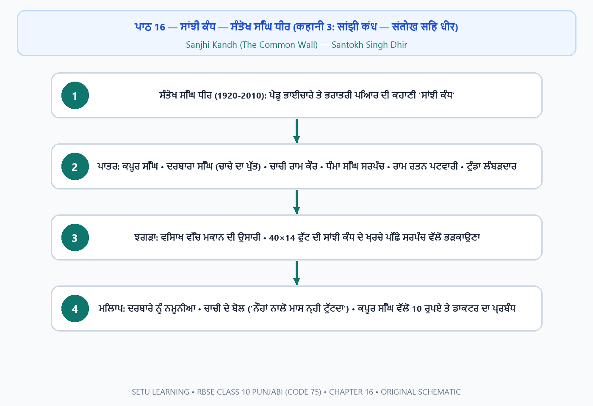

# ਪਾਠ 16 — ਸਾਂਝੀ ਕੰਧ — ਸੰਤੋਖ ਸਿੰਘ ਧੀਰ (कहानी 3: सांझी कंध — संतोख सिंह धीर) (Sanjhi Kandh (The Common Wall) — Santokh Singh Dhir)

## भाग 1: अध्याय प्रवेश एवं पाठ्यक्रम मैपिंग (ਪਾਠ-ਪ੍ਰਵੇਸ਼ ਅਤੇ ਪਾਠਕ੍ਰਮ ਮੈਪਿੰਗ)

> ਪਹਿਲਾ ਸੰਪਾਦਕੀ ਪ੍ਰਾਰੂਪ (प्रथम संपादकीय प्रारूप)। RBSE ਜਮਾਤ 10 ਪੰਜਾਬੀ ਪਾਠ-ਪੁਸਤਕ 'ਸਾਹਿਤ ਸੁਗੰਧੀਆਂ' ਦੇ ਸਾਰੇ ਪ੍ਰਸ਼ਨਾਂ ਦੇ ਹੱਲ ਅਤੇ 2014–2026 ਦਾ ਪੂਰਾ ਇਤਿਹਾਸਕ PYQ ਸੰਗ੍ਰਹਿ ਸਰੋਤ-ਪ੍ਰੀਖਣ ਸਮੇਤ ਸੰਕਲਿਤ ਹਨ।

**ਵਿਸ਼ਾ ਕੋਡ (विषय कोड):** 75 (ਤੀਜੀ ਭਾਸ਼ਾ — ਪੰਜਾਬੀ / तृतीया भाषा — पंजाबी) · **ਲੜੀ ਪੁਸਤਕ (श्रृंखला पुस्तक):** 7

**ਪ੍ਰਮਾਣਿਤ ਆਧਾਰ:** RBSE 2025–26 · **ਪਾਠ ਅੰਕ-ਭਾਰ:** 3 ਅੰਕ। ਇਹ ਭਾਰ ਉਸੇ ਸੰਸਕਰਣ ਦਾ ਹੈ; ਅਸਲ ਪ੍ਰਸ਼ਨ-ਵੰਡ ਦੀ ਭਵਿੱਖਬਾਣੀ ਨਹੀਂ।

**ਸਿੱਖਣ ਦੇ ਉਦੇਸ਼ (सीखने के लक्ष्य):** ਸੰਤੋਖ ਸਿੰਘ ਧੀਰ ਦੀ ਕਹਾਣੀ 'ਸਾਂਝੀ ਕੰਧ' ਦਾ ਸਾਰ, ਕਪੂਰ ਸਿੰਘ ਅਤੇ ਚਾਚੇ ਦੇ ਪੁੱਤਰ ਦਰਬਾਰਾ ਸਿੰਘ ਵਿਚਕਾਰ ਕੰਧ ਦਾ ਝਗੜਾ, ਧੰਮਾ ਸਿੰਘ ਸਰਪੰਚ ਦੀ ਚੁਸਤੀ, ਰਾਮ ਰਤਨ ਪਟਵਾਰੀ, ਟੁੰਡਾ ਲੰਬੜਦਾਰ, ਚਾਚੀ ਰਾਮ ਕੌਰ ਅਤੇ ਦਰਬਾਰੇ ਦੀ ਬਿਮਾਰੀ ਵੇਲੇ ਭਰਾਤਰੀ ਪਿਆਰ ਦੀ ਜਿੱਤ ਨੂੰ ਸਮਝਣਾ।

## भाग 2: शब्दावली एवं अवधारणा कैप्सूल (ਸ਼ਬਦਾਵਲੀ ਅਤੇ ਸੰਕਲਪ ਕੈਪਸੂਲ)

| ਸ਼ਬਦ / ਸੰਕਲਪ | ਅਰਥ / ਵਿਆਖਿਆ |
|---|---|
| ਸਾਂਝੀ ਕੰਧ (सांझी कंध) | ਦੋ ਗੁਆਂਢੀ ਘਰਾਂ ਦੇ ਵਿਚਕਾਰਲੀ ਸਾਂਝੀ ਦੀਵਾਰ (ਇਸ ਕਹਾਣੀ ਵਿੱਚ ਕਪੂਰ ਸਿੰਘ ਤੇ ਦਰਬਾਰਾ ਸਿੰਘ ਦੇ ਘਰਾਂ ਵਿਚਕਾਰ 40 ਫੁੱਟ ਲੰਮੀ ਤੇ 14 ਫੁੱਟ ਉੱਚੀ ਕੰਧ)। |
| ਵਿਸਾਖ (विसाख) | ਪੰਜਾਬੀ ਦੇਸੀ ਮਹੀਨਾ (ਅਪ੍ਰੈਲ-ਮਈ) ਜਦੋਂ ਕਪੂਰ ਸਿੰਘ ਨੇ ਆਪਣਾ ਢੱਠਾ ਹੋਇਆ ਘਰ ਦੁਬਾਰਾ ਬਣਾਉਣਾ ਸ਼ੁਰੂ ਕੀਤਾ। |
| ਗਹਿਣੇ ਪਾਉਣਾ (गहिणे पाउणा) | ਜ਼ਮੀਨ ਜਾਂ ਗਹਿਣਾ ਗਿਰਵੀ ਰੱਖ ਕੇ ਕਰਜ਼ਾ ਲੈਣਾ (ਕਪੂਰ ਸਿੰਘ ਨੇ ਘਰ ਬਣਾਉਣ ਲਈ 10 ਵਿੱਘੇ ਪੈਲੀ ਗਹਿਣੇ ਪਾਈ)। |
| ਪੰਚਾਇਤ (पंचायत) | ਪਿੰਡ ਦੇ ਪਤਵੰਤਿਆਂ ਦੀ ਸਭਾ ਜਿਸ ਵਿੱਚ ਸਰਪੰਚ ਧੰਮਾ ਸਿੰਘ, ਟੁੰਡਾ ਲੰਬੜਦਾਰ, ਰਾਮ ਰਤਨ ਪਟਵਾਰੀ ਅਤੇ ਨਾਹਰ ਸਿੰਘ ਅਕਾਲੀ ਸ਼ਾਮਲ ਸਨ। |
| ਨਮੂਨੀਆ / ਮਿਆਦੀ ਬੁਖ਼ਾਰ (नमूनीआ) | ਦਰਬਾਰਾ ਸਿੰਘ ਨੂੰ ਠੰਢ ਦੀ ਸੀੜ੍ਹ ਵਿੱਚ ਆਉਣ ਕਾਰਨ ਹੋਇਆ ਭਿਆਨਕ ਬੁਖ਼ਾਰ ਜਿਸ ਨਾਲ ਉਹ ਸੁੱਕ ਕੇ ਪਿੰਜਰ ਬਣ ਗਿਆ। |
| ਨੌਹਾਂ ਨਾਲੋਂ ਮਾਸ ਨਹੀਂ ਟੁੱਟਦਾ (नौहां नालों मास नहीं टुट्टदा) | ਚਾਚੀ ਰਾਮ ਕੌਰ ਵੱਲੋਂ ਕਪੂਰ ਸਿੰਘ ਨੂੰ ਕਿਹਾ ਗਿਆ ਮੁਹਾਵਰਾ ਕਿ ਖ਼ੂਨ ਦੇ ਰਿਸ਼ਤੇ ਕਦੇ ਖਤਮ ਨਹੀਂ ਹੁੰਦੇ। |
| ਚੁਗਾਠ ਬਚ ਰਹੇ, ਬਾਣ ਬਥੇਰਾ (चुगाठ बच रहे, बाण बथेरा) | ਕਪੂਰ ਸਿੰਘ ਵੱਲੋਂ ਬਿਮਾਰ ਦਰਬਾਰੇ ਨੂੰ ਦਿੱਤਾ ਗਿਆ ਹੌਸਲਾ ਕਿ ਜੇ ਸਰੀਰ (ਜਾਨ) ਬਚਿਆ ਰਹੇ ਤਾਂ ਕੰਮ-ਕਾਰ ਤੇ ਪੈਸਾ ਫਿਰ ਬਣ ਜਾਂਦੇ ਹਨ। |

## भाग 3: विस्तृत शिक्षण पाठ (ਵਿਸਤ੍ਰਿਤ ਅਧਿਆਪਨ ਪਾਠ)

### 1. ਕਹਾਣੀਕਾਰ-ਪਰਿਚਯ: ਸੰਤੋਖ ਸਿੰਘ ਧੀਰ (1920–2010 ਈ.)

| ਤੱਥ (Fact) | ਵੇਰਵਾ (Details) |
|---|---|
| **ਜਨਮ ਅਤੇ ਮਾਤਾ-ਪਿਤਾ** | **2 ਦਸੰਬਰ 1920 ਈ.**; ਪਿੰਡ **ਡਡਹੇੜੀ** (ਜ਼ਿਲ੍ਹਾ ਫ਼ਤਿਹਗੜ੍ਹ ਸਾਹਿਬ / ਲੁਧਿਆਣਾ); ਪਿਤਾ **ਈਸ਼ਰ ਸਿੰਘ**, ਮਾਤਾ **ਮਾਇਆ ਦੇਵੀ** |
| **ਪ੍ਰਮੁੱਖ ਕਹਾਣੀ-ਸੰਗ੍ਰਹਿ** | *ਸਿੱਟਿਆਂ ਦੀ ਛਾਂ*, *ਸਵੇਰ ਹੋਣ ਤੱਕ*, *ਸਾਂਝੀ ਕੰਧ*, *ਸ਼ਰਾਬ ਦਾ ਗਲਾਸ*, *ਊਸ਼ਾ ਭੈਣ ਜੀ*, *ਪੱਖੀ*, *ਇੱਕ ਕੁੱਤਾ ਤੇ ਮੈਂ* |
| **ਪੁਰਸਕਾਰ** | ਕਹਾਣੀ-ਸੰਗ੍ਰਹਿ **'ਪੱਖੀ'** ਲਈ **ਭਾਰਤੀ ਸਾਹਿਤ ਅਕਾਦਮੀ ਪੁਰਸਕਾਰ (1996)**; ਭਾਸ਼ਾ ਵਿਭਾਗ ਪੰਜਾਬ ਵੱਲੋਂ ਸ਼੍ਰੋਮਣੀ ਸਾਹਿਤਕਾਰ ਪੁਰਸਕਾਰ |
| **ਕਹਾਣੀ-ਕਲਾ** | ਨਿਮਨ ਕਿਸਾਨੀ, ਪੇਂਡੂ ਭਾਈਚਾਰੇ, ਆਰਥਿਕ ਤੰਗੀ ਅਤੇ ਮਨੁੱਖੀ ਸੰਵੇਦਨਾਵਾਂ ਦਾ ਯਥਾਰਥਵਾਦੀ ਚਿਤਰਣ। |

---

### 2. ਪਾਠ-ਸਾਰ: 'ਸਾਂਝੀ ਕੰਧ' (ਕਪੂਰ ਸਿੰਘ ਅਤੇ ਦਰਬਾਰਾ ਸਿੰਘ)

1. **ਕਪੂਰ ਸਿੰਘ ਦੇ ਘਰ ਦਾ ਢਹਿਣਾ ਅਤੇ ਨਵੀਂ ਉਸਾਰੀ:** ਪਿਛਲੇ ਵਰ੍ਹੇ ਦੀਆਂ ਭਾਰੀ ਬਾਰਿਸ਼ਾਂ ਵਿੱਚ **ਕਪੂਰ ਸਿੰਘ** ਦਾ ਕੱਚਾ ਕੋਠਾ ਢਹਿ ਗਿਆ ਸੀ। ਗਿਆਰਾਂ ਮਹੀਨੇ ਉਸ ਨੇ ਚਾਰ ਪਰੈਣੀਆਂ (ਪਰਿਵਾਰ) ਤੇ ਪਸ਼ੂਆਂ ਸਮੇਤ ਬੜੀ ਤੰਗੀ ਕੱਟੀ। **ਵਿਸਾਖ** ਦੇ ਮਹੀਨੇ ਉਸ ਨੇ ਆਪਣੀ **10 ਵਿੱਘੇ ਪੈਲੀ ਗਹਿਣੇ ਪਾ ਕੇ** ਅਤੇ ਕਰਜ਼ਾ ਲੈ ਕੇ ਪੱਕਾ ਮਕਾਨ ਬਣਾਉਣਾ ਸ਼ੁਰੂ ਕੀਤਾ।
2. **ਸਾਂਝੀ ਕੰਧ ਦਾ ਮਸਲਾ:** ਕਪੂਰ ਸਿੰਘ ਦੇ ਘਰ ਦੇ ਸੱਜੇ ਪਾਸੇ **ਚਾਚੀ ਰਾਮ ਕੌਰ** ਦਾ ਘਰ ਸੀ, ਪਿੱਛੇ **ਚੰਨਣ ਸਿੰਘ ਚੀਨੀਏ** ਦਾ ਘਰ ਸੀ ਅਤੇ ਖੱਬੇ ਪਾਸੇ ਉਸ ਦੇ ਚਾਚੇ ਦੇ ਪੁੱਤਰ **ਦਰਬਾਰਾ ਸਿੰਘ** ਦਾ ਘਰ ਸੀ। ਕਪੂਰ ਸਿੰਘ ਅਤੇ ਦਰਬਾਰੇ ਦੇ ਘਰਾਂ ਵਿਚਕਾਰਲੀ **ਸਾਂਝੀ ਕੰਧ** ਕੱਚੀ ਅਤੇ ਖਸਤਾ ਸੀ। ਕਪੂਰ ਸਿੰਘ ਚਾਹੁੰਦਾ ਸੀ ਕਿ ਉਹ ਕੰਧ ਪੱਕੀ ਉਸਾਰ ਲਵੇ ਅਤੇ ਦਰਬਾਰਾ ਸਿੰਘ ਉਸ ਦਾ **ਅੱਧਾ ਖ਼ਰਚਾ** ਦੇ ਦੇਵੇ।
3. **ਧੰਮਾ ਸਿੰਘ ਸਰਪੰਚ ਦੀ ਚੁਸਤੀ ਅਤੇ ਝਗੜਾ:** ਦਰਬਾਰਾ ਸਿੰਘ ਆਰਥਿਕ ਤੌਰ 'ਤੇ ਤੰਗ ਸੀ ਪਰ ਪਿੰਡ ਦਾ **ਸਰਪੰਚ ਧੰਮਾ ਸਿੰਘ** ਕਪੂਰ ਸਿੰਘ ਨਾਲ ਖਾਰ ਖਾਂਦਾ ਸੀ। ਸਰਪੰਚ ਦੀ ਸ਼ਹਿ (ਖੰਘੂਰੇ ਦੇ ਇਸ਼ਾਰੇ) ਉੱਤੇ ਦਰਬਾਰੇ ਨੇ ਕੰਧ ਦਾ ਖ਼ਰਚਾ ਦੇਣ ਤੋਂ ਨਾਂਹ ਕਰ ਦਿੱਤੀ। ਕਪੂਰ ਸਿੰਘ ਨੇ ਕਿਹਾ ਕਿ ਉਹ ਹੁਣ ਪੈਸੇ ਆਪ ਲਾ ਲੈਂਦਾ ਹੈ, ਦਰਬਾਰਾ ਦੋ-ਚਾਰ ਛਿਮਾਹੀਆਂ ਵਿੱਚ ਦੇ ਦੇਵੇ, ਪਰ ਗੱਲ ਵਧ ਗਈ ਤੇ ਦੋਹਾਂ ਵਿੱਚ ਡਾਂਗਾਂ ਖੜਕ ਪਈਆਂ।
4. **ਪੰਚਾਇਤ ਦਾ ਫ਼ੈਸਲਾ:** ਪਿੰਡ ਦੀ ਪੰਚਾਇਤ ਜੁੜੀ ਜਿਸ ਵਿੱਚ **ਧੰਮਾ ਸਿੰਘ ਸਰਪੰਚ**, **ਟੁੰਡਾ ਲੰਬੜਦਾਰ**, **ਰਾਮ ਰਤਨ ਪਟਵਾਰੀ** ਅਤੇ **ਨਾਹਰ ਸਿੰਘ ਅਕਾਲੀ** ਸ਼ਾਮਲ ਸਨ (RBSE 2026 Supp Q3-IX)। ਪੰਚਾਇਤ ਨੇ ਫ਼ੈਸਲਾ ਕੀਤਾ ਕਿ **40 ਫੁੱਟ ਲੰਮੀ, 14 ਫੁੱਟ ਉੱਚੀ ਅਤੇ ਡੇਢ ਇੱਟ ਚੌੜੀ** ਪੱਕੀ ਕੰਧ ਕਪੂਰ ਸਿੰਘ ਬਣਾਵੇਗਾ ਅਤੇ ਦਰਬਾਰਾ ਸਿੰਘ ਉਸ ਨੂੰ **250 ਰੁਪਏ (ਦੋ ਕਿਸ਼ਤਾਂ ਵਿੱਚ — ਹਾੜ੍ਹੀ ਤੇ ਸੌਣੀ)** ਦੇਵੇਗਾ। ਕੰਧ ਬਣ ਗਈ ਪਰ ਦੋਹਾਂ ਭਰਾਵਾਂ ਵਿੱਚ ਬੋਲ-ਚਾਲ ਬੰਦ ਹੋ ਗਈ।
5. **ਦਰਬਾਰੇ ਦੀ ਬਿਮਾਰੀ ਅਤੇ ਭਰਾਤਰੀ ਪਿਆਰ ਦੀ ਜਿੱਤ:** ਸਰਦੀਆਂ ਵਿੱਚ ਦਰਬਾਰਾ ਸਿੰਘ ਨੂੰ **ਨਮੂਨੀਆ (ਤੇ ਫਿਰ ਮਿਆਦੀ ਬੁਖ਼ਾਰ)** ਹੋ ਗਿਆ। ਪੰਦਰਾਂ ਦਿਨ ਬਿਨਾਂ ਇਲਾਜ ਦੇ ਮੰਜੇ 'ਤੇ ਪਏ ਰਹਿਣ ਕਾਰਨ ਉਹ ਸੁੱਕ ਕੇ ਪਿੰਜਰ ਬਣ ਗਿਆ। ਜਦੋਂ **ਚਾਚੀ ਰਾਮ ਕੌਰ** ਨੇ ਕਪੂਰ ਸਿੰਘ ਨੂੰ ਦੱਸਿਆ ਤੇ ਕਿਹਾ — **"ਨੌਹਾਂ ਨਾਲੋਂ ਮਾਸ ਨ੍ਹੀਂ ਟੁੱਟਦਾ ਕਦੇ ਸਾਊ!"** ਤਾਂ ਕਪੂਰ ਸਿੰਘ ਦਾ ਦਿਲ ਪਸੀਜ ਗਿਆ। ਉਹ ਦਰਬਾਰੇ ਦੇ ਘਰ ਗਿਆ, ਉਸ ਦੇ ਮੰਜੇ ਦੀ ਬਾਹੀ 'ਤੇ ਬੈਠ ਕੇ ਹੌਸਲਾ ਦਿੱਤਾ (**"ਸਭ ਦੂਰ ਹੋ ਜੂ; ਚੁਗਾਠ ਬਚ ਰਹੇ, ਬਾਣ ਬਥੇਰਾ!"**), ਆਪਣੀ ਜੇਬ ਵਿੱਚੋਂ **10 ਰੁਪਏ ਦਾ ਨੋਟ** ਕੱਢ ਕੇ ਦਰਬਾਰੇ ਦੀ ਜੇਬ ਵਿੱਚ ਪਾਇਆ ਅਤੇ ਮੰਡੀਓਂ ਡਾਕਟਰ ਭੇਜਣ ਦੀ ਗੱਲ ਕਹੀ।
6. **ਅੰਤਿਮ ਮਿਲਾਪ:** ਦਰਬਾਰੇ ਦੀਆਂ ਅੱਖਾਂ ਭਰ ਆਈਆਂ। ਉਸ ਨੇ ਮੰਨਿਆ ਕਿ ਉਸ ਨੂੰ ਤਾਂ ਸਰਪੰਚ ਭਖਾਉਂਦਾ ਰਿਹਾ ਸੀ ਅਤੇ ਆਪਣੀ ਧੀ **ਹਰਬੰਸੋ (ਬੰਸੋ)** ਦੇ ਹਾੜ੍ਹ ਦੇ ਮਹੀਨੇ ਵਿਆਹ ਦੀ ਸਲਾਹ ਕਪੂਰ ਸਿੰਘ ਨਾਲ ਕੀਤੀ। ਦੋਹਾਂ ਭਰਾਵਾਂ ਦੀਆਂ ਅੱਖਾਂ ਵਿੱਚੋਂ ਪਿਆਰ ਦੇ ਹੰਝੂ ਵਹਿ ਤੁਰੇ ਅਤੇ ਦਿਲਾਂ ਦੀ ਕੰਧ ਢਹਿ ਗਈ।

ਪਾਠ 16: ਸੰਤੋਖ ਸਿੰਘ ਧੀਰ ਦੀ ਕਹਾਣੀ 'ਸਾਂਝੀ ਕੰਧ' ਦਾ ਸੰਕਲਪ ਚਿੱਤਰ

## भाग 4: पाठ्यपुस्तक-अवधारणाओं पर मौलिक हल किए उदाहरण (ਹੱਲ ਕੀਤੇ ਮਿਆਰੀ ਉਦਾਹਰਣ)

ਹੇਠਾਂ ਦਿੱਤੇ ਪ੍ਰਸ਼ਨ ਪਾਠ-ਪੁਸਤਕ 'ਸਾਹਿਤ ਸੁਗੰਧੀਆਂ' ਅਤੇ ਵਿਆਕਰਣ ਦੇ ਸੰਕਲਪਾਂ ਉੱਤੇ ਆਧਾਰਿਤ ਮੌਲਿਕ ਆਦਰਸ਼ ਹੱਲ ਹਨ।

**ਹੱਲ ਕੀਤਾ ਉਦਾਹਰਣ 1: ਕਪੂਰ ਸਿੰਘ ਨੇ ਆਪਣਾ ਨਵਾਂ ਮਕਾਨ ਕਦੋਂ ਅਤੇ ਕਿਵੇਂ ਬਣਾਉਣਾ ਸ਼ੁਰੂ ਕੀਤਾ?**

ਪਿਛਲੇ ਸਾਲ ਦੀਆਂ ਬਾਰਿਸ਼ਾਂ ਵਿੱਚ ਕਪੂਰ ਸਿੰਘ ਦਾ ਘਰ ਢਹਿ ਗਿਆ ਸੀ। ਉਸ ਨੇ ਵਿਸਾਖ ਦੇ ਮਹੀਨੇ ਆਪਣੀ 10 ਵਿੱਘੇ ਪੈਲੀ ਗਹਿਣੇ ਪਾ ਕੇ ਨਵਾਂ ਮਕਾਨ ਬਣਾਉਣਾ ਸ਼ੁਰੂ ਕੀਤਾ (RBSE 2023 Main Q1-vii)।

**ਹੱਲ ਕੀਤਾ ਉਦਾਹਰਣ 2: 'ਸਾਂਝੀ ਕੰਧ' ਕਹਾਣੀ ਵਿੱਚ ਪਟਵਾਰੀ, ਸਰਪੰਚ ਅਤੇ ਲੰਬੜਦਾਰ ਦੇ ਕੀ ਨਾਂ ਸਨ? (RBSE 2026 Supp Q3-IX)**

ਪਟਵਾਰੀ ਦਾ ਨਾਂ 'ਰਾਮ ਰਤਨ', ਸਰਪੰਚ ਦਾ ਨਾਂ 'ਧੰਮਾ ਸਿੰਘ' ਅਤੇ ਲੰਬੜਦਾਰ ਦਾ ਨਾਂ 'ਟੁੰਡਾ ਲੰਬੜਦਾਰ' ਸੀ।

**ਹੱਲ ਕੀਤਾ ਉਦਾਹਰਣ 3: ਚਾਚੀ ਰਾਮ ਕੌਰ ਨੇ ਕਪੂਰ ਸਿੰਘ ਨੂੰ ਦਰਬਾਰੇ ਦੀ ਬਿਮਾਰੀ ਬਾਰੇ ਦੱਸਦੇ ਹੋਏ ਕਿਹੜਾ ਮੁਹਾਵਰਾ ਵਰਤਿਆ?**

ਚਾਚੀ ਰਾਮ ਕੌਰ ਨੇ ਕਿਹਾ — 'ਨੌਹਾਂ ਨਾਲੋਂ ਮਾਸ ਨ੍ਹੀਂ ਟੁੱਟਦਾ ਕਦੇ ਸਾਊ!' ਭਾਵ ਖ਼ੂਨ ਦੇ ਰਿਸ਼ਤੇ ਕਦੇ ਵੀ ਟੁੱਟਦੇ ਨਹੀਂ ਹਨ।

## भाग 5: सत्यापित बोर्ड प्रश्न एवं स्रोत-स्थिति (ਪ੍ਰਮਾਣਿਤ ਬੋਰਡ ਪ੍ਰਸ਼ਨ ਅਤੇ ਸਰੋਤ-ਸਥਿਤੀ)

RBSE 2026 Main (`S-75`, Q13), 2026 Supp (Q3-IX), 2025 Main (Q3-xi, Q17), 2024 Main (Q1-vii, Q3-xi) ਅਤੇ 2023 Main (Q1-vii, Q17) ਵਿੱਚ 'ਸਾਂਝੀ ਕੰਧ' ਕਹਾਣੀ ਦੇ ਪ੍ਰਸ਼ਨ ਪੁੱਛੇ ਗਏ ਹਨ।

[RBSE 2026 ਮੂਲ ਪੇਪਰ (S-75)](https://rajeduboard.rajasthan.gov.in/books/PAPERS-2026/Sec/S-75.pdf)। ਪ੍ਰਸ਼ਨ ਦਾ ਸੰਖੇਪ ਵਿਸ਼ਾ-ਸੰਦਰਭ ਹੈ; ਸ਼ਬਦ-ਬ-ਸ਼ਬਦ ਪੁਨਰ-ਮੁਦਰਣ ਨਹੀਂ।

## भाग 6: खंडवार मौलिक अभ्यास बैंक (ਖੰਡ-ਵਾਰ ਮੌਲਿਕ ਅਭਿਆਸ ਬੈਂਕ)

**ਅਭਿਆਸ-ਅੰਕ:** ਵਿਦਿਆਰਥੀਆਂ ਦੇ ਸਵੈ-ਅਭਿਆਸ ਲਈ ਹਨ; ਉੱਤਰ ਪਹਿਲਾਂ ਆਪ ਲਿਖੋ, ਫਿਰ ਭਾਗ 9 ਵੇਖੋ।

## ੳ: ਬਹੁ-ਵਿਕਲਪੀ ਪ੍ਰਸ਼ਨ (MCQ) — 15 × 1 ਅੰਕ

**MCQ 1. ਕਪੂਰ ਸਿੰਘ ਨੇ ਮਕਾਨ ਕਦੋਂ ਬਣਾਉਣਾ ਸ਼ੁਰੂ ਕੀਤਾ? (RBSE 2023 Main Q1-vii)**

ੳ) ਵਿਸਾਖ ਦੇ ਮਹੀਨੇ ਵਿੱਚ  
ਅ) ਹਾੜ੍ਹ ਦੇ ਮਹੀਨੇ ਵਿੱਚ  
ੲ) ਪੋਹ ਦੇ ਮਹੀਨੇ ਵਿੱਚ  
ਸ) ਚੇਤ ਦੇ ਮਹੀਨੇ ਵਿੱਚ

**MCQ 2. 'ਸਾਂਝੀ ਕੰਧ' ਕਹਾਣੀ ਕਿਸ ਦੀ ਰਚਨਾ ਹੈ? (RBSE 2024 Main Q1-vii)**

ੳ) ਕੁਲਵੰਤ ਸਿੰਘ ਵਿਰਕ  
ਅ) ਗੁਰਬਚਨ ਸਿੰਘ ਭੁੱਲਰ  
ੲ) ਸੰਤ ਸਿੰਘ ਸੇਖੋਂ  
ਸ) ਸੰਤੋਖ ਸਿੰਘ ਧੀਰ

**MCQ 3. ਕਪੂਰ ਸਿੰਘ ਅਤੇ ਦਰਬਾਰਾ ਸਿੰਘ ਦਾ ਆਪਸ ਵਿੱਚ ਕੀ ਰਿਸ਼ਤਾ ਸੀ?**

ੳ) ਸਕੇ ਭਰਾ  
ਅ) ਜੀਜਾ-ਸਾਲਾ  
ੲ) ਚਾਚੇ-ਤਾਏ ਦੇ ਪੁੱਤਰ (ਭਰਾ)  
ਸ) ਮਾਮੇ-ਭੂਆ ਦੇ ਪੁੱਤਰ

**MCQ 4. ਕਪੂਰ ਸਿੰਘ ਨੂੰ ਦਰਬਾਰੇ ਦੇ ਕਪੂਰ ਸਿੰਘ ਵਿਰੁੱਧ ਭੜਕਾਉਣ ਵਾਲਾ ਕੌਣ ਸੀ?**

ੳ) ਚੰਨਣ ਸਿੰਘ ਚੀਨੀਆ  
ਅ) ਧੰਮਾ ਸਿੰਘ ਸਰਪੰਚ  
ੲ) ਰਾਮ ਰਤਨ ਪਟਵਾਰੀ  
ਸ) ਚਾਚੀ ਰਾਮ ਕੌਰ

**MCQ 5. 'ਸਾਂਝੀ ਕੰਧ' ਕਹਾਣੀ ਵਿੱਚ ਪਟਵਾਰੀ, ਸਰਪੰਚ ਅਤੇ ਲੰਬੜਦਾਰ ਦੇ ਨਾਂ ਕੀ ਸਨ? (RBSE 2026 Supp Q3-IX)**

ੳ) ਰਾਮ ਰਤਨ ਪਟਵਾਰੀ, ਧੰਮਾ ਸਿੰਘ ਸਰਪੰਚ ਅਤੇ ਟੁੰਡਾ ਲੰਬੜਦਾਰ  
ਅ) ਹਰਨਾਮ ਸਿੰਘ ਪਟਵਾਰੀ ਤੇ ਬਚਨ ਸਿੰਘ ਸਰਪੰਚ  
ੲ) ਕਰਤਾਰ ਸਿੰਘ ਤੇ ਦਿਆਲ ਸਿੰਘ  
ਸ) ਲਾਲ ਸਿੰਘ ਤੇ ਜੱਗਰ ਸਿੰਘ

**MCQ 6. "ਸਭ ਦੂਰ ਹੋ ਜੂ; ਚੁਗਾਠ ਬਚ ਰਹੇ, ਬਾਣ ਬਥੇਰਾ!" — ਇਹ ਸ਼ਬਦ ਕਿਸ ਨੇ ਕਿਸ ਨੂੰ ਕਹੇ? (RBSE 2025 Main Q3-xi)**

ੳ) ਚਾਚੀ ਰਾਮ ਕੌਰ ਨੇ ਕਪੂਰ ਸਿੰਘ ਨੂੰ  
ਅ) ਸਰਪੰਚ ਨੇ ਦਰਬਾਰੇ ਨੂੰ  
ੲ) ਦਰਬਾਰੇ ਨੇ ਹਰਬੰਸੋ ਨੂੰ  
ਸ) ਕਪੂਰ ਸਿੰਘ ਨੇ ਦਰਬਾਰਾ ਸਿੰਘ ਨੂੰ

**MCQ 7. ਦਰਬਾਰਾ ਸਿੰਘ ਨੂੰ ਕਿਹੜੀ ਬਿਮਾਰੀ ਹੋ ਗਈ ਸੀ?**

ੳ) ਦਮਾ  
ਅ) ਮਲੇਰੀਆ  
ੲ) ਨਮੂਨੀਆ ਅਤੇ ਮਿਆਦੀ ਬੁਖ਼ਾਰ  
ਸ) ਹੈਜ਼ਾ

**MCQ 8. ਕਪੂਰ ਸਿੰਘ ਨੂੰ ਦਰਬਾਰੇ ਦੀ ਬਿਮਾਰੀ ਬਾਰੇ ਕਿਸ ਨੇ ਦੱਸਿਆ?**

ੳ) ਨਾਹਰ ਸਿੰਘ ਅਕਾਲੀ ਨੇ  
ਅ) ਚਾਚੀ ਰਾਮ ਕੌਰ ਨੇ  
ੲ) ਧੰਮਾ ਸਿੰਘ ਸਰਪੰਚ ਨੇ  
ਸ) ਰਾਮ ਰਤਨ ਪਟਵਾਰੀ ਨੇ

**MCQ 9. ਚਾਚੀ ਰਾਮ ਕੌਰ ਨੇ ਕਪੂਰ ਸਿੰਘ ਨੂੰ ਕਿਹੜਾ ਮੁਹਾਵਰਾ ਕਹਿ ਕੇ ਸਮਝਾਇਆ?**

ੳ) ਨੌਹਾਂ ਨਾਲੋਂ ਮਾਸ ਨ੍ਹੀਂ ਟੁੱਟਦਾ  
ਅ) ਦੁੱਧ ਦਾ ਦੁੱਧ ਤੇ ਪਾਣੀ ਦਾ ਪਾਣੀ  
ੲ) ਸੱਪ ਵੀ ਮਰ ਜਾਵੇ ਤੇ ਲਾਠੀ ਵੀ ਬਚ ਜਾਵੇ  
ਸ) ਇੱਕ ਚੁੱਪ ਸੌ ਸੁੱਖ

**MCQ 10. ਕਪੂਰ ਸਿੰਘ ਨੇ ਮਕਾਨ ਬਣਾਉਣ ਲਈ ਆਪਣੀ ਕਿੰਨੀ ਪੈਲੀ ਗਹਿਣੇ ਪਾਈ ਸੀ?**

ੳ) 5 ਵਿੱਘੇ  
ਅ) 20 ਵਿੱਘੇ  
ੲ) 15 ਘੁਮਾਂ  
ਸ) 10 ਵਿੱਘੇ

**MCQ 11. ਕਪੂਰ ਸਿੰਘ ਨੇ ਬਿਮਾਰ ਦਰਬਾਰੇ ਦੀ ਜੇਬ ਵਿੱਚ ਕਿੰਨੇ ਰੁਪਏ ਦਾ ਨੋਟ ਪਾਇਆ?**

ੳ) 50 ਰੁਪਏ ਦਾ  
ਅ) 5 ਰੁਪਏ ਦਾ  
ੲ) 10 ਰੁਪਏ ਦਾ  
ਸ) 100 ਰੁਪਏ ਦਾ

**MCQ 12. ਦਰਬਾਰਾ ਸਿੰਘ ਦੀ ਧੀ ਦਾ ਕੀ ਨਾਂ ਸੀ ਜਿਸ ਦੇ ਵਿਆਹ ਦੀ ਗੱਲ ਅੰਤ ਵਿੱਚ ਹੁੰਦੀ ਹੈ?**

ੳ) ਵੀਰਾਂਵਾਲੀ  
ਅ) ਹਰਬੰਸੋ (ਬੰਸੋ)  
ੲ) ਕੁਲਵੰਤੋ  
ਸ) ਪੇਮੀ

**MCQ 13. ਪੰਚਾਇਤ ਦੇ ਫ਼ੈਸਲੇ ਅਨੁਸਾਰ ਸਾਂਝੀ ਕੰਧ ਦੀ ਲੰਬਾਈ ਅਤੇ ਉਚਾਈ ਕਿੰਨੀ ਸੀ?**

ੳ) 40 ਫੁੱਟ ਲੰਮੀ ਅਤੇ 14 ਫੁੱਟ ਉੱਚੀ (ਡੇਢ ਇੱਟ ਚੌੜੀ)  
ਅ) 20 ਫੁੱਟ ਲੰਮੀ ਤੇ 8 ਫੁੱਟ ਉੱਚੀ  
ੲ) 60 ਫੁੱਟ ਲੰਮੀ ਤੇ 20 ਫੁੱਟ ਉੱਚੀ  
ਸ) 10 ਫੁੱਟ ਲੰਮੀ ਤੇ 5 ਫੁੱਟ ਉੱਚੀ

**MCQ 14. ਕਪੂਰ ਸਿੰਘ ਦਾ ਕੱਚਾ ਘਰ ਕਿਵੇਂ ਢਹਿ ਗਿਆ ਸੀ?**

ੳ) ਭੂਚਾਲ ਨਾਲ  
ਅ) ਅੱਗ ਲੱਗਣ ਨਾਲ  
ੲ) ਹਨੇਰੀ ਨਾਲ  
ਸ) ਪਿਛਲੇ ਸਾਲ ਦੀਆਂ ਭਾਰੀ ਬਾਰਿਸ਼ਾਂ ਨਾਲ

**MCQ 15. ਸੰਤੋਖ ਸਿੰਘ ਧੀਰ ਨੂੰ 1996 ਵਿੱਚ ਕਿਸ ਕਹਾਣੀ-ਸੰਗ੍ਰਹਿ ਲਈ ਭਾਰਤੀ ਸਾਹਿਤ ਅਕਾਦਮੀ ਪੁਰਸਕਾਰ ਮਿਲਿਆ?**

ੳ) ਸਵੇਰ ਹੋਣ ਤੱਕ  
ਅ) ਸ਼ਰਾਬ ਦਾ ਗਲਾਸ  
ੲ) ਪੱਖੀ  
ਸ) ਸਿੱਟਿਆਂ ਦੀ ਛਾਂ

## ੳ: ਖਾਲੀ ਥਾਵਾਂ ਭਰੋ — 6 × 1 ਅੰਕ

1. ਦੋ ਗੁਆਂਢੀ ਘਰਾਂ ਦੇ ਵਿਚਕਾਰਲੀ ਸਾਂਝੀ ਦੀਵਾਰ (ਇਸ ਕਹਾਣੀ ਵਿੱਚ ਕਪੂਰ ਸਿੰਘ ਤੇ ਦਰਬਾਰਾ ਸਿੰਘ ਦੇ ਘਰਾਂ ਵਿਚਕਾਰ 40 ਫੁੱਟ ਲੰਮੀ ਤੇ 14 ਫੁੱਟ ਉੱਚੀ ਕੰਧ)। — ਇਸ ਸ਼ਬਦ/ਸੰਕਲਪ ਦਾ ਨਾਂ ਹੈ: ____।  
2. ਪੰਜਾਬੀ ਦੇਸੀ ਮਹੀਨਾ (ਅਪ੍ਰੈਲ-ਮਈ) ਜਦੋਂ ਕਪੂਰ ਸਿੰਘ ਨੇ ਆਪਣਾ ਢੱਠਾ ਹੋਇਆ ਘਰ ਦੁਬਾਰਾ ਬਣਾਉਣਾ ਸ਼ੁਰੂ ਕੀਤਾ। — ਇਸ ਸ਼ਬਦ/ਸੰਕਲਪ ਦਾ ਨਾਂ ਹੈ: ____।  
3. ਜ਼ਮੀਨ ਜਾਂ ਗਹਿਣਾ ਗਿਰਵੀ ਰੱਖ ਕੇ ਕਰਜ਼ਾ ਲੈਣਾ (ਕਪੂਰ ਸਿੰਘ ਨੇ ਘਰ ਬਣਾਉਣ ਲਈ 10 ਵਿੱਘੇ ਪੈਲੀ ਗਹਿਣੇ ਪਾਈ)। — ਇਸ ਸ਼ਬਦ/ਸੰਕਲਪ ਦਾ ਨਾਂ ਹੈ: ____।  
4. ਪਿੰਡ ਦੇ ਪਤਵੰਤਿਆਂ ਦੀ ਸਭਾ ਜਿਸ ਵਿੱਚ ਸਰਪੰਚ ਧੰਮਾ ਸਿੰਘ, ਟੁੰਡਾ ਲੰਬੜਦਾਰ, ਰਾਮ ਰਤਨ ਪਟਵਾਰੀ ਅਤੇ ਨਾਹਰ ਸਿੰਘ ਅਕਾਲੀ ਸ਼ਾਮਲ ਸਨ। — ਇਸ ਸ਼ਬਦ/ਸੰਕਲਪ ਦਾ ਨਾਂ ਹੈ: ____।  
5. ਦਰਬਾਰਾ ਸਿੰਘ ਨੂੰ ਠੰਢ ਦੀ ਸੀੜ੍ਹ ਵਿੱਚ ਆਉਣ ਕਾਰਨ ਹੋਇਆ ਭਿਆਨਕ ਬੁਖ਼ਾਰ ਜਿਸ ਨਾਲ ਉਹ ਸੁੱਕ ਕੇ ਪਿੰਜਰ ਬਣ ਗਿਆ। — ਇਸ ਸ਼ਬਦ/ਸੰਕਲਪ ਦਾ ਨਾਂ ਹੈ: ____।  
6. ਚਾਚੀ ਰਾਮ ਕੌਰ ਵੱਲੋਂ ਕਪੂਰ ਸਿੰਘ ਨੂੰ ਕਿਹਾ ਗਿਆ ਮੁਹਾਵਰਾ ਕਿ ਖ਼ੂਨ ਦੇ ਰਿਸ਼ਤੇ ਕਦੇ ਖਤਮ ਨਹੀਂ ਹੁੰਦੇ। — ਇਸ ਸ਼ਬਦ/ਸੰਕਲਪ ਦਾ ਨਾਂ ਹੈ: ____।

## ੳ: ਅਤਿ-ਲਘੂ ਉੱਤਰਾਂ ਵਾਲੇ ਪ੍ਰਸ਼ਨ — 8 × 1 ਅੰਕ

1. ਕਪੂਰ ਸਿੰਘ ਨੇ ਮਕਾਨ ਕਦੋਂ ਬਣਾਉਣਾ ਸ਼ੁਰੂ ਕੀਤਾ? (RBSE 2023 Main Q1-vii)  
2. 'ਸਾਂਝੀ ਕੰਧ' ਕਹਾਣੀ ਕਿਸ ਦੀ ਰਚਨਾ ਹੈ? (RBSE 2024 Main Q1-vii)  
3. ਕਪੂਰ ਸਿੰਘ ਅਤੇ ਦਰਬਾਰਾ ਸਿੰਘ ਦਾ ਆਪਸ ਵਿੱਚ ਕੀ ਰਿਸ਼ਤਾ ਸੀ?  
4. ਕਪੂਰ ਸਿੰਘ ਨੂੰ ਦਰਬਾਰੇ ਦੇ ਕਪੂਰ ਸਿੰਘ ਵਿਰੁੱਧ ਭੜਕਾਉਣ ਵਾਲਾ ਕੌਣ ਸੀ?  
5. 'ਸਾਂਝੀ ਕੰਧ' ਕਹਾਣੀ ਵਿੱਚ ਪਟਵਾਰੀ, ਸਰਪੰਚ ਅਤੇ ਲੰਬੜਦਾਰ ਦੇ ਨਾਂ ਕੀ ਸਨ? (RBSE 2026 Supp Q3-IX)  
6. "ਸਭ ਦੂਰ ਹੋ ਜੂ; ਚੁਗਾਠ ਬਚ ਰਹੇ, ਬਾਣ ਬਥੇਰਾ!" — ਇਹ ਸ਼ਬਦ ਕਿਸ ਨੇ ਕਿਸ ਨੂੰ ਕਹੇ? (RBSE 2025 Main Q3-xi)  
7. ਦਰਬਾਰਾ ਸਿੰਘ ਨੂੰ ਕਿਹੜੀ ਬਿਮਾਰੀ ਹੋ ਗਈ ਸੀ?  
8. ਕਪੂਰ ਸਿੰਘ ਨੂੰ ਦਰਬਾਰੇ ਦੀ ਬਿਮਾਰੀ ਬਾਰੇ ਕਿਸ ਨੇ ਦੱਸਿਆ?

## ਅ: ਲਘੂ ਉੱਤਰਾਂ ਵਾਲੇ ਪ੍ਰਸ਼ਨ — 4 × 2 ਅੰਕ

**B1.** ਕਪੂਰ ਸਿੰਘ ਨੇ ਮਕਾਨ ਕਦੋਂ ਬਣਾਉਣਾ ਸ਼ੁਰੂ ਕੀਤਾ? (RBSE 2023 Main Q1-vii)

**B2.** 'ਸਾਂਝੀ ਕੰਧ' ਕਹਾਣੀ ਕਿਸ ਦੀ ਰਚਨਾ ਹੈ? (RBSE 2024 Main Q1-vii)

**B3.** ਕਪੂਰ ਸਿੰਘ ਦੇ ਗੁਆਂਢੀ ਕੌਣ-ਕੌਣ ਸਨ? (RBSE 2024 Main Q3-xi)

**B4.** 'ਸਾਂਝੀ ਕੰਧ' ਕਹਾਣੀ ਵਿੱਚ ਪਟਵਾਰੀ, ਸਰਪੰਚ ਅਤੇ ਲੰਬੜਦਾਰ ਦੇ ਨਾਂ ਦੱਸੋ। (RBSE 2026 Supp Q3-IX)

## ੲ: ਦੀਰਘ ਉੱਤਰਾਂ ਵਾਲੇ ਪ੍ਰਸ਼ਨ — 2 × 3 ਅੰਕ

ਅੰਦਰੂਨੀ ਵਿਕਲਪ ਅਭਿਆਸ: ਪਹਿਲਾਂ ਇੱਕ ਵਿਕਲਪ ਹੱਲ ਕਰੋ ਅਤੇ ਦੁਹਰਾਈ ਵੇਲੇ ਬਾਕੀ ਪ੍ਰਸ਼ਨ ਵੀ ਹੱਲ ਕਰੋ।

**C1.** "ਸਭ ਦੂਰ ਹੋ ਜੂ; ਚੁਗਾਠ ਬਚ ਰਹੇ, ਬਾਣ ਬਥੇਰਾ!" ਇਹ ਸ਼ਬਦ ਕਿਸ ਨੇ ਕਿਸ ਨੂੰ ਕਹੇ? (RBSE 2025 Main Q3-xi)

**C2.** 'ਸਾਂਝੀ ਕੰਧ' ਦਾ ਝਗੜਾ ਕਿਨ੍ਹਾਂ ਵਿਚਕਾਰ ਸੀ ਅਤੇ ਕਿਉਂ? (RBSE 2020 Main Q8-ਟ, 2026 Main Q13)

## ਸ: ਨਿਬੰਧਾਤਮਕ / ਵਿਸਤ੍ਰਿਤ ਉੱਤਰਾਂ ਵਾਲੇ ਪ੍ਰਸ਼ਨ — 2 × 4 ਅੰਕ

ਅੰਦਰੂਨੀ ਵਿਕਲਪ ਅਭਿਆਸ: D1 ਜਾਂ D2 ਚੁਣੋ; ਬਾਅਦ ਵਿੱਚ ਦੂਜਾ ਵੀ ਹੱਲ ਕਰੋ।

**D1.** 'ਸਾਂਝੀ ਕੰਧ' ਕਹਾਣੀ ਕਿਸ ਪੇਂਡੂ ਸਮੱਸਿਆ ਵੱਲ ਸੰਕੇਤ ਕਰਦੀ ਹੈ? (RBSE 2018 Supp Q8-ੲ, 2020 Supp Q8-ਟ)

**D2.** 'ਸਾਂਝੀ ਕੰਧ' ਕਹਾਣੀ ਦਾ ਸਾਰ ਜਾਂ ਕਪੂਰ ਸਿੰਘ ਦਾ ਪਾਤਰ-ਚਿਤਰਣ ਲਿਖੋ। (RBSE 2019 Main Q10, 2020 Supp Q10, 2023 Main Q17, 2025 Main Q17)

## भाग 7: सावधानियाँ एवं परीक्षा-त्रुटियाँ (ਸਾਵਧਾਨੀਆਂ ਅਤੇ ਪ੍ਰੀਖਿਆ-ਗ਼ਲਤੀਆਂ)

- **ਗ਼ਲਤੀ 1:** 'ਸਾਂਝੀ ਕੰਧ' ਅਤੇ 'ਦੁੱਧ ਦਾ ਛੱਪੜ' ਦੇ ਪਾਤਰਾਂ ਵਿੱਚ ਉਲਝਣ — ਯਾਦ ਰੱਖੋ: **ਕਪੂਰ ਸਿੰਘ ਅਤੇ ਦਰਬਾਰਾ ਸਿੰਘ** 'ਸਾਂਝੀ ਕੰਧ' (ਸੰਤੋਖ ਸਿੰਘ ਧੀਰ) ਦੇ ਪਾਤਰ ਹਨ, ਜਦੋਂਕਿ **ਲਾਲ ਅਤੇ ਦਿਆਲ** 'ਦੁੱਧ ਦਾ ਛੱਪੜ' (ਕੁਲਵੰਤ ਸਿੰਘ ਵਿਰਕ) ਦੇ ਪਾਤਰ ਹਨ।
- **ਗ਼ਲਤੀ 2:** ਪੰਚਾਇਤ ਦੇ ਤਿੰਨ ਅਹੁਦੇਦਾਰਾਂ ਦੇ ਨਾਂ ਭੁੱਲ ਜਾਣਾ — **ਰਾਮ ਰਤਨ ਪਟਵਾਰੀ**, **ਧੰਮਾ ਸਿੰਘ ਸਰਪੰਚ** ਅਤੇ **ਟੁੰਡਾ ਲੰਬੜਦਾਰ** (RBSE 2026 Supp Q3-IX)।

## भाग 8: फटाफट पुनरावृत्ति — 25 बिंदु (ਫਟਾਫਟ ਦੁਹਰਾਈ — 25 ਬਿੰਦੂ)

1. ਸਾਂਝੀ ਕੰਧ (सांझी कंध): ਦੋ ਗੁਆਂਢੀ ਘਰਾਂ ਦੇ ਵਿਚਕਾਰਲੀ ਸਾਂਝੀ ਦੀਵਾਰ (ਇਸ ਕਹਾਣੀ ਵਿੱਚ ਕਪੂਰ ਸਿੰਘ ਤੇ ਦਰਬਾਰਾ ਸਿੰਘ ਦੇ ਘਰਾਂ ਵਿਚਕਾਰ 40 ਫੁੱਟ ਲੰਮੀ ਤੇ 14 ਫੁੱਟ ਉੱਚੀ ਕੰਧ)।  
2. ਵਿਸਾਖ (विसाख): ਪੰਜਾਬੀ ਦੇਸੀ ਮਹੀਨਾ (ਅਪ੍ਰੈਲ-ਮਈ) ਜਦੋਂ ਕਪੂਰ ਸਿੰਘ ਨੇ ਆਪਣਾ ਢੱਠਾ ਹੋਇਆ ਘਰ ਦੁਬਾਰਾ ਬਣਾਉਣਾ ਸ਼ੁਰੂ ਕੀਤਾ।  
3. ਗਹਿਣੇ ਪਾਉਣਾ (गहिणे पाउणा): ਜ਼ਮੀਨ ਜਾਂ ਗਹਿਣਾ ਗਿਰਵੀ ਰੱਖ ਕੇ ਕਰਜ਼ਾ ਲੈਣਾ (ਕਪੂਰ ਸਿੰਘ ਨੇ ਘਰ ਬਣਾਉਣ ਲਈ 10 ਵਿੱਘੇ ਪੈਲੀ ਗਹਿਣੇ ਪਾਈ)।  
4. ਪੰਚਾਇਤ (पंचायत): ਪਿੰਡ ਦੇ ਪਤਵੰਤਿਆਂ ਦੀ ਸਭਾ ਜਿਸ ਵਿੱਚ ਸਰਪੰਚ ਧੰਮਾ ਸਿੰਘ, ਟੁੰਡਾ ਲੰਬੜਦਾਰ, ਰਾਮ ਰਤਨ ਪਟਵਾਰੀ ਅਤੇ ਨਾਹਰ ਸਿੰਘ ਅਕਾਲੀ ਸ਼ਾਮਲ ਸਨ।  
5. ਨਮੂਨੀਆ / ਮਿਆਦੀ ਬੁਖ਼ਾਰ (नमूनीआ): ਦਰਬਾਰਾ ਸਿੰਘ ਨੂੰ ਠੰਢ ਦੀ ਸੀੜ੍ਹ ਵਿੱਚ ਆਉਣ ਕਾਰਨ ਹੋਇਆ ਭਿਆਨਕ ਬੁਖ਼ਾਰ ਜਿਸ ਨਾਲ ਉਹ ਸੁੱਕ ਕੇ ਪਿੰਜਰ ਬਣ ਗਿਆ।  
6. ਨੌਹਾਂ ਨਾਲੋਂ ਮਾਸ ਨਹੀਂ ਟੁੱਟਦਾ (नौहां नालों मास नहीं टुट्टदा): ਚਾਚੀ ਰਾਮ ਕੌਰ ਵੱਲੋਂ ਕਪੂਰ ਸਿੰਘ ਨੂੰ ਕਿਹਾ ਗਿਆ ਮੁਹਾਵਰਾ ਕਿ ਖ਼ੂਨ ਦੇ ਰਿਸ਼ਤੇ ਕਦੇ ਖਤਮ ਨਹੀਂ ਹੁੰਦੇ।  
7. ਚੁਗਾਠ ਬਚ ਰਹੇ, ਬਾਣ ਬਥੇਰਾ (चुगाठ बच रहे, बाण बथेरा): ਕਪੂਰ ਸਿੰਘ ਵੱਲੋਂ ਬਿਮਾਰ ਦਰਬਾਰੇ ਨੂੰ ਦਿੱਤਾ ਗਿਆ ਹੌਸਲਾ ਕਿ ਜੇ ਸਰੀਰ (ਜਾਨ) ਬਚਿਆ ਰਹੇ ਤਾਂ ਕੰਮ-ਕਾਰ ਤੇ ਪੈਸਾ ਫਿਰ ਬਣ ਜਾਂਦੇ ਹਨ।  
8. ਕਪੂਰ ਸਿੰਘ ਨੇ ਵਿਸਾਖ ਦੇ ਮਹੀਨੇ ਮਕਾਨ ਬਣਾਉਣਾ ਸ਼ੁਰੂ ਕੀਤਾ ਸੀ (RBSE 2023 Main Q1-vii)।  
9. 'ਸਾਂਝੀ ਕੰਧ' ਕਹਾਣੀ ਸੰਤੋਖ ਸਿੰਘ ਧੀਰ ਦੀ ਰਚਨਾ ਹੈ (RBSE 2024 Main Q1-vii)।  
10. ਕਪੂਰ ਸਿੰਘ ਅਤੇ ਦਰਬਾਰਾ ਸਿੰਘ ਚਾਚੇ-ਤਾਏ ਦੇ ਪੁੱਤਰ ਸਨ।  
11. ਪਿੰਡ ਦਾ ਸਰਪੰਚ ਧੰਮਾ ਸਿੰਘ ਦਰਬਾਰੇ ਨੂੰ ਕਪੂਰ ਸਿੰਘ ਵਿਰੁੱਧ ਭਖਾਉਂਦਾ ਸੀ।  
12. ਕਹਾਣੀ ਵਿੱਚ ਰਾਮ ਰਤਨ ਪਟਵਾਰੀ, ਧੰਮਾ ਸਿੰਘ ਸਰਪੰਚ ਅਤੇ ਟੁੰਡਾ ਲੰਬੜਦਾਰ ਸਨ (RBSE 2026 Supp Q3-IX)।  
13. ਇਹ ਸ਼ਬਦ ਕਪੂਰ ਸਿੰਘ ਨੇ ਬਿਮਾਰ ਪਏ ਦਰਬਾਰਾ ਸਿੰਘ ਨੂੰ ਹੌਸਲਾ ਦਿੰਦੇ ਹੋਏ ਕਹੇ (RBSE 2025 Main Q3-xi)।  
14. ਠੰਢ ਦੀ ਸੀੜ੍ਹ ਵਿੱਚ ਆਉਣ ਕਾਰਨ ਦਰਬਾਰੇ ਨੂੰ ਨਮੂਨੀਆ ਤੇ ਮਿਆਦੀ ਬੁਖ਼ਾਰ ਹੋ ਗਿਆ ਸੀ।  
15. ਗੁਆਂਢਣ ਚਾਚੀ ਰਾਮ ਕੌਰ ਨੇ ਕਪੂਰ ਸਿੰਘ ਨੂੰ ਦਰਬਾਰੇ ਦੀ ਬਿਮਾਰੀ ਬਾਰੇ ਦੱਸਿਆ।  
16. ਚਾਚੀ ਰਾਮ ਕੌਰ ਨੇ ਕਿਹਾ ਸੀ — 'ਨੌਹਾਂ ਨਾਲੋਂ ਮਾਸ ਨ੍ਹੀਂ ਟੁੱਟਦਾ ਕਦੇ ਸਾਊ!'  
17. ਕਪੂਰ ਸਿੰਘ ਨੇ ਆਪਣੀ 10 ਵਿੱਘੇ ਪੈਲੀ ਗਹਿਣੇ ਪਾ ਕੇ ਮਕਾਨ ਸ਼ੁਰੂ ਕੀਤਾ ਸੀ।  
18. ਕਪੂਰ ਸਿੰਘ ਨੇ ਡਾਕਟਰੀ ਇਲਾਜ ਲਈ ਦਰਬਾਰੇ ਦੀ ਜੇਬ ਵਿੱਚ 10 ਰੁਪਏ ਦਾ ਨੋਟ ਪਾਇਆ।  
19. ਦਰਬਾਰੇ ਦੀ ਧੀ ਦਾ ਨਾਂ ਹਰਬੰਸੋ (ਬੰਸੋ) ਸੀ ਜੋ ਬਾਪੂ ਦੀਆਂ ਵੱਖੀਆਂ ਨੂੰ ਲੋਗੜ ਨਾਲ ਸੇਕ ਦੇ ਰਹੀ ਸੀ।  
20. ਪੰਚਾਇਤ ਨੇ 40 ਫੁੱਟ ਲੰਮੀ, 14 ਫੁੱਟ ਉੱਚੀ ਤੇ ਡੇਢ ਇੱਟ ਚੌੜੀ ਕੰਧ ਦਾ ਹਿਸਾਬ ਲਾਇਆ ਸੀ।  
21. ਪਿਛਲੇ ਵਰ੍ਹੇ ਦੀਆਂ ਬਾਰਿਸ਼ਾਂ ਵਿੱਚ ਕਪੂਰ ਸਿੰਘ ਦਾ ਘਰ ਢਹਿ ਗਿਆ ਸੀ।  
22. ਸੰਤੋਖ ਸਿੰਘ ਧੀਰ ਨੂੰ 'ਪੱਖੀ' ਕਹਾਣੀ-ਸੰਗ੍ਰਹਿ ਲਈ ਸਾਹਿਤ ਅਕਾਦਮੀ ਪੁਰਸਕਾਰ ਮਿਲਿਆ।  
23. ਕਪੂਰ ਸਿੰਘ ਨੇ ਆਪਣਾ ਨਵਾਂ ਮਕਾਨ ਕਦੋਂ ਅਤੇ ਕਿਵੇਂ ਬਣਾਉਣਾ ਸ਼ੁਰੂ ਕੀਤਾ? — ਪਿਛਲੇ ਸਾਲ ਦੀਆਂ ਬਾਰਿਸ਼ਾਂ ਵਿੱਚ ਕਪੂਰ ਸਿੰਘ ਦਾ ਘਰ ਢਹਿ ਗਿਆ ਸੀ। ਉਸ ਨੇ ਵਿਸਾਖ ਦੇ ਮਹੀਨੇ ਆਪਣੀ 10 ਵਿੱਘੇ ਪੈਲੀ ਗਹਿਣੇ ਪਾ ਕੇ ਨਵਾਂ ਮਕਾਨ ਬਣਾਉਣਾ ਸ਼ੁਰੂ ਕੀਤਾ (RBSE 2023 Main Q1-vii)।  
24. 'ਸਾਂਝੀ ਕੰਧ' ਕਹਾਣੀ ਵਿੱਚ ਪਟਵਾਰੀ, ਸਰਪੰਚ ਅਤੇ ਲੰਬੜਦਾਰ ਦੇ ਕੀ ਨਾਂ ਸਨ? (RBSE 2026 Supp Q3-IX) — ਪਟਵਾਰੀ ਦਾ ਨਾਂ 'ਰਾਮ ਰਤਨ', ਸਰਪੰਚ ਦਾ ਨਾਂ 'ਧੰਮਾ ਸਿੰਘ' ਅਤੇ ਲੰਬੜਦਾਰ ਦਾ ਨਾਂ 'ਟੁੰਡਾ ਲੰਬੜਦਾਰ' ਸੀ।  
25. ਚਾਚੀ ਰਾਮ ਕੌਰ ਨੇ ਕਪੂਰ ਸਿੰਘ ਨੂੰ ਦਰਬਾਰੇ ਦੀ ਬਿਮਾਰੀ ਬਾਰੇ ਦੱਸਦੇ ਹੋਏ ਕਿਹੜਾ ਮੁਹਾਵਰਾ ਵਰਤਿਆ? — ਚਾਚੀ ਰਾਮ ਕੌਰ ਨੇ ਕਿਹਾ — 'ਨੌਹਾਂ ਨਾਲੋਂ ਮਾਸ ਨ੍ਹੀਂ ਟੁੱਟਦਾ ਕਦੇ ਸਾਊ!' ਭਾਵ ਖ਼ੂਨ ਦੇ ਰਿਸ਼ਤੇ ਕਦੇ ਵੀ ਟੁੱਟਦੇ ਨਹੀਂ ਹਨ।

## भाग 9: संपूर्ण अभ्यास उत्तर-कुंजी (ਸੰਪੂਰਨ ਅਭਿਆਸ ਉੱਤਰ-ਕੁੰਜੀ)

## MCQ: ਸਹੀ ਵਿਕਲਪ ਅਤੇ ਕਾਰਨ

**1. ੳ — ਵਿਸਾਖ ਦੇ ਮਹੀਨੇ ਵਿੱਚ।** ਕਪੂਰ ਸਿੰਘ ਨੇ ਵਿਸਾਖ ਦੇ ਮਹੀਨੇ ਮਕਾਨ ਬਣਾਉਣਾ ਸ਼ੁਰੂ ਕੀਤਾ ਸੀ (RBSE 2023 Main Q1-vii)।

**2. ਸ — ਸੰਤੋਖ ਸਿੰਘ ਧੀਰ।** 'ਸਾਂਝੀ ਕੰਧ' ਕਹਾਣੀ ਸੰਤੋਖ ਸਿੰਘ ਧੀਰ ਦੀ ਰਚਨਾ ਹੈ (RBSE 2024 Main Q1-vii)।

**3. ੲ — ਚਾਚੇ-ਤਾਏ ਦੇ ਪੁੱਤਰ (ਭਰਾ)।** ਕਪੂਰ ਸਿੰਘ ਅਤੇ ਦਰਬਾਰਾ ਸਿੰਘ ਚਾਚੇ-ਤਾਏ ਦੇ ਪੁੱਤਰ ਸਨ।

**4. ਅ — ਧੰਮਾ ਸਿੰਘ ਸਰਪੰਚ।** ਪਿੰਡ ਦਾ ਸਰਪੰਚ ਧੰਮਾ ਸਿੰਘ ਦਰਬਾਰੇ ਨੂੰ ਕਪੂਰ ਸਿੰਘ ਵਿਰੁੱਧ ਭਖਾਉਂਦਾ ਸੀ।

**5. ੳ — ਰਾਮ ਰਤਨ ਪਟਵਾਰੀ, ਧੰਮਾ ਸਿੰਘ ਸਰਪੰਚ ਅਤੇ ਟੁੰਡਾ ਲੰਬੜਦਾਰ।** ਕਹਾਣੀ ਵਿੱਚ ਰਾਮ ਰਤਨ ਪਟਵਾਰੀ, ਧੰਮਾ ਸਿੰਘ ਸਰਪੰਚ ਅਤੇ ਟੁੰਡਾ ਲੰਬੜਦਾਰ ਸਨ (RBSE 2026 Supp Q3-IX)।

**6. ਸ — ਕਪੂਰ ਸਿੰਘ ਨੇ ਦਰਬਾਰਾ ਸਿੰਘ ਨੂੰ।** ਇਹ ਸ਼ਬਦ ਕਪੂਰ ਸਿੰਘ ਨੇ ਬਿਮਾਰ ਪਏ ਦਰਬਾਰਾ ਸਿੰਘ ਨੂੰ ਹੌਸਲਾ ਦਿੰਦੇ ਹੋਏ ਕਹੇ (RBSE 2025 Main Q3-xi)।

**7. ੲ — ਨਮੂਨੀਆ ਅਤੇ ਮਿਆਦੀ ਬੁਖ਼ਾਰ।** ਠੰਢ ਦੀ ਸੀੜ੍ਹ ਵਿੱਚ ਆਉਣ ਕਾਰਨ ਦਰਬਾਰੇ ਨੂੰ ਨਮੂਨੀਆ ਤੇ ਮਿਆਦੀ ਬੁਖ਼ਾਰ ਹੋ ਗਿਆ ਸੀ।

**8. ਅ — ਚਾਚੀ ਰਾਮ ਕੌਰ ਨੇ।** ਗੁਆਂਢਣ ਚਾਚੀ ਰਾਮ ਕੌਰ ਨੇ ਕਪੂਰ ਸਿੰਘ ਨੂੰ ਦਰਬਾਰੇ ਦੀ ਬਿਮਾਰੀ ਬਾਰੇ ਦੱਸਿਆ।

**9. ੳ — ਨੌਹਾਂ ਨਾਲੋਂ ਮਾਸ ਨ੍ਹੀਂ ਟੁੱਟਦਾ।** ਚਾਚੀ ਰਾਮ ਕੌਰ ਨੇ ਕਿਹਾ ਸੀ — 'ਨੌਹਾਂ ਨਾਲੋਂ ਮਾਸ ਨ੍ਹੀਂ ਟੁੱਟਦਾ ਕਦੇ ਸਾਊ!'

**10. ਸ — 10 ਵਿੱਘੇ।** ਕਪੂਰ ਸਿੰਘ ਨੇ ਆਪਣੀ 10 ਵਿੱਘੇ ਪੈਲੀ ਗਹਿਣੇ ਪਾ ਕੇ ਮਕਾਨ ਸ਼ੁਰੂ ਕੀਤਾ ਸੀ।

**11. ੲ — 10 ਰੁਪਏ ਦਾ।** ਕਪੂਰ ਸਿੰਘ ਨੇ ਡਾਕਟਰੀ ਇਲਾਜ ਲਈ ਦਰਬਾਰੇ ਦੀ ਜੇਬ ਵਿੱਚ 10 ਰੁਪਏ ਦਾ ਨੋਟ ਪਾਇਆ।

**12. ਅ — ਹਰਬੰਸੋ (ਬੰਸੋ)।** ਦਰਬਾਰੇ ਦੀ ਧੀ ਦਾ ਨਾਂ ਹਰਬੰਸੋ (ਬੰਸੋ) ਸੀ ਜੋ ਬਾਪੂ ਦੀਆਂ ਵੱਖੀਆਂ ਨੂੰ ਲੋਗੜ ਨਾਲ ਸੇਕ ਦੇ ਰਹੀ ਸੀ।

**13. ੳ — 40 ਫੁੱਟ ਲੰਮੀ ਅਤੇ 14 ਫੁੱਟ ਉੱਚੀ (ਡੇਢ ਇੱਟ ਚੌੜੀ)।** ਪੰਚਾਇਤ ਨੇ 40 ਫੁੱਟ ਲੰਮੀ, 14 ਫੁੱਟ ਉੱਚੀ ਤੇ ਡੇਢ ਇੱਟ ਚੌੜੀ ਕੰਧ ਦਾ ਹਿਸਾਬ ਲਾਇਆ ਸੀ।

**14. ਸ — ਪਿਛਲੇ ਸਾਲ ਦੀਆਂ ਭਾਰੀ ਬਾਰਿਸ਼ਾਂ ਨਾਲ।** ਪਿਛਲੇ ਵਰ੍ਹੇ ਦੀਆਂ ਬਾਰਿਸ਼ਾਂ ਵਿੱਚ ਕਪੂਰ ਸਿੰਘ ਦਾ ਘਰ ਢਹਿ ਗਿਆ ਸੀ।

**15. ੲ — ਪੱਖੀ।** ਸੰਤੋਖ ਸਿੰਘ ਧੀਰ ਨੂੰ 'ਪੱਖੀ' ਕਹਾਣੀ-ਸੰਗ੍ਰਹਿ ਲਈ ਸਾਹਿਤ ਅਕਾਦਮੀ ਪੁਰਸਕਾਰ ਮਿਲਿਆ।

**ਖਾਲੀ ਥਾਵਾਂ:** 1. ਸਾਂਝੀ ਕੰਧ (सांझी कंध); 2. ਵਿਸਾਖ (विसाख); 3. ਗਹਿਣੇ ਪਾਉਣਾ (गहिणे पाउणा); 4. ਪੰਚਾਇਤ (पंचायत); 5. ਨਮੂਨੀਆ / ਮਿਆਦੀ ਬੁਖ਼ਾਰ (नमूनीआ); 6. ਨੌਹਾਂ ਨਾਲੋਂ ਮਾਸ ਨਹੀਂ ਟੁੱਟਦਾ (नौहां नालों मास नहीं टुट्टदा)

**ਅਤਿ-ਲਘੂ ਉੱਤਰ:**

1. ਵਿਸਾਖ ਦੇ ਮਹੀਨੇ ਵਿੱਚ। ਕਪੂਰ ਸਿੰਘ ਨੇ ਵਿਸਾਖ ਦੇ ਮਹੀਨੇ ਮਕਾਨ ਬਣਾਉਣਾ ਸ਼ੁਰੂ ਕੀਤਾ ਸੀ (RBSE 2023 Main Q1-vii)।

2. ਸੰਤੋਖ ਸਿੰਘ ਧੀਰ। 'ਸਾਂਝੀ ਕੰਧ' ਕਹਾਣੀ ਸੰਤੋਖ ਸਿੰਘ ਧੀਰ ਦੀ ਰਚਨਾ ਹੈ (RBSE 2024 Main Q1-vii)।

3. ਚਾਚੇ-ਤਾਏ ਦੇ ਪੁੱਤਰ (ਭਰਾ)। ਕਪੂਰ ਸਿੰਘ ਅਤੇ ਦਰਬਾਰਾ ਸਿੰਘ ਚਾਚੇ-ਤਾਏ ਦੇ ਪੁੱਤਰ ਸਨ।

4. ਧੰਮਾ ਸਿੰਘ ਸਰਪੰਚ। ਪਿੰਡ ਦਾ ਸਰਪੰਚ ਧੰਮਾ ਸਿੰਘ ਦਰਬਾਰੇ ਨੂੰ ਕਪੂਰ ਸਿੰਘ ਵਿਰੁੱਧ ਭਖਾਉਂਦਾ ਸੀ।

5. ਰਾਮ ਰਤਨ ਪਟਵਾਰੀ, ਧੰਮਾ ਸਿੰਘ ਸਰਪੰਚ ਅਤੇ ਟੁੰਡਾ ਲੰਬੜਦਾਰ। ਕਹਾਣੀ ਵਿੱਚ ਰਾਮ ਰਤਨ ਪਟਵਾਰੀ, ਧੰਮਾ ਸਿੰਘ ਸਰਪੰਚ ਅਤੇ ਟੁੰਡਾ ਲੰਬੜਦਾਰ ਸਨ (RBSE 2026 Supp Q3-IX)।

6. ਕਪੂਰ ਸਿੰਘ ਨੇ ਦਰਬਾਰਾ ਸਿੰਘ ਨੂੰ। ਇਹ ਸ਼ਬਦ ਕਪੂਰ ਸਿੰਘ ਨੇ ਬਿਮਾਰ ਪਏ ਦਰਬਾਰਾ ਸਿੰਘ ਨੂੰ ਹੌਸਲਾ ਦਿੰਦੇ ਹੋਏ ਕਹੇ (RBSE 2025 Main Q3-xi)।

7. ਨਮੂਨੀਆ ਅਤੇ ਮਿਆਦੀ ਬੁਖ਼ਾਰ। ਠੰਢ ਦੀ ਸੀੜ੍ਹ ਵਿੱਚ ਆਉਣ ਕਾਰਨ ਦਰਬਾਰੇ ਨੂੰ ਨਮੂਨੀਆ ਤੇ ਮਿਆਦੀ ਬੁਖ਼ਾਰ ਹੋ ਗਿਆ ਸੀ।

8. ਚਾਚੀ ਰਾਮ ਕੌਰ ਨੇ। ਗੁਆਂਢਣ ਚਾਚੀ ਰਾਮ ਕੌਰ ਨੇ ਕਪੂਰ ਸਿੰਘ ਨੂੰ ਦਰਬਾਰੇ ਦੀ ਬਿਮਾਰੀ ਬਾਰੇ ਦੱਸਿਆ।

**B1. ਕਪੂਰ ਸਿੰਘ ਨੇ ਮਕਾਨ ਕਦੋਂ ਬਣਾਉਣਾ ਸ਼ੁਰੂ ਕੀਤਾ? (RBSE 2023 Main Q1-vii)**

ਕਪੂਰ ਸਿੰਘ ਨੇ ਵਿਸਾਖ ਦੇ ਮਹੀਨੇ ਵਿੱਚ ਆਪਣਾ ਮਕਾਨ ਬਣਾਉਣਾ ਸ਼ੁਰੂ ਕੀਤਾ।

**B2. 'ਸਾਂਝੀ ਕੰਧ' ਕਹਾਣੀ ਕਿਸ ਦੀ ਰਚਨਾ ਹੈ? (RBSE 2024 Main Q1-vii)**

'ਸਾਂਝੀ ਕੰਧ' ਕਹਾਣੀ ਸੰਤੋਖ ਸਿੰਘ ਧੀਰ ਦੀ ਰਚਨਾ ਹੈ।

**B3. ਕਪੂਰ ਸਿੰਘ ਦੇ ਗੁਆਂਢੀ ਕੌਣ-ਕੌਣ ਸਨ? (RBSE 2024 Main Q3-xi)**

ਕਪੂਰ ਸਿੰਘ ਦੇ ਗੁਆਂਢੀ ਉਸ ਦੇ ਚਾਚੇ ਦਾ ਪੁੱਤਰ ਦਰਬਾਰਾ ਸਿੰਘ (ਖੱਬੇ ਪਾਸੇ), ਚਾਚੀ ਰਾਮ ਕੌਰ (ਸੱਜੇ ਪਾਸੇ) ਅਤੇ ਚੰਨਣ ਸਿੰਘ ਚੀਨੀਆ (ਪਿੱਛੇ) ਸਨ।

**B4. 'ਸਾਂਝੀ ਕੰਧ' ਕਹਾਣੀ ਵਿੱਚ ਪਟਵਾਰੀ, ਸਰਪੰਚ ਅਤੇ ਲੰਬੜਦਾਰ ਦੇ ਨਾਂ ਦੱਸੋ। (RBSE 2026 Supp Q3-IX)**

ਰਾਮ ਰਤਨ ਪਟਵਾਰੀ, ਧੰਮਾ ਸਿੰਘ ਸਰਪੰਚ ਅਤੇ ਟੁੰਡਾ ਲੰਬੜਦਾਰ।

**C1. "ਸਭ ਦੂਰ ਹੋ ਜੂ; ਚੁਗਾਠ ਬਚ ਰਹੇ, ਬਾਣ ਬਥੇਰਾ!" ਇਹ ਸ਼ਬਦ ਕਿਸ ਨੇ ਕਿਸ ਨੂੰ ਕਹੇ? (RBSE 2025 Main Q3-xi)**

ਇਹ ਸ਼ਬਦ ਕਪੂਰ ਸਿੰਘ ਨੇ ਬਿਮਾਰ ਪਏ ਆਪਣੇ ਭਰਾ ਦਰਬਾਰਾ ਸਿੰਘ ਨੂੰ ਹੌਸਲਾ ਦਿੰਦੇ ਹੋਏ ਕਹੇ।

**C2. 'ਸਾਂਝੀ ਕੰਧ' ਦਾ ਝਗੜਾ ਕਿਨ੍ਹਾਂ ਵਿਚਕਾਰ ਸੀ ਅਤੇ ਕਿਉਂ? (RBSE 2020 Main Q8-ਟ, 2026 Main Q13)**

'ਸਾਂਝੀ ਕੰਧ' ਦਾ ਝਗੜਾ ਕਪੂਰ ਸਿੰਘ ਅਤੇ ਉਸ ਦੇ ਚਾਚੇ ਦੇ ਪੁੱਤਰ ਦਰਬਾਰਾ ਸਿੰਘ ਵਿਚਕਾਰ ਸੀ। ਕਪੂਰ ਸਿੰਘ ਘਰ ਬਣਾਉਣ ਵੇਲੇ ਵਿਚਕਾਰਲੀ ਕੱਚੀ ਸਾਂਝੀ ਕੰਧ ਨੂੰ ਪੱਕਾ ਬਣਾਉਣਾ ਚਾਹੁੰਦਾ ਸੀ ਪਰ ਦਰਬਾਰਾ ਸਿੰਘ (ਸਰਪੰਚ ਧੰਮਾ ਸਿੰਘ ਦੀ ਚੁੱਕ ਵਿੱਚ ਆ ਕੇ) ਕੰਧ ਦਾ ਅੱਧਾ ਖ਼ਰਚਾ ਦੇਣ ਤੋਂ ਇਨਕਾਰ ਕਰ ਰਿਹਾ ਸੀ।

**D1. 'ਸਾਂਝੀ ਕੰਧ' ਕਹਾਣੀ ਕਿਸ ਪੇਂਡੂ ਸਮੱਸਿਆ ਵੱਲ ਸੰਕੇਤ ਕਰਦੀ ਹੈ? (RBSE 2018 Supp Q8-ੲ, 2020 Supp Q8-ਟ)**

'ਸਾਂਝੀ ਕੰਧ' ਕਹਾਣੀ ਪੰਜਾਬ ਦੇ ਪਿੰਡਾਂ ਵਿੱਚ ਕਿਸਾਨਾਂ ਦੀ ਆਰਥਿਕ ਤੰਗੀ, ਘਰਾਂ ਦੀਆਂ ਸਾਂਝੀਆਂ ਕੰਧਾਂ/ਵੱਟਾਂ ਦੇ ਮਾਮੂਲੀ ਝਗੜਿਆਂ ਅਤੇ ਪਿੰਡ ਦੇ ਚੌਧਰੀਆਂ/ਸਰਪੰਚਾਂ ਵੱਲੋਂ ਭਰਾਵਾਂ ਨੂੰ ਆਪਸ ਵਿੱਚ ਲੜਾਉਣ ਦੀ ਸਮੱਸਿਆ ਵੱਲ ਸੰਕੇਤ ਕਰਦੀ ਹੈ।

**D2. 'ਸਾਂਝੀ ਕੰਧ' ਕਹਾਣੀ ਦਾ ਸਾਰ ਜਾਂ ਕਪੂਰ ਸਿੰਘ ਦਾ ਪਾਤਰ-ਚਿਤਰਣ ਲਿਖੋ। (RBSE 2019 Main Q10, 2020 Supp Q10, 2023 Main Q17, 2025 Main Q17)**

1. ਕਪੂਰ ਸਿੰਘ ਇੱਕ ਮਿਹਨਤੀ, ਸਬਰ ਵਾਲਾ ਅਤੇ ਭਰਾਤਰੀ ਪਿਆਰ ਨਾਲ ਭਰਪੂਰ ਕਿਸਾਨ ਹੈ। 2. ਘਰ ਢਹਿ ਜਾਣ 'ਤੇ ਉਹ ਕਰਜ਼ਾ ਲੈ ਕੇ ਮਕਾਨ ਬਣਾਉਂਦਾ ਹੈ। ਦਰਬਾਰਾ ਸਿੰਘ ਨਾਲ ਸਾਂਝੀ ਕੰਧ ਪਿੱਛੇ ਝਗੜਾ ਹੋਣ ਦੇ ਬਾਵਜੂਦ ਜਦੋਂ ਉਸ ਨੂੰ ਦਰਬਾਰੇ ਦੇ ਨਮੂਨੀਏ ਨਾਲ ਬਿਮਾਰ ਹੋਣ ਦਾ ਪਤਾ ਲੱਗਦਾ ਹੈ, ਤਾਂ ਉਹ ਪੁਰਾਣਾ ਵੈਰ ਭੁਲਾ ਕੇ ਉਸ ਦੇ ਘਰ ਜਾਂਦਾ ਹੈ, 10 ਰੁਪਏ ਦਿੰਦਾ ਹੈ, ਡਾਕਟਰ ਸੱਦਦਾ ਹੈ ਅਤੇ ਭਤੀਜੀ ਬੰਸੋ ਦੇ ਵਿਆਹ ਦੀ ਜ਼ਿੰਮੇਵਾਰੀ ਵੰਡਾਉਂਦਾ ਹੈ।

## भाग 10: 10 मिनट / 10 अंक आत्म-मूल्यांकन एवं संदर्भ (10 ਮਿੰਟ / 10 ਅੰਕ ਸਵੈ-ਮੁਲਾਂਕਣ)

ਸਮਾਂ: 10 ਮਿੰਟ। ਪਹਿਲਾਂ ਪੁਸਤਕ ਬੰਦ ਕਰੋ।

1. MCQ 3 ਅਤੇ 11 ਹੱਲ ਕਰੋ। (1 + 1)
2. B1 ਅਤੇ B3 ਦੇ ਉੱਤਰ ਲਿਖੋ। (2 + 2)
3. D1 ਹੱਲ ਕਰੋ। (4)

**ਉੱਤਰ-ਕੁੰਜੀ:** ਭਾਗ 9 ਵਿੱਚ ਸੰਬੰਧਿਤ ਕ੍ਰਮਾਂਕ ਵੇਖੋ। **ਸਵੈ-ਮੁਲਾਂਕਣ:** 8–10: ਅੱਗੇ ਵਧੋ; 5–7: ਛੁੱਟੇ ਵਿਸ਼ੇ ਦੀ ਦੁਹਰਾਈ; 0–4: ਭਾਗ 2–4 ਦੁਬਾਰਾ ਪੜ੍ਹੋ।

[ਪ੍ਰਮਾਣਿਤ RBSE 2025–26 ਪਾਠਕ੍ਰਮ](https://rajeduboard.rajasthan.gov.in/anudeshika-etc/10_2026.pdf) · [RBSE ਸਾਹਿਤ ਸੁਗੰਧੀਆਂ ਪਾਠ-ਪੁਸਤਕ PDF](../../artifacts/rbse10_punjabi/reference/textbook_cls10_punjabi.pdf)

**ਅੱਗੇ ਦੀ ਕੜੀ:** ਆਗੇ ਕੀ ਕੜੀ: 'ਸਾਂਝੀ ਕੰਧ' ਤੋਂ ਬਾਅਦ ਪਾਠ 17 ਵਿੱਚ ਅਸੀਂ ਕੁਲਵੰਤ ਸਿੰਘ ਵਿਰਕ ਦੀ ਮਨੋਵਿਗਿਆਨਕ ਕਹਾਣੀ 'ਦੁੱਧ ਦਾ ਛੱਪੜ' ਦਾ ਅਧਿਐਨ ਕਰਾਂਗੇ।
