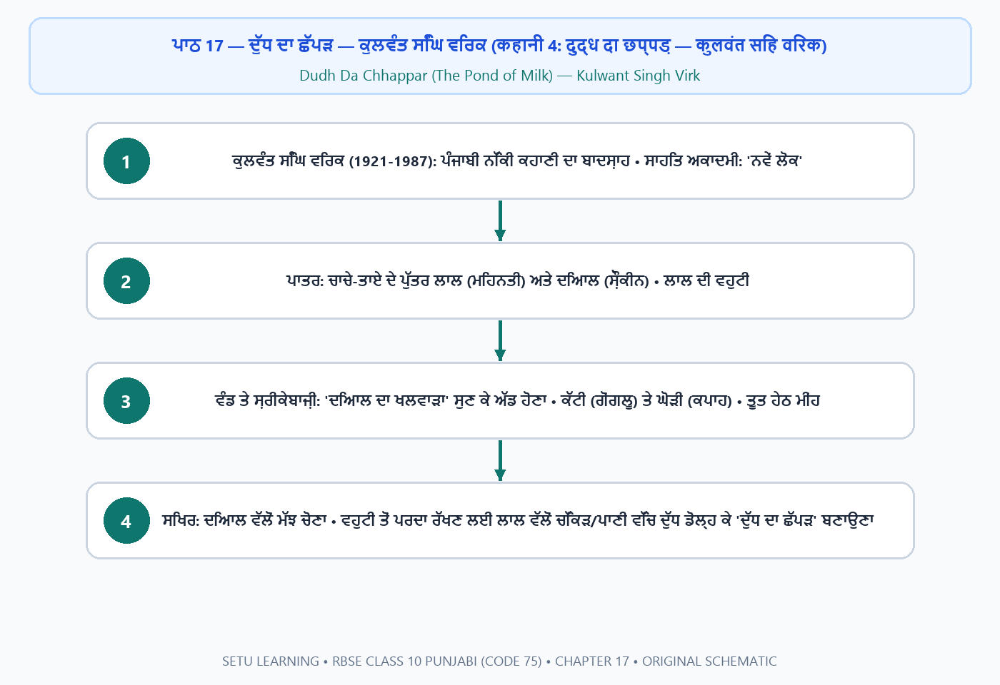

# ਪਾਠ 17 — ਦੁੱਧ ਦਾ ਛੱਪੜ — ਕੁਲਵੰਤ ਸਿੰਘ ਵਿਰਕ (कहानी 4: दुद्ध दा छप्पड़ — कुलवंत सिंह विरक) (Dudh Da Chhappar (The Pond of Milk) — Kulwant Singh Virk)

## भाग 1: अध्याय प्रवेश एवं पाठ्यक्रम मैपिंग (ਪਾਠ-ਪ੍ਰਵੇਸ਼ ਅਤੇ ਪਾਠਕ੍ਰਮ ਮੈਪਿੰਗ)

> RBSE ਜਮਾਤ 10 ਪੰਜਾਬੀ ਪਾਠ-ਪੁਸਤਕ 'ਸਾਹਿਤ ਸੁਗੰਧੀਆਂ' ਦੇ ਸਾਰੇ ਪ੍ਰਸ਼ਨਾਂ ਦੇ ਹੱਲ ਅਤੇ 2014–2026 ਦਾ ਪੂਰਾ ਇਤਿਹਾਸਕ PYQ ਸੰਗ੍ਰਹਿ ਸਰੋਤ-ਪ੍ਰੀਖਣ ਸਮੇਤ ਸੰਕਲਿਤ ਹਨ।

**ਵਿਸ਼ਾ ਕੋਡ (विषय कोड):** 75 (ਤੀਜੀ ਭਾਸ਼ਾ — ਪੰਜਾਬੀ / तृतीया भाषा — पंजाबी) · **ਲੜੀ ਪੁਸਤਕ (श्रृंखला पुस्तक):** 7

**ਪ੍ਰਮਾਣਿਤ ਆਧਾਰ:** RBSE 2025–26 · **ਪਾਠ ਅੰਕ-ਭਾਰ:** 3 ਅੰਕ। ਇਹ ਭਾਰ ਉਸੇ ਸੰਸਕਰਣ ਦਾ ਹੈ; ਅਸਲ ਪ੍ਰਸ਼ਨ-ਵੰਡ ਦੀ ਭਵਿੱਖਬਾਣੀ ਨਹੀਂ।

**ਸਿੱਖਣ ਦੇ ਉਦੇਸ਼ (सीखने के लक्ष्य):** ਕੁਲਵੰਤ ਸਿੰਘ ਵਿਰਕ ਦੀ ਕਹਾਣੀ 'ਦੁੱਧ ਦਾ ਛੱਪੜ' ਦਾ ਸਾਰ, ਚਾਚੇ-ਤਾਏ ਦੇ ਪੁੱਤਰਾਂ ਲਾਲ ਅਤੇ ਦਿਆਲ ਦੀ ਸਾਂਝੀ ਵਾਹੀ, ਅੱਡ ਹੋਣ ਦਾ ਕਾਰਨ, ਸੱਜਰ ਸੂਈ ਮੱਝ ਦਾ ਦਿਆਲ ਨਾਲ ਮੋਹ, ਤੂਤ ਹੇਠ ਮੀਂਹ ਵਿੱਚ ਭਿੱਜਣ ਦੀ ਘਟਨਾ ਅਤੇ ਆਪਣੀ ਹਉਮੈ/ਇੱਜ਼ਤ ਬਚਾਉਣ ਲਈ ਲਾਲ ਵੱਲੋਂ ਗੜਵੇ ਦਾ ਦੁੱਧ ਚਿੱਕੜ ਵਿੱਚ ਡੋਲ੍ਹਣ ਦੇ ਮਨੋਵਿਗਿਆਨ ਨੂੰ ਸਮਝਣਾ।

## भाग 2: शब्दावली एवं अवधारणा कैप्सूल (ਸ਼ਬਦਾਵਲੀ ਅਤੇ ਸੰਕਲਪ ਕੈਪਸੂਲ)

| ਸ਼ਬਦ / ਸੰਕਲਪ | ਅਰਥ / ਵਿਆਖਿਆ |
|---|---|
| ਭਿਆਲੀ (भिआली) | ਸਾਂਝੇਦਾਰੀ (ਲਾਲ ਅਤੇ ਦਿਆਲ ਦੀ ਦੋ ਹਲਾਂ ਦੀ ਸਾਂਝੀ ਖੇਤੀ)। |
| ਖਲਵਾੜਾ (खलवाड़ा) | ਵਾਢੀ ਤੋਂ ਬਾਅਦ ਕਣਕ ਦੀਆਂ ਭਰੀਆਂ ਰੱਖਣ ਤੇ ਗਾਹੁਣ ਦੀ ਥਾਂ (ਜਿਸ ਨੂੰ ਲੁਹਾਰਾਂ ਦੇ ਮੁੰਡੇ ਨੇ 'ਦਿਆਲ ਦਾ ਖਲਵਾੜਾ' ਕਿਹਾ)। |
| ਸੱਜਰ ਸੂਈ ਮੱਝ (सज्जर सूई मज्झ) | ਨਵੀਂ ਸੂਈ ਮੱਝ ਜਿਸ ਦੀ ਕੱਟੀ ਮਰ ਗਈ ਸੀ ਅਤੇ ਜੋ ਕੇਵਲ ਦਿਆਲ ਦੇ ਹੱਥ 'ਤੇ ਹੀ ਪਈ ਹੋਈ ਸੀ (ਦੁੱਧ ਦਿੰਦੀ ਸੀ)। |
| ਪਸਮਾ (पसमा) | ਮੱਝ ਦੇ ਦੁੱਧ ਉਤਾਰਨ (ਪਸਮਾਉਣ) ਦੀ ਕਿਰਿਆ। |
| ਗੜਵਾ ਤੇ ਛੰਨਾ (गड़वा ते छन्ना) | ਦੁੱਧ ਚੋਣ ਅਤੇ ਪੀਣ ਵਾਲੇ ਪਿੱਤਲ/ਕਾਂਸੀ ਦੇ ਪੇਂਡੂ ਭਾਂਡੇ। |
| ਫੁਰਨਾ ਫੁਰਿਆ (फुरना फुरिआ) | ਅਚਾਨਕ ਮਨ ਵਿੱਚ ਨਵੀਂ ਤਰਕੀਬ ਜਾਂ ਜੁਗਤ ਆਉਣੀ। |
| ਦੁੱਧ ਦਾ ਛੱਪੜ (दुद्ध दा छप्पड़) | ਮੀਂਹ ਦੇ ਚਿੱਕੜ ਤੇ ਪਾਣੀ ਦੀਆਂ ਛਪੜੀਆਂ ਵਿੱਚ ਲਾਲ ਵੱਲੋਂ ਡੋਲ੍ਹਿਆ ਗਿਆ ਇੱਕ ਛੰਨਾ ਦੁੱਧ ਜੋ ਫੈਲ ਕੇ ਛੱਪੜ ਵਾਂਗ ਬਹੁਤਾ ਲੱਗਣ ਲੱਗਾ। |

## भाग 3: विस्तृत शिक्षण पाठ (ਵਿਸਤ੍ਰਿਤ ਅਧਿਆਪਨ ਪਾਠ)

### 1. ਕਹਾਣੀਕਾਰ-ਪਰਿਚਯ: ਕੁਲਵੰਤ ਸਿੰਘ ਵਿਰਕ (1921–1987 ਈ.)

| ਤੱਥ (Fact) | ਵੇਰਵਾ (Details) |
|---|---|
| **ਜਨਮ ਅਤੇ ਉਪਾਧੀ** | **21 ਮਾਰਚ 1921 ਈ.**; ਪਿੰਡ **ਫੁਲੇਰਨ** (ਜ਼ਿਲ੍ਹਾ ਸ਼ੇਖੂਪੁਰਾ, ਪਾਕਿਸਤਾਨ); ਪਿਤਾ **ਆਸਾ ਸਿੰਘ**; ਉਪਾਧੀ: **'ਪੰਜਾਬੀ ਨਿੱਕੀ ਕਹਾਣੀ ਦਾ ਬਾਦਸ਼ਾਹ / ਸ਼ਾਹਸਵਾਰ'** |
| **ਪ੍ਰਮੁੱਖ ਕਹਾਣੀ-ਸੰਗ੍ਰਹਿ** | *ਛਾਹ ਵੇਲਾ*, *ਧਰਤੀ ਤੇ ਆਕਾਸ਼*, *ਤੂੜੀ ਦੀ ਪੰਡ*, *ਏਕਸ ਕੇ ਹਮ ਬਾਰਿਕ*, *ਦੁੱਧ ਦਾ ਛੱਪੜ*, *ਗੋਲ੍ਹਾਂ*, *ਨਵੇਂ ਲੋਕ*, *ਆਤਿਸ਼ਬਾਜ਼ੀ* |
| **ਪੁਰਸਕਾਰ** | ਕਹਾਣੀ-ਸੰਗ੍ਰਹਿ **'ਨਵੇਂ ਲੋਕ'** ਲਈ **ਭਾਰਤੀ ਸਾਹਿਤ ਅਕਾਦਮੀ ਪੁਰਸਕਾਰ (1968)** |
| **ਕਹਾਣੀ-ਕਲਾ** | ਸਧਾਰਨ ਮਨੁੱਖ ਦੀਆਂ ਸੂਖਮ ਮਨੋਵਿਗਿਆਨਕ ਗੁੰਝਲਾਂ ਅਤੇ ਹਉਮੈ ਦਾ ਸਹਿਜ ਚਿਤਰਣ। |

---

### 2. ਪਾਠ-ਸਾਰ: 'ਦੁੱਧ ਦਾ ਛੱਪੜ' (ਲਾਲ ਅਤੇ ਦਿਆਲ)

1. **ਲਾਲ ਤੇ ਦਿਆਲ ਦੀ ਸਾਂਝੀ ਵਾਹੀ:** **ਲਾਲ** ਅਤੇ **ਦਿਆਲ** ਚਾਚੇ-ਤਾਏ ਦੇ ਪੁੱਤਰ ਸਨ। ਦੋਹਾਂ ਦੀ ਦੋ ਹਲਾਂ ਦੀ ਵਾਹੀ ਇਕੱਠੀ ਸੀ ਅਤੇ ਪਿੰਡ ਵਿੱਚ ਉਹਨਾਂ ਦੇ ਏਕੇ ਦਾ ਬੜਾ ਰੋਅਬ ਸੀ। ਇੱਕ ਕਾਮਾ ਰੱਖਣ ਨਾਲ ਇੱਕ ਬੰਦੇ ਨੂੰ ਵਿਹਲ ਮਿਲ ਜਾਂਦੀ ਸੀ, ਪਰ ਇਸ ਵਿਹਲ ਦਾ ਸਾਰਾ ਆਨੰਦ ਗੋਰੇ ਰੰਗ ਤੇ ਸੋਹਣੀ ਸ਼ਕਲ ਵਾਲਾ **ਦਿਆਲ** ਹੀ ਮਾਣਦਾ ਸੀ। ਉਹ ਪਿਛਲੇ ਪਹਿਰ ਚਿੱਟੇ ਕੱਪੜੇ ਪਾ ਕੇ ਪਿੰਡ ਵਿੱਚ ਭੌਂਦਾ, ਤਾਸ਼ ਖੇਡਦਾ ਜਾਂ ਅਖ਼ਬਾਰਾਂ ਦੀਆਂ ਖ਼ਬਰਾਂ ਸੁਣਦਾ, ਜਦੋਂਕਿ **ਲਾਲ** ਸਾਰਾ ਦਿਨ ਖੇਤਾਂ ਵਿੱਚ ਮਿੱਟੀ ਨਾਲ ਮਿੱਟੀ ਹੁੰਦਾ ਰਹਿੰਦਾ।
2. **ਲਾਲ ਦੀ ਵਹੁਟੀ ਦੀਆਂ ਸੱਧਰਾਂ ਅਤੇ ਉਲਾਂਭੇ:** ਦਿਆਲ ਨੂੰ ਘਰ ਵਿੱਚ ਫਿਰਦਿਆਂ, ਮੁੰਡੇ ਨੂੰ ਤਰਖਾਣਾਂ ਤੋਂ ਗੱਡੀ ਬਣਵਾ ਕੇ ਦਿੰਦਿਆਂ ਅਤੇ ਆਪਣੀ ਵਹੁਟੀ ਦਾ ਦਾਤਰ ਲੁਹਾਰਾਂ ਤੋਂ ਲੁਆਉਂਦਿਆਂ ਵੇਖ ਕੇ ਲਾਲ ਦੀ ਵਹੁਟੀ ਸੋਚਦੀ ਕਿ ਕਾਸ਼ ਲਾਲ ਵੀ ਸ਼ਾਮ ਵੇਲੇ ਘਰ ਆਵੇ ਤਾਂ ਉਹ ਉਸ ਨੂੰ ਦੁੱਧ ਪਿਆਵੇ ਤੇ ਮਾਇਆ ਲੱਗੀ ਪੱਗ ਬੰਨ੍ਹਾਵੇ। ਰਾਤ ਨੂੰ ਉਹ ਲਾਲ ਨੂੰ ਮਿਹਣਾ ਮਾਰਦੀ — *"ਤੂੰ ਉਹਦਾ ਕਾਮਾ ਰੱਖਿਆ ਹੋਇਆ ਏਂ?"*
3. **ਅੱਡ ਹੋਣ ਦਾ ਕਾਰਨ ('ਦਿਆਲ ਦਾ ਖਲਵਾੜਾ'):** ਵਾਢੀਆਂ ਪਿੱਛੋਂ ਇੱਕ ਦਿਨ ਲੁਹਾਰਾਂ ਦੇ ਮੁੰਡੇ ਜੱਟਾਂ ਤੋਂ ਕਣਕ ਦੀਆਂ ਭਰੀਆਂ ਮੰਗ ਰਹੇ ਸਨ। ਇੱਕ ਮੁੰਡੇ ਨੇ ਕਿਹਾ — **"ਇਹ ਤੇ ਔਥੋਂ ਦਿਆਲ ਦੇ ਖਲਵਾੜੇ ਤੋਂ ਲਿਆਏ ਆਂ।"** ਇਹ ਸੁਣ ਕੇ ਲਾਲ ਦਾ ਲਹੂ ਠੰਢਾ ਹੋ ਗਿਆ ਕਿ ਸਾਂਝੇ ਖਲਵਾੜੇ ਵਿੱਚੋਂ ਉਸ ਦਾ ਨਾਂ ਹੀ ਮਿਟ ਗਿਆ ਹੈ। ਉਸ ਨੇ ਤੁਰੰਤ ਅੱਡ ਹੋਣ ਦਾ ਫ਼ੈਸਲਾ ਕਰ ਲਿਆ।
4. **ਵੈਰ-ਵਿਰੋਧ ਦੀਆਂ ਘਟਨਾਵਾਂ:**
   - **ਗੋਂਗਲੂਆਂ ਤੇ ਕਪਾਹ ਦਾ ਉਲਾਂਭਾ:** ਦਿਆਲ ਦੀ ਕੱਟੀ ਲਾਲ ਦੇ ਗੋਂਗਲੂਆਂ ਵਿੱਚ ਵੜ ਗਈ ਅਤੇ ਅਗਲੇ ਦਿਨ ਲਾਲ ਦੀ ਘੋੜੀ ਨੇ ਦਿਆਲ ਦੀ ਕਪਾਹ ਦੇ ਬੂਟੇ ਭੰਨ ਦਿੱਤੇ।
   - **ਤੂਤ ਹੇਠ ਮੀਂਹ ਵਿੱਚ ਭਿੱਜਣਾ:** ਇੱਕ ਦਿਨ ਮੀਂਹ ਪੈਣ 'ਤੇ ਲਾਲ ਆਪਣੀ ਹਉਮੈ ਕਾਰਨ ਦਿਆਲ ਦੇ ਕੋਠੇ ਵਿੱਚ ਨਾ ਗਿਆ ਸਗੋਂ ਆਪਣੇ ਤੂਤ ਹੇਠ ਬੈਠ ਕੇ ਭਿੱਜਦਾ ਰਿਹਾ। ਪਿੰਡ ਦੇ ਲੋਕ ਕਹਿੰਦੇ ਫਿਰੇ — **"ਉੱਤੇ ਬਗਲੇ ਨ੍ਹਾਉਂਦੇ ਰਹੇ ਤੇ ਹੇਠਾਂ ਲਾਲ ਨਹਾਉਂਦਾ ਰਿਹਾ।"**
   - **ਗੱਡਾ ਮੋੜਨਾ ਅਤੇ ਖਾਲ 'ਤੇ ਟੱਕਰ:** ਲਾਲ ਨੇ ਡਾਂਗ ਫੜ ਕੇ ਆਪਣੀ ਵੱਟ ਤੋਂ ਦਿਆਲ ਦਾ ਰੂੜੀ ਵਾਲਾ ਗੱਡਾ ਮੋੜ ਦਿੱਤਾ ਅਤੇ ਖਾਲ ਉੱਤੇ ਘੋੜੀ ਨੂੰ ਪਾਣੀ ਪਿਆਉਂਦੇ ਹੋਏ ਆਪਣੀ ਵਹੁਟੀ ਅੱਗੇ ਸ਼ੇਖ਼ੀ ਮਾਰੀ।
5. **ਸੱਜਰ ਸੂਈ ਮੱਝ ਅਤੇ 'ਦੁੱਧ ਦਾ ਛੱਪੜ':** ਵੰਡ ਵਿੱਚ ਲਾਲ ਦੇ ਹਿੱਸੇ ਆਈ ਸੱਜਰ ਸੂਈ ਮੱਝ (ਜਿਸ ਦੀ ਕੱਟੀ ਮਰ ਗਈ ਸੀ) ਦਿਆਲ ਦੇ ਹੱਥ 'ਤੇ ਪਈ ਹੋਈ ਸੀ। ਇੱਕ ਕਿਣ-ਮਿਣ ਵਾਲੀ ਰਾਤ ਮੱਝ ਕਿੱਲਾ ਪੁਟਾ ਕੇ ਖੁੱਲ੍ਹ ਗਈ ਅਤੇ ਦਿਆਲ ਨੇ ਸਵੇਰੇ ਹੀ ਉਸ ਨੂੰ ਚੋਅ ਲਿਆ। ਜਦੋਂ ਲਾਲ ਮੱਝ ਚੋਣ ਬੈਠਾ ਤਾਂ ਤਿੰਨ-ਚਾਰ ਛੰਨਿਆਂ ਦੀ ਥਾਂ ਗੜਵੇ ਵਿੱਚ **ਮਸਾਂ ਇੱਕ ਛੰਨਾ ਦੁੱਧ** ਨਿਕਲਿਆ।
6. **ਲਾਲ ਦਾ ਫੁਰਨਾ (ਮਨੋਵਿਗਿਆਨਕ ਸਿਖਰ):** ਲਾਲ ਆਪਣੀ ਵਹੁਟੀ ਸਾਹਮਣੇ ਇਹ ਕਿਵੇਂ ਮੰਨਦਾ ਕਿ ਦਿਆਲ ਉਸ ਦੀ ਮੱਝ ਚੋਅ ਗਿਆ ਹੈ ਤੇ ਉਹ ਚੁੱਪ ਬੈਠਾ ਰਿਹਾ (ਕਿਉਂਕਿ ਦਿਆਲ ਦੇ ਘਰ ਉਸ ਦੇ ਦੋ ਜਵਾਨ ਸਾਲੇ ਆਏ ਹੋਏ ਸਨ)। ਅਚਾਨਕ ਲਾਲ ਨੂੰ **ਇੱਕ ਫੁਰਨਾ ਫੁਰਿਆ** — ਉਸ ਨੇ ਗੜਵੇ ਵਾਲਾ ਇੱਕ ਛੰਨਾ ਦੁੱਧ ਮੀਂਹ ਦੇ ਚਿੱਕੜ ਅਤੇ ਪਾਣੀ ਦੀਆਂ ਛਪੜੀਆਂ ਵਿੱਚ ਮੂਧਾ ਕਰਕੇ ਡੋਲ੍ਹ ਦਿੱਤਾ ਅਤੇ ਵਹੁਟੀ ਨੂੰ ਕਿਹਾ ਕਿ ਮੱਝ ਨੇ ਲੱਤ ਮਾਰ ਕੇ ਗੜਵਾ ਡੋਲ੍ਹ ਦਿੱਤਾ ਹੈ। ਪਾਣੀ ਤੇ ਗਿੱਲ ਵਿੱਚ ਫੈਲਿਆ ਦੁੱਧ ਵੇਖ ਕੇ ਵਹੁਟੀ ਬੋਲੀ — **"ਹਾ...! ਕਿੰਨਾ ਦੁੱਧ ਸੀ। ਛੱਪੜ ਲੱਗਾ ਹੋਇਆ ਏ ਦੁੱਧ ਦਾ!"** ਇਸ ਨਾਲ ਲਾਲ ਦੀ ਹਉਮੈ ਤੇ ਇੱਜ਼ਤ ਦਾ ਪਰਦਾ ਰਹਿ ਗਿਆ।

ਪਾਠ 17: ਕੁਲਵੰਤ ਸਿੰਘ ਵਿਰਕ ਦੀ ਕਹਾਣੀ 'ਦੁੱਧ ਦਾ ਛੱਪੜ' ਦਾ ਸੰਕਲਪ ਚਿੱਤਰ

## भाग 4: पाठ्यपुस्तक-अवधारणाओं पर मौलिक हल किए उदाहरण (ਹੱਲ ਕੀਤੇ ਮਿਆਰੀ ਉਦਾਹਰਣ)

ਹੇਠਾਂ ਦਿੱਤੇ ਪ੍ਰਸ਼ਨ ਪਾਠ-ਪੁਸਤਕ 'ਸਾਹਿਤ ਸੁਗੰਧੀਆਂ' ਅਤੇ ਵਿਆਕਰਣ ਦੇ ਸੰਕਲਪਾਂ ਉੱਤੇ ਆਧਾਰਿਤ ਮੌਲਿਕ ਆਦਰਸ਼ ਹੱਲ ਹਨ।

**ਹੱਲ ਕੀਤਾ ਉਦਾਹਰਣ 1: ਲਾਲ ਤੇ ਦਿਆਲ ਦਾ ਆਪਸ ਵਿੱਚ ਕੀ ਰਿਸ਼ਤਾ ਸੀ ਅਤੇ ਉਹ ਕਿਹੜੀ ਗੱਲ ਕਾਰਨ ਅੱਡ ਹੋਏ? (RBSE 2023 Main Q14)**

ਲਾਲ ਤੇ ਦਿਆਲ ਚਾਚੇ-ਤਾਏ ਦੇ ਪੁੱਤਰ ਸਨ। ਵਾਢੀਆਂ ਵੇਲੇ ਜਦੋਂ ਲੁਹਾਰਾਂ ਦੇ ਮੁੰਡੇ ਨੇ ਉਹਨਾਂ ਦੇ ਸਾਂਝੇ ਖਲਵਾੜੇ ਨੂੰ 'ਦਿਆਲ ਦਾ ਖਲਵਾੜਾ' ਕਿਹਾ, ਤਾਂ ਲਾਲ ਨੂੰ ਲੱਗਾ ਕਿ ਸਾਰੀ ਮਿਹਨਤ ਉਹ ਕਰਦਾ ਹੈ ਪਰ ਨਾਂ ਦਿਆਲ ਦਾ ਵੱਜਦਾ ਹੈ। ਇਸੇ ਗੱਲ ਕਾਰਨ ਉਹ ਅੱਡ ਹੋ ਗਏ।

**ਹੱਲ ਕੀਤਾ ਉਦਾਹਰਣ 2: "ਉੱਤੇ ਬਗਲੇ ਨ੍ਹਾਉਂਦੇ ਰਹੇ ਤੇ ਹੇਠਾਂ ਲਾਲ ਨਹਾਉਂਦਾ ਰਿਹਾ।" ਪਿੰਡ ਦੇ ਲੋਕ ਇਹ ਕਿਉਂ ਕਹਿੰਦੇ ਫਿਰਦੇ ਸਨ?**

ਅੱਡ ਹੋਣ ਤੋਂ ਬਾਅਦ ਇੱਕ ਦਿਨ ਖੇਤ ਵਿੱਚ ਮੀਂਹ ਪੈ ਗਿਆ। ਦਿਆਲ ਕੋਲ ਬਾਹਰ ਕੋਠਾ ਸੀ ਪਰ ਲਾਲ ਆਪਣੀ ਹਉਮੈ ਕਾਰਨ ਦਿਆਲ ਦੇ ਕੋਠੇ ਵਿੱਚ ਸਿਰ ਲੁਕਾਉਣ ਨਾ ਗਿਆ ਅਤੇ ਆਪਣੇ ਤੂਤ ਦੇ ਰੁੱਖ ਹੇਠਾਂ ਚਾਦਰ ਦੀ ਬੁੱਕਲ ਮਾਰ ਕੇ ਮੀਂਹ ਵਿੱਚ ਭਿੱਜਦਾ ਰਿਹਾ। ਤੂਤ ਉੱਤੇ ਬਗਲਿਆਂ ਦੇ ਆਲ੍ਹਣੇ ਸਨ, ਇਸ ਲਈ ਲੋਕਾਂ ਨੇ ਇਹ ਗੱਲ ਬਣਾਈ।

**ਹੱਲ ਕੀਤਾ ਉਦਾਹਰਣ 3: ਪਹਿਲਾਂ ਹੀ ਚੋਈ ਜਾ ਚੁੱਕੀ ਮੱਝ ਦਾ ਪਰਦਾ ਰੱਖਣ ਲਈ ਲਾਲ ਨੂੰ ਕੀ ਫੁਰਨਾ ਫੁਰਿਆ? (RBSE 2024 Main Q17)**

ਲਾਲ ਨੇ ਸੋਚਿਆ ਕਿ ਡੁੱਲ੍ਹੇ ਹੋਏ ਦੁੱਧ ਦਾ ਅੰਦਾਜ਼ਾ ਲਾਉਣਾ ਔਖਾ ਹੁੰਦਾ ਹੈ। ਉਸ ਨੇ ਗੜਵੇ ਵਿੱਚ ਨਿਕਲਿਆ ਮਸਾਂ ਇੱਕ ਛੰਨਾ ਦੁੱਧ ਮੀਂਹ ਦੇ ਚਿੱਕੜ ਤੇ ਪਾਣੀ ਦੀਆਂ ਛਪੜੀਆਂ ਵਿੱਚ ਡੋਲ੍ਹ ਦਿੱਤਾ ਅਤੇ ਵਹੁਟੀ ਨੂੰ ਕਹਿ ਦਿੱਤਾ ਕਿ ਮੱਝ ਨੇ ਲੱਤ ਮਾਰ ਕੇ ਦੁੱਧ ਡੋਲ੍ਹ ਦਿੱਤਾ ਹੈ।

## भाग 5: सत्यापित बोर्ड प्रश्न एवं स्रोत-स्थिति (ਪ੍ਰਮਾਣਿਤ ਬੋਰਡ ਪ੍ਰਸ਼ਨ ਅਤੇ ਸਰੋਤ-ਸਥਿਤੀ)

RBSE 2026 Supp (`S-75`, Q17), 2025 Main (Q3-xii), 2025 Supp (Q1-xiv), 2024 Main (Q17) ਅਤੇ 2023 Main (Q1-viii, Q14) ਵਿੱਚ 'ਦੁੱਧ ਦਾ ਛੱਪੜ' ਕਹਾਣੀ ਦੇ ਪ੍ਰਸ਼ਨ ਪੁੱਛੇ ਗਏ ਹਨ।

[RBSE 2026 ਮੂਲ ਪੇਪਰ (S-75)](https://rajeduboard.rajasthan.gov.in/books/PAPERS-2026/Sec/S-75.pdf)। ਪ੍ਰਸ਼ਨ ਦਾ ਸੰਖੇਪ ਵਿਸ਼ਾ-ਸੰਦਰਭ ਹੈ; ਸ਼ਬਦ-ਬ-ਸ਼ਬਦ ਪੁਨਰ-ਮੁਦਰਣ ਨਹੀਂ।

## भाग 6: खंडवार मौलिक अभ्यास बैंक (ਖੰਡ-ਵਾਰ ਮੌਲਿਕ ਅਭਿਆਸ ਬੈਂਕ)

**ਅਭਿਆਸ-ਅੰਕ:** ਵਿਦਿਆਰਥੀਆਂ ਦੇ ਸਵੈ-ਅਭਿਆਸ ਲਈ ਹਨ; ਉੱਤਰ ਪਹਿਲਾਂ ਆਪ ਲਿਖੋ, ਫਿਰ ਭਾਗ 9 ਵੇਖੋ।

## ੳ: ਬਹੁ-ਵਿਕਲਪੀ ਪ੍ਰਸ਼ਨ (MCQ) — 15 × 1 ਅੰਕ

**MCQ 1. 'ਦੁੱਧ ਦਾ ਛੱਪੜ' ਕਹਾਣੀ ਕਿਸ ਦੀ ਰਚਨਾ ਹੈ? (RBSE 2023 Main Q1-viii, 2024 Supp Q1-vii)**

ੳ) ਸੰਤੋਖ ਸਿੰਘ ਧੀਰ  
ਅ) ਗੁਰਬਚਨ ਸਿੰਘ ਭੁੱਲਰ  
ੲ) ਸੰਤ ਸਿੰਘ ਸੇਖੋਂ  
ਸ) ਕੁਲਵੰਤ ਸਿੰਘ ਵਿਰਕ

**MCQ 2. ਕੁਲਵੰਤ ਸਿੰਘ ਵਿਰਕ ਦਾ ਜਨਮ ਕਦੋਂ ਹੋਇਆ? (RBSE 2025 Supp Q1-xiv)**

ੳ) 8 ਮਈ 1895 ਈ.  
ਅ) 30 ਮਈ 1908 ਈ.  
ੲ) 21 ਮਾਰਚ 1921 ਈ.  
ਸ) 2 ਦਸੰਬਰ 1920 ਈ.

**MCQ 3. 'ਦੁੱਧ ਦਾ ਛੱਪੜ' ਕਹਾਣੀ ਦੇ ਦੋ ਮੁੱਖ ਪਾਤਰ ਕੌਣ ਹਨ? (RBSE 2022 Main Q3-ix)**

ੳ) ਕੈਲਾ ਅਤੇ ਦੀਪਾ  
ਅ) ਲਾਲ ਅਤੇ ਦਿਆਲ  
ੲ) ਕਪੂਰ ਸਿੰਘ ਅਤੇ ਦਰਬਾਰਾ ਸਿੰਘ  
ਸ) ਕਰਤਾਰਾ ਅਤੇ ਜੱਗਰ

**MCQ 4. ਲਾਲ ਦੀ ਘੋੜੀ ਨੇ ਦਿਆਲ ਦੀ ਕਿਹੜੀ ਫ਼ਸਲ ਦਾ ਨੁਕਸਾਨ ਕੀਤਾ ਸੀ? (RBSE 2025 Main Q3-xii)**

ੳ) ਕਪਾਹ ਦੀ ਫ਼ਸਲ ਦਾ  
ਅ) ਕਣਕ ਦੀ ਫ਼ਸਲ ਦਾ  
ੲ) ਗੰਨੇ ਦੀ ਫ਼ਸਲ ਦਾ  
ਸ) ਛੋਲਿਆਂ ਦੀ ਫ਼ਸਲ ਦਾ

**MCQ 5. ਦਿਆਲ ਦੀ ਨਿੱਕੀ ਕੱਟੀ ਨੇ ਰਾਤ ਵੇਲੇ ਲਾਲ ਦੀ ਕਿਹੜੀ ਫ਼ਸਲ ਵਿੱਚ ਨੁਕਸਾਨ ਕੀਤਾ ਸੀ?**

ੳ) ਕਪਾਹ ਵਿੱਚ  
ਅ) ਮੱਕੀ ਵਿੱਚ  
ੲ) ਬਾਜਰੇ ਵਿੱਚ  
ਸ) ਗੋਂਗਲੂਆਂ ਵਿੱਚ

**MCQ 6. ਲਾਲ ਅਤੇ ਦਿਆਲ ਦੇ ਅੱਡ ਹੋਣ ਦਾ ਤਤਕਾਲੀ ਕਾਰਨ ਕੀ ਬਣਿਆ?**

ੳ) ਘੋੜੀ ਦਾ ਖੁੱਲ੍ਹ ਜਾਣਾ  
ਅ) ਮੀਂਹ ਪੈਣਾ  
ੲ) ਲੁਹਾਰਾਂ ਦੇ ਮੁੰਡੇ ਵੱਲੋਂ ਸਾਂਝੇ ਖਲਵਾੜੇ ਨੂੰ 'ਦਿਆਲ ਦਾ ਖਲਵਾੜਾ' ਕਹਿਣਾ  
ਸ) ਮੱਝ ਦਾ ਚੋਰੀ ਹੋਣਾ

**MCQ 7. ਮੀਂਹ ਪੈਣ ਵੇਲੇ ਲਾਲ ਨੇ ਦਿਆਲ ਦੇ ਕੋਠੇ ਵਿੱਚ ਜਾਣ ਦੀ ਥਾਂ ਕਿੱਥੇ ਬੈਠ ਕੇ ਮੀਂਹ ਕੱਟਿਆ?**

ੳ) ਪਿੰਡ ਦੀ ਧਰਮਸ਼ਾਲਾ ਵਿੱਚ  
ਅ) ਆਪਣੇ ਤੂਤ ਦੇ ਰੁੱਖ ਹੇਠਾਂ (ਜਿਸ ਉੱਤੇ ਬਗਲਿਆਂ ਦੇ ਆਲ੍ਹਣੇ ਸਨ)  
ੲ) ਪਿੱਪਲ ਦੇ ਹੇਠਾਂ  
ਸ) ਗੱਡੇ ਦੇ ਹੇਠਾਂ

**MCQ 8. ਲਾਲ ਦੀ ਸੱਜਰ ਸੂਈ ਮੱਝ ਪਹਿਲਾਂ ਕਿਸ ਦੇ ਹੱਥ 'ਤੇ ਪਈ ਹੋਈ ਸੀ (ਕਿਸ ਤੋਂ ਮਿਲਦੀ ਸੀ)?**

ੳ) ਦਿਆਲ ਦੇ  
ਅ) ਕਾਮੇ ਦੇ  
ੲ) ਲਾਲ ਦੀ ਵਹੁਟੀ ਦੇ  
ਸ) ਲੁਹਾਰ ਦੇ

**MCQ 9. ਕਿਣ-ਮਿਣ ਵਾਲੀ ਸਵੇਰ ਜਦੋਂ ਦਿਆਲ ਮੱਝ ਚੋਅ ਗਿਆ ਤਾਂ ਲਾਲ ਦੇ ਗੜਵੇ ਵਿੱਚ ਕਿੰਨਾ ਕੁ ਦੁੱਧ ਨਿਕਲਿਆ?**

ੳ) ਪੂਰਾ ਗੜਵਾ ਭਰ ਕੇ  
ਅ) ਅੱਧੀ ਬਾਲਟੀ  
ੲ) ਇੱਕ ਬੂੰਦ ਵੀ ਨਹੀਂ  
ਸ) ਤਿੰਨ-ਚਾਰ ਛੰਨਿਆਂ ਦੀ ਥਾਂ ਮਸਾਂ ਇੱਕ ਛੰਨਾ

**MCQ 10. ਲਾਲ ਦਿਆਲ ਦੇ ਘਰ ਡਾਂਗ ਲੈ ਕੇ ਉਲਾਂਭਾ ਦੇਣ ਕਿਉਂ ਨਾ ਜਾ ਸਕਿਆ?**

ੳ) ਕਿਉਂਕਿ ਲਾਲ ਬਿਮਾਰ ਸੀ  
ਅ) ਕਿਉਂਕਿ ਦਿਆਲ ਸ਼ਹਿਰ ਗਿਆ ਸੀ  
ੲ) ਕਿਉਂਕਿ ਦਿਆਲ ਦੇ ਘਰ ਉਸ ਦੇ ਦੋ ਜਵਾਨ ਸਾਲੇ ਆਏ ਹੋਏ ਸਨ  
ਸ) ਕਿਉਂਕਿ ਪਿੰਡ ਵਿੱਚ ਪੁਲਿਸ ਆਈ ਹੋਈ ਸੀ

**MCQ 11. ਪਹਿਲਾਂ ਹੀ ਚੋਈ ਜਾ ਚੁੱਕੀ ਮੱਝ ਦਾ ਪਰਦਾ ਰੱਖਣ ਲਈ ਲਾਲ ਨੇ ਕੀ ਕੀਤਾ? (RBSE 2024 Main Q17)**

ੳ) ਮੱਝ ਵੇਚ ਦਿੱਤੀ  
ਅ) ਗੜਵੇ ਦਾ ਥੋੜ੍ਹਾ ਜਿਹਾ ਦੁੱਧ ਚਿੱਕੜ ਤੇ ਪਾਣੀ ਵਿੱਚ ਡੋਲ੍ਹ ਕੇ ਕਿਹਾ ਕਿ ਮੱਝ ਨੇ ਲੱਤ ਮਾਰ ਦਿੱਤੀ ਹੈ  
ੲ) ਬਾਜ਼ਾਰੋਂ ਦੁੱਧ ਖਰੀਦ ਲਿਆਂਦਾ  
ਸ) ਗੜਵੇ ਵਿੱਚ ਪਾਣੀ ਮਿਲਾ ਲਿਆ

**MCQ 12. ਡੁੱਲ੍ਹਿਆ ਹੋਇਆ ਦੁੱਧ ਵੇਖ ਕੇ ਲਾਲ ਦੀ ਵਹੁਟੀ ਨੇ ਕੀ ਕਿਹਾ?**

ੳ) 'ਹਾ...! ਕਿੰਨਾ ਦੁੱਧ ਸੀ। ਛੱਪੜ ਲੱਗਾ ਹੋਇਆ ਏ ਦੁੱਧ ਦਾ।'  
ਅ) 'ਤੂੰ ਦੁੱਧ ਕਿਉਂ ਡੋਲ੍ਹਿਆ?'  
ੲ) 'ਇਹ ਦੁੱਧ ਦਿਆਲ ਨੇ ਚੋਇਆ ਹੈ'  
ਸ) 'ਮੱਝ ਨੂੰ ਵੇਚ ਦੇਵੋ'

**MCQ 13. ਲਾਲ ਨੇ ਆਪਣੀ ਵੱਟ ਉੱਤੇ ਡਾਂਗ ਫੜ ਕੇ ਖਲੋ ਕੇ ਦਿਆਲ ਦਾ ਕੀ ਮੋੜ ਦਿੱਤਾ ਸੀ?**

ੳ) ਪਾਣੀ ਦਾ ਖਾਲ  
ਅ) ਹਲ ਤੇ ਪੰਜਾਲੀ  
ੲ) ਘੋੜੀ  
ਸ) ਰੂੜੀ ਦਾ ਭਰਿਆ ਗੱਡਾ

**MCQ 14. ਕੁਲਵੰਤ ਸਿੰਘ ਵਿਰਕ ਨੂੰ ਕਿਸ ਉਪਾਧੀ ਨਾਲ ਜਾਣਿਆ ਜਾਂਦਾ ਹੈ?**

ੳ) ਪੰਜਾਬੀ ਗ਼ਜ਼ਲ ਦਾ ਬਾਬਾ ਬੋਹੜ  
ਅ) ਹਾਸ-ਰਸ ਦਾ ਸਮਰਾਟ  
ੲ) ਪੰਜਾਬੀ ਨਿੱਕੀ ਕਹਾਣੀ ਦਾ ਬਾਦਸ਼ਾਹ / ਸ਼ਾਹਸਵਾਰ  
ਸ) ਪੰਜਾਬੀ ਨਾਟਕ ਦਾ ਪਿਤਾਮਾ

**MCQ 15. ਕੁਲਵੰਤ ਸਿੰਘ ਵਿਰਕ ਨੂੰ ਕਿਹੜੇ ਕਹਾਣੀ-ਸੰਗ੍ਰਹਿ ਲਈ ਭਾਰਤੀ ਸਾਹਿਤ ਅਕਾਦਮੀ ਪੁਰਸਕਾਰ ਮਿਲਿਆ?**

ੳ) ਗੋਲ੍ਹਾਂ  
ਅ) ਨਵੇਂ ਲੋਕ  
ੲ) ਛਾਹ ਵੇਲਾ  
ਸ) ਤੂੜੀ ਦੀ ਪੰਡ

## ੳ: ਖਾਲੀ ਥਾਵਾਂ ਭਰੋ — 6 × 1 ਅੰਕ

1. ਸਾਂਝੇਦਾਰੀ (ਲਾਲ ਅਤੇ ਦਿਆਲ ਦੀ ਦੋ ਹਲਾਂ ਦੀ ਸਾਂਝੀ ਖੇਤੀ)। — ਇਸ ਸ਼ਬਦ/ਸੰਕਲਪ ਦਾ ਨਾਂ ਹੈ: ____।  
2. ਵਾਢੀ ਤੋਂ ਬਾਅਦ ਕਣਕ ਦੀਆਂ ਭਰੀਆਂ ਰੱਖਣ ਤੇ ਗਾਹੁਣ ਦੀ ਥਾਂ (ਜਿਸ ਨੂੰ ਲੁਹਾਰਾਂ ਦੇ ਮੁੰਡੇ ਨੇ 'ਦਿਆਲ ਦਾ ਖਲਵਾੜਾ' ਕਿਹਾ)। — ਇਸ ਸ਼ਬਦ/ਸੰਕਲਪ ਦਾ ਨਾਂ ਹੈ: ____।  
3. ਨਵੀਂ ਸੂਈ ਮੱਝ ਜਿਸ ਦੀ ਕੱਟੀ ਮਰ ਗਈ ਸੀ ਅਤੇ ਜੋ ਕੇਵਲ ਦਿਆਲ ਦੇ ਹੱਥ 'ਤੇ ਹੀ ਪਈ ਹੋਈ ਸੀ (ਦੁੱਧ ਦਿੰਦੀ ਸੀ)। — ਇਸ ਸ਼ਬਦ/ਸੰਕਲਪ ਦਾ ਨਾਂ ਹੈ: ____।  
4. ਮੱਝ ਦੇ ਦੁੱਧ ਉਤਾਰਨ (ਪਸਮਾਉਣ) ਦੀ ਕਿਰਿਆ। — ਇਸ ਸ਼ਬਦ/ਸੰਕਲਪ ਦਾ ਨਾਂ ਹੈ: ____।  
5. ਦੁੱਧ ਚੋਣ ਅਤੇ ਪੀਣ ਵਾਲੇ ਪਿੱਤਲ/ਕਾਂਸੀ ਦੇ ਪੇਂਡੂ ਭਾਂਡੇ। — ਇਸ ਸ਼ਬਦ/ਸੰਕਲਪ ਦਾ ਨਾਂ ਹੈ: ____।  
6. ਅਚਾਨਕ ਮਨ ਵਿੱਚ ਨਵੀਂ ਤਰਕੀਬ ਜਾਂ ਜੁਗਤ ਆਉਣੀ। — ਇਸ ਸ਼ਬਦ/ਸੰਕਲਪ ਦਾ ਨਾਂ ਹੈ: ____।

## ੳ: ਅਤਿ-ਲਘੂ ਉੱਤਰਾਂ ਵਾਲੇ ਪ੍ਰਸ਼ਨ — 8 × 1 ਅੰਕ

1. 'ਦੁੱਧ ਦਾ ਛੱਪੜ' ਕਹਾਣੀ ਕਿਸ ਦੀ ਰਚਨਾ ਹੈ? (RBSE 2023 Main Q1-viii, 2024 Supp Q1-vii)  
2. ਕੁਲਵੰਤ ਸਿੰਘ ਵਿਰਕ ਦਾ ਜਨਮ ਕਦੋਂ ਹੋਇਆ? (RBSE 2025 Supp Q1-xiv)  
3. 'ਦੁੱਧ ਦਾ ਛੱਪੜ' ਕਹਾਣੀ ਦੇ ਦੋ ਮੁੱਖ ਪਾਤਰ ਕੌਣ ਹਨ? (RBSE 2022 Main Q3-ix)  
4. ਲਾਲ ਦੀ ਘੋੜੀ ਨੇ ਦਿਆਲ ਦੀ ਕਿਹੜੀ ਫ਼ਸਲ ਦਾ ਨੁਕਸਾਨ ਕੀਤਾ ਸੀ? (RBSE 2025 Main Q3-xii)  
5. ਦਿਆਲ ਦੀ ਨਿੱਕੀ ਕੱਟੀ ਨੇ ਰਾਤ ਵੇਲੇ ਲਾਲ ਦੀ ਕਿਹੜੀ ਫ਼ਸਲ ਵਿੱਚ ਨੁਕਸਾਨ ਕੀਤਾ ਸੀ?  
6. ਲਾਲ ਅਤੇ ਦਿਆਲ ਦੇ ਅੱਡ ਹੋਣ ਦਾ ਤਤਕਾਲੀ ਕਾਰਨ ਕੀ ਬਣਿਆ?  
7. ਮੀਂਹ ਪੈਣ ਵੇਲੇ ਲਾਲ ਨੇ ਦਿਆਲ ਦੇ ਕੋਠੇ ਵਿੱਚ ਜਾਣ ਦੀ ਥਾਂ ਕਿੱਥੇ ਬੈਠ ਕੇ ਮੀਂਹ ਕੱਟਿਆ?  
8. ਲਾਲ ਦੀ ਸੱਜਰ ਸੂਈ ਮੱਝ ਪਹਿਲਾਂ ਕਿਸ ਦੇ ਹੱਥ 'ਤੇ ਪਈ ਹੋਈ ਸੀ (ਕਿਸ ਤੋਂ ਮਿਲਦੀ ਸੀ)?

## ਅ: ਲਘੂ ਉੱਤਰਾਂ ਵਾਲੇ ਪ੍ਰਸ਼ਨ — 4 × 2 ਅੰਕ

**B1.** 'ਦੁੱਧ ਦਾ ਛੱਪੜ' ਕਿਸ ਦੀ ਰਚਨਾ ਹੈ? (RBSE 2023 Main Q1-viii, 2024 Supp Q1-vii)

**B2.** ਕੁਲਵੰਤ ਸਿੰਘ ਵਿਰਕ ਦਾ ਜਨਮ ਕਦੋਂ ਹੋਇਆ? (RBSE 2025 Supp Q1-xiv)

**B3.** ਲਾਲ ਦੀ ਘੋੜੀ ਨੇ ਦਿਆਲ ਦੀ ਕਿਹੜੀ ਫ਼ਸਲ ਦਾ ਨੁਕਸਾਨ ਕੀਤਾ ਸੀ? (RBSE 2025 Main Q3-xii)

**B4.** 'ਦੁੱਧ ਦਾ ਛੱਪੜ' ਕਹਾਣੀ ਦੇ ਮੁੱਖ ਪਾਤਰਾਂ ਦੇ ਨਾਂ ਦੱਸੋ। (RBSE 2022 Main Q3-ix)

## ੲ: ਦੀਰਘ ਉੱਤਰਾਂ ਵਾਲੇ ਪ੍ਰਸ਼ਨ — 2 × 3 ਅੰਕ

ਅੰਦਰੂਨੀ ਵਿਕਲਪ ਅਭਿਆਸ: ਪਹਿਲਾਂ ਇੱਕ ਵਿਕਲਪ ਹੱਲ ਕਰੋ ਅਤੇ ਦੁਹਰਾਈ ਵੇਲੇ ਬਾਕੀ ਪ੍ਰਸ਼ਨ ਵੀ ਹੱਲ ਕਰੋ।

**C1.** ਲਾਲ ਆਪਣੀ ਵਹੁਟੀ ਵੱਲੋਂ ਦਿਆਲ ਪ੍ਰਤੀ ਮਿਲੇ ਉਲਾਂਭੇ ਦਾ ਜਵਾਬ ਕਿਵੇਂ ਦਿੰਦਾ ਸੀ? (RBSE 2020 Main Q8-ਠ)

**C2.** ਲਾਲ ਅਤੇ ਦਿਆਲ ਕਿਹੜੀ ਗੱਲ ਕਾਰਨ ਅੱਡਰੇ ਹੋਏ? (RBSE 2023 Main Q14)

## ਸ: ਨਿਬੰਧਾਤਮਕ / ਵਿਸਤ੍ਰਿਤ ਉੱਤਰਾਂ ਵਾਲੇ ਪ੍ਰਸ਼ਨ — 2 × 4 ਅੰਕ

ਅੰਦਰੂਨੀ ਵਿਕਲਪ ਅਭਿਆਸ: D1 ਜਾਂ D2 ਚੁਣੋ; ਬਾਅਦ ਵਿੱਚ ਦੂਜਾ ਵੀ ਹੱਲ ਕਰੋ।

**D1.** ਪਹਿਲਾਂ ਹੀ ਚੋਈ ਜਾ ਚੁੱਕੀ ਮੱਝ ਦਾ ਪਰਦਾ ਰੱਖਣ ਲਈ ਲਾਲ ਨੂੰ ਕੀ ਫੁਰਨਾ ਫੁਰਿਆ? (RBSE 2024 Main Q17)

**D2.** 'ਦੁੱਧ ਦਾ ਛੱਪੜ' ਕਹਾਣੀ ਦਾ ਸਾਰ ਆਪਣੇ ਸ਼ਬਦਾਂ ਵਿੱਚ ਲਿਖੋ। (RBSE 2018 Main Q10, 2024 Supp Q17, 2026 Supp Q17)

## भाग 7: सावधानियाँ एवं परीक्षा-त्रुटियाँ (ਸਾਵਧਾਨੀਆਂ ਅਤੇ ਪ੍ਰੀਖਿਆ-ਗ਼ਲਤੀਆਂ)

- **ਗ਼ਲਤੀ 1:** ਦਿਆਲ ਦੀ ਕੱਟੀ ਅਤੇ ਲਾਲ ਦੀ ਘੋੜੀ ਦੇ ਨੁਕਸਾਨ ਵਿੱਚ ਭੁਲੇਖਾ — ਯਾਦ ਰੱਖੋ: **ਦਿਆਲ ਦੀ ਕੱਟੀ** ਨੇ ਲਾਲ ਦੇ **ਗੋਂਗਲੂਆਂ** ਦਾ ਨੁਕਸਾਨ ਕੀਤਾ ਸੀ, ਜਦੋਂਕਿ **ਲਾਲ ਦੀ ਘੋੜੀ** ਨੇ ਦਿਆਲ ਦੀ **ਕਪਾਹ** ਦੀ ਫ਼ਸਲ ਦੇ ਬੂਟੇ ਭੰਨੇ ਸਨ (RBSE 2025 Main Q3-xii)।
- **ਗ਼ਲਤੀ 2:** 'ਲਾਲ ਨੇ ਦੁੱਧ ਕਿਉਂ ਡੋਲ੍ਹਿਆ?' — ਲਾਲ ਤੋਂ ਦੁੱਧ ਗ਼ਲਤੀ ਨਾਲ ਨਹੀਂ ਡੁੱਲ੍ਹਿਆ ਸੀ, ਸਗੋਂ ਦਿਆਲ ਵੱਲੋਂ ਮੱਝ ਚੋਏ ਜਾਣ ਦੀ ਨਮੋਸ਼ੀ ਆਪਣੀ ਵਹੁਟੀ ਤੋਂ ਲੁਕਾਉਣ ਲਈ ਉਸ ਨੇ **ਜਾਣ-ਬੁੱਝ ਕੇ** ਗੜਵਾ ਮੂਧਾ ਕੀਤਾ ਸੀ।

## भाग 8: फटाफट पुनरावृत्ति — 25 बिंदु (ਫਟਾਫਟ ਦੁਹਰਾਈ — 25 ਬਿੰਦੂ)

1. ਭਿਆਲੀ (भिआली): ਸਾਂਝੇਦਾਰੀ (ਲਾਲ ਅਤੇ ਦਿਆਲ ਦੀ ਦੋ ਹਲਾਂ ਦੀ ਸਾਂਝੀ ਖੇਤੀ)।  
2. ਖਲਵਾੜਾ (खलवाड़ा): ਵਾਢੀ ਤੋਂ ਬਾਅਦ ਕਣਕ ਦੀਆਂ ਭਰੀਆਂ ਰੱਖਣ ਤੇ ਗਾਹੁਣ ਦੀ ਥਾਂ (ਜਿਸ ਨੂੰ ਲੁਹਾਰਾਂ ਦੇ ਮੁੰਡੇ ਨੇ 'ਦਿਆਲ ਦਾ ਖਲਵਾੜਾ' ਕਿਹਾ)।  
3. ਸੱਜਰ ਸੂਈ ਮੱਝ (सज्जर सूई मज्झ): ਨਵੀਂ ਸੂਈ ਮੱਝ ਜਿਸ ਦੀ ਕੱਟੀ ਮਰ ਗਈ ਸੀ ਅਤੇ ਜੋ ਕੇਵਲ ਦਿਆਲ ਦੇ ਹੱਥ 'ਤੇ ਹੀ ਪਈ ਹੋਈ ਸੀ (ਦੁੱਧ ਦਿੰਦੀ ਸੀ)।  
4. ਪਸਮਾ (पसमा): ਮੱਝ ਦੇ ਦੁੱਧ ਉਤਾਰਨ (ਪਸਮਾਉਣ) ਦੀ ਕਿਰਿਆ।  
5. ਗੜਵਾ ਤੇ ਛੰਨਾ (गड़वा ते छन्ना): ਦੁੱਧ ਚੋਣ ਅਤੇ ਪੀਣ ਵਾਲੇ ਪਿੱਤਲ/ਕਾਂਸੀ ਦੇ ਪੇਂਡੂ ਭਾਂਡੇ।  
6. ਫੁਰਨਾ ਫੁਰਿਆ (फुरना फुरिआ): ਅਚਾਨਕ ਮਨ ਵਿੱਚ ਨਵੀਂ ਤਰਕੀਬ ਜਾਂ ਜੁਗਤ ਆਉਣੀ।  
7. ਦੁੱਧ ਦਾ ਛੱਪੜ (दुद्ध दा छप्पड़): ਮੀਂਹ ਦੇ ਚਿੱਕੜ ਤੇ ਪਾਣੀ ਦੀਆਂ ਛਪੜੀਆਂ ਵਿੱਚ ਲਾਲ ਵੱਲੋਂ ਡੋਲ੍ਹਿਆ ਗਿਆ ਇੱਕ ਛੰਨਾ ਦੁੱਧ ਜੋ ਫੈਲ ਕੇ ਛੱਪੜ ਵਾਂਗ ਬਹੁਤਾ ਲੱਗਣ ਲੱਗਾ।  
8. 'ਦੁੱਧ ਦਾ ਛੱਪੜ' ਕਹਾਣੀ ਕੁਲਵੰਤ ਸਿੰਘ ਵਿਰਕ ਦੀ ਰਚਨਾ ਹੈ (RBSE 2023 Main Q1-viii)।  
9. ਕੁਲਵੰਤ ਸਿੰਘ ਵਿਰਕ ਦਾ ਜਨਮ 21 ਮਾਰਚ 1921 ਈ. ਨੂੰ ਪਿੰਡ ਫੁਲੇਰਨ (ਸ਼ੇਖੂਪੁਰਾ) ਵਿਖੇ ਹੋਇਆ (RBSE 2025 Supp Q1-xiv)।  
10. ਕਹਾਣੀ ਦੇ ਦੋ ਮੁੱਖ ਪਾਤਰ ਚਾਚੇ-ਤਾਏ ਦੇ ਪੁੱਤਰ ਲਾਲ ਅਤੇ ਦਿਆਲ ਹਨ (RBSE 2022 Main Q3-ix)।  
11. ਲਾਲ ਦੀ ਸੰਗਲ ਲੱਗੀ ਘੋੜੀ ਨੇ ਦਿਆਲ ਦੀ ਕਪਾਹ ਦੇ ਬੂਟੇ ਭੰਨ ਦਿੱਤੇ ਸਨ (RBSE 2025 Main Q3-xii)।  
12. ਦਿਆਲ ਦੀ ਕੱਟੀ ਲੱਕੜਾਂ ਦੀ ਵਿਰਲ ਵਿੱਚੋਂ ਨਿਕਲ ਕੇ ਸਾਰੀ ਰਾਤ ਲਾਲ ਦੇ ਬੀਜੇ ਗੋਂਗਲੂਆਂ ਵਿੱਚ ਫਿਰਦੀ ਰਹੀ ਸੀ।  
13. ਲੁਹਾਰਾਂ ਦੇ ਮੁੰਡੇ ਵੱਲੋਂ ਸਾਂਝੇ ਖਲਵਾੜੇ ਨੂੰ 'ਦਿਆਲ ਦਾ ਖਲਵਾੜਾ' ਕਹਿਣ ਕਾਰਨ ਲਾਲ ਨੇ ਅੱਡ ਹੋਣ ਦਾ ਫ਼ੈਸਲਾ ਕੀਤਾ (RBSE 2023 Main Q14)।  
14. ਉਹ ਤੂਤ ਹੇਠਾਂ ਬੈਠਾ ਰਿਹਾ ਅਤੇ ਲੋਕਾਂ ਨੇ ਕਿਹਾ 'ਉੱਤੇ ਬਗਲੇ ਨ੍ਹਾਉਂਦੇ ਰਹੇ ਤੇ ਹੇਠਾਂ ਲਾਲ ਨਹਾਉਂਦਾ ਰਿਹਾ'।  
15. ਸੱਜਰ ਸੂਈ ਮੱਝ ਦੀ ਕੱਟੀ ਮਰ ਗਈ ਸੀ ਅਤੇ ਉਹ ਦਿਆਲ ਦੇ ਹੱਥ 'ਤੇ ਪਈ ਹੋਈ ਸੀ।  
16. ਗੜਵੇ ਵਿੱਚ ਤਿੰਨ-ਚਾਰ ਛੰਨਿਆਂ ਦੀ ਥਾਂ ਮਸਾਂ ਇੱਕ ਛੰਨਾ ਦੁੱਧ ਸੀ।  
17. ਦਿਆਲ ਦੇ ਘਰ ਉਸ ਦੇ ਦੋ ਜਵਾਨ ਸਾਲੇ ਆਏ ਹੋਏ ਸਨ।  
18. ਉਸ ਨੇ ਗੜਵਾ ਚਿੱਕੜ ਤੇ ਪਾਣੀ ਵਿੱਚ ਮੂਧਾ ਕਰ ਦਿੱਤਾ ਤਾਂ ਜੋ ਦੁੱਧ ਦਾ ਛੱਪੜ ਲੱਗਿਆ ਦਿਸੇ (RBSE 2024 Main Q17)।  
19. ਵਹੁਟੀ ਨੇ ਕਿਹਾ ਕਿ ਦੁੱਧ ਦਾ ਛੱਪੜ ਲੱਗਾ ਹੋਇਆ ਹੈ, ਜਿਸ ਨਾਲ ਲਾਲ ਨੂੰ ਠੰਢ ਪੈ ਗਈ।  
20. ਲਾਲ ਨੇ ਆਪਣੀ ਅਪੜ ਪਈ ਪੈਲੀ ਵਿੱਚੋਂ ਦਿਆਲ ਦਾ ਰੂੜੀ ਵਾਲਾ ਗੱਡਾ ਲੰਘਣ ਨਾ ਦਿੱਤਾ।  
21. ਕੁਲਵੰਤ ਸਿੰਘ ਵਿਰਕ ਨੂੰ ਪੰਜਾਬੀ ਕਹਾਣੀ ਦਾ ਸ਼ਾਹਸਵਾਰ/ਬਾਦਸ਼ਾਹ ਕਿਹਾ ਜਾਂਦਾ ਹੈ।  
22. 'ਨਵੇਂ ਲੋਕ' ਕਹਾਣੀ-ਸੰਗ੍ਰਹਿ ਲਈ ਉਹਨਾਂ ਨੂੰ ਭਾਰਤੀ ਸਾਹਿਤ ਅਕਾਦਮੀ ਪੁਰਸਕਾਰ ਮਿਲਿਆ।  
23. ਲਾਲ ਤੇ ਦਿਆਲ ਦਾ ਆਪਸ ਵਿੱਚ ਕੀ ਰਿਸ਼ਤਾ ਸੀ ਅਤੇ ਉਹ ਕਿਹੜੀ ਗੱਲ ਕਾਰਨ ਅੱਡ ਹੋਏ? (RBSE 2023 Main Q14) — ਲਾਲ ਤੇ ਦਿਆਲ ਚਾਚੇ-ਤਾਏ ਦੇ ਪੁੱਤਰ ਸਨ। ਵਾਢੀਆਂ ਵੇਲੇ ਜਦੋਂ ਲੁਹਾਰਾਂ ਦੇ ਮੁੰਡੇ ਨੇ ਉਹਨਾਂ ਦੇ ਸਾਂਝੇ ਖਲਵਾੜੇ ਨੂੰ 'ਦਿਆਲ ਦਾ ਖਲਵਾੜਾ' ਕਿਹਾ, ਤਾਂ ਲਾਲ ਨੂੰ ਲੱਗਾ ਕਿ ਸਾਰੀ ਮਿਹਨਤ ਉਹ ਕਰਦਾ ਹੈ ਪਰ ਨਾਂ ਦਿਆਲ ਦਾ ਵੱਜਦਾ ਹੈ। ਇਸੇ ਗੱਲ ਕਾਰਨ ਉਹ ਅੱਡ ਹੋ ਗਏ।  
24. "ਉੱਤੇ ਬਗਲੇ ਨ੍ਹਾਉਂਦੇ ਰਹੇ ਤੇ ਹੇਠਾਂ ਲਾਲ ਨਹਾਉਂਦਾ ਰਿਹਾ।" ਪਿੰਡ ਦੇ ਲੋਕ ਇਹ ਕਿਉਂ ਕਹਿੰਦੇ ਫਿਰਦੇ ਸਨ? — ਅੱਡ ਹੋਣ ਤੋਂ ਬਾਅਦ ਇੱਕ ਦਿਨ ਖੇਤ ਵਿੱਚ ਮੀਂਹ ਪੈ ਗਿਆ। ਦਿਆਲ ਕੋਲ ਬਾਹਰ ਕੋਠਾ ਸੀ ਪਰ ਲਾਲ ਆਪਣੀ ਹਉਮੈ ਕਾਰਨ ਦਿਆਲ ਦੇ ਕੋਠੇ ਵਿੱਚ ਸਿਰ ਲੁਕਾਉਣ ਨਾ ਗਿਆ ਅਤੇ ਆਪਣੇ ਤੂਤ ਦੇ ਰੁੱਖ ਹੇਠਾਂ ਚਾਦਰ ਦੀ ਬੁੱਕਲ ਮਾਰ ਕੇ ਮੀਂਹ ਵਿੱਚ ਭਿੱਜਦਾ ਰਿਹਾ। ਤੂਤ ਉੱਤੇ ਬਗਲਿਆਂ ਦੇ ਆਲ੍ਹਣੇ ਸਨ, ਇਸ ਲਈ ਲੋਕਾਂ ਨੇ ਇਹ ਗੱਲ ਬਣਾਈ।  
25. ਪਹਿਲਾਂ ਹੀ ਚੋਈ ਜਾ ਚੁੱਕੀ ਮੱਝ ਦਾ ਪਰਦਾ ਰੱਖਣ ਲਈ ਲਾਲ ਨੂੰ ਕੀ ਫੁਰਨਾ ਫੁਰਿਆ? (RBSE 2024 Main Q17) — ਲਾਲ ਨੇ ਸੋਚਿਆ ਕਿ ਡੁੱਲ੍ਹੇ ਹੋਏ ਦੁੱਧ ਦਾ ਅੰਦਾਜ਼ਾ ਲਾਉਣਾ ਔਖਾ ਹੁੰਦਾ ਹੈ। ਉਸ ਨੇ ਗੜਵੇ ਵਿੱਚ ਨਿਕਲਿਆ ਮਸਾਂ ਇੱਕ ਛੰਨਾ ਦੁੱਧ ਮੀਂਹ ਦੇ ਚਿੱਕੜ ਤੇ ਪਾਣੀ ਦੀਆਂ ਛਪੜੀਆਂ ਵਿੱਚ ਡੋਲ੍ਹ ਦਿੱਤਾ ਅਤੇ ਵਹੁਟੀ ਨੂੰ ਕਹਿ ਦਿੱਤਾ ਕਿ ਮੱਝ ਨੇ ਲੱਤ ਮਾਰ ਕੇ ਦੁੱਧ ਡੋਲ੍ਹ ਦਿੱਤਾ ਹੈ।

## भाग 9: संपूर्ण अभ्यास उत्तर-कुंजी (ਸੰਪੂਰਨ ਅਭਿਆਸ ਉੱਤਰ-ਕੁੰਜੀ)

## MCQ: ਸਹੀ ਵਿਕਲਪ ਅਤੇ ਕਾਰਨ

**1. ਸ — ਕੁਲਵੰਤ ਸਿੰਘ ਵਿਰਕ।** 'ਦੁੱਧ ਦਾ ਛੱਪੜ' ਕਹਾਣੀ ਕੁਲਵੰਤ ਸਿੰਘ ਵਿਰਕ ਦੀ ਰਚਨਾ ਹੈ (RBSE 2023 Main Q1-viii)।

**2. ੲ — 21 ਮਾਰਚ 1921 ਈ.।** ਕੁਲਵੰਤ ਸਿੰਘ ਵਿਰਕ ਦਾ ਜਨਮ 21 ਮਾਰਚ 1921 ਈ. ਨੂੰ ਪਿੰਡ ਫੁਲੇਰਨ (ਸ਼ੇਖੂਪੁਰਾ) ਵਿਖੇ ਹੋਇਆ (RBSE 2025 Supp Q1-xiv)।

**3. ਅ — ਲਾਲ ਅਤੇ ਦਿਆਲ।** ਕਹਾਣੀ ਦੇ ਦੋ ਮੁੱਖ ਪਾਤਰ ਚਾਚੇ-ਤਾਏ ਦੇ ਪੁੱਤਰ ਲਾਲ ਅਤੇ ਦਿਆਲ ਹਨ (RBSE 2022 Main Q3-ix)।

**4. ੳ — ਕਪਾਹ ਦੀ ਫ਼ਸਲ ਦਾ।** ਲਾਲ ਦੀ ਸੰਗਲ ਲੱਗੀ ਘੋੜੀ ਨੇ ਦਿਆਲ ਦੀ ਕਪਾਹ ਦੇ ਬੂਟੇ ਭੰਨ ਦਿੱਤੇ ਸਨ (RBSE 2025 Main Q3-xii)।

**5. ਸ — ਗੋਂਗਲੂਆਂ ਵਿੱਚ।** ਦਿਆਲ ਦੀ ਕੱਟੀ ਲੱਕੜਾਂ ਦੀ ਵਿਰਲ ਵਿੱਚੋਂ ਨਿਕਲ ਕੇ ਸਾਰੀ ਰਾਤ ਲਾਲ ਦੇ ਬੀਜੇ ਗੋਂਗਲੂਆਂ ਵਿੱਚ ਫਿਰਦੀ ਰਹੀ ਸੀ।

**6. ੲ — ਲੁਹਾਰਾਂ ਦੇ ਮੁੰਡੇ ਵੱਲੋਂ ਸਾਂਝੇ ਖਲਵਾੜੇ ਨੂੰ 'ਦਿਆਲ ਦਾ ਖਲਵਾੜਾ' ਕਹਿਣਾ।** ਲੁਹਾਰਾਂ ਦੇ ਮੁੰਡੇ ਵੱਲੋਂ ਸਾਂਝੇ ਖਲਵਾੜੇ ਨੂੰ 'ਦਿਆਲ ਦਾ ਖਲਵਾੜਾ' ਕਹਿਣ ਕਾਰਨ ਲਾਲ ਨੇ ਅੱਡ ਹੋਣ ਦਾ ਫ਼ੈਸਲਾ ਕੀਤਾ (RBSE 2023 Main Q14)।

**7. ਅ — ਆਪਣੇ ਤੂਤ ਦੇ ਰੁੱਖ ਹੇਠਾਂ (ਜਿਸ ਉੱਤੇ ਬਗਲਿਆਂ ਦੇ ਆਲ੍ਹਣੇ ਸਨ)।** ਉਹ ਤੂਤ ਹੇਠਾਂ ਬੈਠਾ ਰਿਹਾ ਅਤੇ ਲੋਕਾਂ ਨੇ ਕਿਹਾ 'ਉੱਤੇ ਬਗਲੇ ਨ੍ਹਾਉਂਦੇ ਰਹੇ ਤੇ ਹੇਠਾਂ ਲਾਲ ਨਹਾਉਂਦਾ ਰਿਹਾ'।

**8. ੳ — ਦਿਆਲ ਦੇ।** ਸੱਜਰ ਸੂਈ ਮੱਝ ਦੀ ਕੱਟੀ ਮਰ ਗਈ ਸੀ ਅਤੇ ਉਹ ਦਿਆਲ ਦੇ ਹੱਥ 'ਤੇ ਪਈ ਹੋਈ ਸੀ।

**9. ਸ — ਤਿੰਨ-ਚਾਰ ਛੰਨਿਆਂ ਦੀ ਥਾਂ ਮਸਾਂ ਇੱਕ ਛੰਨਾ।** ਗੜਵੇ ਵਿੱਚ ਤਿੰਨ-ਚਾਰ ਛੰਨਿਆਂ ਦੀ ਥਾਂ ਮਸਾਂ ਇੱਕ ਛੰਨਾ ਦੁੱਧ ਸੀ।

**10. ੲ — ਕਿਉਂਕਿ ਦਿਆਲ ਦੇ ਘਰ ਉਸ ਦੇ ਦੋ ਜਵਾਨ ਸਾਲੇ ਆਏ ਹੋਏ ਸਨ।** ਦਿਆਲ ਦੇ ਘਰ ਉਸ ਦੇ ਦੋ ਜਵਾਨ ਸਾਲੇ ਆਏ ਹੋਏ ਸਨ।

**11. ਅ — ਗੜਵੇ ਦਾ ਥੋੜ੍ਹਾ ਜਿਹਾ ਦੁੱਧ ਚਿੱਕੜ ਤੇ ਪਾਣੀ ਵਿੱਚ ਡੋਲ੍ਹ ਕੇ ਕਿਹਾ ਕਿ ਮੱਝ ਨੇ ਲੱਤ ਮਾਰ ਦਿੱਤੀ ਹੈ।** ਉਸ ਨੇ ਗੜਵਾ ਚਿੱਕੜ ਤੇ ਪਾਣੀ ਵਿੱਚ ਮੂਧਾ ਕਰ ਦਿੱਤਾ ਤਾਂ ਜੋ ਦੁੱਧ ਦਾ ਛੱਪੜ ਲੱਗਿਆ ਦਿਸੇ (RBSE 2024 Main Q17)।

**12. ੳ — 'ਹਾ...! ਕਿੰਨਾ ਦੁੱਧ ਸੀ। ਛੱਪੜ ਲੱਗਾ ਹੋਇਆ ਏ ਦੁੱਧ ਦਾ।'।** ਵਹੁਟੀ ਨੇ ਕਿਹਾ ਕਿ ਦੁੱਧ ਦਾ ਛੱਪੜ ਲੱਗਾ ਹੋਇਆ ਹੈ, ਜਿਸ ਨਾਲ ਲਾਲ ਨੂੰ ਠੰਢ ਪੈ ਗਈ।

**13. ਸ — ਰੂੜੀ ਦਾ ਭਰਿਆ ਗੱਡਾ।** ਲਾਲ ਨੇ ਆਪਣੀ ਅਪੜ ਪਈ ਪੈਲੀ ਵਿੱਚੋਂ ਦਿਆਲ ਦਾ ਰੂੜੀ ਵਾਲਾ ਗੱਡਾ ਲੰਘਣ ਨਾ ਦਿੱਤਾ।

**14. ੲ — ਪੰਜਾਬੀ ਨਿੱਕੀ ਕਹਾਣੀ ਦਾ ਬਾਦਸ਼ਾਹ / ਸ਼ਾਹਸਵਾਰ।** ਕੁਲਵੰਤ ਸਿੰਘ ਵਿਰਕ ਨੂੰ ਪੰਜਾਬੀ ਕਹਾਣੀ ਦਾ ਸ਼ਾਹਸਵਾਰ/ਬਾਦਸ਼ਾਹ ਕਿਹਾ ਜਾਂਦਾ ਹੈ।

**15. ਅ — ਨਵੇਂ ਲੋਕ।** 'ਨਵੇਂ ਲੋਕ' ਕਹਾਣੀ-ਸੰਗ੍ਰਹਿ ਲਈ ਉਹਨਾਂ ਨੂੰ ਭਾਰਤੀ ਸਾਹਿਤ ਅਕਾਦਮੀ ਪੁਰਸਕਾਰ ਮਿਲਿਆ।

**ਖਾਲੀ ਥਾਵਾਂ:** 1. ਭਿਆਲੀ (भिआली); 2. ਖਲਵਾੜਾ (खलवाड़ा); 3. ਸੱਜਰ ਸੂਈ ਮੱਝ (सज्जर सूई मज्झ); 4. ਪਸਮਾ (पसमा); 5. ਗੜਵਾ ਤੇ ਛੰਨਾ (गड़वा ते छन्ना); 6. ਫੁਰਨਾ ਫੁਰਿਆ (फुरना फुरिआ)

**ਅਤਿ-ਲਘੂ ਉੱਤਰ:**

1. ਕੁਲਵੰਤ ਸਿੰਘ ਵਿਰਕ। 'ਦੁੱਧ ਦਾ ਛੱਪੜ' ਕਹਾਣੀ ਕੁਲਵੰਤ ਸਿੰਘ ਵਿਰਕ ਦੀ ਰਚਨਾ ਹੈ (RBSE 2023 Main Q1-viii)।

2. 21 ਮਾਰਚ 1921 ਈ.। ਕੁਲਵੰਤ ਸਿੰਘ ਵਿਰਕ ਦਾ ਜਨਮ 21 ਮਾਰਚ 1921 ਈ. ਨੂੰ ਪਿੰਡ ਫੁਲੇਰਨ (ਸ਼ੇਖੂਪੁਰਾ) ਵਿਖੇ ਹੋਇਆ (RBSE 2025 Supp Q1-xiv)।

3. ਲਾਲ ਅਤੇ ਦਿਆਲ। ਕਹਾਣੀ ਦੇ ਦੋ ਮੁੱਖ ਪਾਤਰ ਚਾਚੇ-ਤਾਏ ਦੇ ਪੁੱਤਰ ਲਾਲ ਅਤੇ ਦਿਆਲ ਹਨ (RBSE 2022 Main Q3-ix)।

4. ਕਪਾਹ ਦੀ ਫ਼ਸਲ ਦਾ। ਲਾਲ ਦੀ ਸੰਗਲ ਲੱਗੀ ਘੋੜੀ ਨੇ ਦਿਆਲ ਦੀ ਕਪਾਹ ਦੇ ਬੂਟੇ ਭੰਨ ਦਿੱਤੇ ਸਨ (RBSE 2025 Main Q3-xii)।

5. ਗੋਂਗਲੂਆਂ ਵਿੱਚ। ਦਿਆਲ ਦੀ ਕੱਟੀ ਲੱਕੜਾਂ ਦੀ ਵਿਰਲ ਵਿੱਚੋਂ ਨਿਕਲ ਕੇ ਸਾਰੀ ਰਾਤ ਲਾਲ ਦੇ ਬੀਜੇ ਗੋਂਗਲੂਆਂ ਵਿੱਚ ਫਿਰਦੀ ਰਹੀ ਸੀ।

6. ਲੁਹਾਰਾਂ ਦੇ ਮੁੰਡੇ ਵੱਲੋਂ ਸਾਂਝੇ ਖਲਵਾੜੇ ਨੂੰ 'ਦਿਆਲ ਦਾ ਖਲਵਾੜਾ' ਕਹਿਣਾ। ਲੁਹਾਰਾਂ ਦੇ ਮੁੰਡੇ ਵੱਲੋਂ ਸਾਂਝੇ ਖਲਵਾੜੇ ਨੂੰ 'ਦਿਆਲ ਦਾ ਖਲਵਾੜਾ' ਕਹਿਣ ਕਾਰਨ ਲਾਲ ਨੇ ਅੱਡ ਹੋਣ ਦਾ ਫ਼ੈਸਲਾ ਕੀਤਾ (RBSE 2023 Main Q14)।

7. ਆਪਣੇ ਤੂਤ ਦੇ ਰੁੱਖ ਹੇਠਾਂ (ਜਿਸ ਉੱਤੇ ਬਗਲਿਆਂ ਦੇ ਆਲ੍ਹਣੇ ਸਨ)। ਉਹ ਤੂਤ ਹੇਠਾਂ ਬੈਠਾ ਰਿਹਾ ਅਤੇ ਲੋਕਾਂ ਨੇ ਕਿਹਾ 'ਉੱਤੇ ਬਗਲੇ ਨ੍ਹਾਉਂਦੇ ਰਹੇ ਤੇ ਹੇਠਾਂ ਲਾਲ ਨਹਾਉਂਦਾ ਰਿਹਾ'।

8. ਦਿਆਲ ਦੇ। ਸੱਜਰ ਸੂਈ ਮੱਝ ਦੀ ਕੱਟੀ ਮਰ ਗਈ ਸੀ ਅਤੇ ਉਹ ਦਿਆਲ ਦੇ ਹੱਥ 'ਤੇ ਪਈ ਹੋਈ ਸੀ।

**B1. 'ਦੁੱਧ ਦਾ ਛੱਪੜ' ਕਿਸ ਦੀ ਰਚਨਾ ਹੈ? (RBSE 2023 Main Q1-viii, 2024 Supp Q1-vii)**

'ਦੁੱਧ ਦਾ ਛੱਪੜ' ਕੁਲਵੰਤ ਸਿੰਘ ਵਿਰਕ ਦੀ ਰਚਨਾ ਹੈ।

**B2. ਕੁਲਵੰਤ ਸਿੰਘ ਵਿਰਕ ਦਾ ਜਨਮ ਕਦੋਂ ਹੋਇਆ? (RBSE 2025 Supp Q1-xiv)**

ਕੁਲਵੰਤ ਸਿੰਘ ਵਿਰਕ ਦਾ ਜਨਮ 21 ਮਾਰਚ 1921 ਈ. ਨੂੰ ਪਿੰਡ ਫੁਲੇਰਨ (ਜ਼ਿਲ੍ਹਾ ਸ਼ੇਖੂਪੁਰਾ) ਵਿਖੇ ਹੋਇਆ।

**B3. ਲਾਲ ਦੀ ਘੋੜੀ ਨੇ ਦਿਆਲ ਦੀ ਕਿਹੜੀ ਫ਼ਸਲ ਦਾ ਨੁਕਸਾਨ ਕੀਤਾ ਸੀ? (RBSE 2025 Main Q3-xii)**

ਲਾਲ ਦੀ ਸੰਗਲ ਲੱਗੀ ਘੋੜੀ ਨੇ ਦਿਆਲ ਦੀ ਫਲੀ ਹੋਈ 'ਕਪਾਹ' ਦੀ ਫ਼ਸਲ ਦੇ ਬੂਟੇ ਭੰਨ ਦਿੱਤੇ ਸਨ।

**B4. 'ਦੁੱਧ ਦਾ ਛੱਪੜ' ਕਹਾਣੀ ਦੇ ਮੁੱਖ ਪਾਤਰਾਂ ਦੇ ਨਾਂ ਦੱਸੋ। (RBSE 2022 Main Q3-ix)**

ਕਹਾਣੀ ਦੇ ਮੁੱਖ ਪਾਤਰ ਚਾਚੇ-ਤਾਏ ਦੇ ਪੁੱਤਰ 'ਲਾਲ' ਅਤੇ 'ਦਿਆਲ' (ਅਤੇ ਲਾਲ ਦੀ ਵਹੁਟੀ) ਹਨ।

**C1. ਲਾਲ ਆਪਣੀ ਵਹੁਟੀ ਵੱਲੋਂ ਦਿਆਲ ਪ੍ਰਤੀ ਮਿਲੇ ਉਲਾਂਭੇ ਦਾ ਜਵਾਬ ਕਿਵੇਂ ਦਿੰਦਾ ਸੀ? (RBSE 2020 Main Q8-ਠ)**

ਲਾਲ ਗੱਲ ਵਲਾਉਂਦਾ ਹੋਇਆ ਕਹਿੰਦਾ ਸੀ ਕਿ ਪਿੰਡ ਵਿੱਚ ਸੌ ਕੰਮ ਹੁੰਦੇ ਹਨ — ਕਦੇ ਪਾਣੀ ਦੀ ਵਾਰੀ ਦੀ ਗੱਲ ਕਰਨੀ ਹੁੰਦੀ ਹੈ, ਕਦੇ ਹਲ-ਫਲ ਠੀਕ ਕਰਾਉਣਾ ਹੁੰਦਾ ਹੈ, ਕਦੇ ਰੱਸਾ-ਪੈੜਾ ਵੱਟਣਾ ਹੁੰਦਾ ਹੈ ਜਾਂ ਦਿਹਾੜੀ ਲਈ ਬੰਦਾ ਕਹਿਣਾ ਹੁੰਦਾ ਹੈ।

**C2. ਲਾਲ ਅਤੇ ਦਿਆਲ ਕਿਹੜੀ ਗੱਲ ਕਾਰਨ ਅੱਡਰੇ ਹੋਏ? (RBSE 2023 Main Q14)**

ਵਾਢੀਆਂ ਵੇਲੇ ਲੁਹਾਰਾਂ ਦੇ ਮੁੰਡੇ ਵੱਲੋਂ ਸਾਂਝੇ ਖਲਵਾੜੇ ਨੂੰ 'ਦਿਆਲ ਦਾ ਖਲਵਾੜਾ' ਕਹਿਣ ਕਾਰਨ ਲਾਲ ਨੂੰ ਮਹਿਸੂਸ ਹੋਇਆ ਕਿ ਉਸ ਦੀ ਮਿਹਨਤ ਦੇ ਬਾਵਜੂਦ ਉਸ ਦਾ ਨਾਂ ਮਿਟ ਰਿਹਾ ਹੈ, ਜਿਸ ਕਾਰਨ ਉਹ ਅੱਡ ਹੋ ਗਏ।

**D1. ਪਹਿਲਾਂ ਹੀ ਚੋਈ ਜਾ ਚੁੱਕੀ ਮੱਝ ਦਾ ਪਰਦਾ ਰੱਖਣ ਲਈ ਲਾਲ ਨੂੰ ਕੀ ਫੁਰਨਾ ਫੁਰਿਆ? (RBSE 2024 Main Q17)**

ਲਾਲ ਨੇ ਆਪਣੀ ਵਹੁਟੀ ਸਾਹਮਣੇ ਆਪਣੀ ਇੱਜ਼ਤ ਰੱਖਣ ਲਈ ਗੜਵੇ ਦਾ ਥੋੜ੍ਹਾ ਜਿਹਾ ਦੁੱਧ ਮੀਂਹ ਦੇ ਚਿੱਕੜ ਤੇ ਪਾਣੀ ਵਿੱਚ ਡੋਲ੍ਹ ਦਿੱਤਾ ਤਾਂ ਜੋ ਪਾਣੀ ਨਾਲ ਮਿਲ ਕੇ ਦੁੱਧ ਦਾ ਛੱਪੜ ਲੱਗਿਆ ਦਿਸੇ ਅਤੇ ਉਸ ਨੇ ਬਹਾਨਾ ਬਣਾਇਆ ਕਿ ਮੱਝ ਨੇ ਲੱਤ ਮਾਰ ਕੇ ਗੜਵਾ ਮੂਧਾ ਕਰ ਦਿੱਤਾ ਹੈ।

**D2. 'ਦੁੱਧ ਦਾ ਛੱਪੜ' ਕਹਾਣੀ ਦਾ ਸਾਰ ਆਪਣੇ ਸ਼ਬਦਾਂ ਵਿੱਚ ਲਿਖੋ। (RBSE 2018 Main Q10, 2024 Supp Q17, 2026 Supp Q17)**

1. 'ਦੁੱਧ ਦਾ ਛੱਪੜ' ਕੁਲਵੰਤ ਸਿੰਘ ਵਿਰਕ ਦੀ ਪ੍ਰਸਿੱਧ ਮਨੋਵਿਗਿਆਨਕ ਕਹਾਣੀ ਹੈ ਜਿਸ ਵਿੱਚ ਦੋ ਭਰਾਵਾਂ ਲਾਲ ਅਤੇ ਦਿਆਲ ਦੀ ਸਾਂਝੀ ਵਾਹੀ, ਕੰਮ ਦੇ ਅਸੰਤੁਲਨ ਅਤੇ ਹਉਮੈ ਦਾ ਚਿਤਰਣ ਹੈ। 2. ਲੁਹਾਰਾਂ ਦੇ ਮੁੰਡੇ ਵੱਲੋਂ ਖਲਵਾੜੇ ਨੂੰ ਦਿਆਲ ਦਾ ਖਲਵਾੜਾ ਕਹਿਣ 'ਤੇ ਲਾਲ ਅੱਡ ਹੋ ਜਾਂਦਾ ਹੈ। 3. ਦੋਹਾਂ ਵਿੱਚ ਸ਼ਰੀਕੇਬਾਜ਼ੀ ਵਧਦੀ ਹੈ। 4. ਇੱਕ ਰਾਤ ਲਾਲ ਦੀ ਮੱਝ ਖੁੱਲ੍ਹ ਕੇ ਦਿਆਲ ਕੋਲ ਚਲੀ ਜਾਂਦੀ ਹੈ ਤੇ ਦਿਆਲ ਉਸ ਨੂੰ ਚੋਅ ਲੈਂਦਾ ਹੈ। 5. ਆਪਣੀ ਵਹੁਟੀ ਅੱਗੇ ਹੇਠੀ ਤੋਂ ਬਚਣ ਲਈ ਲਾਲ ਗੜਵੇ ਦਾ ਬਚਿਆ ਇੱਕ ਛੰਨਾ ਦੁੱਧ ਚਿੱਕੜ ਦੇ ਪਾਣੀ ਵਿੱਚ ਡੋਲ੍ਹ ਕੇ 'ਦੁੱਧ ਦਾ ਛੱਪੜ' ਬਣਾ ਦਿੰਦਾ ਹੈ ਅਤੇ ਕਹਿੰਦਾ ਹੈ ਕਿ ਮੱਝ ਨੇ ਲੱਤ ਮਾਰ ਕੇ ਦੁੱਧ ਡੋਲ੍ਹ ਦਿੱਤਾ ਹੈ।

## भाग 10: 10 मिनट / 10 अंक आत्म-मूल्यांकन एवं संदर्भ (10 ਮਿੰਟ / 10 ਅੰਕ ਸਵੈ-ਮੁਲਾਂਕਣ)

ਸਮਾਂ: 10 ਮਿੰਟ। ਪਹਿਲਾਂ ਪੁਸਤਕ ਬੰਦ ਕਰੋ।

1. MCQ 3 ਅਤੇ 11 ਹੱਲ ਕਰੋ। (1 + 1)
2. B1 ਅਤੇ B3 ਦੇ ਉੱਤਰ ਲਿਖੋ। (2 + 2)
3. D1 ਹੱਲ ਕਰੋ। (4)

**ਉੱਤਰ-ਕੁੰਜੀ:** ਭਾਗ 9 ਵਿੱਚ ਸੰਬੰਧਿਤ ਕ੍ਰਮਾਂਕ ਵੇਖੋ। **ਸਵੈ-ਮੁਲਾਂਕਣ:** 8–10: ਅੱਗੇ ਵਧੋ; 5–7: ਛੁੱਟੇ ਵਿਸ਼ੇ ਦੀ ਦੁਹਰਾਈ; 0–4: ਭਾਗ 2–4 ਦੁਬਾਰਾ ਪੜ੍ਹੋ।

[ਪ੍ਰਮਾਣਿਤ RBSE 2025–26 ਪਾਠਕ੍ਰਮ](https://rajeduboard.rajasthan.gov.in/anudeshika-etc/10_2026.pdf) · [RBSE ਸਾਹਿਤ ਸੁਗੰਧੀਆਂ ਪਾਠ-ਪੁਸਤਕ PDF](../../artifacts/rbse10_punjabi/reference/textbook_cls10_punjabi.pdf)

**ਅੱਗੇ ਦੀ ਕੜੀ:** ਆਗੇ ਕੀ ਕੜੀ: 'ਦੁੱਧ ਦਾ ਛੱਪੜ' ਤੋਂ ਬਾਅਦ ਪਾਠ 18 ਵਿੱਚ ਅਸੀਂ ਕਹਾਣੀ-ਭਾਗ ਦੇ ਅੰਤਿਮ ਪਾਠ — ਗੁਰਬਚਨ ਸਿੰਘ ਭੁੱਲਰ ਦੀ ਕਹਾਣੀ 'ਖ਼ੂਨ' ਦਾ ਅਧਿਐਨ ਕਰਾਂਗੇ।
