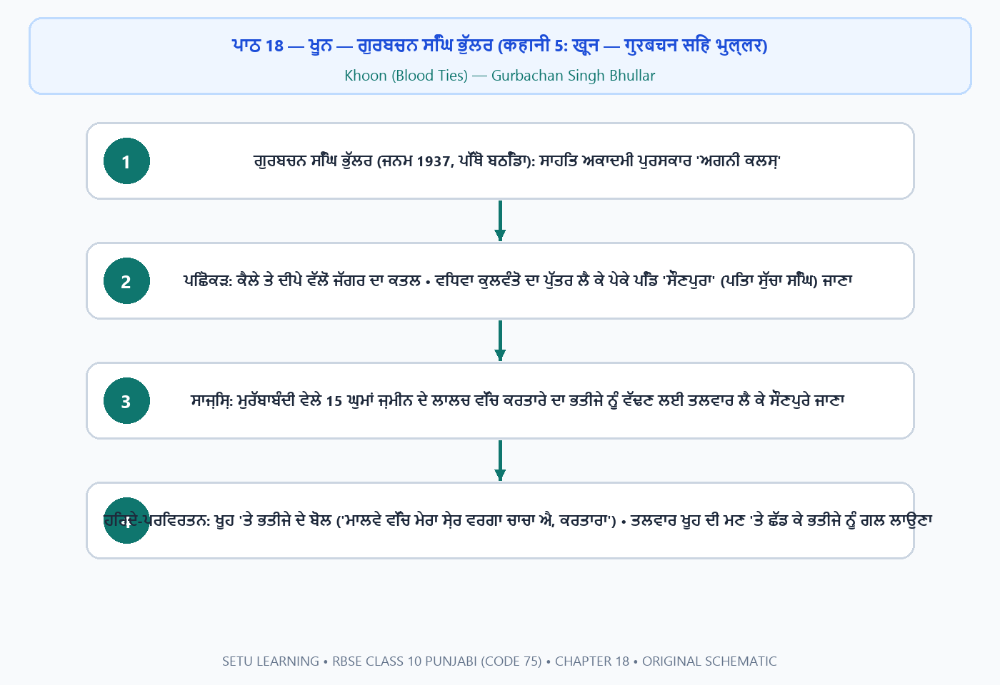

# ਪਾਠ 18 — ਖ਼ੂਨ — ਗੁਰਬਚਨ ਸਿੰਘ ਭੁੱਲਰ (कहानी 5: ख़ून — गुरबचन सिंह भुल्लर) (Khoon (Blood Ties) — Gurbachan Singh Bhullar)

## भाग 1: अध्याय प्रवेश एवं पाठ्यक्रम मैपिंग (ਪਾਠ-ਪ੍ਰਵੇਸ਼ ਅਤੇ ਪਾਠਕ੍ਰਮ ਮੈਪਿੰਗ)

> ਪਹਿਲਾ ਸੰਪਾਦਕੀ ਪ੍ਰਾਰੂਪ (प्रथम संपादकीय प्रारूप)। RBSE ਜਮਾਤ 10 ਪੰਜਾਬੀ ਪਾਠ-ਪੁਸਤਕ 'ਸਾਹਿਤ ਸੁਗੰਧੀਆਂ' ਦੇ ਸਾਰੇ ਪ੍ਰਸ਼ਨਾਂ ਦੇ ਹੱਲ ਅਤੇ 2014–2026 ਦਾ ਪੂਰਾ ਇਤਿਹਾਸਕ PYQ ਸੰਗ੍ਰਹਿ ਸਰੋਤ-ਪ੍ਰੀਖਣ ਸਮੇਤ ਸੰਕਲਿਤ ਹਨ।

**ਵਿਸ਼ਾ ਕੋਡ (विषय कोड):** 75 (ਤੀਜੀ ਭਾਸ਼ਾ — ਪੰਜਾਬੀ / तृतीया भाषा — पंजाबी) · **ਲੜੀ ਪੁਸਤਕ (श्रृंखला पुस्तक):** 7

**ਪ੍ਰਮਾਣਿਤ ਆਧਾਰ:** RBSE 2025–26 · **ਪਾਠ ਅੰਕ-ਭਾਰ:** 2 ਅੰਕ। ਇਹ ਭਾਰ ਉਸੇ ਸੰਸਕਰਣ ਦਾ ਹੈ; ਅਸਲ ਪ੍ਰਸ਼ਨ-ਵੰਡ ਦੀ ਭਵਿੱਖਬਾਣੀ ਨਹੀਂ।

**ਸਿੱਖਣ ਦੇ ਉਦੇਸ਼ (सीखने के लक्ष्य):** ਗੁਰਬਚਨ ਸਿੰਘ ਭੁੱਲਰ ਦੀ ਕਹਾਣੀ 'ਖ਼ੂਨ' ਦਾ ਸਾਰ, ਕਰਤਾਰੇ ਦਾ ਜ਼ਮੀਨ ਦੇ ਲਾਲਚ (15 ਘੁਮਾਂ) ਵਿੱਚ ਆਪਣੇ ਭਤੀਜੇ ਨੂੰ ਕਤਲ ਕਰਨ ਲਈ ਸੌਣਪੁਰੇ ਜਾਣਾ, ਜੱਗਰ ਦੇ ਕਤਲ ਦਾ ਪਿਛੋਕੜ (ਕੈਲਾ ਤੇ ਦੀਪਾ), ਕੁਲਵੰਤੋ ਦਾ ਸਿਦਕ ਅਤੇ ਭਤੀਜੇ ਦੇ ਮਾਸੂਮ ਤੇ ਮਾਣ ਭਰੇ ਬੋਲਾਂ ('ਮਾਲਵੇ ਵਿੱਚ ਮੇਰਾ ਸ਼ੇਰ ਵਰਗਾ ਚਾਚਾ ਐ, ਕਰਤਾਰਾ') ਨਾਲ ਕਰਤਾਰੇ ਦੇ ਹਿਰਦੇ-ਪਰਿਵਰਤਨ ਨੂੰ ਸਮਝਣਾ।

## भाग 2: शब्दावली एवं अवधारणा कैप्सूल (ਸ਼ਬਦਾਵਲੀ ਅਤੇ ਸੰਕਲਪ ਕੈਪਸੂਲ)

| ਸ਼ਬਦ / ਸੰਕਲਪ | ਅਰਥ / ਵਿਆਖਿਆ |
|---|---|
| ਮੁਰੱਬਾਬੰਦੀ (मुरब्बाबंदी) | ਖੇਤਾਂ ਦੀਆਂ ਖਿੱਲਰੀਆਂ ਟੁਕੜੀਆਂ ਨੂੰ ਇਕੱਠਾ ਕਰਕੇ 25 ਘੁਮਾਂ (ਕਿੱਲਿਆਂ) ਦੇ ਮੁਰੱਬੇ ਬਣਾਉਣ ਦੀ ਸਰਕਾਰੀ ਪ੍ਰਕਿਰਿਆ। |
| ਘੁਮਾਂ (घुमां) | ਜ਼ਮੀਨ ਮਾਪਣ ਦੀ ਪੁਰਾਤਨ ਇਕਾਈ (ਇੱਕ ਏਕੜ/ਕਿੱਲੇ ਦੇ ਲਗਭਗ; ਜੱਗਰ ਕੋਲ 15 ਘੁਮਾਂ ਅਤੇ ਕਰਤਾਰੇ ਕੋਲ 10 ਘੁਮਾਂ ਜ਼ਮੀਨ ਸੀ)। |
| ਫਸਤਾ ਵੱਢਣਾ (फसता वड्ढणा) | ਮਾਰ ਮੁਕਾਉਣਾ / ਅਲਖ ਮੁਕਾਉਣੀ (ਕਰਤਾਰਾ ਆਪਣੇ ਭਤੀਜੇ ਨੂੰ ਭਵਿੱਖ ਦਾ ਵੈਰੀ ਸਮਝ ਕੇ ਮਾਰਨ ਚੱਲਿਆ ਸੀ)। |
| ਪਾਣ ਚਾੜ੍ਹਨਾ (पाण चाड़्हना) | ਲੋਹੇ ਦੇ ਹਥਿਆਰ ਨੂੰ ਤਿੱਖਾ ਤੇ ਪੱਕਾ ਕਰਨਾ; ਮੁਹਾਵਰੇ ਵਜੋਂ ਕਿਸੇ ਨੂੰ ਬਦਲਾ ਲੈਣ ਲਈ ਉਕਸਾਉਣਾ ਜਾਂ ਤਿਆਰ ਕਰਨਾ। |
| ਮੋਮੋਠੱਗਣੀਆਂ (मोमोठग्गणीआं) | ਉੱਤੋਂ-ਉੱਤੋਂ ਮਿੱਠੀਆਂ ਤੇ ਭੋਲੀਆਂ ਪਰ ਅੰਦਰੋਂ ਛਲ ਵਾਲੀਆਂ ਗੱਲਾਂ। |
| ਸੌਣਪੁਰਾ (सौणपुरा) | ਕੁਲਵੰਤੋ (ਜੱਗਰ ਦੀ ਵਿਧਵਾ) ਦਾ ਪੇਕਾ ਪਿੰਡ ਜਿੱਥੇ ਉਹ ਆਪਣੇ ਪਿਤਾ ਸੁੱਚਾ ਸਿੰਘ ਕੋਲ ਪੁੱਤਰ ਸਮੇਤ ਰਹਿੰਦੀ ਸੀ। |
| ਖੂਹ ਦੀ ਮਣ (खूह दी मण) | ਖੂਹ ਦੇ ਆਲੇ-ਦੁਆਲੇ ਬਣਿਆ ਪੱਕਾ ਚਬੂਤਰਾ ਜਿੱਥੇ ਕਰਤਾਰੇ ਦੀ ਤਲਵਾਰ ਪਈ ਰਹਿ ਗਈ। |

## भाग 3: विस्तृत शिक्षण पाठ (ਵਿਸਤ੍ਰਿਤ ਅਧਿਆਪਨ ਪਾਠ)

### 1. ਕਹਾਣੀਕਾਰ-ਪਰਿਚਯ: ਗੁਰਬਚਨ ਸਿੰਘ ਭੁੱਲਰ (ਜਨਮ 1937 ਈ.)

| ਤੱਥ (Fact) | ਵੇਰਵਾ (Details) |
|---|---|
| **ਜਨਮ ਅਤੇ ਮਾਤਾ-ਪਿਤਾ** | **1937 ਈ.**; ਪਿੰਡ **ਪਿੱਥੋ** (ਜ਼ਿਲ੍ਹਾ ਬਠਿੰਡਾ, ਮਾਲਵਾ ਖੇਤਰ); ਪਿਤਾ **ਹਜ਼ੂਰ ਸਿੰਘ** |
| **ਪੱਤਰਕਾਰੀ ਅਤੇ ਸੰਪਾਦਨ** | ਦਿੱਲੀ ਵਿਖੇ ਸੋਵੀਅਤ (ਰੂਸੀ) ਅੰਬੈਸੀ ਵਿੱਚ ਪੱਤਰਕਾਰ ਅਤੇ **'ਪੰਜਾਬੀ ਟ੍ਰਿਬਿਊਨ'** ਅਖ਼ਬਾਰ ਦੇ ਸੰਪਾਦਕ ਰਹੇ |
| **ਪ੍ਰਮੁੱਖ ਕਹਾਣੀ-ਸੰਗ੍ਰਹਿ** | *ਓਪਰਾ ਮਰਦ*, *ਸੁਬਹ ਕਿਤਨੀ ਖ਼ੂਬਸੂਰਤ ਹੈ*, *ਵਖਤਾਂ ਮਾਰੇ*, *ਮੈਂ ਗਜ਼ਨਵੀ ਨਹੀਂ*, *ਦੀਵੇ ਵਾਂਗ ਬਲਦੀ ਅੱਖ*, *ਅਗਨੀ ਕਲਸ਼*, *ਤਿੰਨ ਮੂਰਤੀਆਂ ਵਾਲਾ ਮੰਦਰ* |
| **ਪੁਰਸਕਾਰ** | ਕਹਾਣੀ-ਸੰਗ੍ਰਹਿ **'ਅਗਨੀ ਕਲਸ਼'** ਲਈ **ਭਾਰਤੀ ਸਾਹਿਤ ਅਕਾਦਮੀ ਪੁਰਸਕਾਰ (2005)** (RBSE 2025 Main Q1-xiii) |

---

### 2. ਪਾਠ-ਸਾਰ: 'ਖ਼ੂਨ' (ਕਰਤਾਰਾ, ਜੱਗਰ, ਕੁਲਵੰਤੋ ਅਤੇ ਭਤੀਜਾ)

1. **ਤਲਵਾਰ ਦੀ ਪਰਖ ਅਤੇ ਕਰਤਾਰੇ ਦਾ ਇਰਾਦਾ:** ਕਹਾਣੀ ਦੇ ਆਰੰਭ ਵਿੱਚ **ਕਰਤਾਰਾ** ਕਿੱਲੀ ਤੋਂ ਤਲਵਾਰ ਲਾਹ ਕੇ ਵਿਹੜੇ ਵਿੱਚ ਖੜ੍ਹੀ **ਟਾਹਲੀ** ਦੇ ਬਾਂਹ ਜਿੰਨੇ ਮੋਟੇ ਡਾਹਣੇ ਨੂੰ ਮੂਲੀ ਦੇ ਡੱਕਰੇ ਵਾਂਗ ਵੱਢ ਕੇ ਪਰਖਦਾ ਹੈ। ਪਿੰਡ ਵਿੱਚ **ਮੁਰੱਬਾਬੰਦੀ ਵਾਲੇ ਪਟਵਾਰੀ** ਆ ਗਏ ਸਨ। ਕਰਤਾਰਾ ਆਪਣੀ **10 ਘੁਮਾਂ** ਜ਼ਮੀਨ ਵਿੱਚ ਆਪਣੇ ਮਰਹੂਮ ਭਰਾ (ਚਾਚੇ-ਤਾਏ ਦੇ ਪੁੱਤ) **ਜੱਗਰ** ਦੀ **15 ਘੁਮਾਂ** ਜ਼ਮੀਨ ਮਿਲਾ ਕੇ **25 ਘੁਮਾਂ ਦਾ ਮੁਰੱਬਾ** ਬਣਾਉਣਾ ਚਾਹੁੰਦਾ ਸੀ ਅਤੇ ਆਪਣੇ 'ਭਵਿੱਖ ਦੇ ਵੈਰੀ' (ਜੱਗਰ ਦੇ 8-9 ਸਾਲ ਦੇ ਪੁੱਤਰ) ਨੂੰ ਕਤਲ ਕਰਨ ਲਈ ਤਲਵਾਰ ਲੈ ਕੇ ਤੁਰ ਪੈਂਦਾ ਹੈ।
2. **ਜੱਗਰ ਦੇ ਕਤਲ ਦਾ ਪਿਛੋਕੜ (ਕੈਲਾ ਅਤੇ ਦੀਪਾ):** ਪਿੰਡ ਦੇ **ਕੈਲੇ** ਅਤੇ **ਦੀਪੇ** ਨੇ ਇੱਕ ਜ਼ਮੀਨ ਗਹਿਣੇ ਲੈਣ ਦਾ ਸੌਦਾ ਕੀਤਾ ਸੀ ਪਰ **ਜੱਗਰ** ਨੇ ਭਾਅ ਵਧਾ ਕੇ ਉਹ ਜ਼ਮੀਨ ਆਪ ਲੈ ਲਈ ਸੀ। ਬਦਲਾ ਲੈਣ ਲਈ ਕੈਲੇ ਨੇ ਗੰਡਾਸੇ ਨਾਲ ਅਤੇ ਦੀਪੇ ਨੇ ਬਰਛੇ ਨਾਲ ਜੱਗਰ ਦਾ ਕਤਲ ਕਰ ਦਿੱਤਾ ਸੀ। ਕਰਤਾਰੇ ਨੂੰ ਇਸ ਸਾਜ਼ਿਸ਼ ਦਾ ਪਹਿਲਾਂ ਹੀ ਪਤਾ ਸੀ ਪਰ ਉਸ ਨੇ ਜੱਗਰ ਨੂੰ ਸੁਚੇਤ ਨਹੀਂ ਕੀਤਾ ਸੀ ਕਿਉਂਕਿ ਉਹ ਸੋਚਦਾ ਸੀ ਕਿ ਸ਼ਰੀਕ ਦੀ ਲੱਤ ਵੱਢੀ ਜਾਵੇ ਤਾਂ ਚੰਗਾ ਹੈ। ਬਾਅਦ ਵਿੱਚ ਪੁਲਿਸ ਤੋਂ ਬਚਣ ਲਈ ਕਰਤਾਰੇ ਨੂੰ ਬਾਣੀਏ ਤੋਂ ਵਿਆਜੂ ਪੈਸੇ ਲੈ ਕੇ ਥਾਣੇਦਾਰ ਦੀ ਜੇਬ ਭਰਨੀ ਪਈ ਸੀ।
3. **ਕੁਲਵੰਤੋ (ਕੁਲਵੰਤ ਕੌਰ) ਦਾ ਇਨਕਾਰ:** ਜੱਗਰ ਦੇ ਕਤਲ ਤੋਂ ਬਾਅਦ ਕਰਤਾਰੇ ਨੇ **ਸ਼ਾਮੋ ਨਾਇਣ** ਰਾਹੀਂ ਅਤੇ ਫਿਰ ਆਪ ਜੱਗਰ ਦੀ ਵਿਧਵਾ **ਕੁਲਵੰਤੋ** ਨਾਲ ਚਾਦਰ ਪਾਉਣ (ਆਪਣੇ ਘਰ ਵਸਾਉਣ) ਦੀ ਗੱਲ ਤੋਰੀ ਤਾਂ ਜੋ 15 ਘੁਮਾਂ ਜ਼ਮੀਨ ਉਸ ਦੇ ਹੱਥ ਆ ਜਾਵੇ। ਪਰ ਕੁਲਵੰਤੋ ਨੂੰ ਸ਼ੱਕ ਸੀ ਕਿ ਜੱਗਰ ਦੇ ਕਤਲ ਵਿੱਚ ਕਰਤਾਰੇ ਦਾ ਵੀ ਹੱਥ ਹੈ। ਉਸ ਨੇ ਕਰਤਾਰੇ ਨੂੰ ਸਾਫ਼ ਜਵਾਬ ਦੇ ਦਿੱਤਾ ਅਤੇ ਆਪਣੇ ਦੋ ਸਾਲ ਦੇ ਪੁੱਤਰ ਨੂੰ ਲੈ ਕੇ ਆਪਣੇ ਪਿਤਾ **ਸੁੱਚਾ ਸਿੰਘ** ਦੇ ਪਿੰਡ **'ਸੌਣਪੁਰਾ'** ਚਲੀ ਗਈ।
4. **ਸੌਣਪੁਰੇ ਦੇ ਖੂਹ ਉੱਤੇ ਭਤੀਜੇ ਨਾਲ ਮੁਲਾਕਾਤ (ਕਹਾਣੀ ਦਾ ਸਿਖਰ):** ਘੁਸਮੁਸੇ ਵੇਲੇ ਕਰਤਾਰਾ ਬੱਸ ਤੋਂ ਉੱਤਰ ਕੇ ਤਿੰਨ ਕੋਹ ਤੁਰ ਕੇ ਪਿੰਡ **ਸੌਣਪੁਰਾ** ਦੇ ਬਾਹਰ ਇੱਕ ਖੂਹ ਕੋਲ ਬੈਠ ਗਿਆ। ਉੱਥੇ ਖੇਤੋਂ ਰੋਟੀ ਦੇ ਕੇ ਖਾਲੀ ਭਾਂਡੇ ਲਈ ਆਉਂਦਾ 8-9 ਸਾਲ ਦਾ ਇੱਕ ਮੁੰਡਾ ਮਿਲਿਆ। ਪੁੱਛਣ 'ਤੇ ਮੁੰਡੇ ਨੇ ਪਿੰਡ ਦਾ ਨਾਂ **ਸੌਣਪੁਰਾ** ਅਤੇ ਆਪਣੇ ਪਿਓ ਦਾ ਨਾਂ **ਸੁੱਚਾ ਸਿੰਘ** (ਆਪਣੇ ਨਾਨੇ ਦਾ ਨਾਂ) ਦੱਸਿਆ।
5. **ਖ਼ੂਨ ਦਾ ਜਾਗਣਾ ਅਤੇ ਹਿਰਦੇ-ਪਰਿਵਰਤਨ:** ਜਦੋਂ ਕਰਤਾਰੇ ਨੇ ਮਖੌਲ ਵਿੱਚ ਮੁੰਡੇ ਨੂੰ ਡਰਾਇਆ ਕਿ *"ਸਾਡੇ ਪਿੰਡ ਤਾਂ ਚੋਰ ਤੇਰੇ ਜਿੱਡੇ ਮੁੰਡਿਆਂ ਨੂੰ ਚੁੱਪ-ਚਾਪ ਫੜ ਕੇ ਲੈ ਜਾਂਦੇ ਐ"*, ਤਾਂ ਮੁੰਡੇ ਨੇ ਖੂਹ ਦੀ ਮਣ ਉੱਤੇ ਪਈ ਤਲਵਾਰ ਵੱਲ ਵੇਖ ਕੇ ਬੇਝਿਜਕ ਅਤੇ ਮਾਣ ਨਾਲ ਕਿਹਾ —
   > **“ਮੈਨੂੰ ਕੌਣ ਹੱਥ ਲਾਊ। ਮਾਲਵੇ ਵਿੱਚ ਮੇਰਾ ਸ਼ੇਰ ਵਰਗਾ ਚਾਚਾ ਐ, ਕਰਤਾਰਾ। ਡੱਕਰੇ ਕਰ ਦੇਊ!”**
   ਆਪਣੇ ਭਤੀਜੇ ਦੇ ਮੂੰਹੋਂ ਆਪਣੇ ਪ੍ਰਤੀ ਅਜਿਹਾ ਮਾਣ ਅਤੇ ਵਿਸ਼ਵਾਸ ਸੁਣ ਕੇ ਕਰਤਾਰੇ ਨੂੰ ਧਰਤੀ-ਅਸਮਾਨ ਘੁੰਮਦੇ ਦਿਸੇ। ਉਸ ਦੇ ਅੰਦਰਲਾ **'ਖ਼ੂਨ' (ਭਰਾਤਰੀ ਮੋਹ)** ਜਾਗ ਉੱਠਿਆ। ਉਸ ਨੇ ਭੱਜ ਕੇ ਮੁੰਡੇ ਨੂੰ ਗੋਦੀ ਵਿੱਚ ਚੁੱਕ ਕੇ ਘੁੱਟ ਲਿਆ, ਤਲਵਾਰ ਖੂਹ ਦੀ ਮਣ ਉੱਤੇ ਹੀ ਪਈ ਰਹਿ ਗਈ ਅਤੇ ਸੌਣਪੁਰੇ ਵੱਲ ਤੁਰਦਿਆਂ ਉਸ ਦੀਆਂ ਅੱਖਾਂ ਵਿੱਚੋਂ ਪਛਤਾਵੇ ਤੇ ਪਿਆਰ ਦੇ ਹੰਝੂ ਤਿਪ-ਤਿਪ ਵਹਿ ਤੁਰੇ।

ਪਾਠ 18: ਗੁਰਬਚਨ ਸਿੰਘ ਭੁੱਲਰ ਦੀ ਕਹਾਣੀ 'ਖ਼ੂਨ' ਦਾ ਸੰਕਲਪ ਚਿੱਤਰ

## भाग 4: पाठ्यपुस्तक-अवधारणाओं पर मौलिक हल किए उदाहरण (ਹੱਲ ਕੀਤੇ ਮਿਆਰੀ ਉਦਾਹਰਣ)

ਹੇਠਾਂ ਦਿੱਤੇ ਪ੍ਰਸ਼ਨ ਪਾਠ-ਪੁਸਤਕ 'ਸਾਹਿਤ ਸੁਗੰਧੀਆਂ' ਅਤੇ ਵਿਆਕਰਣ ਦੇ ਸੰਕਲਪਾਂ ਉੱਤੇ ਆਧਾਰਿਤ ਮੌਲਿਕ ਆਦਰਸ਼ ਹੱਲ ਹਨ।

**ਹੱਲ ਕੀਤਾ ਉਦਾਹਰਣ 1: ਜੱਗਰ ਦਾ ਕਤਲ ਕਿਸ ਨੇ ਕੀਤਾ ਸੀ ਅਤੇ ਕਿਉਂ? (RBSE 2018 Main Q8-ੲ, 2020 Main Q8-ਡ)**

ਜੱਗਰ ਦਾ ਕਤਲ ਕੈਲੇ ਅਤੇ ਦੀਪੇ ਨੇ ਕੀਤਾ ਸੀ ਕਿਉਂਕਿ ਕੈਲੇ ਤੇ ਦੀਪੇ ਨੇ ਇੱਕ ਜ਼ਮੀਨ ਗਹਿਣੇ ਲੈਣ ਦਾ ਸੌਦਾ ਕੀਤਾ ਸੀ ਪਰ ਜੱਗਰ ਨੇ ਭਾਅ ਵਧਾ ਕੇ ਉਹ ਜ਼ਮੀਨ ਆਪ ਲੈ ਲਈ ਸੀ। ਇਸੇ ਰੰਜਿਸ਼ ਕਾਰਨ ਉਹਨਾਂ ਨੇ ਬਰਛਾ ਮਾਰ ਕੇ ਜੱਗਰ ਨੂੰ ਮਾਰ ਦਿੱਤਾ।

**ਹੱਲ ਕੀਤਾ ਉਦਾਹਰਣ 2: ਕਰਤਾਰਾ ਤਲਵਾਰ ਲੈ ਕੇ ਕੀ ਕਰਨ ਚੱਲਿਆ ਸੀ ਅਤੇ ਕਿਉਂ? (RBSE 2020 Supp Q8-ਠ)**

ਕਰਤਾਰਾ ਤਲਵਾਰ ਲੈ ਕੇ ਪਿੰਡ ਸੌਣਪੁਰੇ ਵਿੱਚ ਰਹਿੰਦੇ ਆਪਣੇ ਭਤੀਜੇ (ਜੱਗਰ ਦੇ ਪੁੱਤਰ) ਨੂੰ ਕਤਲ ਕਰਨ ਚੱਲਿਆ ਸੀ ਕਿਉਂਕਿ ਪਿੰਡ ਵਿੱਚ ਮੁਰੱਬਾਬੰਦੀ ਸ਼ੁਰੂ ਹੋ ਗਈ ਸੀ ਅਤੇ ਉਹ ਜੱਗਰ ਦੀ 15 ਘੁਮਾਂ ਜ਼ਮੀਨ ਹੜੱਪ ਕੇ ਆਪਣੀ 10 ਘੁਮਾਂ ਨਾਲ ਮਿਲਾ ਕੇ 25 ਘੁਮਾਂ ਦਾ ਮੁਰੱਬਾ ਬਣਾਉਣਾ ਚਾਹੁੰਦਾ ਸੀ ਅਤੇ ਭਤੀਜੇ ਨੂੰ ਭਵਿੱਖ ਦਾ ਵੈਰੀ ਸਮਝਦਾ ਸੀ।

**ਹੱਲ ਕੀਤਾ ਉਦਾਹਰਣ 3: ਖੂਹ ਉੱਤੇ ਮਿਲੇ ਮੁੰਡੇ ਦੇ ਕਿਹੜੇ ਬੋਲਾਂ ਨੇ ਕਰਤਾਰੇ ਦਾ ਹਿਰਦਾ ਬਦਲ ਦਿੱਤਾ?**

ਜਦੋਂ ਮੁੰਡੇ ਨੇ ਨਿਡਰ ਹੋ ਕੇ ਮਾਣ ਨਾਲ ਕਿਹਾ — 'ਮੈਨੂੰ ਕੌਣ ਹੱਥ ਲਾਊ। ਮਾਲਵੇ ਵਿੱਚ ਮੇਰਾ ਸ਼ੇਰ ਵਰਗਾ ਚਾਚਾ ਐ, ਕਰਤਾਰਾ। ਡੱਕਰੇ ਕਰ ਦੇਊ!' ਤਾਂ ਇਹ ਬੋਲ ਸੁਣ ਕੇ ਕਰਤਾਰੇ ਦਾ ਖ਼ੂਨ ਪੰਘਰ ਗਿਆ, ਉਸ ਨੇ ਤਲਵਾਰ ਖੂਹ ਦੀ ਮਣ 'ਤੇ ਛੱਡ ਦਿੱਤੀ ਅਤੇ ਭਤੀਜੇ ਨੂੰ ਗਲ ਨਾਲ ਲਾ ਲਿਆ।

## भाग 5: सत्यापित बोर्ड प्रश्न एवं स्रोत-स्थिति (ਪ੍ਰਮਾਣਿਤ ਬੋਰਡ ਪ੍ਰਸ਼ਨ ਅਤੇ ਸਰੋਤ-ਸਥਿਤੀ)

RBSE 2026 Main (`S-75`, Q1-xiv), 2026 Supp (Q1-VIII), 2025 Main (Q1-xiii), 2025 Supp (Q17) ਅਤੇ 2022 Main (Q19) ਵਿੱਚ 'ਖ਼ੂਨ' ਕਹਾਣੀ ਦੇ ਪ੍ਰਸ਼ਨ ਪੁੱਛੇ ਗਏ ਹਨ।

[RBSE 2026 ਮੂਲ ਪੇਪਰ (S-75)](https://rajeduboard.rajasthan.gov.in/books/PAPERS-2026/Sec/S-75.pdf)। ਪ੍ਰਸ਼ਨ ਦਾ ਸੰਖੇਪ ਵਿਸ਼ਾ-ਸੰਦਰਭ ਹੈ; ਸ਼ਬਦ-ਬ-ਸ਼ਬਦ ਪੁਨਰ-ਮੁਦਰਣ ਨਹੀਂ।

## भाग 6: खंडवार मौलिक अभ्यास बैंक (ਖੰਡ-ਵਾਰ ਮੌਲਿਕ ਅਭਿਆਸ ਬੈਂਕ)

**ਅਭਿਆਸ-ਅੰਕ:** ਵਿਦਿਆਰਥੀਆਂ ਦੇ ਸਵੈ-ਅਭਿਆਸ ਲਈ ਹਨ; ਉੱਤਰ ਪਹਿਲਾਂ ਆਪ ਲਿਖੋ, ਫਿਰ ਭਾਗ 9 ਵੇਖੋ।

## ੳ: ਬਹੁ-ਵਿਕਲਪੀ ਪ੍ਰਸ਼ਨ (MCQ) — 15 × 1 ਅੰਕ

**MCQ 1. ਗੁਰਬਚਨ ਸਿੰਘ ਭੁੱਲਰ ਦੇ ਕਿਸ ਕਹਾਣੀ-ਸੰਗ੍ਰਹਿ ਨੂੰ ਭਾਰਤੀ ਸਾਹਿਤ ਅਕਾਦਮੀ ਵੱਲੋਂ ਪੁਰਸਕ੍ਰਿਤ ਕੀਤਾ ਗਿਆ? (RBSE 2025 Main Q1-xiii)**

ੳ) ਵਖਤਾਂ ਮਾਰੇ  
ਅ) ਮੈਂ ਗਜ਼ਨਵੀ ਨਹੀਂ  
ੲ) ਅਗਨੀ ਕਲਸ਼  
ਸ) ਓਪਰਾ ਮਰਦ

**MCQ 2. ਕਰਤਾਰੇ ਨੇ ਵਿਹੜੇ ਵਿੱਚ ਖੜ੍ਹੀ ਟਾਹਲੀ ਦਾ ਡਾਹਣਾ ਕਿਸ ਹਥਿਆਰ ਨਾਲ ਵੱਢਿਆ? (RBSE 2026 Main Q1-xiv)**

ੳ) ਕੁਹਾੜੀ ਨਾਲ  
ਅ) ਤਲਵਾਰ ਨਾਲ  
ੲ) ਗੰਡਾਸੇ ਨਾਲ  
ਸ) ਬਰਛੇ ਨਾਲ

**MCQ 3. ਗੁਰਬਚਨ ਸਿੰਘ ਭੁੱਲਰ ਦਾ ਜਨਮ ਕਦੋਂ ਹੋਇਆ? (RBSE 2026 Supp Q1-VIII)**

ੳ) 1937 ਈ.  
ਅ) 1921 ਈ.  
ੲ) 1920 ਈ.  
ਸ) 1895 ਈ.

**MCQ 4. 'ਖ਼ੂਨ' ਕਹਾਣੀ ਵਿੱਚ ਜੱਗਰ ਦਾ ਕਤਲ ਕਿਸ ਨੇ ਕੀਤਾ ਸੀ? (RBSE 2018 Main Q8-ੲ)**

ੳ) ਕਰਤਾਰੇ ਨੇ  
ਅ) ਸੁੱਚਾ ਸਿੰਘ ਨੇ  
ੲ) ਥਾਣੇਦਾਰ ਨੇ  
ਸ) ਕੈਲੇ ਅਤੇ ਦੀਪੇ ਨੇ

**MCQ 5. ਜੱਗਰ ਦੀ ਵਿਧਵਾ ਪਤਨੀ ਦਾ ਕੀ ਨਾਂ ਸੀ?**

ੳ) ਰਾਮ ਕੌਰ  
ਅ) ਪੇਮੀ  
ੲ) ਕੁਲਵੰਤੋ (ਕੁਲਵੰਤ ਕੌਰ)  
ਸ) ਹਰਬੰਸੋ

**MCQ 6. ਕਰਤਾਰੇ ਨੇ ਕੁਲਵੰਤੋ ਨੂੰ ਆਪਣੇ ਘਰ ਵਸਾਉਣ ਦੀ ਗੱਲ ਪਹਿਲਾਂ ਕਿਸ ਰਾਹੀਂ ਚਲਾਈ ਸੀ?**

ੳ) ਸਰਪੰਚ ਰਾਹੀਂ  
ਅ) ਸ਼ਾਮੋ ਨਾਇਣ ਰਾਹੀਂ  
ੲ) ਚਾਚੀ ਰਾਮ ਕੌਰ ਰਾਹੀਂ  
ਸ) ਸੱਤੋ ਜੁਲਾਹੀ ਰਾਹੀਂ

**MCQ 7. ਜੱਗਰ ਦੇ ਹਿੱਸੇ ਦੀ ਜ਼ਮੀਨ ਕਿੰਨੀ ਸੀ ਜਿਸ ਨੂੰ ਕਰਤਾਰਾ ਆਪਣੀ 10 ਘੁਮਾਂ ਵਿੱਚ ਮਿਲਾ ਕੇ 25 ਘੁਮਾਂ ਦਾ ਮੁਰੱਬਾ ਬਣਾਉਣਾ ਚਾਹੁੰਦਾ ਸੀ?**

ੳ) 15 ਘੁਮਾਂ  
ਅ) 10 ਘੁਮਾਂ  
ੲ) 20 ਘੁਮਾਂ  
ਸ) 5 ਘੁਮਾਂ

**MCQ 8. ਪਿੰਡ ਵਿੱਚ ਚੌਕੀਦਾਰ ਨੇ ਕਿਸ ਗੱਲ ਦਾ ਹੋਕਾ ਦਿੱਤਾ ਸੀ ਜਿਸ ਨੇ ਕਰਤਾਰੇ ਦੇ ਮਨ ਵਿੱਚ ਲਾਟ ਬਾਲ ਦਿੱਤੀ?**

ੳ) ਮੇਲਾ ਲੱਗਣ ਦਾ  
ਅ) ਵੋਟਾਂ ਪੈਣ ਦਾ  
ੲ) ਨਹਿਰ ਟੁੱਟਣ ਦਾ  
ਸ) ਮੁਰੱਬਾਬੰਦੀ ਵਾਲੇ ਪਟਵਾਰੀਆਂ ਦੇ ਆਉਣ ਦਾ

**MCQ 9. ਕੁਲਵੰਤੋ ਆਪਣੇ ਪੁੱਤਰ ਨੂੰ ਲੈ ਕੇ ਕਿਹੜੇ ਪੇਕੇ ਪਿੰਡ ਰਹਿੰਦੀ ਸੀ?**

ੳ) ਡਡਹੇੜੀ  
ਅ) ਫੁਲੇਰਨ  
ੲ) ਸੌਣਪੁਰਾ  
ਸ) ਪਿੱਥੋ

**MCQ 10. ਸੌਣਪੁਰੇ ਦੇ ਖੂਹ ਕੋਲ ਮਿਲੇ ਮੁੰਡੇ ਨੇ ਆਪਣੇ ਪਿਓ (ਅਸਲ ਵਿੱਚ ਨਾਨੇ) ਦਾ ਨਾਂ ਕੀ ਦੱਸਿਆ?**

ੳ) ਹਜ਼ੂਰ ਸਿੰਘ  
ਅ) ਸੁੱਚਾ ਸਿੰਘ  
ੲ) ਜੱਗਰ ਸਿੰਘ  
ਸ) ਕਰਤਾਰ ਸਿੰਘ

**MCQ 11. ਮੁੰਡੇ ਨੇ ਚੋਰਾਂ ਦੇ ਡਰ ਦੀ ਗੱਲ ਸੁਣ ਕੇ ਆਪਣੇ ਚਾਚੇ ਬਾਰੇ ਕੀ ਕਿਹਾ?**

ੳ) 'ਮਾਲਵੇ ਵਿੱਚ ਮੇਰਾ ਸ਼ੇਰ ਵਰਗਾ ਚਾਚਾ ਐ, ਕਰਤਾਰਾ। ਡੱਕਰੇ ਕਰ ਦੇਊ!'  
ਅ) 'ਮੇਰਾ ਚਾਚਾ ਬਹੁਤ ਬੁਰਾ ਹੈ'  
ੲ) 'ਮੇਰਾ ਕੋਈ ਚਾਚਾ ਨਹੀਂ ਹੈ'  
ਸ) 'ਮੈਂ ਪੁਲਿਸ ਨੂੰ ਸੱਦ ਲਵਾਂਗਾ'

**MCQ 12. ਕਹਾਣੀ ਦੇ ਅੰਤ ਵਿੱਚ ਕਰਤਾਰੇ ਦੀ ਤਲਵਾਰ ਕਿੱਥੇ ਪਈ ਰਹਿ ਗਈ?**

ੳ) ਬੱਸ ਦੇ ਵਿੱਚ  
ਅ) ਟਾਹਲੀ ਦੇ ਹੇਠਾਂ  
ੲ) ਪਗਡੰਡੀ ਉੱਤੇ  
ਸ) ਖੂਹ ਦੀ ਮਣ ਉੱਤੇ

**MCQ 13. ਜੱਗਰ ਦੇ ਕਤਲ ਵੇਲੇ ਕਰਤਾਰੇ ਨੇ ਪੁਲਿਸ (ਥਾਣੇਦਾਰ) ਤੋਂ ਆਪਣਾ ਪਿੱਛਾ ਕਿਵੇਂ ਛੁਡਾਇਆ ਸੀ?**

ੳ) ਸਰਪੰਚ ਦੀ ਸਿਫ਼ਾਰਸ਼ ਨਾਲ  
ਅ) ਅਦਾਲਤ ਵਿੱਚ ਕੇਸ ਲੜ ਕੇ  
ੲ) ਬਾਣੀਏ ਤੋਂ ਵਿਆਜੂ ਪੈਸੇ ਲੈ ਕੇ ਥਾਣੇਦਾਰ ਨੂੰ ਰਿਸ਼ਵਤ ਦੇ ਕੇ  
ਸ) ਪਿੰਡ ਛੱਡ ਕੇ ਭੱਜ ਕੇ

**MCQ 14. ਗੁਰਬਚਨ ਸਿੰਘ ਭੁੱਲਰ ਨੇ ਕਿਸ ਪ੍ਰਸਿੱਧ ਪੰਜਾਬੀ ਅਖ਼ਬਾਰ ਦੇ ਸੰਪਾਦਕ ਵਜੋਂ ਸੇਵਾ ਨਿਭਾਈ?**

ੳ) ਦੇਸ਼ ਸੇਵਕ  
ਅ) ਪੰਜਾਬੀ ਟ੍ਰਿਬਿਊਨ  
ੲ) ਅਜੀਤ  
ਸ) ਜੱਗ ਬਾਣੀ

**MCQ 15. 'ਖ਼ੂਨ' ਕਹਾਣੀ ਦਾ ਮੁੱਖ ਉਦੇਸ਼ ਕੀ ਦਰਸਾਉਣਾ ਹੈ?**

ੳ) ਜ਼ਮੀਨ ਦੇ ਲਾਲਚ ਅਤੇ ਵੈਰ ਉੱਤੇ ਖ਼ੂਨ ਦੇ ਪਵਿੱਤਰ ਰਿਸ਼ਤੇ ਤੇ ਮੋਹ ਦੀ ਜਿੱਤ  
ਅ) ਤਲਵਾਰਬਾਜ਼ੀ ਦੀ ਕਲਾ  
ੲ) ਮੁਰੱਬਾਬੰਦੀ ਦੇ ਕਾਨੂੰਨ  
ਸ) ਪੁਲਿਸ ਪ੍ਰਬੰਧ

## ੳ: ਖਾਲੀ ਥਾਵਾਂ ਭਰੋ — 6 × 1 ਅੰਕ

1. ਖੇਤਾਂ ਦੀਆਂ ਖਿੱਲਰੀਆਂ ਟੁਕੜੀਆਂ ਨੂੰ ਇਕੱਠਾ ਕਰਕੇ 25 ਘੁਮਾਂ (ਕਿੱਲਿਆਂ) ਦੇ ਮੁਰੱਬੇ ਬਣਾਉਣ ਦੀ ਸਰਕਾਰੀ ਪ੍ਰਕਿਰਿਆ। — ਇਸ ਸ਼ਬਦ/ਸੰਕਲਪ ਦਾ ਨਾਂ ਹੈ: ____।  
2. ਜ਼ਮੀਨ ਮਾਪਣ ਦੀ ਪੁਰਾਤਨ ਇਕਾਈ (ਇੱਕ ਏਕੜ/ਕਿੱਲੇ ਦੇ ਲਗਭਗ; ਜੱਗਰ ਕੋਲ 15 ਘੁਮਾਂ ਅਤੇ ਕਰਤਾਰੇ ਕੋਲ 10 ਘੁਮਾਂ ਜ਼ਮੀਨ ਸੀ)। — ਇਸ ਸ਼ਬਦ/ਸੰਕਲਪ ਦਾ ਨਾਂ ਹੈ: ____।  
3. ਮਾਰ ਮੁਕਾਉਣਾ / ਅਲਖ ਮੁਕਾਉਣੀ (ਕਰਤਾਰਾ ਆਪਣੇ ਭਤੀਜੇ ਨੂੰ ਭਵਿੱਖ ਦਾ ਵੈਰੀ ਸਮਝ ਕੇ ਮਾਰਨ ਚੱਲਿਆ ਸੀ)। — ਇਸ ਸ਼ਬਦ/ਸੰਕਲਪ ਦਾ ਨਾਂ ਹੈ: ____।  
4. ਲੋਹੇ ਦੇ ਹਥਿਆਰ ਨੂੰ ਤਿੱਖਾ ਤੇ ਪੱਕਾ ਕਰਨਾ; ਮੁਹਾਵਰੇ ਵਜੋਂ ਕਿਸੇ ਨੂੰ ਬਦਲਾ ਲੈਣ ਲਈ ਉਕਸਾਉਣਾ ਜਾਂ ਤਿਆਰ ਕਰਨਾ। — ਇਸ ਸ਼ਬਦ/ਸੰਕਲਪ ਦਾ ਨਾਂ ਹੈ: ____।  
5. ਉੱਤੋਂ-ਉੱਤੋਂ ਮਿੱਠੀਆਂ ਤੇ ਭੋਲੀਆਂ ਪਰ ਅੰਦਰੋਂ ਛਲ ਵਾਲੀਆਂ ਗੱਲਾਂ। — ਇਸ ਸ਼ਬਦ/ਸੰਕਲਪ ਦਾ ਨਾਂ ਹੈ: ____।  
6. ਕੁਲਵੰਤੋ (ਜੱਗਰ ਦੀ ਵਿਧਵਾ) ਦਾ ਪੇਕਾ ਪਿੰਡ ਜਿੱਥੇ ਉਹ ਆਪਣੇ ਪਿਤਾ ਸੁੱਚਾ ਸਿੰਘ ਕੋਲ ਪੁੱਤਰ ਸਮੇਤ ਰਹਿੰਦੀ ਸੀ। — ਇਸ ਸ਼ਬਦ/ਸੰਕਲਪ ਦਾ ਨਾਂ ਹੈ: ____।

## ੳ: ਅਤਿ-ਲਘੂ ਉੱਤਰਾਂ ਵਾਲੇ ਪ੍ਰਸ਼ਨ — 8 × 1 ਅੰਕ

1. ਗੁਰਬਚਨ ਸਿੰਘ ਭੁੱਲਰ ਦੇ ਕਿਸ ਕਹਾਣੀ-ਸੰਗ੍ਰਹਿ ਨੂੰ ਭਾਰਤੀ ਸਾਹਿਤ ਅਕਾਦਮੀ ਵੱਲੋਂ ਪੁਰਸਕ੍ਰਿਤ ਕੀਤਾ ਗਿਆ? (RBSE 2025 Main Q1-xiii)  
2. ਕਰਤਾਰੇ ਨੇ ਵਿਹੜੇ ਵਿੱਚ ਖੜ੍ਹੀ ਟਾਹਲੀ ਦਾ ਡਾਹਣਾ ਕਿਸ ਹਥਿਆਰ ਨਾਲ ਵੱਢਿਆ? (RBSE 2026 Main Q1-xiv)  
3. ਗੁਰਬਚਨ ਸਿੰਘ ਭੁੱਲਰ ਦਾ ਜਨਮ ਕਦੋਂ ਹੋਇਆ? (RBSE 2026 Supp Q1-VIII)  
4. 'ਖ਼ੂਨ' ਕਹਾਣੀ ਵਿੱਚ ਜੱਗਰ ਦਾ ਕਤਲ ਕਿਸ ਨੇ ਕੀਤਾ ਸੀ? (RBSE 2018 Main Q8-ੲ)  
5. ਜੱਗਰ ਦੀ ਵਿਧਵਾ ਪਤਨੀ ਦਾ ਕੀ ਨਾਂ ਸੀ?  
6. ਕਰਤਾਰੇ ਨੇ ਕੁਲਵੰਤੋ ਨੂੰ ਆਪਣੇ ਘਰ ਵਸਾਉਣ ਦੀ ਗੱਲ ਪਹਿਲਾਂ ਕਿਸ ਰਾਹੀਂ ਚਲਾਈ ਸੀ?  
7. ਜੱਗਰ ਦੇ ਹਿੱਸੇ ਦੀ ਜ਼ਮੀਨ ਕਿੰਨੀ ਸੀ ਜਿਸ ਨੂੰ ਕਰਤਾਰਾ ਆਪਣੀ 10 ਘੁਮਾਂ ਵਿੱਚ ਮਿਲਾ ਕੇ 25 ਘੁਮਾਂ ਦਾ ਮੁਰੱਬਾ ਬਣਾਉਣਾ ਚਾਹੁੰਦਾ ਸੀ?  
8. ਪਿੰਡ ਵਿੱਚ ਚੌਕੀਦਾਰ ਨੇ ਕਿਸ ਗੱਲ ਦਾ ਹੋਕਾ ਦਿੱਤਾ ਸੀ ਜਿਸ ਨੇ ਕਰਤਾਰੇ ਦੇ ਮਨ ਵਿੱਚ ਲਾਟ ਬਾਲ ਦਿੱਤੀ?

## ਅ: ਲਘੂ ਉੱਤਰਾਂ ਵਾਲੇ ਪ੍ਰਸ਼ਨ — 4 × 2 ਅੰਕ

**B1.** ਗੁਰਬਚਨ ਸਿੰਘ ਭੁੱਲਰ ਦੇ ਕਿਸ ਕਹਾਣੀ-ਸੰਗ੍ਰਹਿ ਨੂੰ ਭਾਰਤੀ ਸਾਹਿਤ ਅਕਾਦਮੀ ਪੁਰਸਕਾਰ ਮਿਲਿਆ? (RBSE 2025 Main Q1-xiii)

**B2.** ਕਰਤਾਰੇ ਨੇ ਵਿਹੜੇ ਵਿੱਚ ਖੜ੍ਹੀ ਟਾਹਲੀ ਦੇ ਡਾਹਣੇ ਉੱਤੇ ਕਿਸ ਹਥਿਆਰ ਨਾਲ ਵਾਰ ਕੀਤਾ? (RBSE 2026 Main Q1-xiv)

**B3.** ਗੁਰਬਚਨ ਸਿੰਘ ਭੁੱਲਰ ਦਾ ਜਨਮ ਕਦੋਂ ਅਤੇ ਕਿੱਥੇ ਹੋਇਆ? (RBSE 2026 Supp Q1-VIII)

**B4.** ਕੁਲਵੰਤੋ ਦੇ ਪੇਕੇ ਪਿੰਡ ਅਤੇ ਪਿਤਾ ਦਾ ਨਾਂ ਕੀ ਸੀ? (RBSE 2024 Supp Q3-xi)

## ੲ: ਦੀਰਘ ਉੱਤਰਾਂ ਵਾਲੇ ਪ੍ਰਸ਼ਨ — 2 × 3 ਅੰਕ

ਅੰਦਰੂਨੀ ਵਿਕਲਪ ਅਭਿਆਸ: ਪਹਿਲਾਂ ਇੱਕ ਵਿਕਲਪ ਹੱਲ ਕਰੋ ਅਤੇ ਦੁਹਰਾਈ ਵੇਲੇ ਬਾਕੀ ਪ੍ਰਸ਼ਨ ਵੀ ਹੱਲ ਕਰੋ।

**C1.** ਜੱਗਰ ਦਾ ਕਤਲ ਕਿਸ ਨੇ ਕੀਤਾ ਸੀ ਅਤੇ ਕਿਉਂ? (RBSE 2018 Main Q8-ੲ, 2020 Main Q8-ਡ)

**C2.** ਕਰਤਾਰੇ ਨੇ ਕੁਲਵੰਤੋ ਨੂੰ ਆਪਣੇ ਘਰ ਵਸਾਉਣ ਲਈ ਪਹਿਲਾਂ ਕਿਸ ਰਾਹੀਂ ਗੱਲ ਚਲਾਈ ਸੀ?

## ਸ: ਨਿਬੰਧਾਤਮਕ / ਵਿਸਤ੍ਰਿਤ ਉੱਤਰਾਂ ਵਾਲੇ ਪ੍ਰਸ਼ਨ — 2 × 4 ਅੰਕ

ਅੰਦਰੂਨੀ ਵਿਕਲਪ ਅਭਿਆਸ: D1 ਜਾਂ D2 ਚੁਣੋ; ਬਾਅਦ ਵਿੱਚ ਦੂਜਾ ਵੀ ਹੱਲ ਕਰੋ।

**D1.** ਸੌਣਪੁਰੇ ਜਾ ਰਹੇ ਕਰਤਾਰੇ ਦੇ ਮਨ ਵਿੱਚ ਕਿਹੜੇ-ਕਿਹੜੇ ਖ਼ਿਆਲ ਆ ਰਹੇ ਸਨ? (RBSE 2019 Main Q8-ਗ, 2025 Supp Q17)

**D2.** 'ਖ਼ੂਨ' ਕਹਾਣੀ ਦੇ ਆਧਾਰ 'ਤੇ ਕਰਤਾਰੇ ਦਾ ਪਾਤਰ-ਚਿਤਰਣ ਕਰੋ ਜਾਂ ਕਹਾਣੀ ਦਾ ਸਾਰ ਲਿਖੋ। (RBSE 2022 Main Q19, 2025 Supp Q17)

## भाग 7: सावधानियाँ एवं परीक्षा-त्रुटियाँ (ਸਾਵਧਾਨੀਆਂ ਅਤੇ ਪ੍ਰੀਖਿਆ-ਗ਼ਲਤੀਆਂ)

- **ਗ਼ਲਤੀ 1:** 'ਜੱਗਰ ਦਾ ਕਤਲ ਕਿਸ ਨੇ ਕੀਤਾ?' ਦੇ ਉੱਤਰ ਵਿੱਚ 'ਕਰਤਾਰੇ ਨੇ' ਲਿਖ ਦੇਣਾ — ਜੱਗਰ ਦਾ ਕਤਲ **ਕੈਲੇ ਅਤੇ ਦੀਪੇ** ਨੇ ਕੀਤਾ ਸੀ; ਕਰਤਾਰੇ ਨੂੰ ਸਿਰਫ਼ ਪਹਿਲਾਂ ਪਤਾ ਸੀ ਪਰ ਉਸ ਨੇ ਜੱਗਰ ਨੂੰ ਦੱਸਿਆ ਨਹੀਂ ਸੀ।
- **ਗ਼ਲਤੀ 2:** ਮੁੰਡੇ ਵੱਲੋਂ ਦੱਸੇ ਪਿਤਾ ਦੇ ਨਾਂ ਵਿੱਚ ਉਲਝਣ — ਮੁੰਡੇ ਦੇ ਅਸਲੀ ਪਿਤਾ ਦਾ ਨਾਂ **ਜੱਗਰ** ਸੀ, ਪਰ ਨਾਨਕੇ ਪਿੰਡ **ਸੌਣਪੁਰਾ** ਵਿੱਚ ਪਲਣ ਕਾਰਨ ਉਹ ਆਪਣੇ ਨਾਨੇ **ਸੁੱਚਾ ਸਿੰਘ** ਨੂੰ ਹੀ ਪਿਓ ਕਹਿੰਦਾ ਸੀ।

## भाग 8: फटाफट पुनरावृत्ति — 25 बिंदु (ਫਟਾਫਟ ਦੁਹਰਾਈ — 25 ਬਿੰਦੂ)

1. ਮੁਰੱਬਾਬੰਦੀ (मुरब्बाबंदी): ਖੇਤਾਂ ਦੀਆਂ ਖਿੱਲਰੀਆਂ ਟੁਕੜੀਆਂ ਨੂੰ ਇਕੱਠਾ ਕਰਕੇ 25 ਘੁਮਾਂ (ਕਿੱਲਿਆਂ) ਦੇ ਮੁਰੱਬੇ ਬਣਾਉਣ ਦੀ ਸਰਕਾਰੀ ਪ੍ਰਕਿਰਿਆ।  
2. ਘੁਮਾਂ (घुमां): ਜ਼ਮੀਨ ਮਾਪਣ ਦੀ ਪੁਰਾਤਨ ਇਕਾਈ (ਇੱਕ ਏਕੜ/ਕਿੱਲੇ ਦੇ ਲਗਭਗ; ਜੱਗਰ ਕੋਲ 15 ਘੁਮਾਂ ਅਤੇ ਕਰਤਾਰੇ ਕੋਲ 10 ਘੁਮਾਂ ਜ਼ਮੀਨ ਸੀ)।  
3. ਫਸਤਾ ਵੱਢਣਾ (फसता वड्ढणा): ਮਾਰ ਮੁਕਾਉਣਾ / ਅਲਖ ਮੁਕਾਉਣੀ (ਕਰਤਾਰਾ ਆਪਣੇ ਭਤੀਜੇ ਨੂੰ ਭਵਿੱਖ ਦਾ ਵੈਰੀ ਸਮਝ ਕੇ ਮਾਰਨ ਚੱਲਿਆ ਸੀ)।  
4. ਪਾਣ ਚਾੜ੍ਹਨਾ (पाण चाड़्हना): ਲੋਹੇ ਦੇ ਹਥਿਆਰ ਨੂੰ ਤਿੱਖਾ ਤੇ ਪੱਕਾ ਕਰਨਾ; ਮੁਹਾਵਰੇ ਵਜੋਂ ਕਿਸੇ ਨੂੰ ਬਦਲਾ ਲੈਣ ਲਈ ਉਕਸਾਉਣਾ ਜਾਂ ਤਿਆਰ ਕਰਨਾ।  
5. ਮੋਮੋਠੱਗਣੀਆਂ (मोमोठग्गणीआं): ਉੱਤੋਂ-ਉੱਤੋਂ ਮਿੱਠੀਆਂ ਤੇ ਭੋਲੀਆਂ ਪਰ ਅੰਦਰੋਂ ਛਲ ਵਾਲੀਆਂ ਗੱਲਾਂ।  
6. ਸੌਣਪੁਰਾ (सौणपुरा): ਕੁਲਵੰਤੋ (ਜੱਗਰ ਦੀ ਵਿਧਵਾ) ਦਾ ਪੇਕਾ ਪਿੰਡ ਜਿੱਥੇ ਉਹ ਆਪਣੇ ਪਿਤਾ ਸੁੱਚਾ ਸਿੰਘ ਕੋਲ ਪੁੱਤਰ ਸਮੇਤ ਰਹਿੰਦੀ ਸੀ।  
7. ਖੂਹ ਦੀ ਮਣ (खूह दी मण): ਖੂਹ ਦੇ ਆਲੇ-ਦੁਆਲੇ ਬਣਿਆ ਪੱਕਾ ਚਬੂਤਰਾ ਜਿੱਥੇ ਕਰਤਾਰੇ ਦੀ ਤਲਵਾਰ ਪਈ ਰਹਿ ਗਈ।  
8. ਗੁਰਬਚਨ ਸਿੰਘ ਭੁੱਲਰ ਦੇ ਕਹਾਣੀ-ਸੰਗ੍ਰਹਿ 'ਅਗਨੀ ਕਲਸ਼' ਨੂੰ ਭਾਰਤੀ ਸਾਹਿਤ ਅਕਾਦਮੀ ਪੁਰਸਕਾਰ ਮਿਲਿਆ (RBSE 2025 Main Q1-xiii)।  
9. ਕਰਤਾਰੇ ਨੇ ਕਿੱਲੀ ਤੋਂ ਤਲਵਾਰ ਲਾਹ ਕੇ ਟਾਹਲੀ ਦਾ ਡਾਹਣਾ ਮੂਲੀ ਦੇ ਡੱਕਰੇ ਵਾਂਗ ਵੱਢਿਆ (RBSE 2026 Main Q1-xiv)।  
10. ਗੁਰਬਚਨ ਸਿੰਘ ਭੁੱਲਰ ਦਾ ਜਨਮ 1937 ਈ. ਨੂੰ ਪਿੰਡ ਪਿੱਥੋ (ਬਠਿੰਡਾ) ਵਿਖੇ ਹੋਇਆ (RBSE 2026 Supp Q1-VIII)।  
11. ਗਹਿਣੇ ਵਾਲੀ ਜ਼ਮੀਨ ਪਿੱਛੇ ਕੈਲੇ ਅਤੇ ਦੀਪੇ ਨੇ ਬਰਛਾ ਮਾਰ ਕੇ ਜੱਗਰ ਦਾ ਕਤਲ ਕੀਤਾ ਸੀ।  
12. ਜੱਗਰ ਦੀ ਪਤਨੀ ਦਾ ਨਾਂ ਕੁਲਵੰਤੋ (ਕੁਲਵੰਤ ਕੌਰ) ਸੀ।  
13. ਕਰਤਾਰੇ ਨੇ ਪਹਿਲਾਂ ਸ਼ਾਮੋ ਨਾਇਣ ਰਾਹੀਂ ਗੱਲ ਚਲਾਈ ਸੀ।  
14. ਜੱਗਰ ਦੀ 15 ਘੁਮਾਂ ਜ਼ਮੀਨ ਸੀ।  
15. ਚੌਕੀਦਾਰ ਨੇ ਮੁਰੱਬਾਬੰਦੀ ਵਾਲੇ ਪਟਵਾਰੀਆਂ ਦੇ ਪਿੰਡ ਆਉਣ ਦਾ ਹੋਕਾ ਦਿੱਤਾ ਸੀ।  
16. ਕੁਲਵੰਤੋ ਆਪਣੇ ਪੇਕੇ ਪਿੰਡ ਸੌਣਪੁਰਾ ਵਿਖੇ ਰਹਿੰਦੀ ਸੀ (RBSE 2024 Supp Q3-xi)।  
17. ਮੁੰਡੇ ਨੇ ਆਪਣੇ ਨਾਨੇ 'ਸੁੱਚਾ ਸਿੰਘ' ਦਾ ਨਾਂ ਦੱਸਿਆ ਜੋ ਜੱਗਰ ਦਾ ਸਹੁਰਾ ਸੀ।  
18. ਮੁੰਡੇ ਨੇ ਮਾਣ ਨਾਲ ਕਿਹਾ ਕਿ ਮਾਲਵੇ ਵਿੱਚ ਉਸ ਦਾ ਸ਼ੇਰ ਵਰਗਾ ਚਾਚਾ ਕਰਤਾਰਾ ਹੈ।  
19. ਕਰਤਾਰੇ ਨੇ ਭੱਜ ਕੇ ਭਤੀਜੇ ਨੂੰ ਗੋਦੀ ਚੁੱਕ ਲਿਆ ਅਤੇ ਤਲਵਾਰ ਖੂਹ ਦੀ ਮਣ ਉੱਤੇ ਹੀ ਪਈ ਰਹਿ ਗਈ।  
20. ਉਸ ਨੇ ਬਾਣੀਏ ਤੋਂ ਵਿਆਜੂ ਪੈਸੇ ਲੈ ਕੇ ਰਾਤੋ-ਰਾਤ ਥਾਣੇਦਾਰ ਦੀ ਜੇਬ ਭਰੀ ਸੀ।  
21. ਉਹਨਾਂ ਨੇ 'ਪੰਜਾਬੀ ਟ੍ਰਿਬਿਊਨ' ਦੇ ਸੰਪਾਦਕ ਵਜੋਂ ਸ਼ਾਨਦਾਰ ਕੰਮ ਕੀਤਾ।  
22. ਇਹ ਕਹਾਣੀ ਲਾਲਚ ਉੱਤੇ ਖ਼ੂਨ ਦੇ ਰਿਸ਼ਤੇ (ਵਾਤਸਲ ਤੇ ਭਰਾਤਰੀ ਮੋਹ) ਦੀ ਜਿੱਤ ਦਰਸਾਉਂਦੀ ਹੈ।  
23. ਜੱਗਰ ਦਾ ਕਤਲ ਕਿਸ ਨੇ ਕੀਤਾ ਸੀ ਅਤੇ ਕਿਉਂ? (RBSE 2018 Main Q8-ੲ, 2020 Main Q8-ਡ) — ਜੱਗਰ ਦਾ ਕਤਲ ਕੈਲੇ ਅਤੇ ਦੀਪੇ ਨੇ ਕੀਤਾ ਸੀ ਕਿਉਂਕਿ ਕੈਲੇ ਤੇ ਦੀਪੇ ਨੇ ਇੱਕ ਜ਼ਮੀਨ ਗਹਿਣੇ ਲੈਣ ਦਾ ਸੌਦਾ ਕੀਤਾ ਸੀ ਪਰ ਜੱਗਰ ਨੇ ਭਾਅ ਵਧਾ ਕੇ ਉਹ ਜ਼ਮੀਨ ਆਪ ਲੈ ਲਈ ਸੀ। ਇਸੇ ਰੰਜਿਸ਼ ਕਾਰਨ ਉਹਨਾਂ ਨੇ ਬਰਛਾ ਮਾਰ ਕੇ ਜੱਗਰ ਨੂੰ ਮਾਰ ਦਿੱਤਾ।  
24. ਕਰਤਾਰਾ ਤਲਵਾਰ ਲੈ ਕੇ ਕੀ ਕਰਨ ਚੱਲਿਆ ਸੀ ਅਤੇ ਕਿਉਂ? (RBSE 2020 Supp Q8-ਠ) — ਕਰਤਾਰਾ ਤਲਵਾਰ ਲੈ ਕੇ ਪਿੰਡ ਸੌਣਪੁਰੇ ਵਿੱਚ ਰਹਿੰਦੇ ਆਪਣੇ ਭਤੀਜੇ (ਜੱਗਰ ਦੇ ਪੁੱਤਰ) ਨੂੰ ਕਤਲ ਕਰਨ ਚੱਲਿਆ ਸੀ ਕਿਉਂਕਿ ਪਿੰਡ ਵਿੱਚ ਮੁਰੱਬਾਬੰਦੀ ਸ਼ੁਰੂ ਹੋ ਗਈ ਸੀ ਅਤੇ ਉਹ ਜੱਗਰ ਦੀ 15 ਘੁਮਾਂ ਜ਼ਮੀਨ ਹੜੱਪ ਕੇ ਆਪਣੀ 10 ਘੁਮਾਂ ਨਾਲ ਮਿਲਾ ਕੇ 25 ਘੁਮਾਂ ਦਾ ਮੁਰੱਬਾ ਬਣਾਉਣਾ ਚਾਹੁੰਦਾ ਸੀ ਅਤੇ ਭਤੀਜੇ ਨੂੰ ਭਵਿੱਖ ਦਾ ਵੈਰੀ ਸਮਝਦਾ ਸੀ।  
25. ਖੂਹ ਉੱਤੇ ਮਿਲੇ ਮੁੰਡੇ ਦੇ ਕਿਹੜੇ ਬੋਲਾਂ ਨੇ ਕਰਤਾਰੇ ਦਾ ਹਿਰਦਾ ਬਦਲ ਦਿੱਤਾ? — ਜਦੋਂ ਮੁੰਡੇ ਨੇ ਨਿਡਰ ਹੋ ਕੇ ਮਾਣ ਨਾਲ ਕਿਹਾ — 'ਮੈਨੂੰ ਕੌਣ ਹੱਥ ਲਾਊ। ਮਾਲਵੇ ਵਿੱਚ ਮੇਰਾ ਸ਼ੇਰ ਵਰਗਾ ਚਾਚਾ ਐ, ਕਰਤਾਰਾ। ਡੱਕਰੇ ਕਰ ਦੇਊ!' ਤਾਂ ਇਹ ਬੋਲ ਸੁਣ ਕੇ ਕਰਤਾਰੇ ਦਾ ਖ਼ੂਨ ਪੰਘਰ ਗਿਆ, ਉਸ ਨੇ ਤਲਵਾਰ ਖੂਹ ਦੀ ਮਣ 'ਤੇ ਛੱਡ ਦਿੱਤੀ ਅਤੇ ਭਤੀਜੇ ਨੂੰ ਗਲ ਨਾਲ ਲਾ ਲਿਆ।

## भाग 9: संपूर्ण अभ्यास उत्तर-कुंजी (ਸੰਪੂਰਨ ਅਭਿਆਸ ਉੱਤਰ-ਕੁੰਜੀ)

## MCQ: ਸਹੀ ਵਿਕਲਪ ਅਤੇ ਕਾਰਨ

**1. ੲ — ਅਗਨੀ ਕਲਸ਼।** ਗੁਰਬਚਨ ਸਿੰਘ ਭੁੱਲਰ ਦੇ ਕਹਾਣੀ-ਸੰਗ੍ਰਹਿ 'ਅਗਨੀ ਕਲਸ਼' ਨੂੰ ਭਾਰਤੀ ਸਾਹਿਤ ਅਕਾਦਮੀ ਪੁਰਸਕਾਰ ਮਿਲਿਆ (RBSE 2025 Main Q1-xiii)।

**2. ਅ — ਤਲਵਾਰ ਨਾਲ।** ਕਰਤਾਰੇ ਨੇ ਕਿੱਲੀ ਤੋਂ ਤਲਵਾਰ ਲਾਹ ਕੇ ਟਾਹਲੀ ਦਾ ਡਾਹਣਾ ਮੂਲੀ ਦੇ ਡੱਕਰੇ ਵਾਂਗ ਵੱਢਿਆ (RBSE 2026 Main Q1-xiv)।

**3. ੳ — 1937 ਈ.।** ਗੁਰਬਚਨ ਸਿੰਘ ਭੁੱਲਰ ਦਾ ਜਨਮ 1937 ਈ. ਨੂੰ ਪਿੰਡ ਪਿੱਥੋ (ਬਠਿੰਡਾ) ਵਿਖੇ ਹੋਇਆ (RBSE 2026 Supp Q1-VIII)।

**4. ਸ — ਕੈਲੇ ਅਤੇ ਦੀਪੇ ਨੇ।** ਗਹਿਣੇ ਵਾਲੀ ਜ਼ਮੀਨ ਪਿੱਛੇ ਕੈਲੇ ਅਤੇ ਦੀਪੇ ਨੇ ਬਰਛਾ ਮਾਰ ਕੇ ਜੱਗਰ ਦਾ ਕਤਲ ਕੀਤਾ ਸੀ।

**5. ੲ — ਕੁਲਵੰਤੋ (ਕੁਲਵੰਤ ਕੌਰ)।** ਜੱਗਰ ਦੀ ਪਤਨੀ ਦਾ ਨਾਂ ਕੁਲਵੰਤੋ (ਕੁਲਵੰਤ ਕੌਰ) ਸੀ।

**6. ਅ — ਸ਼ਾਮੋ ਨਾਇਣ ਰਾਹੀਂ।** ਕਰਤਾਰੇ ਨੇ ਪਹਿਲਾਂ ਸ਼ਾਮੋ ਨਾਇਣ ਰਾਹੀਂ ਗੱਲ ਚਲਾਈ ਸੀ।

**7. ੳ — 15 ਘੁਮਾਂ।** ਜੱਗਰ ਦੀ 15 ਘੁਮਾਂ ਜ਼ਮੀਨ ਸੀ।

**8. ਸ — ਮੁਰੱਬਾਬੰਦੀ ਵਾਲੇ ਪਟਵਾਰੀਆਂ ਦੇ ਆਉਣ ਦਾ।** ਚੌਕੀਦਾਰ ਨੇ ਮੁਰੱਬਾਬੰਦੀ ਵਾਲੇ ਪਟਵਾਰੀਆਂ ਦੇ ਪਿੰਡ ਆਉਣ ਦਾ ਹੋਕਾ ਦਿੱਤਾ ਸੀ।

**9. ੲ — ਸੌਣਪੁਰਾ।** ਕੁਲਵੰਤੋ ਆਪਣੇ ਪੇਕੇ ਪਿੰਡ ਸੌਣਪੁਰਾ ਵਿਖੇ ਰਹਿੰਦੀ ਸੀ (RBSE 2024 Supp Q3-xi)।

**10. ਅ — ਸੁੱਚਾ ਸਿੰਘ।** ਮੁੰਡੇ ਨੇ ਆਪਣੇ ਨਾਨੇ 'ਸੁੱਚਾ ਸਿੰਘ' ਦਾ ਨਾਂ ਦੱਸਿਆ ਜੋ ਜੱਗਰ ਦਾ ਸਹੁਰਾ ਸੀ।

**11. ੳ — 'ਮਾਲਵੇ ਵਿੱਚ ਮੇਰਾ ਸ਼ੇਰ ਵਰਗਾ ਚਾਚਾ ਐ, ਕਰਤਾਰਾ। ਡੱਕਰੇ ਕਰ ਦੇਊ!'।** ਮੁੰਡੇ ਨੇ ਮਾਣ ਨਾਲ ਕਿਹਾ ਕਿ ਮਾਲਵੇ ਵਿੱਚ ਉਸ ਦਾ ਸ਼ੇਰ ਵਰਗਾ ਚਾਚਾ ਕਰਤਾਰਾ ਹੈ।

**12. ਸ — ਖੂਹ ਦੀ ਮਣ ਉੱਤੇ।** ਕਰਤਾਰੇ ਨੇ ਭੱਜ ਕੇ ਭਤੀਜੇ ਨੂੰ ਗੋਦੀ ਚੁੱਕ ਲਿਆ ਅਤੇ ਤਲਵਾਰ ਖੂਹ ਦੀ ਮਣ ਉੱਤੇ ਹੀ ਪਈ ਰਹਿ ਗਈ।

**13. ੲ — ਬਾਣੀਏ ਤੋਂ ਵਿਆਜੂ ਪੈਸੇ ਲੈ ਕੇ ਥਾਣੇਦਾਰ ਨੂੰ ਰਿਸ਼ਵਤ ਦੇ ਕੇ।** ਉਸ ਨੇ ਬਾਣੀਏ ਤੋਂ ਵਿਆਜੂ ਪੈਸੇ ਲੈ ਕੇ ਰਾਤੋ-ਰਾਤ ਥਾਣੇਦਾਰ ਦੀ ਜੇਬ ਭਰੀ ਸੀ।

**14. ਅ — ਪੰਜਾਬੀ ਟ੍ਰਿਬਿਊਨ।** ਉਹਨਾਂ ਨੇ 'ਪੰਜਾਬੀ ਟ੍ਰਿਬਿਊਨ' ਦੇ ਸੰਪਾਦਕ ਵਜੋਂ ਸ਼ਾਨਦਾਰ ਕੰਮ ਕੀਤਾ।

**15. ੳ — ਜ਼ਮੀਨ ਦੇ ਲਾਲਚ ਅਤੇ ਵੈਰ ਉੱਤੇ ਖ਼ੂਨ ਦੇ ਪਵਿੱਤਰ ਰਿਸ਼ਤੇ ਤੇ ਮੋਹ ਦੀ ਜਿੱਤ।** ਇਹ ਕਹਾਣੀ ਲਾਲਚ ਉੱਤੇ ਖ਼ੂਨ ਦੇ ਰਿਸ਼ਤੇ (ਵਾਤਸਲ ਤੇ ਭਰਾਤਰੀ ਮੋਹ) ਦੀ ਜਿੱਤ ਦਰਸਾਉਂਦੀ ਹੈ।

**ਖਾਲੀ ਥਾਵਾਂ:** 1. ਮੁਰੱਬਾਬੰਦੀ (मुरब्बाबंदी); 2. ਘੁਮਾਂ (घुमां); 3. ਫਸਤਾ ਵੱਢਣਾ (फसता वड्ढणा); 4. ਪਾਣ ਚਾੜ੍ਹਨਾ (पाण चाड़्हना); 5. ਮੋਮੋਠੱਗਣੀਆਂ (मोमोठग्गणीआं); 6. ਸੌਣਪੁਰਾ (सौणपुरा)

**ਅਤਿ-ਲਘੂ ਉੱਤਰ:**

1. ਅਗਨੀ ਕਲਸ਼। ਗੁਰਬਚਨ ਸਿੰਘ ਭੁੱਲਰ ਦੇ ਕਹਾਣੀ-ਸੰਗ੍ਰਹਿ 'ਅਗਨੀ ਕਲਸ਼' ਨੂੰ ਭਾਰਤੀ ਸਾਹਿਤ ਅਕਾਦਮੀ ਪੁਰਸਕਾਰ ਮਿਲਿਆ (RBSE 2025 Main Q1-xiii)।

2. ਤਲਵਾਰ ਨਾਲ। ਕਰਤਾਰੇ ਨੇ ਕਿੱਲੀ ਤੋਂ ਤਲਵਾਰ ਲਾਹ ਕੇ ਟਾਹਲੀ ਦਾ ਡਾਹਣਾ ਮੂਲੀ ਦੇ ਡੱਕਰੇ ਵਾਂਗ ਵੱਢਿਆ (RBSE 2026 Main Q1-xiv)।

3. 1937 ਈ.। ਗੁਰਬਚਨ ਸਿੰਘ ਭੁੱਲਰ ਦਾ ਜਨਮ 1937 ਈ. ਨੂੰ ਪਿੰਡ ਪਿੱਥੋ (ਬਠਿੰਡਾ) ਵਿਖੇ ਹੋਇਆ (RBSE 2026 Supp Q1-VIII)।

4. ਕੈਲੇ ਅਤੇ ਦੀਪੇ ਨੇ। ਗਹਿਣੇ ਵਾਲੀ ਜ਼ਮੀਨ ਪਿੱਛੇ ਕੈਲੇ ਅਤੇ ਦੀਪੇ ਨੇ ਬਰਛਾ ਮਾਰ ਕੇ ਜੱਗਰ ਦਾ ਕਤਲ ਕੀਤਾ ਸੀ।

5. ਕੁਲਵੰਤੋ (ਕੁਲਵੰਤ ਕੌਰ)। ਜੱਗਰ ਦੀ ਪਤਨੀ ਦਾ ਨਾਂ ਕੁਲਵੰਤੋ (ਕੁਲਵੰਤ ਕੌਰ) ਸੀ।

6. ਸ਼ਾਮੋ ਨਾਇਣ ਰਾਹੀਂ। ਕਰਤਾਰੇ ਨੇ ਪਹਿਲਾਂ ਸ਼ਾਮੋ ਨਾਇਣ ਰਾਹੀਂ ਗੱਲ ਚਲਾਈ ਸੀ।

7. 15 ਘੁਮਾਂ। ਜੱਗਰ ਦੀ 15 ਘੁਮਾਂ ਜ਼ਮੀਨ ਸੀ।

8. ਮੁਰੱਬਾਬੰਦੀ ਵਾਲੇ ਪਟਵਾਰੀਆਂ ਦੇ ਆਉਣ ਦਾ। ਚੌਕੀਦਾਰ ਨੇ ਮੁਰੱਬਾਬੰਦੀ ਵਾਲੇ ਪਟਵਾਰੀਆਂ ਦੇ ਪਿੰਡ ਆਉਣ ਦਾ ਹੋਕਾ ਦਿੱਤਾ ਸੀ।

**B1. ਗੁਰਬਚਨ ਸਿੰਘ ਭੁੱਲਰ ਦੇ ਕਿਸ ਕਹਾਣੀ-ਸੰਗ੍ਰਹਿ ਨੂੰ ਭਾਰਤੀ ਸਾਹਿਤ ਅਕਾਦਮੀ ਪੁਰਸਕਾਰ ਮਿਲਿਆ? (RBSE 2025 Main Q1-xiii)**

ਗੁਰਬਚਨ ਸਿੰਘ ਭੁੱਲਰ ਦੇ ਕਹਾਣੀ-ਸੰਗ੍ਰਹਿ 'ਅਗਨੀ ਕਲਸ਼' ਨੂੰ ਭਾਰਤੀ ਸਾਹਿਤ ਅਕਾਦਮੀ ਪੁਰਸਕਾਰ ਮਿਲਿਆ।

**B2. ਕਰਤਾਰੇ ਨੇ ਵਿਹੜੇ ਵਿੱਚ ਖੜ੍ਹੀ ਟਾਹਲੀ ਦੇ ਡਾਹਣੇ ਉੱਤੇ ਕਿਸ ਹਥਿਆਰ ਨਾਲ ਵਾਰ ਕੀਤਾ? (RBSE 2026 Main Q1-xiv)**

ਕਰਤਾਰੇ ਨੇ ਟਾਹਲੀ ਦੇ ਡਾਹਣੇ ਉੱਤੇ 'ਤਲਵਾਰ' ਨਾਲ ਭਰਵਾਂ ਵਾਰ ਕੀਤਾ।

**B3. ਗੁਰਬਚਨ ਸਿੰਘ ਭੁੱਲਰ ਦਾ ਜਨਮ ਕਦੋਂ ਅਤੇ ਕਿੱਥੇ ਹੋਇਆ? (RBSE 2026 Supp Q1-VIII)**

ਗੁਰਬਚਨ ਸਿੰਘ ਭੁੱਲਰ ਦਾ ਜਨਮ 1937 ਈ. ਵਿੱਚ ਪਿੰਡ ਪਿੱਥੋ (ਜ਼ਿਲ੍ਹਾ ਬਠਿੰਡਾ) ਵਿਖੇ ਹੋਇਆ।

**B4. ਕੁਲਵੰਤੋ ਦੇ ਪੇਕੇ ਪਿੰਡ ਅਤੇ ਪਿਤਾ ਦਾ ਨਾਂ ਕੀ ਸੀ? (RBSE 2024 Supp Q3-xi)**

ਕੁਲਵੰਤੋ ਦੇ ਪੇਕੇ ਪਿੰਡ ਦਾ ਨਾਂ 'ਸੌਣਪੁਰਾ' ਅਤੇ ਪਿਤਾ ਦਾ ਨਾਂ 'ਸੁੱਚਾ ਸਿੰਘ' ਸੀ।

**C1. ਜੱਗਰ ਦਾ ਕਤਲ ਕਿਸ ਨੇ ਕੀਤਾ ਸੀ ਅਤੇ ਕਿਉਂ? (RBSE 2018 Main Q8-ੲ, 2020 Main Q8-ਡ)**

ਜੱਗਰ ਦਾ ਕਤਲ ਕੈਲੇ ਅਤੇ ਦੀਪੇ ਨੇ ਗਹਿਣੇ ਵਾਲੀ ਜ਼ਮੀਨ ਦੇ ਝਗੜੇ ਕਾਰਨ ਬਰਛਾ ਮਾਰ ਕੇ ਕੀਤਾ ਸੀ।

**C2. ਕਰਤਾਰੇ ਨੇ ਕੁਲਵੰਤੋ ਨੂੰ ਆਪਣੇ ਘਰ ਵਸਾਉਣ ਲਈ ਪਹਿਲਾਂ ਕਿਸ ਰਾਹੀਂ ਗੱਲ ਚਲਾਈ ਸੀ?**

ਕਰਤਾਰੇ ਨੇ ਪਹਿਲਾਂ ਪਿੰਡ ਦੀ 'ਸ਼ਾਮੋ ਨਾਇਣ' ਰਾਹੀਂ ਕੁਲਵੰਤੋ ਨਾਲ ਗੱਲ ਚਲਾਈ ਸੀ।

**D1. ਸੌਣਪੁਰੇ ਜਾ ਰਹੇ ਕਰਤਾਰੇ ਦੇ ਮਨ ਵਿੱਚ ਕਿਹੜੇ-ਕਿਹੜੇ ਖ਼ਿਆਲ ਆ ਰਹੇ ਸਨ? (RBSE 2019 Main Q8-ਗ, 2025 Supp Q17)**

ਸੌਣਪੁਰੇ ਜਾਂਦੇ ਹੋਏ ਕਰਤਾਰੇ ਦੇ ਮਨ ਵਿੱਚ ਇੱਕ ਪਾਸੇ 15 ਘੁਮਾਂ ਜ਼ਮੀਨ ਮਿਲਾ ਕੇ 25 ਘੁਮਾਂ ਦਾ ਮੁਰੱਬਾ ਬਣਾਉਣ ਦਾ ਲਾਲਚ ਅਤੇ ਭਤੀਜੇ ਦੇ ਵੱਡਾ ਹੋ ਕੇ ਬਦਲਾ ਲੈਣ ਦਾ ਡਰ ਸੀ, ਅਤੇ ਦੂਜੇ ਪਾਸੇ ਆਪਣੇ ਹੀ ਭਤੀਜੇ ਦਾ ਖ਼ੂਨ ਕਰਨ ਦੀ ਕਚਿਆਣ ਅਤੇ ਪੁਲਿਸ ਦੇ ਫੜੇ ਜਾਣ ਦਾ ਭੈਅ ਵੀ ਆ ਰਿਹਾ ਸੀ।

**D2. 'ਖ਼ੂਨ' ਕਹਾਣੀ ਦੇ ਆਧਾਰ 'ਤੇ ਕਰਤਾਰੇ ਦਾ ਪਾਤਰ-ਚਿਤਰਣ ਕਰੋ ਜਾਂ ਕਹਾਣੀ ਦਾ ਸਾਰ ਲਿਖੋ। (RBSE 2022 Main Q19, 2025 Supp Q17)**

1. ਕਰਤਾਰਾ ਮਾਲਵੇ ਦਾ ਇੱਕ ਜੱਟ ਕਿਸਾਨ ਹੈ ਜਿਸ ਦੇ ਮਨ ਵਿੱਚ ਸ਼ਰੀਕੇਬਾਜ਼ੀ ਅਤੇ ਜ਼ਮੀਨ ਦਾ ਲਾਲਚ (15 ਘੁਮਾਂ ਜ਼ਮੀਨ) ਵਸਿਆ ਹੋਇਆ ਹੈ। 2. ਉਹ ਕੈਲੇ ਤੇ ਦੀਪੇ ਵੱਲੋਂ ਜੱਗਰ ਦੇ ਕਤਲ ਦੀ ਸਾਜ਼ਿਸ਼ ਜਾਣਦੇ ਹੋਏ ਵੀ ਚੁੱਪ ਰਹਿੰਦਾ ਹੈ। 3. ਮੁਰੱਬਾਬੰਦੀ ਵੇਲੇ ਉਹ ਜੱਗਰ ਦੇ ਪੁੱਤਰ ਨੂੰ ਮਾਰਨ ਲਈ ਤਲਵਾਰ ਲੈ ਕੇ ਸੌਣਪੁਰੇ ਜਾਂਦਾ ਹੈ। 4. ਪਰ ਅੰਤ ਵਿੱਚ ਜਦੋਂ ਉਸ ਦਾ ਮਾਸੂਮ ਭਤੀਜਾ ਉਸ ਨੂੰ 'ਮਾਲਵੇ ਵਿੱਚ ਮੇਰਾ ਸ਼ੇਰ ਵਰਗਾ ਚਾਚਾ ਕਰਤਾਰਾ' ਕਹਿ ਕੇ ਮਾਣ ਕਰਦਾ ਹੈ, ਤਾਂ ਕਰਤਾਰੇ ਦੇ ਅੰਦਰਲਾ ਖ਼ੂਨ ਦਾ ਰਿਸ਼ਤਾ ਲਾਲਚ ਉੱਤੇ ਜਿੱਤ ਪ੍ਰਾਪਤ ਕਰਦਾ ਹੈ ਅਤੇ ਉਹ ਤਲਵਾਰ ਛੱਡ ਕੇ ਭਤੀਜੇ ਨੂੰ ਗਲ ਨਾਲ ਲਾ ਲੈਂਦਾ ਹੈ।

## भाग 10: 10 मिनट / 10 अंक आत्म-मूल्यांकन एवं संदर्भ (10 ਮਿੰਟ / 10 ਅੰਕ ਸਵੈ-ਮੁਲਾਂਕਣ)

ਸਮਾਂ: 10 ਮਿੰਟ। ਪਹਿਲਾਂ ਪੁਸਤਕ ਬੰਦ ਕਰੋ।

1. MCQ 3 ਅਤੇ 11 ਹੱਲ ਕਰੋ। (1 + 1)
2. B1 ਅਤੇ B3 ਦੇ ਉੱਤਰ ਲਿਖੋ। (2 + 2)
3. D1 ਹੱਲ ਕਰੋ। (4)

**ਉੱਤਰ-ਕੁੰਜੀ:** ਭਾਗ 9 ਵਿੱਚ ਸੰਬੰਧਿਤ ਕ੍ਰਮਾਂਕ ਵੇਖੋ। **ਸਵੈ-ਮੁਲਾਂਕਣ:** 8–10: ਅੱਗੇ ਵਧੋ; 5–7: ਛੁੱਟੇ ਵਿਸ਼ੇ ਦੀ ਦੁਹਰਾਈ; 0–4: ਭਾਗ 2–4 ਦੁਬਾਰਾ ਪੜ੍ਹੋ।

[ਪ੍ਰਮਾਣਿਤ RBSE 2025–26 ਪਾਠਕ੍ਰਮ](https://rajeduboard.rajasthan.gov.in/anudeshika-etc/10_2026.pdf) · [RBSE ਸਾਹਿਤ ਸੁਗੰਧੀਆਂ ਪਾਠ-ਪੁਸਤਕ PDF](../../artifacts/rbse10_punjabi/reference/textbook_cls10_punjabi.pdf)

**ਅੱਗੇ ਦੀ ਕੜੀ:** ਆਗੇ ਕੀ ਕੜੀ: ਸਾਹਿਤ ਸੁਗੰਧੀਆਂ ਦੇ ਤਿੰਨਾਂ ਭਾਗਾਂ (ਕਵਿਤਾ, ਨਿਬੰਧ, ਕਹਾਣੀ) ਤੋਂ ਬਾਅਦ ਪਾਠ 19 ਵਿੱਚ ਅਸੀਂ ਵਿਆਕਰਣ ਭਾਗ — 'ਭਾਸ਼ਾ, ਪੰਜਾਬੀ ਦੀਆਂ ਉਪ-ਭਾਸ਼ਾਵਾਂ, ਧੁਨੀ-ਬੋਧ ਅਤੇ ਲਿਪੀ-ਬੋਧ' (6 ਅੰਕ) ਦਾ ਅਧਿਐਨ ਕਰਾਂਗੇ।
