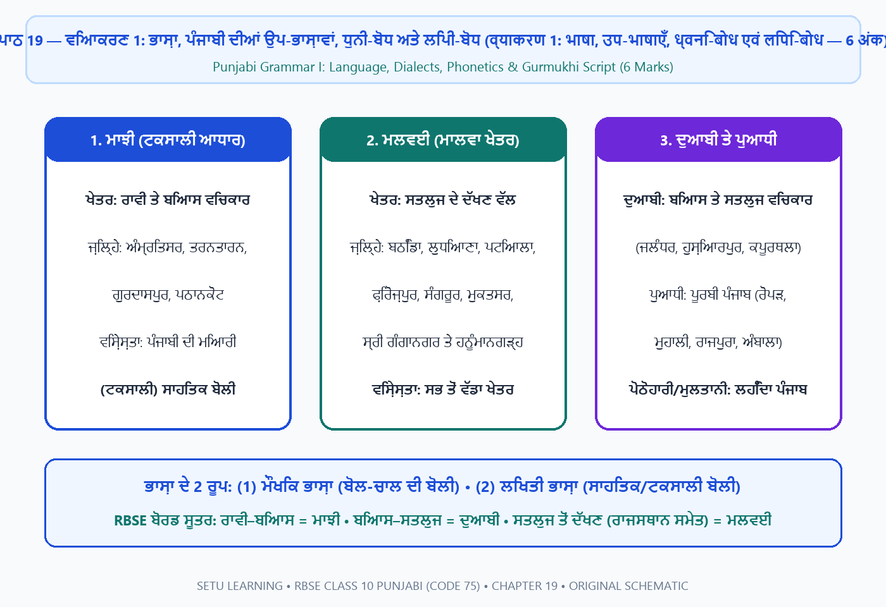

# ਪਾਠ 19 — ਵਿਆਕਰਣ 1: ਭਾਸ਼ਾ, ਪੰਜਾਬੀ ਦੀਆਂ ਉਪ-ਭਾਸ਼ਾਵਾਂ, ਧੁਨੀ-ਬੋਧ ਅਤੇ ਲਿਪੀ-ਬੋਧ (व्याकरण 1: भाषा, उप-भाषाएँ, ध्वनि-बोध एवं लिपि-बोध — 6 अंक) (Punjabi Grammar I: Language, Dialects, Phonetics & Gurmukhi Script (6 Marks))

## भाग 1: अध्याय प्रवेश एवं पाठ्यक्रम मैपिंग (ਪਾਠ-ਪ੍ਰਵੇਸ਼ ਅਤੇ ਪਾਠਕ੍ਰਮ ਮੈਪਿੰਗ)

> RBSE ਜਮਾਤ 10 ਪੰਜਾਬੀ ਪਾਠ-ਪੁਸਤਕ 'ਸਾਹਿਤ ਸੁਗੰਧੀਆਂ' ਦੇ ਸਾਰੇ ਪ੍ਰਸ਼ਨਾਂ ਦੇ ਹੱਲ ਅਤੇ 2014–2026 ਦਾ ਪੂਰਾ ਇਤਿਹਾਸਕ PYQ ਸੰਗ੍ਰਹਿ ਸਰੋਤ-ਪ੍ਰੀਖਣ ਸਮੇਤ ਸੰਕਲਿਤ ਹਨ।

**ਵਿਸ਼ਾ ਕੋਡ (विषय कोड):** 75 (ਤੀਜੀ ਭਾਸ਼ਾ — ਪੰਜਾਬੀ / तृतीया भाषा — पंजाबी) · **ਲੜੀ ਪੁਸਤਕ (श्रृंखला पुस्तक):** 7

**ਪ੍ਰਮਾਣਿਤ ਆਧਾਰ:** RBSE 2025–26 · **ਪਾਠ ਅੰਕ-ਭਾਰ:** 6 ਅੰਕ। ਇਹ ਭਾਰ ਉਸੇ ਸੰਸਕਰਣ ਦਾ ਹੈ; ਅਸਲ ਪ੍ਰਸ਼ਨ-ਵੰਡ ਦੀ ਭਵਿੱਖਬਾਣੀ ਨਹੀਂ।

**ਸਿੱਖਣ ਦੇ ਉਦੇਸ਼ (सीखने के लक्ष्य):** RBSE ਜਮਾਤ 10 ਪੰਜਾਬੀ ਵਿਆਕਰਣ ਦੇ ਪਹਿਲੇ 4 ਵਿਸ਼ਿਆਂ — (1) ਭਾਸ਼ਾ ਦੀ ਪਰਿਭਾਸ਼ਾ ਤੇ ਕਿਸਮਾਂ, (2) ਪੰਜਾਬੀ ਦੀਆਂ ਉਪ-ਭਾਸ਼ਾਵਾਂ (ਮਾਝੀ, ਮਲਵਈ, ਦੁਆਬੀ, ਪੁਆਧੀ, ਪੋਠੋਹਾਰੀ, ਮੁਲਤਾਨੀ), (3) ਧੁਨੀ-ਬੋਧ (ਸਵਰ 3/10, ਵਿਅੰਜਨ 32, ਅਨੁਨਾਸਕੀ 5, ਦੁੱਤ ਅੱਖਰ 3) ਅਤੇ (4) ਲਿਪੀ-ਬੋਧ (ਗੁਰਮੁਖੀ ਲਿਪੀ, 35+6=41 ਅੱਖਰ, ਲਗਾਂ-ਮਾਤਰਾਵਾਂ 10, ਲਗਾਖਰ 3) ਦਾ ਸੰਪੂਰਨ ਅਧਿਐਨ।

## भाग 2: शब्दावली एवं अवधारणा कैप्सूल (ਸ਼ਬਦਾਵਲੀ ਅਤੇ ਸੰਕਲਪ ਕੈਪਸੂਲ)

| ਸ਼ਬਦ / ਸੰਕਲਪ | ਅਰਥ / ਵਿਆਖਿਆ |
|---|---|
| ਭਾਸ਼ਾ / ਬੋਲੀ (भाषा / बोली) | ਮਨੁੱਖੀ ਮਨ ਦੇ ਭਾਵਾਂ ਤੇ ਵਿਚਾਰਾਂ ਨੂੰ ਬੋਲ ਕੇ ਜਾਂ ਲਿਖ ਕੇ ਪ੍ਰਗਟ ਕਰਨ ਦਾ ਸਾਰਥਕ ਸੰਚਾਰ ਸਾਧਨ (ਮੌਖਿਕ ਅਤੇ ਲਿਖਤੀ)। |
| ਉਪ-ਭਾਸ਼ਾ (उप-भाषा) | ਇੱਕੋ ਭਾਸ਼ਾ ਦੇ ਵੱਖ-ਵੱਖ ਭੂਗੋਲਿਕ ਇਲਾਕਿਆਂ ਵਿੱਚ ਬੋਲੇ ਜਾਣ ਵਾਲੇ ਸਥਾਨਕ ਰੂਪ (ਮਾਝੀ, ਮਲਵਈ, ਦੁਆਬੀ, ਪੁਆਧੀ ਆਦਿ)। |
| ਟਕਸਾਲੀ / ਮਿਆਰੀ ਭਾਸ਼ਾ (टकसाली भाषा) | ਸਿੱਖਿਆ, ਪ੍ਰਸ਼ਾਸਨ ਤੇ ਸਾਹਿਤ ਦੀ ਸਰਬ-ਪ੍ਰਵਾਨਿਤ ਭਾਸ਼ਾ (ਪੰਜਾਬੀ ਦੀ ਟਕਸਾਲੀ ਭਾਸ਼ਾ ਦਾ ਆਧਾਰ 'ਮਾਝੀ' ਹੈ)। |
| ਧੁਨੀ (ध्वनि) | ਭਾਸ਼ਾ ਦੀ ਸਭ ਤੋਂ ਛੋਟੀ ਤੋਂ ਛੋਟੀ ਸਾਰਥਕ ਆਵਾਜ਼ ਇਕਾਈ (ਸਵਰ ਧੁਨੀਆਂ ਅਤੇ ਵਿਅੰਜਨ ਧੁਨੀਆਂ)। |
| ਗੁਰਮੁਖੀ ਲਿਪੀ (गुरमुखी लिपी) | ਪੰਜਾਬੀ ਭਾਸ਼ਾ ਨੂੰ ਲਿਖਣ ਵਾਲੀ ਮਿਆਰੀ ਲਿਪੀ ਜਿਸ ਨੂੰ ਪਹਿਲਾਂ 'ਪੈਂਤੀ ਅੱਖਰੀ' (35 ਅੱਖਰ) ਕਿਹਾ ਜਾਂਦਾ ਸੀ ਅਤੇ ਹੁਣ ਨਵੀਨ ਟੋਲੀ ਸਮੇਤ **41 ਅੱਖਰ** ਹਨ। |
| ਦੁੱਤ ਅੱਖਰ / ਪੈਰੀਂ ਅੱਖਰ (दुत्त अक्खर) | ਉਹ ਤਿੰਨ ਅੱਖਰ (**ਹ, ਰ, ਵ**) ਜੋ ਦੂਜੇ ਅੱਖਰਾਂ ਦੇ ਪੈਰਾਂ ਵਿੱਚ ਜੁੜ ਕੇ ਸੰਯੁਕਤ ਧੁਨੀ ਬਣਾਉਂਦੇ ਹਨ। |
| ਲਗਾਂ ਅਤੇ ਲਗਾਖਰ (लगां अते लगाखर) | ਸਵਰ ਧੁਨੀਆਂ ਨੂੰ ਪ੍ਰਗਟ ਕਰਨ ਵਾਲੇ **10 ਚਿੰਨ੍ਹ 'ਲਗਾਂ'** ਹਨ ਅਤੇ ਲਗਾਂ ਦੇ ਨਾਲ ਲੱਗਣ ਵਾਲੇ **3 ਚਿੰਨ੍ਹ (ਬਿੰਦੀ, ਟਿੱਪੀ, ਅੱਧਕ) 'ਲਗਾਖਰ'** ਹਨ। |

## भाग 3: विस्तृत शिक्षण पाठ (ਵਿਸਤ੍ਰਿਤ ਅਧਿਆਪਨ ਪਾਠ)

### 1. ਭਾਸ਼ਾ (ਬੋਲੀ) ਦੀ ਪਰਿਭਾਸ਼ਾ ਅਤੇ ਕਿਸਮਾਂ

- **ਪਰਿਭਾਸ਼ਾ:** ਭਾਸ਼ਾ ਸ਼ਬਦ ਸੰਸਕ੍ਰਿਤ ਦੇ ਧਾਤੂ **'ਭਾਸ਼'** ਤੋਂ ਬਣਿਆ ਹੈ ਜਿਸ ਦਾ ਅਰਥ ਹੈ **'ਬੋਲਣਾ ਜਾਂ ਕਹਿਣਾ'**। ਭਾਸ਼ਾ ਉਹ ਸਾਧਨ ਹੈ ਜਿਸ ਰਾਹੀਂ ਮਨੁੱਖ ਆਪਣੇ ਮਨ ਦੇ ਭਾਵਾਂ ਅਤੇ ਵਿਚਾਰਾਂ ਨੂੰ ਦੂਜਿਆਂ ਅੱਗੇ ਬੋਲ ਕੇ ਜਾਂ ਲਿਖ ਕੇ ਪ੍ਰਗਟ ਕਰਦਾ ਹੈ।
- **ਭਾਸ਼ਾ ਦੇ ਦੋ ਮੁੱਖ ਰੂਪ (ਕਿਸਮਾਂ):**
  1. **ਬੋਲ-ਚਾਲ ਦੀ ਭਾਸ਼ਾ (ਮੌਖਿਕ ਭਾਸ਼ਾ):** ਜੋ ਮੂੰਹੋਂ ਬੋਲ ਕੇ ਅਤੇ ਕੰਨਾਂ ਨਾਲ ਸੁਣ ਕੇ ਸਮਝੀ ਜਾਂਦੀ ਹੈ।
  2. **ਲਿਖਤੀ ਭਾਸ਼ਾ (ਸਾਹਿਤਕ / ਟਕਸਾਲੀ ਭਾਸ਼ਾ):** ਜੋ ਲਿਪੀ ਦੇ ਅੱਖਰਾਂ ਰਾਹੀਂ ਲਿਖ ਕੇ ਪ੍ਰਗਟ ਕੀਤੀ ਜਾਂਦੀ ਹੈ।

---

### 2. ਪੰਜਾਬੀ ਦੀਆਂ ਪ੍ਰਮੁੱਖ ਉਪ-ਭਾਸ਼ਾਵਾਂ (Dialects of Punjabi)

| ਕ੍ਰਮ | ਉਪ-ਭਾਸ਼ਾ (Dialect) | ਭੂਗੋਲਿਕ ਖੇਤਰ (ਦਰਿਆਵਾਂ ਦੇ ਆਧਾਰ 'ਤੇ) | ਪ੍ਰਮੁੱਖ ਜ਼ਿਲ੍ਹੇ (Districts) |
|---|---|---|---|
| 1 | **ਮਾਝੀ (ਟਕਸਾਲੀ ਆਧਾਰ)** | **ਰਾਵੀ ਅਤੇ ਬਿਆਸ** ਦੇ ਵਿਚਕਾਰਲਾ ਇਲਾਕਾ ('ਮਾਝਾ' = ਵਿਚਕਾਰਲਾ) | **ਅੰਮ੍ਰਿਤਸਰ, ਤਰਨਤਾਰਨ, ਗੁਰਦਾਸਪੁਰ, ਪਠਾਨਕੋਟ** (ਅਤੇ ਲਾਹੌਰ, ਸਿਆਲਕੋਟ) |
| 2 | **ਮਲਵਈ** | **ਸਤਲੁਜ ਦੇ ਦੱਖਣ** ਵੱਲ ਦਾ ਵਿਸ਼ਾਲ ਮੈਦਾਨੀ ਇਲਾਕਾ ('ਮਾਲਵਾ') | **ਲੁਧਿਆਣਾ, ਪਟਿਆਲਾ, ਬਠਿੰਡਾ, ਸੰਗਰੂਰ, ਫ਼ਿਰੋਜ਼ਪੁਰ, ਫ਼ਰੀਦਕੋਟ, ਮੋਗਾ, ਮਾਨਸਾ, ਸ੍ਰੀ ਮੁਕਤਸਰ ਸਾਹਿਬ, ਬਰਨਾਲਾ, ਫ਼ਾਜ਼ਿਲਕਾ** ਅਤੇ ਰਾਜਸਥਾਨ ਦੇ **ਸ੍ਰੀ ਗੰਗਾਨਗਰ ਤੇ ਹਨੂੰਮਾਨਗੜ੍ਹ** |
| 3 | **ਦੁਆਬੀ** | **ਬਿਆਸ ਅਤੇ ਸਤਲੁਜ** ਦੇ ਵਿਚਕਾਰਲਾ ਇਲਾਕਾ ('ਦੁਆਬਾ' = ਦੋ ਆਬ/ਪਾਣੀ) | **ਜਲੰਧਰ, ਹੁਸ਼ਿਆਰਪੁਰ, ਕਪੂਰਥਲਾ, ਸ਼ਹੀਦ ਭਗਤ ਸਿੰਘ ਨਗਰ (ਨਵਾਂ ਸ਼ਹਿਰ)** (`ਵ` ਨੂੰ `ਬ` ਬੋਲਣ ਦੀ ਰੁਚੀ: *ਵੱਛਾ → ਬੱਛਾ*) |
| 4 | **ਪੁਆਧੀ** | ਪੰਜਾਬ ਦੇ ਚੜ੍ਹਦੇ (ਪੂਰਬੀ) ਪਾਸੇ ਘੱਗਰ ਨਦੀ ਦੇ ਆਸ-ਪਾਸ ਦਾ ਇਲਾਕਾ ('ਪੁਆਧ') | **ਰੂਪਨਗਰ (ਰੋਪੜ), ਮੁਹਾਲੀ (ਐੱਸ.ਏ.ਐੱਸ. ਨਗਰ), ਫ਼ਤਿਹਗੜ੍ਹ ਸਾਹਿਬ ਦਾ ਪੂਰਬੀ ਭਾਗ, ਪਟਿਆਲਾ (ਰਾਜਪੁਰਾ)** ਅਤੇ ਅੰਬਾਲਾ |
| 5 | **ਪੋਠੋਹਾਰੀ, ਮੁਲਤਾਨੀ (ਲਹਿੰਦੀ) ਤੇ ਡੋਗਰੀ** | ਪਾਕਿਸਤਾਨੀ ਪੰਜਾਬ ਤੇ ਜੰਮੂ ਖੇਤਰ ਦੀਆਂ ਉਪ-ਭਾਸ਼ਾਵਾਂ | **ਪੋਠੋਹਾਰੀ** (ਰਾਵਲਪਿੰਡੀ, ਜੇਹਲਮ), **ਮੁਲਤਾਨੀ** (ਮੁਲਤਾਨ, ਬਹਾਵਲਪੁਰ, ਝੰਗ), **ਡੋਗਰੀ** (ਜੰਮੂ, ਕਾਂਗੜਾ) |

---

### 3. ਧੁਨੀ-ਬੋਧ (Phonetics): ਸਵਰ ਅਤੇ ਵਿਅੰਜਨ

- **ਧੁਨੀ ਦੀ ਪਰਿਭਾਸ਼ਾ:** ਮਨੁੱਖੀ ਮੂੰਹ ਵਿੱਚੋਂ ਨਿਕਲਣ ਵਾਲੀ ਉਹ ਛੋਟੀ ਤੋਂ ਛੋਟੀ ਸਾਰਥਕ ਆਵਾਜ਼ ਜਿਸ ਦੇ ਅੱਗੋਂ ਹੋਰ ਟੁਕੜੇ ਨਾ ਹੋ ਸਕਣ, **ਧੁਨੀ** ਅਖਵਾਉਂਦੀ ਹੈ।
- **ਧੁਨੀਆਂ ਦੇ ਦੋ ਮੁੱਖ ਭੇਦ:**

| ਭੇਦ | ਪਰਿਭਾਸ਼ਾ | ਗਿਣਤੀ ਅਤੇ ਵਰਗੀਕਰਨ |
|---|---|---|
| **1. ਸਵਰ ਧੁਨੀਆਂ (Vowels)** | ਉਹ ਧੁਨੀਆਂ ਜਿਨ੍ਹਾਂ ਦੇ ਉਚਾਰਨ ਸਮੇਂ ਫੇਫੜਿਆਂ ਵਿੱਚੋਂ ਆਉਂਦੀ ਹਵਾ ਮੂੰਹ ਵਿੱਚੋਂ ਬਿਨਾਂ ਕਿਸੇ ਰੋਕ ਦੇ ਬਾਹਰ ਨਿਕਲਦੀ ਹੈ। | • **ਮੂਲ ਸਵਰ ਅੱਖਰ (ਸਵਰ-ਵਾਹਕ): 3** (**ੳ, ਅ, ੲ**) • **ਸਵਰ ਧੁਨੀਆਂ (ਲਗਾਂ ਸਮੇਤ): 10** (**ਅ, ਆ, ਇ, ਈ, ਉ, ਊ, ਏ, ਐ, ਓ, ਔ**) • **ਲਘੂ (ਹ੍ਰਸਵ) ਸਵਰ (3):** ਅ, ਇ, ਉ • **ਦੀਰਘ ਸਵਰ (7):** ਆ, ਈ, ਊ, ਏ, ਐ, ਓ, ਔ |
| **2. ਵਿਅੰਜਨ ਧੁਨੀਆਂ (Consonants)** | ਉਹ ਧੁਨੀਆਂ ਜਿਨ੍ਹਾਂ ਦੇ ਉਚਾਰਨ ਸਮੇਂ ਸਾਹ ਦੀ ਹਵਾ ਮੂੰਹ ਦੇ ਕਿਸੇ ਅੰਗ (ਜੀਭ, ਤਾਲੂ, ਦੰਦ, ਬੁੱਲ੍ਹ) ਨਾਲ ਟਕਰਾ ਕੇ ਜਾਂ ਰੁਕ ਕੇ ਬਾਹਰ ਨਿਕਲਦੀ ਹੈ। | • **ਸ਼ੁੱਧ ਵਿਅੰਜਨ ਅੱਖਰ:** `ਸ` ਤੋਂ `ੜ` ਤੱਕ **32** (ਨਵੀਨ ਟੋਲੀ ਦੇ 6 ਅੱਖਰ ਮਿਲਾ ਕੇ **38**) • **ਅਨੁਨਾਸਕੀ (ਨਾਸਕੀ) ਵਿਅੰਜਨ (5):** **ਙ, ਞ, ਣ, ਨ, ਮ** (ਜਿੰਨ੍ਹਾਂ ਦੀ ਆਵਾਜ਼ ਨੱਕ ਰਾਹੀਂ ਨਿਕਲਦੀ ਹੈ) • **ਅੰਤਸਥ / ਅਰਧ-ਸਵਰ:** **ਯ, ਵ** |

---

### 4. ਲਿਪੀ-ਬੋਧ: ਗੁਰਮੁਖੀ ਲਿਪੀ, ਵਰਣਮਾਲਾ, ਲਗਾਂ ਅਤੇ ਲਗਾਖਰ

1. **ਗੁਰਮੁਖੀ ਲਿਪੀ ਦਾ ਇਤਿਹਾਸ ਅਤੇ ਨਾਮਕਰਨ:** ਪੰਜਾਬੀ ਭਾਸ਼ਾ ਨੂੰ ਲਿਖਣ ਲਈ ਸਭ ਤੋਂ ਢੁਕਵੀਂ ਅਤੇ ਮਿਆਰੀ ਲਿਪੀ **'ਗੁਰਮੁਖੀ ਲਿਪੀ'** ਹੈ (ਪਾਕਿਸਤਾਨੀ ਪੰਜਾਬ ਵਿੱਚ ਫ਼ਾਰਸੀ ਆਧਾਰਿਤ 'ਸ਼ਾਹਮੁਖੀ' ਵਰਤੀ ਜਾਂਦੀ ਹੈ)। ਗੁਰਮੁਖੀ ਦਾ ਅਰਥ ਹੈ **'ਗੁਰੂਆਂ ਦੇ ਮੁੱਖੋਂ ਨਿਕਲੀ ਲਿਪੀ'** — ਦੂਜੇ ਪਾਤਸ਼ਾਹ **ਸ੍ਰੀ ਗੁਰੂ ਅੰਗਦ ਦੇਵ ਜੀ** ਨੇ ਇਸ ਲਿਪੀ ਦੇ ਅੱਖਰਾਂ ਨੂੰ ਤਰਤੀਬ ਦੇ ਕੇ ਸਰਲ ਤੇ ਮਿਆਰੀ ਬਣਾਇਆ।
2. **ਗੁਰਮੁਖੀ ਵਰਣਮਾਲਾ ਦੇ ਅੱਖਰ (35 + 6 = 41 ਅੱਖਰ ਤੇ 8 ਵਰਗ):**
   - ਪਹਿਲਾਂ ਇਸ ਵਿੱਚ **7 ਵਰਗਾਂ (ਟੋਲੀਆਂ)** ਦੇ **35 ਅੱਖਰ** ਸਨ, ਇਸ ਲਈ ਇਸ ਨੂੰ **'ਪੈਂਤੀ ਅੱਖਰੀ'** ਕਿਹਾ ਜਾਂਦਾ ਸੀ।
   - ਬਾਅਦ ਵਿੱਚ ਅਰਬੀ-ਫ਼ਾਰਸੀ ਦੀਆਂ ਧੁਨੀਆਂ ਪ੍ਰਗਟ ਕਰਨ ਲਈ ਪੈਰ ਵਿੱਚ ਬਿੰਦੀ ਵਾਲੇ **6 ਅੱਖਰਾਂ ਦੀ 'ਨਵੀਨ ਟੋਲੀ'** ਜੋੜੀ ਗਈ, ਜਿਸ ਨਾਲ ਹੁਣ ਗੁਰਮੁਖੀ ਵਿੱਚ **8 ਵਰਗ ਅਤੇ 41 ਅੱਖਰ** ਹਨ:

| ਵਰਗ (Group) | ਅੱਖਰ (Letters) | ਗਿਣਤੀ | ਵਿਸ਼ੇਸ਼ਤਾ |
|---|---|---|---|
| **1. ਮੁੱਖ ਵਰਗ** | **ੳ, ਅ, ੲ, ਸ, ਹ** | 5 | `ੳ, ਅ, ੲ` ਤਿੰਨ ਸਵਰ-ਵਾਹਕ ਹਨ |
| **2. ਕਵਰਗ** | **ਕ, ਖ, ਗ, ਘ, ਙ** | 5 | ਕੰਠੀ ਧੁਨੀਆਂ (`ਙ` ਅਨੁਨਾਸਕੀ) |
| **3. ਚਵਰਗ** | **ਚ, ਛ, ਜ, ਝ, ਞ** | 5 | ਤਾਲਵੀ ਧੁਨੀਆਂ (`ਞ` ਅਨੁਨਾਸਕੀ) |
| **4. ਟਵਰਗ** | **ਟ, ਠ, ਡ, ਢ, ਣ** | 5 | ਉਲਟ-ਜੀਭੀ / ਮੂਰਧਨੀ (`ਣ` ਅਨੁਨਾਸਕੀ) |
| **5. ਤਵਰਗ** | **ਤ, ਥ, ਦ, ਧ, ਨ** | 5 | ਦੰਤੀ ਧੁਨੀਆਂ (`ਨ` ਅਨੁਨਾਸਕੀ) |
| **6. ਪਵਰਗ** | **ਪ, ਫ, ਬ, ਭ, ਮ** | 5 | ਹੋਠੀ / ਦੋ-ਬੁੱਲ੍ਹੀ (`ਮ` ਅਨੁਨਾਸਕੀ) |
| **7. ਅੰਤਿਮ ਵਰਗ** | **ਯ, ਰ, ਲ, ਵ, ੜ** | 5 | ਅੰਤਸਥ ਤੇ ਦੁੱਤ ਅੱਖਰਾਂ ਵਾਲੀ ਟੋਲੀ |
| **8. ਨਵੀਨ ਵਰਗ** | **ਸ਼, ਖ਼, ਗ਼, ਜ਼, ਫ਼, ਲ਼** | 6 | ਪੈਰ ਬਿੰਦੀ ਵਾਲੇ ਅੱਖਰ (`ਲ਼` ਤਾਲਵੀ ਧੁਨੀ) |

3. **ਦੁੱਤ ਅੱਖਰ (ਪੈਰੀਂ ਪੈਣ ਵਾਲੇ 3 ਅੱਖਰ):** ਗੁਰਮੁਖੀ ਵਿੱਚ **ਹ, ਰ, ਵ** ਤਿੰਨ ਦੁੱਤ ਅੱਖਰ ਹਨ ਜੋ ਦੂਜੇ ਅੱਖਰਾਂ ਦੇ ਪੈਰਾਂ ਵਿੱਚ ਲੱਗਦੇ ਹਨ:
   - **੍ਹ (ਹ):** ਪੜ੍ਹ, ਚੜ੍ਹ, ਜੜ੍ਹ, ਕੱਲ੍ਹ
   - **੍ਰ (ਰ):** ਪ੍ਰੇਮ, ਪ੍ਰਕਾਸ਼, ਕ੍ਰਿਪਾ, ਅੰਮ੍ਰਿਤ
   - **੍ਵ (ਵ):** ਸ੍ਵੈ, ਸ੍ਵਰਗ, ਦ੍ਵਾਰ
4. **ਲਗਾਂ-ਮਾਤਰਾਵਾਂ (10 ਲਗਾਂ):** `ੳ, ਅ, ੲ` ਦੇ ਨਾਲ ਲੱਗਣ ਵਾਲਾ ਨਿਯਮ **3-4-3** ਹੈ (`ੳ` ਨਾਲ 3 ਲਗਾਂ: ਔਂਕੜ, ਦੁਲੈਂਕੜ, ਹੋੜਾ; `ਅ` ਨਾਲ 4 ਲਗਾਂ: ਮੁਕਤਾ, ਕੰਨਾ, ਦੁਲਾਵਾਂ, ਕਨੌੜਾ; `ੲ` ਨਾਲ 3 ਲਗਾਂ: ਸਿਹਾਰੀ, ਬਿਹਾਰੀ, ਲਾਂ):
   - **(1) ਮੁਕਤਾ** (ਕੋਈ ਚਿੰਨ੍ਹ ਨਹੀਂ: ਘਰ, ਜਲ), **(2) ਕੰਨਾ `ਾ`** (ਕਾਰ), **(3) ਸਿਹਾਰੀ `ਿ`** (ਸਿਰ), **(4) ਬਿਹਾਰੀ `ੀ`** (ਤੀਰ), **(5) ਔਂਕੜ `ੁ`** (ਪੁਲ), **(6) ਦੁਲੈਂਕੜ `ੂ`** (ਸੂਰਜ), **(7) ਲਾਂ `ੇ`** (ਸੇਬ), **(8) ਦੁਲਾਵਾਂ `ੈ`** (ਪੈਰ), **(9) ਹੋੜਾ `ੋ`** (ਮੋਰ), **(10) ਕਨੌੜਾ `ੌ`** (ਕੌਣ)।
5. **ਲਗਾਖਰ (3 ਲਗਾਖਰ):**
   - **1. ਬਿੰਦੀ (`ਂ`):** ਨੱਕ ਰਾਹੀਂ ਆਵਾਜ਼ ਲਈ **6 ਲਗਾਂ** (ਕੰਨਾ, ਬਿਹਾਰੀ, ਲਾਂ, ਦੁਲਾਵਾਂ, ਹੋੜਾ, ਕਨੌੜਾ) ਨਾਲ ਲੱਗਦੀ ਹੈ (ਜਿਵੇਂ: *ਮਾਂ, ਗੇਂਦ, ਕੈਂਚੀ, ਚੌਂਕ*)।
   - **2. ਟਿੱਪੀ (`ੰ`):** ਨੱਕ ਰਾਹੀਂ ਆਵਾਜ਼ ਲਈ **4 ਲਗਾਂ** (ਮੁਕਤਾ, ਸਿਹਾਰੀ, ਔਂਕੜ, ਦੁਲੈਂਕੜ) ਨਾਲ ਲੱਗਦੀ ਹੈ (ਜਿਵੇਂ: *ਕੰਮ, ਸਿੰਘ, ਸੁੰਦਰ, ਗੂੰਜ*)।
   - **3. ਅੱਧਕ (`ੱ`):** ਅਗਲੇ ਅੱਖਰ ਦੀ ਆਵਾਜ਼ ਨੂੰ ਦੁੱਗਣਾ (ਦੁਹਰਾ) ਕਰਨ ਲਈ **3 ਲਗਾਂ** (ਮੁਕਤਾ, ਸਿਹਾਰੀ, ਔਂਕੜ) ਨਾਲ ਲੱਗਦੀ ਹੈ (ਜਿਵੇਂ: *ਸੱਪ, ਵਿੱਦਿਆ, ਕੁੱਤਾ*)।

ਪਾਠ 19: ਪੰਜਾਬੀ ਦੀਆਂ ਉਪ-ਭਾਸ਼ਾਵਾਂ, ਧੁਨੀ-ਬੋਧ ਅਤੇ ਗੁਰਮੁਖੀ ਲਿਪੀ-ਬੋਧ ਦਾ ਸੰਕਲਪ ਚਿੱਤਰ

## भाग 4: पाठ्यपुस्तक-अवधारणाओं पर मौलिक हल किए उदाहरण (ਹੱਲ ਕੀਤੇ ਮਿਆਰੀ ਉਦਾਹਰਣ)

ਹੇਠਾਂ ਦਿੱਤੇ ਪ੍ਰਸ਼ਨ ਪਾਠ-ਪੁਸਤਕ 'ਸਾਹਿਤ ਸੁਗੰਧੀਆਂ' ਅਤੇ ਵਿਆਕਰਣ ਦੇ ਸੰਕਲਪਾਂ ਉੱਤੇ ਆਧਾਰਿਤ ਮੌਲਿਕ ਆਦਰਸ਼ ਹੱਲ ਹਨ।

**ਹੱਲ ਕੀਤਾ ਉਦਾਹਰਣ 1: ਭਾਸ਼ਾ ਕਿਸ ਨੂੰ ਕਹਿੰਦੇ ਹਨ? ਇਸ ਦੇ ਕਿੰਨੇ ਰੂਪ ਹਨ? (RBSE 2022 Main Q9, 2025 Supp Q9)**

ਭਾਸ਼ਾ ਉਹ ਸੰਚਾਰ ਸਾਧਨ ਹੈ ਜਿਸ ਰਾਹੀਂ ਮਨੁੱਖ ਆਪਣੇ ਮਨ ਦੇ ਭਾਵਾਂ ਅਤੇ ਵਿਚਾਰਾਂ ਨੂੰ ਦੂਜਿਆਂ ਅੱਗੇ ਪ੍ਰਗਟ ਕਰਦਾ ਹੈ। ਭਾਸ਼ਾ ਦੇ ਦੋ ਮੁੱਖ ਰੂਪ ਹਨ: (1) ਮੌਖਿਕ ਭਾਸ਼ਾ (ਬੋਲ-ਚਾਲ ਦੀ ਭਾਸ਼ਾ) ਅਤੇ (2) ਲਿਖਤੀ ਭਾਸ਼ਾ (ਸਾਹਿਤਕ ਭਾਸ਼ਾ)।

**ਹੱਲ ਕੀਤਾ ਉਦਾਹਰਣ 2: ਪੰਜਾਬੀ ਦੀਆਂ ਚਾਰ ਪ੍ਰਮੁੱਖ ਉਪ-ਭਾਸ਼ਾਵਾਂ ਦੇ ਨਾਂ ਅਤੇ ਉਹਨਾਂ ਦੇ ਖੇਤਰ ਲਿਖੋ। (RBSE 2018 Main Q4, 2023 Main Q9, 2024 Main Q9)**

1. ਮਾਝੀ (ਰਾਵੀ ਤੇ ਬਿਆਸ ਵਿਚਕਾਰ — ਅੰਮ੍ਰਿਤਸਰ, ਗੁਰਦਾਸਪੁਰ, ਤਰਨਤਾਰਨ)। 2. ਮਲਵਈ (ਸਤਲੁਜ ਦੇ ਦੱਖਣ ਵੱਲ — ਬਠਿੰਡਾ, ਲੁਧਿਆਣਾ, ਪਟਿਆਲਾ, ਫ਼ਿਰੋਜ਼ਪੁਰ, ਸ੍ਰੀ ਗੰਗਾਨਗਰ)। 3. ਦੁਆਬੀ (ਬਿਆਸ ਤੇ ਸਤਲੁਜ ਵਿਚਕਾਰ — ਜਲੰਧਰ, ਹੁਸ਼ਿਆਰਪੁਰ, ਕਪੂਰਥਲਾ)। 4. ਪੁਆਧੀ (ਪੂਰਬੀ ਪੰਜਾਬ — ਰੋਪੜ, ਮੁਹਾਲੀ, ਰਾਜਪੁਰਾ)।

**ਹੱਲ ਕੀਤਾ ਉਦਾਹਰਣ 3: ਗੁਰਮੁਖੀ ਵਰਣਮਾਲਾ ਵਿੱਚ ਕੁੱਲ ਕਿੰਨੇ ਅੱਖਰ, ਕਿੰਨੇ ਸਵਰ, ਕਿੰਨੇ ਦੁੱਤ ਅੱਖਰ, ਕਿੰਨੀਆਂ ਲਗਾਂ ਅਤੇ ਕਿੰਨੇ ਲਗਾਖਰ ਹਨ?**

ਗੁਰਮੁਖੀ ਵਰਣਮਾਲਾ ਵਿੱਚ ਪਹਿਲਾਂ 35 ਅੱਖਰ ਸਨ ਅਤੇ ਨਵੀਨ ਟੋਲੀ ਦੇ 6 ਅੱਖਰ ਮਿਲਾ ਕੇ ਕੁੱਲ 41 ਅੱਖਰ ਹਨ। ਇਸ ਵਿੱਚ 3 ਮੂਲ ਸਵਰ ਅੱਖਰ (ੳ, ਅ, ੲ — 10 ਸਵਰ ਧੁਨੀਆਂ), 5 ਅਨੁਨਾਸਕੀ ਵਿਅੰਜਨ (ਙ, ਞ, ਣ, ਨ, ਮ), 3 ਦੁੱਤ ਅੱਖਰ (ਹ, ਰ, ਵ), 10 ਲਗਾਂ ਅਤੇ 3 ਲਗਾਖਰ (ਬਿੰਦੀ, ਟਿੱਪੀ, ਅੱਧਕ) ਹਨ।

## भाग 5: सत्यापित बोर्ड प्रश्न एवं स्रोत-स्थिति (ਪ੍ਰਮਾਣਿਤ ਬੋਰਡ ਪ੍ਰਸ਼ਨ ਅਤੇ ਸਰੋਤ-ਸਥਿਤੀ)

RBSE 2026 Main (`S-75`, Q1-xv, Q2-vi, Q9), 2026 Supp (Q1-IX, Q2-VI, Q9), 2025 Main (Q1-xiv, Q2-vi, Q9, Q10) ਅਤੇ 2022–2024 ਦੇ ਹਰ ਪੇਪਰ ਵਿੱਚ ਇਸ ਪਾਠ ਵਿੱਚੋਂ 6 ਅੰਕਾਂ ਦੇ ਪ੍ਰਸ਼ਨ ਪੁੱਛੇ ਗਏ ਹਨ।

[RBSE 2026 ਮੂਲ ਪੇਪਰ (S-75)](https://rajeduboard.rajasthan.gov.in/books/PAPERS-2026/Sec/S-75.pdf)। ਪ੍ਰਸ਼ਨ ਦਾ ਸੰਖੇਪ ਵਿਸ਼ਾ-ਸੰਦਰਭ ਹੈ; ਸ਼ਬਦ-ਬ-ਸ਼ਬਦ ਪੁਨਰ-ਮੁਦਰਣ ਨਹੀਂ।

## भाग 6: खंडवार मौलिक अभ्यास बैंक (ਖੰਡ-ਵਾਰ ਮੌਲਿਕ ਅਭਿਆਸ ਬੈਂਕ)

**ਅਭਿਆਸ-ਅੰਕ:** ਵਿਦਿਆਰਥੀਆਂ ਦੇ ਸਵੈ-ਅਭਿਆਸ ਲਈ ਹਨ; ਉੱਤਰ ਪਹਿਲਾਂ ਆਪ ਲਿਖੋ, ਫਿਰ ਭਾਗ 9 ਵੇਖੋ।

## ੳ: ਬਹੁ-ਵਿਕਲਪੀ ਪ੍ਰਸ਼ਨ (MCQ) — 15 × 1 ਅੰਕ

**MCQ 1. ਪੰਜਾਬੀ ਭਾਸ਼ਾ ਨੂੰ ਲਿਖਣ ਲਈ ਕਿਹੜੀ ਲਿਪੀ ਵਰਤੀ ਜਾਂਦੀ ਹੈ? (RBSE 2025 Main Q2-vi, 2026 Supp Q1-IX)**

ੳ) ਬ੍ਰਾਹਮੀ ਲਿਪੀ  
ਅ) ਗੁਰਮੁਖੀ ਲਿਪੀ  
ੲ) ਦੇਵਨਾਗਰੀ ਲਿਪੀ  
ਸ) ਰੋਮਨ ਲਿਪੀ

**MCQ 2. ਗੁਰਮੁਖੀ ਵਰਣਮਾਲਾ ਵਿੱਚ ਨਵੀਨ ਟੋਲੀ ਸਮੇਤ ਕੁੱਲ ਕਿੰਨੇ ਅੱਖਰ ਹਨ? (RBSE 2024 Main Q1-ix)**

ੳ) 41 ਅੱਖਰ (35 + 6)  
ਅ) 35 ਅੱਖਰ  
ੲ) 52 ਅੱਖਰ  
ਸ) 26 ਅੱਖਰ

**MCQ 3. ਗੁਰਮੁਖੀ ਵਰਣਮਾਲਾ ਵਿੱਚ ਮੂਲ ਸਵਰ ਅੱਖਰ (ਸਵਰ-ਵਾਹਕ) ਕਿੰਨੇ ਹਨ? (RBSE 2025 Main Q1-xiv)**

ੳ) 5  
ਅ) 10  
ੲ) 7  
ਸ) 3 (ੳ, ਅ, ੲ)

**MCQ 4. ਪੰਜਾਬੀ ਵਿੱਚ 'ਦੁੱਤ ਅੱਖਰ' (ਪੈਰੀਂ ਪੈਣ ਵਾਲੇ ਅੱਖਰ) ਕਿਹੜੇ ਹਨ? (RBSE 2024 Main Q2-vi, 2026 Main Q2-vi)**

ੳ) ਯ, ਰ, ਲ  
ਅ) ਙ, ਞ, ਣ  
ੲ) ਹ, ਰ, ਵ  
ਸ) ੳ, ਅ, ੲ

**MCQ 5. ਪੰਜਾਬੀ ਭਾਸ਼ਾ ਵਿੱਚ ਲਗਾਂ (ਮਾਤਰਾਵਾਂ) ਦੀ ਕੁੱਲ ਗਿਣਤੀ ਕਿੰਨੀ ਹੈ?**

ੳ) 12  
ਅ) 10  
ੲ) 3  
ਸ) 7

**MCQ 6. ਗੁਰਮੁਖੀ ਲਿਪੀ ਵਿੱਚ 'ਲਗਾਖਰ' ਕਿੰਨੇ ਅਤੇ ਕਿਹੜੇ ਹਨ? (RBSE 2022 Main Q2-v, 2025 Supp Q2-vi)**

ੳ) 3 (ਬਿੰਦੀ, ਟਿੱਪੀ, ਅੱਧਕ)  
ਅ) 3 (ਹ, ਰ, ਵ)  
ੲ) 3 (ੳ, ਅ, ੲ)  
ਸ) 5 (ਙ, ਞ, ਣ, ਨ, ਮ)

**MCQ 7. ਪੰਜਾਬੀ ਵਿੱਚ ਅਨੁਨਾਸਕੀ (ਨਾਸਕੀ) ਵਿਅੰਜਨ ਕਿੰਨੇ ਹਨ? (RBSE 2026 Main Q9)**

ੳ) 3  
ਅ) 6  
ੲ) 4  
ਸ) 5 (ਙ, ਞ, ਣ, ਨ, ਮ)

**MCQ 8. ਪੰਜਾਬੀ ਦੀ ਟਕਸਾਲੀ (ਮਿਆਰੀ) ਭਾਸ਼ਾ ਦਾ ਆਧਾਰ ਕਿਹੜੀ ਉਪ-ਭਾਸ਼ਾ ਹੈ?**

ੳ) ਦੁਆਬੀ  
ਅ) ਪੁਆਧੀ  
ੲ) ਮਾਝੀ  
ਸ) ਮਲਵਈ

**MCQ 9. ਅੰਮ੍ਰਿਤਸਰ, ਤਰਨਤਾਰਨ ਅਤੇ ਗੁਰਦਾਸਪੁਰ ਜ਼ਿਲ੍ਹਿਆਂ ਵਿੱਚ ਕਿਹੜੀ ਉਪ-ਭਾਸ਼ਾ ਬੋਲੀ ਜਾਂਦੀ ਹੈ?**

ੳ) ਪੁਆਧੀ  
ਅ) ਮਾਝੀ  
ੲ) ਦੁਆਬੀ  
ਸ) ਮਲਵਈ

**MCQ 10. ਬਿਆਸ ਅਤੇ ਸਤਲੁਜ ਦਰਿਆਵਾਂ ਦੇ ਵਿਚਕਾਰਲੇ ਇਲਾਕੇ (ਜਲੰਧਰ, ਹੁਸ਼ਿਆਰਪੁਰ, ਕਪੂਰਥਲਾ) ਵਿੱਚ ਕਿਹੜੀ ਉਪ-ਭਾਸ਼ਾ ਬੋਲੀ ਜਾਂਦੀ ਹੈ?**

ੳ) ਦੁਆਬੀ  
ਅ) ਮਾਝੀ  
ੲ) ਮਲਵਈ  
ਸ) ਪੋਠੋਹਾਰੀ

**MCQ 11. ਬਠਿੰਡਾ, ਲੁਧਿਆਣਾ, ਪਟਿਆਲਾ, ਫ਼ਿਰੋਜ਼ਪੁਰ ਅਤੇ ਰਾਜਸਥਾਨ ਦੇ ਸ੍ਰੀ ਗੰਗਾਨਗਰ/ਹਨੂੰਮਾਨਗੜ੍ਹ ਵਿੱਚ ਕਿਹੜੀ ਉਪ-ਭਾਸ਼ਾ ਬੋਲੀ ਜਾਂਦੀ ਹੈ?**

ੳ) ਮਾਝੀ  
ਅ) ਪੁਆਧੀ  
ੲ) ਮੁਲਤਾਨੀ  
ਸ) ਮਲਵਈ

**MCQ 12. ਗੁਰਮੁਖੀ ਦੇ 'ਨਵੀਨ ਵਰਗ' ਵਿੱਚ ਪੈਰ ਬਿੰਦੀ ਵਾਲੇ ਕਿੰਨੇ ਅੱਖਰ ਹਨ?**

ੳ) 3  
ਅ) 7  
ੲ) 6 (ਸ਼, ਖ਼, ਗ਼, ਜ਼, ਫ਼, ਲ਼)  
ਸ) 5

**MCQ 13. 'ੳ' (ਊੜਾ) ਸਵਰ ਅੱਖਰ ਦੇ ਨਾਲ ਕਿੰਨੀਆਂ ਲਗਾਂ ਲੱਗਦੀਆਂ ਹਨ?**

ੳ) 10  
ਅ) 3 (ਔਂਕੜ, ਦੁਲੈਂਕੜ, ਹੋੜਾ)  
ੲ) 4 (ਮੁਕਤਾ, ਕੰਨਾ, ਦੁਲਾਵਾਂ, ਕਨੌੜਾ)  
ਸ) 3 (ਸਿਹਾਰੀ, ਬਿਹਾਰੀ, ਲਾਂ)

**MCQ 14. ਕਿਸੇ ਅੱਖਰ ਦੀ ਆਵਾਜ਼ ਨੂੰ ਦੁੱਗਣਾ (ਦੁਹਰਾ) ਕਰਨ ਲਈ ਕਿਹੜਾ ਲਗਾਖਰ ਵਰਤਿਆ ਜਾਂਦਾ ਹੈ?**

ੳ) ਅੱਧਕ (ੱ)  
ਅ) ਬਿੰਦੀ (ਂ)  
ੲ) ਟਿੱਪੀ (ੰ)  
ਸ) ਦੁੱਤ ਹ (੍ਹ)

**MCQ 15. ਉਚਾਰਨ ਵੇਲੇ ਸਾਹ ਦੀ ਹਵਾ ਬਿਨਾਂ ਕਿਸੇ ਰੁਕਾਵਟ ਦੇ ਬਾਹਰ ਨਿਕਲਣ ਵਾਲੀਆਂ ਧੁਨੀਆਂ ਨੂੰ ਕੀ ਕਹਿੰਦੇ ਹਨ?**

ੳ) ਵਿਅੰਜਨ ਧੁਨੀਆਂ  
ਅ) ਦੁੱਤ ਧੁਨੀਆਂ  
ੲ) ਨਾਸਕੀ ਧੁਨੀਆਂ  
ਸ) ਸਵਰ ਧੁਨੀਆਂ

## ੳ: ਖਾਲੀ ਥਾਵਾਂ ਭਰੋ — 6 × 1 ਅੰਕ

1. ਮਨੁੱਖੀ ਮਨ ਦੇ ਭਾਵਾਂ ਤੇ ਵਿਚਾਰਾਂ ਨੂੰ ਬੋਲ ਕੇ ਜਾਂ ਲਿਖ ਕੇ ਪ੍ਰਗਟ ਕਰਨ ਦਾ ਸਾਰਥਕ ਸੰਚਾਰ ਸਾਧਨ (ਮੌਖਿਕ ਅਤੇ ਲਿਖਤੀ)। — ਇਸ ਸ਼ਬਦ/ਸੰਕਲਪ ਦਾ ਨਾਂ ਹੈ: ____।  
2. ਇੱਕੋ ਭਾਸ਼ਾ ਦੇ ਵੱਖ-ਵੱਖ ਭੂਗੋਲਿਕ ਇਲਾਕਿਆਂ ਵਿੱਚ ਬੋਲੇ ਜਾਣ ਵਾਲੇ ਸਥਾਨਕ ਰੂਪ (ਮਾਝੀ, ਮਲਵਈ, ਦੁਆਬੀ, ਪੁਆਧੀ ਆਦਿ)। — ਇਸ ਸ਼ਬਦ/ਸੰਕਲਪ ਦਾ ਨਾਂ ਹੈ: ____।  
3. ਸਿੱਖਿਆ, ਪ੍ਰਸ਼ਾਸਨ ਤੇ ਸਾਹਿਤ ਦੀ ਸਰਬ-ਪ੍ਰਵਾਨਿਤ ਭਾਸ਼ਾ (ਪੰਜਾਬੀ ਦੀ ਟਕਸਾਲੀ ਭਾਸ਼ਾ ਦਾ ਆਧਾਰ 'ਮਾਝੀ' ਹੈ)। — ਇਸ ਸ਼ਬਦ/ਸੰਕਲਪ ਦਾ ਨਾਂ ਹੈ: ____।  
4. ਭਾਸ਼ਾ ਦੀ ਸਭ ਤੋਂ ਛੋਟੀ ਤੋਂ ਛੋਟੀ ਸਾਰਥਕ ਆਵਾਜ਼ ਇਕਾਈ (ਸਵਰ ਧੁਨੀਆਂ ਅਤੇ ਵਿਅੰਜਨ ਧੁਨੀਆਂ)। — ਇਸ ਸ਼ਬਦ/ਸੰਕਲਪ ਦਾ ਨਾਂ ਹੈ: ____।  
5. ਪੰਜਾਬੀ ਭਾਸ਼ਾ ਨੂੰ ਲਿਖਣ ਵਾਲੀ ਮਿਆਰੀ ਲਿਪੀ ਜਿਸ ਨੂੰ ਪਹਿਲਾਂ 'ਪੈਂਤੀ ਅੱਖਰੀ' (35 ਅੱਖਰ) ਕਿਹਾ ਜਾਂਦਾ ਸੀ ਅਤੇ ਹੁਣ ਨਵੀਨ ਟੋਲੀ ਸਮੇਤ **41 ਅੱਖਰ** ਹਨ। — ਇਸ ਸ਼ਬਦ/ਸੰਕਲਪ ਦਾ ਨਾਂ ਹੈ: ____।  
6. ਉਹ ਤਿੰਨ ਅੱਖਰ (**ਹ, ਰ, ਵ**) ਜੋ ਦੂਜੇ ਅੱਖਰਾਂ ਦੇ ਪੈਰਾਂ ਵਿੱਚ ਜੁੜ ਕੇ ਸੰਯੁਕਤ ਧੁਨੀ ਬਣਾਉਂਦੇ ਹਨ। — ਇਸ ਸ਼ਬਦ/ਸੰਕਲਪ ਦਾ ਨਾਂ ਹੈ: ____।

## ੳ: ਅਤਿ-ਲਘੂ ਉੱਤਰਾਂ ਵਾਲੇ ਪ੍ਰਸ਼ਨ — 8 × 1 ਅੰਕ

1. ਪੰਜਾਬੀ ਭਾਸ਼ਾ ਨੂੰ ਲਿਖਣ ਲਈ ਕਿਹੜੀ ਲਿਪੀ ਵਰਤੀ ਜਾਂਦੀ ਹੈ? (RBSE 2025 Main Q2-vi, 2026 Supp Q1-IX)  
2. ਗੁਰਮੁਖੀ ਵਰਣਮਾਲਾ ਵਿੱਚ ਨਵੀਨ ਟੋਲੀ ਸਮੇਤ ਕੁੱਲ ਕਿੰਨੇ ਅੱਖਰ ਹਨ? (RBSE 2024 Main Q1-ix)  
3. ਗੁਰਮੁਖੀ ਵਰਣਮਾਲਾ ਵਿੱਚ ਮੂਲ ਸਵਰ ਅੱਖਰ (ਸਵਰ-ਵਾਹਕ) ਕਿੰਨੇ ਹਨ? (RBSE 2025 Main Q1-xiv)  
4. ਪੰਜਾਬੀ ਵਿੱਚ 'ਦੁੱਤ ਅੱਖਰ' (ਪੈਰੀਂ ਪੈਣ ਵਾਲੇ ਅੱਖਰ) ਕਿਹੜੇ ਹਨ? (RBSE 2024 Main Q2-vi, 2026 Main Q2-vi)  
5. ਪੰਜਾਬੀ ਭਾਸ਼ਾ ਵਿੱਚ ਲਗਾਂ (ਮਾਤਰਾਵਾਂ) ਦੀ ਕੁੱਲ ਗਿਣਤੀ ਕਿੰਨੀ ਹੈ?  
6. ਗੁਰਮੁਖੀ ਲਿਪੀ ਵਿੱਚ 'ਲਗਾਖਰ' ਕਿੰਨੇ ਅਤੇ ਕਿਹੜੇ ਹਨ? (RBSE 2022 Main Q2-v, 2025 Supp Q2-vi)  
7. ਪੰਜਾਬੀ ਵਿੱਚ ਅਨੁਨਾਸਕੀ (ਨਾਸਕੀ) ਵਿਅੰਜਨ ਕਿੰਨੇ ਹਨ? (RBSE 2026 Main Q9)  
8. ਪੰਜਾਬੀ ਦੀ ਟਕਸਾਲੀ (ਮਿਆਰੀ) ਭਾਸ਼ਾ ਦਾ ਆਧਾਰ ਕਿਹੜੀ ਉਪ-ਭਾਸ਼ਾ ਹੈ?

## ਅ: ਲਘੂ ਉੱਤਰਾਂ ਵਾਲੇ ਪ੍ਰਸ਼ਨ — 4 × 2 ਅੰਕ

**B1.** ਪੰਜਾਬੀ ਭਾਸ਼ਾ ਨੂੰ ਲਿਖਣ ਲਈ ਕਿਹੜੀ ਲਿਪੀ ਦੀ ਵਰਤੋਂ ਕੀਤੀ ਜਾਂਦੀ ਹੈ? (RBSE 2025 Main Q2-vi, 2026 Supp Q1-IX)

**B2.** ਗੁਰਮੁਖੀ ਵਰਣਮਾਲਾ ਵਿੱਚ ਪਹਿਲਾਂ ਕਿੰਨੇ ਅੱਖਰ ਸਨ ਅਤੇ ਹੁਣ ਕੁੱਲ ਕਿੰਨੇ ਅੱਖਰ ਹਨ? (RBSE 2022 Main Q1-x, 2024 Main Q1-ix)

**B3.** ਪੰਜਾਬੀ ਵਿੱਚ ਸਵਰ ਅੱਖਰ ਕਿੰਨੇ ਹਨ? ਨਾਂ ਲਿਖੋ। (RBSE 2023 Main Q3-ix, 2025 Main Q1-xiv)

**B4.** ਪੰਜਾਬੀ ਵਿੱਚ ਦੁੱਤ ਅੱਖਰ ਕਿੰਨੇ ਅਤੇ ਕਿਹੜੇ-ਕਿਹੜੇ ਹਨ? (RBSE 2024 Main Q2-vi, 2026 Main Q2-vi)

## ੲ: ਦੀਰਘ ਉੱਤਰਾਂ ਵਾਲੇ ਪ੍ਰਸ਼ਨ — 2 × 3 ਅੰਕ

ਅੰਦਰੂਨੀ ਵਿਕਲਪ ਅਭਿਆਸ: ਪਹਿਲਾਂ ਇੱਕ ਵਿਕਲਪ ਹੱਲ ਕਰੋ ਅਤੇ ਦੁਹਰਾਈ ਵੇਲੇ ਬਾਕੀ ਪ੍ਰਸ਼ਨ ਵੀ ਹੱਲ ਕਰੋ।

**C1.** ਪੰਜਾਬੀ ਵਿੱਚ ਲਗਾਖਰ ਕਿੰਨੇ ਅਤੇ ਕਿਹੜੇ ਹਨ? (RBSE 2022 Main Q2-v, 2025 Supp Q2-vi)

**C2.** ਪੰਜਾਬੀ ਵਿੱਚ ਅਨੁਨਾਸਕੀ (ਨਾਸਕੀ) ਵਿਅੰਜਨ ਕਿੰਨੇ ਅਤੇ ਕਿਹੜੇ ਹਨ? (RBSE 2024 Supp Q9, 2026 Main Q9)

## ਸ: ਨਿਬੰਧਾਤਮਕ / ਵਿਸਤ੍ਰਿਤ ਉੱਤਰਾਂ ਵਾਲੇ ਪ੍ਰਸ਼ਨ — 2 × 4 ਅੰਕ

ਅੰਦਰੂਨੀ ਵਿਕਲਪ ਅਭਿਆਸ: D1 ਜਾਂ D2 ਚੁਣੋ; ਬਾਅਦ ਵਿੱਚ ਦੂਜਾ ਵੀ ਹੱਲ ਕਰੋ।

**D1.** ਮਾਝੀ ਅਤੇ ਦੁਆਬੀ ਉਪ-ਭਾਸ਼ਾਵਾਂ ਕਿਹੜੇ-ਕਿਹੜੇ ਜ਼ਿਲ੍ਹਿਆਂ ਵਿੱਚ ਬੋਲੀਆਂ ਜਾਂਦੀਆਂ ਹਨ? (RBSE 2019 Main Q4, 2023 Main Q9, 2025 Main Q10)

**D2.** ਲਿਪੀ ਕਿਸ ਨੂੰ ਆਖਦੇ ਹਨ? ਗੁਰਮੁਖੀ ਲਿਪੀ ਦੀਆਂ ਪ੍ਰਮੁੱਖ ਵਿਸ਼ੇਸ਼ਤਾਵਾਂ ਲਿਖੋ। (RBSE 2018 Main Q4, 2020 Main Q4, 2026 Supp Q9)

## भाग 7: सावधानियाँ एवं परीक्षा-त्रुटियाँ (ਸਾਵਧਾਨੀਆਂ ਅਤੇ ਪ੍ਰੀਖਿਆ-ਗ਼ਲਤੀਆਂ)

- **ਗ਼ਲਤੀ 1:** 'ਸਵਰ ਅੱਖਰ' ਅਤੇ 'ਸਵਰ ਧੁਨੀਆਂ' ਵਿੱਚ ਭੁਲੇਖਾ — ਗੁਰਮੁਖੀ ਵਿੱਚ **ਸਵਰ ਅੱਖਰ (ਸਵਰ-ਵਾਹਕ) 3** ਹਨ (**ੳ, ਅ, ੲ**), ਜਦੋਂਕਿ ਲਗਾਂ ਦੀ ਮਦਦ ਨਾਲ ਬਣਨ ਵਾਲੀਆਂ **ਸਵਰ ਧੁਨੀਆਂ 10** ਹਨ (**ਅ, ਆ, ਇ, ਈ, ਉ, ਊ, ਏ, ਐ, ਓ, ਔ**)।
- **ਗ਼ਲਤੀ 2:** 'ਲਗਾਖਰ' ਅਤੇ 'ਦੁੱਤ ਅੱਖਰ' ਵਿੱਚ ਭੁਲੇਖਾ — **ਲਗਾਖਰ 3** ਹਨ (**ਬਿੰਦੀ, ਟਿੱਪੀ, ਅੱਧਕ**), ਜਦੋਂਕਿ **ਦੁੱਤ ਅੱਖਰ (ਪੈਰੀਂ ਅੱਖਰ) 3** ਹਨ (**ਹ, ਰ, ਵ**)।

## भाग 8: फटाफट पुनरावृत्ति — 25 बिंदु (ਫਟਾਫਟ ਦੁਹਰਾਈ — 25 ਬਿੰਦੂ)

1. ਭਾਸ਼ਾ / ਬੋਲੀ (भाषा / बोली): ਮਨੁੱਖੀ ਮਨ ਦੇ ਭਾਵਾਂ ਤੇ ਵਿਚਾਰਾਂ ਨੂੰ ਬੋਲ ਕੇ ਜਾਂ ਲਿਖ ਕੇ ਪ੍ਰਗਟ ਕਰਨ ਦਾ ਸਾਰਥਕ ਸੰਚਾਰ ਸਾਧਨ (ਮੌਖਿਕ ਅਤੇ ਲਿਖਤੀ)।  
2. ਉਪ-ਭਾਸ਼ਾ (उप-भाषा): ਇੱਕੋ ਭਾਸ਼ਾ ਦੇ ਵੱਖ-ਵੱਖ ਭੂਗੋਲਿਕ ਇਲਾਕਿਆਂ ਵਿੱਚ ਬੋਲੇ ਜਾਣ ਵਾਲੇ ਸਥਾਨਕ ਰੂਪ (ਮਾਝੀ, ਮਲਵਈ, ਦੁਆਬੀ, ਪੁਆਧੀ ਆਦਿ)।  
3. ਟਕਸਾਲੀ / ਮਿਆਰੀ ਭਾਸ਼ਾ (टकसाली भाषा): ਸਿੱਖਿਆ, ਪ੍ਰਸ਼ਾਸਨ ਤੇ ਸਾਹਿਤ ਦੀ ਸਰਬ-ਪ੍ਰਵਾਨਿਤ ਭਾਸ਼ਾ (ਪੰਜਾਬੀ ਦੀ ਟਕਸਾਲੀ ਭਾਸ਼ਾ ਦਾ ਆਧਾਰ 'ਮਾਝੀ' ਹੈ)।  
4. ਧੁਨੀ (ध्वनि): ਭਾਸ਼ਾ ਦੀ ਸਭ ਤੋਂ ਛੋਟੀ ਤੋਂ ਛੋਟੀ ਸਾਰਥਕ ਆਵਾਜ਼ ਇਕਾਈ (ਸਵਰ ਧੁਨੀਆਂ ਅਤੇ ਵਿਅੰਜਨ ਧੁਨੀਆਂ)।  
5. ਗੁਰਮੁਖੀ ਲਿਪੀ (गुरमुखी लिपी): ਪੰਜਾਬੀ ਭਾਸ਼ਾ ਨੂੰ ਲਿਖਣ ਵਾਲੀ ਮਿਆਰੀ ਲਿਪੀ ਜਿਸ ਨੂੰ ਪਹਿਲਾਂ 'ਪੈਂਤੀ ਅੱਖਰੀ' (35 ਅੱਖਰ) ਕਿਹਾ ਜਾਂਦਾ ਸੀ ਅਤੇ ਹੁਣ ਨਵੀਨ ਟੋਲੀ ਸਮੇਤ **41 ਅੱਖਰ** ਹਨ।  
6. ਦੁੱਤ ਅੱਖਰ / ਪੈਰੀਂ ਅੱਖਰ (दुत्त अक्खर): ਉਹ ਤਿੰਨ ਅੱਖਰ (**ਹ, ਰ, ਵ**) ਜੋ ਦੂਜੇ ਅੱਖਰਾਂ ਦੇ ਪੈਰਾਂ ਵਿੱਚ ਜੁੜ ਕੇ ਸੰਯੁਕਤ ਧੁਨੀ ਬਣਾਉਂਦੇ ਹਨ।  
7. ਲਗਾਂ ਅਤੇ ਲਗਾਖਰ (लगां अते लगाखर): ਸਵਰ ਧੁਨੀਆਂ ਨੂੰ ਪ੍ਰਗਟ ਕਰਨ ਵਾਲੇ **10 ਚਿੰਨ੍ਹ 'ਲਗਾਂ'** ਹਨ ਅਤੇ ਲਗਾਂ ਦੇ ਨਾਲ ਲੱਗਣ ਵਾਲੇ **3 ਚਿੰਨ੍ਹ (ਬਿੰਦੀ, ਟਿੱਪੀ, ਅੱਧਕ) 'ਲਗਾਖਰ'** ਹਨ।  
8. ਪੰਜਾਬੀ ਭਾਸ਼ਾ ਦੀ ਮਿਆਰੀ ਲਿਪੀ 'ਗੁਰਮੁਖੀ' ਹੈ (RBSE 2025 Main Q2-vi, 2026 Supp Q1-IX)।  
9. ਪੁਰਾਤਨ 35 ਅੱਖਰਾਂ ਅਤੇ ਨਵੀਨ ਟੋਲੀ ਦੇ 6 ਅੱਖਰਾਂ ਸਮੇਤ ਕੁੱਲ 41 ਅੱਖਰ ਹਨ (RBSE 2024 Main Q1-ix)।  
10. ਮੂਲ ਸਵਰ ਅੱਖਰ 3 ਹਨ: ੳ, ਅ, ੲ (RBSE 2025 Main Q1-xiv)।  
11. ਪੰਜਾਬੀ ਵਿੱਚ 3 ਦੁੱਤ ਅੱਖਰ ਹਨ — ਹ, ਰ ਅਤੇ ਵ (RBSE 2026 Main Q2-vi)।  
12. ਪੰਜਾਬੀ ਵਿੱਚ ਕੁੱਲ 10 ਲਗਾਂ ਹਨ (ਮੁਕਤਾ ਤੋਂ ਕਨੌੜਾ ਤੱਕ)।  
13. ਗੁਰਮੁਖੀ ਵਿੱਚ 3 ਲਗਾਖਰ ਹਨ — ਬਿੰਦੀ, ਟਿੱਪੀ ਅਤੇ ਅੱਧਕ (RBSE 2022 Main Q2-v)।  
14. ਪੰਜਾਬੀ ਵਿੱਚ 5 ਅਨੁਨਾਸਕੀ ਵਿਅੰਜਨ ਹਨ: ਙ, ਞ, ਣ, ਨ, ਮ (RBSE 2026 Main Q9)।  
15. ਮਾਝੀ ਉਪ-ਭਾਸ਼ਾ ਟਕਸਾਲੀ ਪੰਜਾਬੀ ਦਾ ਆਧਾਰ ਹੈ।  
16. ਰਾਵੀ ਤੇ ਬਿਆਸ ਦੇ ਵਿਚਕਾਰਲੇ ਇਹਨਾਂ ਜ਼ਿਲ੍ਹਿਆਂ ਵਿੱਚ ਮਾਝੀ ਬੋਲੀ ਜਾਂਦੀ ਹੈ (RBSE 2025 Main Q10)।  
17. ਦੋ ਦਰਿਆਵਾਂ ਦੇ ਵਿਚਕਾਰਲੇ ਇਲਾਕੇ ਦੁਆਬੇ ਵਿੱਚ 'ਦੁਆਬੀ' ਬੋਲੀ ਜਾਂਦੀ ਹੈ।  
18. ਸਤਲੁਜ ਦੇ ਦੱਖਣ ਵੱਲ ਦੇ ਵਿਸ਼ਾਲ ਖੇਤਰ ਵਿੱਚ ਮਲਵਈ ਬੋਲੀ ਜਾਂਦੀ ਹੈ।  
19. ਨਵੀਨ ਵਰਗ ਵਿੱਚ 6 ਅੱਖਰ ਹਨ: ਸ਼, ਖ਼, ਗ਼, ਜ਼, ਫ਼, ਲ਼।  
20. 'ੳ, ਅ, ੲ' ਨਾਲ ਕ੍ਰਮਵਾਰ 3, 4, 3 ਲਗਾਂ ਲੱਗਦੀਆਂ ਹਨ।  
21. ਅੱਧਕ (ੱ) ਅਗਲੇ ਅੱਖਰ ਦੀ ਧੁਨੀ ਨੂੰ ਦੁੱਗਣਾ ਕਰਦਾ ਹੈ (ਜਿਵੇਂ: ਸੱਪ, ਪੱਕਾ)।  
22. ਬਿਨਾਂ ਰੁਕਾਵਟ ਉਚਾਰੀਆਂ ਜਾਣ ਵਾਲੀਆਂ ਧੁਨੀਆਂ ਨੂੰ 'ਸਵਰ' ਕਹਿੰਦੇ ਹਨ।  
23. ਭਾਸ਼ਾ ਕਿਸ ਨੂੰ ਕਹਿੰਦੇ ਹਨ? ਇਸ ਦੇ ਕਿੰਨੇ ਰੂਪ ਹਨ? (RBSE 2022 Main Q9, 2025 Supp Q9) — ਭਾਸ਼ਾ ਉਹ ਸੰਚਾਰ ਸਾਧਨ ਹੈ ਜਿਸ ਰਾਹੀਂ ਮਨੁੱਖ ਆਪਣੇ ਮਨ ਦੇ ਭਾਵਾਂ ਅਤੇ ਵਿਚਾਰਾਂ ਨੂੰ ਦੂਜਿਆਂ ਅੱਗੇ ਪ੍ਰਗਟ ਕਰਦਾ ਹੈ। ਭਾਸ਼ਾ ਦੇ ਦੋ ਮੁੱਖ ਰੂਪ ਹਨ: (1) ਮੌਖਿਕ ਭਾਸ਼ਾ (ਬੋਲ-ਚਾਲ ਦੀ ਭਾਸ਼ਾ) ਅਤੇ (2) ਲਿਖਤੀ ਭਾਸ਼ਾ (ਸਾਹਿਤਕ ਭਾਸ਼ਾ)।  
24. ਪੰਜਾਬੀ ਦੀਆਂ ਚਾਰ ਪ੍ਰਮੁੱਖ ਉਪ-ਭਾਸ਼ਾਵਾਂ ਦੇ ਨਾਂ ਅਤੇ ਉਹਨਾਂ ਦੇ ਖੇਤਰ ਲਿਖੋ। (RBSE 2018 Main Q4, 2023 Main Q9, 2024 Main Q9) — 1. ਮਾਝੀ (ਰਾਵੀ ਤੇ ਬਿਆਸ ਵਿਚਕਾਰ — ਅੰਮ੍ਰਿਤਸਰ, ਗੁਰਦਾਸਪੁਰ, ਤਰਨਤਾਰਨ)। 2. ਮਲਵਈ (ਸਤਲੁਜ ਦੇ ਦੱਖਣ ਵੱਲ — ਬਠਿੰਡਾ, ਲੁਧਿਆਣਾ, ਪਟਿਆਲਾ, ਫ਼ਿਰੋਜ਼ਪੁਰ, ਸ੍ਰੀ ਗੰਗਾਨਗਰ)। 3. ਦੁਆਬੀ (ਬਿਆਸ ਤੇ ਸਤਲੁਜ ਵਿਚਕਾਰ — ਜਲੰਧਰ, ਹੁਸ਼ਿਆਰਪੁਰ, ਕਪੂਰਥਲਾ)। 4. ਪੁਆਧੀ (ਪੂਰਬੀ ਪੰਜਾਬ — ਰੋਪੜ, ਮੁਹਾਲੀ, ਰਾਜਪੁਰਾ)।  
25. ਗੁਰਮੁਖੀ ਵਰਣਮਾਲਾ ਵਿੱਚ ਕੁੱਲ ਕਿੰਨੇ ਅੱਖਰ, ਕਿੰਨੇ ਸਵਰ, ਕਿੰਨੇ ਦੁੱਤ ਅੱਖਰ, ਕਿੰਨੀਆਂ ਲਗਾਂ ਅਤੇ ਕਿੰਨੇ ਲਗਾਖਰ ਹਨ? — ਗੁਰਮੁਖੀ ਵਰਣਮਾਲਾ ਵਿੱਚ ਪਹਿਲਾਂ 35 ਅੱਖਰ ਸਨ ਅਤੇ ਨਵੀਨ ਟੋਲੀ ਦੇ 6 ਅੱਖਰ ਮਿਲਾ ਕੇ ਕੁੱਲ 41 ਅੱਖਰ ਹਨ। ਇਸ ਵਿੱਚ 3 ਮੂਲ ਸਵਰ ਅੱਖਰ (ੳ, ਅ, ੲ — 10 ਸਵਰ ਧੁਨੀਆਂ), 5 ਅਨੁਨਾਸਕੀ ਵਿਅੰਜਨ (ਙ, ਞ, ਣ, ਨ, ਮ), 3 ਦੁੱਤ ਅੱਖਰ (ਹ, ਰ, ਵ), 10 ਲਗਾਂ ਅਤੇ 3 ਲਗਾਖਰ (ਬਿੰਦੀ, ਟਿੱਪੀ, ਅੱਧਕ) ਹਨ।

## भाग 9: संपूर्ण अभ्यास उत्तर-कुंजी (ਸੰਪੂਰਨ ਅਭਿਆਸ ਉੱਤਰ-ਕੁੰਜੀ)

## MCQ: ਸਹੀ ਵਿਕਲਪ ਅਤੇ ਕਾਰਨ

**1. ਅ — ਗੁਰਮੁਖੀ ਲਿਪੀ।** ਪੰਜਾਬੀ ਭਾਸ਼ਾ ਦੀ ਮਿਆਰੀ ਲਿਪੀ 'ਗੁਰਮੁਖੀ' ਹੈ (RBSE 2025 Main Q2-vi, 2026 Supp Q1-IX)।

**2. ੳ — 41 ਅੱਖਰ (35 + 6)।** ਪੁਰਾਤਨ 35 ਅੱਖਰਾਂ ਅਤੇ ਨਵੀਨ ਟੋਲੀ ਦੇ 6 ਅੱਖਰਾਂ ਸਮੇਤ ਕੁੱਲ 41 ਅੱਖਰ ਹਨ (RBSE 2024 Main Q1-ix)।

**3. ਸ — 3 (ੳ, ਅ, ੲ)।** ਮੂਲ ਸਵਰ ਅੱਖਰ 3 ਹਨ: ੳ, ਅ, ੲ (RBSE 2025 Main Q1-xiv)।

**4. ੲ — ਹ, ਰ, ਵ।** ਪੰਜਾਬੀ ਵਿੱਚ 3 ਦੁੱਤ ਅੱਖਰ ਹਨ — ਹ, ਰ ਅਤੇ ਵ (RBSE 2026 Main Q2-vi)।

**5. ਅ — 10।** ਪੰਜਾਬੀ ਵਿੱਚ ਕੁੱਲ 10 ਲਗਾਂ ਹਨ (ਮੁਕਤਾ ਤੋਂ ਕਨੌੜਾ ਤੱਕ)।

**6. ੳ — 3 (ਬਿੰਦੀ, ਟਿੱਪੀ, ਅੱਧਕ)।** ਗੁਰਮੁਖੀ ਵਿੱਚ 3 ਲਗਾਖਰ ਹਨ — ਬਿੰਦੀ, ਟਿੱਪੀ ਅਤੇ ਅੱਧਕ (RBSE 2022 Main Q2-v)।

**7. ਸ — 5 (ਙ, ਞ, ਣ, ਨ, ਮ)।** ਪੰਜਾਬੀ ਵਿੱਚ 5 ਅਨੁਨਾਸਕੀ ਵਿਅੰਜਨ ਹਨ: ਙ, ਞ, ਣ, ਨ, ਮ (RBSE 2026 Main Q9)।

**8. ੲ — ਮਾਝੀ।** ਮਾਝੀ ਉਪ-ਭਾਸ਼ਾ ਟਕਸਾਲੀ ਪੰਜਾਬੀ ਦਾ ਆਧਾਰ ਹੈ।

**9. ਅ — ਮਾਝੀ।** ਰਾਵੀ ਤੇ ਬਿਆਸ ਦੇ ਵਿਚਕਾਰਲੇ ਇਹਨਾਂ ਜ਼ਿਲ੍ਹਿਆਂ ਵਿੱਚ ਮਾਝੀ ਬੋਲੀ ਜਾਂਦੀ ਹੈ (RBSE 2025 Main Q10)।

**10. ੳ — ਦੁਆਬੀ।** ਦੋ ਦਰਿਆਵਾਂ ਦੇ ਵਿਚਕਾਰਲੇ ਇਲਾਕੇ ਦੁਆਬੇ ਵਿੱਚ 'ਦੁਆਬੀ' ਬੋਲੀ ਜਾਂਦੀ ਹੈ।

**11. ਸ — ਮਲਵਈ।** ਸਤਲੁਜ ਦੇ ਦੱਖਣ ਵੱਲ ਦੇ ਵਿਸ਼ਾਲ ਖੇਤਰ ਵਿੱਚ ਮਲਵਈ ਬੋਲੀ ਜਾਂਦੀ ਹੈ।

**12. ੲ — 6 (ਸ਼, ਖ਼, ਗ਼, ਜ਼, ਫ਼, ਲ਼)।** ਨਵੀਨ ਵਰਗ ਵਿੱਚ 6 ਅੱਖਰ ਹਨ: ਸ਼, ਖ਼, ਗ਼, ਜ਼, ਫ਼, ਲ਼।

**13. ਅ — 3 (ਔਂਕੜ, ਦੁਲੈਂਕੜ, ਹੋੜਾ)।** 'ੳ, ਅ, ੲ' ਨਾਲ ਕ੍ਰਮਵਾਰ 3, 4, 3 ਲਗਾਂ ਲੱਗਦੀਆਂ ਹਨ।

**14. ੳ — ਅੱਧਕ (ੱ)।** ਅੱਧਕ (ੱ) ਅਗਲੇ ਅੱਖਰ ਦੀ ਧੁਨੀ ਨੂੰ ਦੁੱਗਣਾ ਕਰਦਾ ਹੈ (ਜਿਵੇਂ: ਸੱਪ, ਪੱਕਾ)।

**15. ਸ — ਸਵਰ ਧੁਨੀਆਂ।** ਬਿਨਾਂ ਰੁਕਾਵਟ ਉਚਾਰੀਆਂ ਜਾਣ ਵਾਲੀਆਂ ਧੁਨੀਆਂ ਨੂੰ 'ਸਵਰ' ਕਹਿੰਦੇ ਹਨ।

**ਖਾਲੀ ਥਾਵਾਂ:** 1. ਭਾਸ਼ਾ / ਬੋਲੀ (भाषा / बोली); 2. ਉਪ-ਭਾਸ਼ਾ (उप-भाषा); 3. ਟਕਸਾਲੀ / ਮਿਆਰੀ ਭਾਸ਼ਾ (टकसाली भाषा); 4. ਧੁਨੀ (ध्वनि); 5. ਗੁਰਮੁਖੀ ਲਿਪੀ (गुरमुखी लिपी); 6. ਦੁੱਤ ਅੱਖਰ / ਪੈਰੀਂ ਅੱਖਰ (दुत्त अक्खर)

**ਅਤਿ-ਲਘੂ ਉੱਤਰ:**

1. ਗੁਰਮੁਖੀ ਲਿਪੀ। ਪੰਜਾਬੀ ਭਾਸ਼ਾ ਦੀ ਮਿਆਰੀ ਲਿਪੀ 'ਗੁਰਮੁਖੀ' ਹੈ (RBSE 2025 Main Q2-vi, 2026 Supp Q1-IX)।

2. 41 ਅੱਖਰ (35 + 6)। ਪੁਰਾਤਨ 35 ਅੱਖਰਾਂ ਅਤੇ ਨਵੀਨ ਟੋਲੀ ਦੇ 6 ਅੱਖਰਾਂ ਸਮੇਤ ਕੁੱਲ 41 ਅੱਖਰ ਹਨ (RBSE 2024 Main Q1-ix)।

3. 3 (ੳ, ਅ, ੲ)। ਮੂਲ ਸਵਰ ਅੱਖਰ 3 ਹਨ: ੳ, ਅ, ੲ (RBSE 2025 Main Q1-xiv)।

4. ਹ, ਰ, ਵ। ਪੰਜਾਬੀ ਵਿੱਚ 3 ਦੁੱਤ ਅੱਖਰ ਹਨ — ਹ, ਰ ਅਤੇ ਵ (RBSE 2026 Main Q2-vi)।

5. 10। ਪੰਜਾਬੀ ਵਿੱਚ ਕੁੱਲ 10 ਲਗਾਂ ਹਨ (ਮੁਕਤਾ ਤੋਂ ਕਨੌੜਾ ਤੱਕ)।

6. 3 (ਬਿੰਦੀ, ਟਿੱਪੀ, ਅੱਧਕ)। ਗੁਰਮੁਖੀ ਵਿੱਚ 3 ਲਗਾਖਰ ਹਨ — ਬਿੰਦੀ, ਟਿੱਪੀ ਅਤੇ ਅੱਧਕ (RBSE 2022 Main Q2-v)।

7. 5 (ਙ, ਞ, ਣ, ਨ, ਮ)। ਪੰਜਾਬੀ ਵਿੱਚ 5 ਅਨੁਨਾਸਕੀ ਵਿਅੰਜਨ ਹਨ: ਙ, ਞ, ਣ, ਨ, ਮ (RBSE 2026 Main Q9)।

8. ਮਾਝੀ। ਮਾਝੀ ਉਪ-ਭਾਸ਼ਾ ਟਕਸਾਲੀ ਪੰਜਾਬੀ ਦਾ ਆਧਾਰ ਹੈ।

**B1. ਪੰਜਾਬੀ ਭਾਸ਼ਾ ਨੂੰ ਲਿਖਣ ਲਈ ਕਿਹੜੀ ਲਿਪੀ ਦੀ ਵਰਤੋਂ ਕੀਤੀ ਜਾਂਦੀ ਹੈ? (RBSE 2025 Main Q2-vi, 2026 Supp Q1-IX)**

ਪੰਜਾਬੀ ਭਾਸ਼ਾ ਨੂੰ ਲਿਖਣ ਲਈ 'ਗੁਰਮੁਖੀ ਲਿਪੀ' ਦੀ ਵਰਤੋਂ ਕੀਤੀ ਜਾਂਦੀ ਹੈ।

**B2. ਗੁਰਮੁਖੀ ਵਰਣਮਾਲਾ ਵਿੱਚ ਪਹਿਲਾਂ ਕਿੰਨੇ ਅੱਖਰ ਸਨ ਅਤੇ ਹੁਣ ਕੁੱਲ ਕਿੰਨੇ ਅੱਖਰ ਹਨ? (RBSE 2022 Main Q1-x, 2024 Main Q1-ix)**

ਪਹਿਲਾਂ 35 ਅੱਖਰ ('ਪੈਂਤੀ') ਸਨ ਅਤੇ ਨਵੀਨ ਟੋਲੀ ਦੇ 6 ਅੱਖਰ (ਸ਼, ਖ਼, ਗ਼, ਜ਼, ਫ਼, ਲ਼) ਮਿਲਾ ਕੇ ਹੁਣ ਕੁੱਲ 41 ਅੱਖਰ ਹਨ।

**B3. ਪੰਜਾਬੀ ਵਿੱਚ ਸਵਰ ਅੱਖਰ ਕਿੰਨੇ ਹਨ? ਨਾਂ ਲਿਖੋ। (RBSE 2023 Main Q3-ix, 2025 Main Q1-xiv)**

ਪੰਜਾਬੀ ਵਿੱਚ ਮੂਲ ਸਵਰ ਅੱਖਰ 3 ਹਨ — ੳ, ਅ, ੲ (ਅਤੇ ਲਗਾਂ ਸਮੇਤ ਸਵਰ ਧੁਨੀਆਂ 10 ਹਨ)।

**B4. ਪੰਜਾਬੀ ਵਿੱਚ ਦੁੱਤ ਅੱਖਰ ਕਿੰਨੇ ਅਤੇ ਕਿਹੜੇ-ਕਿਹੜੇ ਹਨ? (RBSE 2024 Main Q2-vi, 2026 Main Q2-vi)**

ਪੰਜਾਬੀ ਵਿੱਚ ਦੁੱਤ ਅੱਖਰ 3 ਹਨ — ਹ, ਰ ਅਤੇ ਵ (ਜੋ ਪੈਰਾਂ ਵਿੱਚ ਪੈਂਦੇ ਹਨ)।

**C1. ਪੰਜਾਬੀ ਵਿੱਚ ਲਗਾਖਰ ਕਿੰਨੇ ਅਤੇ ਕਿਹੜੇ ਹਨ? (RBSE 2022 Main Q2-v, 2025 Supp Q2-vi)**

ਪੰਜਾਬੀ ਵਿੱਚ ਲਗਾਖਰ 3 ਹਨ — ਬਿੰਦੀ (ਂ), ਟਿੱਪੀ (ੰ) ਅਤੇ ਅੱਧਕ (ੱ)।

**C2. ਪੰਜਾਬੀ ਵਿੱਚ ਅਨੁਨਾਸਕੀ (ਨਾਸਕੀ) ਵਿਅੰਜਨ ਕਿੰਨੇ ਅਤੇ ਕਿਹੜੇ ਹਨ? (RBSE 2024 Supp Q9, 2026 Main Q9)**

ਪੰਜਾਬੀ ਵਿੱਚ ਅਨੁਨਾਸਕੀ ਵਿਅੰਜਨ 5 ਹਨ — ਙ, ਞ, ਣ, ਨ, ਮ। ਇਹਨਾਂ ਦਾ ਉਚਾਰਨ ਕਰਦੇ ਸਮੇਂ ਆਵਾਜ਼ ਨੱਕ ਰਾਹੀਂ ਨਿਕਲਦੀ ਹੈ।

**D1. ਮਾਝੀ ਅਤੇ ਦੁਆਬੀ ਉਪ-ਭਾਸ਼ਾਵਾਂ ਕਿਹੜੇ-ਕਿਹੜੇ ਜ਼ਿਲ੍ਹਿਆਂ ਵਿੱਚ ਬੋਲੀਆਂ ਜਾਂਦੀਆਂ ਹਨ? (RBSE 2019 Main Q4, 2023 Main Q9, 2025 Main Q10)**

1. ਮਾਝੀ ਉਪ-ਭਾਸ਼ਾ: ਰਾਵੀ ਤੇ ਬਿਆਸ ਦਰਿਆਵਾਂ ਦੇ ਵਿਚਕਾਰ ਅੰਮ੍ਰਿਤਸਰ, ਤਰਨਤਾਰਨ, ਗੁਰਦਾਸਪੁਰ ਅਤੇ ਪਠਾਨਕੋਟ ਜ਼ਿਲ੍ਹਿਆਂ ਵਿੱਚ ਬੋਲੀ ਜਾਂਦੀ ਹੈ (ਇਹ ਟਕਸਾਲੀ ਪੰਜਾਬੀ ਦਾ ਆਧਾਰ ਹੈ)। 2. ਦੁਆਬੀ ਉਪ-ਭਾਸ਼ਾ: ਬਿਆਸ ਤੇ ਸਤਲੁਜ ਦੇ ਵਿਚਕਾਰ ਜਲੰਧਰ, ਹੁਸ਼ਿਆਰਪੁਰ, ਕਪੂਰਥਲਾ ਅਤੇ ਸ਼ਹੀਦ ਭਗਤ ਸਿੰਘ ਨਗਰ (ਨਵਾਂ ਸ਼ਹਿਰ) ਵਿੱਚ ਬੋਲੀ ਜਾਂਦੀ ਹੈ।

**D2. ਲਿਪੀ ਕਿਸ ਨੂੰ ਆਖਦੇ ਹਨ? ਗੁਰਮੁਖੀ ਲਿਪੀ ਦੀਆਂ ਪ੍ਰਮੁੱਖ ਵਿਸ਼ੇਸ਼ਤਾਵਾਂ ਲਿਖੋ। (RBSE 2018 Main Q4, 2020 Main Q4, 2026 Supp Q9)**

1. ਭਾਸ਼ਾ ਦੀਆਂ ਮੌਖਿਕ ਧੁਨੀਆਂ ਨੂੰ ਲਿਖਤੀ ਰੂਪ ਵਿੱਚ ਪ੍ਰਗਟ ਕਰਨ ਲਈ ਵਰਤੇ ਜਾਣ ਵਾਲੇ ਚਿੰਨ੍ਹਾਂ (ਅੱਖਰਾਂ) ਦੇ ਸਮੂਹ ਨੂੰ 'ਲਿਪੀ' ਕਹਿੰਦੇ ਹਨ। 2. ਗੁਰਮੁਖੀ ਲਿਪੀ ਦੀਆਂ ਵਿਸ਼ੇਸ਼ਤਾਵਾਂ: ਇਹ ਖੱਬੇ ਤੋਂ ਸੱਜੇ ਲਿਖੀ ਜਾਂਦੀ ਹੈ, ਇਸ ਵਿੱਚ 8 ਵਰਗਾਂ ਦੇ 41 ਅੱਖਰ, 10 ਲਗਾਂ, 3 ਲਗਾਖਰ ਅਤੇ 3 ਦੁੱਤ ਅੱਖਰ ਹਨ। ਇਸ ਵਿੱਚ ਹਰ ਧੁਨੀ ਲਈ ਵੱਖਰਾ ਚਿੰਨ੍ਹ ਹੈ ਅਤੇ ਜੋ ਬੋਲਿਆ ਜਾਂਦਾ ਹੈ ਉਹੀ ਲਿਖਿਆ ਜਾਂਦਾ ਹੈ।

## भाग 10: 10 मिनट / 10 अंक आत्म-मूल्यांकन एवं संदर्भ (10 ਮਿੰਟ / 10 ਅੰਕ ਸਵੈ-ਮੁਲਾਂਕਣ)

ਸਮਾਂ: 10 ਮਿੰਟ। ਪਹਿਲਾਂ ਪੁਸਤਕ ਬੰਦ ਕਰੋ।

1. MCQ 3 ਅਤੇ 11 ਹੱਲ ਕਰੋ। (1 + 1)
2. B1 ਅਤੇ B3 ਦੇ ਉੱਤਰ ਲਿਖੋ। (2 + 2)
3. D1 ਹੱਲ ਕਰੋ। (4)

**ਉੱਤਰ-ਕੁੰਜੀ:** ਭਾਗ 9 ਵਿੱਚ ਸੰਬੰਧਿਤ ਕ੍ਰਮਾਂਕ ਵੇਖੋ। **ਸਵੈ-ਮੁਲਾਂਕਣ:** 8–10: ਅੱਗੇ ਵਧੋ; 5–7: ਛੁੱਟੇ ਵਿਸ਼ੇ ਦੀ ਦੁਹਰਾਈ; 0–4: ਭਾਗ 2–4 ਦੁਬਾਰਾ ਪੜ੍ਹੋ।

[ਪ੍ਰਮਾਣਿਤ RBSE 2025–26 ਪਾਠਕ੍ਰਮ](https://rajeduboard.rajasthan.gov.in/anudeshika-etc/10_2026.pdf) · [RBSE ਸਾਹਿਤ ਸੁਗੰਧੀਆਂ ਪਾਠ-ਪੁਸਤਕ PDF](../../artifacts/rbse10_punjabi/reference/textbook_cls10_punjabi.pdf)

**ਅੱਗੇ ਦੀ ਕੜੀ:** ਆਗੇ ਕੀ ਕੜੀ: ਭਾਸ਼ਾ, ਧੁਨੀ ਤੇ ਲਿਪੀ-ਬੋਧ ਤੋਂ ਬਾਅਦ ਪਾਠ 20 ਵਿੱਚ ਅਸੀਂ ਵਿਆਕਰਣ ਦੇ ਦੂਜੇ ਵੱਡੇ ਭਾਗ — 'ਅਰਥ-ਬੋਧ: ਵਿਰੋਧੀ ਸ਼ਬਦ, ਸਮਾਨਾਰਥਕ ਸ਼ਬਦ ਅਤੇ ਬਹੁ-ਅਰਥਕ ਸ਼ਬਦ' (9 ਅੰਕ) ਦਾ ਅਧਿਐਨ ਕਰਾਂਗੇ।
