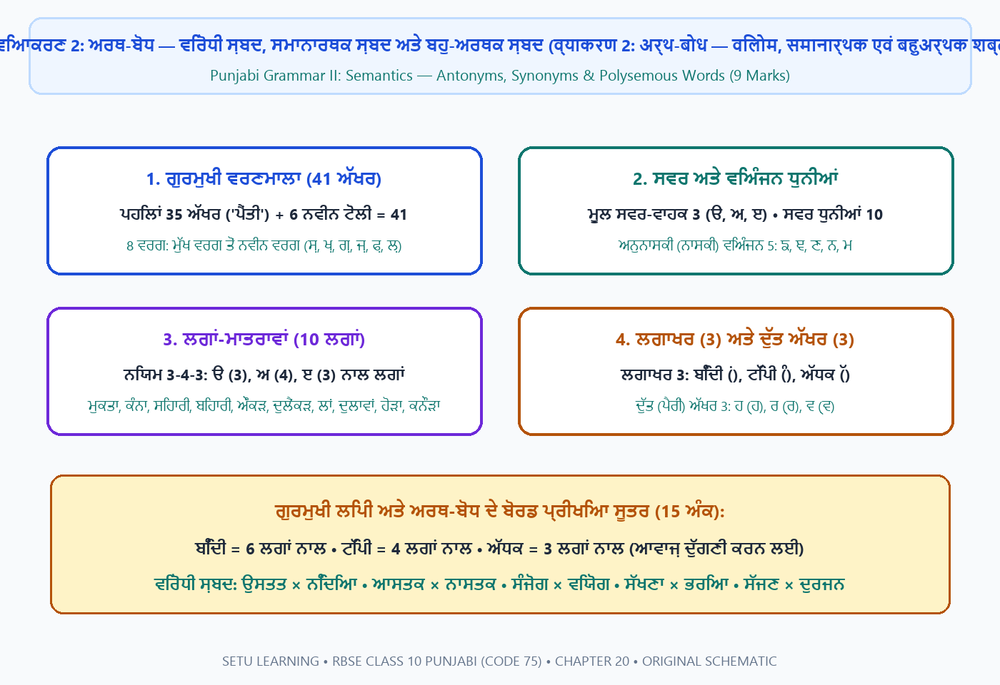

# ਪਾਠ 20 — ਵਿਆਕਰਣ 2: ਅਰਥ-ਬੋਧ — ਵਿਰੋਧੀ ਸ਼ਬਦ, ਸਮਾਨਾਰਥਕ ਸ਼ਬਦ ਅਤੇ ਬਹੁ-ਅਰਥਕ ਸ਼ਬਦ (व्याकरण 2: अर्थ-बोध — विलोम, समानार्थक एवं बहुअर्थक शब्द — 9 अंक) (Punjabi Grammar II: Semantics — Antonyms, Synonyms & Polysemous Words (9 Marks))

## भाग 1: अध्याय प्रवेश एवं पाठ्यक्रम मैपिंग (ਪਾਠ-ਪ੍ਰਵੇਸ਼ ਅਤੇ ਪਾਠਕ੍ਰਮ ਮੈਪਿੰਗ)

> RBSE ਜਮਾਤ 10 ਪੰਜਾਬੀ ਪਾਠ-ਪੁਸਤਕ 'ਸਾਹਿਤ ਸੁਗੰਧੀਆਂ' ਦੇ ਸਾਰੇ ਪ੍ਰਸ਼ਨਾਂ ਦੇ ਹੱਲ ਅਤੇ 2014–2026 ਦਾ ਪੂਰਾ ਇਤਿਹਾਸਕ PYQ ਸੰਗ੍ਰਹਿ ਸਰੋਤ-ਪ੍ਰੀਖਣ ਸਮੇਤ ਸੰਕਲਿਤ ਹਨ।

**ਵਿਸ਼ਾ ਕੋਡ (विषय कोड):** 75 (ਤੀਜੀ ਭਾਸ਼ਾ — ਪੰਜਾਬੀ / तृतीया भाषा — पंजाबी) · **ਲੜੀ ਪੁਸਤਕ (श्रृंखला पुस्तक):** 7

**ਪ੍ਰਮਾਣਿਤ ਆਧਾਰ:** RBSE 2025–26 · **ਪਾਠ ਅੰਕ-ਭਾਰ:** 9 ਅੰਕ। ਇਹ ਭਾਰ ਉਸੇ ਸੰਸਕਰਣ ਦਾ ਹੈ; ਅਸਲ ਪ੍ਰਸ਼ਨ-ਵੰਡ ਦੀ ਭਵਿੱਖਬਾਣੀ ਨਹੀਂ।

**ਸਿੱਖਣ ਦੇ ਉਦੇਸ਼ (सीखने के लक्ष्य):** RBSE ਜਮਾਤ 10 ਪੰਜਾਬੀ ਵਿਆਕਰਣ ਦੇ 9 ਅੰਕਾਂ ਵਾਲੇ 'ਅਰਥ-ਬੋਧ' ਭਾਗ — (1) ਵਿਰੋਧੀ ਸ਼ਬਦ (Antonyms), (2) ਸਮਾਨਾਰਥਕ ਸ਼ਬਦ (Synonyms) ਅਤੇ (3) ਬਹੁ-ਅਰਥਕ ਸ਼ਬਦ (Polysemous words & sentence framing) ਦਾ ਬੋਰਡ ਪ੍ਰੀਖਿਆਵਾਂ (2018–2026) ਵਿੱਚ ਪੁੱਛੇ ਗਏ ਸਾਰੇ ਸ਼ਬਦਾਂ ਸਮੇਤ ਸੰਪੂਰਨ ਅਧਿਐਨ।

## भाग 2: शब्दावली एवं अवधारणा कैप्सूल (ਸ਼ਬਦਾਵਲੀ ਅਤੇ ਸੰਕਲਪ ਕੈਪਸੂਲ)

| ਸ਼ਬਦ / ਸੰਕਲਪ | ਅਰਥ / ਵਿਆਖਿਆ |
|---|---|
| ਅਰਥ-ਬੋਧ (अर्थ-बोध) | ਵਿਆਕਰਣ ਦਾ ਉਹ ਭਾਗ ਜਿਸ ਵਿੱਚ ਸ਼ਬਦਾਂ ਦੇ ਅਰਥਾਂ, ਉਹਨਾਂ ਦੇ ਆਪਸੀ ਸੰਬੰਧਾਂ (ਸਮਾਨਤਾ, ਵਿਰੋਧ ਅਤੇ ਬਹੁ-ਅਰਥਕਤਾ) ਦਾ ਅਧਿਐਨ ਕੀਤਾ ਜਾਂਦਾ ਹੈ। |
| ਵਿਰੋਧੀ ਸ਼ਬਦ (विरोधी शब्द / विलोम) | ਉਹ ਸ਼ਬਦ ਜੋ ਇੱਕ-ਦੂਜੇ ਦੇ ਉਲਟ ਜਾਂ ਵਿਪਰੀਤ ਅਰਥ ਪ੍ਰਗਟ ਕਰਦੇ ਹਨ (ਜਿਵੇਂ: *ਉਸਤਤ × ਨਿੰਦਿਆ*, *ਸੱਜਣ × ਦੁਰਜਨ*)। |
| ਸਮਾਨਾਰਥਕ ਸ਼ਬਦ (समानार्थक / पर्यायवाची) | ਉਹ ਸ਼ਬਦ ਜੋ ਵੱਖ-ਵੱਖ ਹੁੰਦੇ ਹੋਏ ਵੀ ਇੱਕੋ ਜਿਹੇ ਜਾਂ ਸਮਾਨ ਅਰਥ ਰੱਖਦੇ ਹਨ (ਜਿਵੇਂ: *ਉੱਦਮ = ਮਿਹਨਤ, ਉਪਰਾਲਾ, ਕੋਸ਼ਿਸ਼, ਯਤਨ*)। |
| ਬਹੁ-ਅਰਥਕ ਸ਼ਬਦ (बहु-अर्थक शब्द) | ਉਹ ਸ਼ਬਦ ਜੋ ਰੂਪ/ਸ਼ਬਦ-ਜੋੜ ਪੱਖੋਂ ਇੱਕੋ ਹੁੰਦੇ ਹਨ ਪਰ ਵੱਖ-ਵੱਖ ਪ੍ਰਸੰਗਾਂ ਵਿੱਚ ਵੱਖ-ਵੱਖ ਅਰਥ ਦਿੰਦੇ ਹਨ (ਜਿਵੇਂ: *ਵੱਟ, ਹਾਰ, ਉੱਤਰ, ਜੱਗ, ਤਾਰ*)। |
| ਉਸਤਤ (उसतत) | ਵਡਿਆਈ ਜਾਂ ਪ੍ਰਸ਼ੰਸਾ (ਇਸ ਦਾ ਵਿਰੋਧੀ ਸ਼ਬਦ **'ਨਿੰਦਿਆ'** ਹੈ — RBSE ਬੋਰਡ ਦਾ ਸਭ ਤੋਂ ਵੱਧ ਪੁੱਛਿਆ ਜਾਣ ਵਾਲਾ ਸ਼ਬਦ)। |
| ਸੰਜੋਗ (संजोग) | ਮਿਲਾਪ ਜਾਂ ਮੇਲ (ਇਸ ਦਾ ਵਿਰੋਧੀ ਸ਼ਬਦ **'ਵਿਯੋਗ / ਵਿਛੋੜਾ'** ਹੈ)। |
| ਸੱਖਣਾ (सक्खणा) | ਖ਼ਾਲੀ ਜਾਂ ਸੁੰਨਾ (ਇਸ ਦਾ ਵਿਰੋਧੀ ਸ਼ਬਦ **'ਭਰਿਆ'** ਹੈ)। |

## भाग 3: विस्तृत शिक्षण पाठ (ਵਿਸਤ੍ਰਿਤ ਅਧਿਆਪਨ ਪਾਠ)

### 1. ਵਿਰੋਧੀ ਸ਼ਬਦ (Antonyms — 3 ਅੰਕ)

- **ਪਰਿਭਾਸ਼ਾ:** ਜਿਹੜੇ ਸ਼ਬਦ ਕਿਸੇ ਦੂਜੇ ਸ਼ਬਦ ਦੇ ਬਿਲਕੁਲ ਉਲਟ (ਵਿਪਰੀਤ) ਅਰਥ ਪ੍ਰਗਟ ਕਰਨ, ਉਹਨਾਂ ਨੂੰ **ਵਿਰੋਧੀ ਸ਼ਬਦ** ਕਿਹਾ ਜਾਂਦਾ ਹੈ।
- **RBSE ਬੋਰਡ ਪ੍ਰੀਖਿਆਵਾਂ (2018–2026) ਵਿੱਚ ਪੁੱਛੇ ਗਏ ਅਤੇ ਪਾਠ-ਪੁਸਤਕ ਦੇ ਪ੍ਰਮੁੱਖ ਵਿਰੋਧੀ ਸ਼ਬਦ:**

| ਸ਼ਬਦ | ਵਿਰੋਧੀ ਸ਼ਬਦ | ਸ਼ਬਦ | ਵਿਰੋਧੀ ਸ਼ਬਦ | ਸ਼ਬਦ | ਵਿਰੋਧੀ ਸ਼ਬਦ |
|---|---|---|---|---|---|
| **ਉਸਤਤ (ਵਡਿਆਈ)** | **ਨਿੰਦਿਆ** | **ਸੱਜਣ** | **ਦੁਰਜਨ / ਵੈਰੀ** | **ਆਸਤਕ** | **ਨਾਸਤਕ** |
| **ਉੱਚਾ** | **ਨੀਵਾਂ** | **ਸੱਖਣਾ (ਖ਼ਾਲੀ)** | **ਭਰਿਆ** | **ਆਦਰ** | **ਨਿਰਾਦਰ** |
| **ਉੱਤਮ** | **ਅਧਮ / ਨੀਚ** | **ਸੰਜੋਗ (ਮਿਲਾਪ)** | **ਵਿਯੋਗ (ਵਿਛੋੜਾ)** | **ਆਦਿ (ਮੁੱਢ)** | **ਅੰਤ** |
| **ਉੱਦਮੀ** | **ਆਲਸੀ** | **ਸਵਰਗ** | **ਨਰਕ** | **ਆਮ** | **ਖ਼ਾਸ** |
| **ਉਧਾਰ** | **ਨਕਦ** | **ਸਵੇਰ** | **ਸ਼ਾਮ / ਤ੍ਰਿਕਾਲਾਂ** | **ਆਜ਼ਾਦੀ** | **ਗ਼ੁਲਾਮੀ** |
| **ਉਪਕਾਰ** | **ਅਪਕਾਰ** | **ਸੁੱਖ** | **ਦੁੱਖ** | **ਅੰਦਰ** | **ਬਾਹਰ** |
| **ਉਜਾੜ** | **ਆਬਾਦ / ਵੱਸੋਂ** | **ਸੁਚੱਜਾ** | **ਕੁਚੱਜਾ** | **ਅਮੀਰ** | **ਗ਼ਰੀਬ** |
| **ਅਸਲੀ** | **ਨਕਲੀ** | **ਸੁਣੱਖਾ** | **ਕੁਢੱਬਾ / ਬਦਸੂਰਤ** | **ਅੱਗਾ** | **ਪਿੱਛਾ** |
| **ਅਗਾਂਹ** | **ਪਿਛਾਂਹ** | **ਸੁਗੰਧ (ਖ਼ੁਸ਼ਬੂ)** | **ਦੁਰਗੰਧ (ਬਦਬੂ)** | **ਅੱਜ** | **ਕੱਲ੍ਹ** |
| **ਅਗੇਤਾ** | **ਪਛੇਤਾ** | **ਸੁੱਕਾ** | **ਗਿੱਲਾ** | **ਇੱਕ** | **ਅਨੇਕ** |
| **ਅਪਣਾਉਣਾ** | **ਤਿਆਗਣਾ** | **ਸੁੱਤਾ** | **ਜਾਗਦਾ** | **ਇਮਾਨਦਾਰ** | **ਬੇਈਮਾਨ** |
| **ਔਖਾ** | **ਸੌਖਾ** | **ਸੱਚ** | **ਝੂਠ** | **ਇਕਰਾਰ** | **ਇਨਕਾਰ** |
| **ਕੱਚਾ** | **ਪੱਕਾ** | **ਹੱਸਣਾ** | **ਰੋਣਾ** | **ਕਮਾਊ** | **ਗਵਾਊ / ਉਡਾਊ** |
| **ਕੌੜਾ** | **ਮਿੱਠਾ** | **ਹੱਕ** | **ਨਾਹੱਕ** | **ਖੋਟਾ** | **ਖਰਾ** |
| **ਗੁਣ** | **ਔਗੁਣ** | **ਹਾਨੀ (ਘਾਟਾ)** | **ਲਾਭ (ਵਾਧਾ)** | **ਗੁਰੂ** | **ਚੇਲਾ** |
| **ਗਰਮੀ** | **ਸਰਦੀ** | **ਹਨੇਰਾ (ਅੰਧੇਰਾ)** | **ਚਾਨਣ (ਪ੍ਰਕਾਸ਼)** | **ਚੜ੍ਹਨਾ** | **ਉੱਤਰਨਾ / ਲਹਿਣਾ** |
| **ਚੋਰ** | **ਸਾਧ** | **ਹਾਰ** | **ਜਿੱਤ** | **ਜਨਮ** | **ਮਰਨ / ਮੌਤ** |
| **ਠੰਢਾ** | **ਤੱਤਾ / ਗਰਮ** | **ਨੇਕੀ** | **ਬਦੀ** | **ਪੁੰਨ** | **ਪਾਪ** |
| **ਧੁੱਪ** | **ਛਾਂ** | **ਪਿਆਰ** | **ਨਫ਼ਰਤ / ਵੈਰ** | **ਪਤਲਾ** | **ਮੋਟਾ / ਸੰਘਣਾ** |
| **ਬਹਾਦਰ** | **ਡਰਪੋਕ / ਕਾਇਰ** | **ਮਿੱਤਰ** | **ਸ਼ਤਰੂ / ਦੁਸ਼ਮਣ** | **ਵਰਦਾਨ (ਅਸੀਸ)** | **ਸਰਾਪ (ਬਦਅਸੀਸ)** |

---

### 2. ਸਮਾਨਾਰਥਕ ਸ਼ਬਦ (Synonyms — 3 ਅੰਕ)

- **ਪਰਿਭਾਸ਼ਾ:** ਜਿਹੜੇ ਸ਼ਬਦ ਰੂਪ ਵਿੱਚ ਵੱਖ-ਵੱਖ ਹੋਣ ਪਰ ਲਗਭਗ ਇੱਕੋ ਜਿਹਾ (ਸਮਾਨ) ਅਰਥ ਪ੍ਰਗਟ ਕਰਨ, ਉਹਨਾਂ ਨੂੰ **ਸਮਾਨਾਰਥਕ ਸ਼ਬਦ** ਕਹਿੰਦੇ ਹਨ।
- **RBSE ਬੋਰਡ ਪ੍ਰੀਖਿਆਵਾਂ (2018–2026) ਵਿੱਚ ਪੁੱਛੇ ਗਏ ਪ੍ਰਮੁੱਖ ਸਮਾਨਾਰਥਕ ਸ਼ਬਦ:**

| ਮੂਲ ਸ਼ਬਦ | ਸਮਾਨਾਰਥਕ ਸ਼ਬਦ (3–4 ਸ਼ਬਦ) | ਮੂਲ ਸ਼ਬਦ | ਸਮਾਨਾਰਥਕ ਸ਼ਬਦ (3–4 ਸ਼ਬਦ) |
|---|---|---|---|
| **ਉੱਦਮ** | ਮਿਹਨਤ, ਕੋਸ਼ਿਸ਼, ਯਤਨ, ਉਪਰਾਲਾ, ਹਿੰਮਤ | **ਸੁੰਦਰ** | ਸੋਹਣਾ, ਖ਼ੂਬਸੂਰਤ, ਮਨੋਹਰ, ਦਿਲਕਸ਼ |
| **ਉਸਤਤ** | ਵਡਿਆਈ, ਪ੍ਰਸ਼ੰਸਾ, ਤਾਰੀਫ਼, ਸ਼ਲਾਘਾ, ਸਿਫ਼ਤ | **ਸੂਰਜ** | ਰਵੀ, ਭਾਨੂ, ਦਿਨਕਰ, ਸੂਰ, ਆਫ਼ਤਾਬ |
| **ਉਪਕਾਰ** | ਭਲਾਈ, ਨੇਕੀ, ਅਹਿਸਾਨ, ਮਿਹਰਬਾਨੀ | **ਸਰੀਰ** | ਤਨ, ਦੇਹ, ਕਾਇਆ, ਜੁੱਸਾ, ਬਦਨ |
| **ਉਜਾਲਾ** | ਚਾਨਣ, ਪ੍ਰਕਾਸ਼, ਰੌਸ਼ਨੀ, ਨੂਰ, ਲੋਅ | **ਹੰਕਾਰ** | ਘੁਮੰਡ, ਗ਼ਰੂਰ, ਮਾਣ, ਆਕੜ, ਅਭਿਮਾਨ |
| **ਅਕਾਸ਼ (ਅਸਮਾਨ)** | ਗਗਨ, ਅੰਬਰ, ਅਸਮਾਨ, ਅਰਸ਼, ਨਭ | **ਹਵਾ** | ਪੌਣ, ਵਾਯੂ, ਸਮੀਰ, ਬਿਆਸ, ਵਾ |
| **ਅੱਖ** | ਨੈਣ, ਨੇਤਰ, ਲੋਚਨ, ਦੀਦਾ, ਚਸ਼ਮ | **ਕਮਜ਼ੋਰ** | ਮਾੜਾ, ਦੁਰਬਲ, ਨਿਰਬਲ, ਨਿਤਾਣਾ, ਲਿੱਸਾ |
| **ਅੱਗ** | ਅਗਨੀ, ਪਾਵਕ, ਜਵਾਲਾ, ਅਨਲ, ਭਾਹਿ | **ਕਪੜਾ** | ਬਸਤਰ, ਪੁਸ਼ਾਕ, ਲੀੜਾ, ਚੀਰ, ਬਾਨਾ |
| **ਅਮੀਰ** | ਧਨੀ, ਦੌਲਤਮੰਦ, ਧਨਾਢ, ਸਰਮਾਏਦਾਰ | **ਖ਼ੁਸ਼ੀ** | ਪ੍ਰਸੰਨਤਾ, ਆਨੰਦ, ਖੇੜਾ, ਚਾਅ, ਹੁਲਾਸ |
| **ਔਰਤ (ਇਸਤਰੀ)** | ਤੀਵੀਂ, ਨਾਰੀ, ਮਹਿਲਾ, ਜ਼ਨਾਨੀ, ਸੁਆਣੀ | **ਗ਼ਰੀਬ** | ਨਿਰਧਨ, ਕੰਗਾਲ, ਲੋੜਵੰਦ, ਮੁਥਾਜ, ਮਸਕੀਨ |
| **ਇੱਜ਼ਤ** | ਆਦਰ, ਮਾਣ, ਸਤਿਕਾਰ, ਵਡਿਆਈ, ਪੱਤ | **ਘਰ** | ਮਕਾਨ, ਗ੍ਰਹਿ, ਨਿਵਾਸ, ਆਲ੍ਹਣਾ, ਡੇਰਾ |
| **ਇੱਛਾ** | ਚਾਹ, ਖਾਹਿਸ਼, ਤਾਂਘ, ਸੱਧਰ, ਕਾਮਨਾ | **ਚੰਦਰਮਾ (ਚੰਨ)** | ਚੰਦ, ਸ਼ਸ਼ੀ, ਮਹਿਤਾਬ, ਸੋਮ, ਇੰਦੂ |
| **ਸੰਸਾਰ** | ਜਗਤ, ਦੁਨੀਆ, ਜਹਾਨ, ਵਿਸ਼ਵ, ਲੋਕ | **ਜੰਗ (ਯੁੱਧ)** | ਲੜਾਈ, ਸਮਰ, ਰਣ, ਸੰਗਰਾਮ |
| **ਸਬਰ** | ਸੰਤੋਖ, ਧੀਰਜ, ਰਜ਼ਾ, ਸ਼ਾਂਤੀ, ਤ੍ਰਿਪਤੀ | **ਧਰਤੀ** | ਜ਼ਮੀਨ, ਭੂਮੀ, ਪ੍ਰਿਥਵੀ, ਵਸੁੰਧਰਾ, ਭੋਇੰ |
| **ਪਾਣੀ** | ਜਲ, ਨੀਰ, ਵਾਰੀ, ਅੰਬੁ, ਆਬ | **ਪਰਮਾਤਮਾ (ਰੱਬ)** | ਈਸ਼ਵਰ, ਵਾਹਿਗੁਰੂ, ਖ਼ੁਦਾ, ਅੱਲ੍ਹਾ, ਭਗਵਾਨ |
| **ਪਿਆਰ** | ਪ੍ਰੇਮ, ਮੁਹੱਬਤ, ਸਨੇਹ, ਪ੍ਰੀਤ, ਮੋਹ | **ਮਿੱਤਰ** | ਦੋਸਤ, ਯਾਰ, ਬੇਲੀ, ਸੱਜਣ, ਮੀਤ |
| **ਫੁੱਲ** | ਪੁਸ਼ਪ, ਕੁਸੁਮ, ਸੁਮਨ, ਗੁਲ | **ਰਾਤ** | ਰੈਣ, ਨਿਸ਼ਾ, ਰਾਤਰੀ, ਸ਼ਬ, ਰਜਨੀ |

---

### 3. ਬਹੁ-ਅਰਥਕ ਸ਼ਬਦ (Polysemous Words — 3 ਅੰਕ)

- **ਪਰਿਭਾਸ਼ਾ:** ਜਿਹੜੇ ਸ਼ਬਦ ਲਿਖਣ ਅਤੇ ਬੋਲਣ ਵਿੱਚ ਇੱਕੋ ਜਿਹੇ ਹੋਣ ਪਰ ਵੱਖ-ਵੱਖ ਵਾਕਾਂ/ਪ੍ਰਸੰਗਾਂ ਵਿੱਚ ਉਹਨਾਂ ਦੇ ਅਰਥ ਵੱਖ-ਵੱਖ ਨਿਕਲਣ, ਉਹਨਾਂ ਨੂੰ **ਬਹੁ-ਅਰਥਕ ਸ਼ਬਦ** ਕਹਿੰਦੇ ਹਨ।

| ਬਹੁ-ਅਰਥਕ ਸ਼ਬਦ | ਵੱਖ-ਵੱਖ ਅਰਥ ਅਤੇ ਵਾਕਾਂ ਵਿੱਚ ਵਰਤੋਂ |
|---|---|
| **1. ਵੱਟ** | • **ਖੇਤ ਦੀ ਬੰਨ੍ਹੀ:** ਕਿਸਾਨ ਆਪਣੇ ਖੇਤ ਦੀ **ਵੱਟ** ਉੱਤੇ ਖੜ੍ਹਾ ਸੀ। • **ਗਰਮੀ / ਹੁੰਮਸ:** ਅੱਜ ਦੁਪਹਿਰੇ ਬਹੁਤ **ਵੱਟ** ਪੈ ਰਿਹਾ ਹੈ। • **ਗੁੱਸਾ / ਰੋਸ:** ਉਸ ਨੇ ਮੇਰੇ ਨਾਲ ਦਿਲ ਵਿੱਚ **ਵੱਟ** ਰੱਖਿਆ ਹੋਇਆ ਹੈ। • **ਕੱਪੜੇ ਦੇ ਬਲ/ਸਿਲਵਟ:** ਪੱਗ ਦੇ **ਵੱਟ** ਸਿੱਧੇ ਕਰ ਲਵੋ। / ਰੱਸਾ **ਵੱਟ** ਲਵੋ। |
| **2. ਹਾਰ** | • **ਗਲੇ ਦਾ ਗਹਿਣਾ / ਮਾਲਾ:** ਮਹਿਮਾਨਾਂ ਦੇ ਗਲ ਵਿੱਚ ਫੁੱਲਾਂ ਦੇ **ਹਾਰ** ਪਾਏ ਗਏ। • **ਪਰਾਜੈ (ਜਿੱਤ ਦਾ ਉਲਟ):** ਖੇਡ ਵਿੱਚ **ਹਾਰ** ਅਤੇ ਜਿੱਤ ਬਣੀ ਰਹਿੰਦੀ ਹੈ। • **ਥੱਕ ਜਾਣਾ (ਹਾਰ ਜਾਣਾ):** ਉਹ ਮਿਹਨਤ ਕਰਦਾ ਹੋਇਆ ਕਦੇ ਨਹੀਂ **ਹਾਰਿਆ**। |
| **3. ਉੱਤਰ** | • **ਦਿਸ਼ਾ ਦਾ ਨਾਂ:** ਹਿਮਾਲਿਆ ਪਰਬਤ ਭਾਰਤ ਦੇ **ਉੱਤਰ** ਵੱਲ ਹੈ। • **ਪ੍ਰਸ਼ਨ ਦਾ ਜਵਾਬ:** ਵਿਦਿਆਰਥੀ ਨੇ ਸਾਰੇ ਪ੍ਰਸ਼ਨਾਂ ਦੇ ਸਹੀ **ਉੱਤਰ** ਦਿੱਤੇ। • **ਹੇਠਾਂ ਆਉਣਾ (ਉੱਤਰਨਾ):** ਉਹ ਕੋਠੇ ਤੋਂ ਹੇਠਾਂ **ਉੱਤਰ** ਆਇਆ। |
| **4. ਜੱਗ** | • **ਸੰਸਾਰ / ਦੁਨੀਆ:** ਇਹ **ਜੱਗ** ਮਿੱਠਾ ਤੇ ਅਗਲਾ ਕਿਨ ਡਿੱਠਾ। • **ਪਾਣੀ ਪਾਉਣ ਵਾਲਾ ਭਾਂਡਾ:** ਮੇਜ਼ ਉੱਤੇ ਪਾਣੀ ਦਾ **ਜੱਗ** ਭਰ ਕੇ ਰੱਖ ਦੇਵੋ। • **ਧਾਰਮਿਕ ਯੱਗ / ਭੰਡਾਰਾ:** ਪਿੰਡ ਵਾਲਿਆਂ ਨੇ ਮਿਲ ਕੇ ਵੱਡਾ **ਜੱਗ** ਕੀਤਾ। |
| **5. ਤਾਰ** | • **ਲੋਹੇ/ਤਾਂਬੇ ਦੀ ਤਾਰ:** ਬਿਜਲੀ ਦੀ **ਤਾਰ** ਟੁੱਟ ਗਈ ਹੈ। • **ਟੈਲੀਗ੍ਰਾਮ (ਸੁਨੇਹਾ):** ਉਸ ਨੇ ਪਿਤਾ ਜੀ ਨੂੰ ਤੁਰੰਤ **ਤਾਰ** ਭੇਜ ਦਿੱਤੀ। • **ਤਰਨਾ / ਪਾਰ ਲਾਉਣਾ:** ਹੇ ਪ੍ਰਭੂ! ਸਾਨੂੰ ਭਵ-ਸਾਗਰ ਤੋਂ **ਤਾਰ** ਦੇਵੋ। / ਟੈਕਸ **ਤਾਰ** ਦੇਵੋ। |
| **6. ਸਰ** | • **ਤਾਲਾਬ / ਸਰੋਵਰ:** ਅੰਮ੍ਰਿਤਸਰ ਦੇ ਪਵਿੱਤਰ **ਸਰ** ਵਿੱਚ ਸ਼ਰਧਾਲੂ ਇਸ਼ਨਾਨ ਕਰਦੇ ਹਨ। • **ਜਿੱਤਣਾ / ਫ਼ਤਿਹ ਕਰਨਾ:** ਖ਼ਾਲਸਾ ਫ਼ੌਜ ਨੇ ਕਿਲ੍ਹਾ **ਸਰ** ਕਰ ਲਿਆ। • **ਪੂਰਾ ਹੋਣਾ (ਕੰਮ ਚੱਲਣਾ):** ਤੇਰੇ ਬਿਨਾਂ ਮੇਰਾ ਕੰਮ ਨਹੀਂ **ਸਰ** ਸਕਦਾ। |
| **7. ਪੱਤ** | • **ਇੱਜ਼ਤ / ਲਾਜ:** ਪ੍ਰਭੂ ਆਪਣੇ ਭਗਤਾਂ ਦੀ **ਪੱਤ** ਰੱਖਦਾ ਹੈ। • **ਦਰੱਖ਼ਤ ਦੇ ਪੱਤੇ:** ਪੱਤਝੜ ਵਿੱਚ ਰੁੱਖਾਂ ਦੇ **ਪੱਤ** ਝੜ ਜਾਂਦੇ ਹਨ। |
| **8. ਵਾਰ** | • **ਹਮਲਾ / ਚੋਟ:** ਕਰਤਾਰੇ ਨੇ ਤਲਵਾਰ ਦਾ ਭਰਵਾਂ **ਵਾਰ** ਕੀਤਾ। • **ਦਿਨ (ਹਫ਼ਤੇ ਦਾ ਦਿਨ):** ਅੱਜ ਕਿਹੜਾ **ਵਾਰ** ਹੈ? (ਸੋਮਵਾਰ, ਮੰਗਲਵਾਰ)। • **ਵਾਰੀ (Turn):** ਇਹ ਪਾਠ ਮੈਂ ਦੋ **ਵਾਰ** ਪੜ੍ਹ ਲਿਆ ਹੈ। • **ਵੀਰ-ਰਸੀ ਕਾਵਿ ਰੂਪ:** ਚੰਡੀ ਦੀ **ਵਾਰ** ਗੁਰੂ ਗੋਬਿੰਦ ਸਿੰਘ ਜੀ ਦੀ ਰਚਨਾ ਹੈ। |
| **9. ਸੂਤ** | • **ਕੱਚਾ ਧਾਗਾ:** ਚਰਖੇ ਉੱਤੇ ਬਾਰੀਕ **ਸੂਤ** ਕੱਤਿਆ ਜਾਂਦਾ ਹੈ। • **ਠੀਕ / ਸਿੱਧਾ (ਸੂਤਰ):** ਹੁਣ ਉਸ ਦਾ ਦਿਮਾਗ਼ ਬਿਲਕੁਲ **ਸੂਤ** ਆ ਗਿਆ ਹੈ। |
| **10. ਫਲ** | • **ਰੁੱਖ ਦਾ ਫਲ (ਮੇਵਾ):** ਅੰਬ ਇੱਕ ਮਿੱਠਾ **ਫਲ** ਹੈ। • **ਨਤੀਜਾ / ਸਿੱਟਾ:** ਮਿਹਨਤ ਦਾ **ਫਲ** ਹਮੇਸ਼ਾ ਮਿੱਠਾ ਹੁੰਦਾ ਹੈ। • **ਹਲ ਜਾਂ ਤੀਰ ਦਾ ਲੋਹੇ ਵਾਲਾ ਅਗਲਾ ਹਿੱਸਾ:** ਕਿਸਾਨ ਨੇ ਲੁਹਾਰ ਤੋਂ ਹਲ ਦਾ **ਫਲ** ਤਿੱਖਾ ਕਰਵਾਇਆ। |

ਪਾਠ 20: ਅਰਥ-ਬੋਧ — ਵਿਰੋਧੀ ਸ਼ਬਦ, ਸਮਾਨਾਰਥਕ ਸ਼ਬਦ ਅਤੇ ਬਹੁ-ਅਰਥਕ ਸ਼ਬਦ ਦਾ ਸੰਕਲਪ ਚਿੱਤਰ

## भाग 4: पाठ्यपुस्तक-अवधारणाओं पर मौलिक हल किए उदाहरण (ਹੱਲ ਕੀਤੇ ਮਿਆਰੀ ਉਦਾਹਰਣ)

ਹੇਠਾਂ ਦਿੱਤੇ ਪ੍ਰਸ਼ਨ ਪਾਠ-ਪੁਸਤਕ 'ਸਾਹਿਤ ਸੁਗੰਧੀਆਂ' ਅਤੇ ਵਿਆਕਰਣ ਦੇ ਸੰਕਲਪਾਂ ਉੱਤੇ ਆਧਾਰਿਤ ਮੌਲਿਕ ਆਦਰਸ਼ ਹੱਲ ਹਨ।

**ਹੱਲ ਕੀਤਾ ਉਦਾਹਰਣ 1: ਹੇਠ ਲਿਖੇ ਸ਼ਬਦਾਂ ਦੇ ਵਿਰੋਧੀ ਸ਼ਬਦ ਲਿਖੋ: (1) ਉਸਤਤ, (2) ਸੱਜਣ, (3) ਆਸਤਕ, (4) ਸੰਜੋਗ, (5) ਸੱਖਣਾ, (6) ਉੱਦਮੀ।**

(1) ਉਸਤਤ — ਨਿੰਦਿਆ, (2) ਸੱਜਣ — ਦੁਰਜਨ / ਵੈਰੀ, (3) ਆਸਤਕ — ਨਾਸਤਕ, (4) ਸੰਜੋਗ — ਵਿਯੋਗ / ਵਿਛੋੜਾ, (5) ਸੱਖਣਾ — ਭਰਿਆ, (6) ਉੱਦਮੀ — ਆਲਸੀ।

**ਹੱਲ ਕੀਤਾ ਉਦਾਹਰਣ 2: ਹੇਠ ਲਿਖੇ ਸ਼ਬਦਾਂ ਦੇ ਤਿੰਨ-ਤਿੰਨ ਸਮਾਨਾਰਥਕ ਸ਼ਬਦ ਲਿਖੋ: (1) ਉੱਦਮ, (2) ਅਕਾਸ਼, (3) ਪਾਣੀ, (4) ਸੁੰਦਰ।**

(1) ਉੱਦਮ — ਮਿਹਨਤ, ਕੋਸ਼ਿਸ਼, ਉਪਰਾਲਾ। (2) ਅਕਾਸ਼ — ਅਸਮਾਨ, ਗਗਨ, ਅੰਬਰ। (3) ਪਾਣੀ — ਜਲ, ਨੀਰ, ਆਬ। (4) ਸੁੰਦਰ — ਸੋਹਣਾ, ਖ਼ੂਬਸੂਰਤ, ਮਨੋਹਰ।

**ਹੱਲ ਕੀਤਾ ਉਦਾਹਰਣ 3: 'ਵੱਟ' ਅਤੇ 'ਹਾਰ' ਬਹੁ-ਅਰਥਕ ਸ਼ਬਦਾਂ ਦੇ ਦੋ-ਦੋ ਵੱਖ-ਵੱਖ ਅਰਥ ਦੱਸਦੇ ਹੋਏ ਵਾਕ ਬਣਾਓ।**

1. ਵੱਟ: (ੳ) ਖੇਤ ਦੀ ਬੰਨ੍ਹੀ — ਕਿਸਾਨ ਖੇਤ ਦੀ ਵੱਟ ਉੱਤੇ ਬੈਠਾ ਹੈ। (ਅ) ਗਰਮੀ/ਹੁੰਮਸ — ਅੱਜ ਬਹੁਤ ਵੱਟ ਪੈ ਰਿਹਾ ਹੈ। 2. ਹਾਰ: (ੳ) ਫੁੱਲਾਂ ਦੀ ਮਾਲਾ — ਜੇਤੂ ਖਿਡਾਰੀ ਦੇ ਗਲ ਵਿੱਚ ਹਾਰ ਪਾਇਆ ਗਿਆ। (ਅ) ਪਰਾਜੈ — ਮੈਚ ਵਿੱਚ ਵਿਰੋਧੀ ਟੀਮ ਦੀ ਹਾਰ ਹੋਈ।

## भाग 5: सत्यापित बोर्ड प्रश्न एवं स्रोत-स्थिति (ਪ੍ਰਮਾਣਿਤ ਬੋਰਡ ਪ੍ਰਸ਼ਨ ਅਤੇ ਸਰੋਤ-ਸਥਿਤੀ)

RBSE 2026 Main (`S-75`), 2026 Supp, 2025 Main, 2025 Supp ਅਤੇ 2018–2024 ਦੇ ਹਰ ਬੋਰਡ ਪੇਪਰ ਵਿੱਚ ਵਿਰੋਧੀ, ਸਮਾਨਾਰਥਕ ਅਤੇ ਬਹੁ-ਅਰਥਕ ਸ਼ਬਦਾਂ ਦੇ 9 ਅੰਕਾਂ ਦੇ ਪ੍ਰਸ਼ਨ ਪੁੱਛੇ ਗਏ ਹਨ।

[RBSE 2026 ਮੂਲ ਪੇਪਰ (S-75)](https://rajeduboard.rajasthan.gov.in/books/PAPERS-2026/Sec/S-75.pdf)। ਪ੍ਰਸ਼ਨ ਦਾ ਸੰਖੇਪ ਵਿਸ਼ਾ-ਸੰਦਰਭ ਹੈ; ਸ਼ਬਦ-ਬ-ਸ਼ਬਦ ਪੁਨਰ-ਮੁਦਰਣ ਨਹੀਂ।

## भाग 6: खंडवार मौलिक अभ्यास बैंक (ਖੰਡ-ਵਾਰ ਮੌਲਿਕ ਅਭਿਆਸ ਬੈਂਕ)

**ਅਭਿਆਸ-ਅੰਕ:** ਵਿਦਿਆਰਥੀਆਂ ਦੇ ਸਵੈ-ਅਭਿਆਸ ਲਈ ਹਨ; ਉੱਤਰ ਪਹਿਲਾਂ ਆਪ ਲਿਖੋ, ਫਿਰ ਭਾਗ 9 ਵੇਖੋ।

## ੳ: ਬਹੁ-ਵਿਕਲਪੀ ਪ੍ਰਸ਼ਨ (MCQ) — 15 × 1 ਅੰਕ

**MCQ 1. 'ਉਸਤਤ' ਸ਼ਬਦ ਦਾ ਸਹੀ ਵਿਰੋਧੀ ਸ਼ਬਦ ਕਿਹੜਾ ਹੈ? (RBSE 2022 Main Q1-xi, 2024 Main Q1-xi, 2025 Main Q1-xvi)**

ੳ) ਨਿੰਦਿਆ  
ਅ) ਪ੍ਰਸ਼ੰਸਾ  
ੲ) ਵਡਿਆਈ  
ਸ) ਸਤਿਕਾਰ

**MCQ 2. 'ਆਸਤਕ' ਸ਼ਬਦ ਦਾ ਵਿਰੋਧੀ ਸ਼ਬਦ ਚੁਣੋ: (RBSE 2023 Main Q1-xi, 2026 Main Q1-xvi)**

ੳ) ਧਾਰਮਿਕ  
ਅ) ਭਗਤ  
ੲ) ਸੱਜਣ  
ਸ) ਨਾਸਤਕ

**MCQ 3. 'ਸੰਜੋਗ' ਸ਼ਬਦ ਦਾ ਵਿਰੋਧੀ ਸ਼ਬਦ ਕੀ ਹੈ? (RBSE 2025 Supp Q1-xvi)**

ੳ) ਮੇਲ  
ਅ) ਖ਼ੁਸ਼ੀ  
ੲ) ਵਿਯੋਗ (ਵਿਛੋੜਾ)  
ਸ) ਮਿਲਾਪ

**MCQ 4. 'ਸੱਖਣਾ' ਸ਼ਬਦ ਦਾ ਵਿਰੋਧੀ ਸ਼ਬਦ ਕੀ ਹੈ? (RBSE 2024 Supp Q1-xi)**

ੳ) ਅੱਧਾ  
ਅ) ਭਰਿਆ  
ੲ) ਖ਼ਾਲੀ  
ਸ) ਸੁੰਨਾ

**MCQ 5. 'ਉੱਦਮੀ' ਸ਼ਬਦ ਦਾ ਵਿਰੋਧੀ ਸ਼ਬਦ ਦੱਸੋ:**

ੳ) ਆਲਸੀ  
ਅ) ਮਿਹਨਤੀ  
ੲ) ਕਾਮਾ  
ਸ) ਚੁਸਤ

**MCQ 6. 'ਸੱਜਣ' ਸ਼ਬਦ ਦਾ ਵਿਰੋਧੀ ਸ਼ਬਦ ਕਿਹੜਾ ਹੈ?**

ੳ) ਮਿੱਤਰ  
ਅ) ਦੋਸਤ  
ੲ) ਪਿਆਰਾ  
ਸ) ਦੁਰਜਨ / ਵੈਰੀ

**MCQ 7. 'ਉੱਦਮ' ਸ਼ਬਦ ਦਾ ਸਹੀ ਸਮਾਨਾਰਥਕ ਸ਼ਬਦ-ਜੁੱਟ ਚੁਣੋ: (RBSE 2023 Main Q3-xi, 2025 Main Q3-ix)**

ੳ) ਗੁੱਸਾ, ਵੈਰ, ਨਫ਼ਰਤ  
ਅ) ਧਰਤੀ, ਅਕਾਸ਼, ਪਾਣੀ  
ੲ) ਮਿਹਨਤ, ਕੋਸ਼ਿਸ਼, ਯਤਨ, ਉਪਰਾਲਾ  
ਸ) ਆਲਸ, ਸੁਸਤੀ, ਨੀਂਦ

**MCQ 8. 'ਅਕਾਸ਼' ਸ਼ਬਦ ਦਾ ਸਮਾਨਾਰਥਕ ਸ਼ਬਦ ਕਿਹੜਾ ਹੈ?**

ੳ) ਪੌਣ  
ਅ) ਅੰਬਰ / ਗਗਨ / ਅਸਮਾਨ  
ੲ) ਵਸੁੰਧਰਾ  
ਸ) ਨੀਰ

**MCQ 9. 'ਪਾਣੀ' ਸ਼ਬਦ ਦਾ ਸਮਾਨਾਰਥਕ ਸ਼ਬਦ ਕਿਹੜਾ ਨਹੀਂ ਹੈ?**

ੳ) ਅਨਲ (ਅੱਗ)  
ਅ) ਜਲ  
ੲ) ਨੀਰ  
ਸ) ਆਬ

**MCQ 10. 'ਉਜਾਲਾ' ਸ਼ਬਦ ਦਾ ਸਮਾਨਾਰਥਕ ਸ਼ਬਦ ਚੁਣੋ:**

ੳ) ਹਨੇਰਾ  
ਅ) ਛਾਂ  
ੲ) ਰਾਤ  
ਸ) ਚਾਨਣ / ਪ੍ਰਕਾਸ਼ / ਰੌਸ਼ਨੀ

**MCQ 11. ਜਿਹੜੇ ਸ਼ਬਦ ਰੂਪ ਪੱਖੋਂ ਇੱਕ ਹੋਣ ਪਰ ਵੱਖ-ਵੱਖ ਪ੍ਰਸੰਗਾਂ ਵਿੱਚ ਵੱਖ-ਵੱਖ ਅਰਥ ਦੇਣ, ਉਹਨਾਂ ਨੂੰ ਕੀ ਕਹਿੰਦੇ ਹਨ?**

ੳ) ਸਮਾਨਾਰਥਕ ਸ਼ਬਦ  
ਅ) ਦੁੱਤ ਅੱਖਰ  
ੲ) ਬਹੁ-ਅਰਥਕ ਸ਼ਬਦ  
ਸ) ਵਿਰੋਧੀ ਸ਼ਬਦ

**MCQ 12. 'ਵੱਟ' ਬਹੁ-ਅਰਥਕ ਸ਼ਬਦ ਦੇ ਸਹੀ ਅਰਥ ਕਿਹੜੇ ਹਨ?**

ੳ) ਕੇਵਲ ਦਿਸ਼ਾ  
ਅ) ਖੇਤ ਦੀ ਬੰਨ੍ਹੀ, ਗਰਮੀ/ਹੁੰਮਸ, ਗੁੱਸਾ, ਕੱਪੜੇ ਦੇ ਬਲ  
ੲ) ਕੇਵਲ ਪਾਣੀ  
ਸ) ਕੇਵਲ ਫੁੱਲ

**MCQ 13. 'ਹਾਰ' ਸ਼ਬਦ ਦੇ ਦੋ ਵੱਖ-ਵੱਖ ਅਰਥ ਕਿਹੜੇ ਹਨ?**

ੳ) ਫੁੱਲਾਂ ਦੀ ਮਾਲਾ ਅਤੇ ਪਰਾਜੈ (ਜਿੱਤ ਦਾ ਉਲਟ)  
ਅ) ਜਿੱਤ ਅਤੇ ਖੁਸ਼ੀ  
ੲ) ਦਿਨ ਅਤੇ ਰਾਤ  
ਸ) ਉੱਤਰ ਅਤੇ ਦੱਖਣ

**MCQ 14. 'ਸਰ' ਬਹੁ-ਅਰਥਕ ਸ਼ਬਦ ਦੇ ਵੱਖ-ਵੱਖ ਅਰਥ ਦੱਸੋ:**

ੳ) ਕੇਵਲ ਤੀਰ  
ਅ) ਕੇਵਲ ਪੱਤਾ  
ੲ) ਕੇਵਲ ਧਾਗਾ  
ਸ) ਤਾਲਾਬ (ਸਰੋਵਰ), ਜਿੱਤਣਾ (ਫ਼ਤਿਹ ਕਰਨਾ), ਕੰਮ ਚੱਲਣਾ

**MCQ 15. 'ਪੱਤ' ਬਹੁ-ਅਰਥਕ ਸ਼ਬਦ ਦੇ ਦੋ ਅਰਥ ਕਿਹੜੇ ਹਨ?**

ੳ) ਸਵੇਰ ਅਤੇ ਸ਼ਾਮ  
ਅ) ਸੱਚ ਅਤੇ ਝੂਠ  
ੲ) ਇੱਜ਼ਤ (ਲਾਜ) ਅਤੇ ਰੁੱਖ ਦੇ ਪੱਤੇ  
ਸ) ਪਾਣੀ ਅਤੇ ਅੱਗ

## ੳ: ਖਾਲੀ ਥਾਵਾਂ ਭਰੋ — 6 × 1 ਅੰਕ

1. ਵਿਆਕਰਣ ਦਾ ਉਹ ਭਾਗ ਜਿਸ ਵਿੱਚ ਸ਼ਬਦਾਂ ਦੇ ਅਰਥਾਂ, ਉਹਨਾਂ ਦੇ ਆਪਸੀ ਸੰਬੰਧਾਂ (ਸਮਾਨਤਾ, ਵਿਰੋਧ ਅਤੇ ਬਹੁ-ਅਰਥਕਤਾ) ਦਾ ਅਧਿਐਨ ਕੀਤਾ ਜਾਂਦਾ ਹੈ। — ਇਸ ਸ਼ਬਦ/ਸੰਕਲਪ ਦਾ ਨਾਂ ਹੈ: ____।  
2. ਉਹ ਸ਼ਬਦ ਜੋ ਇੱਕ-ਦੂਜੇ ਦੇ ਉਲਟ ਜਾਂ ਵਿਪਰੀਤ ਅਰਥ ਪ੍ਰਗਟ ਕਰਦੇ ਹਨ (ਜਿਵੇਂ: *ਉਸਤਤ × ਨਿੰਦਿਆ*, *ਸੱਜਣ × ਦੁਰਜਨ*)। — ਇਸ ਸ਼ਬਦ/ਸੰਕਲਪ ਦਾ ਨਾਂ ਹੈ: ____।  
3. ਉਹ ਸ਼ਬਦ ਜੋ ਵੱਖ-ਵੱਖ ਹੁੰਦੇ ਹੋਏ ਵੀ ਇੱਕੋ ਜਿਹੇ ਜਾਂ ਸਮਾਨ ਅਰਥ ਰੱਖਦੇ ਹਨ (ਜਿਵੇਂ: *ਉੱਦਮ = ਮਿਹਨਤ, ਉਪਰਾਲਾ, ਕੋਸ਼ਿਸ਼, ਯਤਨ*)। — ਇਸ ਸ਼ਬਦ/ਸੰਕਲਪ ਦਾ ਨਾਂ ਹੈ: ____।  
4. ਉਹ ਸ਼ਬਦ ਜੋ ਰੂਪ/ਸ਼ਬਦ-ਜੋੜ ਪੱਖੋਂ ਇੱਕੋ ਹੁੰਦੇ ਹਨ ਪਰ ਵੱਖ-ਵੱਖ ਪ੍ਰਸੰਗਾਂ ਵਿੱਚ ਵੱਖ-ਵੱਖ ਅਰਥ ਦਿੰਦੇ ਹਨ (ਜਿਵੇਂ: *ਵੱਟ, ਹਾਰ, ਉੱਤਰ, ਜੱਗ, ਤਾਰ*)। — ਇਸ ਸ਼ਬਦ/ਸੰਕਲਪ ਦਾ ਨਾਂ ਹੈ: ____।  
5. ਵਡਿਆਈ ਜਾਂ ਪ੍ਰਸ਼ੰਸਾ (ਇਸ ਦਾ ਵਿਰੋਧੀ ਸ਼ਬਦ **'ਨਿੰਦਿਆ'** ਹੈ — RBSE ਬੋਰਡ ਦਾ ਸਭ ਤੋਂ ਵੱਧ ਪੁੱਛਿਆ ਜਾਣ ਵਾਲਾ ਸ਼ਬਦ)। — ਇਸ ਸ਼ਬਦ/ਸੰਕਲਪ ਦਾ ਨਾਂ ਹੈ: ____।  
6. ਮਿਲਾਪ ਜਾਂ ਮੇਲ (ਇਸ ਦਾ ਵਿਰੋਧੀ ਸ਼ਬਦ **'ਵਿਯੋਗ / ਵਿਛੋੜਾ'** ਹੈ)। — ਇਸ ਸ਼ਬਦ/ਸੰਕਲਪ ਦਾ ਨਾਂ ਹੈ: ____।

## ੳ: ਅਤਿ-ਲਘੂ ਉੱਤਰਾਂ ਵਾਲੇ ਪ੍ਰਸ਼ਨ — 8 × 1 ਅੰਕ

1. 'ਉਸਤਤ' ਸ਼ਬਦ ਦਾ ਸਹੀ ਵਿਰੋਧੀ ਸ਼ਬਦ ਕਿਹੜਾ ਹੈ? (RBSE 2022 Main Q1-xi, 2024 Main Q1-xi, 2025 Main Q1-xvi)  
2. 'ਆਸਤਕ' ਸ਼ਬਦ ਦਾ ਵਿਰੋਧੀ ਸ਼ਬਦ ਚੁਣੋ: (RBSE 2023 Main Q1-xi, 2026 Main Q1-xvi)  
3. 'ਸੰਜੋਗ' ਸ਼ਬਦ ਦਾ ਵਿਰੋਧੀ ਸ਼ਬਦ ਕੀ ਹੈ? (RBSE 2025 Supp Q1-xvi)  
4. 'ਸੱਖਣਾ' ਸ਼ਬਦ ਦਾ ਵਿਰੋਧੀ ਸ਼ਬਦ ਕੀ ਹੈ? (RBSE 2024 Supp Q1-xi)  
5. 'ਉੱਦਮੀ' ਸ਼ਬਦ ਦਾ ਵਿਰੋਧੀ ਸ਼ਬਦ ਦੱਸੋ:  
6. 'ਸੱਜਣ' ਸ਼ਬਦ ਦਾ ਵਿਰੋਧੀ ਸ਼ਬਦ ਕਿਹੜਾ ਹੈ?  
7. 'ਉੱਦਮ' ਸ਼ਬਦ ਦਾ ਸਹੀ ਸਮਾਨਾਰਥਕ ਸ਼ਬਦ-ਜੁੱਟ ਚੁਣੋ: (RBSE 2023 Main Q3-xi, 2025 Main Q3-ix)  
8. 'ਅਕਾਸ਼' ਸ਼ਬਦ ਦਾ ਸਮਾਨਾਰਥਕ ਸ਼ਬਦ ਕਿਹੜਾ ਹੈ?

## ਅ: ਲਘੂ ਉੱਤਰਾਂ ਵਾਲੇ ਪ੍ਰਸ਼ਨ — 4 × 2 ਅੰਕ

**B1.** 'ਉਸਤਤ' ਸ਼ਬਦ ਦਾ ਵਿਰੋਧੀ ਸ਼ਬਦ ਕੀ ਹੈ? (RBSE 2022 Main Q1-xi, 2024 Main Q1-xi, 2025 Main Q1-xvi)

**B2.** 'ਆਸਤਕ' ਸ਼ਬਦ ਦਾ ਵਿਰੋਧੀ ਸ਼ਬਦ ਲਿਖੋ। (RBSE 2023 Main Q1-xi, 2026 Main Q1-xvi)

**B3.** 'ਸੱਖਣਾ' ਅਤੇ 'ਸੰਜੋਗ' ਦੇ ਵਿਰੋਧੀ ਸ਼ਬਦ ਲਿਖੋ। (RBSE 2024 Supp Q1-xi, 2025 Supp Q1-xvi)

**B4.** 'ਉੱਦਮ' ਸ਼ਬਦ ਦੇ ਸਮਾਨਾਰਥਕ ਸ਼ਬਦ ਲਿਖੋ। (RBSE 2023 Main Q3-xi, 2025 Main Q3-ix)

## ੲ: ਦੀਰਘ ਉੱਤਰਾਂ ਵਾਲੇ ਪ੍ਰਸ਼ਨ — 2 × 3 ਅੰਕ

ਅੰਦਰੂਨੀ ਵਿਕਲਪ ਅਭਿਆਸ: ਪਹਿਲਾਂ ਇੱਕ ਵਿਕਲਪ ਹੱਲ ਕਰੋ ਅਤੇ ਦੁਹਰਾਈ ਵੇਲੇ ਬਾਕੀ ਪ੍ਰਸ਼ਨ ਵੀ ਹੱਲ ਕਰੋ।

**C1.** 'ਅਕਾਸ਼' ਅਤੇ 'ਧਰਤੀ' ਦੇ ਸਮਾਨਾਰਥਕ ਸ਼ਬਦ ਲਿਖੋ। (RBSE 2022 Main Q10, 2024 Main Q10)

**C2.** 'ਸੁੰਦਰ' ਅਤੇ 'ਖ਼ੁਸ਼ੀ' ਦੇ ਸਮਾਨਾਰਥਕ ਸ਼ਬਦ ਲਿਖੋ। (RBSE 2025 Supp Q10, 2026 Main Q10)

## ਸ: ਨਿਬੰਧਾਤਮਕ / ਵਿਸਤ੍ਰਿਤ ਉੱਤਰਾਂ ਵਾਲੇ ਪ੍ਰਸ਼ਨ — 2 × 4 ਅੰਕ

ਅੰਦਰੂਨੀ ਵਿਕਲਪ ਅਭਿਆਸ: D1 ਜਾਂ D2 ਚੁਣੋ; ਬਾਅਦ ਵਿੱਚ ਦੂਜਾ ਵੀ ਹੱਲ ਕਰੋ।

**D1.** ਬਹੁ-ਅਰਥਕ ਸ਼ਬਦ ਕਿਸ ਨੂੰ ਕਹਿੰਦੇ ਹਨ? 'ਉੱਤਰ' ਅਤੇ 'ਜੱਗ' ਸ਼ਬਦਾਂ ਦੇ ਵੱਖ-ਵੱਖ ਅਰਥਾਂ ਵਾਲੇ ਵਾਕ ਬਣਾਓ। (RBSE 2023 Main Q10, 2024 Main Q11)

**D2.** 'ਵਾਰ' ਅਤੇ 'ਫਲ' ਬਹੁ-ਅਰਥਕ ਸ਼ਬਦਾਂ ਦੇ ਭਿੰਨ-ਭਿੰਨ ਅਰਥ ਸਪੱਸ਼ਟ ਕਰਦੇ ਹੋਏ ਵਾਕਾਂ ਵਿੱਚ ਵਰਤੋਂ ਕਰੋ। (RBSE 2025 Main Q11, 2026 Supp Q10)

## भाग 7: सावधानियाँ एवं परीक्षा-त्रुटियाँ (ਸਾਵਧਾਨੀਆਂ ਅਤੇ ਪ੍ਰੀਖਿਆ-ਗ਼ਲਤੀਆਂ)

- **ਗ਼ਲਤੀ 1:** 'ਉਸਤਤ' ਦਾ ਅਰਥ ਨਾ ਸਮਝ ਕੇ ਇਸ ਦਾ ਵਿਰੋਧੀ ਸ਼ਬਦ ਗ਼ਲਤ ਲਿਖਣਾ — **'ਉਸਤਤ'** ਦਾ ਅਰਥ ਹੈ **ਵਡਿਆਈ / ਪ੍ਰਸ਼ੰਸਾ**; ਇਸ ਲਈ ਇਸ ਦਾ ਸਮਾਨਾਰਥਕ **'ਪ੍ਰਸ਼ੰਸਾ/ਵਡਿਆਈ'** ਹੈ ਅਤੇ ਵਿਰੋਧੀ ਸ਼ਬਦ **'ਨਿੰਦਿਆ'** ਹੈ।
- **ਗ਼ਲਤੀ 2:** ਬਹੁ-ਅਰਥਕ ਸ਼ਬਦਾਂ ਵਿੱਚ ਕੇਵਲ ਅਰਥ ਲਿਖ ਕੇ ਛੱਡ ਦੇਣਾ — ਬੋਰਡ ਪ੍ਰੀਖਿਆ ਦੇ 2 ਜਾਂ 3 ਅੰਕਾਂ ਦੇ ਪ੍ਰਸ਼ਨ ਵਿੱਚ ਹਰ ਅਰਥ ਸਪੱਸ਼ਟ ਕਰਨ ਦੇ ਨਾਲ-ਨਾਲ **ਵਾਕ ਬਣਾਉਣਾ** ਵੀ ਲਾਜ਼ਮੀ ਹੁੰਦਾ ਹੈ।

## भाग 8: फटाफट पुनरावृत्ति — 25 बिंदु (ਫਟਾਫਟ ਦੁਹਰਾਈ — 25 ਬਿੰਦੂ)

1. ਅਰਥ-ਬੋਧ (अर्थ-बोध): ਵਿਆਕਰਣ ਦਾ ਉਹ ਭਾਗ ਜਿਸ ਵਿੱਚ ਸ਼ਬਦਾਂ ਦੇ ਅਰਥਾਂ, ਉਹਨਾਂ ਦੇ ਆਪਸੀ ਸੰਬੰਧਾਂ (ਸਮਾਨਤਾ, ਵਿਰੋਧ ਅਤੇ ਬਹੁ-ਅਰਥਕਤਾ) ਦਾ ਅਧਿਐਨ ਕੀਤਾ ਜਾਂਦਾ ਹੈ।  
2. ਵਿਰੋਧੀ ਸ਼ਬਦ (विरोधी शब्द / विलोम): ਉਹ ਸ਼ਬਦ ਜੋ ਇੱਕ-ਦੂਜੇ ਦੇ ਉਲਟ ਜਾਂ ਵਿਪਰੀਤ ਅਰਥ ਪ੍ਰਗਟ ਕਰਦੇ ਹਨ (ਜਿਵੇਂ: *ਉਸਤਤ × ਨਿੰਦਿਆ*, *ਸੱਜਣ × ਦੁਰਜਨ*)।  
3. ਸਮਾਨਾਰਥਕ ਸ਼ਬਦ (समानार्थक / पर्यायवाची): ਉਹ ਸ਼ਬਦ ਜੋ ਵੱਖ-ਵੱਖ ਹੁੰਦੇ ਹੋਏ ਵੀ ਇੱਕੋ ਜਿਹੇ ਜਾਂ ਸਮਾਨ ਅਰਥ ਰੱਖਦੇ ਹਨ (ਜਿਵੇਂ: *ਉੱਦਮ = ਮਿਹਨਤ, ਉਪਰਾਲਾ, ਕੋਸ਼ਿਸ਼, ਯਤਨ*)।  
4. ਬਹੁ-ਅਰਥਕ ਸ਼ਬਦ (बहु-अर्थक शब्द): ਉਹ ਸ਼ਬਦ ਜੋ ਰੂਪ/ਸ਼ਬਦ-ਜੋੜ ਪੱਖੋਂ ਇੱਕੋ ਹੁੰਦੇ ਹਨ ਪਰ ਵੱਖ-ਵੱਖ ਪ੍ਰਸੰਗਾਂ ਵਿੱਚ ਵੱਖ-ਵੱਖ ਅਰਥ ਦਿੰਦੇ ਹਨ (ਜਿਵੇਂ: *ਵੱਟ, ਹਾਰ, ਉੱਤਰ, ਜੱਗ, ਤਾਰ*)।  
5. ਉਸਤਤ (उसतत): ਵਡਿਆਈ ਜਾਂ ਪ੍ਰਸ਼ੰਸਾ (ਇਸ ਦਾ ਵਿਰੋਧੀ ਸ਼ਬਦ **'ਨਿੰਦਿਆ'** ਹੈ — RBSE ਬੋਰਡ ਦਾ ਸਭ ਤੋਂ ਵੱਧ ਪੁੱਛਿਆ ਜਾਣ ਵਾਲਾ ਸ਼ਬਦ)।  
6. ਸੰਜੋਗ (संजोग): ਮਿਲਾਪ ਜਾਂ ਮੇਲ (ਇਸ ਦਾ ਵਿਰੋਧੀ ਸ਼ਬਦ **'ਵਿਯੋਗ / ਵਿਛੋੜਾ'** ਹੈ)।  
7. ਸੱਖਣਾ (सक्खणा): ਖ਼ਾਲੀ ਜਾਂ ਸੁੰਨਾ (ਇਸ ਦਾ ਵਿਰੋਧੀ ਸ਼ਬਦ **'ਭਰਿਆ'** ਹੈ)।  
8. 'ਉਸਤਤ' ਦਾ ਅਰਥ ਵਡਿਆਈ ਹੈ ਅਤੇ ਇਸ ਦਾ ਵਿਰੋਧੀ ਸ਼ਬਦ 'ਨਿੰਦਿਆ' ਹੈ (RBSE 2025 Main Q1-xvi)।  
9. ਰੱਬ ਨੂੰ ਮੰਨਣ ਵਾਲਾ 'ਆਸਤਕ' ਅਤੇ ਨਾ ਮੰਨਣ ਵਾਲਾ 'ਨਾਸਤਕ' ਹੁੰਦਾ ਹੈ (RBSE 2026 Main Q1-xvi)।  
10. 'ਸੰਜੋਗ' (ਮਿਲਾਪ) ਦਾ ਵਿਰੋਧੀ ਸ਼ਬਦ 'ਵਿਯੋਗ' ਹੈ (RBSE 2025 Supp Q1-xvi)।  
11. 'ਸੱਖਣਾ' ਦਾ ਅਰਥ ਖ਼ਾਲੀ ਹੁੰਦਾ ਹੈ, ਇਸ ਦਾ ਵਿਰੋਧੀ ਸ਼ਬਦ 'ਭਰਿਆ' ਹੈ।  
12. 'ਉੱਦਮੀ' (ਮਿਹਨਤੀ) ਦਾ ਵਿਰੋਧੀ ਸ਼ਬਦ 'ਆਲਸੀ' ਹੈ।  
13. 'ਸੱਜਣ' ਦਾ ਵਿਰੋਧੀ ਸ਼ਬਦ 'ਦੁਰਜਨ' ਜਾਂ 'ਵੈਰੀ' ਹੈ।  
14. 'ਉੱਦਮ' ਦੇ ਸਮਾਨਾਰਥਕ ਸ਼ਬਦ ਮਿਹਨਤ, ਕੋਸ਼ਿਸ਼, ਯਤਨ ਅਤੇ ਉਪਰਾਲਾ ਹਨ।  
15. ਅੰਬਰ, ਗਗਨ ਅਤੇ ਅਸਮਾਨ 'ਅਕਾਸ਼' ਦੇ ਸਮਾਨਾਰਥਕ ਹਨ।  
16. 'ਅਨਲ' ਅੱਗ ਦਾ ਸਮਾਨਾਰਥਕ ਹੈ, ਜਦੋਂਕਿ ਜਲ, ਨੀਰ ਅਤੇ ਆਬ ਪਾਣੀ ਦੇ ਸਮਾਨਾਰਥਕ ਹਨ।  
17. 'ਉਜਾਲਾ' ਦੇ ਸਮਾਨਾਰਥਕ ਚਾਨਣ, ਪ੍ਰਕਾਸ਼ ਅਤੇ ਰੌਸ਼ਨੀ ਹਨ।  
18. ਅਜਿਹੇ ਸ਼ਬਦਾਂ ਨੂੰ 'ਬਹੁ-ਅਰਥਕ ਸ਼ਬਦ' ਕਿਹਾ ਜਾਂਦਾ ਹੈ।  
19. 'ਵੱਟ' ਦੇ ਅਰਥ ਖੇਤ ਦੀ ਵੱਟ, ਹੁੰਮਸ/ਗਰਮੀ, ਗੁੱਸਾ ਅਤੇ ਪੱਗ ਦੇ ਵੱਟ ਹਨ।  
20. 'ਹਾਰ' ਦਾ ਇੱਕ ਅਰਥ ਗਲੇ ਦੀ ਮਾਲਾ ਅਤੇ ਦੂਜਾ ਅਰਥ ਖੇਡ/ਯੁੱਧ ਵਿੱਚ ਪਰਾਜੈ ਹੈ।  
21. 'ਸਰ' ਦੇ ਅਰਥ ਸਰੋਵਰ, ਜਿੱਤਣਾ ਅਤੇ ਗੁਜ਼ਾਰਾ ਹੋਣਾ ਹਨ।  
22. 'ਪੱਤ' ਦਾ ਅਰਥ ਇੱਜ਼ਤ/ਆਬਰੂ ਅਤੇ ਰੁੱਖ ਦਾ ਪੱਤਾ ਹੈ।  
23. ਹੇਠ ਲਿਖੇ ਸ਼ਬਦਾਂ ਦੇ ਵਿਰੋਧੀ ਸ਼ਬਦ ਲਿਖੋ: (1) ਉਸਤਤ, (2) ਸੱਜਣ, (3) ਆਸਤਕ, (4) ਸੰਜੋਗ, (5) ਸੱਖਣਾ, (6) ਉੱਦਮੀ। — (1) ਉਸਤਤ — ਨਿੰਦਿਆ, (2) ਸੱਜਣ — ਦੁਰਜਨ / ਵੈਰੀ, (3) ਆਸਤਕ — ਨਾਸਤਕ, (4) ਸੰਜੋਗ — ਵਿਯੋਗ / ਵਿਛੋੜਾ, (5) ਸੱਖਣਾ — ਭਰਿਆ, (6) ਉੱਦਮੀ — ਆਲਸੀ।  
24. ਹੇਠ ਲਿਖੇ ਸ਼ਬਦਾਂ ਦੇ ਤਿੰਨ-ਤਿੰਨ ਸਮਾਨਾਰਥਕ ਸ਼ਬਦ ਲਿਖੋ: (1) ਉੱਦਮ, (2) ਅਕਾਸ਼, (3) ਪਾਣੀ, (4) ਸੁੰਦਰ। — (1) ਉੱਦਮ — ਮਿਹਨਤ, ਕੋਸ਼ਿਸ਼, ਉਪਰਾਲਾ। (2) ਅਕਾਸ਼ — ਅਸਮਾਨ, ਗਗਨ, ਅੰਬਰ। (3) ਪਾਣੀ — ਜਲ, ਨੀਰ, ਆਬ। (4) ਸੁੰਦਰ — ਸੋਹਣਾ, ਖ਼ੂਬਸੂਰਤ, ਮਨੋਹਰ।  
25. 'ਵੱਟ' ਅਤੇ 'ਹਾਰ' ਬਹੁ-ਅਰਥਕ ਸ਼ਬਦਾਂ ਦੇ ਦੋ-ਦੋ ਵੱਖ-ਵੱਖ ਅਰਥ ਦੱਸਦੇ ਹੋਏ ਵਾਕ ਬਣਾਓ। — 1. ਵੱਟ: (ੳ) ਖੇਤ ਦੀ ਬੰਨ੍ਹੀ — ਕਿਸਾਨ ਖੇਤ ਦੀ ਵੱਟ ਉੱਤੇ ਬੈਠਾ ਹੈ। (ਅ) ਗਰਮੀ/ਹੁੰਮਸ — ਅੱਜ ਬਹੁਤ ਵੱਟ ਪੈ ਰਿਹਾ ਹੈ। 2. ਹਾਰ: (ੳ) ਫੁੱਲਾਂ ਦੀ ਮਾਲਾ — ਜੇਤੂ ਖਿਡਾਰੀ ਦੇ ਗਲ ਵਿੱਚ ਹਾਰ ਪਾਇਆ ਗਿਆ। (ਅ) ਪਰਾਜੈ — ਮੈਚ ਵਿੱਚ ਵਿਰੋਧੀ ਟੀਮ ਦੀ ਹਾਰ ਹੋਈ।

## भाग 9: संपूर्ण अभ्यास उत्तर-कुंजी (ਸੰਪੂਰਨ ਅਭਿਆਸ ਉੱਤਰ-ਕੁੰਜੀ)

## MCQ: ਸਹੀ ਵਿਕਲਪ ਅਤੇ ਕਾਰਨ

**1. ੳ — ਨਿੰਦਿਆ।** 'ਉਸਤਤ' ਦਾ ਅਰਥ ਵਡਿਆਈ ਹੈ ਅਤੇ ਇਸ ਦਾ ਵਿਰੋਧੀ ਸ਼ਬਦ 'ਨਿੰਦਿਆ' ਹੈ (RBSE 2025 Main Q1-xvi)।

**2. ਸ — ਨਾਸਤਕ।** ਰੱਬ ਨੂੰ ਮੰਨਣ ਵਾਲਾ 'ਆਸਤਕ' ਅਤੇ ਨਾ ਮੰਨਣ ਵਾਲਾ 'ਨਾਸਤਕ' ਹੁੰਦਾ ਹੈ (RBSE 2026 Main Q1-xvi)।

**3. ੲ — ਵਿਯੋਗ (ਵਿਛੋੜਾ)।** 'ਸੰਜੋਗ' (ਮਿਲਾਪ) ਦਾ ਵਿਰੋਧੀ ਸ਼ਬਦ 'ਵਿਯੋਗ' ਹੈ (RBSE 2025 Supp Q1-xvi)।

**4. ਅ — ਭਰਿਆ।** 'ਸੱਖਣਾ' ਦਾ ਅਰਥ ਖ਼ਾਲੀ ਹੁੰਦਾ ਹੈ, ਇਸ ਦਾ ਵਿਰੋਧੀ ਸ਼ਬਦ 'ਭਰਿਆ' ਹੈ।

**5. ੳ — ਆਲਸੀ।** 'ਉੱਦਮੀ' (ਮਿਹਨਤੀ) ਦਾ ਵਿਰੋਧੀ ਸ਼ਬਦ 'ਆਲਸੀ' ਹੈ।

**6. ਸ — ਦੁਰਜਨ / ਵੈਰੀ।** 'ਸੱਜਣ' ਦਾ ਵਿਰੋਧੀ ਸ਼ਬਦ 'ਦੁਰਜਨ' ਜਾਂ 'ਵੈਰੀ' ਹੈ।

**7. ੲ — ਮਿਹਨਤ, ਕੋਸ਼ਿਸ਼, ਯਤਨ, ਉਪਰਾਲਾ।** 'ਉੱਦਮ' ਦੇ ਸਮਾਨਾਰਥਕ ਸ਼ਬਦ ਮਿਹਨਤ, ਕੋਸ਼ਿਸ਼, ਯਤਨ ਅਤੇ ਉਪਰਾਲਾ ਹਨ।

**8. ਅ — ਅੰਬਰ / ਗਗਨ / ਅਸਮਾਨ।** ਅੰਬਰ, ਗਗਨ ਅਤੇ ਅਸਮਾਨ 'ਅਕਾਸ਼' ਦੇ ਸਮਾਨਾਰਥਕ ਹਨ।

**9. ੳ — ਅਨਲ (ਅੱਗ)।** 'ਅਨਲ' ਅੱਗ ਦਾ ਸਮਾਨਾਰਥਕ ਹੈ, ਜਦੋਂਕਿ ਜਲ, ਨੀਰ ਅਤੇ ਆਬ ਪਾਣੀ ਦੇ ਸਮਾਨਾਰਥਕ ਹਨ।

**10. ਸ — ਚਾਨਣ / ਪ੍ਰਕਾਸ਼ / ਰੌਸ਼ਨੀ।** 'ਉਜਾਲਾ' ਦੇ ਸਮਾਨਾਰਥਕ ਚਾਨਣ, ਪ੍ਰਕਾਸ਼ ਅਤੇ ਰੌਸ਼ਨੀ ਹਨ।

**11. ੲ — ਬਹੁ-ਅਰਥਕ ਸ਼ਬਦ।** ਅਜਿਹੇ ਸ਼ਬਦਾਂ ਨੂੰ 'ਬਹੁ-ਅਰਥਕ ਸ਼ਬਦ' ਕਿਹਾ ਜਾਂਦਾ ਹੈ।

**12. ਅ — ਖੇਤ ਦੀ ਬੰਨ੍ਹੀ, ਗਰਮੀ/ਹੁੰਮਸ, ਗੁੱਸਾ, ਕੱਪੜੇ ਦੇ ਬਲ।** 'ਵੱਟ' ਦੇ ਅਰਥ ਖੇਤ ਦੀ ਵੱਟ, ਹੁੰਮਸ/ਗਰਮੀ, ਗੁੱਸਾ ਅਤੇ ਪੱਗ ਦੇ ਵੱਟ ਹਨ।

**13. ੳ — ਫੁੱਲਾਂ ਦੀ ਮਾਲਾ ਅਤੇ ਪਰਾਜੈ (ਜਿੱਤ ਦਾ ਉਲਟ)।** 'ਹਾਰ' ਦਾ ਇੱਕ ਅਰਥ ਗਲੇ ਦੀ ਮਾਲਾ ਅਤੇ ਦੂਜਾ ਅਰਥ ਖੇਡ/ਯੁੱਧ ਵਿੱਚ ਪਰਾਜੈ ਹੈ।

**14. ਸ — ਤਾਲਾਬ (ਸਰੋਵਰ), ਜਿੱਤਣਾ (ਫ਼ਤਿਹ ਕਰਨਾ), ਕੰਮ ਚੱਲਣਾ।** 'ਸਰ' ਦੇ ਅਰਥ ਸਰੋਵਰ, ਜਿੱਤਣਾ ਅਤੇ ਗੁਜ਼ਾਰਾ ਹੋਣਾ ਹਨ।

**15. ੲ — ਇੱਜ਼ਤ (ਲਾਜ) ਅਤੇ ਰੁੱਖ ਦੇ ਪੱਤੇ।** 'ਪੱਤ' ਦਾ ਅਰਥ ਇੱਜ਼ਤ/ਆਬਰੂ ਅਤੇ ਰੁੱਖ ਦਾ ਪੱਤਾ ਹੈ।

**ਖਾਲੀ ਥਾਵਾਂ:** 1. ਅਰਥ-ਬੋਧ (अर्थ-बोध); 2. ਵਿਰੋਧੀ ਸ਼ਬਦ (विरोधी शब्द / विलोम); 3. ਸਮਾਨਾਰਥਕ ਸ਼ਬਦ (समानार्थक / पर्यायवाची); 4. ਬਹੁ-ਅਰਥਕ ਸ਼ਬਦ (बहु-अर्थक शब्द); 5. ਉਸਤਤ (उसतत); 6. ਸੰਜੋਗ (संजोग)

**ਅਤਿ-ਲਘੂ ਉੱਤਰ:**

1. ਨਿੰਦਿਆ। 'ਉਸਤਤ' ਦਾ ਅਰਥ ਵਡਿਆਈ ਹੈ ਅਤੇ ਇਸ ਦਾ ਵਿਰੋਧੀ ਸ਼ਬਦ 'ਨਿੰਦਿਆ' ਹੈ (RBSE 2025 Main Q1-xvi)।

2. ਨਾਸਤਕ। ਰੱਬ ਨੂੰ ਮੰਨਣ ਵਾਲਾ 'ਆਸਤਕ' ਅਤੇ ਨਾ ਮੰਨਣ ਵਾਲਾ 'ਨਾਸਤਕ' ਹੁੰਦਾ ਹੈ (RBSE 2026 Main Q1-xvi)।

3. ਵਿਯੋਗ (ਵਿਛੋੜਾ)। 'ਸੰਜੋਗ' (ਮਿਲਾਪ) ਦਾ ਵਿਰੋਧੀ ਸ਼ਬਦ 'ਵਿਯੋਗ' ਹੈ (RBSE 2025 Supp Q1-xvi)।

4. ਭਰਿਆ। 'ਸੱਖਣਾ' ਦਾ ਅਰਥ ਖ਼ਾਲੀ ਹੁੰਦਾ ਹੈ, ਇਸ ਦਾ ਵਿਰੋਧੀ ਸ਼ਬਦ 'ਭਰਿਆ' ਹੈ।

5. ਆਲਸੀ। 'ਉੱਦਮੀ' (ਮਿਹਨਤੀ) ਦਾ ਵਿਰੋਧੀ ਸ਼ਬਦ 'ਆਲਸੀ' ਹੈ।

6. ਦੁਰਜਨ / ਵੈਰੀ। 'ਸੱਜਣ' ਦਾ ਵਿਰੋਧੀ ਸ਼ਬਦ 'ਦੁਰਜਨ' ਜਾਂ 'ਵੈਰੀ' ਹੈ।

7. ਮਿਹਨਤ, ਕੋਸ਼ਿਸ਼, ਯਤਨ, ਉਪਰਾਲਾ। 'ਉੱਦਮ' ਦੇ ਸਮਾਨਾਰਥਕ ਸ਼ਬਦ ਮਿਹਨਤ, ਕੋਸ਼ਿਸ਼, ਯਤਨ ਅਤੇ ਉਪਰਾਲਾ ਹਨ।

8. ਅੰਬਰ / ਗਗਨ / ਅਸਮਾਨ। ਅੰਬਰ, ਗਗਨ ਅਤੇ ਅਸਮਾਨ 'ਅਕਾਸ਼' ਦੇ ਸਮਾਨਾਰਥਕ ਹਨ।

**B1. 'ਉਸਤਤ' ਸ਼ਬਦ ਦਾ ਵਿਰੋਧੀ ਸ਼ਬਦ ਕੀ ਹੈ? (RBSE 2022 Main Q1-xi, 2024 Main Q1-xi, 2025 Main Q1-xvi)**

'ਉਸਤਤ' (ਵਡਿਆਈ) ਦਾ ਵਿਰੋਧੀ ਸ਼ਬਦ 'ਨਿੰਦਿਆ' ਹੈ।

**B2. 'ਆਸਤਕ' ਸ਼ਬਦ ਦਾ ਵਿਰੋਧੀ ਸ਼ਬਦ ਲਿਖੋ। (RBSE 2023 Main Q1-xi, 2026 Main Q1-xvi)**

'ਆਸਤਕ' ਦਾ ਵਿਰੋਧੀ ਸ਼ਬਦ 'ਨਾਸਤਕ' ਹੈ।

**B3. 'ਸੱਖਣਾ' ਅਤੇ 'ਸੰਜੋਗ' ਦੇ ਵਿਰੋਧੀ ਸ਼ਬਦ ਲਿਖੋ। (RBSE 2024 Supp Q1-xi, 2025 Supp Q1-xvi)**

'ਸੱਖਣਾ' (ਖ਼ਾਲੀ) ਦਾ ਵਿਰੋਧੀ ਸ਼ਬਦ 'ਭਰਿਆ' ਹੈ ਅਤੇ 'ਸੰਜੋਗ' ਦਾ ਵਿਰੋਧੀ ਸ਼ਬਦ 'ਵਿਯੋਗ / ਵਿਛੋੜਾ' ਹੈ।

**B4. 'ਉੱਦਮ' ਸ਼ਬਦ ਦੇ ਸਮਾਨਾਰਥਕ ਸ਼ਬਦ ਲਿਖੋ। (RBSE 2023 Main Q3-xi, 2025 Main Q3-ix)**

'ਉੱਦਮ' ਦੇ ਸਮਾਨਾਰਥਕ ਸ਼ਬਦ ਹਨ — ਮਿਹਨਤ, ਕੋਸ਼ਿਸ਼, ਯਤਨ, ਉਪਰਾਲਾ।

**C1. 'ਅਕਾਸ਼' ਅਤੇ 'ਧਰਤੀ' ਦੇ ਸਮਾਨਾਰਥਕ ਸ਼ਬਦ ਲਿਖੋ। (RBSE 2022 Main Q10, 2024 Main Q10)**

1. ਅਕਾਸ਼: ਅਸਮਾਨ, ਗਗਨ, ਅੰਬਰ, ਅਰਸ਼। 2. ਧਰਤੀ: ਜ਼ਮੀਨ, ਭੂਮੀ, ਪ੍ਰਿਥਵੀ, ਵਸੁੰਧਰਾ।

**C2. 'ਸੁੰਦਰ' ਅਤੇ 'ਖ਼ੁਸ਼ੀ' ਦੇ ਸਮਾਨਾਰਥਕ ਸ਼ਬਦ ਲਿਖੋ। (RBSE 2025 Supp Q10, 2026 Main Q10)**

1. ਸੁੰਦਰ: ਸੋਹਣਾ, ਖ਼ੂਬਸੂਰਤ, ਮਨੋਹਰ, ਦਿਲਕਸ਼। 2. ਖ਼ੁਸ਼ੀ: ਪ੍ਰਸੰਨਤਾ, ਆਨੰਦ, ਖੇੜਾ, ਚਾਅ।

**D1. ਬਹੁ-ਅਰਥਕ ਸ਼ਬਦ ਕਿਸ ਨੂੰ ਕਹਿੰਦੇ ਹਨ? 'ਉੱਤਰ' ਅਤੇ 'ਜੱਗ' ਸ਼ਬਦਾਂ ਦੇ ਵੱਖ-ਵੱਖ ਅਰਥਾਂ ਵਾਲੇ ਵਾਕ ਬਣਾਓ। (RBSE 2023 Main Q10, 2024 Main Q11)**

ਜਿਹੜੇ ਸ਼ਬਦ ਰੂਪ ਪੱਖੋਂ ਇੱਕ ਹੋਣ ਪਰ ਵੱਖ-ਵੱਖ ਪ੍ਰਸੰਗਾਂ ਵਿੱਚ ਵੱਖਰੇ ਅਰਥ ਦੇਣ, ਉਹਨਾਂ ਨੂੰ ਬਹੁ-ਅਰਥਕ ਸ਼ਬਦ ਕਹਿੰਦੇ ਹਨ। 1. ਉੱਤਰ: (ੳ) ਦਿਸ਼ਾ — ਕਸ਼ਮੀਰ ਭਾਰਤ ਦੇ ਉੱਤਰ ਵਿੱਚ ਹੈ। (ਅ) ਜਵਾਬ — ਉਸ ਨੇ ਮੇਰੇ ਸਵਾਲ ਦਾ ਉੱਤਰ ਦਿੱਤਾ। 2. ਜੱਗ: (ੳ) ਦੁਨੀਆ — ਸਾਰਾ ਜੱਗ ਉਸ ਦੀ ਬਹਾਦਰੀ ਦੀ ਸਿਫ਼ਤ ਕਰਦਾ ਹੈ। (ਅ) ਭਾਂਡਾ — ਜੱਗ ਵਿੱਚ ਪਾਣੀ ਪਾ ਲਵੋ।

**D2. 'ਵਾਰ' ਅਤੇ 'ਫਲ' ਬਹੁ-ਅਰਥਕ ਸ਼ਬਦਾਂ ਦੇ ਭਿੰਨ-ਭਿੰਨ ਅਰਥ ਸਪੱਸ਼ਟ ਕਰਦੇ ਹੋਏ ਵਾਕਾਂ ਵਿੱਚ ਵਰਤੋਂ ਕਰੋ। (RBSE 2025 Main Q11, 2026 Supp Q10)**

1. ਵਾਰ: (ੳ) ਹਮਲਾ — ਯੋਧੇ ਨੇ ਦੁਸ਼ਮਣ 'ਤੇ ਤਲਵਾਰ ਦਾ ਵਾਰ ਕੀਤਾ। (ਅ) ਦਿਨ — ਅੱਜ ਐਤਵਾਰ ਦਾ ਸ਼ੁੱਭ ਵਾਰ ਹੈ। (ੲ) ਕਾਵਿ-ਰੂਪ — ਚੰਡੀ ਦੀ ਵਾਰ ਬੀਰ-ਰਸੀ ਰਚਨਾ ਹੈ। 2. ਫਲ: (ੳ) ਮੇਵਾ — ਸੇਬ ਇੱਕ ਗੁਣਕਾਰੀ ਫਲ ਹੈ। (ਅ) ਨਤੀਜਾ — ਨੇਕ ਕੰਮਾਂ ਦਾ ਫਲ ਚੰਗਾ ਮਿਲਦਾ ਹੈ।

## भाग 10: 10 मिनट / 10 अंक आत्म-मूल्यांकन एवं संदर्भ (10 ਮਿੰਟ / 10 ਅੰਕ ਸਵੈ-ਮੁਲਾਂਕਣ)

ਸਮਾਂ: 10 ਮਿੰਟ। ਪਹਿਲਾਂ ਪੁਸਤਕ ਬੰਦ ਕਰੋ।

1. MCQ 3 ਅਤੇ 11 ਹੱਲ ਕਰੋ। (1 + 1)
2. B1 ਅਤੇ B3 ਦੇ ਉੱਤਰ ਲਿਖੋ। (2 + 2)
3. D1 ਹੱਲ ਕਰੋ। (4)

**ਉੱਤਰ-ਕੁੰਜੀ:** ਭਾਗ 9 ਵਿੱਚ ਸੰਬੰਧਿਤ ਕ੍ਰਮਾਂਕ ਵੇਖੋ। **ਸਵੈ-ਮੁਲਾਂਕਣ:** 8–10: ਅੱਗੇ ਵਧੋ; 5–7: ਛੁੱਟੇ ਵਿਸ਼ੇ ਦੀ ਦੁਹਰਾਈ; 0–4: ਭਾਗ 2–4 ਦੁਬਾਰਾ ਪੜ੍ਹੋ।

[ਪ੍ਰਮਾਣਿਤ RBSE 2025–26 ਪਾਠਕ੍ਰਮ](https://rajeduboard.rajasthan.gov.in/anudeshika-etc/10_2026.pdf) · [RBSE ਸਾਹਿਤ ਸੁਗੰਧੀਆਂ ਪਾਠ-ਪੁਸਤਕ PDF](../../artifacts/rbse10_punjabi/reference/textbook_cls10_punjabi.pdf)

**ਅੱਗੇ ਦੀ ਕੜੀ:** ਆਗੇ ਕੀ ਕੜੀ: ਵਿਆਕਰਣ ਭਾਗ ਦੇ 15 ਅੰਕਾਂ (6+9) ਤੋਂ ਬਾਅਦ ਪਾਠ 21 ਵਿੱਚ ਅਸੀਂ 'ਅਣਡਿੱਠਾ ਪੈਰ੍ਹਾ (ਅਪਠਿਤ ਗਦਿਆਂਸ਼ ਬੋਧ)' (10 ਅੰਕ) ਨੂੰ ਹੱਲ ਕਰਨ ਦੀ ਵਿਧੀ ਅਤੇ ਬੋਰਡ ਪੈਰ੍ਹਿਆਂ ਦਾ ਅਭਿਆਸ ਕਰਾਂਗੇ।
