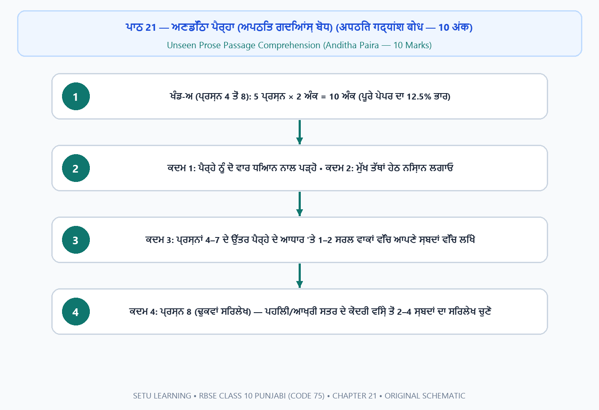

# ਪਾਠ 21 — ਅਣਡਿੱਠਾ ਪੈਰ੍ਹਾ (ਅਪਠਿਤ ਗਦਿਆਂਸ਼ ਬੋਧ) (अपठित गद्यांश बोध — 10 अंक) (Unseen Prose Passage Comprehension (Anditha Paira — 10 Marks))

## भाग 1: अध्याय प्रवेश एवं पाठ्यक्रम मैपिंग (ਪਾਠ-ਪ੍ਰਵੇਸ਼ ਅਤੇ ਪਾਠਕ੍ਰਮ ਮੈਪਿੰਗ)

> ਪਹਿਲਾ ਸੰਪਾਦਕੀ ਪ੍ਰਾਰੂਪ (प्रथम संपादकीय प्रारूप)। RBSE ਜਮਾਤ 10 ਪੰਜਾਬੀ ਪਾਠ-ਪੁਸਤਕ 'ਸਾਹਿਤ ਸੁਗੰਧੀਆਂ' ਦੇ ਸਾਰੇ ਪ੍ਰਸ਼ਨਾਂ ਦੇ ਹੱਲ ਅਤੇ 2014–2026 ਦਾ ਪੂਰਾ ਇਤਿਹਾਸਕ PYQ ਸੰਗ੍ਰਹਿ ਸਰੋਤ-ਪ੍ਰੀਖਣ ਸਮੇਤ ਸੰਕਲਿਤ ਹਨ।

**ਵਿਸ਼ਾ ਕੋਡ (विषय कोड):** 75 (ਤੀਜੀ ਭਾਸ਼ਾ — ਪੰਜਾਬੀ / तृतीया भाषा — पंजाबी) · **ਲੜੀ ਪੁਸਤਕ (श्रृंखला पुस्तक):** 7

**ਪ੍ਰਮਾਣਿਤ ਆਧਾਰ:** RBSE 2025–26 · **ਪਾਠ ਅੰਕ-ਭਾਰ:** 10 ਅੰਕ। ਇਹ ਭਾਰ ਉਸੇ ਸੰਸਕਰਣ ਦਾ ਹੈ; ਅਸਲ ਪ੍ਰਸ਼ਨ-ਵੰਡ ਦੀ ਭਵਿੱਖਬਾਣੀ ਨਹੀਂ।

**ਸਿੱਖਣ ਦੇ ਉਦੇਸ਼ (सीखने के लक्ष्य):** RBSE ਜਮਾਤ 10 ਪੰਜਾਬੀ ਪ੍ਰਸ਼ਨ-ਪੱਤਰ ਦੇ ਖੰਡ 'ਅ' (ਪ੍ਰਸ਼ਨ 4 ਤੋਂ 8) ਵਿੱਚ ਪੁੱਛੇ ਜਾਣ ਵਾਲੇ 10 ਅੰਕਾਂ ਦੇ 'ਅਣਡਿੱਠੇ ਪੈਰ੍ਹੇ' (5 ਪ੍ਰਸ਼ਨ × 2 ਅੰਕ = 10 ਅੰਕ) ਨੂੰ ਹੱਲ ਕਰਨ ਦੇ ਨਿਯਮ, ਢੁਕਵਾਂ ਸਿਰਲੇਖ ਚੁਣਨ ਦੀ ਤਕਨੀਕ ਅਤੇ ਬੋਰਡ ਪੇਪਰਾਂ (2018–2026) ਦੇ ਹੱਲ ਕੀਤੇ ਅਣਡਿੱਠੇ ਪੈਰ੍ਹਿਆਂ ਦਾ ਅਭਿਆਸ।

## भाग 2: शब्दावली एवं अवधारणा कैप्सूल (ਸ਼ਬਦਾਵਲੀ ਅਤੇ ਸੰਕਲਪ ਕੈਪਸੂਲ)

| ਸ਼ਬਦ / ਸੰਕਲਪ | ਅਰਥ / ਵਿਆਖਿਆ |
|---|---|
| ਅਣਡਿੱਠਾ ਪੈਰ੍ਹਾ (अणडिट्ठा पैर्हा) | ਉਹ ਗਦ-ਟੁਕੜਾ (ਪੈਰ੍ਹਾ) ਜੋ ਪਾਠ-ਪੁਸਤਕ ਤੋਂ ਬਾਹਰੋਂ ਵਿਦਿਆਰਥੀਆਂ ਦੀ ਭਾਸ਼ਾ-ਸਮਝ ਪਰਖਣ ਲਈ ਪੁੱਛਿਆ ਜਾਂਦਾ ਹੈ। |
| ਢੁਕਵਾਂ ਸਿਰਲੇਖ (ढुकवां सिरलेख) | ਪੈਰ੍ਹੇ ਦੇ ਕੇਂਦਰੀ ਵਿਸ਼ੇ ਨੂੰ 2 ਤੋਂ 4 ਸ਼ਬਦਾਂ ਵਿੱਚ ਪ੍ਰਗਟ ਕਰਨ ਵਾਲਾ ਨਾਂ (ਇਹ ਆਮ ਤੌਰ 'ਤੇ ਪਹਿਲੀ ਜਾਂ ਆਖ਼ਰੀ ਸਤਰ ਵਿੱਚ ਮਿਲਦਾ ਹੈ)। |
| ਕੇਂਦਰੀ ਭਾਵ (केंदरी भाव) | ਪੈਰ੍ਹੇ ਵਿੱਚ ਲੇਖਕ ਵੱਲੋਂ ਦਿੱਤਾ ਗਿਆ ਮੁੱਖ ਸੁਨੇਹਾ ਜਾਂ ਸਿੱਟਾ। |
| ਸੰਖੇਪ ਉੱਤਰ (संखेप उत्तर) | ਪੈਰ੍ਹੇ ਦੇ ਪ੍ਰਸ਼ਨਾਂ ਦੇ ਉੱਤਰ ਇੰਨ-ਬਿੰਨ ਨਕਲ ਕਰਨ ਦੀ ਥਾਂ ਆਪਣੀ ਸਰਲ ਭਾਸ਼ਾ ਵਿੱਚ 1–2 ਵਾਕਾਂ ਵਿੱਚ ਲਿਖਣੇ। |
| ਪ੍ਰਸੰਗ-ਅਨੁਸਾਰ ਅਰਥ (प्रसंग-अनुसार अर्थ) | ਪੈਰ੍ਹੇ ਵਿੱਚ ਆਏ ਕਿਸੇ ਔਖੇ ਸ਼ਬਦ ਜਾਂ ਮੁਹਾਵਰੇ ਦਾ ਵਾਕ ਦੇ ਅਨੁਸਾਰ ਸਹੀ ਅਰਥ। |
| ਖੰਡ-ਅ (खंड-अ) | RBSE 2025–2026 ਦੇ ਨਵੇਂ ਬਲੂਪ੍ਰਿੰਟ ਅਨੁਸਾਰ ਪ੍ਰਸ਼ਨ ਨੰਬਰ 4, 5, 6, 7 ਅਤੇ 8 (5 × 2 = 10 ਅੰਕ) ਅਣਡਿੱਠੇ ਪੈਰ੍ਹੇ ਉੱਤੇ ਆਧਾਰਿਤ ਹੁੰਦੇ ਹਨ। |
| ਸਵੈ-ਸ਼ਬਦਾਵਲੀ (स्वै-शब्दावली) | ਪੈਰ੍ਹੇ ਦੇ ਤੱਥਾਂ ਨੂੰ ਆਪਣੇ ਸ਼ਬਦਾਂ ਵਿੱਚ ਸਪੱਸ਼ਟ ਅਤੇ ਸ਼ੁੱਧ ਗੁਰਮੁਖੀ ਵਿੱਚ ਲਿਖਣ ਦੀ ਕਲਾ। |

## भाग 3: विस्तृत शिक्षण पाठ (ਵਿਸਤ੍ਰਿਤ ਅਧਿਆਪਨ ਪਾਠ)

### 1. ਅਣਡਿੱਠਾ ਪੈਰ੍ਹਾ (10 ਅੰਕ) ਹੱਲ ਕਰਨ ਦੇ 5 ਸੁਨਹਿਰੀ ਨਿਯਮ

| ਕ੍ਰਮ | ਨਿਯਮ (Step) | ਵਿਹਾਰਕ ਤਕਨੀਕ (Exam Strategy) |
|---|---|---|
| **1** | **ਦੋ ਵਾਰ ਧਿਆਨ ਨਾਲ ਪੜ੍ਹਨਾ** | ਪੈਰ੍ਹੇ ਨੂੰ ਘੱਟੋ-ਘੱਟ **ਦੋ ਵਾਰ** ਧਿਆਨ ਨਾਲ ਪੜ੍ਹੋ। ਪਹਿਲੀ ਵਾਰ ਪੜ੍ਹਦਿਆਂ ਪੈਰ੍ਹੇ ਦਾ ਮੁੱਖ ਵਿਸ਼ਾ ਸਮਝੋ ਅਤੇ ਦੂਜੀ ਵਾਰ ਪੜ੍ਹਦਿਆਂ ਪ੍ਰਸ਼ਨਾਂ ਦੇ ਉੱਤਰਾਂ ਹੇਠ ਪੈਨਸਿਲ ਨਾਲ ਨਿਸ਼ਾਨ ਲਗਾਓ। |
| **2** | **ਢੁਕਵਾਂ ਸਿਰਲੇਖ (Title) ਲੱਭਣਾ** | ਬੋਰਡ ਵਿੱਚ **8ਵਾਂ ਪ੍ਰਸ਼ਨ (2 ਅੰਕ)** ਹਮੇਸ਼ਾ **'ਉਪਰੋਕਤ ਪੈਰ੍ਹੇ ਦਾ ਢੁਕਵਾਂ ਸਿਰਲੇਖ ਲਿਖੋ'** ਹੁੰਦਾ ਹੈ। ਸਿਰਲੇਖ ਹਮੇਸ਼ਾ **2 ਤੋਂ 4 ਸ਼ਬਦਾਂ** ਦਾ, ਸੰਖੇਪ ਅਤੇ ਪੈਰ੍ਹੇ ਦੀ **ਪਹਿਲੀ ਜਾਂ ਆਖ਼ਰੀ ਸਤਰ** ਵਿੱਚ ਆਏ ਮੁੱਖ ਵਿਸ਼ੇ ਉੱਤੇ ਆਧਾਰਿਤ ਹੋਣਾ ਚਾਹੀਦਾ ਹੈ (ਜਿਵੇਂ: *'ਸਮੇਂ ਦੀ ਕਦਰ'*, *'ਮਿਹਨਤ ਦੀ ਮਹੱਤਤਾ'*, *'ਅਨੁਸ਼ਾਸਨ'*, *'ਪੁਸਤਕਾਂ ਦਾ ਮਹੱਤਵ'*)। |
| **3** | **ਆਪਣੇ ਸ਼ਬਦਾਂ ਵਿੱਚ ਉੱਤਰ** | ਪੈਰ੍ਹੇ ਦੀਆਂ ਸਤਰਾਂ ਨੂੰ ਬਿਨਾਂ ਸਮਝੇ ਜਿਉਂ ਦਾ ਤਿਉਂ ਨਾ ਉਤਾਰੋ, ਸਗੋਂ ਪ੍ਰਸ਼ਨ ਦੇ ਅਨੁਸਾਰ ਸਹੀ ਵਾਕ-ਬਣਤਰ ਵਿੱਚ ਉੱਤਰ ਦਿਓ। |
| **4** | **ਪੈਰ੍ਹੇ ਤੋਂ ਬਾਹਰਲੇ ਵਿਚਾਰ ਨਾ ਜੋੜੋ** | ਉੱਤਰ ਕੇਵਲ ਪੈਰ੍ਹੇ ਵਿੱਚ ਦਿੱਤੇ ਗਏ ਤੱਥਾਂ ਦੇ ਆਧਾਰ 'ਤੇ ਹੀ ਦਿਓ; ਆਪਣੀ ਕਲਪਨਾ ਨਾਲ ਬਾਹਰਲੇ ਤੱਥ ਨਾ ਜੋੜੋ। |
| **5** | **ਸ਼ਬਦ-ਜੋੜਾਂ ਦੀ ਸ਼ੁੱਧਤਾ** | ਪੈਰ੍ਹੇ ਵਿੱਚ ਸ਼ਬਦ ਸਾਹਮਣੇ ਲਿਖੇ ਹੁੰਦੇ ਹਨ, ਇਸ ਲਈ ਲਗਾਂ-ਮਾਤਰਾਵਾਂ ਅਤੇ ਬਿੰਦੀ/ਟਿੱਪੀ/ਅੱਧਕ ਦੀ ਗ਼ਲਤੀ ਬਿਲਕੁਲ ਨਾ ਕਰੋ। |

---

### 2. ਬੋਰਡ ਪ੍ਰੀਖਿਆ ਦੇ ਹੱਲ ਕੀਤੇ ਅਣਡਿੱਠੇ ਪੈਰ੍ਹੇ (Solved Board Passages)

#### ਪੈਰ੍ਹਾ 1: ਸਮੇਂ ਦੀ ਕਦਰ ਅਤੇ ਅਨੁਸ਼ਾਸਨ (RBSE 2025 Main / 2023 Main ਆਧਾਰਿਤ)
> *"ਸਮਾਂ ਬਹੁਤ ਕੀਮਤੀ ਧਨ ਹੈ। ਗੁਆਚਿਆ ਹੋਇਆ ਧਨ ਤਾਂ ਮਿਹਨਤ ਕਰਨ ਨਾਲ ਦੁਬਾਰਾ ਕਮਾਇਆ ਜਾ ਸਕਦਾ ਹੈ ਅਤੇ ਖੁੱਸੀ ਹੋਈ ਸਿਹਤ ਵੀ ਇਲਾਜ ਤੇ ਸੰਜਮ ਨਾਲ ਮੁੜ ਪ੍ਰਾਪਤ ਹੋ ਸਕਦੀ ਹੈ, ਪਰ ਬੀਤਿਆ ਹੋਇਆ ਸਮਾਂ ਕਿਸੇ ਵੀ ਕੀਮਤ ਉੱਤੇ ਵਾਪਸ ਨਹੀਂ ਆਉਂਦਾ। ਜਿਹੜੇ ਮਨੁੱਖ ਸਮੇਂ ਦੀ ਕਦਰ ਕਰਦੇ ਹਨ ਅਤੇ ਆਪਣੇ ਸਾਰੇ ਕੰਮ ਸਮੇਂ ਸਿਰ ਅਨੁਸ਼ਾਸਨ ਵਿੱਚ ਰਹਿ ਕੇ ਪੂਰੇ ਕਰਦੇ ਹਨ, ਉਹ ਜ਼ਿੰਦਗੀ ਵਿੱਚ ਹਮੇਸ਼ਾ ਸਫ਼ਲਤਾ ਦੀਆਂ ਬੁਲੰਦੀਆਂ ਨੂੰ ਛੂੰਹਦੇ ਹਨ। ਵਿਦਿਆਰਥੀ ਜੀਵਨ ਵਿੱਚ ਸਮੇਂ ਦੀ ਪਾਬੰਦੀ ਦਾ ਮਹੱਤਵ ਹੋਰ ਵੀ ਵਧ ਜਾਂਦਾ ਹੈ। ਆਲਸੀ ਮਨੁੱਖ ਅੱਜ ਦਾ ਕੰਮ ਕੱਲ੍ਹ ਉੱਤੇ ਛੱਡਦਾ ਹੈ ਅਤੇ ਅੰਤ ਵਿੱਚ ਪਛਤਾਉਂਦਾ ਹੈ।"*

- **ਪ੍ਰਸ਼ਨ 4: ਮਨੁੱਖ ਕਿਹੜੀਆਂ ਚੀਜ਼ਾਂ ਦੁਬਾਰਾ ਪ੍ਰਾਪਤ ਕਰ ਸਕਦਾ ਹੈ ਅਤੇ ਕਿਹੜੀ ਚੀਜ਼ ਵਾਪਸ ਨਹੀਂ ਆਉਂਦੀ? (2 ਅੰਕ)**
  - **ਉੱਤਰ:** ਮਨੁੱਖ ਗੁਆਚਿਆ ਹੋਇਆ ਧਨ ਮਿਹਨਤ ਨਾਲ ਅਤੇ ਖੁੱਸੀ ਹੋਈ ਸਿਹਤ ਇਲਾਜ ਨਾਲ ਦੁਬਾਰਾ ਪ੍ਰਾਪਤ ਕਰ ਸਕਦਾ ਹੈ, ਪਰ ਬੀਤਿਆ ਹੋਇਆ ਸਮਾਂ ਕਦੇ ਵਾਪਸ ਨਹੀਂ ਆਉਂਦਾ।
- **ਪ੍ਰਸ਼ਨ 5: ਜ਼ਿੰਦਗੀ ਵਿੱਚ ਸਫ਼ਲਤਾ ਦੀਆਂ ਬੁਲੰਦੀਆਂ ਨੂੰ ਕੌਣ ਛੂੰਹਦੇ ਹਨ? (2 ਅੰਕ)**
  - **ਉੱਤਰ:** ਜਿਹੜੇ ਮਨੁੱਖ ਸਮੇਂ ਦੀ ਕਦਰ ਕਰਦੇ ਹਨ ਅਤੇ ਆਪਣੇ ਸਾਰੇ ਕੰਮ ਸਮੇਂ ਸਿਰ ਅਨੁਸ਼ਾਸਨ ਵਿੱਚ ਰਹਿ ਕੇ ਪੂਰੇ ਕਰਦੇ ਹਨ, ਉਹ ਸਫ਼ਲਤਾ ਦੀਆਂ ਬੁਲੰਦੀਆਂ ਨੂੰ ਛੂੰਹਦੇ ਹਨ।
- **ਪ੍ਰਸ਼ਨ 6: ਆਲਸੀ ਮਨੁੱਖ ਦਾ ਸੁਭਾਅ ਕਿਹੋ ਜਿਹਾ ਹੁੰਦਾ ਹੈ? (2 ਅੰਕ)**
  - **ਉੱਤਰ:** ਆਲਸੀ ਮਨੁੱਖ ਅੱਜ ਦਾ ਕੰਮ ਕੱਲ੍ਹ ਉੱਤੇ ਛੱਡਦਾ ਹੈ ਅਤੇ ਸਮਾਂ ਲੰਘ ਜਾਣ ਤੋਂ ਬਾਅਦ ਪਛਤਾਉਂਦਾ ਹੈ।
- **ਪ੍ਰਸ਼ਨ 7: ਕਿਸ ਜੀਵਨ ਵਿੱਚ ਸਮੇਂ ਦੀ ਪਾਬੰਦੀ ਦਾ ਮਹੱਤਵ ਸਭ ਤੋਂ ਵੱਧ ਹੈ? (2 ਅੰਕ)**
  - **ਉੱਤਰ:** ਵਿਦਿਆਰਥੀ ਜੀਵਨ ਵਿੱਚ ਸਮੇਂ ਦੀ ਪਾਬੰਦੀ ਦਾ ਮਹੱਤਵ ਸਭ ਤੋਂ ਵੱਧ ਹੈ।
- **ਪ੍ਰਸ਼ਨ 8: ਉਪਰੋਕਤ ਪੈਰ੍ਹੇ ਦਾ ਢੁਕਵਾਂ ਸਿਰਲੇਖ ਲਿਖੋ। (2 ਅੰਕ)**
  - **ਉੱਤਰ:** **'ਸਮੇਂ ਦੀ ਕਦਰ'** ਜਾਂ **'ਸਮੇਂ ਦਾ ਮਹੱਤਵ'**।

---

#### ਪੈਰ੍ਹਾ 2: ਪੁਸਤਕਾਂ ਅਤੇ ਸਾਹਿਤ ਦਾ ਮਹੱਤਵ (RBSE 2024 Main / 2026 Main ਆਧਾਰਿਤ)
> *"ਪੁਸਤਕਾਂ ਮਨੁੱਖ ਦੀਆਂ ਸਭ ਤੋਂ ਸੱਚੀਆਂ ਅਤੇ ਵਫ਼ਾਦਾਰ ਮਿੱਤਰ ਹੁੰਦੀਆਂ ਹਨ। ਚੰਗੀਆਂ ਪੁਸਤਕਾਂ ਸਾਨੂੰ ਅਗਿਆਨਤਾ ਦੇ ਹਨੇਰੇ ਵਿੱਚੋਂ ਕੱਢ ਕੇ ਗਿਆਨ ਦੇ ਚਾਨਣ ਵੱਲ ਲੈ ਜਾਂਦੀਆਂ ਹਨ। ਦੁਨੀਆ ਦੇ ਮਹਾਨ ਵਿਦਵਾਨਾਂ, ਸੰਤਾਂ ਅਤੇ ਮਹਾਂਪੁਰਸ਼ਾਂ ਦੇ ਵਿਚਾਰ ਪੁਸਤਕਾਂ ਵਿੱਚ ਸੁਰੱਖਿਅਤ ਰਹਿੰਦੇ ਹਨ। ਜਦੋਂ ਮਨੁੱਖ ਇਕੱਲਾ ਜਾਂ ਉਦਾਸ ਹੁੰਦਾ ਹੈ, ਤਾਂ ਚੰਗੀ ਪੁਸਤਕ ਉਸ ਦਾ ਇਕੱਲਾਪਣ ਦੂਰ ਕਰਕੇ ਉਸ ਨੂੰ ਨਵੀਂ ਪ੍ਰੇਰਨਾ ਅਤੇ ਉਤਸ਼ਾਹ ਦਿੰਦੀ ਹੈ। ਜਿਸ ਘਰ ਵਿੱਚ ਚੰਗੀਆਂ ਪੁਸਤਕਾਂ ਹੁੰਦੀਆਂ ਹਨ, ਉੱਥੇ ਸਕਾਰਾਤਮਕ ਵਿਚਾਰਾਂ ਦਾ ਵਾਸ ਹੁੰਦਾ ਹੈ।"*

- **ਪ੍ਰਸ਼ਨ 4: ਮਨੁੱਖ ਦੀਆਂ ਸਭ ਤੋਂ ਸੱਚੀਆਂ ਅਤੇ ਵਫ਼ਾਦਾਰ ਮਿੱਤਰ ਕੌਣ ਹਨ? (2 ਅੰਕ)**
  - **ਉੱਤਰ:** ਪੁਸਤਕਾਂ ਮਨੁੱਖ ਦੀਆਂ ਸਭ ਤੋਂ ਸੱਚੀਆਂ ਅਤੇ ਵਫ਼ਾਦਾਰ ਮਿੱਤਰ ਹਨ।
- **ਪ੍ਰਸ਼ਨ 5: ਚੰਗੀਆਂ ਪੁਸਤਕਾਂ ਮਨੁੱਖ ਨੂੰ ਕਿੱਥੋਂ ਕੱਢ ਕੇ ਕਿੱਥੇ ਲੈ ਜਾਂਦੀਆਂ ਹਨ? (2 ਅੰਕ)**
  - **ਉੱਤਰ:** ਚੰਗੀਆਂ ਪੁਸਤਕਾਂ ਮਨੁੱਖ ਨੂੰ ਅਗਿਆਨਤਾ ਦੇ ਹਨੇਰੇ ਵਿੱਚੋਂ ਕੱਢ ਕੇ ਗਿਆਨ ਦੇ ਚਾਨਣ ਵੱਲ ਲੈ ਜਾਂਦੀਆਂ ਹਨ।
- **ਪ੍ਰਸ਼ਨ 6: ਪੁਸਤਕਾਂ ਵਿੱਚ ਕਿਨ੍ਹਾਂ ਦੇ ਵਿਚਾਰ ਸੁਰੱਖਿਅਤ ਰਹਿੰਦੇ ਹਨ? (2 ਅੰਕ)**
  - **ਉੱਤਰ:** ਪੁਸਤਕਾਂ ਵਿੱਚ ਦੁਨੀਆ ਦੇ ਮਹਾਨ ਵਿਦਵਾਨਾਂ, ਸੰਤਾਂ ਅਤੇ ਮਹਾਂਪੁਰਸ਼ਾਂ ਦੇ ਵਿਚਾਰ ਸੁਰੱਖਿਅਤ ਰਹਿੰਦੇ ਹਨ।
- **ਪ੍ਰਸ਼ਨ 7: ਉਦਾਸੀ ਜਾਂ ਇਕੱਲੇਪਣ ਵੇਲੇ ਪੁਸਤਕ ਮਨੁੱਖ ਦੀ ਕਿਵੇਂ ਮਦਦ ਕਰਦੀ ਹੈ? (2 ਅੰਕ)**
  - **ਉੱਤਰ:** ਉਦਾਸੀ ਜਾਂ ਇਕੱਲੇਪਣ ਵੇਲੇ ਚੰਗੀ ਪੁਸਤਕ ਮਨੁੱਖ ਦਾ ਇਕੱਲਾਪਣ ਦੂਰ ਕਰਕੇ ਉਸ ਨੂੰ ਨਵੀਂ ਪ੍ਰੇਰਨਾ ਅਤੇ ਉਤਸ਼ਾਹ ਦਿੰਦੀ ਹੈ।
- **ਪ੍ਰਸ਼ਨ 8: ਉਪਰੋਕਤ ਪੈਰ੍ਹੇ ਦਾ ਢੁਕਵਾਂ ਸਿਰਲੇਖ ਲਿਖੋ। (2 ਅੰਕ)**
  - **ਉੱਤਰ:** **'ਪੁਸਤਕਾਂ ਦਾ ਮਹੱਤਵ'** ਜਾਂ **'ਸੱਚੇ ਮਿੱਤਰ: ਪੁਸਤਕਾਂ'**।

ਪਾਠ 21: ਅਣਡਿੱਠਾ ਪੈਰ੍ਹਾ (ਅਪਠਿਤ ਗਦਿਆਂਸ਼ ਬੋਧ — 10 ਅੰਕ) ਹੱਲ ਕਰਨ ਦੀ ਵਿਧੀ

## भाग 4: पाठ्यपुस्तक-अवधारणाओं पर मौलिक हल किए उदाहरण (ਹੱਲ ਕੀਤੇ ਮਿਆਰੀ ਉਦਾਹਰਣ)

ਹੇਠਾਂ ਦਿੱਤੇ ਪ੍ਰਸ਼ਨ ਪਾਠ-ਪੁਸਤਕ 'ਸਾਹਿਤ ਸੁਗੰਧੀਆਂ' ਅਤੇ ਵਿਆਕਰਣ ਦੇ ਸੰਕਲਪਾਂ ਉੱਤੇ ਆਧਾਰਿਤ ਮੌਲਿਕ ਆਦਰਸ਼ ਹੱਲ ਹਨ।

**ਹੱਲ ਕੀਤਾ ਉਦਾਹਰਣ 1: ਅਣਡਿੱਠੇ ਪੈਰ੍ਹੇ ਦਾ ਢੁਕਵਾਂ ਸਿਰਲੇਖ ਚੁਣਦੇ ਸਮੇਂ ਕਿਹੜੀਆਂ ਗੱਲਾਂ ਦਾ ਧਿਆਨ ਰੱਖਣਾ ਚਾਹੀਦਾ ਹੈ?**

1. ਸਿਰਲੇਖ ਪੈਰ੍ਹੇ ਦੇ ਕੇਂਦਰੀ ਭਾਵ ਜਾਂ ਮੁੱਖ ਵਿਸ਼ੇ ਨਾਲ ਸਿੱਧਾ ਜੁੜਿਆ ਹੋਣਾ ਚਾਹੀਦਾ ਹੈ। 2. ਇਹ ਸੰਖੇਪ (2 ਤੋਂ 4 ਸ਼ਬਦਾਂ ਦਾ) ਅਤੇ ਪ੍ਰਭਾਵਸ਼ਾਲੀ ਹੋਣਾ ਚਾਹੀਦਾ ਹੈ। 3. ਆਮ ਤੌਰ 'ਤੇ ਪੈਰ੍ਹੇ ਦੀ ਪਹਿਲੀ ਜਾਂ ਅੰਤਿਮ ਸਤਰ ਵਿੱਚ ਮੁੱਖ ਵਿਸ਼ਾ ਮਿਲ ਜਾਂਦਾ ਹੈ।

**ਹੱਲ ਕੀਤਾ ਉਦਾਹਰਣ 2: RBSE ਜਮਾਤ 10 ਪੰਜਾਬੀ ਦੇ ਪ੍ਰਸ਼ਨ-ਪੱਤਰ ਵਿੱਚ ਅਣਡਿੱਠਾ ਪੈਰ੍ਹਾ ਕਿੰਨੇ ਅੰਕਾਂ ਦਾ ਹੁੰਦਾ ਹੈ ਅਤੇ ਇਸ ਵਿੱਚ ਕਿੰਨੇ ਪ੍ਰਸ਼ਨ ਪੁੱਛੇ ਜਾਂਦੇ ਹਨ?**

RBSE ਜਮਾਤ 10 ਪੰਜਾਬੀ ਦੇ ਪ੍ਰਸ਼ਨ-ਪੱਤਰ ਦੇ ਖੰਡ 'ਅ' (ਪ੍ਰਸ਼ਨ ਨੰਬਰ 4 ਤੋਂ 8) ਵਿੱਚ ਅਣਡਿੱਠਾ ਪੈਰ੍ਹਾ ਕੁੱਲ 10 ਅੰਕਾਂ ਦਾ ਹੁੰਦਾ ਹੈ। ਇਸ ਵਿੱਚ 2-2 ਅੰਕਾਂ ਦੇ 5 ਪ੍ਰਸ਼ਨ ਪੁੱਛੇ ਜਾਂਦੇ ਹਨ।

**ਹੱਲ ਕੀਤਾ ਉਦਾਹਰਣ 3: ਅਣਡਿੱਠੇ ਪੈਰ੍ਹੇ ਦੇ ਪ੍ਰਸ਼ਨਾਂ ਦੇ ਉੱਤਰ ਲਿਖਣ ਦਾ ਸਹੀ ਤਰੀਕਾ ਕੀ ਹੈ?**

ਪਹਿਲਾਂ ਪੈਰ੍ਹੇ ਨੂੰ ਦੋ ਵਾਰ ਧਿਆਨ ਨਾਲ ਪੜ੍ਹੋ, ਫਿਰ ਪ੍ਰਸ਼ਨਾਂ ਦੇ ਉੱਤਰ ਪੈਰ੍ਹੇ ਵਿੱਚੋਂ ਲੱਭ ਕੇ ਇੰਨ-ਬਿੰਨ ਨਕਲ ਕਰਨ ਦੀ ਥਾਂ ਆਪਣੀ ਸਰਲ, ਸਪੱਸ਼ਟ ਅਤੇ ਸ਼ੁੱਧ ਪੰਜਾਬੀ ਭਾਸ਼ਾ ਵਿੱਚ 1 ਤੋਂ 2 ਵਾਕਾਂ ਵਿੱਚ ਲਿਖੋ।

## भाग 5: सत्यापित बोर्ड प्रश्न एवं स्रोत-स्थिति (ਪ੍ਰਮਾਣਿਤ ਬੋਰਡ ਪ੍ਰਸ਼ਨ ਅਤੇ ਸਰੋਤ-ਸਥਿਤੀ)

RBSE 2014 ਤੋਂ 2026 ਤੱਕ ਦੇ ਹਰ ਪੰਜਾਬੀ ਬੋਰਡ ਪੇਪਰ ਵਿੱਚ 10 ਅੰਕਾਂ ਦਾ ਅਣਡਿੱਠਾ ਪੈਰ੍ਹਾ ਲਾਜ਼ਮੀ ਪੁੱਛਿਆ ਗਿਆ ਹੈ।

[RBSE 2026 ਮੂਲ ਪੇਪਰ (S-75)](https://rajeduboard.rajasthan.gov.in/books/PAPERS-2026/Sec/S-75.pdf)। ਪ੍ਰਸ਼ਨ ਦਾ ਸੰਖੇਪ ਵਿਸ਼ਾ-ਸੰਦਰਭ ਹੈ; ਸ਼ਬਦ-ਬ-ਸ਼ਬਦ ਪੁਨਰ-ਮੁਦਰਣ ਨਹੀਂ।

## भाग 6: खंडवार मौलिक अभ्यास बैंक (ਖੰਡ-ਵਾਰ ਮੌਲਿਕ ਅਭਿਆਸ ਬੈਂਕ)

**ਅਭਿਆਸ-ਅੰਕ:** ਵਿਦਿਆਰਥੀਆਂ ਦੇ ਸਵੈ-ਅਭਿਆਸ ਲਈ ਹਨ; ਉੱਤਰ ਪਹਿਲਾਂ ਆਪ ਲਿਖੋ, ਫਿਰ ਭਾਗ 9 ਵੇਖੋ।

## ੳ: ਬਹੁ-ਵਿਕਲਪੀ ਪ੍ਰਸ਼ਨ (MCQ) — 15 × 1 ਅੰਕ

**MCQ 1. RBSE ਜਮਾਤ 10 ਪੰਜਾਬੀ ਦੇ ਪ੍ਰਸ਼ਨ-ਪੱਤਰ ਵਿੱਚ 'ਅਣਡਿੱਠਾ ਪੈਰ੍ਹਾ' ਕੁੱਲ ਕਿੰਨੇ ਅੰਕਾਂ ਦਾ ਹੁੰਦਾ ਹੈ?**

ੳ) 5 ਅੰਕ  
ਅ) 8 ਅੰਕ  
ੲ) 4 ਅੰਕ  
ਸ) 10 ਅੰਕ (5 ਪ੍ਰਸ਼ਨ × 2 ਅੰਕ)

**MCQ 2. ਅਣਡਿੱਠੇ ਪੈਰ੍ਹੇ ਦਾ 'ਢੁਕਵਾਂ ਸਿਰਲੇਖ' ਕਿੰਨੇ ਸ਼ਬਦਾਂ ਦਾ ਹੋਣਾ ਸਭ ਤੋਂ ਉੱਤਮ ਮੰਨਿਆ ਜਾਂਦਾ ਹੈ?**

ੳ) ਪੂਰੇ ਤਿੰਨ ਵਾਕਾਂ ਦਾ  
ਅ) ਇੱਕ ਪੂਰੇ ਪੈਰ੍ਹੇ ਦਾ  
ੲ) 2 ਤੋਂ 4 ਸ਼ਬਦਾਂ ਦਾ  
ਸ) 20 ਤੋਂ 30 ਸ਼ਬਦਾਂ ਦਾ

**MCQ 3. ਅਣਡਿੱਠੇ ਪੈਰ੍ਹੇ ਦਾ ਸਿਰਲੇਖ ਆਮ ਤੌਰ 'ਤੇ ਪੈਰ੍ਹੇ ਦੇ ਕਿਹੜੇ ਹਿੱਸੇ ਵਿੱਚੋਂ ਮਿਲ ਜਾਂਦਾ ਹੈ?**

ੳ) ਕਿਸੇ ਕਵਿਤਾ ਵਿੱਚੋਂ  
ਅ) ਪਹਿਲੀ ਜਾਂ ਆਖ਼ਰੀ ਸਤਰ ਵਿੱਚੋਂ (ਕੇਂਦਰੀ ਵਿਸ਼ੇ ਤੋਂ)  
ੲ) ਪੈਰ੍ਹੇ ਤੋਂ ਬਾਹਰੋਂ  
ਸ) ਵਿਆਕਰਣ ਦੇ ਨਿਯਮਾਂ ਵਿੱਚੋਂ

**MCQ 4. 'ਗੁਆਚਿਆ ਹੋਇਆ ਧਨ ਮਿਹਨਤ ਨਾਲ ਮੁੜ ਮਿਲ ਸਕਦਾ ਹੈ ਪਰ ਬੀਤਿਆ ਸਮਾਂ ਵਾਪਸ ਨਹੀਂ ਆਉਂਦਾ' — ਇਸ ਪੈਰ੍ਹੇ ਦਾ ਸਭ ਤੋਂ ਢੁਕਵਾਂ ਸਿਰਲੇਖ ਕੀ ਹੋਵੇਗਾ?**

ੳ) ਸਮੇਂ ਦੀ ਕਦਰ  
ਅ) ਧਨ ਦੀ ਕਮਾਈ  
ੲ) ਸਿਹਤ ਦੀ ਸੰਭਾਲ  
ਸ) ਖੇਡਾਂ ਦਾ ਮਹੱਤਵ

**MCQ 5. 'ਪੁਸਤਕਾਂ ਮਨੁੱਖ ਦੀਆਂ ਸਭ ਤੋਂ ਸੱਚੀਆਂ ਮਿੱਤਰ ਹਨ ਜੋ ਅਗਿਆਨਤਾ ਦਾ ਹਨੇਰਾ ਦੂਰ ਕਰਦੀਆਂ ਹਨ' — ਇਸ ਪੈਰ੍ਹੇ ਦਾ ਢੁਕਵਾਂ ਸਿਰਲੇਖ ਕੀ ਹੋਵੇਗਾ?**

ੳ) ਹਨੇਰਾ ਅਤੇ ਚਾਨਣ  
ਅ) ਮਿੱਤਰਤਾ  
ੲ) ਇਕੱਲਾਪਣ  
ਸ) ਪੁਸਤਕਾਂ ਦਾ ਮਹੱਤਵ

**MCQ 6. ਅਣਡਿੱਠੇ ਪੈਰ੍ਹੇ ਨੂੰ ਹੱਲ ਕਰਨ ਲਈ ਸਭ ਤੋਂ ਪਹਿਲਾ ਕਦਮ ਕੀ ਹੋਣਾ ਚਾਹੀਦਾ ਹੈ?**

ੳ) ਪੂਰਾ ਪੈਰ੍ਹਾ ਕਾਪੀ ਉੱਤੇ ਉਤਾਰਨਾ  
ਅ) ਸਿਰਫ਼ ਆਖ਼ਰੀ ਸ਼ਬਦ ਪੜ੍ਹਨਾ  
ੲ) ਪੈਰ੍ਹੇ ਨੂੰ ਘੱਟੋ-ਘੱਟ ਦੋ ਵਾਰ ਧਿਆਨ ਨਾਲ ਪੜ੍ਹ ਕੇ ਉਸ ਦੇ ਅਰਥ ਸਮਝਣਾ  
ਸ) ਬਿਨਾਂ ਪੜ੍ਹੇ ਸਿੱਧਾ ਉੱਤਰ ਲਿਖਣਾ

**MCQ 7. 'ਵਿੱਦਿਆ ਮਨੁੱਖ ਦਾ ਤੀਜਾ ਨੇਤਰ ਹੈ ਅਤੇ ਇਹ ਧਨ ਵੰਡਣ ਨਾਲ ਵਧਦਾ ਹੈ' — ਇਸ ਪੈਰ੍ਹੇ ਵਿੱਚ ਕਿਸ ਚੀਜ਼ ਨੂੰ ਤੀਜਾ ਨੇਤਰ ਕਿਹਾ ਗਿਆ ਹੈ?**

ੳ) ਸਮੇਂ ਨੂੰ  
ਅ) ਵਿੱਦਿਆ ਨੂੰ  
ੲ) ਪੈਸੇ ਨੂੰ  
ਸ) ਖੇਡਾਂ ਨੂੰ

**MCQ 8. 'ਤੰਦਰੁਸਤ ਸਰੀਰ ਵਿੱਚ ਹੀ ਤੰਦਰੁਸਤ ਮਨ ਨਿਵਾਸ ਕਰਦਾ ਹੈ ਅਤੇ ਖੇਡਾਂ ਸਰੀਰ ਨੂੰ ਰਿਸ਼ਟ-ਪੁਸ਼ਟ ਰੱਖਦੀਆਂ ਹਨ' — ਇਸ ਪੈਰ੍ਹੇ ਦਾ ਸਿਰਲੇਖ ਕੀ ਹੋਵੇਗਾ?**

ੳ) ਖੇਡਾਂ ਅਤੇ ਸਿਹਤ ਦਾ ਮਹੱਤਵ  
ਅ) ਪੜ੍ਹਾਈ ਦਾ ਮਹੱਤਵ  
ੲ) ਰੁੱਖਾਂ ਦੇ ਲਾਭ  
ਸ) ਪ੍ਰਦੂਸ਼ਣ ਦੀ ਸਮੱਸਿਆ

**MCQ 9. ਅਣਡਿੱਠੇ ਪੈਰ੍ਹੇ ਦੇ ਪ੍ਰਸ਼ਨਾਂ ਦੇ ਉੱਤਰ ਕਿਹੋ ਜਿਹੀ ਭਾਸ਼ਾ ਵਿੱਚ ਲਿਖਣੇ ਚਾਹੀਦੇ ਹਨ?**

ੳ) ਪੈਰ੍ਹੇ ਤੋਂ ਬਿਲਕੁਲ ਉਲਟ  
ਅ) ਕਵਿਤਾ ਦੇ ਰੂਪ ਵਿੱਚ  
ੲ) ਅੰਗਰੇਜ਼ੀ ਭਾਸ਼ਾ ਵਿੱਚ  
ਸ) ਪੈਰ੍ਹੇ ਦੇ ਤੱਥਾਂ ਦੇ ਆਧਾਰ 'ਤੇ ਆਪਣੀ ਸਰਲ ਅਤੇ ਸਪੱਸ਼ਟ ਭਾਸ਼ਾ ਵਿੱਚ

**MCQ 10. 'ਰੁੱਖ ਸਾਨੂੰ ਆਕਸੀਜਨ, ਫਲ, ਫੁੱਲ ਅਤੇ ਛਾਂ ਦਿੰਦੇ ਹਨ ਅਤੇ ਧਰਤੀ ਨੂੰ ਖੁਰਨ ਤੋਂ ਬਚਾਉਂਦੇ ਹਨ' — ਇਸ ਪੈਰ੍ਹੇ ਦਾ ਮੁੱਖ ਵਿਸ਼ਾ ਕੀ ਹੈ?**

ੳ) ਸਮੇਂ ਦੀ ਪਾਬੰਦੀ  
ਅ) ਦਾਜ ਦੀ ਲਾਹਨਤ  
ੲ) ਰੁੱਖਾਂ ਦਾ ਮਹੱਤਵ (ਵਾਤਾਵਰਣ ਸੰਭਾਲ)  
ਸ) ਮੋਬਾਈਲ ਦੇ ਲਾਭ

**MCQ 11. ਅਣਡਿੱਠਾ ਪੈਰ੍ਹਾ ਪ੍ਰੀਖਿਆ ਵਿੱਚ ਕਿਉਂ ਪੁੱਛਿਆ ਜਾਂਦਾ ਹੈ?**

ੳ) ਸਮਾਂ ਖਰਾਬ ਕਰਨ ਲਈ  
ਅ) ਵਿਦਿਆਰਥੀਆਂ ਦੀ ਭਾਸ਼ਾ-ਸਮਝ (ਅਰਥ-ਗ੍ਰਹਿਣ ਸਮਰੱਥਾ) ਅਤੇ ਪ੍ਰਗਟਾਵੇ ਦੀ ਪਰਖ ਲਈ  
ੲ) ਸੁੰਦਰ ਲਿਖਾਈ ਪਰਖਣ ਲਈ  
ਸ) ਰੱਟਾ ਲਾਉਣ ਦੀ ਆਦਤ ਵਧਾਉਣ ਲਈ

**MCQ 12. ਜੇ ਪੈਰ੍ਹੇ ਵਿੱਚ ਪੁੱਛਿਆ ਜਾਵੇ 'ਉੱਦਮੀ ਮਨੁੱਖ ਕਿਸ ਦੇ ਭਰੋਸੇ ਨਹੀਂ ਬੈਠਦਾ?' ਤਾਂ ਸਹੀ ਉੱਤਰ ਕੀ ਹੁੰਦਾ ਹੈ?**

ੳ) ਕਿਸਮਤ ਦੇ ਭਰੋਸੇ  
ਅ) ਮਿਹਨਤ ਦੇ ਭਰੋਸੇ  
ੲ) ਪੜ੍ਹਾਈ ਦੇ ਭਰੋਸੇ  
ਸ) ਸਮੇਂ ਦੇ ਭਰੋਸੇ

**MCQ 13. 'ਚੰਗੀ ਸੰਗਤ ਪਾਰਸ ਵਾਂਗ ਹੁੰਦੀ ਹੈ ਜੋ ਲੋਹੇ ਨੂੰ ਸੋਨਾ ਬਣਾ ਦਿੰਦੀ ਹੈ' — ਇਸ ਵਾਕ ਵਿੱਚ ਚੰਗੀ ਸੰਗਤ ਦੀ ਤੁਲਨਾ ਕਿਸ ਨਾਲ ਕੀਤੀ ਗਈ ਹੈ?**

ੳ) ਲੋਹੇ ਨਾਲ  
ਅ) ਪੱਥਰ ਨਾਲ  
ੲ) ਪਾਣੀ ਨਾਲ  
ਸ) ਪਾਰਸ ਨਾਲ

**MCQ 14. RBSE 2025–2026 ਦੇ ਪ੍ਰਸ਼ਨ-ਪੱਤਰ ਵਿੱਚ ਅਣਡਿੱਠੇ ਪੈਰ੍ਹੇ ਦੇ ਪ੍ਰਸ਼ਨ ਕਿਹੜੇ ਨੰਬਰਾਂ ਉੱਤੇ ਆਉਂਦੇ ਹਨ?**

ੳ) ਪ੍ਰਸ਼ਨ ਨੰਬਰ 18, 19 ਅਤੇ 20  
ਅ) ਪ੍ਰਸ਼ਨ ਨੰਬਰ 14 ਤੋਂ 17  
ੲ) ਪ੍ਰਸ਼ਨ ਨੰਬਰ 4, 5, 6, 7 ਅਤੇ 8  
ਸ) ਪ੍ਰਸ਼ਨ ਨੰਬਰ 1, 2 ਅਤੇ 3

**MCQ 15. ਅਣਡਿੱਠੇ ਪੈਰ੍ਹੇ ਦੇ ਸਿਰਲੇਖ ਵਾਲੇ ਪ੍ਰਸ਼ਨ (Q8) ਦੇ ਕਿੰਨੇ ਅੰਕ ਹੁੰਦੇ ਹਨ?**

ੳ) 4 ਅੰਕ  
ਅ) 2 ਅੰਕ  
ੲ) 1 ਅੰਕ  
ਸ) 5 ਅੰਕ

## ੳ: ਖਾਲੀ ਥਾਵਾਂ ਭਰੋ — 6 × 1 ਅੰਕ

1. ਉਹ ਗਦ-ਟੁਕੜਾ (ਪੈਰ੍ਹਾ) ਜੋ ਪਾਠ-ਪੁਸਤਕ ਤੋਂ ਬਾਹਰੋਂ ਵਿਦਿਆਰਥੀਆਂ ਦੀ ਭਾਸ਼ਾ-ਸਮਝ ਪਰਖਣ ਲਈ ਪੁੱਛਿਆ ਜਾਂਦਾ ਹੈ। — ਇਸ ਸ਼ਬਦ/ਸੰਕਲਪ ਦਾ ਨਾਂ ਹੈ: ____।  
2. ਪੈਰ੍ਹੇ ਦੇ ਕੇਂਦਰੀ ਵਿਸ਼ੇ ਨੂੰ 2 ਤੋਂ 4 ਸ਼ਬਦਾਂ ਵਿੱਚ ਪ੍ਰਗਟ ਕਰਨ ਵਾਲਾ ਨਾਂ (ਇਹ ਆਮ ਤੌਰ 'ਤੇ ਪਹਿਲੀ ਜਾਂ ਆਖ਼ਰੀ ਸਤਰ ਵਿੱਚ ਮਿਲਦਾ ਹੈ)। — ਇਸ ਸ਼ਬਦ/ਸੰਕਲਪ ਦਾ ਨਾਂ ਹੈ: ____।  
3. ਪੈਰ੍ਹੇ ਵਿੱਚ ਲੇਖਕ ਵੱਲੋਂ ਦਿੱਤਾ ਗਿਆ ਮੁੱਖ ਸੁਨੇਹਾ ਜਾਂ ਸਿੱਟਾ। — ਇਸ ਸ਼ਬਦ/ਸੰਕਲਪ ਦਾ ਨਾਂ ਹੈ: ____।  
4. ਪੈਰ੍ਹੇ ਦੇ ਪ੍ਰਸ਼ਨਾਂ ਦੇ ਉੱਤਰ ਇੰਨ-ਬਿੰਨ ਨਕਲ ਕਰਨ ਦੀ ਥਾਂ ਆਪਣੀ ਸਰਲ ਭਾਸ਼ਾ ਵਿੱਚ 1–2 ਵਾਕਾਂ ਵਿੱਚ ਲਿਖਣੇ। — ਇਸ ਸ਼ਬਦ/ਸੰਕਲਪ ਦਾ ਨਾਂ ਹੈ: ____।  
5. ਪੈਰ੍ਹੇ ਵਿੱਚ ਆਏ ਕਿਸੇ ਔਖੇ ਸ਼ਬਦ ਜਾਂ ਮੁਹਾਵਰੇ ਦਾ ਵਾਕ ਦੇ ਅਨੁਸਾਰ ਸਹੀ ਅਰਥ। — ਇਸ ਸ਼ਬਦ/ਸੰਕਲਪ ਦਾ ਨਾਂ ਹੈ: ____।  
6. RBSE 2025–2026 ਦੇ ਨਵੇਂ ਬਲੂਪ੍ਰਿੰਟ ਅਨੁਸਾਰ ਪ੍ਰਸ਼ਨ ਨੰਬਰ 4, 5, 6, 7 ਅਤੇ 8 (5 × 2 = 10 ਅੰਕ) ਅਣਡਿੱਠੇ ਪੈਰ੍ਹੇ ਉੱਤੇ ਆਧਾਰਿਤ ਹੁੰਦੇ ਹਨ। — ਇਸ ਸ਼ਬਦ/ਸੰਕਲਪ ਦਾ ਨਾਂ ਹੈ: ____।

## ੳ: ਅਤਿ-ਲਘੂ ਉੱਤਰਾਂ ਵਾਲੇ ਪ੍ਰਸ਼ਨ — 8 × 1 ਅੰਕ

1. RBSE ਜਮਾਤ 10 ਪੰਜਾਬੀ ਦੇ ਪ੍ਰਸ਼ਨ-ਪੱਤਰ ਵਿੱਚ 'ਅਣਡਿੱਠਾ ਪੈਰ੍ਹਾ' ਕੁੱਲ ਕਿੰਨੇ ਅੰਕਾਂ ਦਾ ਹੁੰਦਾ ਹੈ?  
2. ਅਣਡਿੱਠੇ ਪੈਰ੍ਹੇ ਦਾ 'ਢੁਕਵਾਂ ਸਿਰਲੇਖ' ਕਿੰਨੇ ਸ਼ਬਦਾਂ ਦਾ ਹੋਣਾ ਸਭ ਤੋਂ ਉੱਤਮ ਮੰਨਿਆ ਜਾਂਦਾ ਹੈ?  
3. ਅਣਡਿੱਠੇ ਪੈਰ੍ਹੇ ਦਾ ਸਿਰਲੇਖ ਆਮ ਤੌਰ 'ਤੇ ਪੈਰ੍ਹੇ ਦੇ ਕਿਹੜੇ ਹਿੱਸੇ ਵਿੱਚੋਂ ਮਿਲ ਜਾਂਦਾ ਹੈ?  
4. 'ਗੁਆਚਿਆ ਹੋਇਆ ਧਨ ਮਿਹਨਤ ਨਾਲ ਮੁੜ ਮਿਲ ਸਕਦਾ ਹੈ ਪਰ ਬੀਤਿਆ ਸਮਾਂ ਵਾਪਸ ਨਹੀਂ ਆਉਂਦਾ' — ਇਸ ਪੈਰ੍ਹੇ ਦਾ ਸਭ ਤੋਂ ਢੁਕਵਾਂ ਸਿਰਲੇਖ ਕੀ ਹੋਵੇਗਾ?  
5. 'ਪੁਸਤਕਾਂ ਮਨੁੱਖ ਦੀਆਂ ਸਭ ਤੋਂ ਸੱਚੀਆਂ ਮਿੱਤਰ ਹਨ ਜੋ ਅਗਿਆਨਤਾ ਦਾ ਹਨੇਰਾ ਦੂਰ ਕਰਦੀਆਂ ਹਨ' — ਇਸ ਪੈਰ੍ਹੇ ਦਾ ਢੁਕਵਾਂ ਸਿਰਲੇਖ ਕੀ ਹੋਵੇਗਾ?  
6. ਅਣਡਿੱਠੇ ਪੈਰ੍ਹੇ ਨੂੰ ਹੱਲ ਕਰਨ ਲਈ ਸਭ ਤੋਂ ਪਹਿਲਾ ਕਦਮ ਕੀ ਹੋਣਾ ਚਾਹੀਦਾ ਹੈ?  
7. 'ਵਿੱਦਿਆ ਮਨੁੱਖ ਦਾ ਤੀਜਾ ਨੇਤਰ ਹੈ ਅਤੇ ਇਹ ਧਨ ਵੰਡਣ ਨਾਲ ਵਧਦਾ ਹੈ' — ਇਸ ਪੈਰ੍ਹੇ ਵਿੱਚ ਕਿਸ ਚੀਜ਼ ਨੂੰ ਤੀਜਾ ਨੇਤਰ ਕਿਹਾ ਗਿਆ ਹੈ?  
8. 'ਤੰਦਰੁਸਤ ਸਰੀਰ ਵਿੱਚ ਹੀ ਤੰਦਰੁਸਤ ਮਨ ਨਿਵਾਸ ਕਰਦਾ ਹੈ ਅਤੇ ਖੇਡਾਂ ਸਰੀਰ ਨੂੰ ਰਿਸ਼ਟ-ਪੁਸ਼ਟ ਰੱਖਦੀਆਂ ਹਨ' — ਇਸ ਪੈਰ੍ਹੇ ਦਾ ਸਿਰਲੇਖ ਕੀ ਹੋਵੇਗਾ?

## ਅ: ਲਘੂ ਉੱਤਰਾਂ ਵਾਲੇ ਪ੍ਰਸ਼ਨ — 4 × 2 ਅੰਕ

**B1.** ਪੈਰ੍ਹਾ (RBSE 2026 Main Q4–8): ਮਨੁੱਖੀ ਜੀਵਨ ਵਿੱਚ ਮਿਹਨਤ ਅਤੇ ਉੱਦਮ ਦੀ ਮਹੱਤਤਾ ਬਾਰੇ ਪ੍ਰਸ਼ਨ।

**B2.** ਪੈਰ੍ਹਾ (RBSE 2026 Supp Q4–8): ਰੁੱਖਾਂ ਅਤੇ ਵਾਤਾਵਰਣ ਦੀ ਸੰਭਾਲ ਬਾਰੇ ਪ੍ਰਸ਼ਨ।

**B3.** ਪੈਰ੍ਹਾ (RBSE 2025 Main Q4–8): ਸਮੇਂ ਦੀ ਕਦਰ ਅਤੇ ਵਿਦਿਆਰਥੀ ਜੀਵਨ ਬਾਰੇ ਪ੍ਰਸ਼ਨ।

**B4.** ਪੈਰ੍ਹਾ (RBSE 2025 Supp Q4–8): ਸੱਚੀ ਮਿੱਤਰਤਾ ਅਤੇ ਚੰਗੀ ਸੰਗਤ ਬਾਰੇ ਪ੍ਰਸ਼ਨ।

## ੲ: ਦੀਰਘ ਉੱਤਰਾਂ ਵਾਲੇ ਪ੍ਰਸ਼ਨ — 2 × 3 ਅੰਕ

ਅੰਦਰੂਨੀ ਵਿਕਲਪ ਅਭਿਆਸ: ਪਹਿਲਾਂ ਇੱਕ ਵਿਕਲਪ ਹੱਲ ਕਰੋ ਅਤੇ ਦੁਹਰਾਈ ਵੇਲੇ ਬਾਕੀ ਪ੍ਰਸ਼ਨ ਵੀ ਹੱਲ ਕਰੋ।

**C1.** ਪੈਰ੍ਹਾ (RBSE 2024 Main Q4–8): ਖੇਡਾਂ ਅਤੇ ਸਿਹਤਮੰਦ ਸਰੀਰ ਬਾਰੇ ਪ੍ਰਸ਼ਨ।

**C2.** ਪੈਰ੍ਹਾ (RBSE 2023 Main Q4–8): ਮਾਤ-ਭਾਸ਼ਾ (ਮਾਂ-ਬੋਲੀ) ਦੇ ਮਹੱਤਵ ਬਾਰੇ ਪ੍ਰਸ਼ਨ।

## ਸ: ਨਿਬੰਧਾਤਮਕ / ਵਿਸਤ੍ਰਿਤ ਉੱਤਰਾਂ ਵਾਲੇ ਪ੍ਰਸ਼ਨ — 2 × 4 ਅੰਕ

ਅੰਦਰੂਨੀ ਵਿਕਲਪ ਅਭਿਆਸ: D1 ਜਾਂ D2 ਚੁਣੋ; ਬਾਅਦ ਵਿੱਚ ਦੂਜਾ ਵੀ ਹੱਲ ਕਰੋ।

**D1.** ਪੈਰ੍ਹਾ (RBSE 2022 Main Q4–8): ਵਿੱਦਿਆ ਦੇ ਮਹੱਤਵ ਬਾਰੇ ਪ੍ਰਸ਼ਨ।

**D2.** ਪੈਰ੍ਹਾ (RBSE 2020 Main Q1): ਅਨੁਸ਼ਾਸਨ ਅਤੇ ਆਦਰਸ਼ ਨਾਗਰਿਕ ਬਾਰੇ ਪ੍ਰਸ਼ਨ।

## भाग 7: सावधानियाँ एवं परीक्षा-त्रुटियाँ (ਸਾਵਧਾਨੀਆਂ ਅਤੇ ਪ੍ਰੀਖਿਆ-ਗ਼ਲਤੀਆਂ)

- **ਗ਼ਲਤੀ 1:** ਸਿਰਲੇਖ ਵਾਲਾ ਪ੍ਰਸ਼ਨ (Q8 — 2 ਅੰਕ) ਛੱਡ ਆਉਣਾ ਜਾਂ ਪੂਰਾ ਲੰਮਾ ਵਾਕ ਸਿਰਲੇਖ ਵਜੋਂ ਲਿਖ ਦੇਣਾ — ਸਿਰਲੇਖ ਹਮੇਸ਼ਾ **2 ਤੋਂ 4 ਸ਼ਬਦਾਂ** ਵਿੱਚ ਕੋਮਿਆਂ (`'...'`) ਦੇ ਅੰਦਰ ਸਪੱਸ਼ਟ ਲਿਖੋ।
- **ਗ਼ਲਤੀ 2:** ਪ੍ਰਸ਼ਨ ਦੇ ਸ਼ਬਦ ਜਿੱਥੇ ਪੈਰ੍ਹੇ ਵਿੱਚ ਦਿਸਣ, ਉੱਥੋਂ ਬਿਨਾਂ ਪੜ੍ਹੇ 3-4 ਲਾਈਨਾਂ ਨਕਲ ਕਰ ਦੇਣਾ — ਇਸ ਨਾਲ ਉੱਤਰ ਅਸਪੱਸ਼ਟ ਹੋ ਜਾਂਦਾ ਹੈ; ਕੇਵਲ ਪੁੱਛੀ ਗਈ ਗੱਲ ਦਾ ਸਟੀਕ ਉੱਤਰ 1–2 ਵਾਕਾਂ ਵਿੱਚ ਲਿਖੋ।

## भाग 8: फटाफट पुनरावृत्ति — 25 बिंदु (ਫਟਾਫਟ ਦੁਹਰਾਈ — 25 ਬਿੰਦੂ)

1. ਅਣਡਿੱਠਾ ਪੈਰ੍ਹਾ (अणडिट्ठा पैर्हा): ਉਹ ਗਦ-ਟੁਕੜਾ (ਪੈਰ੍ਹਾ) ਜੋ ਪਾਠ-ਪੁਸਤਕ ਤੋਂ ਬਾਹਰੋਂ ਵਿਦਿਆਰਥੀਆਂ ਦੀ ਭਾਸ਼ਾ-ਸਮਝ ਪਰਖਣ ਲਈ ਪੁੱਛਿਆ ਜਾਂਦਾ ਹੈ।  
2. ਢੁਕਵਾਂ ਸਿਰਲੇਖ (ढुकवां सिरलेख): ਪੈਰ੍ਹੇ ਦੇ ਕੇਂਦਰੀ ਵਿਸ਼ੇ ਨੂੰ 2 ਤੋਂ 4 ਸ਼ਬਦਾਂ ਵਿੱਚ ਪ੍ਰਗਟ ਕਰਨ ਵਾਲਾ ਨਾਂ (ਇਹ ਆਮ ਤੌਰ 'ਤੇ ਪਹਿਲੀ ਜਾਂ ਆਖ਼ਰੀ ਸਤਰ ਵਿੱਚ ਮਿਲਦਾ ਹੈ)।  
3. ਕੇਂਦਰੀ ਭਾਵ (केंदरी भाव): ਪੈਰ੍ਹੇ ਵਿੱਚ ਲੇਖਕ ਵੱਲੋਂ ਦਿੱਤਾ ਗਿਆ ਮੁੱਖ ਸੁਨੇਹਾ ਜਾਂ ਸਿੱਟਾ।  
4. ਸੰਖੇਪ ਉੱਤਰ (संखेप उत्तर): ਪੈਰ੍ਹੇ ਦੇ ਪ੍ਰਸ਼ਨਾਂ ਦੇ ਉੱਤਰ ਇੰਨ-ਬਿੰਨ ਨਕਲ ਕਰਨ ਦੀ ਥਾਂ ਆਪਣੀ ਸਰਲ ਭਾਸ਼ਾ ਵਿੱਚ 1–2 ਵਾਕਾਂ ਵਿੱਚ ਲਿਖਣੇ।  
5. ਪ੍ਰਸੰਗ-ਅਨੁਸਾਰ ਅਰਥ (प्रसंग-अनुसार अर्थ): ਪੈਰ੍ਹੇ ਵਿੱਚ ਆਏ ਕਿਸੇ ਔਖੇ ਸ਼ਬਦ ਜਾਂ ਮੁਹਾਵਰੇ ਦਾ ਵਾਕ ਦੇ ਅਨੁਸਾਰ ਸਹੀ ਅਰਥ।  
6. ਖੰਡ-ਅ (खंड-अ): RBSE 2025–2026 ਦੇ ਨਵੇਂ ਬਲੂਪ੍ਰਿੰਟ ਅਨੁਸਾਰ ਪ੍ਰਸ਼ਨ ਨੰਬਰ 4, 5, 6, 7 ਅਤੇ 8 (5 × 2 = 10 ਅੰਕ) ਅਣਡਿੱਠੇ ਪੈਰ੍ਹੇ ਉੱਤੇ ਆਧਾਰਿਤ ਹੁੰਦੇ ਹਨ।  
7. ਸਵੈ-ਸ਼ਬਦਾਵਲੀ (स्वै-शब्दावली): ਪੈਰ੍ਹੇ ਦੇ ਤੱਥਾਂ ਨੂੰ ਆਪਣੇ ਸ਼ਬਦਾਂ ਵਿੱਚ ਸਪੱਸ਼ਟ ਅਤੇ ਸ਼ੁੱਧ ਗੁਰਮੁਖੀ ਵਿੱਚ ਲਿਖਣ ਦੀ ਕਲਾ।  
8. ਅਣਡਿੱਠਾ ਪੈਰ੍ਹਾ ਖੰਡ 'ਅ' (ਪ੍ਰਸ਼ਨ 4 ਤੋਂ 8) ਵਿੱਚ 10 ਅੰਕਾਂ (5 × 2 = 10) ਦਾ ਹੁੰਦਾ ਹੈ।  
9. ਸਿਰਲੇਖ ਹਮੇਸ਼ਾ ਸੰਖੇਪ (2 ਤੋਂ 4 ਸ਼ਬਦਾਂ ਦਾ) ਅਤੇ ਕੇਂਦਰੀ ਵਿਸ਼ੇ ਉੱਤੇ ਆਧਾਰਿਤ ਹੋਣਾ ਚਾਹੀਦਾ ਹੈ।  
10. ਪੈਰ੍ਹੇ ਦੀ ਪਹਿਲੀ ਜਾਂ ਆਖ਼ਰੀ ਸਤਰ ਵਿੱਚ ਆਮ ਤੌਰ 'ਤੇ ਮੁੱਖ ਵਿਸ਼ਾ (ਸਿਰਲੇਖ) ਛੁਪਿਆ ਹੁੰਦਾ ਹੈ।  
11. ਇਸ ਪੈਰ੍ਹੇ ਦਾ ਕੇਂਦਰੀ ਵਿਸ਼ਾ 'ਸਮੇਂ ਦੀ ਕਦਰ' ਹੈ।  
12. ਇਸ ਪੈਰ੍ਹੇ ਦਾ ਢੁਕਵਾਂ ਸਿਰਲੇਖ 'ਪੁਸਤਕਾਂ ਦਾ ਮਹੱਤਵ' ਹੈ।  
13. ਪੈਰ੍ਹੇ ਨੂੰ ਦੋ ਵਾਰ ਧਿਆਨ ਨਾਲ ਪੜ੍ਹਨਾ ਸਭ ਤੋਂ ਪਹਿਲਾ ਨਿਯਮ ਹੈ।  
14. ਪੈਰ੍ਹੇ ਵਿੱਚ ਵਿੱਦਿਆ (ਗਿਆਨ) ਨੂੰ ਮਨੁੱਖ ਦਾ ਤੀਜਾ ਨੇਤਰ ਕਿਹਾ ਗਿਆ ਹੈ।  
15. ਇਸ ਪੈਰ੍ਹੇ ਦਾ ਢੁਕਵਾਂ ਸਿਰਲੇਖ 'ਖੇਡਾਂ ਅਤੇ ਸਿਹਤ ਦਾ ਮਹੱਤਵ' ਹੈ।  
16. ਉੱਤਰ ਪੈਰ੍ਹੇ ਦੇ ਤੱਥਾਂ ਦੇ ਆਧਾਰ 'ਤੇ ਸਰਲ ਪੰਜਾਬੀ ਵਾਕਾਂ ਵਿੱਚ ਲਿਖਣੇ ਚਾਹੀਦੇ ਹਨ।  
17. ਇਸ ਪੈਰ੍ਹੇ ਦਾ ਮੁੱਖ ਵਿਸ਼ਾ 'ਰੁੱਖਾਂ ਦਾ ਮਹੱਤਵ' ਹੈ।  
18. ਇਹ ਵਿਦਿਆਰਥੀਆਂ ਦੀ ਅਰਥ-ਗ੍ਰਹਿਣ ਸਮਰੱਥਾ ਪਰਖਣ ਲਈ ਪੁੱਛਿਆ ਜਾਂਦਾ ਹੈ।  
19. ਉੱਦਮੀ ਮਨੁੱਖ ਕਿਸਮਤ ਦੇ ਭਰੋਸੇ ਨਹੀਂ ਬੈਠਦਾ ਸਗੋਂ ਮਿਹਨਤ ਨਾਲ ਕਿਸਮਤ ਬਦਲਦਾ ਹੈ।  
20. ਚੰਗੀ ਸੰਗਤ ਦੀ ਤੁਲਨਾ ਪਾਰਸ ਨਾਲ ਕੀਤੀ ਗਈ ਹੈ।  
21. ਨਵੇਂ ਬਲੂਪ੍ਰਿੰਟ ਵਿੱਚ ਪ੍ਰਸ਼ਨ 4 ਤੋਂ 8 ਅਣਡਿੱਠੇ ਪੈਰ੍ਹੇ ਦੇ ਹੁੰਦੇ ਹਨ।  
22. ਸਿਰਲੇਖ ਦੱਸਣ ਵਾਲੇ ਪ੍ਰਸ਼ਨ ਦੇ ਪੂਰੇ 2 ਅੰਕ ਹੁੰਦੇ ਹਨ।  
23. ਅਣਡਿੱਠੇ ਪੈਰ੍ਹੇ ਦਾ ਢੁਕਵਾਂ ਸਿਰਲੇਖ ਚੁਣਦੇ ਸਮੇਂ ਕਿਹੜੀਆਂ ਗੱਲਾਂ ਦਾ ਧਿਆਨ ਰੱਖਣਾ ਚਾਹੀਦਾ ਹੈ? — 1. ਸਿਰਲੇਖ ਪੈਰ੍ਹੇ ਦੇ ਕੇਂਦਰੀ ਭਾਵ ਜਾਂ ਮੁੱਖ ਵਿਸ਼ੇ ਨਾਲ ਸਿੱਧਾ ਜੁੜਿਆ ਹੋਣਾ ਚਾਹੀਦਾ ਹੈ। 2. ਇਹ ਸੰਖੇਪ (2 ਤੋਂ 4 ਸ਼ਬਦਾਂ ਦਾ) ਅਤੇ ਪ੍ਰਭਾਵਸ਼ਾਲੀ ਹੋਣਾ ਚਾਹੀਦਾ ਹੈ। 3. ਆਮ ਤੌਰ 'ਤੇ ਪੈਰ੍ਹੇ ਦੀ ਪਹਿਲੀ ਜਾਂ ਅੰਤਿਮ ਸਤਰ ਵਿੱਚ ਮੁੱਖ ਵਿਸ਼ਾ ਮਿਲ ਜਾਂਦਾ ਹੈ।  
24. RBSE ਜਮਾਤ 10 ਪੰਜਾਬੀ ਦੇ ਪ੍ਰਸ਼ਨ-ਪੱਤਰ ਵਿੱਚ ਅਣਡਿੱਠਾ ਪੈਰ੍ਹਾ ਕਿੰਨੇ ਅੰਕਾਂ ਦਾ ਹੁੰਦਾ ਹੈ ਅਤੇ ਇਸ ਵਿੱਚ ਕਿੰਨੇ ਪ੍ਰਸ਼ਨ ਪੁੱਛੇ ਜਾਂਦੇ ਹਨ? — RBSE ਜਮਾਤ 10 ਪੰਜਾਬੀ ਦੇ ਪ੍ਰਸ਼ਨ-ਪੱਤਰ ਦੇ ਖੰਡ 'ਅ' (ਪ੍ਰਸ਼ਨ ਨੰਬਰ 4 ਤੋਂ 8) ਵਿੱਚ ਅਣਡਿੱਠਾ ਪੈਰ੍ਹਾ ਕੁੱਲ 10 ਅੰਕਾਂ ਦਾ ਹੁੰਦਾ ਹੈ। ਇਸ ਵਿੱਚ 2-2 ਅੰਕਾਂ ਦੇ 5 ਪ੍ਰਸ਼ਨ ਪੁੱਛੇ ਜਾਂਦੇ ਹਨ।  
25. ਅਣਡਿੱਠੇ ਪੈਰ੍ਹੇ ਦੇ ਪ੍ਰਸ਼ਨਾਂ ਦੇ ਉੱਤਰ ਲਿਖਣ ਦਾ ਸਹੀ ਤਰੀਕਾ ਕੀ ਹੈ? — ਪਹਿਲਾਂ ਪੈਰ੍ਹੇ ਨੂੰ ਦੋ ਵਾਰ ਧਿਆਨ ਨਾਲ ਪੜ੍ਹੋ, ਫਿਰ ਪ੍ਰਸ਼ਨਾਂ ਦੇ ਉੱਤਰ ਪੈਰ੍ਹੇ ਵਿੱਚੋਂ ਲੱਭ ਕੇ ਇੰਨ-ਬਿੰਨ ਨਕਲ ਕਰਨ ਦੀ ਥਾਂ ਆਪਣੀ ਸਰਲ, ਸਪੱਸ਼ਟ ਅਤੇ ਸ਼ੁੱਧ ਪੰਜਾਬੀ ਭਾਸ਼ਾ ਵਿੱਚ 1 ਤੋਂ 2 ਵਾਕਾਂ ਵਿੱਚ ਲਿਖੋ।

## भाग 9: संपूर्ण अभ्यास उत्तर-कुंजी (ਸੰਪੂਰਨ ਅਭਿਆਸ ਉੱਤਰ-ਕੁੰਜੀ)

## MCQ: ਸਹੀ ਵਿਕਲਪ ਅਤੇ ਕਾਰਨ

**1. ਸ — 10 ਅੰਕ (5 ਪ੍ਰਸ਼ਨ × 2 ਅੰਕ)।** ਅਣਡਿੱਠਾ ਪੈਰ੍ਹਾ ਖੰਡ 'ਅ' (ਪ੍ਰਸ਼ਨ 4 ਤੋਂ 8) ਵਿੱਚ 10 ਅੰਕਾਂ (5 × 2 = 10) ਦਾ ਹੁੰਦਾ ਹੈ।

**2. ੲ — 2 ਤੋਂ 4 ਸ਼ਬਦਾਂ ਦਾ।** ਸਿਰਲੇਖ ਹਮੇਸ਼ਾ ਸੰਖੇਪ (2 ਤੋਂ 4 ਸ਼ਬਦਾਂ ਦਾ) ਅਤੇ ਕੇਂਦਰੀ ਵਿਸ਼ੇ ਉੱਤੇ ਆਧਾਰਿਤ ਹੋਣਾ ਚਾਹੀਦਾ ਹੈ।

**3. ਅ — ਪਹਿਲੀ ਜਾਂ ਆਖ਼ਰੀ ਸਤਰ ਵਿੱਚੋਂ (ਕੇਂਦਰੀ ਵਿਸ਼ੇ ਤੋਂ)।** ਪੈਰ੍ਹੇ ਦੀ ਪਹਿਲੀ ਜਾਂ ਆਖ਼ਰੀ ਸਤਰ ਵਿੱਚ ਆਮ ਤੌਰ 'ਤੇ ਮੁੱਖ ਵਿਸ਼ਾ (ਸਿਰਲੇਖ) ਛੁਪਿਆ ਹੁੰਦਾ ਹੈ।

**4. ੳ — ਸਮੇਂ ਦੀ ਕਦਰ।** ਇਸ ਪੈਰ੍ਹੇ ਦਾ ਕੇਂਦਰੀ ਵਿਸ਼ਾ 'ਸਮੇਂ ਦੀ ਕਦਰ' ਹੈ।

**5. ਸ — ਪੁਸਤਕਾਂ ਦਾ ਮਹੱਤਵ।** ਇਸ ਪੈਰ੍ਹੇ ਦਾ ਢੁਕਵਾਂ ਸਿਰਲੇਖ 'ਪੁਸਤਕਾਂ ਦਾ ਮਹੱਤਵ' ਹੈ।

**6. ੲ — ਪੈਰ੍ਹੇ ਨੂੰ ਘੱਟੋ-ਘੱਟ ਦੋ ਵਾਰ ਧਿਆਨ ਨਾਲ ਪੜ੍ਹ ਕੇ ਉਸ ਦੇ ਅਰਥ ਸਮਝਣਾ।** ਪੈਰ੍ਹੇ ਨੂੰ ਦੋ ਵਾਰ ਧਿਆਨ ਨਾਲ ਪੜ੍ਹਨਾ ਸਭ ਤੋਂ ਪਹਿਲਾ ਨਿਯਮ ਹੈ।

**7. ਅ — ਵਿੱਦਿਆ ਨੂੰ।** ਪੈਰ੍ਹੇ ਵਿੱਚ ਵਿੱਦਿਆ (ਗਿਆਨ) ਨੂੰ ਮਨੁੱਖ ਦਾ ਤੀਜਾ ਨੇਤਰ ਕਿਹਾ ਗਿਆ ਹੈ।

**8. ੳ — ਖੇਡਾਂ ਅਤੇ ਸਿਹਤ ਦਾ ਮਹੱਤਵ।** ਇਸ ਪੈਰ੍ਹੇ ਦਾ ਢੁਕਵਾਂ ਸਿਰਲੇਖ 'ਖੇਡਾਂ ਅਤੇ ਸਿਹਤ ਦਾ ਮਹੱਤਵ' ਹੈ।

**9. ਸ — ਪੈਰ੍ਹੇ ਦੇ ਤੱਥਾਂ ਦੇ ਆਧਾਰ 'ਤੇ ਆਪਣੀ ਸਰਲ ਅਤੇ ਸਪੱਸ਼ਟ ਭਾਸ਼ਾ ਵਿੱਚ।** ਉੱਤਰ ਪੈਰ੍ਹੇ ਦੇ ਤੱਥਾਂ ਦੇ ਆਧਾਰ 'ਤੇ ਸਰਲ ਪੰਜਾਬੀ ਵਾਕਾਂ ਵਿੱਚ ਲਿਖਣੇ ਚਾਹੀਦੇ ਹਨ।

**10. ੲ — ਰੁੱਖਾਂ ਦਾ ਮਹੱਤਵ (ਵਾਤਾਵਰਣ ਸੰਭਾਲ)।** ਇਸ ਪੈਰ੍ਹੇ ਦਾ ਮੁੱਖ ਵਿਸ਼ਾ 'ਰੁੱਖਾਂ ਦਾ ਮਹੱਤਵ' ਹੈ।

**11. ਅ — ਵਿਦਿਆਰਥੀਆਂ ਦੀ ਭਾਸ਼ਾ-ਸਮਝ (ਅਰਥ-ਗ੍ਰਹਿਣ ਸਮਰੱਥਾ) ਅਤੇ ਪ੍ਰਗਟਾਵੇ ਦੀ ਪਰਖ ਲਈ।** ਇਹ ਵਿਦਿਆਰਥੀਆਂ ਦੀ ਅਰਥ-ਗ੍ਰਹਿਣ ਸਮਰੱਥਾ ਪਰਖਣ ਲਈ ਪੁੱਛਿਆ ਜਾਂਦਾ ਹੈ।

**12. ੳ — ਕਿਸਮਤ ਦੇ ਭਰੋਸੇ।** ਉੱਦਮੀ ਮਨੁੱਖ ਕਿਸਮਤ ਦੇ ਭਰੋਸੇ ਨਹੀਂ ਬੈਠਦਾ ਸਗੋਂ ਮਿਹਨਤ ਨਾਲ ਕਿਸਮਤ ਬਦਲਦਾ ਹੈ।

**13. ਸ — ਪਾਰਸ ਨਾਲ।** ਚੰਗੀ ਸੰਗਤ ਦੀ ਤੁਲਨਾ ਪਾਰਸ ਨਾਲ ਕੀਤੀ ਗਈ ਹੈ।

**14. ੲ — ਪ੍ਰਸ਼ਨ ਨੰਬਰ 4, 5, 6, 7 ਅਤੇ 8।** ਨਵੇਂ ਬਲੂਪ੍ਰਿੰਟ ਵਿੱਚ ਪ੍ਰਸ਼ਨ 4 ਤੋਂ 8 ਅਣਡਿੱਠੇ ਪੈਰ੍ਹੇ ਦੇ ਹੁੰਦੇ ਹਨ।

**15. ਅ — 2 ਅੰਕ।** ਸਿਰਲੇਖ ਦੱਸਣ ਵਾਲੇ ਪ੍ਰਸ਼ਨ ਦੇ ਪੂਰੇ 2 ਅੰਕ ਹੁੰਦੇ ਹਨ।

**ਖਾਲੀ ਥਾਵਾਂ:** 1. ਅਣਡਿੱਠਾ ਪੈਰ੍ਹਾ (अणडिट्ठा पैर्हा); 2. ਢੁਕਵਾਂ ਸਿਰਲੇਖ (ढुकवां सिरलेख); 3. ਕੇਂਦਰੀ ਭਾਵ (केंदरी भाव); 4. ਸੰਖੇਪ ਉੱਤਰ (संखेप उत्तर); 5. ਪ੍ਰਸੰਗ-ਅਨੁਸਾਰ ਅਰਥ (प्रसंग-अनुसार अर्थ); 6. ਖੰਡ-ਅ (खंड-अ)

**ਅਤਿ-ਲਘੂ ਉੱਤਰ:**

1. 10 ਅੰਕ (5 ਪ੍ਰਸ਼ਨ × 2 ਅੰਕ)। ਅਣਡਿੱਠਾ ਪੈਰ੍ਹਾ ਖੰਡ 'ਅ' (ਪ੍ਰਸ਼ਨ 4 ਤੋਂ 8) ਵਿੱਚ 10 ਅੰਕਾਂ (5 × 2 = 10) ਦਾ ਹੁੰਦਾ ਹੈ।

2. 2 ਤੋਂ 4 ਸ਼ਬਦਾਂ ਦਾ। ਸਿਰਲੇਖ ਹਮੇਸ਼ਾ ਸੰਖੇਪ (2 ਤੋਂ 4 ਸ਼ਬਦਾਂ ਦਾ) ਅਤੇ ਕੇਂਦਰੀ ਵਿਸ਼ੇ ਉੱਤੇ ਆਧਾਰਿਤ ਹੋਣਾ ਚਾਹੀਦਾ ਹੈ।

3. ਪਹਿਲੀ ਜਾਂ ਆਖ਼ਰੀ ਸਤਰ ਵਿੱਚੋਂ (ਕੇਂਦਰੀ ਵਿਸ਼ੇ ਤੋਂ)। ਪੈਰ੍ਹੇ ਦੀ ਪਹਿਲੀ ਜਾਂ ਆਖ਼ਰੀ ਸਤਰ ਵਿੱਚ ਆਮ ਤੌਰ 'ਤੇ ਮੁੱਖ ਵਿਸ਼ਾ (ਸਿਰਲੇਖ) ਛੁਪਿਆ ਹੁੰਦਾ ਹੈ।

4. ਸਮੇਂ ਦੀ ਕਦਰ। ਇਸ ਪੈਰ੍ਹੇ ਦਾ ਕੇਂਦਰੀ ਵਿਸ਼ਾ 'ਸਮੇਂ ਦੀ ਕਦਰ' ਹੈ।

5. ਪੁਸਤਕਾਂ ਦਾ ਮਹੱਤਵ। ਇਸ ਪੈਰ੍ਹੇ ਦਾ ਢੁਕਵਾਂ ਸਿਰਲੇਖ 'ਪੁਸਤਕਾਂ ਦਾ ਮਹੱਤਵ' ਹੈ।

6. ਪੈਰ੍ਹੇ ਨੂੰ ਘੱਟੋ-ਘੱਟ ਦੋ ਵਾਰ ਧਿਆਨ ਨਾਲ ਪੜ੍ਹ ਕੇ ਉਸ ਦੇ ਅਰਥ ਸਮਝਣਾ। ਪੈਰ੍ਹੇ ਨੂੰ ਦੋ ਵਾਰ ਧਿਆਨ ਨਾਲ ਪੜ੍ਹਨਾ ਸਭ ਤੋਂ ਪਹਿਲਾ ਨਿਯਮ ਹੈ।

7. ਵਿੱਦਿਆ ਨੂੰ। ਪੈਰ੍ਹੇ ਵਿੱਚ ਵਿੱਦਿਆ (ਗਿਆਨ) ਨੂੰ ਮਨੁੱਖ ਦਾ ਤੀਜਾ ਨੇਤਰ ਕਿਹਾ ਗਿਆ ਹੈ।

8. ਖੇਡਾਂ ਅਤੇ ਸਿਹਤ ਦਾ ਮਹੱਤਵ। ਇਸ ਪੈਰ੍ਹੇ ਦਾ ਢੁਕਵਾਂ ਸਿਰਲੇਖ 'ਖੇਡਾਂ ਅਤੇ ਸਿਹਤ ਦਾ ਮਹੱਤਵ' ਹੈ।

**B1. ਪੈਰ੍ਹਾ (RBSE 2026 Main Q4–8): ਮਨੁੱਖੀ ਜੀਵਨ ਵਿੱਚ ਮਿਹਨਤ ਅਤੇ ਉੱਦਮ ਦੀ ਮਹੱਤਤਾ ਬਾਰੇ ਪ੍ਰਸ਼ਨ।**

ਮਿਹਨਤ ਅਤੇ ਉੱਦਮ ਹੀ ਸਫ਼ਲਤਾ ਦੀ ਕੁੰਜੀ ਹਨ; ਉੱਦਮੀ ਮਨੁੱਖ ਕਿਸਮਤ ਦੇ ਭਰੋਸੇ ਨਹੀਂ ਬੈਠਦਾ ਸਗੋਂ ਆਪਣੀ ਮਿਹਨਤ ਨਾਲ ਆਪਣੀ ਕਿਸਮਤ ਆਪ ਘੜਦਾ ਹੈ। ਸਿਰਲੇਖ: 'ਮਿਹਨਤ ਦੀ ਮਹੱਤਤਾ'।

**B2. ਪੈਰ੍ਹਾ (RBSE 2026 Supp Q4–8): ਰੁੱਖਾਂ ਅਤੇ ਵਾਤਾਵਰਣ ਦੀ ਸੰਭਾਲ ਬਾਰੇ ਪ੍ਰਸ਼ਨ।**

ਰੁੱਖ ਮਨੁੱਖੀ ਜੀਵਨ ਦਾ ਆਧਾਰ ਹਨ; ਇਹ ਸਾਨੂੰ ਆਕਸੀਜਨ, ਫਲ, ਲੱਕੜ ਅਤੇ ਛਾਂ ਦਿੰਦੇ ਹਨ ਅਤੇ ਪ੍ਰਦੂਸ਼ਣ ਤੇ ਭੂ-ਖੋਰ ਨੂੰ ਰੋਕਦੇ ਹਨ। ਸਿਰਲੇਖ: 'ਰੁੱਖਾਂ ਦਾ ਮਹੱਤਵ' ਜਾਂ 'ਵਾਤਾਵਰਣ ਦੀ ਸੰਭਾਲ'।

**B3. ਪੈਰ੍ਹਾ (RBSE 2025 Main Q4–8): ਸਮੇਂ ਦੀ ਕਦਰ ਅਤੇ ਵਿਦਿਆਰਥੀ ਜੀਵਨ ਬਾਰੇ ਪ੍ਰਸ਼ਨ।**

ਬੀਤਿਆ ਹੋਇਆ ਸਮਾਂ ਕਦੇ ਵਾਪਸ ਨਹੀਂ ਆਉਂਦਾ; ਸਮੇਂ ਦੀ ਕਦਰ ਕਰਨ ਵਾਲੇ ਵਿਦਿਆਰਥੀ ਹੀ ਜੀਵਨ ਵਿੱਚ ਉੱਚੇ ਨਿਸ਼ਾਨੇ ਪ੍ਰਾਪਤ ਕਰਦੇ ਹਨ। ਸਿਰਲੇਖ: 'ਸਮੇਂ ਦੀ ਕਦਰ'।

**B4. ਪੈਰ੍ਹਾ (RBSE 2025 Supp Q4–8): ਸੱਚੀ ਮਿੱਤਰਤਾ ਅਤੇ ਚੰਗੀ ਸੰਗਤ ਬਾਰੇ ਪ੍ਰਸ਼ਨ।**

ਚੰਗੀ ਸੰਗਤ ਮਨੁੱਖ ਨੂੰ ਉੱਚਾ ਚੁੱਕਦੀ ਹੈ ਅਤੇ ਮਾੜੀ ਸੰਗਤ ਮਨੁੱਖ ਦਾ ਜੀਵਨ ਤਬਾਹ ਕਰ ਦਿੰਦੀ ਹੈ। ਸਿਰਲੇਖ: 'ਚੰਗੀ ਸੰਗਤ ਦਾ ਪ੍ਰਭਾਵ'।

**C1. ਪੈਰ੍ਹਾ (RBSE 2024 Main Q4–8): ਖੇਡਾਂ ਅਤੇ ਸਿਹਤਮੰਦ ਸਰੀਰ ਬਾਰੇ ਪ੍ਰਸ਼ਨ।**

ਤੰਦਰੁਸਤ ਸਰੀਰ ਵਿੱਚ ਹੀ ਤੰਦਰੁਸਤ ਮਨ ਨਿਵਾਸ ਕਰਦਾ ਹੈ; ਖੇਡਾਂ ਵਿਦਿਆਰਥੀਆਂ ਵਿੱਚ ਅਨੁਸ਼ਾਸਨ, ਸਹਿਯੋਗ ਅਤੇ ਸਹਿਣਸ਼ੀਲਤਾ ਪੈਦਾ ਕਰਦੀਆਂ ਹਨ। ਸਿਰਲੇਖ: 'ਖੇਡਾਂ ਦਾ ਮਹੱਤਵ'।

**C2. ਪੈਰ੍ਹਾ (RBSE 2023 Main Q4–8): ਮਾਤ-ਭਾਸ਼ਾ (ਮਾਂ-ਬੋਲੀ) ਦੇ ਮਹੱਤਵ ਬਾਰੇ ਪ੍ਰਸ਼ਨ।**

ਮਾਂ-ਬੋਲੀ ਮਨੁੱਖ ਦੇ ਸੱਭਿਆਚਾਰ ਅਤੇ ਵਿਰਸੇ ਦੀ ਜੜ੍ਹ ਹੁੰਦੀ ਹੈ; ਆਪਣੀ ਮਾਂ-ਬੋਲੀ ਨਾਲ ਪਿਆਰ ਕਰਨਾ ਹਰ ਮਨੁੱਖ ਦਾ ਫ਼ਰਜ਼ ਹੈ। ਸਿਰਲੇਖ: 'ਮਾਂ-ਬੋਲੀ ਦਾ ਮਹੱਤਵ'।

**D1. ਪੈਰ੍ਹਾ (RBSE 2022 Main Q4–8): ਵਿੱਦਿਆ ਦੇ ਮਹੱਤਵ ਬਾਰੇ ਪ੍ਰਸ਼ਨ।**

ਵਿੱਦਿਆ ਮਨੁੱਖ ਦਾ ਤੀਜਾ ਨੇਤਰ ਹੈ ਜੋ ਉਸ ਨੂੰ ਸਹੀ ਅਤੇ ਗ਼ਲਤ ਦੀ ਪਛਾਣ ਕਰਵਾਉਂਦੀ ਹੈ; ਇਹ ਅਜਿਹਾ ਧਨ ਹੈ ਜੋ ਵੰਡਣ ਨਾਲ ਵਧਦਾ ਹੈ। ਸਿਰਲੇਖ: 'ਵਿੱਦਿਆ ਦਾ ਮਹੱਤਵ'।

**D2. ਪੈਰ੍ਹਾ (RBSE 2020 Main Q1): ਅਨੁਸ਼ਾਸਨ ਅਤੇ ਆਦਰਸ਼ ਨਾਗਰਿਕ ਬਾਰੇ ਪ੍ਰਸ਼ਨ।**

ਅਨੁਸ਼ਾਸਨ ਤੋਂ ਬਿਨਾਂ ਕੋਈ ਵੀ ਪਰਿਵਾਰ, ਸਮਾਜ ਜਾਂ ਦੇਸ਼ ਤਰੱਕੀ ਨਹੀਂ ਕਰ ਸਕਦਾ; ਸੂਰਜ, ਚੰਨ ਤੇ ਕੁਦਰਤ ਦੇ ਸਾਰੇ ਨਿਯਮ ਅਨੁਸ਼ਾਸਨ ਵਿੱਚ ਚੱਲਦੇ ਹਨ। ਸਿਰਲੇਖ: 'ਅਨੁਸ਼ਾਸਨ ਦਾ ਮਹੱਤਵ'।

## भाग 10: 10 मिनट / 10 अंक आत्म-मूल्यांकन एवं संदर्भ (10 ਮਿੰਟ / 10 ਅੰਕ ਸਵੈ-ਮੁਲਾਂਕਣ)

ਸਮਾਂ: 10 ਮਿੰਟ। ਪਹਿਲਾਂ ਪੁਸਤਕ ਬੰਦ ਕਰੋ।

1. MCQ 3 ਅਤੇ 11 ਹੱਲ ਕਰੋ। (1 + 1)
2. B1 ਅਤੇ B3 ਦੇ ਉੱਤਰ ਲਿਖੋ। (2 + 2)
3. D1 ਹੱਲ ਕਰੋ। (4)

**ਉੱਤਰ-ਕੁੰਜੀ:** ਭਾਗ 9 ਵਿੱਚ ਸੰਬੰਧਿਤ ਕ੍ਰਮਾਂਕ ਵੇਖੋ। **ਸਵੈ-ਮੁਲਾਂਕਣ:** 8–10: ਅੱਗੇ ਵਧੋ; 5–7: ਛੁੱਟੇ ਵਿਸ਼ੇ ਦੀ ਦੁਹਰਾਈ; 0–4: ਭਾਗ 2–4 ਦੁਬਾਰਾ ਪੜ੍ਹੋ।

[ਪ੍ਰਮਾਣਿਤ RBSE 2025–26 ਪਾਠਕ੍ਰਮ](https://rajeduboard.rajasthan.gov.in/anudeshika-etc/10_2026.pdf) · [RBSE ਸਾਹਿਤ ਸੁਗੰਧੀਆਂ ਪਾਠ-ਪੁਸਤਕ PDF](../../artifacts/rbse10_punjabi/reference/textbook_cls10_punjabi.pdf)

**ਅੱਗੇ ਦੀ ਕੜੀ:** ਆਗੇ ਕੀ ਕੜੀ: ਅਣਡਿੱਠੇ ਪੈਰ੍ਹੇ ਦੇ 10 ਅੰਕਾਂ ਤੋਂ ਬਾਅਦ ਪਾਠ 22 ਵਿੱਚ ਅਸੀਂ ਰਚਨਾ-ਭਾਗ ਦੇ ਅੰਤਿਮ ਪਾਠ — 'ਨਿਬੰਧ ਰਚਨਾ (ਲੇਖ) ਅਤੇ ਪ੍ਰਾਰਥਨਾ-ਪੱਤਰ / ਚਿੱਠੀ-ਪੱਤਰ' (4 + 4 = 8 ਅੰਕ) ਦਾ ਅਧਿਐਨ ਕਰਾਂਗੇ।
