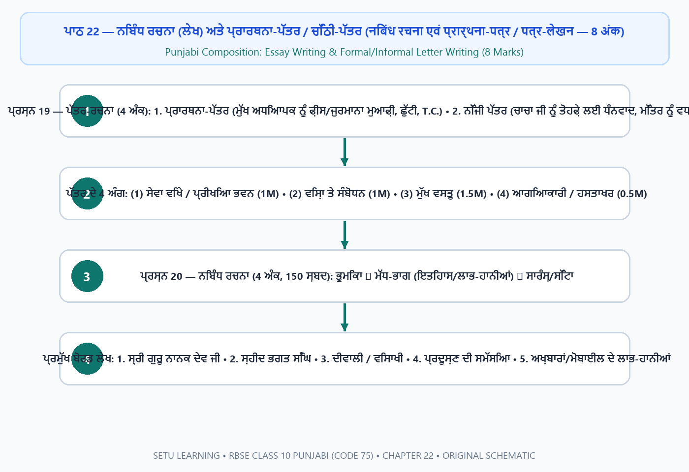

# ਪਾਠ 22 — ਨਿਬੰਧ ਰਚਨਾ (ਲੇਖ) ਅਤੇ ਪ੍ਰਾਰਥਨਾ-ਪੱਤਰ / ਚਿੱਠੀ-ਪੱਤਰ (निबंध रचना एवं प्रार्थना-पत्र / पत्र-लेखन — 8 अंक) (Punjabi Composition: Essay Writing & Formal/Informal Letter Writing (8 Marks))

## भाग 1: अध्याय प्रवेश एवं पाठ्यक्रम मैपिंग (ਪਾਠ-ਪ੍ਰਵੇਸ਼ ਅਤੇ ਪਾਠਕ੍ਰਮ ਮੈਪਿੰਗ)

> ਪਹਿਲਾ ਸੰਪਾਦਕੀ ਪ੍ਰਾਰੂਪ (प्रथम संपादकीय प्रारूप)। RBSE ਜਮਾਤ 10 ਪੰਜਾਬੀ ਪਾਠ-ਪੁਸਤਕ 'ਸਾਹਿਤ ਸੁਗੰਧੀਆਂ' ਦੇ ਸਾਰੇ ਪ੍ਰਸ਼ਨਾਂ ਦੇ ਹੱਲ ਅਤੇ 2014–2026 ਦਾ ਪੂਰਾ ਇਤਿਹਾਸਕ PYQ ਸੰਗ੍ਰਹਿ ਸਰੋਤ-ਪ੍ਰੀਖਣ ਸਮੇਤ ਸੰਕਲਿਤ ਹਨ।

**ਵਿਸ਼ਾ ਕੋਡ (विषय कोड):** 75 (ਤੀਜੀ ਭਾਸ਼ਾ — ਪੰਜਾਬੀ / तृतीया भाषा — पंजाबी) · **ਲੜੀ ਪੁਸਤਕ (श्रृंखला पुस्तक):** 7

**ਪ੍ਰਮਾਣਿਤ ਆਧਾਰ:** RBSE 2025–26 · **ਪਾਠ ਅੰਕ-ਭਾਰ:** 8 ਅੰਕ। ਇਹ ਭਾਰ ਉਸੇ ਸੰਸਕਰਣ ਦਾ ਹੈ; ਅਸਲ ਪ੍ਰਸ਼ਨ-ਵੰਡ ਦੀ ਭਵਿੱਖਬਾਣੀ ਨਹੀਂ।

**ਸਿੱਖਣ ਦੇ ਉਦੇਸ਼ (सीखने के लक्ष्य):** RBSE ਜਮਾਤ 10 ਪੰਜਾਬੀ ਪ੍ਰਸ਼ਨ-ਪੱਤਰ ਦੇ ਖੰਡ 'ਸ' ਵਿੱਚ ਪੁੱਛੇ ਜਾਣ ਵਾਲੇ ਪ੍ਰਸ਼ਨ 19 (ਪੱਤਰ-ਰਚਨਾ — 4 ਅੰਕ) ਅਤੇ ਪ੍ਰਸ਼ਨ 20 (ਨਿਬੰਧ/ਲੇਖ ਰਚਨਾ — 4 ਅੰਕ, ਲਗਭਗ 150 ਸ਼ਬਦ) ਦੇ ਮਿਆਰੀ ਫਾਰਮੈਟ ਅਤੇ 2014–2026 ਦੇ ਸਾਰੇ ਬੋਰਡ ਲੇਖਾਂ ਤੇ ਪੱਤਰਾਂ ਦਾ ਸੰਪੂਰਨ ਅਭਿਆਸ।

## भाग 2: शब्दावली एवं अवधारणा कैप्सूल (ਸ਼ਬਦਾਵਲੀ ਅਤੇ ਸੰਕਲਪ ਕੈਪਸੂਲ)

| ਸ਼ਬਦ / ਸੰਕਲਪ | ਅਰਥ / ਵਿਆਖਿਆ |
|---|---|
| ਪ੍ਰਾਰਥਨਾ-ਪੱਤਰ / ਬਿਨੈ-ਪੱਤਰ (प्रार्थना-पत्र) | ਸਕੂਲ ਦੇ ਮੁੱਖ ਅਧਿਆਪਕ/ਪ੍ਰਿੰਸੀਪਲ ਜਾਂ ਕਿਸੇ ਅਧਿਕਾਰੀ ਨੂੰ ਲਿਖਿਆ ਜਾਣ ਵਾਲਾ ਦਫ਼ਤਰੀ ਪੱਤਰ (Formal Application)। |
| ਨਿੱਜੀ ਪੱਤਰ / ਘਰੇਲੂ ਚਿੱਠੀ (निज्जी पत्तर) | ਮਾਤਾ-ਪਿਤਾ, ਭੈਣ-ਭਰਾ, ਚਾਚਾ ਜੀ ਜਾਂ ਮਿੱਤਰ/ਸਹੇਲੀ ਨੂੰ ਲਿਖਿਆ ਜਾਣ ਵਾਲਾ ਘਰੇਲੂ ਪੱਤਰ (Informal Letter)। |
| ਸੇਵਾ ਵਿਖੇ (सेवा विखे) | ਪ੍ਰਾਰਥਨਾ-ਪੱਤਰ ਦੇ ਖੱਬੇ ਪਾਸੇ ਸਭ ਤੋਂ ਉੱਪਰ ਅਧਿਕਾਰੀ ਦੇ ਅਹੁਦੇ ਤੋਂ ਪਹਿਲਾਂ ਲਿਖਿਆ ਜਾਣ ਵਾਲਾ ਆਦਰ-ਸੂਚਕ ਸ਼ਬਦ। |
| ਵਿਸ਼ਾ (विशा) | ਪ੍ਰਾਰਥਨਾ-ਪੱਤਰ ਵਿੱਚ ਬੇਨਤੀ ਦੇ ਮੁੱਖ ਕਾਰਨ ਨੂੰ ਇੱਕ ਸਤਰ ਵਿੱਚ ਸਪੱਸ਼ਟ ਕਰਨ ਵਾਲਾ ਸਿਰਲੇਖ। |
| ਆਗਿਆਕਾਰੀ / ਆਪ ਜੀ ਦਾ ਵਿਸ਼ਵਾਸਪਾਤਰ (आगिआकारी) | ਪੱਤਰ ਦੇ ਅੰਤ ਵਿੱਚ ਹੇਠਾਂ ਸੱਜੇ/ਖੱਬੇ ਪਾਸੇ ਲਿਖਿਆ ਜਾਣ ਵਾਲਾ ਸਮਾਪਤੀ ਸ਼ਬਦ। |
| ਨਿਬੰਧ / ਲੇਖ ਰਚਨਾ (निबंध / लेख रचना) | ਕਿਸੇ ਵਿਸ਼ੇ ਉੱਤੇ ਕ੍ਰਮਬੱਧ, ਵਿਚਾਰਪੂਰਨ ਅਤੇ ਸ਼ੁੱਧ ਭਾਸ਼ਾ ਵਿੱਚ ਲਗਭਗ 150 ਸ਼ਬਦਾਂ ਵਿੱਚ ਲਿਖੀ ਰਚਨਾ (4 ਅੰਕ)। |
| ਸਾਰੰਸ਼ / ਸਿੱਟਾ (सारांश / सिट्टा) | ਨਿਬੰਧ ਦਾ ਆਖ਼ਰੀ ਪੈਰ੍ਹਾ ਜਿਸ ਵਿੱਚ ਪੂਰੇ ਲੇਖ ਦਾ ਨਿਚੋੜ ਅਤੇ ਉਸਾਰੂ ਸੁਨੇਹਾ ਦਿੱਤਾ ਜਾਂਦਾ ਹੈ। |

## भाग 3: विस्तृत शिक्षण पाठ (ਵਿਸਤ੍ਰਿਤ ਅਧਿਆਪਨ ਪਾਠ)

### 1. ਪੱਤਰ-ਰਚਨਾ (Letter Writing — ਪ੍ਰਸ਼ਨ 19, 4 ਅੰਕ)

RBSE ਬੋਰਡ ਪੇਪਰ ਵਿੱਚ **ਪ੍ਰਸ਼ਨ 19 (4 ਅੰਕ)** ਵਿੱਚ ਦੋ ਪੱਤਰ ਦਿੱਤੇ ਹੁੰਦੇ ਹਨ — ਇੱਕ **ਪ੍ਰਾਰਥਨਾ-ਪੱਤਰ (ਸਕੂਲ ਮੁਖੀ/ਅਧਿਕਾਰੀ ਨੂੰ)** ਅਤੇ ਦੂਜਾ **ਨਿੱਜੀ ਪੱਤਰ (ਪਿਤਾ/ਚਾਚਾ/ਮਿੱਤਰ ਨੂੰ)**, ਜਿਨ੍ਹਾਂ ਵਿੱਚੋਂ ਕੋਈ ਇੱਕ ਲਿਖਣਾ ਹੁੰਦਾ ਹੈ।

#### (ੳ) ਪ੍ਰਾਰਥਨਾ-ਪੱਤਰ (Application) ਦਾ ਮਿਆਰੀ ਢਾਂਚਾ (4 ਅੰਕਾਂ ਦੀ ਵੰਡ):
1. **ਆਰੰਭ (1 ਅੰਕ):** `ਸੇਵਾ ਵਿਖੇ, ਮੁੱਖ ਅਧਿਆਪਕ ਜੀ / ਪ੍ਰਿੰਸੀਪਲ ਸਾਹਿਬ, ਸਰਕਾਰੀ ਸੀਨੀਅਰ ਸੈਕੰਡਰੀ ਸਕੂਲ, ............... (ਸ਼ਹਿਰ/ਪਿੰਡ)।`
2. **ਵਿਸ਼ਾ ਅਤੇ ਸੰਬੋਧਨ (1 ਅੰਕ):** `ਵਿਸ਼ਾ: .................... ਸੰਬੰਧੀ।` ਅਤੇ `ਸ੍ਰੀਮਾਨ ਜੀ,`
3. **ਮੁੱਖ ਵਿਸ਼ਾ-ਵਸਤੂ (1.5 ਅੰਕ):** ਸਨਿਮਰ ਬੇਨਤੀ ਹੈ ਕਿ ਮੈਂ ਆਪ ਜੀ ਦੇ ਸਕੂਲ ਵਿੱਚ ਦਸਵੀਂ ਜਮਾਤ ਦਾ ਵਿਦਿਆਰਥੀ ਹਾਂ... (ਕਾਰਨ ਅਤੇ ਬੇਨਤੀ)।
4. **ਅੰਤਿਮ ਧੰਨਵਾਦ ਅਤੇ ਹਸਤਾਖਰ (0.5 ਅੰਕ):** `ਧੰਨਵਾਦ ਸਾਹਿਤ, ਆਪ ਜੀ ਦਾ ਆਗਿਆਕਾਰੀ ਵਿਦਿਆਰਥੀ, ਨਾਂ: ੳ ਅ ੲ, ਜਮਾਤ: ਦਸਵੀਂ, ਰੋਲ ਨੰਬਰ: ......, ਮਿਤੀ: ............।`

---

#### ਬੋਰਡ ਵਿੱਚ ਸਭ ਤੋਂ ਵੱਧ ਪੁੱਛੇ ਗਏ 4 ਪ੍ਰਮੁੱਖ ਪੱਤਰ (Solved Models):

##### ਪੱਤਰ 1: ਸਕੂਲ ਦੇ ਮੁੱਖ ਅਧਿਆਪਕ ਜੀ ਨੂੰ ਫ਼ੀਸ ਮੁਆਫ਼ੀ ਜਾਂ ਜੁਰਮਾਨਾ ਮੁਆਫ਼ੀ ਲਈ ਬਿਨੈ-ਪੱਤਰ (RBSE 2018, 2020, 2022, 2024, 2026)
> **ਸੇਵਾ ਵਿਖੇ,**
> ਮੁੱਖ ਅਧਿਆਪਕ ਜੀ,
> ਸਰਕਾਰੀ ਸੀਨੀਅਰ ਸੈਕੰਡਰੀ ਸਕੂਲ,
> ਸ੍ਰੀ ਗੰਗਾਨਗਰ।
>
> **ਵਿਸ਼ਾ:** ਫ਼ੀਸ ਮੁਆਫ਼ੀ (ਜਾਂ ਜੁਰਮਾਨਾ ਮੁਆਫ਼ੀ) ਸੰਬੰਧੀ ਬਿਨੈ-ਪੱਤਰ।
>
> **ਸ੍ਰੀਮਾਨ ਜੀ,**
> ਸਨਿਮਰ ਬੇਨਤੀ ਹੈ ਕਿ ਮੈਂ ਆਪ ਜੀ ਦੇ ਸਕੂਲ ਵਿੱਚ ਦਸਵੀਂ ਜਮਾਤ ਦਾ ਵਿਦਿਆਰਥੀ ਹਾਂ। ਮੇਰੇ ਪਿਤਾ ਜੀ ਇੱਕ ਛੋਟੇ ਕਿਸਾਨ/ਮਜ਼ਦੂਰ ਹਨ। ਸਾਡੇ ਪਰਿਵਾਰ ਦੀ ਆਮਦਨ ਬਹੁਤ ਘੱਟ ਹੈ ਜਿਸ ਨਾਲ ਘਰ ਦਾ ਗੁਜ਼ਾਰਾ ਬੜੀ ਮੁਸ਼ਕਲ ਨਾਲ ਚੱਲਦਾ ਹੈ। ਮੇਰਾ ਪੜ੍ਹਾਈ ਵਿੱਚ ਬਹੁਤ ਸ਼ੌਕ ਹੈ। ਮੈਂ ਨੌਵੀਂ ਜਮਾਤ ਵਿੱਚੋਂ ਵੀ 90% ਅੰਕ ਲੈ ਕੇ ਪਹਿਲੇ ਦਰਜੇ ਵਿੱਚ ਪਾਸ ਹੋਇਆ ਹਾਂ ਅਤੇ ਸਕੂਲ ਦੀ ਹਾਕੀ ਟੀਮ ਦਾ ਕਪਤਾਨ ਵੀ ਹਾਂ।
>
> ਪਿਤਾ ਜੀ ਦੀ ਆਰਥਿਕ ਤੰਗੀ ਕਾਰਨ ਮੈਂ ਸਕੂਲ ਦੀ ਫ਼ੀਸ ਦੇਣ ਤੋਂ ਅਸਮਰੱਥ ਹਾਂ। ਕਿਰਪਾ ਕਰਕੇ ਮੇਰੀ ਪੂਰੀ ਫ਼ੀਸ ਮੁਆਫ਼ ਕੀਤੀ ਜਾਵੇ ਤਾਂ ਜੋ ਮੈਂ ਆਪਣੀ ਪੜ੍ਹਾਈ ਜਾਰੀ ਰੱਖ ਸਕਾਂ। ਮੈਂ ਆਪ ਜੀ ਦਾ ਸਦਾ ਧੰਨਵਾਦੀ ਰਹਾਂਗਾ।
>
> **ਧੰਨਵਾਦ ਸਾਹਿਤ,**
> ਆਪ ਜੀ ਦਾ ਆਗਿਆਕਾਰੀ ਵਿਦਿਆਰਥੀ,
> **ਨਾਂ:** ੳ. ਅ. ੲ.
> **ਜਮਾਤ:** ਦਸਵੀਂ (ਏ), ਰੋਲ ਨੰਬਰ: 15
> **ਮਿਤੀ:** 12 ਮਾਰਚ, 2026

##### ਪੱਤਰ 2: ਸਕੂਲ ਦੇ ਮੁੱਖ ਅਧਿਆਪਕ ਨੂੰ ਸਰਟੀਫਿਕੇਟ ਲੈਣ ਜਾਂ ਵੱਡੀ ਭੈਣ ਦੇ ਵਿਆਹ/ਬਿਮਾਰੀ ਕਾਰਨ ਛੁੱਟੀ ਲੈਣ ਲਈ ਪੱਤਰ (RBSE 2019, 2023, 2025 Main)
- **ਵਿਸ਼ਾ:** ਵੱਡੀ ਭੈਣ ਦੇ ਵਿਆਹ (ਜਾਂ ਜ਼ਰੂਰੀ ਕੰਮ/ਬਿਮਾਰੀ) ਕਾਰਨ ਚਾਰ ਦਿਨਾਂ ਦੀ ਛੁੱਟੀ ਲੈਣ ਸੰਬੰਧੀ / ਸਕੂਲ ਛੱਡਣ ਦਾ ਸਰਟੀਫਿਕੇਟ (T.C.) ਲੈਣ ਸੰਬੰਧੀ।
- **ਮੁੱਖ ਵਸਤੂ:** ਭੈਣ ਦੇ ਵਿਆਹ ਦੀ ਮਿਤੀ ਦੱਸ ਕੇ ਘਰ ਦੇ ਕੰਮਾਂ ਵਿੱਚ ਹੱਥ ਵਟਾਉਣ ਲਈ 4 ਦਿਨਾਂ ਦੀ ਛੁੱਟੀ ਦੀ ਬੇਨਤੀ (ਜਾਂ ਪਿਤਾ ਜੀ ਦੀ ਬਦਲੀ ਬੀਕਾਨੇਰ ਹੋ ਜਾਣ ਕਾਰਨ ਸਕੂਲ ਛੱਡਣ ਦਾ ਸਰਟੀਫਿਕੇਟ ਦੇਣ ਦੀ ਬੇਨਤੀ)।

##### ਪੱਤਰ 3: ਚਾਚਾ ਜੀ ਵੱਲੋਂ ਭੇਜੇ ਜਨਮ-ਦਿਨ ਦੇ ਤੋਹਫ਼ੇ (ਘੜੀ) ਲਈ ਧੰਨਵਾਦ ਪੱਤਰ ਜਾਂ ਮਿੱਤਰ ਨੂੰ ਪਾਸ ਹੋਣ 'ਤੇ ਵਧਾਈ ਪੱਤਰ (RBSE 2022, 2024, 2025 Supp, 2026)
> **ਪ੍ਰੀਖਿਆ ਭਵਨ,**
> **............. (ਸ਼ਹਿਰ)।**
> **ਮਿਤੀ:** 15 ਮਾਰਚ, 2026
>
> **ਸਤਿਕਾਰਯੋਗ ਚਾਚਾ ਜੀ,**
> **ਸਤਿ ਸ੍ਰੀ ਅਕਾਲ।**
>
> ਮੈਂ ਇੱਥੇ ਰਾਜ਼ੀ-ਖ਼ੁਸ਼ੀ ਹਾਂ ਅਤੇ ਪਰਮਾਤਮਾ ਅੱਗੇ ਆਪ ਜੀ ਦੀ ਚੜ੍ਹਦੀ ਕਲਾ ਲਈ ਅਰਦਾਸ ਕਰਦਾ ਹਾਂ। ਕੱਲ੍ਹ ਮੇਰੇ ਜਨਮ-ਦਿਨ ਉੱਤੇ ਆਪ ਜੀ ਵੱਲੋਂ ਭੇਜਿਆ ਗਿਆ ਪਾਰਸਲ ਮਿਲਿਆ। ਜਦੋਂ ਮੈਂ ਡੱਬਾ ਖੋਲ੍ਹਿਆ ਤਾਂ ਉਸ ਵਿੱਚ ਇੱਕ ਬਹੁਤ ਸੁੰਦਰ ਸੁਨਹਿਰੀ ਘੜੀ ਵੇਖ ਕੇ ਮੇਰੀ ਖ਼ੁਸ਼ੀ ਦੀ ਕੋਈ ਹੱਦ ਨਾ ਰਹੀ।
>
> ਚਾਚਾ ਜੀ, ਦਸਵੀਂ ਜਮਾਤ ਦੀਆਂ ਬੋਰਡ ਪ੍ਰੀਖਿਆਵਾਂ ਨੇੜੇ ਹੋਣ ਕਾਰਨ ਮੈਨੂੰ ਸਮੇਂ ਸਿਰ ਪੜ੍ਹਾਈ ਕਰਨ ਲਈ ਘੜੀ ਦੀ ਬਹੁਤ ਲੋੜ ਸੀ। ਇਹ ਘੜੀ ਮੈਨੂੰ ਸਮੇਂ ਦਾ ਪਾਬੰਦ ਬਣਾਏਗੀ ਅਤੇ ਇਮਤਿਹਾਨ ਵਿੱਚ ਮੇਰੀ ਬਹੁਤ ਮਦਦ ਕਰੇਗੀ। ਇਸ ਅਨਮੋਲ ਤੋਹਫ਼ੇ ਲਈ ਮੈਂ ਆਪ ਜੀ ਦਾ ਤਹਿ-ਦਿਲੋਂ ਧੰਨਵਾਦ ਕਰਦਾ ਹਾਂ। ਚਾਚੀ ਜੀ ਨੂੰ ਮੇਰੇ ਵੱਲੋਂ ਪੈਰੀਂ ਪੈਣਾ।
>
> **ਆਪ ਜੀ ਦਾ ਪਿਆਰਾ ਭਤੀਜਾ,**
> **ੳ. ਅ. ੲ.**

---

### 2. ਨਿਬੰਧ / ਲੇਖ ਰਚਨਾ (Essay Writing — ਪ੍ਰਸ਼ਨ 20, 4 ਅੰਕ, 150 ਸ਼ਬਦ)

RBSE ਬੋਰਡ ਪੇਪਰ ਵਿੱਚ **ਪ੍ਰਸ਼ਨ 20 (4 ਅੰਕ)** ਵਿੱਚ 4 ਜਾਂ 5 ਵਿਸ਼ੇ ਦਿੱਤੇ ਹੁੰਦੇ ਹਨ ਜਿਨ੍ਹਾਂ ਵਿੱਚੋਂ ਕਿਸੇ ਇੱਕ ਵਿਸ਼ੇ ਉੱਤੇ **ਲਗਭਗ 150 ਸ਼ਬਦਾਂ** ਵਿੱਚ ਲੇਖ ਲਿਖਣਾ ਹੁੰਦਾ ਹੈ।

#### ਬੋਰਡ ਪ੍ਰੀਖਿਆਵਾਂ (2014–2026) ਦੇ 6 ਸਭ ਤੋਂ ਮਹੱਤਵਪੂਰਨ ਲੇਖ:

| ਕ੍ਰਮ | ਨਿਬੰਧ ਦਾ ਵਿਸ਼ਾ (Board Years) | ਮੁੱਖ ਨੁਕਤੇ ਅਤੇ ਸੰਖੇਪ ਸਾਰ (150 ਸ਼ਬਦਾਂ ਲਈ ਰੂਪ-ਰੇਖਾ) |
|---|---|---|
| **1** | **ਸ੍ਰੀ ਗੁਰੂ ਨਾਨਕ ਦੇਵ ਜੀ / ਗੁਰੂ ਗੋਬਿੰਦ ਸਿੰਘ ਜੀ** (2018, 2020, 2022, 2023, 2024, 2025, 2026) | • **ਜਾਣ-ਪਛਾਣ ਤੇ ਜਨਮ:** ਗੁਰੂ ਨਾਨਕ ਦੇਵ ਜੀ ਸਿੱਖ ਧਰਮ ਦੇ ਬਾਨੀ; ਜਨਮ **15 ਅਪ੍ਰੈਲ 1469 ਈ.** ਰਾਇ ਭੋਇੰ ਦੀ ਤਲਵੰਡੀ (ਨਨਕਾਣਾ ਸਾਹਿਬ); ਪਿਤਾ ਮਹਿਤਾ ਕਾਲੂ ਜੀ, ਮਾਤਾ ਤ੍ਰਿਪਤਾ ਦੇਵੀ ਜੀ, ਭੈਣ ਬੇਬੇ ਨਾਨਕੀ ਜੀ। • **ਬਚਪਨ ਤੇ ਵੀਹ ਰੁਪਏ ਦਾ ਸੱਚਾ ਸੌਦਾ:** ਭੁੱਖੇ ਸਾਧੂਆਂ ਨੂੰ ਭੋਜਨ ਛਕਾਉਣਾ; ਸੁਲਤਾਨਪੁਰ ਲੋਧੀ ਵਿਖੇ ਮੋਦੀਖਾਨੇ ਦੀ ਨੌਕਰੀ। • **ਚਾਰ ਉਦਾਸੀਆਂ ਤੇ ਸਿੱਖਿਆਵਾਂ:** ਭਾਈ ਮਰਦਾਨਾ ਜੀ ਨਾਲ ਚਾਰ ਦਿਸ਼ਾਵਾਂ ਵਿੱਚ ਯਾਤਰਾਵਾਂ; ਵਹਿਮਾਂ-ਭਰਮਾਂ ਤੇ ਜਾਤ-ਪਾਤ ਦਾ ਖੰਡਨ; **'ਕਿਰਤ ਕਰੋ, ਨਾਮ ਜਪੋ ਅਤੇ ਵੰਡ ਛਕੋ'** ਦਾ ਉਪਦੇਸ਼; 974 ਸ਼ਬਦਾਂ ਦੀ ਰਚਨਾ; 1539 ਈ. ਵਿੱਚ ਕਰਤਾਰਪੁਰ ਵਿਖੇ ਜੋਤੀ-ਜੋਤਿ ਸਮਾਉਣਾ। |
| **2** | **ਸ਼ਹੀਦ ਭਗਤ ਸਿੰਘ** (2019, 2022, 2024, 2025, 2026) | • **ਜਨਮ ਅਤੇ ਪਰਿਵਾਰ:** ਜਨਮ **28 ਸਤੰਬਰ 1907 ਈ.** ਪਿੰਡ ਬੰਗਾ (ਜ਼ਿਲ੍ਹਾ ਲਾਇਲਪੁਰ); ਪਿਤਾ ਸ. ਕਿਸ਼ਨ ਸਿੰਘ, ਮਾਤਾ ਵਿੱਦਿਆਵਤੀ ਜੀ, ਚਾਚਾ ਸ. ਅਜੀਤ ਸਿੰਘ ('ਪੱਗੜੀ ਸੰਭਾਲ ਜੱਟਾ')। • **ਦੇਸ਼-ਭਗਤੀ ਤੇ ਕ੍ਰਾਂਤੀਕਾਰੀ ਜੀਵਨ:** ਜੱਲ੍ਹਿਆਂਵਾਲੇ ਬਾਗ਼ ਦੇ ਖ਼ੂਨੀ ਸਾਕੇ ਦਾ ਡੂੰਘਾ ਪ੍ਰਭਾਵ; ਨੌਜਵਾਨ ਭਾਰਤ ਸਭਾ ਦੀ ਸਥਾਪਨਾ; ਲਾਲਾ ਲਾਜਪਤ ਰਾਏ ਦੀ ਸ਼ਹੀਦੀ ਦਾ ਬਦਲਾ (ਸਾਂਡਰਸ ਕਤਲ); ਅਸੈਂਬਲੀ ਵਿੱਚ ਬੰਬ ਸੁੱਟਣਾ ('ਇਨਕਲਾਬ ਜ਼ਿੰਦਾਬਾਦ')। • **ਸ਼ਹਾਦਤ:** **23 ਮਾਰਚ 1931 ਈ.** ਨੂੰ ਰਾਜਗੁਰੂ ਅਤੇ ਸੁਖਦੇਵ ਸਮੇਤ ਲਾਹੌਰ ਜੇਲ੍ਹ ਵਿੱਚ ਫਾਂਸੀ ਦਾ ਰੱਸਾ ਚੁੰਮ ਕੇ ਸ਼ਹੀਦ-ਏ-ਆਜ਼ਮ ਬਣਨਾ। |
| **3** | **ਦੀਵਾਲੀ / ਵਿਸਾਖੀ (ਤਿਉਹਾਰ)** (2018, 2019, 2020, 2022, 2023, 2024, 2025, 2026) | • **ਦੀਵਾਲੀ:** ਕੱਤਕ ਦੀ ਮੱਸਿਆ ਨੂੰ ਮਨਾਇਆ ਜਾਣ ਵਾਲਾ ਰੌਸ਼ਨੀਆਂ ਦਾ ਤਿਉਹਾਰ। **ਇਤਿਹਾਸਕ ਮਹੱਤਤਾ:** ਸ੍ਰੀ ਰਾਮ ਚੰਦਰ ਜੀ ਦਾ 14 ਸਾਲਾਂ ਦਾ ਬਨਵਾਸ ਕੱਟ ਕੇ ਅਯੁੱਧਿਆ ਪਰਤਣਾ ਅਤੇ ਛੇਵੇਂ ਪਾਤਸ਼ਾਹ **ਸ੍ਰੀ ਗੁਰੂ ਹਰਿਗੋਬਿੰਦ ਸਾਹਿਬ ਜੀ** ਦਾ ਗਵਾਲੀਅਰ ਦੇ ਕਿਲ੍ਹੇ ਵਿੱਚੋਂ 52 ਰਾਜਿਆਂ ਨੂੰ ਛੁਡਵਾ ਕੇ ਸ੍ਰੀ ਅੰਮ੍ਰਿਤਸਰ ਸਾਹਿਬ ਪਹੁੰਚਣਾ (*'ਦਾਲ ਰੋਟੀ ਘਰ ਦੀ, ਦੀਵਾਲੀ ਅੰਮ੍ਰਿਤਸਰ ਦੀ'*)। **ਸੁਨੇਹਾ:** ਪਟਾਕਿਆਂ ਦੇ ਪ੍ਰਦੂਸ਼ਣ ਤੇ ਜੂਏ/ਸ਼ਰਾਬ ਤੋਂ ਬਚ ਕੇ ਪਿਆਰ ਨਾਲ ਹਰੀ ਦੀਵਾਲੀ ਮਨਾਉਣਾ। • **ਵਿਸਾਖੀ:** 13 ਅਪ੍ਰੈਲ (ਹਾੜ੍ਹੀ ਦੀ ਫ਼ਸਲ ਪੱਕਣ ਦੀ ਖ਼ੁਸ਼ੀ); **1699 ਈ. ਵਿੱਚ ਗੁਰੂ ਗੋਬਿੰਦ ਸਿੰਘ ਜੀ ਵੱਲੋਂ ਆਨੰਦਪੁਰ ਸਾਹਿਬ ਵਿਖੇ ਖ਼ਾਲਸਾ ਪੰਥ ਦੀ ਸਾਜਨਾ**; 13 ਅਪ੍ਰੈਲ 1919 ਨੂੰ ਜੱਲ੍ਹਿਆਂਵਾਲੇ ਬਾਗ਼ ਦਾ ਸਾਕਾ। |
| **4** | **ਅਖ਼ਬਾਰਾਂ ਦੇ ਲਾਭ-ਹਾਨੀਆਂ / ਮੋਬਾਈਲ ਫ਼ੋਨ ਜਾਂ ਇੰਟਰਨੈੱਟ** (2020, 2023, 2024, 2025, 2026) | • **ਜਾਣ-ਪਛਾਣ:** ਵਿਗਿਆਨ ਅਤੇ ਸੂਚਨਾ ਕ੍ਰਾਂਤੀ ਦਾ ਯੁੱਗ। • **ਲਾਭ:** ਦੇਸ਼-ਵਿਦੇਸ਼ ਦੀਆਂ ਤਾਜ਼ਾ ਖ਼ਬਰਾਂ, ਵਪਾਰਕ ਇਸ਼ਤਿਹਾਰ, ਰੁਜ਼ਗਾਰ ਦੇ ਮੌਕੇ, ਵਿੱਦਿਅਕ ਜਾਣਕਾਰੀ, ਆਨਲਾਈਨ ਪੜ੍ਹਾਈ ਤੇ ਬੈਂਕਿੰਗ, ਲੋਕਤੰਤਰ ਦਾ ਚੌਥਾ ਥੰਮ੍ਹ। • **ਹਾਨੀਆਂ:** ਝੂਠੀਆਂ ਤੇ ਸਨਸਨੀਖੇਜ਼ ਖ਼ਬਰਾਂ, ਸਮੇਂ ਦੀ ਬਰਬਾਦੀ, ਅੱਖਾਂ ਤੇ ਸਿਹਤ ਉੱਤੇ ਮਾੜਾ ਪ੍ਰਭਾਵ, ਸਾਈਬਰ ਠੱਗੀ। **ਸਿੱਟਾ:** ਸੰਜਮ ਅਤੇ ਸੂਝ-ਬੂਝ ਨਾਲ ਵਰਤੋਂ। |
| **5** | **ਪ੍ਰਦੂਸ਼ਣ ਦੀ ਸਮੱਸਿਆ / ਵਾਤਾਵਰਣ ਦੀ ਸੰਭਾਲ** (2022, 2024, 2025, 2026) | • **ਪਰਿਭਾਸ਼ਾ ਤੇ ਕਿਸਮਾਂ:** ਕੁਦਰਤੀ ਤੱਤਾਂ ਦਾ ਗੰਧਲਾ ਹੋਣਾ — (1) ਹਵਾ ਪ੍ਰਦੂਸ਼ਣ, (2) ਪਾਣੀ ਪ੍ਰਦੂਸ਼ਣ, (3) ਧੁਨੀ ਪ੍ਰਦੂਸ਼ਣ, (4) ਭੂਮੀ ਪ੍ਰਦੂਸ਼ਣ। • **ਕਾਰਨ:** ਰੁੱਖਾਂ ਦੀ ਅੰਨ੍ਹੇਵਾਹ ਕਟਾਈ, ਕਾਰਖਾਨਿਆਂ ਤੇ ਗੱਡੀਆਂ ਦਾ ਧੂੰਆਂ, ਪਲਾਸਟਿਕ ਅਤੇ ਰਸਾਇਣਕ ਖਾਦਾਂ। • **ਉਪਾਅ:** ਵੱਧ ਤੋਂ ਵੱਧ ਰੁੱਖ ਲਗਾਉਣਾ (*'ਪਵਣੁ ਗੁਰੂ ਪਾਣੀ ਪਿਤਾ ਮਾਤਾ ਧਰਤਿ ਮਹਤੁ'*), ਪਲਾਸਟਿਕ ਦੀ ਵਰਤੋਂ ਬੰਦ ਕਰਨਾ ਅਤੇ ਸਵੱਛਤਾ ਅਪਣਾਉਣਾ। |
| **6** | **ਦਾਜ ਦੀ ਲਾਹਨਤ / ਭਰੂਣ ਹੱਤਿਆ (ਸਮਾਜਿਕ ਬੁਰਾਈਆਂ)** (2018, 2020, 2023, 2025) | • **ਜਾਣ-ਪਛਾਣ:** ਪੰਜਾਬੀ ਸਮਾਜ ਨੂੰ ਘੁਣ ਵਾਂਗ ਖਾ ਰਹੀਆਂ ਸਮਾਜਿਕ ਕੁਰੀਤੀਆਂ। • **ਦੁਸ਼ਪ੍ਰਭਾਵ:** ਗ਼ਰੀਬ ਮਾਪਿਆਂ ਸਿਰ ਕਰਜ਼ੇ ਦਾ ਬੋਝ, ਧੀਆਂ ਉੱਤੇ ਅੱਤਿਆਚਾਰ, ਕੁੜੀਆਂ ਦੀ ਘਟਦੀ ਗਿਣਤੀ। • **ਹੱਲ:** ਗੁਰੂ ਨਾਨਕ ਦੇਵ ਜੀ ਦੇ ਬਚਨ (*'ਸੋ ਕਿਉ ਮੰਦਾ ਆਖੀਐ ਜਿਤੁ ਜੰਮਹਿ ਰਾਜਾਨ'*), ਲੜਕੀਆਂ ਦੀ ਉੱਚ ਸਿੱਖਿਆ, ਕਾਨੂੰਨ ਦੀ ਸਖ਼ਤੀ ਅਤੇ ਨੌਜਵਾਨਾਂ ਦਾ ਦਾਜ-ਰਹਿਤ ਵਿਆਹਾਂ ਲਈ ਅੱਗੇ ਆਉਣਾ। |

ਪਾਠ 22: ਨਿਬੰਧ ਰਚਨਾ (ਲੇਖ — 4 ਅੰਕ) ਅਤੇ ਪੱਤਰ-ਰਚਨਾ (4 ਅੰਕ) ਦਾ ਸੰਕਲਪ ਚਿੱਤਰ

## भाग 4: पाठ्यपुस्तक-अवधारणाओं पर मौलिक हल किए उदाहरण (ਹੱਲ ਕੀਤੇ ਮਿਆਰੀ ਉਦਾਹਰਣ)

ਹੇਠਾਂ ਦਿੱਤੇ ਪ੍ਰਸ਼ਨ ਪਾਠ-ਪੁਸਤਕ 'ਸਾਹਿਤ ਸੁਗੰਧੀਆਂ' ਅਤੇ ਵਿਆਕਰਣ ਦੇ ਸੰਕਲਪਾਂ ਉੱਤੇ ਆਧਾਰਿਤ ਮੌਲਿਕ ਆਦਰਸ਼ ਹੱਲ ਹਨ।

**ਹੱਲ ਕੀਤਾ ਉਦਾਹਰਣ 1: ਪ੍ਰਾਰਥਨਾ-ਪੱਤਰ (ਬਿਨੈ-ਪੱਤਰ) ਅਤੇ ਨਿੱਜੀ ਪੱਤਰ (ਘਰੇਲੂ ਚਿੱਠੀ) ਵਿੱਚ ਕੀ ਅੰਤਰ ਹੈ?**

1. ਪ੍ਰਾਰਥਨਾ-ਪੱਤਰ (Formal Letter): ਇਹ ਸਕੂਲ ਦੇ ਮੁੱਖ ਅਧਿਆਪਕ, ਪ੍ਰਿੰਸੀਪਲ ਜਾਂ ਸਰਕਾਰੀ ਅਧਿਕਾਰੀਆਂ ਨੂੰ ਲਿਖਿਆ ਜਾਂਦਾ ਹੈ। ਇਸ ਵਿੱਚ 'ਸੇਵਾ ਵਿਖੇ', ਅਹੁਦਾ ਅਤੇ 'ਵਿਸ਼ਾ' ਲਿਖਣਾ ਲਾਜ਼ਮੀ ਹੁੰਦਾ ਹੈ। 2. ਨਿੱਜੀ ਪੱਤਰ (Informal Letter): ਇਹ ਮਾਤਾ-ਪਿਤਾ, ਚਾਚਾ ਜੀ, ਭੈਣ-ਭਰਾ ਜਾਂ ਮਿੱਤਰਾਂ ਨੂੰ ਲਿਖਿਆ ਜਾਂਦਾ ਹੈ। ਇਸ ਵਿੱਚ 'ਵਿਸ਼ਾ' ਨਹੀਂ ਲਿਖਿਆ ਜਾਂਦਾ, ਸਗੋਂ ਉੱਪਰ ਪਤਾ/ਮਿਤੀ ਅਤੇ ਆਦਰ-ਸੂਚਕ ਸੰਬੋਧਨ ('ਸਤਿਕਾਰਯੋਗ ਪਿਤਾ ਜੀ / ਪਿਆਰੇ ਮਿੱਤਰ') ਲਿਖਿਆ ਜਾਂਦਾ ਹੈ।

**ਹੱਲ ਕੀਤਾ ਉਦਾਹਰਣ 2: 'ਦੀਵਾਲੀ' ਦੇ ਤਿਉਹਾਰ ਦੀ ਇਤਿਹਾਸਕ ਅਤੇ ਧਾਰਮਿਕ ਮਹੱਤਤਾ ਕੀ ਹੈ?**

ਦੀਵਾਲੀ ਵਾਲੇ ਦਿਨ ਸ੍ਰੀ ਰਾਮ ਚੰਦਰ ਜੀ 14 ਸਾਲਾਂ ਦਾ ਬਨਵਾਸ ਕੱਟ ਕੇ ਅਤੇ ਰਾਵਣ ਨੂੰ ਮਾਰ ਕੇ ਅਯੁੱਧਿਆ ਵਾਪਸ ਪਰਤੇ ਸਨ। ਸਿੱਖ ਇਤਿਹਾਸ ਵਿੱਚ ਇਸ ਦਿਨ ਛੇਵੇਂ ਗੁਰੂ ਸ੍ਰੀ ਹਰਿਗੋਬਿੰਦ ਸਾਹਿਬ ਜੀ ਗਵਾਲੀਅਰ ਦੇ ਕਿਲ੍ਹੇ ਵਿੱਚੋਂ 52 ਰਾਜਿਆਂ ਨੂੰ ਰਿਹਾਅ ਕਰਵਾ ਕੇ ('ਬੰਦੀ-ਛੋੜ ਦਾਤਾ' ਵਜੋਂ) ਸ੍ਰੀ ਅੰਮ੍ਰਿਤਸਰ ਸਾਹਿਬ ਪਹੁੰਚੇ ਸਨ।

**ਹੱਲ ਕੀਤਾ ਉਦਾਹਰਣ 3: ਨਿਬੰਧ (ਲੇਖ) ਲਿਖਦੇ ਸਮੇਂ ਕਿਹੜੇ ਤਿੰਨ ਮੁੱਖ ਅੰਗਾਂ ਦਾ ਧਿਆਨ ਰੱਖਣਾ ਚਾਹੀਦਾ ਹੈ?**

1. ਭੂਮਿਕਾ (ਜਾਣ-ਪਛਾਣ): ਵਿਸ਼ੇ ਦੀ ਪਰਿਭਾਸ਼ਾ ਅਤੇ ਮਹੱਤਤਾ। 2. ਮੱਧ-ਭਾਗ (ਵਿਸ਼ਾ-ਵਿਸਥਾਰ): ਵਿਸ਼ੇ ਦੇ ਇਤਿਹਾਸਕ ਪੱਖ, ਲਾਭ-ਹਾਨੀਆਂ ਜਾਂ ਕਾਰਨ (3–4 ਪੈਰ੍ਹਿਆਂ ਵਿੱਚ)। 3. ਸਾਰੰਸ਼ (ਸਿੱਟਾ): ਪੂਰੇ ਲੇਖ ਦਾ ਨਿਚੋੜ ਅਤੇ ਉਸਾਰੂ ਸੁਨੇਹਾ।

## भाग 5: सत्यापित बोर्ड प्रश्न एवं स्रोत-स्थिति (ਪ੍ਰਮਾਣਿਤ ਬੋਰਡ ਪ੍ਰਸ਼ਨ ਅਤੇ ਸਰੋਤ-ਸਥਿਤੀ)

RBSE 2014 ਤੋਂ 2026 ਤੱਕ ਦੇ ਹਰ ਪੰਜਾਬੀ ਬੋਰਡ ਪੇਪਰ ਦੇ ਅੰਤਿਮ ਦੋ ਪ੍ਰਸ਼ਨਾਂ ਵਿੱਚ ਪੱਤਰ-ਰਚਨਾ (4 ਅੰਕ) ਅਤੇ ਨਿਬੰਧ-ਰਚਨਾ (4 ਅੰਕ) ਲਾਜ਼ਮੀ ਪੁੱਛੇ ਗਏ ਹਨ।

[RBSE 2026 ਮੂਲ ਪੇਪਰ (S-75)](https://rajeduboard.rajasthan.gov.in/books/PAPERS-2026/Sec/S-75.pdf)। ਪ੍ਰਸ਼ਨ ਦਾ ਸੰਖੇਪ ਵਿਸ਼ਾ-ਸੰਦਰਭ ਹੈ; ਸ਼ਬਦ-ਬ-ਸ਼ਬਦ ਪੁਨਰ-ਮੁਦਰਣ ਨਹੀਂ।

## भाग 6: खंडवार मौलिक अभ्यास बैंक (ਖੰਡ-ਵਾਰ ਮੌਲਿਕ ਅਭਿਆਸ ਬੈਂਕ)

**ਅਭਿਆਸ-ਅੰਕ:** ਵਿਦਿਆਰਥੀਆਂ ਦੇ ਸਵੈ-ਅਭਿਆਸ ਲਈ ਹਨ; ਉੱਤਰ ਪਹਿਲਾਂ ਆਪ ਲਿਖੋ, ਫਿਰ ਭਾਗ 9 ਵੇਖੋ।

## ੳ: ਬਹੁ-ਵਿਕਲਪੀ ਪ੍ਰਸ਼ਨ (MCQ) — 15 × 1 ਅੰਕ

**MCQ 1. RBSE ਜਮਾਤ 10 ਪੰਜਾਬੀ ਦੇ ਪ੍ਰਸ਼ਨ-ਪੱਤਰ ਵਿੱਚ 'ਨਿਬੰਧ ਰਚਨਾ' (4 ਅੰਕ) ਅਤੇ 'ਪੱਤਰ ਰਚਨਾ' (4 ਅੰਕ) ਕੁੱਲ ਕਿੰਨੇ ਅੰਕਾਂ ਦੇ ਹੁੰਦੇ ਹਨ?**

ੳ) 15 ਅੰਕ  
ਅ) 6 ਅੰਕ  
ੲ) 8 ਅੰਕ (4 + 4)  
ਸ) 10 ਅੰਕ

**MCQ 2. ਬੋਰਡ ਪ੍ਰੀਖਿਆ ਵਿੱਚ ਨਿਬੰਧ (ਲੇਖ) ਲਗਭਗ ਕਿੰਨੇ ਸ਼ਬਦਾਂ ਵਿੱਚ ਲਿਖਣ ਲਈ ਕਿਹਾ ਜਾਂਦਾ ਹੈ?**

ੳ) 5 ਸ਼ਬਦਾਂ ਵਿੱਚ  
ਅ) ਲਗਭਗ 150 ਸ਼ਬਦਾਂ ਵਿੱਚ  
ੲ) 20 ਸ਼ਬਦਾਂ ਵਿੱਚ  
ਸ) 1000 ਸ਼ਬਦਾਂ ਵਿੱਚ

**MCQ 3. ਸਕੂਲ ਦੇ ਮੁੱਖ ਅਧਿਆਪਕ ਨੂੰ ਬਿਨੈ-ਪੱਤਰ ਲਿਖਦੇ ਸਮੇਂ ਸਭ ਤੋਂ ਉੱਪਰ ਖੱਬੇ ਪਾਸੇ ਕੀ ਲਿਖਿਆ ਜਾਂਦਾ ਹੈ?**

ੳ) ਸੇਵਾ ਵਿਖੇ,  
ਅ) ਪਿਆਰੇ ਮਿੱਤਰ,  
ੲ) ਸਤਿਕਾਰਯੋਗ ਚਾਚਾ ਜੀ,  
ਸ) ਆਪ ਜੀ ਦਾ ਧੰਨਵਾਦੀ,

**MCQ 4. ਸਕੂਲ ਦੇ ਮੁੱਖ ਅਧਿਆਪਕ ਨੂੰ ਪੱਤਰ ਲਿਖਦੇ ਸਮੇਂ ਅੰਤ ਵਿੱਚ ਆਪਣੇ ਨਾਂ ਤੋਂ ਪਹਿਲਾਂ ਕੀ ਲਿਖਿਆ ਜਾਂਦਾ ਹੈ?**

ੳ) ਆਪ ਜੀ ਦਾ ਪਿਆਰਾ ਮਿੱਤਰ  
ਅ) ਆਪ ਜੀ ਦਾ ਚਾਚਾ  
ੲ) ਆਪ ਜੀ ਦਾ ਅਧਿਆਪਕ  
ਸ) ਆਪ ਜੀ ਦਾ ਆਗਿਆਕਾਰੀ ਵਿਦਿਆਰਥੀ

**MCQ 5. ਕਿਹੜੇ ਪੱਤਰ ਵਿੱਚ 'ਵਿਸ਼ਾ (Subject)' ਲਿਖਣਾ ਲਾਜ਼ਮੀ ਹੁੰਦਾ ਹੈ?**

ੳ) ਚਾਚਾ ਜੀ ਨੂੰ ਧੰਨਵਾਦ ਪੱਤਰ ਵਿੱਚ  
ਅ) ਮਾਤਾ ਜੀ ਨੂੰ ਘਰੇਲੂ ਚਿੱਠੀ ਵਿੱਚ  
ੲ) ਪ੍ਰਾਰਥਨਾ-ਪੱਤਰ / ਦਫ਼ਤਰੀ ਬਿਨੈ-ਪੱਤਰ ਵਿੱਚ  
ਸ) ਮਿੱਤਰ ਨੂੰ ਵਧਾਈ ਪੱਤਰ ਵਿੱਚ

**MCQ 6. 'ਦਾਲ ਰੋਟੀ ਘਰ ਦੀ, ਦੀਵਾਲੀ ਅੰਮ੍ਰਿਤਸਰ ਦੀ' — ਇਹ ਅਖਾਣ ਕਿਸ ਤਿਉਹਾਰ ਦੇ ਲੇਖ ਨਾਲ ਸੰਬੰਧਿਤ ਹੈ?**

ੳ) ਲੋਹੜੀ  
ਅ) ਦੀਵਾਲੀ  
ੲ) ਵਿਸਾਖੀ  
ਸ) ਹੋਲੀ

**MCQ 7. ਦੀਵਾਲੀ ਵਾਲੇ ਦਿਨ ਸਿੱਖਾਂ ਦੇ ਕਿਹੜੇ ਗੁਰੂ ਸਾਹਿਬ ਗਵਾਲੀਅਰ ਦੇ ਕਿਲ੍ਹੇ ਵਿੱਚੋਂ 52 ਰਾਜਿਆਂ ਨੂੰ ਰਿਹਾਅ ਕਰਵਾ ਕੇ ਅੰਮ੍ਰਿਤਸਰ ਪਹੁੰਚੇ ਸਨ?**

ੳ) ਛੇਵੇਂ ਗੁਰੂ ਸ੍ਰੀ ਹਰਿਗੋਬਿੰਦ ਸਾਹਿਬ ਜੀ  
ਅ) ਪਹਿਲੇ ਗੁਰੂ ਸ੍ਰੀ ਨਾਨਕ ਦੇਵ ਜੀ  
ੲ) ਪੰਜਵੇਂ ਗੁਰੂ ਸ੍ਰੀ ਅਰਜਨ ਦੇਵ ਜੀ  
ਸ) ਦਸਵੇਂ ਗੁਰੂ ਸ੍ਰੀ ਗੋਬਿੰਦ ਸਿੰਘ ਜੀ

**MCQ 8. 13 ਅਪ੍ਰੈਲ 1699 ਈ. ਨੂੰ ਵਿਸਾਖੀ ਵਾਲੇ ਦਿਨ ਸ੍ਰੀ ਗੁਰੂ ਗੋਬਿੰਦ ਸਿੰਘ ਜੀ ਨੇ ਸ੍ਰੀ ਆਨੰਦਪੁਰ ਸਾਹਿਬ ਵਿਖੇ ਕਿਸ ਦੀ ਸਾਜਨਾ ਕੀਤੀ ਸੀ?**

ੳ) ਮੋਦੀਖਾਨੇ ਦੀ  
ਅ) ਗੁਰਮੁਖੀ ਲਿਪੀ ਦੀ  
ੲ) ਨਨਕਾਣਾ ਸਾਹਿਬ ਦੀ  
ਸ) ਖ਼ਾਲਸਾ ਪੰਥ ਦੀ

**MCQ 9. ਸ਼ਹੀਦ-ਏ-ਆਜ਼ਮ ਸ. ਭਗਤ ਸਿੰਘ, ਰਾਜਗੁਰੂ ਅਤੇ ਸੁਖਦੇਵ ਨੂੰ ਕਦੋਂ ਫਾਂਸੀ ਦਿੱਤੀ ਗਈ ਸੀ?**

ੳ) 13 ਅਪ੍ਰੈਲ 1919 ਈ. ਨੂੰ  
ਅ) 28 ਸਤੰਬਰ 1907 ਈ. ਨੂੰ  
ੲ) 23 ਮਾਰਚ 1931 ਈ. ਨੂੰ  
ਸ) 15 ਅਗਸਤ 1947 ਈ. ਨੂੰ

**MCQ 10. ਸ਼ਹੀਦ ਭਗਤ ਸਿੰਘ ਦਾ ਜਨਮ 28 ਸਤੰਬਰ 1907 ਈ. ਨੂੰ ਕਿਹੜੇ ਪਿੰਡ ਵਿੱਚ ਹੋਇਆ ਸੀ?**

ੳ) ਡਡਹੇੜੀ  
ਅ) ਪਿੰਡ ਬੰਗਾ (ਜ਼ਿਲ੍ਹਾ ਲਾਇਲਪੁਰ)  
ੲ) ਤਲਵੰਡੀ  
ਸ) ਪਿੱਥੋ

**MCQ 11. ਸ੍ਰੀ ਗੁਰੂ ਨਾਨਕ ਦੇਵ ਜੀ ਦੇ ਤਿੰਨ ਪ੍ਰਮੁੱਖ ਉਪਦੇਸ਼ ਕਿਹੜੇ ਹਨ?**

ੳ) ਕਿਰਤ ਕਰੋ, ਨਾਮ ਜਪੋ ਅਤੇ ਵੰਡ ਛਕੋ  
ਅ) ਵਹਿਮ-ਭਰਮ ਕਰੋ  
ੲ) ਜਾਤ-ਪਾਤ ਮੰਨੋ  
ਸ) ਕੇਵਲ ਜੰਗਲ ਵਿੱਚ ਰਹੋ

**MCQ 12. 'ਪਵਣੁ ਗੁਰੂ ਪਾਣੀ ਪਿਤਾ ਮਾਤਾ ਧਰਤਿ ਮਹਤੁ' — ਗੁਰਬਾਣੀ ਦੀ ਇਹ ਤੁਕ ਕਿਹੜੇ ਨਿਬੰਧ ਵਿੱਚ ਵਰਤੀ ਜਾਂਦੀ ਹੈ?**

ੳ) ਮੋਬਾਈਲ ਫ਼ੋਨ ਦੇ ਲਾਭ  
ਅ) ਰੇਲਵੇ ਸਟੇਸ਼ਨ ਦਾ ਦ੍ਰਿਸ਼  
ੲ) ਅਖ਼ਬਾਰਾਂ ਦੇ ਲਾਭ  
ਸ) ਪ੍ਰਦੂਸ਼ਣ ਦੀ ਸਮੱਸਿਆ / ਵਾਤਾਵਰਣ ਦੀ ਸੰਭਾਲ

**MCQ 13. ਚਾਚਾ ਜੀ ਜਾਂ ਪਿਤਾ ਜੀ ਨੂੰ ਨਿੱਜੀ ਪੱਤਰ ਲਿਖਦੇ ਸਮੇਂ ਆਰੰਭ ਵਿੱਚ ਕਿਹੜਾ ਸੰਬੋਧਨ ਵਰਤਿਆ ਜਾਂਦਾ ਹੈ?**

ੳ) ਆਗਿਆਕਾਰੀ ਵਿਦਿਆਰਥੀ  
ਅ) ਵਿਸ਼ਾ: ਘੜੀ ਲੈਣ ਸੰਬੰਧੀ  
ੲ) ਸਤਿਕਾਰਯੋਗ ਚਾਚਾ ਜੀ / ਪਿਤਾ ਜੀ, ਸਤਿ ਸ੍ਰੀ ਅਕਾਲ  
ਸ) ਸੇਵਾ ਵਿਖੇ, ਸ੍ਰੀਮਾਨ ਜੀ

**MCQ 14. ਕਿਸੇ ਲੇਖ (ਨਿਬੰਧ) ਦੇ ਆਖ਼ਰੀ ਪੈਰ੍ਹੇ ਨੂੰ ਕੀ ਕਿਹਾ ਜਾਂਦਾ ਹੈ?**

ੳ) ਸੰਬੋਧਨ  
ਅ) ਸਾਰੰਸ਼ ਜਾਂ ਸਿੱਟਾ  
ੲ) ਭੂਮਿਕਾ  
ਸ) ਵਿਸ਼ਾ

**MCQ 15. ਬੋਰਡ ਪ੍ਰੀਖਿਆ ਵਿੱਚ ਪੱਤਰ ਲਿਖਦੇ ਸਮੇਂ ਆਪਣੇ ਅਸਲੀ ਨਾਂ ਅਤੇ ਪਿੰਡ/ਸ਼ਹਿਰ ਦੀ ਥਾਂ ਕੀ ਲਿਖਣਾ ਚਾਹੀਦਾ ਹੈ?**

ੳ) 'ਪ੍ਰੀਖਿਆ ਭਵਨ' ਅਤੇ ਨਾਂ ਦੀ ਥਾਂ 'ੳ. ਅ. ੲ.'  
ਅ) ਆਪਣਾ ਮੋਬਾਈਲ ਨੰਬਰ  
ੲ) ਆਪਣੇ ਆਧਾਰ ਕਾਰਡ ਦਾ ਨੰਬਰ  
ਸ) ਕੁਝ ਵੀ ਨਹੀਂ

## ੳ: ਖਾਲੀ ਥਾਵਾਂ ਭਰੋ — 6 × 1 ਅੰਕ

1. ਸਕੂਲ ਦੇ ਮੁੱਖ ਅਧਿਆਪਕ/ਪ੍ਰਿੰਸੀਪਲ ਜਾਂ ਕਿਸੇ ਅਧਿਕਾਰੀ ਨੂੰ ਲਿਖਿਆ ਜਾਣ ਵਾਲਾ ਦਫ਼ਤਰੀ ਪੱਤਰ (Formal Application)। — ਇਸ ਸ਼ਬਦ/ਸੰਕਲਪ ਦਾ ਨਾਂ ਹੈ: ____।  
2. ਮਾਤਾ-ਪਿਤਾ, ਭੈਣ-ਭਰਾ, ਚਾਚਾ ਜੀ ਜਾਂ ਮਿੱਤਰ/ਸਹੇਲੀ ਨੂੰ ਲਿਖਿਆ ਜਾਣ ਵਾਲਾ ਘਰੇਲੂ ਪੱਤਰ (Informal Letter)। — ਇਸ ਸ਼ਬਦ/ਸੰਕਲਪ ਦਾ ਨਾਂ ਹੈ: ____।  
3. ਪ੍ਰਾਰਥਨਾ-ਪੱਤਰ ਦੇ ਖੱਬੇ ਪਾਸੇ ਸਭ ਤੋਂ ਉੱਪਰ ਅਧਿਕਾਰੀ ਦੇ ਅਹੁਦੇ ਤੋਂ ਪਹਿਲਾਂ ਲਿਖਿਆ ਜਾਣ ਵਾਲਾ ਆਦਰ-ਸੂਚਕ ਸ਼ਬਦ। — ਇਸ ਸ਼ਬਦ/ਸੰਕਲਪ ਦਾ ਨਾਂ ਹੈ: ____।  
4. ਪ੍ਰਾਰਥਨਾ-ਪੱਤਰ ਵਿੱਚ ਬੇਨਤੀ ਦੇ ਮੁੱਖ ਕਾਰਨ ਨੂੰ ਇੱਕ ਸਤਰ ਵਿੱਚ ਸਪੱਸ਼ਟ ਕਰਨ ਵਾਲਾ ਸਿਰਲੇਖ। — ਇਸ ਸ਼ਬਦ/ਸੰਕਲਪ ਦਾ ਨਾਂ ਹੈ: ____।  
5. ਪੱਤਰ ਦੇ ਅੰਤ ਵਿੱਚ ਹੇਠਾਂ ਸੱਜੇ/ਖੱਬੇ ਪਾਸੇ ਲਿਖਿਆ ਜਾਣ ਵਾਲਾ ਸਮਾਪਤੀ ਸ਼ਬਦ। — ਇਸ ਸ਼ਬਦ/ਸੰਕਲਪ ਦਾ ਨਾਂ ਹੈ: ____।  
6. ਕਿਸੇ ਵਿਸ਼ੇ ਉੱਤੇ ਕ੍ਰਮਬੱਧ, ਵਿਚਾਰਪੂਰਨ ਅਤੇ ਸ਼ੁੱਧ ਭਾਸ਼ਾ ਵਿੱਚ ਲਗਭਗ 150 ਸ਼ਬਦਾਂ ਵਿੱਚ ਲਿਖੀ ਰਚਨਾ (4 ਅੰਕ)। — ਇਸ ਸ਼ਬਦ/ਸੰਕਲਪ ਦਾ ਨਾਂ ਹੈ: ____।

## ੳ: ਅਤਿ-ਲਘੂ ਉੱਤਰਾਂ ਵਾਲੇ ਪ੍ਰਸ਼ਨ — 8 × 1 ਅੰਕ

1. RBSE ਜਮਾਤ 10 ਪੰਜਾਬੀ ਦੇ ਪ੍ਰਸ਼ਨ-ਪੱਤਰ ਵਿੱਚ 'ਨਿਬੰਧ ਰਚਨਾ' (4 ਅੰਕ) ਅਤੇ 'ਪੱਤਰ ਰਚਨਾ' (4 ਅੰਕ) ਕੁੱਲ ਕਿੰਨੇ ਅੰਕਾਂ ਦੇ ਹੁੰਦੇ ਹਨ?  
2. ਬੋਰਡ ਪ੍ਰੀਖਿਆ ਵਿੱਚ ਨਿਬੰਧ (ਲੇਖ) ਲਗਭਗ ਕਿੰਨੇ ਸ਼ਬਦਾਂ ਵਿੱਚ ਲਿਖਣ ਲਈ ਕਿਹਾ ਜਾਂਦਾ ਹੈ?  
3. ਸਕੂਲ ਦੇ ਮੁੱਖ ਅਧਿਆਪਕ ਨੂੰ ਬਿਨੈ-ਪੱਤਰ ਲਿਖਦੇ ਸਮੇਂ ਸਭ ਤੋਂ ਉੱਪਰ ਖੱਬੇ ਪਾਸੇ ਕੀ ਲਿਖਿਆ ਜਾਂਦਾ ਹੈ?  
4. ਸਕੂਲ ਦੇ ਮੁੱਖ ਅਧਿਆਪਕ ਨੂੰ ਪੱਤਰ ਲਿਖਦੇ ਸਮੇਂ ਅੰਤ ਵਿੱਚ ਆਪਣੇ ਨਾਂ ਤੋਂ ਪਹਿਲਾਂ ਕੀ ਲਿਖਿਆ ਜਾਂਦਾ ਹੈ?  
5. ਕਿਹੜੇ ਪੱਤਰ ਵਿੱਚ 'ਵਿਸ਼ਾ (Subject)' ਲਿਖਣਾ ਲਾਜ਼ਮੀ ਹੁੰਦਾ ਹੈ?  
6. 'ਦਾਲ ਰੋਟੀ ਘਰ ਦੀ, ਦੀਵਾਲੀ ਅੰਮ੍ਰਿਤਸਰ ਦੀ' — ਇਹ ਅਖਾਣ ਕਿਸ ਤਿਉਹਾਰ ਦੇ ਲੇਖ ਨਾਲ ਸੰਬੰਧਿਤ ਹੈ?  
7. ਦੀਵਾਲੀ ਵਾਲੇ ਦਿਨ ਸਿੱਖਾਂ ਦੇ ਕਿਹੜੇ ਗੁਰੂ ਸਾਹਿਬ ਗਵਾਲੀਅਰ ਦੇ ਕਿਲ੍ਹੇ ਵਿੱਚੋਂ 52 ਰਾਜਿਆਂ ਨੂੰ ਰਿਹਾਅ ਕਰਵਾ ਕੇ ਅੰਮ੍ਰਿਤਸਰ ਪਹੁੰਚੇ ਸਨ?  
8. 13 ਅਪ੍ਰੈਲ 1699 ਈ. ਨੂੰ ਵਿਸਾਖੀ ਵਾਲੇ ਦਿਨ ਸ੍ਰੀ ਗੁਰੂ ਗੋਬਿੰਦ ਸਿੰਘ ਜੀ ਨੇ ਸ੍ਰੀ ਆਨੰਦਪੁਰ ਸਾਹਿਬ ਵਿਖੇ ਕਿਸ ਦੀ ਸਾਜਨਾ ਕੀਤੀ ਸੀ?

## ਅ: ਲਘੂ ਉੱਤਰਾਂ ਵਾਲੇ ਪ੍ਰਸ਼ਨ — 4 × 2 ਅੰਕ

**B1.** ਆਪਣੇ ਸਕੂਲ ਦੇ ਮੁੱਖ ਅਧਿਆਪਕ ਨੂੰ ਫ਼ੀਸ ਮੁਆਫ਼ੀ ਲਈ ਬਿਨੈ-ਪੱਤਰ ਲਿਖੋ। (RBSE 2022 Main Q21, 2024 Main Q22, 2026 Main Q19)

**B2.** ਆਪਣੇ ਚਾਚਾ ਜੀ ਵੱਲੋਂ ਜਨਮ-ਦਿਨ 'ਤੇ ਭੇਜੇ ਗਏ ਤੋਹਫ਼ੇ (ਘੜੀ) ਲਈ ਧੰਨਵਾਦ ਪੱਤਰ ਲਿਖੋ। (RBSE 2022 Main Q21, 2025 Supp Q19)

**B3.** ਆਪਣੇ ਸਕੂਲ ਦੇ ਮੁੱਖ ਅਧਿਆਪਕ ਨੂੰ ਵੱਡੀ ਭੈਣ ਦੇ ਵਿਆਹ ਕਾਰਨ ਛੁੱਟੀ ਲੈਣ ਲਈ ਜਾਂ ਸਕੂਲ ਛੱਡਣ ਦਾ ਸਰਟੀਫਿਕੇਟ ਲੈਣ ਲਈ ਪੱਤਰ ਲਿਖੋ। (RBSE 2023 Main Q22, 2025 Main Q19)

**B4.** ਆਪਣੇ ਮਿੱਤਰ ਨੂੰ ਦਸਵੀਂ ਜਮਾਤ ਵਿੱਚੋਂ ਪਹਿਲੇ ਦਰਜੇ ਵਿੱਚ ਪਾਸ ਹੋਣ 'ਤੇ ਵਧਾਈ ਪੱਤਰ ਲਿਖੋ। (RBSE 2024 Supp Q22, 2026 Supp Q19)

## ੲ: ਦੀਰਘ ਉੱਤਰਾਂ ਵਾਲੇ ਪ੍ਰਸ਼ਨ — 2 × 3 ਅੰਕ

ਅੰਦਰੂਨੀ ਵਿਕਲਪ ਅਭਿਆਸ: ਪਹਿਲਾਂ ਇੱਕ ਵਿਕਲਪ ਹੱਲ ਕਰੋ ਅਤੇ ਦੁਹਰਾਈ ਵੇਲੇ ਬਾਕੀ ਪ੍ਰਸ਼ਨ ਵੀ ਹੱਲ ਕਰੋ।

**C1.** 'ਸ੍ਰੀ ਗੁਰੂ ਨਾਨਕ ਦੇਵ ਜੀ' ਵਿਸ਼ੇ ਉੱਤੇ ਲਗਭਗ 150 ਸ਼ਬਦਾਂ ਵਿੱਚ ਲੇਖ ਲਿਖੋ। (RBSE 2022 Main Q22, 2023 Main Q23, 2025 Main Q20)

**C2.** 'ਸ਼ਹੀਦ ਭਗਤ ਸਿੰਘ' ਵਿਸ਼ੇ ਉੱਤੇ ਲਗਭਗ 150 ਸ਼ਬਦਾਂ ਵਿੱਚ ਲੇਖ ਲਿਖੋ। (RBSE 2022 Main Q22, 2024 Main Q23, 2026 Main Q20)

## ਸ: ਨਿਬੰਧਾਤਮਕ / ਵਿਸਤ੍ਰਿਤ ਉੱਤਰਾਂ ਵਾਲੇ ਪ੍ਰਸ਼ਨ — 2 × 4 ਅੰਕ

ਅੰਦਰੂਨੀ ਵਿਕਲਪ ਅਭਿਆਸ: D1 ਜਾਂ D2 ਚੁਣੋ; ਬਾਅਦ ਵਿੱਚ ਦੂਜਾ ਵੀ ਹੱਲ ਕਰੋ।

**D1.** 'ਦੀਵਾਲੀ' ਜਾਂ 'ਵਿਸਾਖੀ' ਦੇ ਤਿਉਹਾਰ ਉੱਤੇ ਲਗਭਗ 150 ਸ਼ਬਦਾਂ ਵਿੱਚ ਲੇਖ ਲਿਖੋ। (RBSE 2023 Main Q23, 2024 Main Q23, 2025 Supp Q20, 2026 Supp Q20)

**D2.** 'ਪ੍ਰਦੂਸ਼ਣ ਦੀ ਸਮੱਸਿਆ' ਜਾਂ 'ਅਖ਼ਬਾਰਾਂ ਦੇ ਲਾਭ-ਹਾਨੀਆਂ' ਵਿਸ਼ੇ ਉੱਤੇ 150 ਸ਼ਬਦਾਂ ਵਿੱਚ ਲੇਖ ਲਿਖੋ। (RBSE 2024 Main Q23, 2025 Main Q20, 2026 Main Q20)

## भाग 7: सावधानियाँ एवं परीक्षा-त्रुटियाँ (ਸਾਵਧਾਨੀਆਂ ਅਤੇ ਪ੍ਰੀਖਿਆ-ਗ਼ਲਤੀਆਂ)

- **ਗ਼ਲਤੀ 1:** ਨਿੱਜੀ ਪੱਤਰ (ਚਾਚਾ ਜੀ ਜਾਂ ਮਿੱਤਰ ਨੂੰ ਪੱਤਰ) ਵਿੱਚ 'ਸੇਵਾ ਵਿਖੇ' ਅਤੇ 'ਵਿਸ਼ਾ' ਲਿਖ ਦੇਣਾ — ਯਾਦ ਰੱਖੋ, **'ਸੇਵਾ ਵਿਖੇ'** ਅਤੇ **'ਵਿਸ਼ਾ'** ਕੇਵਲ ਦਫ਼ਤਰੀ/ਸਕੂਲੀ ਬਿਨੈ-ਪੱਤਰਾਂ (ਮੁੱਖ ਅਧਿਆਪਕ ਨੂੰ ਪੱਤਰ) ਵਿੱਚ ਹੀ ਲਿਖੇ ਜਾਂਦੇ ਹਨ।
- **ਗ਼ਲਤੀ 2:** ਨਿਬੰਧ (ਲੇਖ) ਨੂੰ ਬਿਨਾਂ ਪੈਰ੍ਹਿਆਂ (Paragraphs) ਦੇ ਇੱਕੋ ਲਗਾਤਾਰ ਪੰਨੇ ਵਿੱਚ ਲਿਖ ਦੇਣਾ — 4 ਵਿੱਚੋਂ 4 ਅੰਕ ਲੈਣ ਲਈ ਲੇਖ ਨੂੰ **4–5 ਸਪੱਸ਼ਟ ਪੈਰ੍ਹਿਆਂ (ਉਪ-ਸਿਰਲੇਖਾਂ ਸਮੇਤ)** ਵਿੱਚ ਵੰਡ ਕੇ ਲਿਖੋ।

## भाग 8: फटाफट पुनरावृत्ति — 25 बिंदु (ਫਟਾਫਟ ਦੁਹਰਾਈ — 25 ਬਿੰਦੂ)

1. ਪ੍ਰਾਰਥਨਾ-ਪੱਤਰ / ਬਿਨੈ-ਪੱਤਰ (प्रार्थना-पत्र): ਸਕੂਲ ਦੇ ਮੁੱਖ ਅਧਿਆਪਕ/ਪ੍ਰਿੰਸੀਪਲ ਜਾਂ ਕਿਸੇ ਅਧਿਕਾਰੀ ਨੂੰ ਲਿਖਿਆ ਜਾਣ ਵਾਲਾ ਦਫ਼ਤਰੀ ਪੱਤਰ (Formal Application)।  
2. ਨਿੱਜੀ ਪੱਤਰ / ਘਰੇਲੂ ਚਿੱਠੀ (निज्जी पत्तर): ਮਾਤਾ-ਪਿਤਾ, ਭੈਣ-ਭਰਾ, ਚਾਚਾ ਜੀ ਜਾਂ ਮਿੱਤਰ/ਸਹੇਲੀ ਨੂੰ ਲਿਖਿਆ ਜਾਣ ਵਾਲਾ ਘਰੇਲੂ ਪੱਤਰ (Informal Letter)।  
3. ਸੇਵਾ ਵਿਖੇ (सेवा विखे): ਪ੍ਰਾਰਥਨਾ-ਪੱਤਰ ਦੇ ਖੱਬੇ ਪਾਸੇ ਸਭ ਤੋਂ ਉੱਪਰ ਅਧਿਕਾਰੀ ਦੇ ਅਹੁਦੇ ਤੋਂ ਪਹਿਲਾਂ ਲਿਖਿਆ ਜਾਣ ਵਾਲਾ ਆਦਰ-ਸੂਚਕ ਸ਼ਬਦ।  
4. ਵਿਸ਼ਾ (विशा): ਪ੍ਰਾਰਥਨਾ-ਪੱਤਰ ਵਿੱਚ ਬੇਨਤੀ ਦੇ ਮੁੱਖ ਕਾਰਨ ਨੂੰ ਇੱਕ ਸਤਰ ਵਿੱਚ ਸਪੱਸ਼ਟ ਕਰਨ ਵਾਲਾ ਸਿਰਲੇਖ।  
5. ਆਗਿਆਕਾਰੀ / ਆਪ ਜੀ ਦਾ ਵਿਸ਼ਵਾਸਪਾਤਰ (आगिआकारी): ਪੱਤਰ ਦੇ ਅੰਤ ਵਿੱਚ ਹੇਠਾਂ ਸੱਜੇ/ਖੱਬੇ ਪਾਸੇ ਲਿਖਿਆ ਜਾਣ ਵਾਲਾ ਸਮਾਪਤੀ ਸ਼ਬਦ।  
6. ਨਿਬੰਧ / ਲੇਖ ਰਚਨਾ (निबंध / लेख रचना): ਕਿਸੇ ਵਿਸ਼ੇ ਉੱਤੇ ਕ੍ਰਮਬੱਧ, ਵਿਚਾਰਪੂਰਨ ਅਤੇ ਸ਼ੁੱਧ ਭਾਸ਼ਾ ਵਿੱਚ ਲਗਭਗ 150 ਸ਼ਬਦਾਂ ਵਿੱਚ ਲਿਖੀ ਰਚਨਾ (4 ਅੰਕ)।  
7. ਸਾਰੰਸ਼ / ਸਿੱਟਾ (सारांश / सिट्टा): ਨਿਬੰਧ ਦਾ ਆਖ਼ਰੀ ਪੈਰ੍ਹਾ ਜਿਸ ਵਿੱਚ ਪੂਰੇ ਲੇਖ ਦਾ ਨਿਚੋੜ ਅਤੇ ਉਸਾਰੂ ਸੁਨੇਹਾ ਦਿੱਤਾ ਜਾਂਦਾ ਹੈ।  
8. ਪੱਤਰ-ਰਚਨਾ (Q19 — 4 ਅੰਕ) ਅਤੇ ਨਿਬੰਧ-ਰਚਨਾ (Q20 — 4 ਅੰਕ) ਕੁੱਲ 8 ਅੰਕਾਂ ਦੇ ਹਨ।  
9. ਬਲੂਪ੍ਰਿੰਟ ਅਨੁਸਾਰ ਲੇਖ ਦੀ ਸ਼ਬਦ-ਸੀਮਾ ਲਗਭਗ 150 ਸ਼ਬਦ ਹੈ।  
10. ਦਫ਼ਤਰੀ/ਸਕੂਲੀ ਬਿਨੈ-ਪੱਤਰ ਦੇ ਆਰੰਭ ਵਿੱਚ 'ਸੇਵਾ ਵਿਖੇ,' ਲਿਖਿਆ ਜਾਂਦਾ ਹੈ।  
11. ਵਿਦਿਆਰਥੀ ਵੱਲੋਂ ਮੁੱਖ ਅਧਿਆਪਕ ਨੂੰ ਪੱਤਰ ਦੇ ਅੰਤ ਵਿੱਚ 'ਆਪ ਜੀ ਦਾ ਆਗਿਆਕਾਰੀ ਵਿਦਿਆਰਥੀ' ਲਿਖਿਆ ਜਾਂਦਾ ਹੈ।  
12. ਕੇਵਲ ਪ੍ਰਾਰਥਨਾ-ਪੱਤਰ ਜਾਂ ਦਫ਼ਤਰੀ ਪੱਤਰ ਵਿੱਚ ਹੀ 'ਵਿਸ਼ਾ' ਲਿਖਿਆ ਜਾਂਦਾ ਹੈ।  
13. ਇਹ ਪ੍ਰਸਿੱਧ ਅਖਾਣ ਅੰਮ੍ਰਿਤਸਰ ਦੀ ਦੀਵਾਲੀ (ਬੰਦੀ-ਛੋੜ ਦਿਵਸ) ਨਾਲ ਸੰਬੰਧਿਤ ਹੈ।  
14. ਛੇਵੇਂ ਪਾਤਸ਼ਾਹ ਸ੍ਰੀ ਗੁਰੂ ਹਰਿਗੋਬਿੰਦ ਸਾਹਿਬ ਜੀ ਬੰਦੀ-ਛੋੜ ਦਾਤਾ ਵਜੋਂ ਅੰਮ੍ਰਿਤਸਰ ਪਹੁੰਚੇ ਸਨ।  
15. 1699 ਈ. ਦੀ ਵਿਸਾਖੀ ਨੂੰ ਗੁਰੂ ਗੋਬਿੰਦ ਸਿੰਘ ਜੀ ਨੇ ਖ਼ਾਲਸਾ ਪੰਥ ਦੀ ਸਾਜਨਾ ਕੀਤੀ ਸੀ।  
16. 23 ਮਾਰਚ 1931 ਈ. ਨੂੰ ਲਾਹੌਰ ਜੇਲ੍ਹ ਵਿੱਚ ਤਿੰਨਾਂ ਯੋਧਿਆਂ ਨੇ ਸ਼ਹਾਦਤ ਪ੍ਰਾਪਤ ਕੀਤੀ।  
17. ਸ਼ਹੀਦ ਭਗਤ ਸਿੰਘ ਦਾ ਜਨਮ ਪਿੰਡ ਬੰਗਾ (ਜ਼ਿਲ੍ਹਾ ਲਾਇਲਪੁਰ) ਵਿਖੇ ਪਿਤਾ ਕਿਸ਼ਨ ਸਿੰਘ ਤੇ ਮਾਤਾ ਵਿੱਦਿਆਵਤੀ ਦੇ ਘਰ ਹੋਇਆ।  
18. 'ਕਿਰਤ ਕਰੋ, ਨਾਮ ਜਪੋ ਅਤੇ ਵੰਡ ਛਕੋ' ਗੁਰੂ ਨਾਨਕ ਦੇਵ ਜੀ ਦੇ ਤਿੰਨ ਬੁਨਿਆਦੀ ਸਿਧਾਂਤ ਹਨ।  
19. ਇਹ ਤੁਕ ਹਵਾ, ਪਾਣੀ ਅਤੇ ਧਰਤੀ ਦੀ ਸੰਭਾਲ (ਵਾਤਾਵਰਣ/ਪ੍ਰਦੂਸ਼ਣ) ਦੇ ਲੇਖ ਵਿੱਚ ਵਰਤੀ ਜਾਂਦੀ ਹੈ।  
20. ਵੱਡਿਆਂ ਨੂੰ ਨਿੱਜੀ ਪੱਤਰ ਵਿੱਚ 'ਸਤਿਕਾਰਯੋਗ ... ਜੀ, ਸਤਿ ਸ੍ਰੀ ਅਕਾਲ' ਲਿਖਿਆ ਜਾਂਦਾ ਹੈ।  
21. ਲੇਖ ਦੇ ਅੰਤਿਮ ਪੈਰ੍ਹੇ ਨੂੰ 'ਸਾਰੰਸ਼' ਜਾਂ 'ਸਿੱਟਾ' ਕਿਹਾ ਜਾਂਦਾ ਹੈ।  
22. ਗੋਪਨੀਯਤਾ ਨਿਯਮਾਂ ਅਨੁਸਾਰ ਪੱਤਰ ਵਿੱਚ 'ਪ੍ਰੀਖਿਆ ਭਵਨ' ਅਤੇ ਨਾਂ ਵਜੋਂ 'ੳ. ਅ. ੲ.' ਲਿਖਣਾ ਚਾਹੀਦਾ ਹੈ।  
23. ਪ੍ਰਾਰਥਨਾ-ਪੱਤਰ (ਬਿਨੈ-ਪੱਤਰ) ਅਤੇ ਨਿੱਜੀ ਪੱਤਰ (ਘਰੇਲੂ ਚਿੱਠੀ) ਵਿੱਚ ਕੀ ਅੰਤਰ ਹੈ? — 1. ਪ੍ਰਾਰਥਨਾ-ਪੱਤਰ (Formal Letter): ਇਹ ਸਕੂਲ ਦੇ ਮੁੱਖ ਅਧਿਆਪਕ, ਪ੍ਰਿੰਸੀਪਲ ਜਾਂ ਸਰਕਾਰੀ ਅਧਿਕਾਰੀਆਂ ਨੂੰ ਲਿਖਿਆ ਜਾਂਦਾ ਹੈ। ਇਸ ਵਿੱਚ 'ਸੇਵਾ ਵਿਖੇ', ਅਹੁਦਾ ਅਤੇ 'ਵਿਸ਼ਾ' ਲਿਖਣਾ ਲਾਜ਼ਮੀ ਹੁੰਦਾ ਹੈ। 2. ਨਿੱਜੀ ਪੱਤਰ (Informal Letter): ਇਹ ਮਾਤਾ-ਪਿਤਾ, ਚਾਚਾ ਜੀ, ਭੈਣ-ਭਰਾ ਜਾਂ ਮਿੱਤਰਾਂ ਨੂੰ ਲਿਖਿਆ ਜਾਂਦਾ ਹੈ। ਇਸ ਵਿੱਚ 'ਵਿਸ਼ਾ' ਨਹੀਂ ਲਿਖਿਆ ਜਾਂਦਾ, ਸਗੋਂ ਉੱਪਰ ਪਤਾ/ਮਿਤੀ ਅਤੇ ਆਦਰ-ਸੂਚਕ ਸੰਬੋਧਨ ('ਸਤਿਕਾਰਯੋਗ ਪਿਤਾ ਜੀ / ਪਿਆਰੇ ਮਿੱਤਰ') ਲਿਖਿਆ ਜਾਂਦਾ ਹੈ।  
24. 'ਦੀਵਾਲੀ' ਦੇ ਤਿਉਹਾਰ ਦੀ ਇਤਿਹਾਸਕ ਅਤੇ ਧਾਰਮਿਕ ਮਹੱਤਤਾ ਕੀ ਹੈ? — ਦੀਵਾਲੀ ਵਾਲੇ ਦਿਨ ਸ੍ਰੀ ਰਾਮ ਚੰਦਰ ਜੀ 14 ਸਾਲਾਂ ਦਾ ਬਨਵਾਸ ਕੱਟ ਕੇ ਅਤੇ ਰਾਵਣ ਨੂੰ ਮਾਰ ਕੇ ਅਯੁੱਧਿਆ ਵਾਪਸ ਪਰਤੇ ਸਨ। ਸਿੱਖ ਇਤਿਹਾਸ ਵਿੱਚ ਇਸ ਦਿਨ ਛੇਵੇਂ ਗੁਰੂ ਸ੍ਰੀ ਹਰਿਗੋਬਿੰਦ ਸਾਹਿਬ ਜੀ ਗਵਾਲੀਅਰ ਦੇ ਕਿਲ੍ਹੇ ਵਿੱਚੋਂ 52 ਰਾਜਿਆਂ ਨੂੰ ਰਿਹਾਅ ਕਰਵਾ ਕੇ ('ਬੰਦੀ-ਛੋੜ ਦਾਤਾ' ਵਜੋਂ) ਸ੍ਰੀ ਅੰਮ੍ਰਿਤਸਰ ਸਾਹਿਬ ਪਹੁੰਚੇ ਸਨ।  
25. ਨਿਬੰਧ (ਲੇਖ) ਲਿਖਦੇ ਸਮੇਂ ਕਿਹੜੇ ਤਿੰਨ ਮੁੱਖ ਅੰਗਾਂ ਦਾ ਧਿਆਨ ਰੱਖਣਾ ਚਾਹੀਦਾ ਹੈ? — 1. ਭੂਮਿਕਾ (ਜਾਣ-ਪਛਾਣ): ਵਿਸ਼ੇ ਦੀ ਪਰਿਭਾਸ਼ਾ ਅਤੇ ਮਹੱਤਤਾ। 2. ਮੱਧ-ਭਾਗ (ਵਿਸ਼ਾ-ਵਿਸਥਾਰ): ਵਿਸ਼ੇ ਦੇ ਇਤਿਹਾਸਕ ਪੱਖ, ਲਾਭ-ਹਾਨੀਆਂ ਜਾਂ ਕਾਰਨ (3–4 ਪੈਰ੍ਹਿਆਂ ਵਿੱਚ)। 3. ਸਾਰੰਸ਼ (ਸਿੱਟਾ): ਪੂਰੇ ਲੇਖ ਦਾ ਨਿਚੋੜ ਅਤੇ ਉਸਾਰੂ ਸੁਨੇਹਾ।

## भाग 9: संपूर्ण अभ्यास उत्तर-कुंजी (ਸੰਪੂਰਨ ਅਭਿਆਸ ਉੱਤਰ-ਕੁੰਜੀ)

## MCQ: ਸਹੀ ਵਿਕਲਪ ਅਤੇ ਕਾਰਨ

**1. ੲ — 8 ਅੰਕ (4 + 4)।** ਪੱਤਰ-ਰਚਨਾ (Q19 — 4 ਅੰਕ) ਅਤੇ ਨਿਬੰਧ-ਰਚਨਾ (Q20 — 4 ਅੰਕ) ਕੁੱਲ 8 ਅੰਕਾਂ ਦੇ ਹਨ।

**2. ਅ — ਲਗਭਗ 150 ਸ਼ਬਦਾਂ ਵਿੱਚ।** ਬਲੂਪ੍ਰਿੰਟ ਅਨੁਸਾਰ ਲੇਖ ਦੀ ਸ਼ਬਦ-ਸੀਮਾ ਲਗਭਗ 150 ਸ਼ਬਦ ਹੈ।

**3. ੳ — ਸੇਵਾ ਵਿਖੇ,।** ਦਫ਼ਤਰੀ/ਸਕੂਲੀ ਬਿਨੈ-ਪੱਤਰ ਦੇ ਆਰੰਭ ਵਿੱਚ 'ਸੇਵਾ ਵਿਖੇ,' ਲਿਖਿਆ ਜਾਂਦਾ ਹੈ।

**4. ਸ — ਆਪ ਜੀ ਦਾ ਆਗਿਆਕਾਰੀ ਵਿਦਿਆਰਥੀ।** ਵਿਦਿਆਰਥੀ ਵੱਲੋਂ ਮੁੱਖ ਅਧਿਆਪਕ ਨੂੰ ਪੱਤਰ ਦੇ ਅੰਤ ਵਿੱਚ 'ਆਪ ਜੀ ਦਾ ਆਗਿਆਕਾਰੀ ਵਿਦਿਆਰਥੀ' ਲਿਖਿਆ ਜਾਂਦਾ ਹੈ।

**5. ੲ — ਪ੍ਰਾਰਥਨਾ-ਪੱਤਰ / ਦਫ਼ਤਰੀ ਬਿਨੈ-ਪੱਤਰ ਵਿੱਚ।** ਕੇਵਲ ਪ੍ਰਾਰਥਨਾ-ਪੱਤਰ ਜਾਂ ਦਫ਼ਤਰੀ ਪੱਤਰ ਵਿੱਚ ਹੀ 'ਵਿਸ਼ਾ' ਲਿਖਿਆ ਜਾਂਦਾ ਹੈ।

**6. ਅ — ਦੀਵਾਲੀ।** ਇਹ ਪ੍ਰਸਿੱਧ ਅਖਾਣ ਅੰਮ੍ਰਿਤਸਰ ਦੀ ਦੀਵਾਲੀ (ਬੰਦੀ-ਛੋੜ ਦਿਵਸ) ਨਾਲ ਸੰਬੰਧਿਤ ਹੈ।

**7. ੳ — ਛੇਵੇਂ ਗੁਰੂ ਸ੍ਰੀ ਹਰਿਗੋਬਿੰਦ ਸਾਹਿਬ ਜੀ।** ਛੇਵੇਂ ਪਾਤਸ਼ਾਹ ਸ੍ਰੀ ਗੁਰੂ ਹਰਿਗੋਬਿੰਦ ਸਾਹਿਬ ਜੀ ਬੰਦੀ-ਛੋੜ ਦਾਤਾ ਵਜੋਂ ਅੰਮ੍ਰਿਤਸਰ ਪਹੁੰਚੇ ਸਨ।

**8. ਸ — ਖ਼ਾਲਸਾ ਪੰਥ ਦੀ।** 1699 ਈ. ਦੀ ਵਿਸਾਖੀ ਨੂੰ ਗੁਰੂ ਗੋਬਿੰਦ ਸਿੰਘ ਜੀ ਨੇ ਖ਼ਾਲਸਾ ਪੰਥ ਦੀ ਸਾਜਨਾ ਕੀਤੀ ਸੀ।

**9. ੲ — 23 ਮਾਰਚ 1931 ਈ. ਨੂੰ।** 23 ਮਾਰਚ 1931 ਈ. ਨੂੰ ਲਾਹੌਰ ਜੇਲ੍ਹ ਵਿੱਚ ਤਿੰਨਾਂ ਯੋਧਿਆਂ ਨੇ ਸ਼ਹਾਦਤ ਪ੍ਰਾਪਤ ਕੀਤੀ।

**10. ਅ — ਪਿੰਡ ਬੰਗਾ (ਜ਼ਿਲ੍ਹਾ ਲਾਇਲਪੁਰ)।** ਸ਼ਹੀਦ ਭਗਤ ਸਿੰਘ ਦਾ ਜਨਮ ਪਿੰਡ ਬੰਗਾ (ਜ਼ਿਲ੍ਹਾ ਲਾਇਲਪੁਰ) ਵਿਖੇ ਪਿਤਾ ਕਿਸ਼ਨ ਸਿੰਘ ਤੇ ਮਾਤਾ ਵਿੱਦਿਆਵਤੀ ਦੇ ਘਰ ਹੋਇਆ।

**11. ੳ — ਕਿਰਤ ਕਰੋ, ਨਾਮ ਜਪੋ ਅਤੇ ਵੰਡ ਛਕੋ।** 'ਕਿਰਤ ਕਰੋ, ਨਾਮ ਜਪੋ ਅਤੇ ਵੰਡ ਛਕੋ' ਗੁਰੂ ਨਾਨਕ ਦੇਵ ਜੀ ਦੇ ਤਿੰਨ ਬੁਨਿਆਦੀ ਸਿਧਾਂਤ ਹਨ।

**12. ਸ — ਪ੍ਰਦੂਸ਼ਣ ਦੀ ਸਮੱਸਿਆ / ਵਾਤਾਵਰਣ ਦੀ ਸੰਭਾਲ।** ਇਹ ਤੁਕ ਹਵਾ, ਪਾਣੀ ਅਤੇ ਧਰਤੀ ਦੀ ਸੰਭਾਲ (ਵਾਤਾਵਰਣ/ਪ੍ਰਦੂਸ਼ਣ) ਦੇ ਲੇਖ ਵਿੱਚ ਵਰਤੀ ਜਾਂਦੀ ਹੈ।

**13. ੲ — ਸਤਿਕਾਰਯੋਗ ਚਾਚਾ ਜੀ / ਪਿਤਾ ਜੀ, ਸਤਿ ਸ੍ਰੀ ਅਕਾਲ।** ਵੱਡਿਆਂ ਨੂੰ ਨਿੱਜੀ ਪੱਤਰ ਵਿੱਚ 'ਸਤਿਕਾਰਯੋਗ ... ਜੀ, ਸਤਿ ਸ੍ਰੀ ਅਕਾਲ' ਲਿਖਿਆ ਜਾਂਦਾ ਹੈ।

**14. ਅ — ਸਾਰੰਸ਼ ਜਾਂ ਸਿੱਟਾ।** ਲੇਖ ਦੇ ਅੰਤਿਮ ਪੈਰ੍ਹੇ ਨੂੰ 'ਸਾਰੰਸ਼' ਜਾਂ 'ਸਿੱਟਾ' ਕਿਹਾ ਜਾਂਦਾ ਹੈ।

**15. ੳ — 'ਪ੍ਰੀਖਿਆ ਭਵਨ' ਅਤੇ ਨਾਂ ਦੀ ਥਾਂ 'ੳ. ਅ. ੲ.'।** ਗੋਪਨੀਯਤਾ ਨਿਯਮਾਂ ਅਨੁਸਾਰ ਪੱਤਰ ਵਿੱਚ 'ਪ੍ਰੀਖਿਆ ਭਵਨ' ਅਤੇ ਨਾਂ ਵਜੋਂ 'ੳ. ਅ. ੲ.' ਲਿਖਣਾ ਚਾਹੀਦਾ ਹੈ।

**ਖਾਲੀ ਥਾਵਾਂ:** 1. ਪ੍ਰਾਰਥਨਾ-ਪੱਤਰ / ਬਿਨੈ-ਪੱਤਰ (प्रार्थना-पत्र); 2. ਨਿੱਜੀ ਪੱਤਰ / ਘਰੇਲੂ ਚਿੱਠੀ (निज्जी पत्तर); 3. ਸੇਵਾ ਵਿਖੇ (सेवा विखे); 4. ਵਿਸ਼ਾ (विशा); 5. ਆਗਿਆਕਾਰੀ / ਆਪ ਜੀ ਦਾ ਵਿਸ਼ਵਾਸਪਾਤਰ (आगिआकारी); 6. ਨਿਬੰਧ / ਲੇਖ ਰਚਨਾ (निबंध / लेख रचना)

**ਅਤਿ-ਲਘੂ ਉੱਤਰ:**

1. 8 ਅੰਕ (4 + 4)। ਪੱਤਰ-ਰਚਨਾ (Q19 — 4 ਅੰਕ) ਅਤੇ ਨਿਬੰਧ-ਰਚਨਾ (Q20 — 4 ਅੰਕ) ਕੁੱਲ 8 ਅੰਕਾਂ ਦੇ ਹਨ।

2. ਲਗਭਗ 150 ਸ਼ਬਦਾਂ ਵਿੱਚ। ਬਲੂਪ੍ਰਿੰਟ ਅਨੁਸਾਰ ਲੇਖ ਦੀ ਸ਼ਬਦ-ਸੀਮਾ ਲਗਭਗ 150 ਸ਼ਬਦ ਹੈ।

3. ਸੇਵਾ ਵਿਖੇ,। ਦਫ਼ਤਰੀ/ਸਕੂਲੀ ਬਿਨੈ-ਪੱਤਰ ਦੇ ਆਰੰਭ ਵਿੱਚ 'ਸੇਵਾ ਵਿਖੇ,' ਲਿਖਿਆ ਜਾਂਦਾ ਹੈ।

4. ਆਪ ਜੀ ਦਾ ਆਗਿਆਕਾਰੀ ਵਿਦਿਆਰਥੀ। ਵਿਦਿਆਰਥੀ ਵੱਲੋਂ ਮੁੱਖ ਅਧਿਆਪਕ ਨੂੰ ਪੱਤਰ ਦੇ ਅੰਤ ਵਿੱਚ 'ਆਪ ਜੀ ਦਾ ਆਗਿਆਕਾਰੀ ਵਿਦਿਆਰਥੀ' ਲਿਖਿਆ ਜਾਂਦਾ ਹੈ।

5. ਪ੍ਰਾਰਥਨਾ-ਪੱਤਰ / ਦਫ਼ਤਰੀ ਬਿਨੈ-ਪੱਤਰ ਵਿੱਚ। ਕੇਵਲ ਪ੍ਰਾਰਥਨਾ-ਪੱਤਰ ਜਾਂ ਦਫ਼ਤਰੀ ਪੱਤਰ ਵਿੱਚ ਹੀ 'ਵਿਸ਼ਾ' ਲਿਖਿਆ ਜਾਂਦਾ ਹੈ।

6. ਦੀਵਾਲੀ। ਇਹ ਪ੍ਰਸਿੱਧ ਅਖਾਣ ਅੰਮ੍ਰਿਤਸਰ ਦੀ ਦੀਵਾਲੀ (ਬੰਦੀ-ਛੋੜ ਦਿਵਸ) ਨਾਲ ਸੰਬੰਧਿਤ ਹੈ।

7. ਛੇਵੇਂ ਗੁਰੂ ਸ੍ਰੀ ਹਰਿਗੋਬਿੰਦ ਸਾਹਿਬ ਜੀ। ਛੇਵੇਂ ਪਾਤਸ਼ਾਹ ਸ੍ਰੀ ਗੁਰੂ ਹਰਿਗੋਬਿੰਦ ਸਾਹਿਬ ਜੀ ਬੰਦੀ-ਛੋੜ ਦਾਤਾ ਵਜੋਂ ਅੰਮ੍ਰਿਤਸਰ ਪਹੁੰਚੇ ਸਨ।

8. ਖ਼ਾਲਸਾ ਪੰਥ ਦੀ। 1699 ਈ. ਦੀ ਵਿਸਾਖੀ ਨੂੰ ਗੁਰੂ ਗੋਬਿੰਦ ਸਿੰਘ ਜੀ ਨੇ ਖ਼ਾਲਸਾ ਪੰਥ ਦੀ ਸਾਜਨਾ ਕੀਤੀ ਸੀ।

**B1. ਆਪਣੇ ਸਕੂਲ ਦੇ ਮੁੱਖ ਅਧਿਆਪਕ ਨੂੰ ਫ਼ੀਸ ਮੁਆਫ਼ੀ ਲਈ ਬਿਨੈ-ਪੱਤਰ ਲਿਖੋ। (RBSE 2022 Main Q21, 2024 Main Q22, 2026 Main Q19)**

'ਸੇਵਾ ਵਿਖੇ, ਮੁੱਖ ਅਧਿਆਪਕ ਜੀ...' ਲਿਖ ਕੇ ਪਿਤਾ ਜੀ ਦੀ ਆਰਥਿਕ ਤੰਗੀ, ਆਪਣੀ ਪੜ੍ਹਾਈ ਤੇ ਖੇਡਾਂ ਵਿੱਚ ਪ੍ਰਾਪਤੀ ਦੱਸਦੇ ਹੋਏ ਪੂਰੀ ਫ਼ੀਸ ਮੁਆਫ਼ ਕਰਨ ਦੀ ਬੇਨਤੀ ਕੀਤੀ ਜਾਂਦੀ ਹੈ।

**B2. ਆਪਣੇ ਚਾਚਾ ਜੀ ਵੱਲੋਂ ਜਨਮ-ਦਿਨ 'ਤੇ ਭੇਜੇ ਗਏ ਤੋਹਫ਼ੇ (ਘੜੀ) ਲਈ ਧੰਨਵਾਦ ਪੱਤਰ ਲਿਖੋ। (RBSE 2022 Main Q21, 2025 Supp Q19)**

ਉੱਪਰ 'ਪ੍ਰੀਖਿਆ ਭਵਨ' ਤੇ ਮਿਤੀ ਲਿਖ ਕੇ 'ਸਤਿਕਾਰਯੋਗ ਚਾਚਾ ਜੀ, ਸਤਿ ਸ੍ਰੀ ਅਕਾਲ' ਨਾਲ ਆਰੰਭ ਕਰੋ ਅਤੇ ਘੜੀ ਦੇ ਤੋਹਫ਼ੇ ਦੀ ਪ੍ਰੀਖਿਆਵਾਂ ਵਿੱਚ ਉਪਯੋਗਤਾ ਦੱਸਦੇ ਹੋਏ ਧੰਨਵਾਦ ਕਰੋ।

**B3. ਆਪਣੇ ਸਕੂਲ ਦੇ ਮੁੱਖ ਅਧਿਆਪਕ ਨੂੰ ਵੱਡੀ ਭੈਣ ਦੇ ਵਿਆਹ ਕਾਰਨ ਛੁੱਟੀ ਲੈਣ ਲਈ ਜਾਂ ਸਕੂਲ ਛੱਡਣ ਦਾ ਸਰਟੀਫਿਕੇਟ ਲੈਣ ਲਈ ਪੱਤਰ ਲਿਖੋ। (RBSE 2023 Main Q22, 2025 Main Q19)**

'ਵਿਸ਼ਾ: ਵੱਡੀ ਭੈਣ ਦੇ ਵਿਆਹ ਕਾਰਨ ਚਾਰ ਦਿਨ ਦੀ ਛੁੱਟੀ ਲੈਣ ਸੰਬੰਧੀ' (ਜਾਂ ਪਿਤਾ ਜੀ ਦੀ ਬਦਲੀ ਹੋਣ ਕਾਰਨ T.C. ਲੈਣ ਸੰਬੰਧੀ) ਲਿਖ ਕੇ ਨਿਮਰਤਾ ਸਹਿਤ ਬੇਨਤੀ ਕਰੋ।

**B4. ਆਪਣੇ ਮਿੱਤਰ ਨੂੰ ਦਸਵੀਂ ਜਮਾਤ ਵਿੱਚੋਂ ਪਹਿਲੇ ਦਰਜੇ ਵਿੱਚ ਪਾਸ ਹੋਣ 'ਤੇ ਵਧਾਈ ਪੱਤਰ ਲਿਖੋ। (RBSE 2024 Supp Q22, 2026 Supp Q19)**

ਪਿਆਰੇ ਮਿੱਤਰ ਨੂੰ ਅਖ਼ਬਾਰ/ਇੰਟਰਨੈੱਟ ਰਾਹੀਂ ਉਸ ਦਾ ਰੋਲ ਨੰਬਰ ਵੇਖ ਕੇ 95% ਅੰਕਾਂ ਨਾਲ ਪਾਸ ਹੋਣ ਦੀ ਖ਼ੁਸ਼ੀ ਦੱਸਦੇ ਹੋਏ ਉਸ ਨੂੰ ਅਤੇ ਉਸ ਦੇ ਮਾਤਾ-ਪਿਤਾ ਨੂੰ ਵਧਾਈ ਦਿਓ।

**C1. 'ਸ੍ਰੀ ਗੁਰੂ ਨਾਨਕ ਦੇਵ ਜੀ' ਵਿਸ਼ੇ ਉੱਤੇ ਲਗਭਗ 150 ਸ਼ਬਦਾਂ ਵਿੱਚ ਲੇਖ ਲਿਖੋ। (RBSE 2022 Main Q22, 2023 Main Q23, 2025 Main Q20)**

ਜਨਮ (1469 ਈ. ਤਲਵੰਡੀ), ਮਾਤਾ ਤ੍ਰਿਪਤਾ ਜੀ ਤੇ ਪਿਤਾ ਮਹਿਤਾ ਕਾਲੂ ਜੀ, 20 ਰੁਪਏ ਦਾ ਸੱਚਾ ਸੌਦਾ, ਮੋਦੀਖਾਨਾ, ਚਾਰ ਉਦਾਸੀਆਂ, 'ਕਿਰਤ ਕਰੋ, ਨਾਮ ਜਪੋ, ਵੰਡ ਛਕੋ' ਦੀਆਂ ਸਿੱਖਿਆਵਾਂ ਅਤੇ ਬਾਣੀ (974 ਸ਼ਬਦ)।

**C2. 'ਸ਼ਹੀਦ ਭਗਤ ਸਿੰਘ' ਵਿਸ਼ੇ ਉੱਤੇ ਲਗਭਗ 150 ਸ਼ਬਦਾਂ ਵਿੱਚ ਲੇਖ ਲਿਖੋ। (RBSE 2022 Main Q22, 2024 Main Q23, 2026 Main Q20)**

ਜਨਮ (28 ਸਤੰਬਰ 1907, ਪਿੰਡ ਬੰਗਾ), ਪਿਤਾ ਸ. ਕਿਸ਼ਨ ਸਿੰਘ, ਜੱਲ੍ਹਿਆਂਵਾਲੇ ਬਾਗ਼ ਦਾ ਪ੍ਰਭਾਵ, ਸਾਂਡਰਸ ਕਤਲ, ਅਸੈਂਬਲੀ ਬੰਬ ਕਾਂਡ ਅਤੇ 23 ਮਾਰਚ 1931 ਨੂੰ ਰਾਜਗੁਰੂ ਤੇ ਸੁਖਦੇਵ ਸਮੇਤ ਸ਼ਹਾਦਤ।

**D1. 'ਦੀਵਾਲੀ' ਜਾਂ 'ਵਿਸਾਖੀ' ਦੇ ਤਿਉਹਾਰ ਉੱਤੇ ਲਗਭਗ 150 ਸ਼ਬਦਾਂ ਵਿੱਚ ਲੇਖ ਲਿਖੋ। (RBSE 2023 Main Q23, 2024 Main Q23, 2025 Supp Q20, 2026 Supp Q20)**

ਤਿਉਹਾਰ ਦਾ ਸਮਾਂ, ਇਤਿਹਾਸਕ ਪਿਛੋਕੜ (ਸ੍ਰੀ ਰਾਮ ਚੰਦਰ ਜੀ ਤੇ ਸ੍ਰੀ ਗੁਰੂ ਹਰਿਗੋਬਿੰਦ ਸਾਹਿਬ ਜੀ / 1699 ਈ. ਖ਼ਾਲਸਾ ਸਾਜਨਾ ਦਿਵਸ), ਮਨਾਉਣ ਦਾ ਢੰਗ ਅਤੇ ਪ੍ਰਦੂਸ਼ਣ/ਬੁਰਾਈਆਂ ਤੋਂ ਬਚਣ ਦਾ ਸੁਨੇਹਾ।

**D2. 'ਪ੍ਰਦੂਸ਼ਣ ਦੀ ਸਮੱਸਿਆ' ਜਾਂ 'ਅਖ਼ਬਾਰਾਂ ਦੇ ਲਾਭ-ਹਾਨੀਆਂ' ਵਿਸ਼ੇ ਉੱਤੇ 150 ਸ਼ਬਦਾਂ ਵਿੱਚ ਲੇਖ ਲਿਖੋ। (RBSE 2024 Main Q23, 2025 Main Q20, 2026 Main Q20)**

ਪ੍ਰਦੂਸ਼ਣ ਦੀਆਂ ਚਾਰ ਕਿਸਮਾਂ (ਹਵਾ, ਪਾਣੀ, ਧੁਨੀ, ਭੂਮੀ), ਕਾਰਨ ਅਤੇ ਰੁੱਖ ਲਗਾਉਣ ਦੇ ਉਪਾਅ; ਜਾਂ ਅਖ਼ਬਾਰਾਂ ਰਾਹੀਂ ਦੇਸ਼-ਵਿਦੇਸ਼ ਦੀਆਂ ਖ਼ਬਰਾਂ, ਇਸ਼ਤਿਹਾਰ ਤੇ ਗਿਆਨ ਦੇ ਲਾਭ।

## भाग 10: 10 मिनट / 10 अंक आत्म-मूल्यांकन एवं संदर्भ (10 ਮਿੰਟ / 10 ਅੰਕ ਸਵੈ-ਮੁਲਾਂਕਣ)

ਸਮਾਂ: 10 ਮਿੰਟ। ਪਹਿਲਾਂ ਪੁਸਤਕ ਬੰਦ ਕਰੋ।

1. MCQ 3 ਅਤੇ 11 ਹੱਲ ਕਰੋ। (1 + 1)
2. B1 ਅਤੇ B3 ਦੇ ਉੱਤਰ ਲਿਖੋ। (2 + 2)
3. D1 ਹੱਲ ਕਰੋ। (4)

**ਉੱਤਰ-ਕੁੰਜੀ:** ਭਾਗ 9 ਵਿੱਚ ਸੰਬੰਧਿਤ ਕ੍ਰਮਾਂਕ ਵੇਖੋ। **ਸਵੈ-ਮੁਲਾਂਕਣ:** 8–10: ਅੱਗੇ ਵਧੋ; 5–7: ਛੁੱਟੇ ਵਿਸ਼ੇ ਦੀ ਦੁਹਰਾਈ; 0–4: ਭਾਗ 2–4 ਦੁਬਾਰਾ ਪੜ੍ਹੋ।

[ਪ੍ਰਮਾਣਿਤ RBSE 2025–26 ਪਾਠਕ੍ਰਮ](https://rajeduboard.rajasthan.gov.in/anudeshika-etc/10_2026.pdf) · [RBSE ਸਾਹਿਤ ਸੁਗੰਧੀਆਂ ਪਾਠ-ਪੁਸਤਕ PDF](../../artifacts/rbse10_punjabi/reference/textbook_cls10_punjabi.pdf)

**ਅੱਗੇ ਦੀ ਕੜੀ:** ਆਗੇ ਕੀ ਕੜੀ: ਸਾਰੇ 22 ਪਾਠਾਂ ਦੇ ਸੰਪੂਰਨ ਅਧਿਐਨ ਤੋਂ ਬਾਅਦ ਹੁਣ ਪਾਠ 23 ('ਰਾਜਸਥਾਨ ਬੋਰਡ ਜਮਾਤ 10 ਪੰਜਾਬੀ — ਹੱਲ ਕੀਤੇ ਪੁਰਾਣੇ ਪ੍ਰਸ਼ਨ-ਪੱਤਰ 2014–2026') ਵਿੱਚ ਅਸੀਂ 17 ਬੋਰਡ ਪੇਪਰਾਂ ਦੇ 221 ਪ੍ਰਮਾਣਿਕ ਪ੍ਰਸ਼ਨਾਂ ਦਾ ਅਭਿਆਸ ਕਰਾਂਗੇ।
