# ਪਾਠ 23: ਰਾਜਸਥਾਨ ਬੋਰਡ ਜਮਾਤ 10 ਪੰਜਾਬੀ — ਹੱਲ ਕੀਤੇ ਪੁਰਾਣੇ ਪ੍ਰਸ਼ਨ-ਪੱਤਰ (2014–2026)

**ਚੋਣਵੇਂ ਹੱਲ:** 221 · **ਅਧਿਕਾਰਤ ਪੇਪਰ:** 17

## ਪਾਠ ਦਾ ਉਪਯੋਗ ਅਤੇ ਸਰੋਤ ਸੀਮਾ (अध्याय का उपयोग और स्रोत सीमा)

> 221 ਸਰੋਤ-ਸੰਦਰਭਿਤ ਹੱਲ ਕੀਤੇ ਪ੍ਰਸ਼ਨ/ਉਪ-ਭਾਗ, 17 ਅਧਿਕਾਰਤ ਮੁੱਖ/ਪੂਰਕ ਪੇਪਰਾਂ (2014–2026) ਵਿੱਚੋਂ। ਪ੍ਰਸ਼ਨਾਂ ਦੇ ਸੰਖੇਪ ਪੰਜਾਬੀ/ਹਿੰਦੀ ਸਾਰ ਅਤੇ ਮੌਲਿਕ ਅਧਿਆਪਨ-ਹੱਲ ਦਿੱਤੇ ਗਏ ਹਨ; ਇਹ ਪੂਰੇ ਪੇਪਰਾਂ ਦਾ ਸ਼ਬਦ-ਬ-ਸ਼ਬਦ ਪੁਨਰ-ਮੁਦਰਣ ਜਾਂ ਅਧਿਕਾਰਤ ਉੱਤਰ-ਕੁੰਜੀ ਨਹੀਂ ਹੈ।

ਹਰੇਕ ਪ੍ਰਸ਼ਨ ਦਾ ਸਾਲ, ਮੁੱਖ/ਪੂਰਕ ਪ੍ਰੀਖਿਆ, ਮੂਲ ਪ੍ਰਸ਼ਨ/ਉਪ-ਭਾਗ ਕ੍ਰਮਾਂਕ ਅਤੇ PDF viewer ਪੰਨਾ ਦਿੱਤਾ ਗਿਆ ਹੈ। ਛਪਿਆ ਹੋਇਆ ਪੰਨਾ ਅਤੇ PDF ਪੰਨਾ ਵੱਖ-ਵੱਖ ਹੋ ਸਕਦੇ ਹਨ। ਵੱਡੇ ਪ੍ਰਸ਼ਨਾਂ (ਅਣਡਿੱਠਾ ਪੈਰ੍ਹਾ, ਕਾਵਿ-ਵਿਆਖਿਆ, ਨਿਬੰਧ ਤੇ ਪੱਤਰ) ਦਾ ਚੋਣਵਾਂ ਸਾਰ ਅਤੇ ਆਦਰਸ਼ ਹੱਲ ਦਿੱਤਾ ਗਿਆ ਹੈ।

ਮੁੱਖ ਪਾਠ 1–22 ਦੇ 80-ਅੰਕ ਭਾਰ ਵਿੱਚ ਇਹ ਅਭਿਆਸ ਪਾਠ ਵੱਖਰਾ ਵਾਧੂ ਭਾਰ ਨਹੀਂ ਜੋੜਦਾ। 2021 ਦਾ ਅभिਲੇਖੀ PDF ਕੇਵਲ ਸਕੈਨ ਇਮੇਜ ਹੋਣ ਕਾਰਨ ਇੱਥੇ ਪਾਠ-ਪ੍ਰਮਾਣਿਤ ਸਰੋਤ ਵਿੱਚ ਸ਼ਾਮਲ ਨਹੀਂ ਹੈ। 2014–2017 ਦੇ ਪੁਰਾਣੇ ਪਾਠਕ੍ਰਮ ਦੇ ਪ੍ਰਸ਼ਨਾਂ ਉੱਤੇ ਸਪੱਸ਼ਟ 'ਪੁਰਾਣਾ ਪਾਠਕ੍ਰਮ' ਟੈਗ ਲਗਾਇਆ ਗਿਆ ਹੈ।

## ਸਾਲ-ਵਾਰ ਸਰੋਤ ਰਜਿਸਟਰ (2014–2026)

| ਸਾਲ / ਪ੍ਰੀਖਿਆ | ਚੁਣੇ ਪ੍ਰਸ਼ਨ/ਉਪ-ਭਾਗ | ਮੂਲ ਸਰੋਤ |
|---|---:|---|
| 2026 / ਮੁੱਖ (Main) | 13 | [S-75 ਮੂਲ ਪੇਪਰ](https://rajeduboard.rajasthan.gov.in/books/PAPERS-2026/Sec/S-75.pdf) |
| 2026 / ਪੂਰਕ (Supp) | 13 | [S-75 ਮੂਲ ਪੇਪਰ](https://rajeduboard.rajasthan.gov.in/books/PAPERS-2026/SecSUP/S-75.pdf) |
| 2025 / ਮੁੱਖ (Main) | 13 | [S-75 ਮੂਲ ਪੇਪਰ](https://rajeduboard.rajasthan.gov.in/books/PAPERS-2025/Sec/S-75.pdf) |
| 2025 / ਪੂਰਕ (Supp) | 13 | [S-75 ਮੂਲ ਪੇਪਰ](https://rajeduboard.rajasthan.gov.in/books/PAPERS-2025/SecSUP/S-75.pdf) |
| 2024 / ਮੁੱਖ (Main) | 13 | [S-75 ਮੂਲ ਪੇਪਰ](https://rajeduboard.rajasthan.gov.in/books/PAPERS-2024/Sec/S-75.pdf) |
| 2024 / ਪੂਰਕ (Supp) | 13 | [S-75 ਮੂਲ ਪੇਪਰ](https://rajeduboard.rajasthan.gov.in/books/PAPERS-2024/SecSUP/S-75.pdf) |
| 2023 / ਮੁੱਖ (Main) | 13 | [S-75 ਮੂਲ ਪੇਪਰ](https://rajeduboard.rajasthan.gov.in/books/PAPERS-2023/Sec/S-75.pdf) |
| 2022 / ਮੁੱਖ (Main) | 13 | [S-75 ਮੂਲ ਪੇਪਰ](https://rajeduboard.rajasthan.gov.in/books/PAPERS-2022/Sec/S-75.pdf) |
| 2020 / ਮੁੱਖ (Main) | 13 | [S-75 ਮੂਲ ਪੇਪਰ](https://rajeduboard.rajasthan.gov.in/books/PAPERS-2020/Sec/S-75-Punjabi.pdf) |
| 2020 / ਪੂਰਕ (Supp) | 13 | [S-75 ਮੂਲ ਪੇਪਰ](https://rajeduboard.rajasthan.gov.in/books/PAPERS-2020/SecSUP/S-75.pdf) |
| 2019 / ਮੁੱਖ (Main) | 13 | [S-75 ਮੂਲ ਪੇਪਰ](https://rajeduboard.rajasthan.gov.in/books/PAPERS-2019/Sec/S-75-Punjabi-T-L.pdf) |
| 2018 / ਮੁੱਖ (Main) | 13 | [S-75 ਮੂਲ ਪੇਪਰ](https://rajeduboard.rajasthan.gov.in/books/PAPERS-2018/Sec/S-75-Punjabi-T-L.pdf) |
| 2018 / ਪੂਰਕ (Supp) | 13 | [S-75 ਮੂਲ ਪੇਪਰ](https://rajeduboard.rajasthan.gov.in/books/PAPERS-2018/SUPP/Sec/S-75-Punjabi-T-L.pdf) |
| 2017 / ਮੁੱਖ (Main) | 13 | [S-75 ਮੂਲ ਪੇਪਰ](https://rajeduboard.rajasthan.gov.in/books/PAPERS-2017/Sec/S-75-Punjabi-TL.pdf) |
| 2016 / ਮੁੱਖ (Main) | 13 | [S-75 ਮੂਲ ਪੇਪਰ](https://rajeduboard.rajasthan.gov.in/books/PAPERS-2016/Sec/S-75%20Pnjabi.pdf) |
| 2015 / ਮੁੱਖ (Main) | 13 | [S-75 ਮੂਲ ਪੇਪਰ](https://rajeduboard.rajasthan.gov.in/books/PAPERS-2015/Sec/S-75-Punjabi%20_T.L.pdf) |
| 2014 / ਮੁੱਖ (Main) | 13 | [S-75 ਮੂਲ ਪੇਪਰ](https://rajeduboard.rajasthan.gov.in/books/PAPERS-2014/Sec/S-75-Punjabi%20_T.L.pdf) |

## ਲਿਖਤੀ ਉੱਤਰ ਦੀ ਪੇਸ਼ਕਾਰੀ ਵਿਧੀ

ਪਹਿਲਾਂ ਮੂਲ ਪ੍ਰਸ਼ਨ-ਪੱਤਰ ਦਾ ਪੂਰਾ ਪ੍ਰਸ਼ਨ ਪੜ੍ਹੋ, ਫਿਰ ਉੱਤਰ ਲੁਕਾ ਕੇ ਆਪ ਹੱਲ ਕਰੋ। ਕਾਵਿ-ਬੰਦ ਦੀ ਵਿਆਖਿਆ ਵਿੱਚ 'ਪ੍ਰਸੰਗ' (ਪੁਸਤਕ 'ਸਾਹਿਤ ਸੁਗੰਧੀਆਂ', ਕਵੀ ਅਤੇ ਕਵਿਤਾ ਦਾ ਨਾਂ) ਅਤੇ 'ਵਿਆਖਿਆ' ਦੋਵੇਂ ਵੱਖਰੇ ਸਿਰਲੇਖਾਂ ਹੇਠ ਲਿਖੋ; ਬਹੁ-ਅਰਥਕ ਸ਼ਬਦਾਂ ਵਿੱਚ ਅਰਥ ਦੱਸ ਕੇ ਵਾਕ ਜ਼ਰੂਰ ਬਣਾਓ; ਅਤੇ ਪੱਤਰ-ਰਚਨਾ ਵਿੱਚ ਸਹੀ ਫਾਰਮੈਟ ('ਸੇਵਾ ਵਿਖੇ' / 'ਪ੍ਰੀਖਿਆ ਭਵਨ') ਵਰਤੋ।

## 2026 — ਮੁੱਖ ਪ੍ਰੀਖਿਆ

[2026 ਮੁੱਖ: ਪੂਰਾ ਅਧਿਕਾਰਤ ਪ੍ਰਸ਼ਨ-ਪੱਤਰ (S-75)](https://rajeduboard.rajasthan.gov.in/books/PAPERS-2026/Sec/S-75.pdf)

## 1. ਸ਼ੇਖ਼ ਫ਼ਰੀਦ ਜੀ ਦਾ ਜਨਮ ਕਦੋਂ ਹੋਇਆ (1173 ਈ.)।

**ਸਰੋਤ:** 2026 ਮੁੱਖ, ਪ੍ਰਸ਼ਨ 1(i), PDF ਪੰਨਾ 2 · **ਅੰਕ:** 1 ਅੰਕ

**ਪਾਠ-ਸੰਬੰਧ:** ਪਾਠ 1 — ਸ਼ੇਖ਼ ਫ਼ਰੀਦ ਅਤੇ ਸ੍ਰੀ ਗੁਰੂ ਨਾਨਕ ਦੇਵ ਜੀ (शेख़ फ़रीद एवं श्री गुरु नानक देव जी)

**ਹੱਲ:** ਸ਼ੇਖ਼ ਫ਼ਰੀਦ ਜੀ ਦਾ ਜਨਮ 1173 ਈ. ਵਿੱਚ ਪਿੰਡ ਖੋਤਵਾਲ (ਮੁਲਤਾਨ) ਵਿਖੇ ਹੋਇਆ; ਉਹ ਪੰਜਾਬੀ ਸੂਫ਼ੀ ਕਾਵਿ ਦੇ ਮੋਢੀ ਹਨ (ਸ੍ਰੀ ਗੁਰੂ ਗ੍ਰੰਥ ਸਾਹਿਬ ਵਿੱਚ 112 ਸਲੋਕ ਤੇ 4 ਸ਼ਬਦ ਦਰਜ ਹਨ)। 'ਫਰੀਦਾ ਜੇ ਤੂ ਅਕਲਿ ਲਤੀਫੁ ਕਾਲੇ ਲਿਖੁ ਨ ਲੇਖ' ਰਾਹੀਂ ਉਹ ਦੂਜਿਆਂ ਦੇ ਐਬ ਫੋਲਣ ਦੀ ਥਾਂ ਆਪਣੀ ਗਿਰੀਵਾਨ ਵਿੱਚ ਝਾਤੀ ਮਾਰਨ, ਨਿਮਰਤਾ ਧਾਰਨ ਕਰਨ ਅਤੇ ਰੁੱਖੀ-ਸੁੱਖੀ ਖਾ ਕੇ ਸਬਰ ਕਰਨ ਦਾ ਉਪਦੇਸ਼ ਦਿੰਦੇ ਹਨ।

[ਮੂਲ ਪ੍ਰਸ਼ਨ ਵੇਖੋ](https://rajeduboard.rajasthan.gov.in/books/PAPERS-2026/Sec/S-75.pdf#page=2)

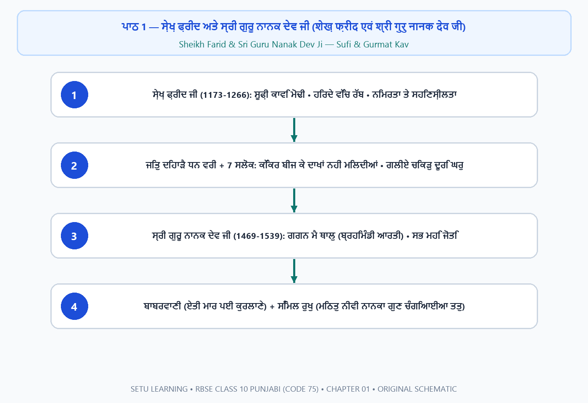

## 2. ਮਿਲਖਾ ਸਿੰਘ ਦਾ ਜਨਮ ਕਿਸ ਪਿੰਡ ਵਿੱਚ ਹੋਇਆ (ਗੋਬਿੰਦਪੁਰਾ)।

**ਸਰੋਤ:** 2026 ਮੁੱਖ, ਪ੍ਰਸ਼ਨ 1(v), PDF ਪੰਨਾ 2 · **ਅੰਕ:** 1 ਅੰਕ

**ਪਾਠ-ਸੰਬੰਧ:** ਪਾਠ 10 — ਫ਼ਲਾਇੰਗ ਸਿੱਖ — ਮਿਲਖਾ ਸਿੰਘ — ਪ੍ਰਿੰ. ਸਰਵਣ ਸਿੰਘ (निबंध 3: फ़्लाइंग सिख — मिल्खा सिंह)

**ਹੱਲ:** ਪ੍ਰਿੰ. ਸਰਵਣ ਸਿੰਘ ਦੇ ਨਿਬੰਧ 'ਫ਼ਲਾਇੰਗ ਸਿੱਖ — ਮਿਲਖਾ ਸਿੰਘ' ਅਨੁਸਾਰ ਮਿਲਖਾ ਸਿੰਘ ਦਾ ਜਨਮ ਗੋਬਿੰਦਪੁਰਾ (ਜ਼ਿਲ੍ਹਾ ਮੁਜ਼ੱਫ਼ਰਗੜ੍ਹ) ਵਿਖੇ ਹੋਇਆ। ਫ਼ੌਜ ਵਿੱਚ ਉਸਤਾਦ ਗੁਰਦੇਵ ਸਿੰਘ ਨੇ ਉਸ ਨੂੰ ਤਰਾਸ਼ਿਆ। ਉਸ ਨੇ 1958 ਟੋਕੀਓ ਏਸ਼ੀਆਈ ਖੇਡਾਂ (200 ਮੀ. ਤੇ 400 ਮੀ.) ਅਤੇ 1958 ਕਾਰਡਿਫ਼ ਕਾਮਨਵੈਲਥ ਖੇਡਾਂ (440 ਗਜ਼) ਵਿੱਚ ਸੋਨ ਤਮਗ਼ੇ ਜਿੱਤੇ, 1960 ਲਾਹੌਰ ਵਿੱਚ ਅਬਦੁਲ ਖ਼ਾਲਿਕ ਨੂੰ ਹਰਾ ਕੇ ਜਨਰਲ ਅਯੂਬ ਖ਼ਾਨ ਤੋਂ 'ਫ਼ਲਾਇੰਗ ਸਿੱਖ' ਖਿਤਾਬ ਪਾਇਆ ਅਤੇ 1960 ਰੋਮ ਓਲੰਪਿਕ (400 ਮੀ.) ਵਿੱਚ 45.6 ਸੈਕਿੰਡ ਨਾਲ ਚੌਥਾ ਸਥਾਨ ਪ੍ਰਾਪਤ ਕੀਤਾ।

[ਮੂਲ ਪ੍ਰਸ਼ਨ ਵੇਖੋ](https://rajeduboard.rajasthan.gov.in/books/PAPERS-2026/Sec/S-75.pdf#page=2)

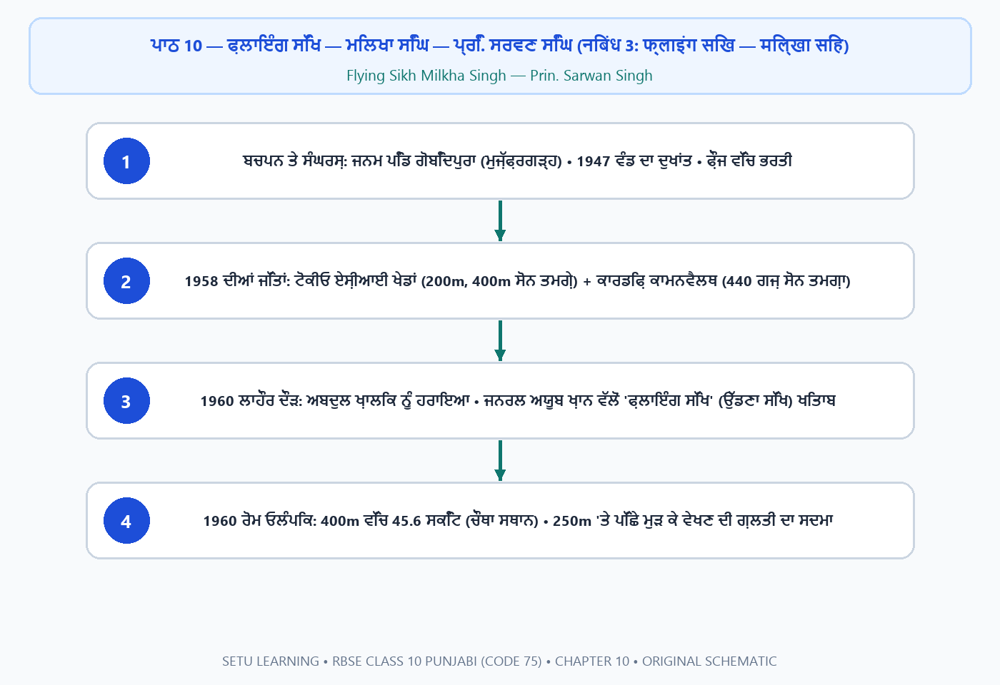

## 3. ਕਰਤਾਰੇ ਨੇ ਟਾਹਲੀ ਦਾ ਡਾਹਣਾ ਕਿਸ ਹਥਿਆਰ ਨਾਲ ਵੱਢਿਆ (ਤਲਵਾਰ)।

**ਸਰੋਤ:** 2026 ਮੁੱਖ, ਪ੍ਰਸ਼ਨ 1(xiv), PDF ਪੰਨਾ 3 · **ਅੰਕ:** 1 ਅੰਕ

**ਪਾਠ-ਸੰਬੰਧ:** ਪਾਠ 18 — ਖ਼ੂਨ — ਗੁਰਬਚਨ ਸਿੰਘ ਭੁੱਲਰ (कहानी 5: ख़ून — गुरबचन सिंह भुल्लर)

**ਹੱਲ:** ਗੁਰਬਚਨ ਸਿੰਘ ਭੁੱਲਰ (ਜਨਮ 1937 ਈ., ਪਿੰਡ ਪਿੱਥੋ, ਬਠਿੰਡਾ; ਸਾਹਿਤ ਅਕਾਦਮੀ: 'ਅਗਨੀ ਕਲਸ਼') ਦੀ ਕਹਾਣੀ 'ਖ਼ੂਨ' ਵਿੱਚ ਕਰਤਾਰਾ ਵਿਹੜੇ ਦੀ ਟਾਹਲੀ ਦਾ ਡਾਹਣਾ ਤਲਵਾਰ ਨਾਲ ਵੱਢ ਕੇ ਪਰਖਦਾ ਹੈ। ਗਹਿਣੇ ਵਾਲੀ ਜ਼ਮੀਨ ਪਿੱਛੇ ਕੈਲੇ ਤੇ ਦੀਪੇ ਨੇ ਜੱਗਰ ਦਾ ਕਤਲ ਕਰ ਦਿੱਤਾ ਸੀ। ਮੁਰੱਬਾਬੰਦੀ ਵੇਲੇ ਜੱਗਰ ਦੀ 15 ਘੁਮਾਂ ਜ਼ਮੀਨ ਹੜੱਪਣ ਲਈ ਕਰਤਾਰਾ ਜੱਗਰ ਦੀ ਵਿਧਵਾ ਕੁਲਵੰਤੋ ਦੇ ਪੇਕੇ ਪਿੰਡ 'ਸੌਣਪੁਰਾ' (ਪਿਤਾ ਸੁੱਚਾ ਸਿੰਘ) ਵਿਖੇ ਆਪਣੇ ਭਤੀਜੇ ਨੂੰ ਵੱਢਣ ਜਾਂਦਾ ਹੈ। ਖੂਹ ਉੱਤੇ ਜਦੋਂ ਭਤੀਜਾ ਮਾਣ ਨਾਲ ਕਹਿੰਦਾ ਹੈ — 'ਮੈਨੂੰ ਕੌਣ ਹੱਥ ਲਾਊ। ਮਾਲਵੇ ਵਿੱਚ ਮੇਰਾ ਸ਼ੇਰ ਵਰਗਾ ਚਾਚਾ ਐ, ਕਰਤਾਰਾ। ਡੱਕਰੇ ਕਰ ਦੇਊ!' ਤਾਂ ਕਰਤਾਰੇ ਦਾ ਖ਼ੂਨ ਪੰਘਰ ਜਾਂਦਾ ਹੈ ਅਤੇ ਉਹ ਤਲਵਾਰ ਖੂਹ ਦੀ ਮਣ 'ਤੇ ਛੱਡ ਕੇ ਭਤੀਜੇ ਨੂੰ ਗਲ ਨਾਲ ਲਾ ਲੈਂਦਾ ਹੈ।

[ਮੂਲ ਪ੍ਰਸ਼ਨ ਵੇਖੋ](https://rajeduboard.rajasthan.gov.in/books/PAPERS-2026/Sec/S-75.pdf#page=3)

## 4. 'ਆਸਤਕ' ਸ਼ਬਦ ਦਾ ਵਿਰੋਧੀ ਸ਼ਬਦ (ਨਾਸਤਕ)।

**ਸਰੋਤ:** 2026 ਮੁੱਖ, ਪ੍ਰਸ਼ਨ 1(xvi), PDF ਪੰਨਾ 3 · **ਅੰਕ:** 1 ਅੰਕ

**ਪਾਠ-ਸੰਬੰਧ:** ਪਾਠ 20 — ਵਿਆਕਰਣ 2: ਅਰਥ-ਬੋਧ — ਵਿਰੋਧੀ ਸ਼ਬਦ, ਸਮਾਨਾਰਥਕ ਸ਼ਬਦ ਅਤੇ ਬਹੁ-ਅਰਥਕ ਸ਼ਬਦ (व्याकरण 2: अर्थ-बोध — विलोम, समानार्थक एवं बहुअर्थक शब्द — 9 अंक)

**ਹੱਲ:** ਵਿਆਕਰਣ ਭਾਗ 2 — ਅਰਥ-ਬੋਧ (9 ਅੰਕ): (1) ਵਿਰੋਧੀ ਸ਼ਬਦ (3 ਅੰਕ): ਉਸਤਤ × ਨਿੰਦਿਆ, ਆਸਤਕ × ਨਾਸਤਕ, ਸੰਜੋਗ × ਵਿਯੋਗ, ਸੱਖਣਾ × ਭਰਿਆ, ਸੱਜਣ × ਦੁਰਜਨ, ਉੱਦਮੀ × ਆਲਸੀ, ਉਪਕਾਰ × ਅਪਕਾਰ, ਹਾਨੀ × ਲਾਭ। (2) ਸਮਾਨਾਰਥਕ ਸ਼ਬਦ (3 ਅੰਕ): ਉੱਦਮ (ਮਿਹਨਤ, ਕੋਸ਼ਿਸ਼, ਯਤਨ, ਉਪਰਾਲਾ), ਅਕਾਸ਼ (ਅਸਮਾਨ, ਗਗਨ, ਅੰਬਰ), ਸੁੰਦਰ (ਸੋਹਣਾ, ਖ਼ੂਬਸੂਰਤ, ਮਨੋਹਰ), ਪਾਣੀ (ਜਲ, ਨੀਰ, ਆਬ), ਧਰਤੀ (ਜ਼ਮੀਨ, ਭੂਮੀ, ਪ੍ਰਿਥਵੀ)। (3) ਬਹੁ-ਅਰਥਕ ਸ਼ਬਦ (3 ਅੰਕ): ਵੱਟ (ਖੇਤ ਦੀ ਬੰਨ੍ਹੀ, ਗਰਮੀ/ਹੁੰਮਸ, ਗੁੱਸਾ, ਪੱਗ ਦੇ ਬਲ), ਹਾਰ (ਫੁੱਲਾਂ ਦੀ ਮਾਲਾ, ਪਰਾਜੈ), ਉੱਤਰ (ਦਿਸ਼ਾ, ਸਵਾਲ ਦਾ ਜਵਾਬ, ਹੇਠਾਂ ਉੱਤਰਨਾ), ਜੱਗ (ਸੰਸਾਰ, ਪਾਣੀ ਦਾ ਭਾਂਡਾ), ਵਾਰ (ਹਮਲਾ, ਦਿਨ, ਕਾਵਿ-ਰੂਪ), ਫਲ (ਮੇਵਾ, ਨਤੀਜਾ, ਹਲ ਦਾ ਫਲ)।

[ਮੂਲ ਪ੍ਰਸ਼ਨ ਵੇਖੋ](https://rajeduboard.rajasthan.gov.in/books/PAPERS-2026/Sec/S-75.pdf#page=3)

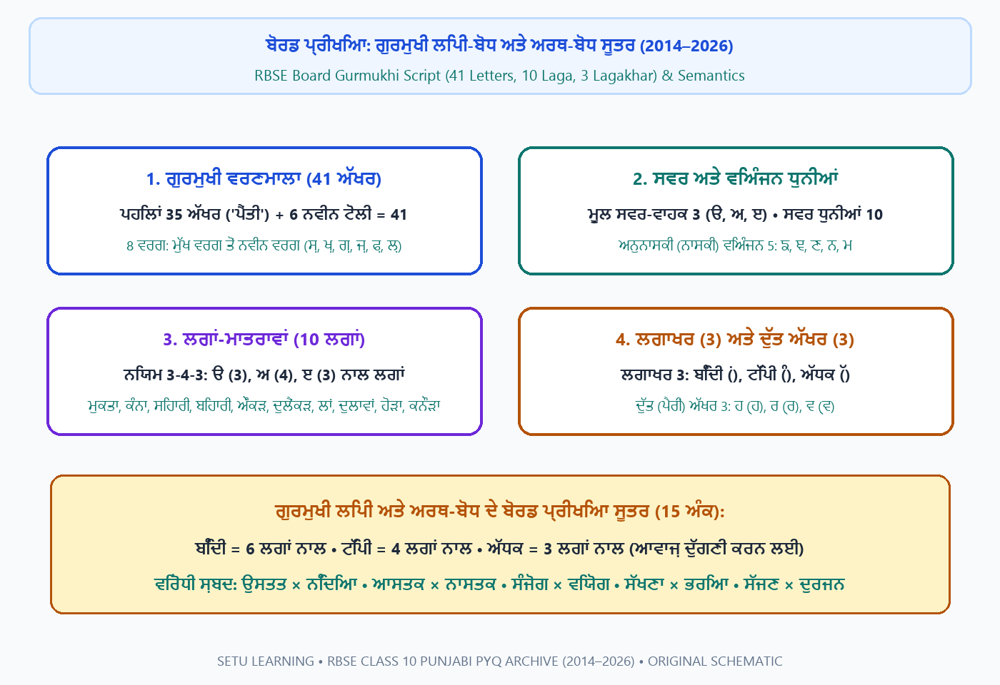

## 5. ਬੁੱਲ੍ਹੇ ਸ਼ਾਹ ਦੇ ਮੁਰਸ਼ਦ ਦਾ ਨਾਂ (ਸ਼ਾਹ ਇਨਾਇਤ ਕਾਦਰੀ)।

**ਸਰੋਤ:** 2026 ਮੁੱਖ, ਪ੍ਰਸ਼ਨ 2(iii), PDF ਪੰਨਾ 4 · **ਅੰਕ:** 1 ਅੰਕ

**ਪਾਠ-ਸੰਬੰਧ:** ਪਾਠ 4 — ਮੀਆਂ ਵਜੀਦ ਅਤੇ ਬੁੱਲ੍ਹੇ ਸ਼ਾਹ (मियां वजीद एवं बुल्ले शाह)

**ਹੱਲ:** ਸ਼ਾਹ ਹੁਸੈਨ (1539–1599, ਲਾਹੌਰ; ਕਾਫ਼ੀ ਕਾਵਿ-ਰੂਪ ਦਾ ਮੋਢੀ) ਨੇ 'ਆਪ ਨੂੰ ਪਛਾਣ ਬੰਦਿਆ' ਅਤੇ 'ਰੱਬਾ ਮੇਰੇ ਹਾਲ ਦਾ ਮਹਿਰਮ ਤੂੰ' (ਅੰਦਰ ਤੂੰ ਹੈਂ ਬਾਹਰ ਤੂੰ ਹੈਂ, ਤੂੰ ਹੈਂ ਤਾਣਾ ਤੂੰ ਹੈਂ ਬਾਣਾ) ਰਾਹੀਂ ਆਤਮ-ਪਛਾਣ ਤੇ ਸਰਬ-ਵਿਆਪਕਤਾ ਦੱਸੀ ਹੈ। ਸੂਫ਼ੀ ਕਾਵਿ ਦੇ ਸਿਖਰ ਬੁੱਲ੍ਹੇ ਸ਼ਾਹ (1680–1758; ਮੁਰਸ਼ਦ ਸ਼ਾਹ ਇਨਾਇਤ ਕਾਦਰੀ) ਨੇ 'ਇਸ਼ਕ ਦੀ ਨਵੀਓਂ ਨਵੀਂ ਬਹਾਰ' ਅਤੇ 'ਬੁੱਲ੍ਹਾ ਕੀ ਜਾਣਾ ਮੈਂ ਕੌਣ' ਰਾਹੀਂ ਫ਼ਿਰਕਾਪ੍ਰਸਤੀ ਤੇ ਮਜ਼ਹਬੀ ਕੱਟੜਤਾ ਦਾ ਤਿਆਗ ਕਰਕੇ ਪ੍ਰੇਮ-ਭਗਤੀ ਦਾ ਸੁਨੇਹਾ ਦਿੱਤਾ ਹੈ।

[ਮੂਲ ਪ੍ਰਸ਼ਨ ਵੇਖੋ](https://rajeduboard.rajasthan.gov.in/books/PAPERS-2026/Sec/S-75.pdf#page=4)

## 6. ਪੰਜਾਬੀ ਵਿੱਚ ਦੁੱਤ ਅੱਖਰਾਂ ਦੀ ਗਿਣਤੀ (3 — ਹ, ਰ, ਵ)।

**ਸਰੋਤ:** 2026 ਮੁੱਖ, ਪ੍ਰਸ਼ਨ 2(vi), PDF ਪੰਨਾ 4 · **ਅੰਕ:** 1 ਅੰਕ

**ਪਾਠ-ਸੰਬੰਧ:** ਪਾਠ 19 — ਵਿਆਕਰਣ 1: ਭਾਸ਼ਾ, ਪੰਜਾਬੀ ਦੀਆਂ ਉਪ-ਭਾਸ਼ਾਵਾਂ, ਧੁਨੀ-ਬੋਧ ਅਤੇ ਲਿਪੀ-ਬੋਧ (व्याकरण 1: भाषा, उप-भाषाएँ, ध्वनि-बोध एवं लिपि-बोध — 6 अंक)

**ਹੱਲ:** ਵਿਆਕਰਣ ਭਾਗ 1 (6 ਅੰਕ): (1) ਭਾਸ਼ਾ: ਮਨ ਦੇ ਭਾਵਾਂ ਨੂੰ ਪ੍ਰਗਟ ਕਰਨ ਦਾ ਸਾਧਨ (ਮੌਖਿਕ ਅਤੇ ਲਿਖਤੀ)। (2) ਪੰਜਾਬੀ ਦੀਆਂ ਉਪ-ਭਾਸ਼ਾਵਾਂ: ਮਾਝੀ (ਟਕਸਾਲੀ ਆਧਾਰ — ਅੰਮ੍ਰਿਤਸਰ, ਤਰਨਤਾਰਨ, ਗੁਰਦਾਸਪੁਰ, ਪਠਾਨਕੋਟ), ਮਲਵਈ (ਬਠਿੰਡਾ, ਲੁਧਿਆਣਾ, ਪਟਿਆਲਾ, ਫ਼ਿਰੋਜ਼ਪੁਰ, ਸ੍ਰੀ ਗੰਗਾਨਗਰ), ਦੁਆਬੀ (ਜਲੰਧਰ, ਹੁਸ਼ਿਆਰਪੁਰ, ਕਪੂਰਥਲਾ, ਨਵਾਂ ਸ਼ਹਿਰ), ਪੁਆਧੀ (ਰੋਪੜ, ਮੁਹਾਲੀ, ਰਾਜਪੁਰਾ)। (3) ਧੁਨੀ-ਬੋਧ: ਮੂਲ ਸਵਰ ਅੱਖਰ 3 (ੳ, ਅ, ੲ) ਤੇ ਸਵਰ ਧੁਨੀਆਂ 10 (3 ਲਘੂ + 7 ਦੀਰਘ); ਅਨੁਨਾਸਕੀ ਵਿਅੰਜਨ 5 (ਙ, ਞ, ਣ, ਨ, ਮ); ਦੁੱਤ ਅੱਖਰ 3 (ਹ, ਰ, ਵ)। (4) ਗੁਰਮੁਖੀ ਲਿਪੀ: ਪੰਜਾਬੀ ਦੀ ਮਿਆਰੀ ਲਿਪੀ ਜਿਸ ਵਿੱਚ 8 ਵਰਗਾਂ ਦੇ 41 ਅੱਖਰ (35 ਪੈਂਤੀ + 6 ਨਵੀਨ ਟੋਲੀ: ਸ਼, ਖ਼, ਗ਼, ਜ਼, ਫ਼, ਲ਼), 10 ਲਗਾਂ (ੳ=3, ਅ=4, ੲ=3) ਅਤੇ 3 ਲਗਾਖਰ (ਬਿੰਦੀ, ਟਿੱਪੀ, ਅੱਧਕ) ਹਨ।

[ਮੂਲ ਪ੍ਰਸ਼ਨ ਵੇਖੋ](https://rajeduboard.rajasthan.gov.in/books/PAPERS-2026/Sec/S-75.pdf#page=4)

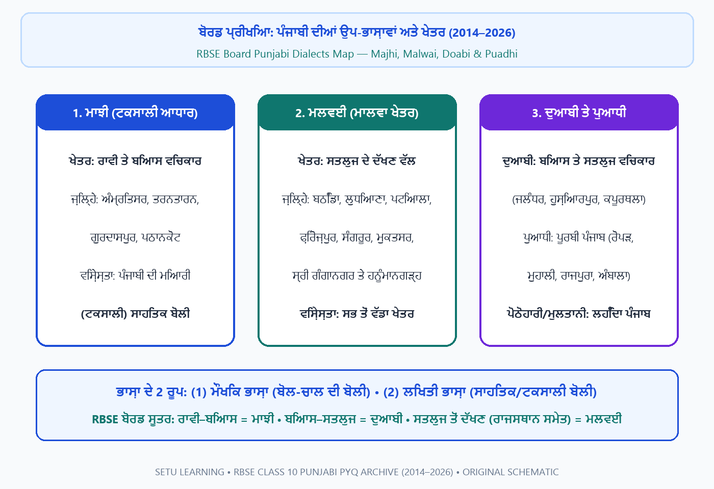

## 7. ਮਹਾਰਾਜਾ ਗੰਗਾ ਸਿੰਘ ਦਾ ਜਨਮ ਕਦੋਂ ਹੋਇਆ (13 ਅਕਤੂਬਰ 1880 ਈ.)।

**ਸਰੋਤ:** 2026 ਮੁੱਖ, ਪ੍ਰਸ਼ਨ 3(v), PDF ਪੰਨਾ 4 · **ਅੰਕ:** 1 ਅੰਕ

**ਪਾਠ-ਸੰਬੰਧ:** ਪਾਠ 11 — ਮਹਾਰਾਜਾ ਗੰਗਾ ਸਿੰਘ — ਹਰਪਾਲ ਸਿੰਘ ਲੱਖੀਆਂ (निबंध 4: महाराजा गंगा सिंह)

**ਹੱਲ:** ਹਰਪਾਲ ਸਿੰਘ ਲੱਖੀਆਂ ਦੇ ਨਿਬੰਧ 'ਗੰਗ ਨਹਿਰ ਅਤੇ ਮਹਾਰਾਜਾ ਗੰਗਾ ਸਿੰਘ' ਅਨੁਸਾਰ ਬੀਕਾਨੇਰ ਰਿਆਸਤ ਦੇ ਮਹਾਰਾਜਾ ਗੰਗਾ ਸਿੰਘ ਜੀ ਦਾ ਜਨਮ 13 ਅਕਤੂਬਰ 1880 ਈ. (ਦੁਸਹਿਰੇ ਵਾਲੇ ਦਿਨ) ਹੋਇਆ। 1899 ਈ. (ਸੰਮਤ 1956) ਦੇ 'ਛੱਪਨੀਆ ਅਕਾਲ' ਨੇ ਉਹਨਾਂ ਨੂੰ ਨਹਿਰ ਲਿਆਉਣ ਲਈ ਪ੍ਰੇਰਿਆ। ਸਤਲੁਜ ਦਰਿਆ ਉੱਤੇ ਹੁਸੈਨੀਵਾਲਾ ਹੈੱਡ-ਵਰਕਸ ਤੋਂ ਨਿਕਲੀ ਗੰਗ ਨਹਿਰ ਦਾ ਨੀਂਹ-ਪੱਥਰ 5 ਦਸੰਬਰ 1925 ਨੂੰ ਰੱਖਿਆ ਗਿਆ ਅਤੇ 26 ਅਕਤੂਬਰ 1927 ਨੂੰ ਸ਼ਿਵਪੁਰ ਹੈੱਡ 'ਤੇ ਵਾਇਸਰਾਏ ਲਾਰਡ ਇਰਵਿਨ ਨੇ ਇਸ ਦਾ ਉਦਘਾਟਨ ਕੀਤਾ। ਇਸ ਨੇ ਬੀਕਾਨੇਰ/ਗੰਗਾਨਗਰ ਦੇ ਮਾਰੂਥਲ ਨੂੰ ਹਰਾ-ਭਰਾ ਬਣਾ ਦਿੱਤਾ ਜਿਸ ਕਾਰਨ ਮਹਾਰਾਜਾ ਗੰਗਾ ਸਿੰਘ ਨੂੰ 'ਆਧੁਨਿਕ ਭਾਗੀਰਥ' ਕਿਹਾ ਜਾਂਦਾ ਹੈ।

[ਮੂਲ ਪ੍ਰਸ਼ਨ ਵੇਖੋ](https://rajeduboard.rajasthan.gov.in/books/PAPERS-2026/Sec/S-75.pdf#page=4)

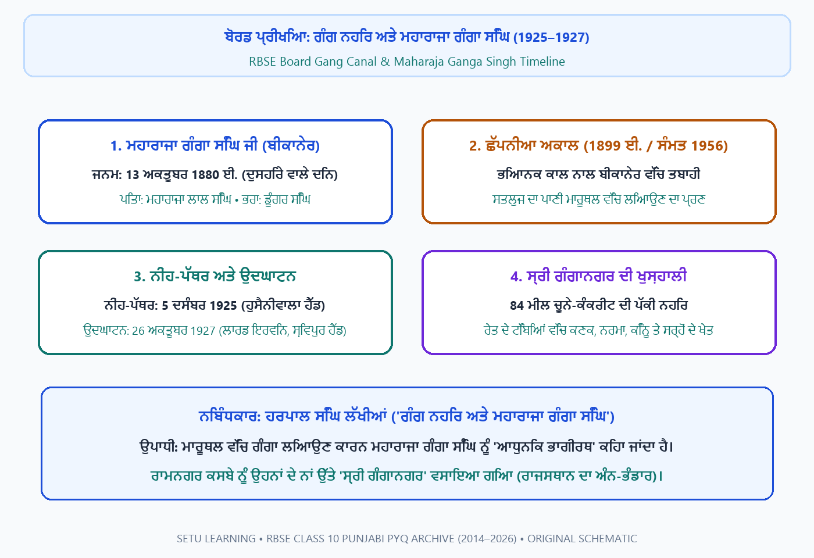

## 8. ਮਿਹਨਤ ਅਤੇ ਉੱਦਮ ਦੀ ਮਹੱਤਤਾ ਬਾਰੇ ਅਣਡਿੱਠਾ ਪੈਰ੍ਹਾ।

**ਸਰੋਤ:** 2026 ਮੁੱਖ, ਪ੍ਰਸ਼ਨ 4-8, PDF ਪੰਨਾ 5 · **ਅੰਕ:** 10 ਅੰਕ

**ਪਾਠ-ਸੰਬੰਧ:** ਪਾਠ 21 — ਅਣਡਿੱਠਾ ਪੈਰ੍ਹਾ (ਅਪਠਿਤ ਗਦਿਆਂਸ਼ ਬੋਧ) (अपठित गद्यांश बोध — 10 अंक)

**ਹੱਲ:** ਅਣਡਿੱਠਾ ਪੈਰ੍ਹਾ (ਖੰਡ-ਅ, ਪ੍ਰਸ਼ਨ 4 ਤੋਂ 8 — 5 × 2 = 10 ਅੰਕ): ਪੈਰ੍ਹੇ ਨੂੰ ਦੋ ਵਾਰ ਧਿਆਨ ਨਾਲ ਪੜ੍ਹ ਕੇ ਪਹਿਲੇ 4 ਪ੍ਰਸ਼ਨਾਂ ਦੇ ਉੱਤਰ ਪੈਰ੍ਹੇ ਦੇ ਤੱਥਾਂ ਦੇ ਆਧਾਰ 'ਤੇ ਆਪਣੀ ਸਰਲ ਭਾਸ਼ਾ ਵਿੱਚ 1–2 ਵਾਕਾਂ ਵਿੱਚ ਲਿਖੋ। 5ਵੇਂ ਪ੍ਰਸ਼ਨ (Q8 — ਢੁਕਵਾਂ ਸਿਰਲੇਖ) ਵਿੱਚ ਪੈਰ੍ਹੇ ਦੀ ਪਹਿਲੀ ਜਾਂ ਆਖ਼ਰੀ ਸਤਰ ਦੇ ਕੇਂਦਰੀ ਵਿਸ਼ੇ ਤੋਂ 2 ਤੋਂ 4 ਸ਼ਬਦਾਂ ਦਾ ਸਿਰਲੇਖ ਚੁਣੋ (ਜਿਵੇਂ — 'ਸਮੇਂ ਦੀ ਕਦਰ', 'ਮਿਹਨਤ ਦੀ ਮਹੱਤਤਾ', 'ਪੁਸਤਕਾਂ ਦਾ ਮਹੱਤਵ', 'ਰੁੱਖਾਂ ਦੇ ਲਾਭ', 'ਅਨੁਸ਼ਾਸਨ', 'ਮਾਂ-ਬੋਲੀ ਦਾ ਮਹੱਤਵ')।

[ਮੂਲ ਪ੍ਰਸ਼ਨ ਵੇਖੋ](https://rajeduboard.rajasthan.gov.in/books/PAPERS-2026/Sec/S-75.pdf#page=5)

## 9. ਅਨੁਨਾਸਕੀ (ਨਾਸਕੀ) ਵਿਅੰਜਨ ਕਿੰਨੇ ਅਤੇ ਕਿਹੜੇ ਹਨ।

**ਸਰੋਤ:** 2026 ਮੁੱਖ, ਪ੍ਰਸ਼ਨ 9, PDF ਪੰਨਾ 5 · **ਅੰਕ:** 2 ਅੰਕ

**ਪਾਠ-ਸੰਬੰਧ:** ਪਾਠ 19 — ਵਿਆਕਰਣ 1: ਭਾਸ਼ਾ, ਪੰਜਾਬੀ ਦੀਆਂ ਉਪ-ਭਾਸ਼ਾਵਾਂ, ਧੁਨੀ-ਬੋਧ ਅਤੇ ਲਿਪੀ-ਬੋਧ (व्याकरण 1: भाषा, उप-भाषाएँ, ध्वनि-बोध एवं लिपि-बोध — 6 अंक)

**ਹੱਲ:** ਵਿਆਕਰਣ ਭਾਗ 1 (6 ਅੰਕ): (1) ਭਾਸ਼ਾ: ਮਨ ਦੇ ਭਾਵਾਂ ਨੂੰ ਪ੍ਰਗਟ ਕਰਨ ਦਾ ਸਾਧਨ (ਮੌਖਿਕ ਅਤੇ ਲਿਖਤੀ)। (2) ਪੰਜਾਬੀ ਦੀਆਂ ਉਪ-ਭਾਸ਼ਾਵਾਂ: ਮਾਝੀ (ਟਕਸਾਲੀ ਆਧਾਰ — ਅੰਮ੍ਰਿਤਸਰ, ਤਰਨਤਾਰਨ, ਗੁਰਦਾਸਪੁਰ, ਪਠਾਨਕੋਟ), ਮਲਵਈ (ਬਠਿੰਡਾ, ਲੁਧਿਆਣਾ, ਪਟਿਆਲਾ, ਫ਼ਿਰੋਜ਼ਪੁਰ, ਸ੍ਰੀ ਗੰਗਾਨਗਰ), ਦੁਆਬੀ (ਜਲੰਧਰ, ਹੁਸ਼ਿਆਰਪੁਰ, ਕਪੂਰਥਲਾ, ਨਵਾਂ ਸ਼ਹਿਰ), ਪੁਆਧੀ (ਰੋਪੜ, ਮੁਹਾਲੀ, ਰਾਜਪੁਰਾ)। (3) ਧੁਨੀ-ਬੋਧ: ਮੂਲ ਸਵਰ ਅੱਖਰ 3 (ੳ, ਅ, ੲ) ਤੇ ਸਵਰ ਧੁਨੀਆਂ 10 (3 ਲਘੂ + 7 ਦੀਰਘ); ਅਨੁਨਾਸਕੀ ਵਿਅੰਜਨ 5 (ਙ, ਞ, ਣ, ਨ, ਮ); ਦੁੱਤ ਅੱਖਰ 3 (ਹ, ਰ, ਵ)। (4) ਗੁਰਮੁਖੀ ਲਿਪੀ: ਪੰਜਾਬੀ ਦੀ ਮਿਆਰੀ ਲਿਪੀ ਜਿਸ ਵਿੱਚ 8 ਵਰਗਾਂ ਦੇ 41 ਅੱਖਰ (35 ਪੈਂਤੀ + 6 ਨਵੀਨ ਟੋਲੀ: ਸ਼, ਖ਼, ਗ਼, ਜ਼, ਫ਼, ਲ਼), 10 ਲਗਾਂ (ੳ=3, ਅ=4, ੲ=3) ਅਤੇ 3 ਲਗਾਖਰ (ਬਿੰਦੀ, ਟਿੱਪੀ, ਅੱਧਕ) ਹਨ।

[ਮੂਲ ਪ੍ਰਸ਼ਨ ਵੇਖੋ](https://rajeduboard.rajasthan.gov.in/books/PAPERS-2026/Sec/S-75.pdf#page=5)

ਚਿੱਤਰ ਸਹਾਇਤਾ: ਇਸੇ ਪਾਠ ਵਿੱਚ ਇਸ ਸੰਕਲਪ ਦਾ ਪਹਿਲਾਂ ਦਿੱਤਾ ਗਿਆ ਨਾਮਾਂਕਿਤ schematic ਵੇਖੋ।

## 10. 'ਸਾਂਝੀ ਕੰਧ' ਦਾ ਝਗੜਾ ਕਿਨ੍ਹਾਂ ਵਿਚਕਾਰ ਸੀ ਅਤੇ ਕਿਉਂ।

**ਸਰੋਤ:** 2026 ਮੁੱਖ, ਪ੍ਰਸ਼ਨ 13, PDF ਪੰਨਾ 6 · **ਅੰਕ:** 2 ਅੰਕ

**ਪਾਠ-ਸੰਬੰਧ:** ਪਾਠ 16 — ਸਾਂਝੀ ਕੰਧ — ਸੰਤੋਖ ਸਿੰਘ ਧੀਰ (कहानी 3: सांझी कंध — संतोख सिंह धीर)

**ਹੱਲ:** ਸੰਤੋਖ ਸਿੰਘ ਧੀਰ (1920–2010; ਸਾਹਿਤ ਅਕਾਦਮੀ: 'ਪੱਖੀ') ਦੀ ਕਹਾਣੀ 'ਸਾਂਝੀ ਕੰਧ' ਵਿੱਚ ਕਪੂਰ ਸਿੰਘ ਵਿਸਾਖ ਦੇ ਮਹੀਨੇ ਆਪਣੀ 10 ਵਿੱਘੇ ਪੈਲੀ ਗਹਿਣੇ ਪਾ ਕੇ ਢੱਠਾ ਮਕਾਨ ਬਣਾਉਂਦਾ ਹੈ। ਚਾਚੇ ਦੇ ਪੁੱਤਰ ਦਰਬਾਰਾ ਸਿੰਘ ਨਾਲ 40 ਫੁੱਟ ਲੰਮੀ ਤੇ 14 ਫੁੱਟ ਉੱਚੀ ਸਾਂਝੀ ਕੰਧ ਦੇ ਖ਼ਰਚੇ ਪਿੱਛੇ ਝਗੜਾ ਹੁੰਦਾ ਹੈ ਜਿਸ ਨੂੰ ਧੰਮਾ ਸਿੰਘ ਸਰਪੰਚ ਭੜਕਾਉਂਦਾ ਹੈ। ਪੰਚਾਇਤ ਵਿੱਚ ਰਾਮ ਰਤਨ ਪਟਵਾਰੀ, ਧੰਮਾ ਸਿੰਘ ਸਰਪੰਚ, ਟੁੰਡਾ ਲੰਬੜਦਾਰ ਅਤੇ ਨਾਹਰ ਸਿੰਘ ਅਕਾਲੀ ਸ਼ਾਮਲ ਸਨ। ਸਰਦੀਆਂ ਵਿੱਚ ਦਰਬਾਰੇ ਨੂੰ ਨਮੂਨੀਆ ਹੋਣ 'ਤੇ ਚਾਚੀ ਰਾਮ ਕੌਰ ਦੇ ਬੋਲ ('ਨੌਹਾਂ ਨਾਲੋਂ ਮਾਸ ਨ੍ਹੀਂ ਟੁੱਟਦਾ') ਸੁਣ ਕੇ ਕਪੂਰ ਸਿੰਘ ਉਸ ਦੇ ਘਰ ਜਾਂਦਾ ਹੈ, 'ਚੁਗਾਠ ਬਚ ਰਹੇ, ਬਾਣ ਬਥੇਰਾ' ਕਹਿ ਕੇ ਹੌਸਲਾ ਦਿੰਦਾ ਹੈ, 10 ਰੁਪਏ ਦਿੰਦਾ ਹੈ ਅਤੇ ਭਤੀਜੀ ਹਰਬੰਸੋ (ਬੰਸੋ) ਦੇ ਵਿਆਹ ਦੀ ਜ਼ਿੰਮੇਵਾਰੀ ਵੰਡਾਉਂਦਾ ਹੈ।

[ਮੂਲ ਪ੍ਰਸ਼ਨ ਵੇਖੋ](https://rajeduboard.rajasthan.gov.in/books/PAPERS-2026/Sec/S-75.pdf#page=6)

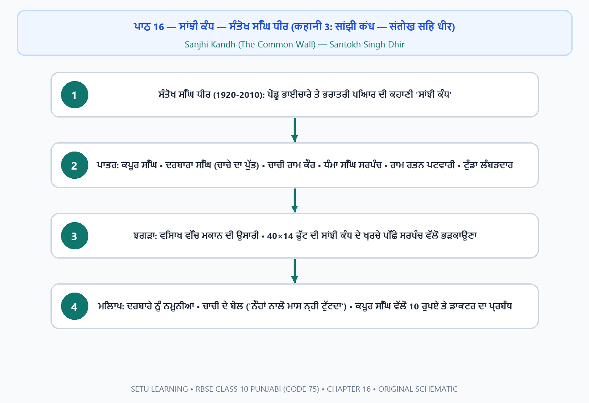

## 11. ਗੰਗ ਨਹਿਰ ਆਉਣ ਨਾਲ ਇਲਾਕੇ ਵਿੱਚ ਆਈ ਤਬਦੀਲੀ।

**ਸਰੋਤ:** 2026 ਮੁੱਖ, ਪ੍ਰਸ਼ਨ 16, PDF ਪੰਨਾ 6 · **ਅੰਕ:** 3 ਅੰਕ

**ਪਾਠ-ਸੰਬੰਧ:** ਪਾਠ 11 — ਮਹਾਰਾਜਾ ਗੰਗਾ ਸਿੰਘ — ਹਰਪਾਲ ਸਿੰਘ ਲੱਖੀਆਂ (निबंध 4: महाराजा गंगा सिंह)

**ਹੱਲ:** ਹਰਪਾਲ ਸਿੰਘ ਲੱਖੀਆਂ ਦੇ ਨਿਬੰਧ 'ਗੰਗ ਨਹਿਰ ਅਤੇ ਮਹਾਰਾਜਾ ਗੰਗਾ ਸਿੰਘ' ਅਨੁਸਾਰ ਬੀਕਾਨੇਰ ਰਿਆਸਤ ਦੇ ਮਹਾਰਾਜਾ ਗੰਗਾ ਸਿੰਘ ਜੀ ਦਾ ਜਨਮ 13 ਅਕਤੂਬਰ 1880 ਈ. (ਦੁਸਹਿਰੇ ਵਾਲੇ ਦਿਨ) ਹੋਇਆ। 1899 ਈ. (ਸੰਮਤ 1956) ਦੇ 'ਛੱਪਨੀਆ ਅਕਾਲ' ਨੇ ਉਹਨਾਂ ਨੂੰ ਨਹਿਰ ਲਿਆਉਣ ਲਈ ਪ੍ਰੇਰਿਆ। ਸਤਲੁਜ ਦਰਿਆ ਉੱਤੇ ਹੁਸੈਨੀਵਾਲਾ ਹੈੱਡ-ਵਰਕਸ ਤੋਂ ਨਿਕਲੀ ਗੰਗ ਨਹਿਰ ਦਾ ਨੀਂਹ-ਪੱਥਰ 5 ਦਸੰਬਰ 1925 ਨੂੰ ਰੱਖਿਆ ਗਿਆ ਅਤੇ 26 ਅਕਤੂਬਰ 1927 ਨੂੰ ਸ਼ਿਵਪੁਰ ਹੈੱਡ 'ਤੇ ਵਾਇਸਰਾਏ ਲਾਰਡ ਇਰਵਿਨ ਨੇ ਇਸ ਦਾ ਉਦਘਾਟਨ ਕੀਤਾ। ਇਸ ਨੇ ਬੀਕਾਨੇਰ/ਗੰਗਾਨਗਰ ਦੇ ਮਾਰੂਥਲ ਨੂੰ ਹਰਾ-ਭਰਾ ਬਣਾ ਦਿੱਤਾ ਜਿਸ ਕਾਰਨ ਮਹਾਰਾਜਾ ਗੰਗਾ ਸਿੰਘ ਨੂੰ 'ਆਧੁਨਿਕ ਭਾਗੀਰਥ' ਕਿਹਾ ਜਾਂਦਾ ਹੈ।

[ਮੂਲ ਪ੍ਰਸ਼ਨ ਵੇਖੋ](https://rajeduboard.rajasthan.gov.in/books/PAPERS-2026/Sec/S-75.pdf#page=6)

ਚਿੱਤਰ ਸਹਾਇਤਾ: ਇਸੇ ਪਾਠ ਵਿੱਚ ਇਸ ਸੰਕਲਪ ਦਾ ਪਹਿਲਾਂ ਦਿੱਤਾ ਗਿਆ ਨਾਮਾਂਕਿਤ schematic ਵੇਖੋ।

## 12. 'ਅੱਜ ਆਖਾਂ ਵਾਰਿਸ ਸ਼ਾਹ ਨੂੰ' / ਕਾਵਿ-ਟੁਕੜੀ ਦੀ ਪ੍ਰਸੰਗ ਸਹਿਤ ਵਿਆਖਿਆ।

**ਸਰੋਤ:** 2026 ਮੁੱਖ, ਪ੍ਰਸ਼ਨ 18, PDF ਪੰਨਾ 6 · **ਅੰਕ:** 4 ਅੰਕ

**ਪਾਠ-ਸੰਬੰਧ:** ਪਾਠ 6 — ਪ੍ਰੋ. ਮੋਹਨ ਸਿੰਘ ਅਤੇ ਅੰਮ੍ਰਿਤਾ ਪ੍ਰੀਤਮ (प्रो. मोहन सिंह एवं अमृता प्रीतम)

**ਹੱਲ:** ਪ੍ਰੋ. ਮੋਹਨ ਸਿੰਘ (1905–1978; ਸਾਹਿਤ ਅਕਾਦਮੀ: 'ਵੱਡਾ ਵੇਲਾ') ਨੇ 'ਬੁੱਢਣ ਦੀ ਮੱਝ' (ਸ਼ਾਹੂਕਾਰ ਦੀ ਕੁਰਕੀ), 'ਗੁਰੂ ਨਾਨਕ ਨੂੰ' (1947 ਦੇ ਫ਼ਸਾਦਾਂ ਵੇਲੇ ਪੁਕਾਰ) ਅਤੇ 'ਆਓ ਨੱਚੀਏ' ਲਿਖੀਆਂ। ਅੰਮ੍ਰਿਤਾ ਪ੍ਰੀਤਮ (1919–2005; ਸਾਹਿਤ ਅਕਾਦਮੀ: 'ਸੁਨੇਹੜੇ', ਗਿਆਨਪੀਠ: 'ਕਾਗ਼ਜ਼ ਤੇ ਕੈਨਵਸ') ਨੇ 1947 ਦੀ ਵੰਡ ਦੇ ਦਰਦ ਵਿੱਚ ਅਮਰ ਕਵਿਤਾ 'ਅੱਜ ਆਖਾਂ ਵਾਰਿਸ ਸ਼ਾਹ ਨੂੰ' ('ਇੱਕ ਰੋਈ ਸੀ ਧੀ ਪੰਜਾਬ ਦੀ... ਅੱਜ ਬੇਲੇ ਲਾਸ਼ਾਂ ਵਿਛੀਆਂ ਤੇ ਲਹੂ ਦੀ ਭਰੀ ਚਨਾਬ'), 'ਅੰਨਦਾਤਾ' ਅਤੇ 'ਚੈੱਕ-ਬੁੱਕ' ਰਚੀਆਂ।

[ਮੂਲ ਪ੍ਰਸ਼ਨ ਵੇਖੋ](https://rajeduboard.rajasthan.gov.in/books/PAPERS-2026/Sec/S-75.pdf#page=6)

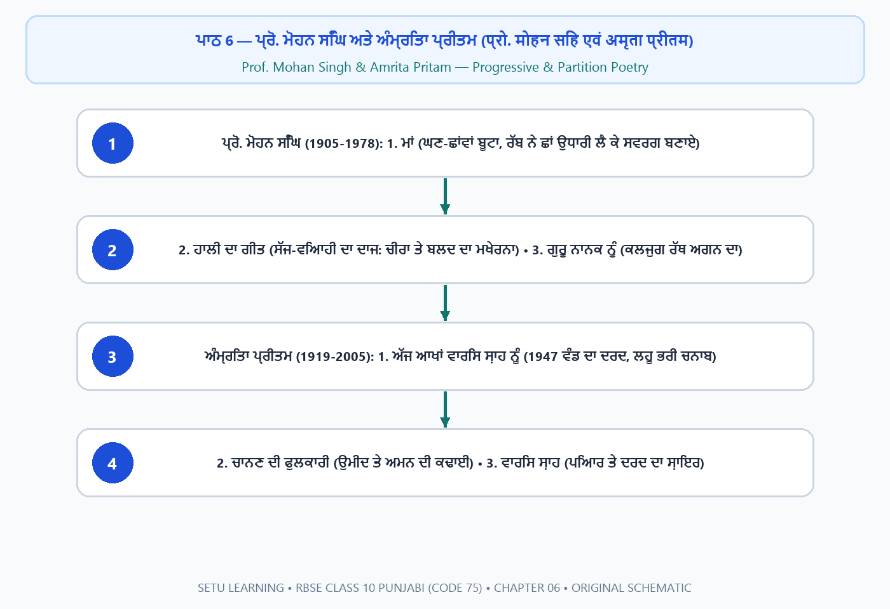

## 13. ਮੁੱਖ ਅਧਿਆਪਕ ਨੂੰ ਫ਼ੀਸ ਮੁਆਫ਼ੀ ਪੱਤਰ ਅਤੇ ਸ਼ਹੀਦ ਭਗਤ ਸਿੰਘ / ਪ੍ਰਦੂਸ਼ਣ ਲੇਖ।

**ਸਰੋਤ:** 2026 ਮੁੱਖ, ਪ੍ਰਸ਼ਨ 19-20, PDF ਪੰਨਾ 7 · **ਅੰਕ:** 8 ਅੰਕ

**ਪਾਠ-ਸੰਬੰਧ:** ਪਾਠ 22 — ਨਿਬੰਧ ਰਚਨਾ (ਲੇਖ) ਅਤੇ ਪ੍ਰਾਰਥਨਾ-ਪੱਤਰ / ਚਿੱਠੀ-ਪੱਤਰ (निबंध रचना एवं प्रार्थना-पत्र / पत्र-लेखन — 8 अंक)

**ਹੱਲ:** ਰਚਨਾ ਭਾਗ (ਖੰਡ-ਸ, ਪ੍ਰਸ਼ਨ 19 ਤੇ 20 — 4 + 4 = 8 ਅੰਕ): (1) ਪੱਤਰ-ਰਚਨਾ (4 ਅੰਕ): ਸਕੂਲ ਦੇ ਮੁੱਖ ਅਧਿਆਪਕ ਨੂੰ ਫ਼ੀਸ/ਜੁਰਮਾਨਾ ਮੁਆਫ਼ੀ, ਭੈਣ ਦੇ ਵਿਆਹ/ਬਿਮਾਰੀ ਦੀ ਛੁੱਟੀ ਜਾਂ ਸਰਟੀਫਿਕੇਟ (T.C.) ਲੈਣ ਲਈ ਬਿਨੈ-ਪੱਤਰ ('ਸੇਵਾ ਵਿਖੇ, ਮੁੱਖ ਅਧਿਆਪਕ ਜੀ...', 'ਵਿਸ਼ਾ', 'ਸ੍ਰੀਮਾਨ ਜੀ', 'ਆਪ ਜੀ ਦਾ ਆਗਿਆਕਾਰੀ ਵਿਦਿਆਰਥੀ'); ਜਾਂ ਚਾਚਾ ਜੀ ਨੂੰ ਜਨਮ-ਦਿਨ ਦੇ ਤੋਹਫ਼ੇ (ਘੜੀ) ਲਈ ਧੰਨਵਾਦ ਪੱਤਰ / ਮਿੱਤਰ ਨੂੰ ਪਾਸ ਹੋਣ 'ਤੇ ਵਧਾਈ ਪੱਤਰ। (2) ਨਿਬੰਧ/ਲੇਖ ਰਚਨਾ (4 ਅੰਕ, ਲਗਭਗ 150 ਸ਼ਬਦ): ਸ੍ਰੀ ਗੁਰੂ ਨਾਨਕ ਦੇਵ ਜੀ, ਸ਼ਹੀਦ ਭਗਤ ਸਿੰਘ, ਦੀਵਾਲੀ, ਵਿਸਾਖੀ, ਪ੍ਰਦੂਸ਼ਣ ਦੀ ਸਮੱਸਿਆ, ਅਖ਼ਬਾਰਾਂ/ਮੋਬਾਈਲ ਦੇ ਲਾਭ-ਹਾਨੀਆਂ ਅਤੇ ਦਾਜ ਦੀ ਲਾਹਨਤ।

[ਮੂਲ ਪ੍ਰਸ਼ਨ ਵੇਖੋ](https://rajeduboard.rajasthan.gov.in/books/PAPERS-2026/Sec/S-75.pdf#page=7)

## 2026 — ਪੂਰਕ ਪ੍ਰੀਖਿਆ

[2026 ਪੂਰਕ: ਪੂਰਾ ਅਧਿਕਾਰਤ ਪ੍ਰਸ਼ਨ-ਪੱਤਰ (S-75)](https://rajeduboard.rajasthan.gov.in/books/PAPERS-2026/SecSUP/S-75.pdf)

## 14. ਸ੍ਰੀ ਗੁਰੂ ਨਾਨਕ ਦੇਵ ਜੀ ਨੇ ਪਾਣੀ ਨੂੰ ਕੀ ਕਿਹਾ ਹੈ (ਪਿਤਾ)।

**ਸਰੋਤ:** 2026 ਪੂਰਕ, ਪ੍ਰਸ਼ਨ 1(I), PDF ਪੰਨਾ 2 · **ਅੰਕ:** 1 ਅੰਕ

**ਪਾਠ-ਸੰਬੰਧ:** ਪਾਠ 1 — ਸ਼ੇਖ਼ ਫ਼ਰੀਦ ਅਤੇ ਸ੍ਰੀ ਗੁਰੂ ਨਾਨਕ ਦੇਵ ਜੀ (शेख़ फ़रीद एवं श्री गुरु नानक देव जी)

**ਹੱਲ:** ਸ੍ਰੀ ਗੁਰੂ ਨਾਨਕ ਦੇਵ ਜੀ (ਜਨਮ 1469 ਈ., ਤਲਵੰਡੀ; 974 ਸ਼ਬਦ) ਨੇ 'ਪਵਣੁ ਗੁਰੂ ਪਾਣੀ ਪਿਤਾ ਮਾਤਾ ਧਰਤਿ ਮਹਤੁ' ਵਿੱਚ ਹਵਾ ਨੂੰ ਗੁਰੂ, ਪਾਣੀ ਨੂੰ ਪਿਤਾ, ਧਰਤੀ ਨੂੰ ਮਹਾਨ ਮਾਤਾ ਅਤੇ ਦਿਨ-ਰਾਤ ਨੂੰ ਖਿਡਾਵਾ-ਖਿਡਾਵੀ ਕਿਹਾ ਹੈ। 'ਗਗਨ ਮੈ ਥਾਲੁ ਰਵਿ ਚੰਦੁ ਦੀਪਕ ਬਣੇ' ਵਿੱਚ ਬ੍ਰਹਿਮੰਡ ਦੀ ਕੁਦਰਤੀ ਆਰਤੀ ਅਤੇ 'ਸੋ ਕਿਉ ਮੰਦਾ ਆਖੀਐ ਜਿਤੁ ਜੰਮਹਿ ਰਾਜਾਨ' ਵਿੱਚ ਇਸਤਰੀ ਜਾਤੀ ਦੀ ਮਹਾਨਤਾ ਦੱਸੀ ਹੈ।

[ਮੂਲ ਪ੍ਰਸ਼ਨ ਵੇਖੋ](https://rajeduboard.rajasthan.gov.in/books/PAPERS-2026/SecSUP/S-75.pdf#page=2)

## 15. ਮਿਲਖਾ ਸਿੰਘ ਨੇ 400 ਮੀਟਰ ਦੌੜ ਕਿੰਨੇ ਸਮੇਂ ਵਿੱਚ ਪੂਰੀ ਕੀਤੀ (45.6 ਸੈਕਿੰਡ)।

**ਸਰੋਤ:** 2026 ਪੂਰਕ, ਪ੍ਰਸ਼ਨ 1(V), PDF ਪੰਨਾ 2 · **ਅੰਕ:** 1 ਅੰਕ

**ਪਾਠ-ਸੰਬੰਧ:** ਪਾਠ 10 — ਫ਼ਲਾਇੰਗ ਸਿੱਖ — ਮਿਲਖਾ ਸਿੰਘ — ਪ੍ਰਿੰ. ਸਰਵਣ ਸਿੰਘ (निबंध 3: फ़्लाइंग सिख — मिल्खा सिंह)

**ਹੱਲ:** ਪ੍ਰਿੰ. ਸਰਵਣ ਸਿੰਘ ਦੇ ਨਿਬੰਧ 'ਫ਼ਲਾਇੰਗ ਸਿੱਖ — ਮਿਲਖਾ ਸਿੰਘ' ਅਨੁਸਾਰ ਮਿਲਖਾ ਸਿੰਘ ਦਾ ਜਨਮ ਗੋਬਿੰਦਪੁਰਾ (ਜ਼ਿਲ੍ਹਾ ਮੁਜ਼ੱਫ਼ਰਗੜ੍ਹ) ਵਿਖੇ ਹੋਇਆ। ਫ਼ੌਜ ਵਿੱਚ ਉਸਤਾਦ ਗੁਰਦੇਵ ਸਿੰਘ ਨੇ ਉਸ ਨੂੰ ਤਰਾਸ਼ਿਆ। ਉਸ ਨੇ 1958 ਟੋਕੀਓ ਏਸ਼ੀਆਈ ਖੇਡਾਂ (200 ਮੀ. ਤੇ 400 ਮੀ.) ਅਤੇ 1958 ਕਾਰਡਿਫ਼ ਕਾਮਨਵੈਲਥ ਖੇਡਾਂ (440 ਗਜ਼) ਵਿੱਚ ਸੋਨ ਤਮਗ਼ੇ ਜਿੱਤੇ, 1960 ਲਾਹੌਰ ਵਿੱਚ ਅਬਦੁਲ ਖ਼ਾਲਿਕ ਨੂੰ ਹਰਾ ਕੇ ਜਨਰਲ ਅਯੂਬ ਖ਼ਾਨ ਤੋਂ 'ਫ਼ਲਾਇੰਗ ਸਿੱਖ' ਖਿਤਾਬ ਪਾਇਆ ਅਤੇ 1960 ਰੋਮ ਓਲੰਪਿਕ (400 ਮੀ.) ਵਿੱਚ 45.6 ਸੈਕਿੰਡ ਨਾਲ ਚੌਥਾ ਸਥਾਨ ਪ੍ਰਾਪਤ ਕੀਤਾ।

[ਮੂਲ ਪ੍ਰਸ਼ਨ ਵੇਖੋ](https://rajeduboard.rajasthan.gov.in/books/PAPERS-2026/SecSUP/S-75.pdf#page=2)

ਚਿੱਤਰ ਸਹਾਇਤਾ: ਇਸੇ ਪਾਠ ਵਿੱਚ ਇਸ ਸੰਕਲਪ ਦਾ ਪਹਿਲਾਂ ਦਿੱਤਾ ਗਿਆ ਨਾਮਾਂਕਿਤ schematic ਵੇਖੋ।

## 16. ਰਾਵ ਜੋਧਾ ਜੀ ਨੇ ਕਿਹੜੇ ਕਿਲ੍ਹੇ ਦਾ ਨਿਰਮਾਣ ਕਰਵਾਇਆ (ਮਹਿਰਾਨਗੜ੍ਹ)।

**ਸਰੋਤ:** 2026 ਪੂਰਕ, ਪ੍ਰਸ਼ਨ 1(VII), PDF ਪੰਨਾ 2 · **ਅੰਕ:** 1 ਅੰਕ

**ਪਾਠ-ਸੰਬੰਧ:** ਪਾਠ 12 — ਰਾਜਸਥਾਨ ਦੇ ਪ੍ਰਸਿੱਧ ਕਿਲ੍ਹੇ — ਬਲਜਿੰਦਰ ਸਿੰਘ ਭੁੱਲਰ (निबंध 5: राजस्थान दे प्रसिद्ध किले)

**ਹੱਲ:** ਬਲਜਿੰਦਰ ਸਿੰਘ ਭੁੱਲਰ ਦੇ ਨਿਬੰਧ 'ਰਾਜਸਥਾਨ ਦੇ ਪ੍ਰਸਿੱਧ ਕਿਲ੍ਹੇ' ਵਿੱਚ 10 ਕਿਲ੍ਹਿਆਂ ਦਾ ਵਰਣਨ ਹੈ: (1) ਚਿਤੌੜਗੜ੍ਹ (ਚਿਤਰਾਗਦ ਮੌਰਿਆ, 3 ਸਾਕੇ), (2) ਜੈਸਲਮੇਰ (ਰਾਵ ਜੈਸਲ 1155 ਈ., ਭਾਟੀ ਰਾਜਪੂਤ, ਪੀਲੇ ਪੱਥਰਾਂ ਵਾਲਾ 'ਸੁਨਾਰ ਕਿਲ੍ਹਾ'), (3) ਆਮੇਰ (ਕਛਵਾਹਾ, ਸ਼ਿਲਾ ਦੇਵੀ ਮੰਦਰ), (4) ਗਾਗਰੌਣ (ਕਾਲੀ ਸਿੰਧ ਤੇ ਆਹੂ ਨਦੀਆਂ ਦੇ ਸੰਗਮ 'ਤੇ ਜਲ-ਦੁਰਗ, ਗਾਗਰੌਣੀ ਤੋਤੇ), (5) ਜੂਨਾਗੜ੍ਹ ਬੀਕਾਨੇਰ (ਰਾਜਾ ਰਾਏ ਸਿੰਘ, 33 ਕਰੋੜ ਦੇਵੀ-ਦੇਵਤਿਆਂ ਦਾ ਮੰਦਰ), (6) ਰਣਥੰਭੋਰ ('ਰਣ' ਤੇ 'ਥੰਭ' ਪਹਾੜੀਆਂ, ਹਮੀਰ ਦੇਵ ਚੌਹਾਨ), (7) ਕੁੰਭਲਗੜ੍ਹ (ਮਹਾਰਾਣਾ ਕੁੰਭਾ), (8) ਤਾਰਾਗੜ੍ਹ ਬੂੰਦੀ (ਰਾਵ ਨਰ ਸਿੰਘ 1354 ਈ., ਮੀਨਾਕਾਰੀ ਤੇ ਭਿੱਤੀ ਚਿੱਤਰ), (9) ਨਾਹਰਗੜ੍ਹ ਜੈਪੁਰ (ਸਵਾਈ ਜੈ ਸਿੰਘ), (10) ਮਹਿਰਾਨਗੜ੍ਹ ਜੋਧਪੁਰ (ਰਾਵ ਜੋਧਾ, ਚਿੜੀਆ ਟੂੰਕ ਪਹਾੜੀ)।

[ਮੂਲ ਪ੍ਰਸ਼ਨ ਵੇਖੋ](https://rajeduboard.rajasthan.gov.in/books/PAPERS-2026/SecSUP/S-75.pdf#page=2)

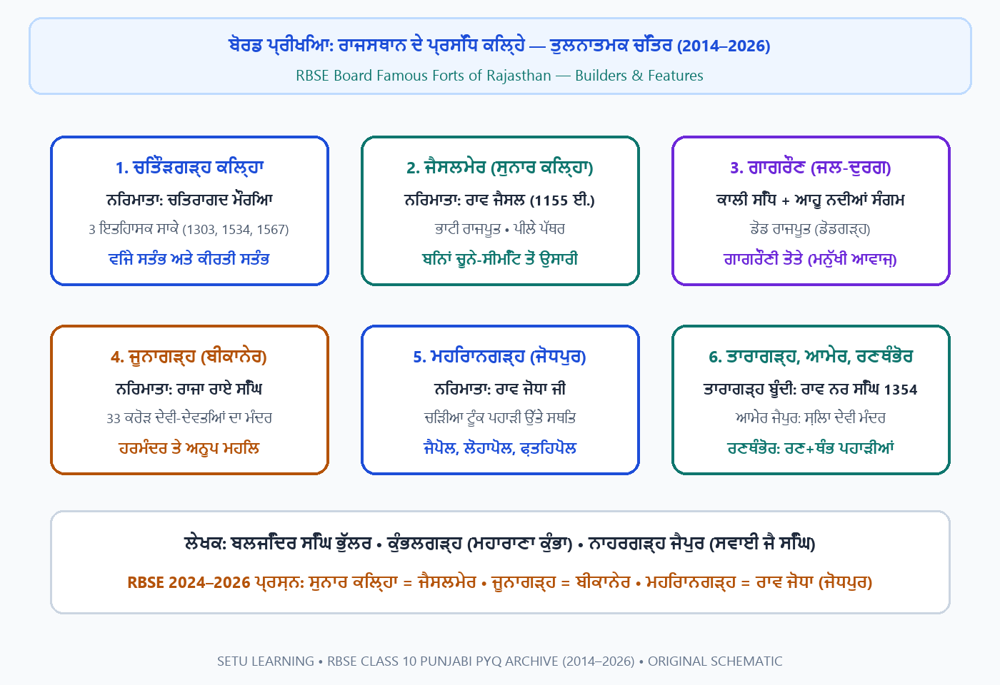

## 17. ਗੁਰਬਚਨ ਸਿੰਘ ਭੁੱਲਰ ਦਾ ਜਨਮ ਕਦੋਂ ਹੋਇਆ (1937 ਈ.)।

**ਸਰੋਤ:** 2026 ਪੂਰਕ, ਪ੍ਰਸ਼ਨ 1(VIII), PDF ਪੰਨਾ 2 · **ਅੰਕ:** 1 ਅੰਕ

**ਪਾਠ-ਸੰਬੰਧ:** ਪਾਠ 18 — ਖ਼ੂਨ — ਗੁਰਬਚਨ ਸਿੰਘ ਭੁੱਲਰ (कहानी 5: ख़ून — गुरबचन सिंह भुल्लर)

**ਹੱਲ:** ਗੁਰਬਚਨ ਸਿੰਘ ਭੁੱਲਰ (ਜਨਮ 1937 ਈ., ਪਿੰਡ ਪਿੱਥੋ, ਬਠਿੰਡਾ; ਸਾਹਿਤ ਅਕਾਦਮੀ: 'ਅਗਨੀ ਕਲਸ਼') ਦੀ ਕਹਾਣੀ 'ਖ਼ੂਨ' ਵਿੱਚ ਕਰਤਾਰਾ ਵਿਹੜੇ ਦੀ ਟਾਹਲੀ ਦਾ ਡਾਹਣਾ ਤਲਵਾਰ ਨਾਲ ਵੱਢ ਕੇ ਪਰਖਦਾ ਹੈ। ਗਹਿਣੇ ਵਾਲੀ ਜ਼ਮੀਨ ਪਿੱਛੇ ਕੈਲੇ ਤੇ ਦੀਪੇ ਨੇ ਜੱਗਰ ਦਾ ਕਤਲ ਕਰ ਦਿੱਤਾ ਸੀ। ਮੁਰੱਬਾਬੰਦੀ ਵੇਲੇ ਜੱਗਰ ਦੀ 15 ਘੁਮਾਂ ਜ਼ਮੀਨ ਹੜੱਪਣ ਲਈ ਕਰਤਾਰਾ ਜੱਗਰ ਦੀ ਵਿਧਵਾ ਕੁਲਵੰਤੋ ਦੇ ਪੇਕੇ ਪਿੰਡ 'ਸੌਣਪੁਰਾ' (ਪਿਤਾ ਸੁੱਚਾ ਸਿੰਘ) ਵਿਖੇ ਆਪਣੇ ਭਤੀਜੇ ਨੂੰ ਵੱਢਣ ਜਾਂਦਾ ਹੈ। ਖੂਹ ਉੱਤੇ ਜਦੋਂ ਭਤੀਜਾ ਮਾਣ ਨਾਲ ਕਹਿੰਦਾ ਹੈ — 'ਮੈਨੂੰ ਕੌਣ ਹੱਥ ਲਾਊ। ਮਾਲਵੇ ਵਿੱਚ ਮੇਰਾ ਸ਼ੇਰ ਵਰਗਾ ਚਾਚਾ ਐ, ਕਰਤਾਰਾ। ਡੱਕਰੇ ਕਰ ਦੇਊ!' ਤਾਂ ਕਰਤਾਰੇ ਦਾ ਖ਼ੂਨ ਪੰਘਰ ਜਾਂਦਾ ਹੈ ਅਤੇ ਉਹ ਤਲਵਾਰ ਖੂਹ ਦੀ ਮਣ 'ਤੇ ਛੱਡ ਕੇ ਭਤੀਜੇ ਨੂੰ ਗਲ ਨਾਲ ਲਾ ਲੈਂਦਾ ਹੈ।

[ਮੂਲ ਪ੍ਰਸ਼ਨ ਵੇਖੋ](https://rajeduboard.rajasthan.gov.in/books/PAPERS-2026/SecSUP/S-75.pdf#page=2)

## 18. ਪੰਜਾਬੀ ਭਾਸ਼ਾ ਨੂੰ ਲਿਖਣ ਵਾਲੀ ਲਿਪੀ (ਗੁਰਮੁਖੀ ਲਿਪੀ)।

**ਸਰੋਤ:** 2026 ਪੂਰਕ, ਪ੍ਰਸ਼ਨ 1(IX), PDF ਪੰਨਾ 2 · **ਅੰਕ:** 1 ਅੰਕ

**ਪਾਠ-ਸੰਬੰਧ:** ਪਾਠ 19 — ਵਿਆਕਰਣ 1: ਭਾਸ਼ਾ, ਪੰਜਾਬੀ ਦੀਆਂ ਉਪ-ਭਾਸ਼ਾਵਾਂ, ਧੁਨੀ-ਬੋਧ ਅਤੇ ਲਿਪੀ-ਬੋਧ (व्याकरण 1: भाषा, उप-भाषाएँ, ध्वनि-बोध एवं लिपि-बोध — 6 अंक)

**ਹੱਲ:** ਵਿਆਕਰਣ ਭਾਗ 1 (6 ਅੰਕ): (1) ਭਾਸ਼ਾ: ਮਨ ਦੇ ਭਾਵਾਂ ਨੂੰ ਪ੍ਰਗਟ ਕਰਨ ਦਾ ਸਾਧਨ (ਮੌਖਿਕ ਅਤੇ ਲਿਖਤੀ)। (2) ਪੰਜਾਬੀ ਦੀਆਂ ਉਪ-ਭਾਸ਼ਾਵਾਂ: ਮਾਝੀ (ਟਕਸਾਲੀ ਆਧਾਰ — ਅੰਮ੍ਰਿਤਸਰ, ਤਰਨਤਾਰਨ, ਗੁਰਦਾਸਪੁਰ, ਪਠਾਨਕੋਟ), ਮਲਵਈ (ਬਠਿੰਡਾ, ਲੁਧਿਆਣਾ, ਪਟਿਆਲਾ, ਫ਼ਿਰੋਜ਼ਪੁਰ, ਸ੍ਰੀ ਗੰਗਾਨਗਰ), ਦੁਆਬੀ (ਜਲੰਧਰ, ਹੁਸ਼ਿਆਰਪੁਰ, ਕਪੂਰਥਲਾ, ਨਵਾਂ ਸ਼ਹਿਰ), ਪੁਆਧੀ (ਰੋਪੜ, ਮੁਹਾਲੀ, ਰਾਜਪੁਰਾ)। (3) ਧੁਨੀ-ਬੋਧ: ਮੂਲ ਸਵਰ ਅੱਖਰ 3 (ੳ, ਅ, ੲ) ਤੇ ਸਵਰ ਧੁਨੀਆਂ 10 (3 ਲਘੂ + 7 ਦੀਰਘ); ਅਨੁਨਾਸਕੀ ਵਿਅੰਜਨ 5 (ਙ, ਞ, ਣ, ਨ, ਮ); ਦੁੱਤ ਅੱਖਰ 3 (ਹ, ਰ, ਵ)। (4) ਗੁਰਮੁਖੀ ਲਿਪੀ: ਪੰਜਾਬੀ ਦੀ ਮਿਆਰੀ ਲਿਪੀ ਜਿਸ ਵਿੱਚ 8 ਵਰਗਾਂ ਦੇ 41 ਅੱਖਰ (35 ਪੈਂਤੀ + 6 ਨਵੀਨ ਟੋਲੀ: ਸ਼, ਖ਼, ਗ਼, ਜ਼, ਫ਼, ਲ਼), 10 ਲਗਾਂ (ੳ=3, ਅ=4, ੲ=3) ਅਤੇ 3 ਲਗਾਖਰ (ਬਿੰਦੀ, ਟਿੱਪੀ, ਅੱਧਕ) ਹਨ।

[ਮੂਲ ਪ੍ਰਸ਼ਨ ਵੇਖੋ](https://rajeduboard.rajasthan.gov.in/books/PAPERS-2026/SecSUP/S-75.pdf#page=2)

ਚਿੱਤਰ ਸਹਾਇਤਾ: ਇਸੇ ਪਾਠ ਵਿੱਚ ਇਸ ਸੰਕਲਪ ਦਾ ਪਹਿਲਾਂ ਦਿੱਤਾ ਗਿਆ ਨਾਮਾਂਕਿਤ schematic ਵੇਖੋ।

## 19. 'ਮਿਤ੍ਰ ਪਿਆਰੇ ਨੂੰ ਹਾਲ ਮੁਰੀਦਾਂ ਦਾ ਕਹਿਣਾ' ਖਾਲੀ ਥਾਂ।

**ਸਰੋਤ:** 2026 ਪੂਰਕ, ਪ੍ਰਸ਼ਨ 2(II), PDF ਪੰਨਾ 4 · **ਅੰਕ:** 1 ਅੰਕ

**ਪਾਠ-ਸੰਬੰਧ:** ਪਾਠ 3 — ਭਾਈ ਗੁਰਦਾਸ ਜੀ ਦੀਆਂ ਵਾਰਾਂ (भाई गुरदास जी की वारें)

**ਹੱਲ:** ਪੰਜਵੇਂ ਗੁਰੂ ਸ੍ਰੀ ਅਰਜਨ ਦੇਵ ਜੀ (ਜਨਮ 1563 ਈ., ਗੋਇੰਦਵਾਲ; 2218 ਸ਼ਬਦ, ਸੁਖਮਨੀ ਸਾਹਿਬ) ਨੇ 'ਮੇਰਾ ਮਨੁ ਲੋਚੈ ਗੁਰ ਦਰਸਨ ਤਾਈ' (ਸ਼ਬਦ ਹਜ਼ਾਰੇ) ਵਿੱਚ ਚਾਤ੍ਰਿਕ ਵਾਂਗ ਗੁਰੂ-ਦਰਸ਼ਨ ਦੀ ਤਾਂਘ ਅਤੇ 'ਤੂੰ ਮੇਰਾ ਪਿਤਾ ਤੂੰਹੈ ਮੇਰਾ ਮਾਤਾ' ਵਿੱਚ ਪ੍ਰਭੂ ਨੂੰ ਸਰਬ-ਰੱਖਿਅਕ ਦੱਸਿਆ ਹੈ। ਦਸਵੇਂ ਗੁਰੂ ਸ੍ਰੀ ਗੋਬਿੰਦ ਸਿੰਘ ਜੀ (ਜਨਮ 1666 ਈ., ਪਟਨਾ ਸਾਹਿਬ) ਨੇ 'ਦੇਹਿ ਸਿਵਾ ਬਰੁ ਮੋਹਿ ਇਹੈ' ਵਿੱਚ ਸ਼ੁਭ ਕਰਮਨ ਤੋਂ ਕਦੇ ਨਾ ਡਰਨ ਅਤੇ 'ਮਿਤ੍ਰ ਪਿਆਰੇ ਨੂੰ ਹਾਲ ਮੁਰੀਦਾਂ ਦਾ ਕਹਿਣਾ' ਵਿੱਚ ਮਾਛੀਵਾੜੇ ਦੇ ਜੰਗਲ ਵਿੱਚ ਰੱਬੀ ਰਜ਼ਾ ਦੀ ਸਿਖਰ ਪੇਸ਼ ਕੀਤੀ ਹੈ।

[ਮੂਲ ਪ੍ਰਸ਼ਨ ਵੇਖੋ](https://rajeduboard.rajasthan.gov.in/books/PAPERS-2026/SecSUP/S-75.pdf#page=4)

## 20. ਸ਼ਿਵ ਕੁਮਾਰ ਬਟਾਲਵੀ ਭੱਠੀ ਵਾਲੀ ਨੂੰ ਕੀ ਭੁੰਨਣ ਲਈ ਕਹਿੰਦਾ ਹੈ (ਪੀੜਾਂ ਦਾ ਪਰਾਗਾ)।

**ਸਰੋਤ:** 2026 ਪੂਰਕ, ਪ੍ਰਸ਼ਨ 3(V), PDF ਪੰਨਾ 4 · **ਅੰਕ:** 1 ਅੰਕ

**ਪਾਠ-ਸੰਬੰਧ:** ਪਾਠ 7 — ਸ਼ਿਵ ਕੁਮਾਰ ਬਟਾਲਵੀ ਅਤੇ ਸੁਰਜੀਤ ਪਾਤਰ (शिव कुमार बटालवी एवं सुरजीत पातर)

**ਹੱਲ:** ਬਿਰਹਾ ਦੇ ਸੁਲਤਾਨ ਸ਼ਿਵ ਕੁਮਾਰ ਬਟਾਲਵੀ (1936–1973; ਸਾਹਿਤ ਅਕਾਦਮੀ: 'ਲੂਣਾ') ਨੇ 'ਰੁੱਖ' (ਪੁੱਤ, ਮਾਵਾਂ, ਨੂੰਹਾਂ-ਧੀਆਂ, ਭਰਾ, ਬਾਬਾ, ਦਾਦੀ, ਯਾਰ, ਮਹਿਬੂਬਾ) ਅਤੇ 'ਪੀੜਾਂ ਦਾ ਪਰਾਗਾ / ਤੈਨੂੰ ਦਿਆਂ ਹੰਝੂਆਂ ਦਾ ਭਾੜਾ' (ਭੱਠੀ ਵਾਲੀ = ਜ਼ਿੰਦਗੀ/ਕਿਸਮਤ) ਲਿਖੀਆਂ। ਸੁਰਜੀਤ ਪਾਤਰ (1945–2024; ਸਾਹਿਤ ਅਕਾਦਮੀ: 'ਹਨੇਰੇ ਵਿੱਚ ਸੁਲਗਦੀ ਵਰਣਮਾਲਾ') ਨੇ 'ਕੁਛ ਕਿਹਾ ਤਾਂ ਹਨੇਰਾ ਜਰੇਗਾ ਕਿਵੇਂ' (ਗ਼ਜ਼ਲ), 'ਤਮਗ਼ੇ' ('ਧੀਆਂ ਦੇ ਵਸੇਬੇ ਲਈ ਬਾਪੂ ਦੇਸ ਛੱਡਿਆ, ਡੂੰਘਾ ਮੇਰੀ ਹਿੱਕ 'ਚ ਤਿਰੰਗਾ ਗਿਆ ਗੱਡਿਆ') ਅਤੇ 'ਸੁੰਨੇ-ਸੁੰਨੇ ਰਾਹਾਂ ਵਿੱਚ' ਰਚੀਆਂ।

[ਮੂਲ ਪ੍ਰਸ਼ਨ ਵੇਖੋ](https://rajeduboard.rajasthan.gov.in/books/PAPERS-2026/SecSUP/S-75.pdf#page=4)

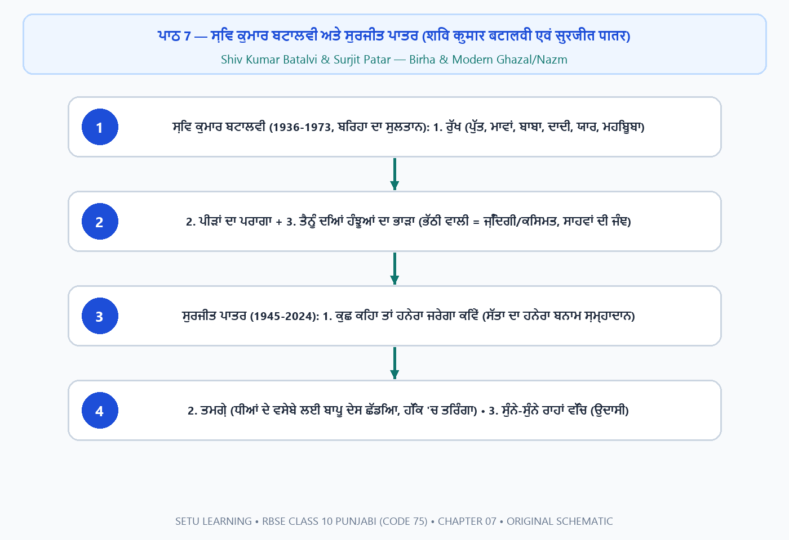

## 21. 'ਪੇਮੀ ਦੇ ਨਿਆਣੇ' ਵਿੱਚ ਕਿਸ ਨੂੰ ਭੈ-ਸਾਗਰ ਕਿਹਾ ਗਿਆ ਹੈ (ਜਰਨੈਲੀ ਸੜਕ ਨੂੰ)।

**ਸਰੋਤ:** 2026 ਪੂਰਕ, ਪ੍ਰਸ਼ਨ 3(VIII), PDF ਪੰਨਾ 4 · **ਅੰਕ:** 1 ਅੰਕ

**ਪਾਠ-ਸੰਬੰਧ:** ਪਾਠ 15 — ਪੇਮੀ ਦੇ ਨਿਆਣੇ — ਸੰਤ ਸਿੰਘ ਸੇਖੋਂ (कहानी 2: पेमी दे नियाणे)

**ਹੱਲ:** ਸੰਤ ਸਿੰਘ ਸੇਖੋਂ (1908–1997; ਸਾਹਿਤ ਅਕਾਦਮੀ: 'ਮਿੱਤਰ ਪਿਆਰਾ') ਦੀ ਬਾਲ-ਮਨੋਵਿਗਿਆਨਕ ਕਹਾਣੀ 'ਪੇਮੀ ਦੇ ਨਿਆਣੇ' ਵਿੱਚ 7 ਸਾਲ ਦੀ ਵੱਡੀ ਭੈਣ (ਬੀਬੀ) ਅਤੇ 5 ਸਾਲ ਦਾ ਛੋਟਾ ਭਰਾ (ਲੇਖਕ) ਦੁਪਹਿਰ ਵੇਲੇ ਆਪਣੇ ਬਾਪੂ ਲਈ ਖੇਤ ਰੋਟੀ ਲੈ ਕੇ ਜਾਂਦੇ ਹਨ। ਪਿੰਡ ਅਤੇ ਖੇਤ ਦੇ ਵਿਚਕਾਰਲੀ 'ਜਰਨੈਲੀ ਸੜਕ' ਉਹਨਾਂ ਨੂੰ 'ਭੈ-ਸਾਗਰ' (ਡਰ ਦਾ ਸਮੁੰਦਰ) ਲੱਗਦੀ ਹੈ। ਸੜਕ ਉੱਤੇ ਤੁਰੇ ਜਾਂਦੇ ਇੱਕ ਰਾਸ਼ੇ (ਪਠਾਣ) ਤੋਂ ਡਰ ਕੇ ਬੱਚੇ ਪਹਿਲਾਂ ਵਾਹਿਗੁਰੂ/ਗੁਰੂ ਨਾਨਕ ਦਾ ਨਾਂ ਲੈਂਦੇ ਹਨ, ਮਾਂ ਵੱਲੋਂ ਸੁਣਾਈਆਂ ਕਹਾਣੀਆਂ ਤੇ ਮਾਮੇ ਦੀ ਦਲੇਰੀ ਯਾਦ ਕਰਦੇ ਹਨ, ਅਤੇ ਅੰਤ ਵਿੱਚ 'ਅਸੀਂ ਪੇਮੀ ਦੇ ਨਿਆਣੇ ਆਂ' (ਮਾਂ ਦੇ ਨਾਂ ਦੀ ਓਟ) ਦਾ ਵਿਸ਼ਵਾਸ ਧਾਰ ਕੇ ਸੜਕ ਪਾਰ ਕਰ ਲੈਂਦੇ ਹਨ।

[ਮੂਲ ਪ੍ਰਸ਼ਨ ਵੇਖੋ](https://rajeduboard.rajasthan.gov.in/books/PAPERS-2026/SecSUP/S-75.pdf#page=4)

## 22. 'ਸਾਂਝੀ ਕੰਧ' ਵਿੱਚ ਪਟਵਾਰੀ, ਸਰਪੰਚ ਤੇ ਲੰਬੜਦਾਰ ਦੇ ਨਾਂ (ਰਾਮ ਰਤਨ, ਧੰਮਾ ਸਿੰਘ, ਟੁੰਡਾ)।

**ਸਰੋਤ:** 2026 ਪੂਰਕ, ਪ੍ਰਸ਼ਨ 3(IX), PDF ਪੰਨਾ 4 · **ਅੰਕ:** 1 ਅੰਕ

**ਪਾਠ-ਸੰਬੰਧ:** ਪਾਠ 16 — ਸਾਂਝੀ ਕੰਧ — ਸੰਤੋਖ ਸਿੰਘ ਧੀਰ (कहानी 3: सांझी कंध — संतोख सिंह धीर)

**ਹੱਲ:** ਸੰਤੋਖ ਸਿੰਘ ਧੀਰ (1920–2010; ਸਾਹਿਤ ਅਕਾਦਮੀ: 'ਪੱਖੀ') ਦੀ ਕਹਾਣੀ 'ਸਾਂਝੀ ਕੰਧ' ਵਿੱਚ ਕਪੂਰ ਸਿੰਘ ਵਿਸਾਖ ਦੇ ਮਹੀਨੇ ਆਪਣੀ 10 ਵਿੱਘੇ ਪੈਲੀ ਗਹਿਣੇ ਪਾ ਕੇ ਢੱਠਾ ਮਕਾਨ ਬਣਾਉਂਦਾ ਹੈ। ਚਾਚੇ ਦੇ ਪੁੱਤਰ ਦਰਬਾਰਾ ਸਿੰਘ ਨਾਲ 40 ਫੁੱਟ ਲੰਮੀ ਤੇ 14 ਫੁੱਟ ਉੱਚੀ ਸਾਂਝੀ ਕੰਧ ਦੇ ਖ਼ਰਚੇ ਪਿੱਛੇ ਝਗੜਾ ਹੁੰਦਾ ਹੈ ਜਿਸ ਨੂੰ ਧੰਮਾ ਸਿੰਘ ਸਰਪੰਚ ਭੜਕਾਉਂਦਾ ਹੈ। ਪੰਚਾਇਤ ਵਿੱਚ ਰਾਮ ਰਤਨ ਪਟਵਾਰੀ, ਧੰਮਾ ਸਿੰਘ ਸਰਪੰਚ, ਟੁੰਡਾ ਲੰਬੜਦਾਰ ਅਤੇ ਨਾਹਰ ਸਿੰਘ ਅਕਾਲੀ ਸ਼ਾਮਲ ਸਨ। ਸਰਦੀਆਂ ਵਿੱਚ ਦਰਬਾਰੇ ਨੂੰ ਨਮੂਨੀਆ ਹੋਣ 'ਤੇ ਚਾਚੀ ਰਾਮ ਕੌਰ ਦੇ ਬੋਲ ('ਨੌਹਾਂ ਨਾਲੋਂ ਮਾਸ ਨ੍ਹੀਂ ਟੁੱਟਦਾ') ਸੁਣ ਕੇ ਕਪੂਰ ਸਿੰਘ ਉਸ ਦੇ ਘਰ ਜਾਂਦਾ ਹੈ, 'ਚੁਗਾਠ ਬਚ ਰਹੇ, ਬਾਣ ਬਥੇਰਾ' ਕਹਿ ਕੇ ਹੌਸਲਾ ਦਿੰਦਾ ਹੈ, 10 ਰੁਪਏ ਦਿੰਦਾ ਹੈ ਅਤੇ ਭਤੀਜੀ ਹਰਬੰਸੋ (ਬੰਸੋ) ਦੇ ਵਿਆਹ ਦੀ ਜ਼ਿੰਮੇਵਾਰੀ ਵੰਡਾਉਂਦਾ ਹੈ।

[ਮੂਲ ਪ੍ਰਸ਼ਨ ਵੇਖੋ](https://rajeduboard.rajasthan.gov.in/books/PAPERS-2026/SecSUP/S-75.pdf#page=4)

ਚਿੱਤਰ ਸਹਾਇਤਾ: ਇਸੇ ਪਾਠ ਵਿੱਚ ਇਸ ਸੰਕਲਪ ਦਾ ਪਹਿਲਾਂ ਦਿੱਤਾ ਗਿਆ ਨਾਮਾਂਕਿਤ schematic ਵੇਖੋ।

## 23. ਰੁੱਖਾਂ ਅਤੇ ਵਾਤਾਵਰਣ ਦੀ ਸੰਭਾਲ ਬਾਰੇ ਅਣਡਿੱਠਾ ਪੈਰ੍ਹਾ।

**ਸਰੋਤ:** 2026 ਪੂਰਕ, ਪ੍ਰਸ਼ਨ 4-8, PDF ਪੰਨਾ 5 · **ਅੰਕ:** 10 ਅੰਕ

**ਪਾਠ-ਸੰਬੰਧ:** ਪਾਠ 21 — ਅਣਡਿੱਠਾ ਪੈਰ੍ਹਾ (ਅਪਠਿਤ ਗਦਿਆਂਸ਼ ਬੋਧ) (अपठित गद्यांश बोध — 10 अंक)

**ਹੱਲ:** ਅਣਡਿੱਠਾ ਪੈਰ੍ਹਾ (ਖੰਡ-ਅ, ਪ੍ਰਸ਼ਨ 4 ਤੋਂ 8 — 5 × 2 = 10 ਅੰਕ): ਪੈਰ੍ਹੇ ਨੂੰ ਦੋ ਵਾਰ ਧਿਆਨ ਨਾਲ ਪੜ੍ਹ ਕੇ ਪਹਿਲੇ 4 ਪ੍ਰਸ਼ਨਾਂ ਦੇ ਉੱਤਰ ਪੈਰ੍ਹੇ ਦੇ ਤੱਥਾਂ ਦੇ ਆਧਾਰ 'ਤੇ ਆਪਣੀ ਸਰਲ ਭਾਸ਼ਾ ਵਿੱਚ 1–2 ਵਾਕਾਂ ਵਿੱਚ ਲਿਖੋ। 5ਵੇਂ ਪ੍ਰਸ਼ਨ (Q8 — ਢੁਕਵਾਂ ਸਿਰਲੇਖ) ਵਿੱਚ ਪੈਰ੍ਹੇ ਦੀ ਪਹਿਲੀ ਜਾਂ ਆਖ਼ਰੀ ਸਤਰ ਦੇ ਕੇਂਦਰੀ ਵਿਸ਼ੇ ਤੋਂ 2 ਤੋਂ 4 ਸ਼ਬਦਾਂ ਦਾ ਸਿਰਲੇਖ ਚੁਣੋ (ਜਿਵੇਂ — 'ਸਮੇਂ ਦੀ ਕਦਰ', 'ਮਿਹਨਤ ਦੀ ਮਹੱਤਤਾ', 'ਪੁਸਤਕਾਂ ਦਾ ਮਹੱਤਵ', 'ਰੁੱਖਾਂ ਦੇ ਲਾਭ', 'ਅਨੁਸ਼ਾਸਨ', 'ਮਾਂ-ਬੋਲੀ ਦਾ ਮਹੱਤਵ')।

[ਮੂਲ ਪ੍ਰਸ਼ਨ ਵੇਖੋ](https://rajeduboard.rajasthan.gov.in/books/PAPERS-2026/SecSUP/S-75.pdf#page=5)

## 24. 'ਗੰਗਾ ਦੀਨ' ਜਾਂ 'ਰਾਜਸਥਾਨ ਦੇ ਪ੍ਰਸਿੱਧ ਕਿਲ੍ਹੇ' ਨਿਬੰਧ ਦਾ ਸਾਰ।

**ਸਰੋਤ:** 2026 ਪੂਰਕ, ਪ੍ਰਸ਼ਨ 16, PDF ਪੰਨਾ 6 · **ਅੰਕ:** 3 ਅੰਕ

**ਪਾਠ-ਸੰਬੰਧ:** ਪਾਠ 9 — ਗੰਗਾ ਦੀਨ — ਪ੍ਰਿੰ. ਤੇਜਾ ਸਿੰਘ (निबंध 2: गंगा दीन — प्रिं. तेजा सिंह)

**ਹੱਲ:** ਪ੍ਰਿੰ. ਤੇਜਾ ਸਿੰਘ (1894–1958; ਸਵੈ-ਜੀਵਨੀ 'ਆਰਸੀ') ਦੇ ਨਿਬੰਧ 'ਗੰਗਾ ਦੀਨ' ਵਿੱਚ ਬੂਟ (ਜੁੱਤੀਆਂ) ਬਣਾਉਣ ਵਾਲੇ ਇਮਾਨਦਾਰ ਕਾਰੀਗਰ ਗੰਗਾ ਦੀਨ ਅਤੇ ਉਸ ਦੇ ਵੱਡੇ ਭਰਾ ਦਾ ਚਿਤਰਣ ਹੈ। ਗੰਗਾ ਦੀਨ ਬੂਟ ਬਣਾਉਣ ਨੂੰ ਪਵਿੱਤਰ ਕਲਾ ਸਮਝਦਾ ਸੀ ਅਤੇ ਵਧੀਆ ਚਮੜੇ ਦੇ ਹੰਢਣਸਾਰ ਬੂਟ ਬਣਾਉਂਦਾ ਸੀ। ਵੱਡੀਆਂ ਕੰਪਨੀਆਂ ਦੀ ਝੂਠੀ ਇਸ਼ਤਿਹਾਰਬਾਜ਼ੀ ਅਤੇ ਦੁਕਾਨ ਦੇ ਭਾਰੀ ਕਿਰਾਏ ਕਾਰਨ ਉਸ ਦੀ ਮਾਲੀ ਹਾਲਤ ਵਿਗੜ ਗਈ ਅਤੇ ਅੰਤ ਉਹ ਭੁੱਖ-ਨੰਗ ਨਾਲ ਮਰ ਗਿਆ।

[ਮੂਲ ਪ੍ਰਸ਼ਨ ਵੇਖੋ](https://rajeduboard.rajasthan.gov.in/books/PAPERS-2026/SecSUP/S-75.pdf#page=6)

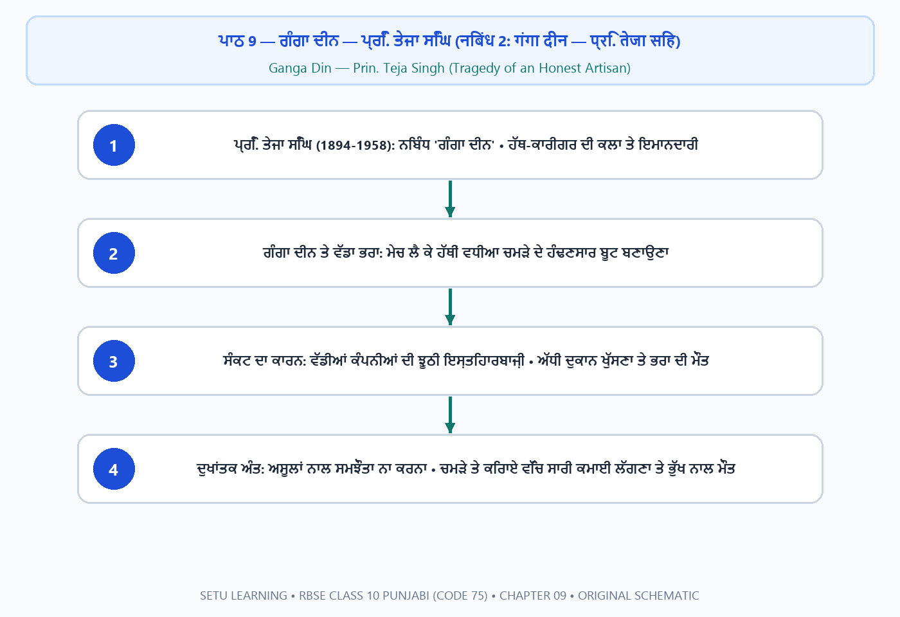

## 25. 'ਬਾਗ਼ੀ ਦੀ ਧੀ' ਜਾਂ 'ਦੁੱਧ ਦਾ ਛੱਪੜ' ਕਹਾਣੀ ਦਾ ਸਾਰ।

**ਸਰੋਤ:** 2026 ਪੂਰਕ, ਪ੍ਰਸ਼ਨ 17, PDF ਪੰਨਾ 6 · **ਅੰਕ:** 3 ਅੰਕ

**ਪਾਠ-ਸੰਬੰਧ:** ਪਾਠ 17 — ਦੁੱਧ ਦਾ ਛੱਪੜ — ਕੁਲਵੰਤ ਸਿੰਘ ਵਿਰਕ (कहानी 4: दुद्ध दा छप्पड़ — कुलवंत सिंह विरक)

**ਹੱਲ:** ਪੰਜਾਬੀ ਨਿੱਕੀ ਕਹਾਣੀ ਦੇ ਬਾਦਸ਼ਾਹ ਕੁਲਵੰਤ ਸਿੰਘ ਵਿਰਕ (ਜਨਮ 21 ਮਾਰਚ 1921, ਫੁਲੇਰਨ; ਸਾਹਿਤ ਅਕਾਦਮੀ: 'ਨਵੇਂ ਲੋਕ') ਦੀ ਕਹਾਣੀ 'ਦੁੱਧ ਦਾ ਛੱਪੜ' ਵਿੱਚ ਚਾਚੇ-ਤਾਏ ਦੇ ਪੁੱਤਰ ਲਾਲ ਅਤੇ ਦਿਆਲ ਸਾਂਝੀ ਵਾਹੀ ਕਰਦੇ ਹਨ। ਵਾਢੀਆਂ ਵੇਲੇ ਲੁਹਾਰਾਂ ਦੇ ਮੁੰਡੇ ਵੱਲੋਂ ਸਾਂਝੇ ਖਲਵਾੜੇ ਨੂੰ 'ਦਿਆਲ ਦਾ ਖਲਵਾੜਾ' ਕਹਿਣ ਕਾਰਨ ਲਾਲ ਅੱਡ ਹੋ ਜਾਂਦਾ ਹੈ। ਦਿਆਲ ਦੀ ਕੱਟੀ ਲਾਲ ਦੇ ਗੋਂਗਲੂਆਂ ਵਿੱਚ ਅਤੇ ਲਾਲ ਦੀ ਘੋੜੀ ਦਿਆਲ ਦੀ ਕਪਾਹ ਵਿੱਚ ਨੁਕਸਾਨ ਕਰਦੀ ਹੈ; ਮੀਂਹ ਵੇਲੇ ਲਾਲ ਆਪਣੇ ਤੂਤ ਹੇਠ ਭਿੱਜਦਾ ਰਹਿੰਦਾ ਹੈ ('ਉੱਤੇ ਬਗਲੇ ਨ੍ਹਾਉਂਦੇ ਰਹੇ ਤੇ ਹੇਠਾਂ ਲਾਲ ਨਹਾਉਂਦਾ ਰਿਹਾ')। ਇੱਕ ਰਾਤ ਲਾਲ ਦੀ ਮੱਝ ਖੁੱਲ੍ਹ ਕੇ ਦਿਆਲ ਕੋਲ ਚਲੀ ਜਾਂਦੀ ਹੈ ਤੇ ਦਿਆਲ ਉਸ ਨੂੰ ਚੋਅ ਲੈਂਦਾ ਹੈ; ਆਪਣੀ ਵਹੁਟੀ ਅੱਗੇ ਪਰਦਾ ਰੱਖਣ ਲਈ ਲਾਲ ਗੜਵੇ ਦਾ ਬਚਿਆ ਇੱਕ ਛੰਨਾ ਦੁੱਧ ਮੀਂਹ ਦੇ ਚਿੱਕੜ ਤੇ ਪਾਣੀ ਵਿੱਚ ਡੋਲ੍ਹ ਕੇ 'ਦੁੱਧ ਦਾ ਛੱਪੜ' ਬਣਾ ਦਿੰਦਾ ਹੈ ਅਤੇ ਕਹਿੰਦਾ ਹੈ ਕਿ ਮੱਝ ਨੇ ਲੱਤ ਮਾਰ ਕੇ ਦੁੱਧ ਡੋਲ੍ਹ ਦਿੱਤਾ ਹੈ।

[ਮੂਲ ਪ੍ਰਸ਼ਨ ਵੇਖੋ](https://rajeduboard.rajasthan.gov.in/books/PAPERS-2026/SecSUP/S-75.pdf#page=6)

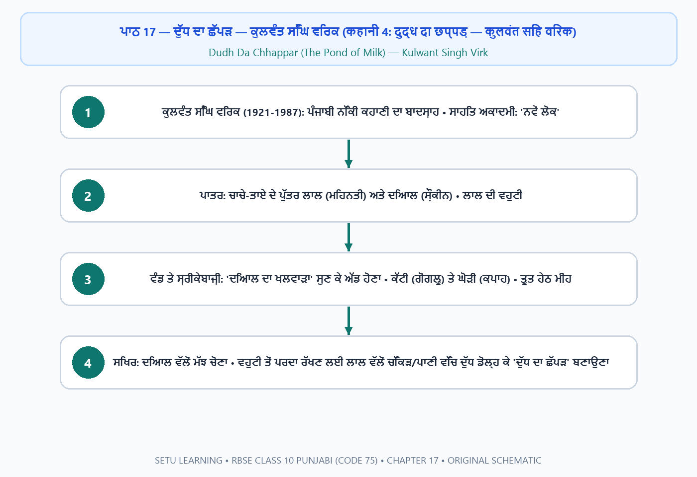

## 26. 'ਦੇਹਿ ਸਿਵਾ ਬਰੁ ਮੋਹਿ ਇਹੈ' ਜਾਂ 'ਬੁੱਢਣ ਦੀ ਮੱਝ' ਕਾਵਿ-ਵਿਆਖਿਆ।

**ਸਰੋਤ:** 2026 ਪੂਰਕ, ਪ੍ਰਸ਼ਨ 18, PDF ਪੰਨਾ 6 · **ਅੰਕ:** 4 ਅੰਕ

**ਪਾਠ-ਸੰਬੰਧ:** ਪਾਠ 6 — ਪ੍ਰੋ. ਮੋਹਨ ਸਿੰਘ ਅਤੇ ਅੰਮ੍ਰਿਤਾ ਪ੍ਰੀਤਮ (प्रो. मोहन सिंह एवं अमृता प्रीतम)

**ਹੱਲ:** ਪ੍ਰੋ. ਮੋਹਨ ਸਿੰਘ (1905–1978; ਸਾਹਿਤ ਅਕਾਦਮੀ: 'ਵੱਡਾ ਵੇਲਾ') ਨੇ 'ਬੁੱਢਣ ਦੀ ਮੱਝ' (ਸ਼ਾਹੂਕਾਰ ਦੀ ਕੁਰਕੀ), 'ਗੁਰੂ ਨਾਨਕ ਨੂੰ' (1947 ਦੇ ਫ਼ਸਾਦਾਂ ਵੇਲੇ ਪੁਕਾਰ) ਅਤੇ 'ਆਓ ਨੱਚੀਏ' ਲਿਖੀਆਂ। ਅੰਮ੍ਰਿਤਾ ਪ੍ਰੀਤਮ (1919–2005; ਸਾਹਿਤ ਅਕਾਦਮੀ: 'ਸੁਨੇਹੜੇ', ਗਿਆਨਪੀਠ: 'ਕਾਗ਼ਜ਼ ਤੇ ਕੈਨਵਸ') ਨੇ 1947 ਦੀ ਵੰਡ ਦੇ ਦਰਦ ਵਿੱਚ ਅਮਰ ਕਵਿਤਾ 'ਅੱਜ ਆਖਾਂ ਵਾਰਿਸ ਸ਼ਾਹ ਨੂੰ' ('ਇੱਕ ਰੋਈ ਸੀ ਧੀ ਪੰਜਾਬ ਦੀ... ਅੱਜ ਬੇਲੇ ਲਾਸ਼ਾਂ ਵਿਛੀਆਂ ਤੇ ਲਹੂ ਦੀ ਭਰੀ ਚਨਾਬ'), 'ਅੰਨਦਾਤਾ' ਅਤੇ 'ਚੈੱਕ-ਬੁੱਕ' ਰਚੀਆਂ।

[ਮੂਲ ਪ੍ਰਸ਼ਨ ਵੇਖੋ](https://rajeduboard.rajasthan.gov.in/books/PAPERS-2026/SecSUP/S-75.pdf#page=6)

ਚਿੱਤਰ ਸਹਾਇਤਾ: ਇਸੇ ਪਾਠ ਵਿੱਚ ਇਸ ਸੰਕਲਪ ਦਾ ਪਹਿਲਾਂ ਦਿੱਤਾ ਗਿਆ ਨਾਮਾਂਕਿਤ schematic ਵੇਖੋ।

## 2025 — ਮੁੱਖ ਪ੍ਰੀਖਿਆ

[2025 ਮੁੱਖ: ਪੂਰਾ ਅਧਿਕਾਰਤ ਪ੍ਰਸ਼ਨ-ਪੱਤਰ (S-75)](https://rajeduboard.rajasthan.gov.in/books/PAPERS-2025/Sec/S-75.pdf)

## 27. ਪੰਜਾਬੀ ਸੂਫ਼ੀ ਕਾਵਿ-ਧਾਰਾ ਦੇ ਮੋਢੀ ਕਵੀ (ਸ਼ੇਖ਼ ਫ਼ਰੀਦ ਜੀ)।

**ਸਰੋਤ:** 2025 ਮੁੱਖ, ਪ੍ਰਸ਼ਨ 1(i), PDF ਪੰਨਾ 2 · **ਅੰਕ:** 1 ਅੰਕ

**ਪਾਠ-ਸੰਬੰਧ:** ਪਾਠ 1 — ਸ਼ੇਖ਼ ਫ਼ਰੀਦ ਅਤੇ ਸ੍ਰੀ ਗੁਰੂ ਨਾਨਕ ਦੇਵ ਜੀ (शेख़ फ़रीद एवं श्री गुरु नानक देव जी)

**ਹੱਲ:** ਸ਼ੇਖ਼ ਫ਼ਰੀਦ ਜੀ ਦਾ ਜਨਮ 1173 ਈ. ਵਿੱਚ ਪਿੰਡ ਖੋਤਵਾਲ (ਮੁਲਤਾਨ) ਵਿਖੇ ਹੋਇਆ; ਉਹ ਪੰਜਾਬੀ ਸੂਫ਼ੀ ਕਾਵਿ ਦੇ ਮੋਢੀ ਹਨ (ਸ੍ਰੀ ਗੁਰੂ ਗ੍ਰੰਥ ਸਾਹਿਬ ਵਿੱਚ 112 ਸਲੋਕ ਤੇ 4 ਸ਼ਬਦ ਦਰਜ ਹਨ)। 'ਫਰੀਦਾ ਜੇ ਤੂ ਅਕਲਿ ਲਤੀਫੁ ਕਾਲੇ ਲਿਖੁ ਨ ਲੇਖ' ਰਾਹੀਂ ਉਹ ਦੂਜਿਆਂ ਦੇ ਐਬ ਫੋਲਣ ਦੀ ਥਾਂ ਆਪਣੀ ਗਿਰੀਵਾਨ ਵਿੱਚ ਝਾਤੀ ਮਾਰਨ, ਨਿਮਰਤਾ ਧਾਰਨ ਕਰਨ ਅਤੇ ਰੁੱਖੀ-ਸੁੱਖੀ ਖਾ ਕੇ ਸਬਰ ਕਰਨ ਦਾ ਉਪਦੇਸ਼ ਦਿੰਦੇ ਹਨ।

[ਮੂਲ ਪ੍ਰਸ਼ਨ ਵੇਖੋ](https://rajeduboard.rajasthan.gov.in/books/PAPERS-2025/Sec/S-75.pdf#page=2)

ਚਿੱਤਰ ਸਹਾਇਤਾ: ਇਸੇ ਪਾਠ ਵਿੱਚ ਇਸ ਸੰਕਲਪ ਦਾ ਪਹਿਲਾਂ ਦਿੱਤਾ ਗਿਆ ਨਾਮਾਂਕਿਤ schematic ਵੇਖੋ।

## 28. 'ਦੇਹਿ ਸਿਵਾ ਬਰੁ ਮੋਹਿ ਇਹੈ' ਸ਼ਬਦ ਦੇ ਰਚਨਾਕਾਰ (ਗੁਰੂ ਗੋਬਿੰਦ ਸਿੰਘ ਜੀ)।

**ਸਰੋਤ:** 2025 ਮੁੱਖ, ਪ੍ਰਸ਼ਨ 1(ii), PDF ਪੰਨਾ 2 · **ਅੰਕ:** 1 ਅੰਕ

**ਪਾਠ-ਸੰਬੰਧ:** ਪਾਠ 3 — ਭਾਈ ਗੁਰਦਾਸ ਜੀ ਦੀਆਂ ਵਾਰਾਂ (भाई गुरदास जी की वारें)

**ਹੱਲ:** ਪੰਜਵੇਂ ਗੁਰੂ ਸ੍ਰੀ ਅਰਜਨ ਦੇਵ ਜੀ (ਜਨਮ 1563 ਈ., ਗੋਇੰਦਵਾਲ; 2218 ਸ਼ਬਦ, ਸੁਖਮਨੀ ਸਾਹਿਬ) ਨੇ 'ਮੇਰਾ ਮਨੁ ਲੋਚੈ ਗੁਰ ਦਰਸਨ ਤਾਈ' (ਸ਼ਬਦ ਹਜ਼ਾਰੇ) ਵਿੱਚ ਚਾਤ੍ਰਿਕ ਵਾਂਗ ਗੁਰੂ-ਦਰਸ਼ਨ ਦੀ ਤਾਂਘ ਅਤੇ 'ਤੂੰ ਮੇਰਾ ਪਿਤਾ ਤੂੰਹੈ ਮੇਰਾ ਮਾਤਾ' ਵਿੱਚ ਪ੍ਰਭੂ ਨੂੰ ਸਰਬ-ਰੱਖਿਅਕ ਦੱਸਿਆ ਹੈ। ਦਸਵੇਂ ਗੁਰੂ ਸ੍ਰੀ ਗੋਬਿੰਦ ਸਿੰਘ ਜੀ (ਜਨਮ 1666 ਈ., ਪਟਨਾ ਸਾਹਿਬ) ਨੇ 'ਦੇਹਿ ਸਿਵਾ ਬਰੁ ਮੋਹਿ ਇਹੈ' ਵਿੱਚ ਸ਼ੁਭ ਕਰਮਨ ਤੋਂ ਕਦੇ ਨਾ ਡਰਨ ਅਤੇ 'ਮਿਤ੍ਰ ਪਿਆਰੇ ਨੂੰ ਹਾਲ ਮੁਰੀਦਾਂ ਦਾ ਕਹਿਣਾ' ਵਿੱਚ ਮਾਛੀਵਾੜੇ ਦੇ ਜੰਗਲ ਵਿੱਚ ਰੱਬੀ ਰਜ਼ਾ ਦੀ ਸਿਖਰ ਪੇਸ਼ ਕੀਤੀ ਹੈ।

[ਮੂਲ ਪ੍ਰਸ਼ਨ ਵੇਖੋ](https://rajeduboard.rajasthan.gov.in/books/PAPERS-2025/Sec/S-75.pdf#page=2)

## 29. 'ਫ਼ਲਾਇੰਗ ਸਿੱਖ — ਮਿਲਖਾ ਸਿੰਘ' ਨਿਬੰਧ ਦੇ ਲੇਖਕ (ਪ੍ਰਿੰ. ਸਰਵਣ ਸਿੰਘ)।

**ਸਰੋਤ:** 2025 ਮੁੱਖ, ਪ੍ਰਸ਼ਨ 1(vii), PDF ਪੰਨਾ 2 · **ਅੰਕ:** 1 ਅੰਕ

**ਪਾਠ-ਸੰਬੰਧ:** ਪਾਠ 10 — ਫ਼ਲਾਇੰਗ ਸਿੱਖ — ਮਿਲਖਾ ਸਿੰਘ — ਪ੍ਰਿੰ. ਸਰਵਣ ਸਿੰਘ (निबंध 3: फ़्लाइंग सिख — मिल्खा सिंह)

**ਹੱਲ:** ਪ੍ਰਿੰ. ਸਰਵਣ ਸਿੰਘ ਦੇ ਨਿਬੰਧ 'ਫ਼ਲਾਇੰਗ ਸਿੱਖ — ਮਿਲਖਾ ਸਿੰਘ' ਅਨੁਸਾਰ ਮਿਲਖਾ ਸਿੰਘ ਦਾ ਜਨਮ ਗੋਬਿੰਦਪੁਰਾ (ਜ਼ਿਲ੍ਹਾ ਮੁਜ਼ੱਫ਼ਰਗੜ੍ਹ) ਵਿਖੇ ਹੋਇਆ। ਫ਼ੌਜ ਵਿੱਚ ਉਸਤਾਦ ਗੁਰਦੇਵ ਸਿੰਘ ਨੇ ਉਸ ਨੂੰ ਤਰਾਸ਼ਿਆ। ਉਸ ਨੇ 1958 ਟੋਕੀਓ ਏਸ਼ੀਆਈ ਖੇਡਾਂ (200 ਮੀ. ਤੇ 400 ਮੀ.) ਅਤੇ 1958 ਕਾਰਡਿਫ਼ ਕਾਮਨਵੈਲਥ ਖੇਡਾਂ (440 ਗਜ਼) ਵਿੱਚ ਸੋਨ ਤਮਗ਼ੇ ਜਿੱਤੇ, 1960 ਲਾਹੌਰ ਵਿੱਚ ਅਬਦੁਲ ਖ਼ਾਲਿਕ ਨੂੰ ਹਰਾ ਕੇ ਜਨਰਲ ਅਯੂਬ ਖ਼ਾਨ ਤੋਂ 'ਫ਼ਲਾਇੰਗ ਸਿੱਖ' ਖਿਤਾਬ ਪਾਇਆ ਅਤੇ 1960 ਰੋਮ ਓਲੰਪਿਕ (400 ਮੀ.) ਵਿੱਚ 45.6 ਸੈਕਿੰਡ ਨਾਲ ਚੌਥਾ ਸਥਾਨ ਪ੍ਰਾਪਤ ਕੀਤਾ।

[ਮੂਲ ਪ੍ਰਸ਼ਨ ਵੇਖੋ](https://rajeduboard.rajasthan.gov.in/books/PAPERS-2025/Sec/S-75.pdf#page=2)

ਚਿੱਤਰ ਸਹਾਇਤਾ: ਇਸੇ ਪਾਠ ਵਿੱਚ ਇਸ ਸੰਕਲਪ ਦਾ ਪਹਿਲਾਂ ਦਿੱਤਾ ਗਿਆ ਨਾਮਾਂਕਿਤ schematic ਵੇਖੋ।

## 30. 'ਬਾਗ਼ੀ ਦੀ ਧੀ' ਕਹਾਣੀ ਦੇ ਲੇਖਕ (ਗੁਰਬਖ਼ਸ਼ ਸਿੰਘ ਪ੍ਰੀਤਲੜੀ)।

**ਸਰੋਤ:** 2025 ਮੁੱਖ, ਪ੍ਰਸ਼ਨ 1(xi), PDF ਪੰਨਾ 3 · **ਅੰਕ:** 1 ਅੰਕ

**ਪਾਠ-ਸੰਬੰਧ:** ਪਾਠ 14 — ਪਹੁਤਾ ਪਾਂਧੀ — ਗੁਰਬਖ਼ਸ਼ ਸਿੰਘ ਪ੍ਰੀਤਲੜੀ (कहानी 1: पहुता पांधी)

**ਹੱਲ:** ਗੁਰਬਖ਼ਸ਼ ਸਿੰਘ ਪ੍ਰੀਤਲੜੀ (1895–1977; 'ਪ੍ਰੀਤਲੜੀ' ਰਸਾਲਾ, 'ਪ੍ਰੀਤ ਨਗਰ') ਦੀ ਕਹਾਣੀ 'ਬਾਗ਼ੀ ਦੀ ਧੀ' ਵਿੱਚ ਦੇਸ਼-ਭਗਤ ਕਿਸ਼ਨ ਸਿੰਘ ਅਤੇ ਉਸ ਦੀ ਪਤਨੀ ਸ਼ਰਨ ਕੌਰ ਦੇ ਜੇਲ੍ਹ ਜਾਣ ਮਗਰੋਂ ਉਹਨਾਂ ਦੀ 12 ਸਾਲ ਦੀ ਤਪਦਿਕ (T.B.) ਨਾਲ ਬਿਮਾਰ ਧੀ 'ਲਾਜ' ਦੀ ਜ਼ਿੰਮੇਵਾਰੀ ਭੂਆ 'ਵੀਰਾਂਵਾਲੀ' ਨਿਭਾਉਂਦੀ ਹੈ। ਲਾਜ ਦੇ ਆਖ਼ਰੀ ਬੋਲ 'ਤੁਸੀਂ ਫ਼ਿਕਰ ਨਾ ਕਰੋ ਭੂਆ ਜੀ, ਮੈਂ ਚੰਗੀ ਹੋ ਜਾਵਾਂਗੀ, ਮੇਰੇ ਬੀਬੀ ਜੀ ਆਉਣ ਲੱਗੇ ਨੇ' ਹਨ। ਲਾਜ ਦੀ ਮੌਤ ਅਤੇ ਉਸ ਦੇ ਬਿਸਤਰੇ ਨੂੰ ਅੱਗ ਲਾਉਣ ਵੇਲੇ ਵੀਰਾਂਵਾਲੀ ਦੇ ਹਿਰਦੇ ਵਿੱਚ ਇਨਕਲਾਬ ਦੀ ਜਵਾਲਾ ਜਾਗ ਉੱਠਦੀ ਹੈ ਅਤੇ ਉਹ ਭਰਾ ਦਾ ਬਾਗ਼ੀ ਝੰਡਾ ਸੰਭਾਲ ਲੈਂਦੀ ਹੈ।

[ਮੂਲ ਪ੍ਰਸ਼ਨ ਵੇਖੋ](https://rajeduboard.rajasthan.gov.in/books/PAPERS-2025/Sec/S-75.pdf#page=3)

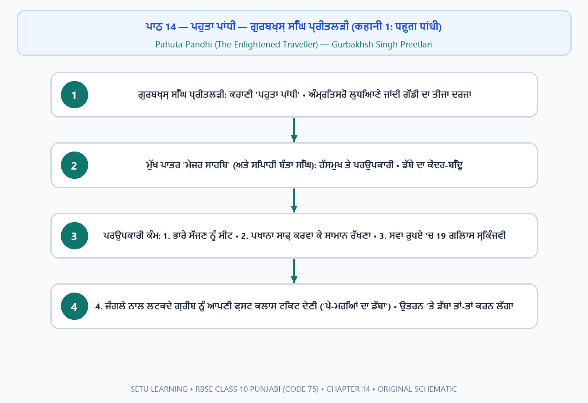

## 31. ਗੁਰਬਚਨ ਸਿੰਘ ਭੁੱਲਰ ਦਾ ਸਾਹਿਤ ਅਕਾਦਮੀ ਪੁਰਸਕ੍ਰਿਤ ਕਹਾਣੀ-ਸੰਗ੍ਰਹਿ (ਅਗਨੀ ਕਲਸ਼)।

**ਸਰੋਤ:** 2025 ਮੁੱਖ, ਪ੍ਰਸ਼ਨ 1(xiii), PDF ਪੰਨਾ 3 · **ਅੰਕ:** 1 ਅੰਕ

**ਪਾਠ-ਸੰਬੰਧ:** ਪਾਠ 18 — ਖ਼ੂਨ — ਗੁਰਬਚਨ ਸਿੰਘ ਭੁੱਲਰ (कहानी 5: ख़ून — गुरबचन सिंह भुल्लर)

**ਹੱਲ:** ਗੁਰਬਚਨ ਸਿੰਘ ਭੁੱਲਰ (ਜਨਮ 1937 ਈ., ਪਿੰਡ ਪਿੱਥੋ, ਬਠਿੰਡਾ; ਸਾਹਿਤ ਅਕਾਦਮੀ: 'ਅਗਨੀ ਕਲਸ਼') ਦੀ ਕਹਾਣੀ 'ਖ਼ੂਨ' ਵਿੱਚ ਕਰਤਾਰਾ ਵਿਹੜੇ ਦੀ ਟਾਹਲੀ ਦਾ ਡਾਹਣਾ ਤਲਵਾਰ ਨਾਲ ਵੱਢ ਕੇ ਪਰਖਦਾ ਹੈ। ਗਹਿਣੇ ਵਾਲੀ ਜ਼ਮੀਨ ਪਿੱਛੇ ਕੈਲੇ ਤੇ ਦੀਪੇ ਨੇ ਜੱਗਰ ਦਾ ਕਤਲ ਕਰ ਦਿੱਤਾ ਸੀ। ਮੁਰੱਬਾਬੰਦੀ ਵੇਲੇ ਜੱਗਰ ਦੀ 15 ਘੁਮਾਂ ਜ਼ਮੀਨ ਹੜੱਪਣ ਲਈ ਕਰਤਾਰਾ ਜੱਗਰ ਦੀ ਵਿਧਵਾ ਕੁਲਵੰਤੋ ਦੇ ਪੇਕੇ ਪਿੰਡ 'ਸੌਣਪੁਰਾ' (ਪਿਤਾ ਸੁੱਚਾ ਸਿੰਘ) ਵਿਖੇ ਆਪਣੇ ਭਤੀਜੇ ਨੂੰ ਵੱਢਣ ਜਾਂਦਾ ਹੈ। ਖੂਹ ਉੱਤੇ ਜਦੋਂ ਭਤੀਜਾ ਮਾਣ ਨਾਲ ਕਹਿੰਦਾ ਹੈ — 'ਮੈਨੂੰ ਕੌਣ ਹੱਥ ਲਾਊ। ਮਾਲਵੇ ਵਿੱਚ ਮੇਰਾ ਸ਼ੇਰ ਵਰਗਾ ਚਾਚਾ ਐ, ਕਰਤਾਰਾ। ਡੱਕਰੇ ਕਰ ਦੇਊ!' ਤਾਂ ਕਰਤਾਰੇ ਦਾ ਖ਼ੂਨ ਪੰਘਰ ਜਾਂਦਾ ਹੈ ਅਤੇ ਉਹ ਤਲਵਾਰ ਖੂਹ ਦੀ ਮਣ 'ਤੇ ਛੱਡ ਕੇ ਭਤੀਜੇ ਨੂੰ ਗਲ ਨਾਲ ਲਾ ਲੈਂਦਾ ਹੈ।

[ਮੂਲ ਪ੍ਰਸ਼ਨ ਵੇਖੋ](https://rajeduboard.rajasthan.gov.in/books/PAPERS-2025/Sec/S-75.pdf#page=3)

## 32. ਗੁਰਮੁਖੀ ਵਿੱਚ ਮੂਲ ਸਵਰ ਅੱਖਰਾਂ ਦੀ ਗਿਣਤੀ (3 — ੳ, ਅ, ੲ)।

**ਸਰੋਤ:** 2025 ਮੁੱਖ, ਪ੍ਰਸ਼ਨ 1(xiv), PDF ਪੰਨਾ 3 · **ਅੰਕ:** 1 ਅੰਕ

**ਪਾਠ-ਸੰਬੰਧ:** ਪਾਠ 19 — ਵਿਆਕਰਣ 1: ਭਾਸ਼ਾ, ਪੰਜਾਬੀ ਦੀਆਂ ਉਪ-ਭਾਸ਼ਾਵਾਂ, ਧੁਨੀ-ਬੋਧ ਅਤੇ ਲਿਪੀ-ਬੋਧ (व्याकरण 1: भाषा, उप-भाषाएँ, ध्वनि-बोध एवं लिपि-बोध — 6 अंक)

**ਹੱਲ:** ਵਿਆਕਰਣ ਭਾਗ 1 (6 ਅੰਕ): (1) ਭਾਸ਼ਾ: ਮਨ ਦੇ ਭਾਵਾਂ ਨੂੰ ਪ੍ਰਗਟ ਕਰਨ ਦਾ ਸਾਧਨ (ਮੌਖਿਕ ਅਤੇ ਲਿਖਤੀ)। (2) ਪੰਜਾਬੀ ਦੀਆਂ ਉਪ-ਭਾਸ਼ਾਵਾਂ: ਮਾਝੀ (ਟਕਸਾਲੀ ਆਧਾਰ — ਅੰਮ੍ਰਿਤਸਰ, ਤਰਨਤਾਰਨ, ਗੁਰਦਾਸਪੁਰ, ਪਠਾਨਕੋਟ), ਮਲਵਈ (ਬਠਿੰਡਾ, ਲੁਧਿਆਣਾ, ਪਟਿਆਲਾ, ਫ਼ਿਰੋਜ਼ਪੁਰ, ਸ੍ਰੀ ਗੰਗਾਨਗਰ), ਦੁਆਬੀ (ਜਲੰਧਰ, ਹੁਸ਼ਿਆਰਪੁਰ, ਕਪੂਰਥਲਾ, ਨਵਾਂ ਸ਼ਹਿਰ), ਪੁਆਧੀ (ਰੋਪੜ, ਮੁਹਾਲੀ, ਰਾਜਪੁਰਾ)। (3) ਧੁਨੀ-ਬੋਧ: ਮੂਲ ਸਵਰ ਅੱਖਰ 3 (ੳ, ਅ, ੲ) ਤੇ ਸਵਰ ਧੁਨੀਆਂ 10 (3 ਲਘੂ + 7 ਦੀਰਘ); ਅਨੁਨਾਸਕੀ ਵਿਅੰਜਨ 5 (ਙ, ਞ, ਣ, ਨ, ਮ); ਦੁੱਤ ਅੱਖਰ 3 (ਹ, ਰ, ਵ)। (4) ਗੁਰਮੁਖੀ ਲਿਪੀ: ਪੰਜਾਬੀ ਦੀ ਮਿਆਰੀ ਲਿਪੀ ਜਿਸ ਵਿੱਚ 8 ਵਰਗਾਂ ਦੇ 41 ਅੱਖਰ (35 ਪੈਂਤੀ + 6 ਨਵੀਨ ਟੋਲੀ: ਸ਼, ਖ਼, ਗ਼, ਜ਼, ਫ਼, ਲ਼), 10 ਲਗਾਂ (ੳ=3, ਅ=4, ੲ=3) ਅਤੇ 3 ਲਗਾਖਰ (ਬਿੰਦੀ, ਟਿੱਪੀ, ਅੱਧਕ) ਹਨ।

[ਮੂਲ ਪ੍ਰਸ਼ਨ ਵੇਖੋ](https://rajeduboard.rajasthan.gov.in/books/PAPERS-2025/Sec/S-75.pdf#page=3)

ਚਿੱਤਰ ਸਹਾਇਤਾ: ਇਸੇ ਪਾਠ ਵਿੱਚ ਇਸ ਸੰਕਲਪ ਦਾ ਪਹਿਲਾਂ ਦਿੱਤਾ ਗਿਆ ਨਾਮਾਂਕਿਤ schematic ਵੇਖੋ।

## 33. 'ਉਸਤਤ' ਸ਼ਬਦ ਦਾ ਵਿਰੋਧੀ ਸ਼ਬਦ (ਨਿੰਦਿਆ)।

**ਸਰੋਤ:** 2025 ਮੁੱਖ, ਪ੍ਰਸ਼ਨ 1(xvi), PDF ਪੰਨਾ 3 · **ਅੰਕ:** 1 ਅੰਕ

**ਪਾਠ-ਸੰਬੰਧ:** ਪਾਠ 20 — ਵਿਆਕਰਣ 2: ਅਰਥ-ਬੋਧ — ਵਿਰੋਧੀ ਸ਼ਬਦ, ਸਮਾਨਾਰਥਕ ਸ਼ਬਦ ਅਤੇ ਬਹੁ-ਅਰਥਕ ਸ਼ਬਦ (व्याकरण 2: अर्थ-बोध — विलोम, समानार्थक एवं बहुअर्थक शब्द — 9 अंक)

**ਹੱਲ:** ਵਿਆਕਰਣ ਭਾਗ 2 — ਅਰਥ-ਬੋਧ (9 ਅੰਕ): (1) ਵਿਰੋਧੀ ਸ਼ਬਦ (3 ਅੰਕ): ਉਸਤਤ × ਨਿੰਦਿਆ, ਆਸਤਕ × ਨਾਸਤਕ, ਸੰਜੋਗ × ਵਿਯੋਗ, ਸੱਖਣਾ × ਭਰਿਆ, ਸੱਜਣ × ਦੁਰਜਨ, ਉੱਦਮੀ × ਆਲਸੀ, ਉਪਕਾਰ × ਅਪਕਾਰ, ਹਾਨੀ × ਲਾਭ। (2) ਸਮਾਨਾਰਥਕ ਸ਼ਬਦ (3 ਅੰਕ): ਉੱਦਮ (ਮਿਹਨਤ, ਕੋਸ਼ਿਸ਼, ਯਤਨ, ਉਪਰਾਲਾ), ਅਕਾਸ਼ (ਅਸਮਾਨ, ਗਗਨ, ਅੰਬਰ), ਸੁੰਦਰ (ਸੋਹਣਾ, ਖ਼ੂਬਸੂਰਤ, ਮਨੋਹਰ), ਪਾਣੀ (ਜਲ, ਨੀਰ, ਆਬ), ਧਰਤੀ (ਜ਼ਮੀਨ, ਭੂਮੀ, ਪ੍ਰਿਥਵੀ)। (3) ਬਹੁ-ਅਰਥਕ ਸ਼ਬਦ (3 ਅੰਕ): ਵੱਟ (ਖੇਤ ਦੀ ਬੰਨ੍ਹੀ, ਗਰਮੀ/ਹੁੰਮਸ, ਗੁੱਸਾ, ਪੱਗ ਦੇ ਬਲ), ਹਾਰ (ਫੁੱਲਾਂ ਦੀ ਮਾਲਾ, ਪਰਾਜੈ), ਉੱਤਰ (ਦਿਸ਼ਾ, ਸਵਾਲ ਦਾ ਜਵਾਬ, ਹੇਠਾਂ ਉੱਤਰਨਾ), ਜੱਗ (ਸੰਸਾਰ, ਪਾਣੀ ਦਾ ਭਾਂਡਾ), ਵਾਰ (ਹਮਲਾ, ਦਿਨ, ਕਾਵਿ-ਰੂਪ), ਫਲ (ਮੇਵਾ, ਨਤੀਜਾ, ਹਲ ਦਾ ਫਲ)।

[ਮੂਲ ਪ੍ਰਸ਼ਨ ਵੇਖੋ](https://rajeduboard.rajasthan.gov.in/books/PAPERS-2025/Sec/S-75.pdf#page=3)

ਚਿੱਤਰ ਸਹਾਇਤਾ: ਇਸੇ ਪਾਠ ਵਿੱਚ ਇਸ ਸੰਕਲਪ ਦਾ ਪਹਿਲਾਂ ਦਿੱਤਾ ਗਿਆ ਨਾਮਾਂਕਿਤ schematic ਵੇਖੋ।

## 34. 'ਰੱਬਾ ਮੇਰੇ ਹਾਲ ਦਾ ਮਹਿਰਮ ਤੂੰ' ਖਾਲੀ ਥਾਂ।

**ਸਰੋਤ:** 2025 ਮੁੱਖ, ਪ੍ਰਸ਼ਨ 2(ii), PDF ਪੰਨਾ 4 · **ਅੰਕ:** 1 ਅੰਕ

**ਪਾਠ-ਸੰਬੰਧ:** ਪਾਠ 4 — ਮੀਆਂ ਵਜੀਦ ਅਤੇ ਬੁੱਲ੍ਹੇ ਸ਼ਾਹ (मियां वजीद एवं बुल्ले शाह)

**ਹੱਲ:** ਸ਼ਾਹ ਹੁਸੈਨ (1539–1599, ਲਾਹੌਰ; ਕਾਫ਼ੀ ਕਾਵਿ-ਰੂਪ ਦਾ ਮੋਢੀ) ਨੇ 'ਆਪ ਨੂੰ ਪਛਾਣ ਬੰਦਿਆ' ਅਤੇ 'ਰੱਬਾ ਮੇਰੇ ਹਾਲ ਦਾ ਮਹਿਰਮ ਤੂੰ' (ਅੰਦਰ ਤੂੰ ਹੈਂ ਬਾਹਰ ਤੂੰ ਹੈਂ, ਤੂੰ ਹੈਂ ਤਾਣਾ ਤੂੰ ਹੈਂ ਬਾਣਾ) ਰਾਹੀਂ ਆਤਮ-ਪਛਾਣ ਤੇ ਸਰਬ-ਵਿਆਪਕਤਾ ਦੱਸੀ ਹੈ। ਸੂਫ਼ੀ ਕਾਵਿ ਦੇ ਸਿਖਰ ਬੁੱਲ੍ਹੇ ਸ਼ਾਹ (1680–1758; ਮੁਰਸ਼ਦ ਸ਼ਾਹ ਇਨਾਇਤ ਕਾਦਰੀ) ਨੇ 'ਇਸ਼ਕ ਦੀ ਨਵੀਓਂ ਨਵੀਂ ਬਹਾਰ' ਅਤੇ 'ਬੁੱਲ੍ਹਾ ਕੀ ਜਾਣਾ ਮੈਂ ਕੌਣ' ਰਾਹੀਂ ਫ਼ਿਰਕਾਪ੍ਰਸਤੀ ਤੇ ਮਜ਼ਹਬੀ ਕੱਟੜਤਾ ਦਾ ਤਿਆਗ ਕਰਕੇ ਪ੍ਰੇਮ-ਭਗਤੀ ਦਾ ਸੁਨੇਹਾ ਦਿੱਤਾ ਹੈ।

[ਮੂਲ ਪ੍ਰਸ਼ਨ ਵੇਖੋ](https://rajeduboard.rajasthan.gov.in/books/PAPERS-2025/Sec/S-75.pdf#page=4)

## 35. 'ਚੁਗਾਠ ਬਚ ਰਹੇ, ਬਾਣ ਬਥੇਰਾ' ਸ਼ਬਦ ਕਿਸ ਨੇ ਕਿਸ ਨੂੰ ਕਹੇ (ਕਪੂਰ ਸਿੰਘ ਨੇ ਦਰਬਾਰੇ ਨੂੰ)।

**ਸਰੋਤ:** 2025 ਮੁੱਖ, ਪ੍ਰਸ਼ਨ 3(xi), PDF ਪੰਨਾ 4 · **ਅੰਕ:** 1 ਅੰਕ

**ਪਾਠ-ਸੰਬੰਧ:** ਪਾਠ 16 — ਸਾਂਝੀ ਕੰਧ — ਸੰਤੋਖ ਸਿੰਘ ਧੀਰ (कहानी 3: सांझी कंध — संतोख सिंह धीर)

**ਹੱਲ:** ਸੰਤੋਖ ਸਿੰਘ ਧੀਰ (1920–2010; ਸਾਹਿਤ ਅਕਾਦਮੀ: 'ਪੱਖੀ') ਦੀ ਕਹਾਣੀ 'ਸਾਂਝੀ ਕੰਧ' ਵਿੱਚ ਕਪੂਰ ਸਿੰਘ ਵਿਸਾਖ ਦੇ ਮਹੀਨੇ ਆਪਣੀ 10 ਵਿੱਘੇ ਪੈਲੀ ਗਹਿਣੇ ਪਾ ਕੇ ਢੱਠਾ ਮਕਾਨ ਬਣਾਉਂਦਾ ਹੈ। ਚਾਚੇ ਦੇ ਪੁੱਤਰ ਦਰਬਾਰਾ ਸਿੰਘ ਨਾਲ 40 ਫੁੱਟ ਲੰਮੀ ਤੇ 14 ਫੁੱਟ ਉੱਚੀ ਸਾਂਝੀ ਕੰਧ ਦੇ ਖ਼ਰਚੇ ਪਿੱਛੇ ਝਗੜਾ ਹੁੰਦਾ ਹੈ ਜਿਸ ਨੂੰ ਧੰਮਾ ਸਿੰਘ ਸਰਪੰਚ ਭੜਕਾਉਂਦਾ ਹੈ। ਪੰਚਾਇਤ ਵਿੱਚ ਰਾਮ ਰਤਨ ਪਟਵਾਰੀ, ਧੰਮਾ ਸਿੰਘ ਸਰਪੰਚ, ਟੁੰਡਾ ਲੰਬੜਦਾਰ ਅਤੇ ਨਾਹਰ ਸਿੰਘ ਅਕਾਲੀ ਸ਼ਾਮਲ ਸਨ। ਸਰਦੀਆਂ ਵਿੱਚ ਦਰਬਾਰੇ ਨੂੰ ਨਮੂਨੀਆ ਹੋਣ 'ਤੇ ਚਾਚੀ ਰਾਮ ਕੌਰ ਦੇ ਬੋਲ ('ਨੌਹਾਂ ਨਾਲੋਂ ਮਾਸ ਨ੍ਹੀਂ ਟੁੱਟਦਾ') ਸੁਣ ਕੇ ਕਪੂਰ ਸਿੰਘ ਉਸ ਦੇ ਘਰ ਜਾਂਦਾ ਹੈ, 'ਚੁਗਾਠ ਬਚ ਰਹੇ, ਬਾਣ ਬਥੇਰਾ' ਕਹਿ ਕੇ ਹੌਸਲਾ ਦਿੰਦਾ ਹੈ, 10 ਰੁਪਏ ਦਿੰਦਾ ਹੈ ਅਤੇ ਭਤੀਜੀ ਹਰਬੰਸੋ (ਬੰਸੋ) ਦੇ ਵਿਆਹ ਦੀ ਜ਼ਿੰਮੇਵਾਰੀ ਵੰਡਾਉਂਦਾ ਹੈ।

[ਮੂਲ ਪ੍ਰਸ਼ਨ ਵੇਖੋ](https://rajeduboard.rajasthan.gov.in/books/PAPERS-2025/Sec/S-75.pdf#page=4)

ਚਿੱਤਰ ਸਹਾਇਤਾ: ਇਸੇ ਪਾਠ ਵਿੱਚ ਇਸ ਸੰਕਲਪ ਦਾ ਪਹਿਲਾਂ ਦਿੱਤਾ ਗਿਆ ਨਾਮਾਂਕਿਤ schematic ਵੇਖੋ।

## 36. ਲਾਲ ਦੀ ਘੋੜੀ ਨੇ ਦਿਆਲ ਦੀ ਕਿਹੜੀ ਫ਼ਸਲ ਦਾ ਨੁਕਸਾਨ ਕੀਤਾ (ਕਪਾਹ ਦਾ)।

**ਸਰੋਤ:** 2025 ਮੁੱਖ, ਪ੍ਰਸ਼ਨ 3(xii), PDF ਪੰਨਾ 4 · **ਅੰਕ:** 1 ਅੰਕ

**ਪਾਠ-ਸੰਬੰਧ:** ਪਾਠ 17 — ਦੁੱਧ ਦਾ ਛੱਪੜ — ਕੁਲਵੰਤ ਸਿੰਘ ਵਿਰਕ (कहानी 4: दुद्ध दा छप्पड़ — कुलवंत सिंह विरक)

**ਹੱਲ:** ਪੰਜਾਬੀ ਨਿੱਕੀ ਕਹਾਣੀ ਦੇ ਬਾਦਸ਼ਾਹ ਕੁਲਵੰਤ ਸਿੰਘ ਵਿਰਕ (ਜਨਮ 21 ਮਾਰਚ 1921, ਫੁਲੇਰਨ; ਸਾਹਿਤ ਅਕਾਦਮੀ: 'ਨਵੇਂ ਲੋਕ') ਦੀ ਕਹਾਣੀ 'ਦੁੱਧ ਦਾ ਛੱਪੜ' ਵਿੱਚ ਚਾਚੇ-ਤਾਏ ਦੇ ਪੁੱਤਰ ਲਾਲ ਅਤੇ ਦਿਆਲ ਸਾਂਝੀ ਵਾਹੀ ਕਰਦੇ ਹਨ। ਵਾਢੀਆਂ ਵੇਲੇ ਲੁਹਾਰਾਂ ਦੇ ਮੁੰਡੇ ਵੱਲੋਂ ਸਾਂਝੇ ਖਲਵਾੜੇ ਨੂੰ 'ਦਿਆਲ ਦਾ ਖਲਵਾੜਾ' ਕਹਿਣ ਕਾਰਨ ਲਾਲ ਅੱਡ ਹੋ ਜਾਂਦਾ ਹੈ। ਦਿਆਲ ਦੀ ਕੱਟੀ ਲਾਲ ਦੇ ਗੋਂਗਲੂਆਂ ਵਿੱਚ ਅਤੇ ਲਾਲ ਦੀ ਘੋੜੀ ਦਿਆਲ ਦੀ ਕਪਾਹ ਵਿੱਚ ਨੁਕਸਾਨ ਕਰਦੀ ਹੈ; ਮੀਂਹ ਵੇਲੇ ਲਾਲ ਆਪਣੇ ਤੂਤ ਹੇਠ ਭਿੱਜਦਾ ਰਹਿੰਦਾ ਹੈ ('ਉੱਤੇ ਬਗਲੇ ਨ੍ਹਾਉਂਦੇ ਰਹੇ ਤੇ ਹੇਠਾਂ ਲਾਲ ਨਹਾਉਂਦਾ ਰਿਹਾ')। ਇੱਕ ਰਾਤ ਲਾਲ ਦੀ ਮੱਝ ਖੁੱਲ੍ਹ ਕੇ ਦਿਆਲ ਕੋਲ ਚਲੀ ਜਾਂਦੀ ਹੈ ਤੇ ਦਿਆਲ ਉਸ ਨੂੰ ਚੋਅ ਲੈਂਦਾ ਹੈ; ਆਪਣੀ ਵਹੁਟੀ ਅੱਗੇ ਪਰਦਾ ਰੱਖਣ ਲਈ ਲਾਲ ਗੜਵੇ ਦਾ ਬਚਿਆ ਇੱਕ ਛੰਨਾ ਦੁੱਧ ਮੀਂਹ ਦੇ ਚਿੱਕੜ ਤੇ ਪਾਣੀ ਵਿੱਚ ਡੋਲ੍ਹ ਕੇ 'ਦੁੱਧ ਦਾ ਛੱਪੜ' ਬਣਾ ਦਿੰਦਾ ਹੈ ਅਤੇ ਕਹਿੰਦਾ ਹੈ ਕਿ ਮੱਝ ਨੇ ਲੱਤ ਮਾਰ ਕੇ ਦੁੱਧ ਡੋਲ੍ਹ ਦਿੱਤਾ ਹੈ।

[ਮੂਲ ਪ੍ਰਸ਼ਨ ਵੇਖੋ](https://rajeduboard.rajasthan.gov.in/books/PAPERS-2025/Sec/S-75.pdf#page=4)

ਚਿੱਤਰ ਸਹਾਇਤਾ: ਇਸੇ ਪਾਠ ਵਿੱਚ ਇਸ ਸੰਕਲਪ ਦਾ ਪਹਿਲਾਂ ਦਿੱਤਾ ਗਿਆ ਨਾਮਾਂਕਿਤ schematic ਵੇਖੋ।

## 37. ਸਮੇਂ ਦੀ ਕਦਰ ਅਤੇ ਅਨੁਸ਼ਾਸਨ ਬਾਰੇ ਅਣਡਿੱਠਾ ਪੈਰ੍ਹਾ।

**ਸਰੋਤ:** 2025 ਮੁੱਖ, ਪ੍ਰਸ਼ਨ 4-8, PDF ਪੰਨਾ 5 · **ਅੰਕ:** 10 ਅੰਕ

**ਪਾਠ-ਸੰਬੰਧ:** ਪਾਠ 21 — ਅਣਡਿੱਠਾ ਪੈਰ੍ਹਾ (ਅਪਠਿਤ ਗਦਿਆਂਸ਼ ਬੋਧ) (अपठित गद्यांश बोध — 10 अंक)

**ਹੱਲ:** ਅਣਡਿੱਠਾ ਪੈਰ੍ਹਾ (ਖੰਡ-ਅ, ਪ੍ਰਸ਼ਨ 4 ਤੋਂ 8 — 5 × 2 = 10 ਅੰਕ): ਪੈਰ੍ਹੇ ਨੂੰ ਦੋ ਵਾਰ ਧਿਆਨ ਨਾਲ ਪੜ੍ਹ ਕੇ ਪਹਿਲੇ 4 ਪ੍ਰਸ਼ਨਾਂ ਦੇ ਉੱਤਰ ਪੈਰ੍ਹੇ ਦੇ ਤੱਥਾਂ ਦੇ ਆਧਾਰ 'ਤੇ ਆਪਣੀ ਸਰਲ ਭਾਸ਼ਾ ਵਿੱਚ 1–2 ਵਾਕਾਂ ਵਿੱਚ ਲਿਖੋ। 5ਵੇਂ ਪ੍ਰਸ਼ਨ (Q8 — ਢੁਕਵਾਂ ਸਿਰਲੇਖ) ਵਿੱਚ ਪੈਰ੍ਹੇ ਦੀ ਪਹਿਲੀ ਜਾਂ ਆਖ਼ਰੀ ਸਤਰ ਦੇ ਕੇਂਦਰੀ ਵਿਸ਼ੇ ਤੋਂ 2 ਤੋਂ 4 ਸ਼ਬਦਾਂ ਦਾ ਸਿਰਲੇਖ ਚੁਣੋ (ਜਿਵੇਂ — 'ਸਮੇਂ ਦੀ ਕਦਰ', 'ਮਿਹਨਤ ਦੀ ਮਹੱਤਤਾ', 'ਪੁਸਤਕਾਂ ਦਾ ਮਹੱਤਵ', 'ਰੁੱਖਾਂ ਦੇ ਲਾਭ', 'ਅਨੁਸ਼ਾਸਨ', 'ਮਾਂ-ਬੋਲੀ ਦਾ ਮਹੱਤਵ')।

[ਮੂਲ ਪ੍ਰਸ਼ਨ ਵੇਖੋ](https://rajeduboard.rajasthan.gov.in/books/PAPERS-2025/Sec/S-75.pdf#page=5)

## 38. 'ਸਾਂਝੀ ਕੰਧ' ਜਾਂ 'ਬਾਗ਼ੀ ਦੀ ਧੀ' ਕਹਾਣੀ ਦਾ ਸਾਰ।

**ਸਰੋਤ:** 2025 ਮੁੱਖ, ਪ੍ਰਸ਼ਨ 17, PDF ਪੰਨਾ 6 · **ਅੰਕ:** 3 ਅੰਕ

**ਪਾਠ-ਸੰਬੰਧ:** ਪਾਠ 16 — ਸਾਂਝੀ ਕੰਧ — ਸੰਤੋਖ ਸਿੰਘ ਧੀਰ (कहानी 3: सांझी कंध — संतोख सिंह धीर)

**ਹੱਲ:** ਸੰਤੋਖ ਸਿੰਘ ਧੀਰ (1920–2010; ਸਾਹਿਤ ਅਕਾਦਮੀ: 'ਪੱਖੀ') ਦੀ ਕਹਾਣੀ 'ਸਾਂਝੀ ਕੰਧ' ਵਿੱਚ ਕਪੂਰ ਸਿੰਘ ਵਿਸਾਖ ਦੇ ਮਹੀਨੇ ਆਪਣੀ 10 ਵਿੱਘੇ ਪੈਲੀ ਗਹਿਣੇ ਪਾ ਕੇ ਢੱਠਾ ਮਕਾਨ ਬਣਾਉਂਦਾ ਹੈ। ਚਾਚੇ ਦੇ ਪੁੱਤਰ ਦਰਬਾਰਾ ਸਿੰਘ ਨਾਲ 40 ਫੁੱਟ ਲੰਮੀ ਤੇ 14 ਫੁੱਟ ਉੱਚੀ ਸਾਂਝੀ ਕੰਧ ਦੇ ਖ਼ਰਚੇ ਪਿੱਛੇ ਝਗੜਾ ਹੁੰਦਾ ਹੈ ਜਿਸ ਨੂੰ ਧੰਮਾ ਸਿੰਘ ਸਰਪੰਚ ਭੜਕਾਉਂਦਾ ਹੈ। ਪੰਚਾਇਤ ਵਿੱਚ ਰਾਮ ਰਤਨ ਪਟਵਾਰੀ, ਧੰਮਾ ਸਿੰਘ ਸਰਪੰਚ, ਟੁੰਡਾ ਲੰਬੜਦਾਰ ਅਤੇ ਨਾਹਰ ਸਿੰਘ ਅਕਾਲੀ ਸ਼ਾਮਲ ਸਨ। ਸਰਦੀਆਂ ਵਿੱਚ ਦਰਬਾਰੇ ਨੂੰ ਨਮੂਨੀਆ ਹੋਣ 'ਤੇ ਚਾਚੀ ਰਾਮ ਕੌਰ ਦੇ ਬੋਲ ('ਨੌਹਾਂ ਨਾਲੋਂ ਮਾਸ ਨ੍ਹੀਂ ਟੁੱਟਦਾ') ਸੁਣ ਕੇ ਕਪੂਰ ਸਿੰਘ ਉਸ ਦੇ ਘਰ ਜਾਂਦਾ ਹੈ, 'ਚੁਗਾਠ ਬਚ ਰਹੇ, ਬਾਣ ਬਥੇਰਾ' ਕਹਿ ਕੇ ਹੌਸਲਾ ਦਿੰਦਾ ਹੈ, 10 ਰੁਪਏ ਦਿੰਦਾ ਹੈ ਅਤੇ ਭਤੀਜੀ ਹਰਬੰਸੋ (ਬੰਸੋ) ਦੇ ਵਿਆਹ ਦੀ ਜ਼ਿੰਮੇਵਾਰੀ ਵੰਡਾਉਂਦਾ ਹੈ।

[ਮੂਲ ਪ੍ਰਸ਼ਨ ਵੇਖੋ](https://rajeduboard.rajasthan.gov.in/books/PAPERS-2025/Sec/S-75.pdf#page=6)

ਚਿੱਤਰ ਸਹਾਇਤਾ: ਇਸੇ ਪਾਠ ਵਿੱਚ ਇਸ ਸੰਕਲਪ ਦਾ ਪਹਿਲਾਂ ਦਿੱਤਾ ਗਿਆ ਨਾਮਾਂਕਿਤ schematic ਵੇਖੋ।

## 39. ਵੱਡੀ ਭੈਣ ਦੇ ਵਿਆਹ ਦੀ ਛੁੱਟੀ ਲਈ ਪੱਤਰ ਅਤੇ ਸ੍ਰੀ ਗੁਰੂ ਨਾਨਕ ਦੇਵ ਜੀ ਲੇਖ।

**ਸਰੋਤ:** 2025 ਮੁੱਖ, ਪ੍ਰਸ਼ਨ 19-20, PDF ਪੰਨਾ 7 · **ਅੰਕ:** 8 ਅੰਕ

**ਪਾਠ-ਸੰਬੰਧ:** ਪਾਠ 22 — ਨਿਬੰਧ ਰਚਨਾ (ਲੇਖ) ਅਤੇ ਪ੍ਰਾਰਥਨਾ-ਪੱਤਰ / ਚਿੱਠੀ-ਪੱਤਰ (निबंध रचना एवं प्रार्थना-पत्र / पत्र-लेखन — 8 अंक)

**ਹੱਲ:** ਰਚਨਾ ਭਾਗ (ਖੰਡ-ਸ, ਪ੍ਰਸ਼ਨ 19 ਤੇ 20 — 4 + 4 = 8 ਅੰਕ): (1) ਪੱਤਰ-ਰਚਨਾ (4 ਅੰਕ): ਸਕੂਲ ਦੇ ਮੁੱਖ ਅਧਿਆਪਕ ਨੂੰ ਫ਼ੀਸ/ਜੁਰਮਾਨਾ ਮੁਆਫ਼ੀ, ਭੈਣ ਦੇ ਵਿਆਹ/ਬਿਮਾਰੀ ਦੀ ਛੁੱਟੀ ਜਾਂ ਸਰਟੀਫਿਕੇਟ (T.C.) ਲੈਣ ਲਈ ਬਿਨੈ-ਪੱਤਰ ('ਸੇਵਾ ਵਿਖੇ, ਮੁੱਖ ਅਧਿਆਪਕ ਜੀ...', 'ਵਿਸ਼ਾ', 'ਸ੍ਰੀਮਾਨ ਜੀ', 'ਆਪ ਜੀ ਦਾ ਆਗਿਆਕਾਰੀ ਵਿਦਿਆਰਥੀ'); ਜਾਂ ਚਾਚਾ ਜੀ ਨੂੰ ਜਨਮ-ਦਿਨ ਦੇ ਤੋਹਫ਼ੇ (ਘੜੀ) ਲਈ ਧੰਨਵਾਦ ਪੱਤਰ / ਮਿੱਤਰ ਨੂੰ ਪਾਸ ਹੋਣ 'ਤੇ ਵਧਾਈ ਪੱਤਰ। (2) ਨਿਬੰਧ/ਲੇਖ ਰਚਨਾ (4 ਅੰਕ, ਲਗਭਗ 150 ਸ਼ਬਦ): ਸ੍ਰੀ ਗੁਰੂ ਨਾਨਕ ਦੇਵ ਜੀ, ਸ਼ਹੀਦ ਭਗਤ ਸਿੰਘ, ਦੀਵਾਲੀ, ਵਿਸਾਖੀ, ਪ੍ਰਦੂਸ਼ਣ ਦੀ ਸਮੱਸਿਆ, ਅਖ਼ਬਾਰਾਂ/ਮੋਬਾਈਲ ਦੇ ਲਾਭ-ਹਾਨੀਆਂ ਅਤੇ ਦਾਜ ਦੀ ਲਾਹਨਤ।

[ਮੂਲ ਪ੍ਰਸ਼ਨ ਵੇਖੋ](https://rajeduboard.rajasthan.gov.in/books/PAPERS-2025/Sec/S-75.pdf#page=7)

## 2025 — ਪੂਰਕ ਪ੍ਰੀਖਿਆ

[2025 ਪੂਰਕ: ਪੂਰਾ ਅਧਿਕਾਰਤ ਪ੍ਰਸ਼ਨ-ਪੱਤਰ (S-75)](https://rajeduboard.rajasthan.gov.in/books/PAPERS-2025/SecSUP/S-75.pdf)

## 40. 'ਹਰਿ ਦਰਸਨ ਕਉ ਮੇਰਾ ਮਨੁ ਬਹੁ ਤਪਤਿਆ' ਸ਼ਬਦ ਦੇ ਰਚਨਾਕਾਰ (ਗੁਰੂ ਰਾਮਦਾਸ ਜੀ)।

**ਸਰੋਤ:** 2025 ਪੂਰਕ, ਪ੍ਰਸ਼ਨ 1(i), PDF ਪੰਨਾ 2 · **ਅੰਕ:** 1 ਅੰਕ

**ਪਾਠ-ਸੰਬੰਧ:** ਪਾਠ 2 — ਸ੍ਰੀ ਗੁਰੂ ਅਮਰਦਾਸ ਜੀ ਅਤੇ ਸ੍ਰੀ ਗੁਰੂ ਰਾਮਦਾਸ ਜੀ (श्री गुरु अमरदास जी एवं श्री गुरु रामदास जी)

**ਹੱਲ:** ਤੀਜੇ ਗੁਰੂ ਸ੍ਰੀ ਅਮਰਦਾਸ ਜੀ (ਜਨਮ 1479 ਈ., ਬਾਸਰਕੇ; 907 ਸ਼ਬਦ) ਨੇ 'ਆਨੰਦੁ ਭਇਆ ਮੇਰੀ ਮਾਏ ਸਤਿਗੁਰੂ ਮੈ ਪਾਇਆ' ਵਿੱਚ ਗੁਰੂ-ਮਿਲਾਪ ਦੇ ਆਤਮਿਕ ਖੇੜੇ ਅਤੇ 'ਸਤਿਗੁਰ ਨੋ ਸਭੁ ਕੋ ਵੇਖਦਾ' ਵਿੱਚ ਸ਼ਬਦ-ਕਮਾਈ ਰਾਹੀਂ ਦਰਸ਼ਨ ਦੀ ਗੱਲ ਕਹੀ ਹੈ। ਚੌਥੇ ਗੁਰੂ ਸ੍ਰੀ ਰਾਮਦਾਸ ਜੀ (ਜਨਮ 1534 ਈ., ਚੂਨਾ ਮੰਡੀ ਲਾਹੌਰ; 679 ਸ਼ਬਦ) ਨੇ ਅੰਮ੍ਰਿਤਸਰ ਵਸਾਇਆ ਅਤੇ 'ਹਰਿ ਅੰਮ੍ਰਿਤ ਭਿੰਨੇ ਲੋਇਣਾ' ਤੇ 'ਹਰਿ ਦਰਸਨ ਕਉ ਮੇਰਾ ਮਨੁ ਬਹੁ ਤਪਤਿਆ' ਵਿੱਚ ਚਾਤ੍ਰਿਕ ਵਾਂਗ ਪ੍ਰਭੂ-ਮਿਲਾਪ ਦੀ ਤੜਪ ਪ੍ਰਗਟ ਕੀਤੀ ਹੈ।

[ਮੂਲ ਪ੍ਰਸ਼ਨ ਵੇਖੋ](https://rajeduboard.rajasthan.gov.in/books/PAPERS-2025/SecSUP/S-75.pdf#page=2)

## 41. 'ਕਿੱਥੋਂ ਦਿਆਂ ਪੰਛੀਆਂ ਨੂੰ ਕਿੱਥੋਂ ਚੋਗਾ ਲੱਭਿਆ' ਸਤਰ ਦੇ ਕਵੀ (ਸੁਰਜੀਤ ਪਾਤਰ)।

**ਸਰੋਤ:** 2025 ਪੂਰਕ, ਪ੍ਰਸ਼ਨ 1(iv), PDF ਪੰਨਾ 2 · **ਅੰਕ:** 1 ਅੰਕ

**ਪਾਠ-ਸੰਬੰਧ:** ਪਾਠ 7 — ਸ਼ਿਵ ਕੁਮਾਰ ਬਟਾਲਵੀ ਅਤੇ ਸੁਰਜੀਤ ਪਾਤਰ (शिव कुमार बटालवी एवं सुरजीत पातर)

**ਹੱਲ:** ਬਿਰਹਾ ਦੇ ਸੁਲਤਾਨ ਸ਼ਿਵ ਕੁਮਾਰ ਬਟਾਲਵੀ (1936–1973; ਸਾਹਿਤ ਅਕਾਦਮੀ: 'ਲੂਣਾ') ਨੇ 'ਰੁੱਖ' (ਪੁੱਤ, ਮਾਵਾਂ, ਨੂੰਹਾਂ-ਧੀਆਂ, ਭਰਾ, ਬਾਬਾ, ਦਾਦੀ, ਯਾਰ, ਮਹਿਬੂਬਾ) ਅਤੇ 'ਪੀੜਾਂ ਦਾ ਪਰਾਗਾ / ਤੈਨੂੰ ਦਿਆਂ ਹੰਝੂਆਂ ਦਾ ਭਾੜਾ' (ਭੱਠੀ ਵਾਲੀ = ਜ਼ਿੰਦਗੀ/ਕਿਸਮਤ) ਲਿਖੀਆਂ। ਸੁਰਜੀਤ ਪਾਤਰ (1945–2024; ਸਾਹਿਤ ਅਕਾਦਮੀ: 'ਹਨੇਰੇ ਵਿੱਚ ਸੁਲਗਦੀ ਵਰਣਮਾਲਾ') ਨੇ 'ਕੁਛ ਕਿਹਾ ਤਾਂ ਹਨੇਰਾ ਜਰੇਗਾ ਕਿਵੇਂ' (ਗ਼ਜ਼ਲ), 'ਤਮਗ਼ੇ' ('ਧੀਆਂ ਦੇ ਵਸੇਬੇ ਲਈ ਬਾਪੂ ਦੇਸ ਛੱਡਿਆ, ਡੂੰਘਾ ਮੇਰੀ ਹਿੱਕ 'ਚ ਤਿਰੰਗਾ ਗਿਆ ਗੱਡਿਆ') ਅਤੇ 'ਸੁੰਨੇ-ਸੁੰਨੇ ਰਾਹਾਂ ਵਿੱਚ' ਰਚੀਆਂ।

[ਮੂਲ ਪ੍ਰਸ਼ਨ ਵੇਖੋ](https://rajeduboard.rajasthan.gov.in/books/PAPERS-2025/SecSUP/S-75.pdf#page=2)

ਚਿੱਤਰ ਸਹਾਇਤਾ: ਇਸੇ ਪਾਠ ਵਿੱਚ ਇਸ ਸੰਕਲਪ ਦਾ ਪਹਿਲਾਂ ਦਿੱਤਾ ਗਿਆ ਨਾਮਾਂਕਿਤ schematic ਵੇਖੋ।

## 42. 'ਕਿਰਤ' ਨਿਬੰਧ ਦੇ ਲੇਖਕ (ਪ੍ਰੋ. ਪੂਰਨ ਸਿੰਘ)।

**ਸਰੋਤ:** 2025 ਪੂਰਕ, ਪ੍ਰਸ਼ਨ 1(vii), PDF ਪੰਨਾ 2 · **ਅੰਕ:** 1 ਅੰਕ

**ਪਾਠ-ਸੰਬੰਧ:** ਪਾਠ 8 — ਕਿਰਤ — ਪ੍ਰੋ. ਪੂਰਨ ਸਿੰਘ (निबंध 1: किरत — प्रो. पूरन सिंह)

**ਹੱਲ:** ਪ੍ਰੋ. ਪੂਰਨ ਸਿੰਘ (1881–1931; 'ਖੁੱਲ੍ਹੇ ਲੇਖ') ਨੇ ਨਿਬੰਧ 'ਕਿਰਤ' ਵਿੱਚ ਹੱਥੀਂ ਮਿਹਨਤ ਨੂੰ ਰੱਬ ਦੀ ਸੱਚੀ ਪੂਜਾ ('ਸੁੱਚੀ ਕਿਰਤ ਜ਼ਰੂਰ ਰੱਬ ਦੀ ਪੂਜਾ ਹੈ') ਦੱਸਿਆ ਹੈ। ਕਿਰਤੀ ਆਪਣੇ ਕੰਮ ਵਿੱਚ ਉਵੇਂ ਹੀ ਲੀਨ, ਨਿਰਛਲ, ਸੰਤੋਖੀ ਅਤੇ ਹਉਮੈ-ਰਹਿਤ ਹੁੰਦਾ ਹੈ ਜਿਵੇਂ ਸਾਧ ਆਪਣੀ ਭਗਤੀ ਵਿੱਚ ਜੁੜਿਆ ਹੁੰਦਾ ਹੈ। ਲੇਖਕ ਵਿਹਲੜ ਧਨਵਾਨਾਂ ਨੂੰ ਆਪਣੇ ਹੱਥੀਂ ਬਾਗ਼ਬਾਨੀ ਜਾਂ ਦਸਤਕਾਰੀ ਕਰਨ ਦੀ ਪ੍ਰੇਰਨਾ ਦਿੰਦਾ ਹੈ।

[ਮੂਲ ਪ੍ਰਸ਼ਨ ਵੇਖੋ](https://rajeduboard.rajasthan.gov.in/books/PAPERS-2025/SecSUP/S-75.pdf#page=2)

## 43. ਜੂਨਾਗੜ੍ਹ ਦਾ ਕਿਲ੍ਹਾ ਕਿੱਥੇ ਸਥਿਤ ਹੈ (ਬੀਕਾਨੇਰ)।

**ਸਰੋਤ:** 2025 ਪੂਰਕ, ਪ੍ਰਸ਼ਨ 1(ix), PDF ਪੰਨਾ 2 · **ਅੰਕ:** 1 ਅੰਕ

**ਪਾਠ-ਸੰਬੰਧ:** ਪਾਠ 12 — ਰਾਜਸਥਾਨ ਦੇ ਪ੍ਰਸਿੱਧ ਕਿਲ੍ਹੇ — ਬਲਜਿੰਦਰ ਸਿੰਘ ਭੁੱਲਰ (निबंध 5: राजस्थान दे प्रसिद्ध किले)

**ਹੱਲ:** ਬਲਜਿੰਦਰ ਸਿੰਘ ਭੁੱਲਰ ਦੇ ਨਿਬੰਧ 'ਰਾਜਸਥਾਨ ਦੇ ਪ੍ਰਸਿੱਧ ਕਿਲ੍ਹੇ' ਵਿੱਚ 10 ਕਿਲ੍ਹਿਆਂ ਦਾ ਵਰਣਨ ਹੈ: (1) ਚਿਤੌੜਗੜ੍ਹ (ਚਿਤਰਾਗਦ ਮੌਰਿਆ, 3 ਸਾਕੇ), (2) ਜੈਸਲਮੇਰ (ਰਾਵ ਜੈਸਲ 1155 ਈ., ਭਾਟੀ ਰਾਜਪੂਤ, ਪੀਲੇ ਪੱਥਰਾਂ ਵਾਲਾ 'ਸੁਨਾਰ ਕਿਲ੍ਹਾ'), (3) ਆਮੇਰ (ਕਛਵਾਹਾ, ਸ਼ਿਲਾ ਦੇਵੀ ਮੰਦਰ), (4) ਗਾਗਰੌਣ (ਕਾਲੀ ਸਿੰਧ ਤੇ ਆਹੂ ਨਦੀਆਂ ਦੇ ਸੰਗਮ 'ਤੇ ਜਲ-ਦੁਰਗ, ਗਾਗਰੌਣੀ ਤੋਤੇ), (5) ਜੂਨਾਗੜ੍ਹ ਬੀਕਾਨੇਰ (ਰਾਜਾ ਰਾਏ ਸਿੰਘ, 33 ਕਰੋੜ ਦੇਵੀ-ਦੇਵਤਿਆਂ ਦਾ ਮੰਦਰ), (6) ਰਣਥੰਭੋਰ ('ਰਣ' ਤੇ 'ਥੰਭ' ਪਹਾੜੀਆਂ, ਹਮੀਰ ਦੇਵ ਚੌਹਾਨ), (7) ਕੁੰਭਲਗੜ੍ਹ (ਮਹਾਰਾਣਾ ਕੁੰਭਾ), (8) ਤਾਰਾਗੜ੍ਹ ਬੂੰਦੀ (ਰਾਵ ਨਰ ਸਿੰਘ 1354 ਈ., ਮੀਨਾਕਾਰੀ ਤੇ ਭਿੱਤੀ ਚਿੱਤਰ), (9) ਨਾਹਰਗੜ੍ਹ ਜੈਪੁਰ (ਸਵਾਈ ਜੈ ਸਿੰਘ), (10) ਮਹਿਰਾਨਗੜ੍ਹ ਜੋਧਪੁਰ (ਰਾਵ ਜੋਧਾ, ਚਿੜੀਆ ਟੂੰਕ ਪਹਾੜੀ)।

[ਮੂਲ ਪ੍ਰਸ਼ਨ ਵੇਖੋ](https://rajeduboard.rajasthan.gov.in/books/PAPERS-2025/SecSUP/S-75.pdf#page=2)

ਚਿੱਤਰ ਸਹਾਇਤਾ: ਇਸੇ ਪਾਠ ਵਿੱਚ ਇਸ ਸੰਕਲਪ ਦਾ ਪਹਿਲਾਂ ਦਿੱਤਾ ਗਿਆ ਨਾਮਾਂਕਿਤ schematic ਵੇਖੋ।

## 44. ਪੇਮੀ ਦੇ ਨਿਆਣੇ ਕਿੱਥੇ ਜਾ ਰਹੇ ਸਨ (ਖੇਤ)।

**ਸਰੋਤ:** 2025 ਪੂਰਕ, ਪ੍ਰਸ਼ਨ 1(xiii), PDF ਪੰਨਾ 3 · **ਅੰਕ:** 1 ਅੰਕ

**ਪਾਠ-ਸੰਬੰਧ:** ਪਾਠ 15 — ਪੇਮੀ ਦੇ ਨਿਆਣੇ — ਸੰਤ ਸਿੰਘ ਸੇਖੋਂ (कहानी 2: पेमी दे नियाणे)

**ਹੱਲ:** ਸੰਤ ਸਿੰਘ ਸੇਖੋਂ (1908–1997; ਸਾਹਿਤ ਅਕਾਦਮੀ: 'ਮਿੱਤਰ ਪਿਆਰਾ') ਦੀ ਬਾਲ-ਮਨੋਵਿਗਿਆਨਕ ਕਹਾਣੀ 'ਪੇਮੀ ਦੇ ਨਿਆਣੇ' ਵਿੱਚ 7 ਸਾਲ ਦੀ ਵੱਡੀ ਭੈਣ (ਬੀਬੀ) ਅਤੇ 5 ਸਾਲ ਦਾ ਛੋਟਾ ਭਰਾ (ਲੇਖਕ) ਦੁਪਹਿਰ ਵੇਲੇ ਆਪਣੇ ਬਾਪੂ ਲਈ ਖੇਤ ਰੋਟੀ ਲੈ ਕੇ ਜਾਂਦੇ ਹਨ। ਪਿੰਡ ਅਤੇ ਖੇਤ ਦੇ ਵਿਚਕਾਰਲੀ 'ਜਰਨੈਲੀ ਸੜਕ' ਉਹਨਾਂ ਨੂੰ 'ਭੈ-ਸਾਗਰ' (ਡਰ ਦਾ ਸਮੁੰਦਰ) ਲੱਗਦੀ ਹੈ। ਸੜਕ ਉੱਤੇ ਤੁਰੇ ਜਾਂਦੇ ਇੱਕ ਰਾਸ਼ੇ (ਪਠਾਣ) ਤੋਂ ਡਰ ਕੇ ਬੱਚੇ ਪਹਿਲਾਂ ਵਾਹਿਗੁਰੂ/ਗੁਰੂ ਨਾਨਕ ਦਾ ਨਾਂ ਲੈਂਦੇ ਹਨ, ਮਾਂ ਵੱਲੋਂ ਸੁਣਾਈਆਂ ਕਹਾਣੀਆਂ ਤੇ ਮਾਮੇ ਦੀ ਦਲੇਰੀ ਯਾਦ ਕਰਦੇ ਹਨ, ਅਤੇ ਅੰਤ ਵਿੱਚ 'ਅਸੀਂ ਪੇਮੀ ਦੇ ਨਿਆਣੇ ਆਂ' (ਮਾਂ ਦੇ ਨਾਂ ਦੀ ਓਟ) ਦਾ ਵਿਸ਼ਵਾਸ ਧਾਰ ਕੇ ਸੜਕ ਪਾਰ ਕਰ ਲੈਂਦੇ ਹਨ।

[ਮੂਲ ਪ੍ਰਸ਼ਨ ਵੇਖੋ](https://rajeduboard.rajasthan.gov.in/books/PAPERS-2025/SecSUP/S-75.pdf#page=3)

## 45. ਕੁਲਵੰਤ ਸਿੰਘ ਵਿਰਕ ਦਾ ਜਨਮ ਕਦੋਂ ਹੋਇਆ (21 ਮਾਰਚ 1921 ਈ.)।

**ਸਰੋਤ:** 2025 ਪੂਰਕ, ਪ੍ਰਸ਼ਨ 1(xiv), PDF ਪੰਨਾ 3 · **ਅੰਕ:** 1 ਅੰਕ

**ਪਾਠ-ਸੰਬੰਧ:** ਪਾਠ 17 — ਦੁੱਧ ਦਾ ਛੱਪੜ — ਕੁਲਵੰਤ ਸਿੰਘ ਵਿਰਕ (कहानी 4: दुद्ध दा छप्पड़ — कुलवंत सिंह विरक)

**ਹੱਲ:** ਪੰਜਾਬੀ ਨਿੱਕੀ ਕਹਾਣੀ ਦੇ ਬਾਦਸ਼ਾਹ ਕੁਲਵੰਤ ਸਿੰਘ ਵਿਰਕ (ਜਨਮ 21 ਮਾਰਚ 1921, ਫੁਲੇਰਨ; ਸਾਹਿਤ ਅਕਾਦਮੀ: 'ਨਵੇਂ ਲੋਕ') ਦੀ ਕਹਾਣੀ 'ਦੁੱਧ ਦਾ ਛੱਪੜ' ਵਿੱਚ ਚਾਚੇ-ਤਾਏ ਦੇ ਪੁੱਤਰ ਲਾਲ ਅਤੇ ਦਿਆਲ ਸਾਂਝੀ ਵਾਹੀ ਕਰਦੇ ਹਨ। ਵਾਢੀਆਂ ਵੇਲੇ ਲੁਹਾਰਾਂ ਦੇ ਮੁੰਡੇ ਵੱਲੋਂ ਸਾਂਝੇ ਖਲਵਾੜੇ ਨੂੰ 'ਦਿਆਲ ਦਾ ਖਲਵਾੜਾ' ਕਹਿਣ ਕਾਰਨ ਲਾਲ ਅੱਡ ਹੋ ਜਾਂਦਾ ਹੈ। ਦਿਆਲ ਦੀ ਕੱਟੀ ਲਾਲ ਦੇ ਗੋਂਗਲੂਆਂ ਵਿੱਚ ਅਤੇ ਲਾਲ ਦੀ ਘੋੜੀ ਦਿਆਲ ਦੀ ਕਪਾਹ ਵਿੱਚ ਨੁਕਸਾਨ ਕਰਦੀ ਹੈ; ਮੀਂਹ ਵੇਲੇ ਲਾਲ ਆਪਣੇ ਤੂਤ ਹੇਠ ਭਿੱਜਦਾ ਰਹਿੰਦਾ ਹੈ ('ਉੱਤੇ ਬਗਲੇ ਨ੍ਹਾਉਂਦੇ ਰਹੇ ਤੇ ਹੇਠਾਂ ਲਾਲ ਨਹਾਉਂਦਾ ਰਿਹਾ')। ਇੱਕ ਰਾਤ ਲਾਲ ਦੀ ਮੱਝ ਖੁੱਲ੍ਹ ਕੇ ਦਿਆਲ ਕੋਲ ਚਲੀ ਜਾਂਦੀ ਹੈ ਤੇ ਦਿਆਲ ਉਸ ਨੂੰ ਚੋਅ ਲੈਂਦਾ ਹੈ; ਆਪਣੀ ਵਹੁਟੀ ਅੱਗੇ ਪਰਦਾ ਰੱਖਣ ਲਈ ਲਾਲ ਗੜਵੇ ਦਾ ਬਚਿਆ ਇੱਕ ਛੰਨਾ ਦੁੱਧ ਮੀਂਹ ਦੇ ਚਿੱਕੜ ਤੇ ਪਾਣੀ ਵਿੱਚ ਡੋਲ੍ਹ ਕੇ 'ਦੁੱਧ ਦਾ ਛੱਪੜ' ਬਣਾ ਦਿੰਦਾ ਹੈ ਅਤੇ ਕਹਿੰਦਾ ਹੈ ਕਿ ਮੱਝ ਨੇ ਲੱਤ ਮਾਰ ਕੇ ਦੁੱਧ ਡੋਲ੍ਹ ਦਿੱਤਾ ਹੈ।

[ਮੂਲ ਪ੍ਰਸ਼ਨ ਵੇਖੋ](https://rajeduboard.rajasthan.gov.in/books/PAPERS-2025/SecSUP/S-75.pdf#page=3)

ਚਿੱਤਰ ਸਹਾਇਤਾ: ਇਸੇ ਪਾਠ ਵਿੱਚ ਇਸ ਸੰਕਲਪ ਦਾ ਪਹਿਲਾਂ ਦਿੱਤਾ ਗਿਆ ਨਾਮਾਂਕਿਤ schematic ਵੇਖੋ।

## 46. 'ਸੰਜੋਗ' ਸ਼ਬਦ ਦਾ ਵਿਰੋਧੀ ਸ਼ਬਦ (ਵਿਯੋਗ)।

**ਸਰੋਤ:** 2025 ਪੂਰਕ, ਪ੍ਰਸ਼ਨ 1(xvi), PDF ਪੰਨਾ 3 · **ਅੰਕ:** 1 ਅੰਕ

**ਪਾਠ-ਸੰਬੰਧ:** ਪਾਠ 20 — ਵਿਆਕਰਣ 2: ਅਰਥ-ਬੋਧ — ਵਿਰੋਧੀ ਸ਼ਬਦ, ਸਮਾਨਾਰਥਕ ਸ਼ਬਦ ਅਤੇ ਬਹੁ-ਅਰਥਕ ਸ਼ਬਦ (व्याकरण 2: अर्थ-बोध — विलोम, समानार्थक एवं बहुअर्थक शब्द — 9 अंक)

**ਹੱਲ:** ਵਿਆਕਰਣ ਭਾਗ 2 — ਅਰਥ-ਬੋਧ (9 ਅੰਕ): (1) ਵਿਰੋਧੀ ਸ਼ਬਦ (3 ਅੰਕ): ਉਸਤਤ × ਨਿੰਦਿਆ, ਆਸਤਕ × ਨਾਸਤਕ, ਸੰਜੋਗ × ਵਿਯੋਗ, ਸੱਖਣਾ × ਭਰਿਆ, ਸੱਜਣ × ਦੁਰਜਨ, ਉੱਦਮੀ × ਆਲਸੀ, ਉਪਕਾਰ × ਅਪਕਾਰ, ਹਾਨੀ × ਲਾਭ। (2) ਸਮਾਨਾਰਥਕ ਸ਼ਬਦ (3 ਅੰਕ): ਉੱਦਮ (ਮਿਹਨਤ, ਕੋਸ਼ਿਸ਼, ਯਤਨ, ਉਪਰਾਲਾ), ਅਕਾਸ਼ (ਅਸਮਾਨ, ਗਗਨ, ਅੰਬਰ), ਸੁੰਦਰ (ਸੋਹਣਾ, ਖ਼ੂਬਸੂਰਤ, ਮਨੋਹਰ), ਪਾਣੀ (ਜਲ, ਨੀਰ, ਆਬ), ਧਰਤੀ (ਜ਼ਮੀਨ, ਭੂਮੀ, ਪ੍ਰਿਥਵੀ)। (3) ਬਹੁ-ਅਰਥਕ ਸ਼ਬਦ (3 ਅੰਕ): ਵੱਟ (ਖੇਤ ਦੀ ਬੰਨ੍ਹੀ, ਗਰਮੀ/ਹੁੰਮਸ, ਗੁੱਸਾ, ਪੱਗ ਦੇ ਬਲ), ਹਾਰ (ਫੁੱਲਾਂ ਦੀ ਮਾਲਾ, ਪਰਾਜੈ), ਉੱਤਰ (ਦਿਸ਼ਾ, ਸਵਾਲ ਦਾ ਜਵਾਬ, ਹੇਠਾਂ ਉੱਤਰਨਾ), ਜੱਗ (ਸੰਸਾਰ, ਪਾਣੀ ਦਾ ਭਾਂਡਾ), ਵਾਰ (ਹਮਲਾ, ਦਿਨ, ਕਾਵਿ-ਰੂਪ), ਫਲ (ਮੇਵਾ, ਨਤੀਜਾ, ਹਲ ਦਾ ਫਲ)।

[ਮੂਲ ਪ੍ਰਸ਼ਨ ਵੇਖੋ](https://rajeduboard.rajasthan.gov.in/books/PAPERS-2025/SecSUP/S-75.pdf#page=3)

ਚਿੱਤਰ ਸਹਾਇਤਾ: ਇਸੇ ਪਾਠ ਵਿੱਚ ਇਸ ਸੰਕਲਪ ਦਾ ਪਹਿਲਾਂ ਦਿੱਤਾ ਗਿਆ ਨਾਮਾਂਕਿਤ schematic ਵੇਖੋ।

## 47. ਗੰਗ ਨਹਿਰ ਕਢਵਾਉਣ ਵਾਲੇ ਮਹਾਰਾਜਾ (ਮਹਾਰਾਜਾ ਗੰਗਾ ਸਿੰਘ)।

**ਸਰੋਤ:** 2025 ਪੂਰਕ, ਪ੍ਰਸ਼ਨ 2(iv), PDF ਪੰਨਾ 4 · **ਅੰਕ:** 1 ਅੰਕ

**ਪਾਠ-ਸੰਬੰਧ:** ਪਾਠ 11 — ਮਹਾਰਾਜਾ ਗੰਗਾ ਸਿੰਘ — ਹਰਪਾਲ ਸਿੰਘ ਲੱਖੀਆਂ (निबंध 4: महाराजा गंगा सिंह)

**ਹੱਲ:** ਹਰਪਾਲ ਸਿੰਘ ਲੱਖੀਆਂ ਦੇ ਨਿਬੰਧ 'ਗੰਗ ਨਹਿਰ ਅਤੇ ਮਹਾਰਾਜਾ ਗੰਗਾ ਸਿੰਘ' ਅਨੁਸਾਰ ਬੀਕਾਨੇਰ ਰਿਆਸਤ ਦੇ ਮਹਾਰਾਜਾ ਗੰਗਾ ਸਿੰਘ ਜੀ ਦਾ ਜਨਮ 13 ਅਕਤੂਬਰ 1880 ਈ. (ਦੁਸਹਿਰੇ ਵਾਲੇ ਦਿਨ) ਹੋਇਆ। 1899 ਈ. (ਸੰਮਤ 1956) ਦੇ 'ਛੱਪਨੀਆ ਅਕਾਲ' ਨੇ ਉਹਨਾਂ ਨੂੰ ਨਹਿਰ ਲਿਆਉਣ ਲਈ ਪ੍ਰੇਰਿਆ। ਸਤਲੁਜ ਦਰਿਆ ਉੱਤੇ ਹੁਸੈਨੀਵਾਲਾ ਹੈੱਡ-ਵਰਕਸ ਤੋਂ ਨਿਕਲੀ ਗੰਗ ਨਹਿਰ ਦਾ ਨੀਂਹ-ਪੱਥਰ 5 ਦਸੰਬਰ 1925 ਨੂੰ ਰੱਖਿਆ ਗਿਆ ਅਤੇ 26 ਅਕਤੂਬਰ 1927 ਨੂੰ ਸ਼ਿਵਪੁਰ ਹੈੱਡ 'ਤੇ ਵਾਇਸਰਾਏ ਲਾਰਡ ਇਰਵਿਨ ਨੇ ਇਸ ਦਾ ਉਦਘਾਟਨ ਕੀਤਾ। ਇਸ ਨੇ ਬੀਕਾਨੇਰ/ਗੰਗਾਨਗਰ ਦੇ ਮਾਰੂਥਲ ਨੂੰ ਹਰਾ-ਭਰਾ ਬਣਾ ਦਿੱਤਾ ਜਿਸ ਕਾਰਨ ਮਹਾਰਾਜਾ ਗੰਗਾ ਸਿੰਘ ਨੂੰ 'ਆਧੁਨਿਕ ਭਾਗੀਰਥ' ਕਿਹਾ ਜਾਂਦਾ ਹੈ।

[ਮੂਲ ਪ੍ਰਸ਼ਨ ਵੇਖੋ](https://rajeduboard.rajasthan.gov.in/books/PAPERS-2025/SecSUP/S-75.pdf#page=4)

ਚਿੱਤਰ ਸਹਾਇਤਾ: ਇਸੇ ਪਾਠ ਵਿੱਚ ਇਸ ਸੰਕਲਪ ਦਾ ਪਹਿਲਾਂ ਦਿੱਤਾ ਗਿਆ ਨਾਮਾਂਕਿਤ schematic ਵੇਖੋ।

## 48. ਗੁਰੂ ਨਾਨਕ ਦੇਵ ਜੀ ਨੇ ਭਾਈ ਮਰਦਾਨਾ ਜੀ ਦੇ ਕਿਸ ਪੁੱਤਰ ਨੂੰ ਕੀਰਤਨ ਦੀ ਬਖ਼ਸ਼ਿਸ਼ ਕੀਤੀ (ਸ਼ਾਹਜਾਦ ਨੂੰ)।

**ਸਰੋਤ:** 2025 ਪੂਰਕ, ਪ੍ਰਸ਼ਨ 3(viii), PDF ਪੰਨਾ 4 · **ਅੰਕ:** 1 ਅੰਕ

**ਪਾਠ-ਸੰਬੰਧ:** ਪਾਠ 13 — ਭਾਈ ਮਰਦਾਨਾ ਜੀ — ਹਰਪ੍ਰੀਤ ਕੌਰ (निबंध 6: भाई मर्दाना जी — हरप्रीत कौर)

**ਹੱਲ:** ਹਰਪ੍ਰੀਤ ਕੌਰ ਦੇ ਨਿਬੰਧ 'ਭਾਈ ਮਰਦਾਨਾ ਜੀ' ਅਨੁਸਾਰ ਭਾਈ ਮਰਦਾਨਾ ਜੀ ਦਾ ਜਨਮ 1459 ਈ. ਵਿੱਚ ਰਾਇ ਭੋਇੰ ਦੀ ਤਲਵੰਡੀ (ਨਨਕਾਣਾ ਸਾਹਿਬ) ਵਿਖੇ ਪਿਤਾ ਮੀਰ ਬਦਰੇ ਅਤੇ ਮਾਤਾ ਲੱਖੋ ਦੇ ਘਰ ਹੋਇਆ। ਪਹਿਲੇ ਬੱਚੇ ਮਰ ਜਾਣ ਕਾਰਨ ਮਾਪਿਆਂ ਨੇ ਉਹਨਾਂ ਦਾ ਨਾਂ 'ਮਰ ਜਾਣਾ' (ਜਾਂ 'ਦਾਨਾ') ਰੱਖਿਆ, ਜਿਸ ਨੂੰ ਗੁਰੂ ਨਾਨਕ ਦੇਵ ਜੀ ਨੇ 'ਮਰਦਾਨਾ' (ਮਰਦਾਂ ਵਰਗਾ ਸੂਰਮਾ) ਬਣਾਇਆ। ਬੇਬੇ ਨਾਨਕੀ ਜੀ ਦੇ ਦਿੱਤੇ ਪੈਸਿਆਂ ਨਾਲ ਉਹਨਾਂ ਨੇ ਰਬਾਬ ਖਰੀਦੀ ਅਤੇ 54 ਸਾਲ ਗੁਰੂ ਜੀ ਨਾਲ ਉਦਾਸੀਆਂ ਵਿੱਚ ਕੀਰਤਨ ਕੀਤਾ। ਗੁਰੂ ਜੀ ਨੇ ਉਹਨਾਂ ਦੇ ਪੁੱਤਰ 'ਸ਼ਾਹਜਾਦ' ਨੂੰ ਵੀ ਕੀਰਤਨ ਦੀ ਬਖ਼ਸ਼ਿਸ਼ ਕੀਤੀ।

[ਮੂਲ ਪ੍ਰਸ਼ਨ ਵੇਖੋ](https://rajeduboard.rajasthan.gov.in/books/PAPERS-2025/SecSUP/S-75.pdf#page=4)

## 49. ਸੱਚੀ ਮਿੱਤਰਤਾ ਅਤੇ ਚੰਗੀ ਸੰਗਤ ਬਾਰੇ ਅਣਡਿੱਠਾ ਪੈਰ੍ਹਾ।

**ਸਰੋਤ:** 2025 ਪੂਰਕ, ਪ੍ਰਸ਼ਨ 4-8, PDF ਪੰਨਾ 5 · **ਅੰਕ:** 10 ਅੰਕ

**ਪਾਠ-ਸੰਬੰਧ:** ਪਾਠ 21 — ਅਣਡਿੱਠਾ ਪੈਰ੍ਹਾ (ਅਪਠਿਤ ਗਦਿਆਂਸ਼ ਬੋਧ) (अपठित गद्यांश बोध — 10 अंक)

**ਹੱਲ:** ਅਣਡਿੱਠਾ ਪੈਰ੍ਹਾ (ਖੰਡ-ਅ, ਪ੍ਰਸ਼ਨ 4 ਤੋਂ 8 — 5 × 2 = 10 ਅੰਕ): ਪੈਰ੍ਹੇ ਨੂੰ ਦੋ ਵਾਰ ਧਿਆਨ ਨਾਲ ਪੜ੍ਹ ਕੇ ਪਹਿਲੇ 4 ਪ੍ਰਸ਼ਨਾਂ ਦੇ ਉੱਤਰ ਪੈਰ੍ਹੇ ਦੇ ਤੱਥਾਂ ਦੇ ਆਧਾਰ 'ਤੇ ਆਪਣੀ ਸਰਲ ਭਾਸ਼ਾ ਵਿੱਚ 1–2 ਵਾਕਾਂ ਵਿੱਚ ਲਿਖੋ। 5ਵੇਂ ਪ੍ਰਸ਼ਨ (Q8 — ਢੁਕਵਾਂ ਸਿਰਲੇਖ) ਵਿੱਚ ਪੈਰ੍ਹੇ ਦੀ ਪਹਿਲੀ ਜਾਂ ਆਖ਼ਰੀ ਸਤਰ ਦੇ ਕੇਂਦਰੀ ਵਿਸ਼ੇ ਤੋਂ 2 ਤੋਂ 4 ਸ਼ਬਦਾਂ ਦਾ ਸਿਰਲੇਖ ਚੁਣੋ (ਜਿਵੇਂ — 'ਸਮੇਂ ਦੀ ਕਦਰ', 'ਮਿਹਨਤ ਦੀ ਮਹੱਤਤਾ', 'ਪੁਸਤਕਾਂ ਦਾ ਮਹੱਤਵ', 'ਰੁੱਖਾਂ ਦੇ ਲਾਭ', 'ਅਨੁਸ਼ਾਸਨ', 'ਮਾਂ-ਬੋਲੀ ਦਾ ਮਹੱਤਵ')।

[ਮੂਲ ਪ੍ਰਸ਼ਨ ਵੇਖੋ](https://rajeduboard.rajasthan.gov.in/books/PAPERS-2025/SecSUP/S-75.pdf#page=5)

## 50. ਗੰਗਾ ਦੀਨ ਦੇ ਸੁਭਾਅ ਉੱਤੇ ਟਿੱਪਣੀ ਜਾਂ ਕਿਰਤ ਨਿਬੰਧ ਦਾ ਸਾਰ।

**ਸਰੋਤ:** 2025 ਪੂਰਕ, ਪ੍ਰਸ਼ਨ 15, PDF ਪੰਨਾ 6 · **ਅੰਕ:** 3 ਅੰਕ

**ਪਾਠ-ਸੰਬੰਧ:** ਪਾਠ 9 — ਗੰਗਾ ਦੀਨ — ਪ੍ਰਿੰ. ਤੇਜਾ ਸਿੰਘ (निबंध 2: गंगा दीन — प्रिं. तेजा सिंह)

**ਹੱਲ:** ਪ੍ਰਿੰ. ਤੇਜਾ ਸਿੰਘ (1894–1958; ਸਵੈ-ਜੀਵਨੀ 'ਆਰਸੀ') ਦੇ ਨਿਬੰਧ 'ਗੰਗਾ ਦੀਨ' ਵਿੱਚ ਬੂਟ (ਜੁੱਤੀਆਂ) ਬਣਾਉਣ ਵਾਲੇ ਇਮਾਨਦਾਰ ਕਾਰੀਗਰ ਗੰਗਾ ਦੀਨ ਅਤੇ ਉਸ ਦੇ ਵੱਡੇ ਭਰਾ ਦਾ ਚਿਤਰਣ ਹੈ। ਗੰਗਾ ਦੀਨ ਬੂਟ ਬਣਾਉਣ ਨੂੰ ਪਵਿੱਤਰ ਕਲਾ ਸਮਝਦਾ ਸੀ ਅਤੇ ਵਧੀਆ ਚਮੜੇ ਦੇ ਹੰਢਣਸਾਰ ਬੂਟ ਬਣਾਉਂਦਾ ਸੀ। ਵੱਡੀਆਂ ਕੰਪਨੀਆਂ ਦੀ ਝੂਠੀ ਇਸ਼ਤਿਹਾਰਬਾਜ਼ੀ ਅਤੇ ਦੁਕਾਨ ਦੇ ਭਾਰੀ ਕਿਰਾਏ ਕਾਰਨ ਉਸ ਦੀ ਮਾਲੀ ਹਾਲਤ ਵਿਗੜ ਗਈ ਅਤੇ ਅੰਤ ਉਹ ਭੁੱਖ-ਨੰਗ ਨਾਲ ਮਰ ਗਿਆ।

[ਮੂਲ ਪ੍ਰਸ਼ਨ ਵੇਖੋ](https://rajeduboard.rajasthan.gov.in/books/PAPERS-2025/SecSUP/S-75.pdf#page=6)

ਚਿੱਤਰ ਸਹਾਇਤਾ: ਇਸੇ ਪਾਠ ਵਿੱਚ ਇਸ ਸੰਕਲਪ ਦਾ ਪਹਿਲਾਂ ਦਿੱਤਾ ਗਿਆ ਨਾਮਾਂਕਿਤ schematic ਵੇਖੋ।

## 51. 'ਸੋ ਕਿਉ ਮੰਦਾ ਆਖੀਐ' ਜਾਂ 'ਅੰਨਦਾਤਾ' ਕਾਵਿ-ਟੁਕੜੀ ਦੀ ਪ੍ਰਸੰਗ ਸਹਿਤ ਵਿਆਖਿਆ।

**ਸਰੋਤ:** 2025 ਪੂਰਕ, ਪ੍ਰਸ਼ਨ 18, PDF ਪੰਨਾ 6 · **ਅੰਕ:** 4 ਅੰਕ

**ਪਾਠ-ਸੰਬੰਧ:** ਪਾਠ 6 — ਪ੍ਰੋ. ਮੋਹਨ ਸਿੰਘ ਅਤੇ ਅੰਮ੍ਰਿਤਾ ਪ੍ਰੀਤਮ (प्रो. मोहन सिंह एवं अमृता प्रीतम)

**ਹੱਲ:** ਪ੍ਰੋ. ਮੋਹਨ ਸਿੰਘ (1905–1978; ਸਾਹਿਤ ਅਕਾਦਮੀ: 'ਵੱਡਾ ਵੇਲਾ') ਨੇ 'ਬੁੱਢਣ ਦੀ ਮੱਝ' (ਸ਼ਾਹੂਕਾਰ ਦੀ ਕੁਰਕੀ), 'ਗੁਰੂ ਨਾਨਕ ਨੂੰ' (1947 ਦੇ ਫ਼ਸਾਦਾਂ ਵੇਲੇ ਪੁਕਾਰ) ਅਤੇ 'ਆਓ ਨੱਚੀਏ' ਲਿਖੀਆਂ। ਅੰਮ੍ਰਿਤਾ ਪ੍ਰੀਤਮ (1919–2005; ਸਾਹਿਤ ਅਕਾਦਮੀ: 'ਸੁਨੇਹੜੇ', ਗਿਆਨਪੀਠ: 'ਕਾਗ਼ਜ਼ ਤੇ ਕੈਨਵਸ') ਨੇ 1947 ਦੀ ਵੰਡ ਦੇ ਦਰਦ ਵਿੱਚ ਅਮਰ ਕਵਿਤਾ 'ਅੱਜ ਆਖਾਂ ਵਾਰਿਸ ਸ਼ਾਹ ਨੂੰ' ('ਇੱਕ ਰੋਈ ਸੀ ਧੀ ਪੰਜਾਬ ਦੀ... ਅੱਜ ਬੇਲੇ ਲਾਸ਼ਾਂ ਵਿਛੀਆਂ ਤੇ ਲਹੂ ਦੀ ਭਰੀ ਚਨਾਬ'), 'ਅੰਨਦਾਤਾ' ਅਤੇ 'ਚੈੱਕ-ਬੁੱਕ' ਰਚੀਆਂ।

[ਮੂਲ ਪ੍ਰਸ਼ਨ ਵੇਖੋ](https://rajeduboard.rajasthan.gov.in/books/PAPERS-2025/SecSUP/S-75.pdf#page=6)

ਚਿੱਤਰ ਸਹਾਇਤਾ: ਇਸੇ ਪਾਠ ਵਿੱਚ ਇਸ ਸੰਕਲਪ ਦਾ ਪਹਿਲਾਂ ਦਿੱਤਾ ਗਿਆ ਨਾਮਾਂਕਿਤ schematic ਵੇਖੋ।

## 52. ਚਾਚਾ ਜੀ ਨੂੰ ਤੋਹਫ਼ੇ ਲਈ ਧੰਨਵਾਦ ਪੱਤਰ ਅਤੇ ਦੀਵਾਲੀ / ਵਿਸਾਖੀ ਲੇਖ।

**ਸਰੋਤ:** 2025 ਪੂਰਕ, ਪ੍ਰਸ਼ਨ 19-20, PDF ਪੰਨਾ 7 · **ਅੰਕ:** 8 ਅੰਕ

**ਪਾਠ-ਸੰਬੰਧ:** ਪਾਠ 22 — ਨਿਬੰਧ ਰਚਨਾ (ਲੇਖ) ਅਤੇ ਪ੍ਰਾਰਥਨਾ-ਪੱਤਰ / ਚਿੱਠੀ-ਪੱਤਰ (निबंध रचना एवं प्रार्थना-पत्र / पत्र-लेखन — 8 अंक)

**ਹੱਲ:** ਰਚਨਾ ਭਾਗ (ਖੰਡ-ਸ, ਪ੍ਰਸ਼ਨ 19 ਤੇ 20 — 4 + 4 = 8 ਅੰਕ): (1) ਪੱਤਰ-ਰਚਨਾ (4 ਅੰਕ): ਸਕੂਲ ਦੇ ਮੁੱਖ ਅਧਿਆਪਕ ਨੂੰ ਫ਼ੀਸ/ਜੁਰਮਾਨਾ ਮੁਆਫ਼ੀ, ਭੈਣ ਦੇ ਵਿਆਹ/ਬਿਮਾਰੀ ਦੀ ਛੁੱਟੀ ਜਾਂ ਸਰਟੀਫਿਕੇਟ (T.C.) ਲੈਣ ਲਈ ਬਿਨੈ-ਪੱਤਰ ('ਸੇਵਾ ਵਿਖੇ, ਮੁੱਖ ਅਧਿਆਪਕ ਜੀ...', 'ਵਿਸ਼ਾ', 'ਸ੍ਰੀਮਾਨ ਜੀ', 'ਆਪ ਜੀ ਦਾ ਆਗਿਆਕਾਰੀ ਵਿਦਿਆਰਥੀ'); ਜਾਂ ਚਾਚਾ ਜੀ ਨੂੰ ਜਨਮ-ਦਿਨ ਦੇ ਤੋਹਫ਼ੇ (ਘੜੀ) ਲਈ ਧੰਨਵਾਦ ਪੱਤਰ / ਮਿੱਤਰ ਨੂੰ ਪਾਸ ਹੋਣ 'ਤੇ ਵਧਾਈ ਪੱਤਰ। (2) ਨਿਬੰਧ/ਲੇਖ ਰਚਨਾ (4 ਅੰਕ, ਲਗਭਗ 150 ਸ਼ਬਦ): ਸ੍ਰੀ ਗੁਰੂ ਨਾਨਕ ਦੇਵ ਜੀ, ਸ਼ਹੀਦ ਭਗਤ ਸਿੰਘ, ਦੀਵਾਲੀ, ਵਿਸਾਖੀ, ਪ੍ਰਦੂਸ਼ਣ ਦੀ ਸਮੱਸਿਆ, ਅਖ਼ਬਾਰਾਂ/ਮੋਬਾਈਲ ਦੇ ਲਾਭ-ਹਾਨੀਆਂ ਅਤੇ ਦਾਜ ਦੀ ਲਾਹਨਤ।

[ਮੂਲ ਪ੍ਰਸ਼ਨ ਵੇਖੋ](https://rajeduboard.rajasthan.gov.in/books/PAPERS-2025/SecSUP/S-75.pdf#page=7)

## 2024 — ਮੁੱਖ ਪ੍ਰੀਖਿਆ

[2024 ਮੁੱਖ: ਪੂਰਾ ਅਧਿਕਾਰਤ ਪ੍ਰਸ਼ਨ-ਪੱਤਰ (S-75)](https://rajeduboard.rajasthan.gov.in/books/PAPERS-2024/Sec/S-75.pdf)

## 53. 'ਮੇਰਾ ਮਨੁ ਲੋਚੈ ਗੁਰ ਦਰਸਨ ਤਾਈ' ਸ਼ਬਦ ਦੇ ਰਚਨਾਕਾਰ (ਗੁਰੂ ਅਰਜਨ ਦੇਵ ਜੀ)।

**ਸਰੋਤ:** 2024 ਮੁੱਖ, ਪ੍ਰਸ਼ਨ 1(i), PDF ਪੰਨਾ 2 · **ਅੰਕ:** 1 ਅੰਕ

**ਪਾਠ-ਸੰਬੰਧ:** ਪਾਠ 3 — ਭਾਈ ਗੁਰਦਾਸ ਜੀ ਦੀਆਂ ਵਾਰਾਂ (भाई गुरदास जी की वारें)

**ਹੱਲ:** ਪੰਜਵੇਂ ਗੁਰੂ ਸ੍ਰੀ ਅਰਜਨ ਦੇਵ ਜੀ (ਜਨਮ 1563 ਈ., ਗੋਇੰਦਵਾਲ; 2218 ਸ਼ਬਦ, ਸੁਖਮਨੀ ਸਾਹਿਬ) ਨੇ 'ਮੇਰਾ ਮਨੁ ਲੋਚੈ ਗੁਰ ਦਰਸਨ ਤਾਈ' (ਸ਼ਬਦ ਹਜ਼ਾਰੇ) ਵਿੱਚ ਚਾਤ੍ਰਿਕ ਵਾਂਗ ਗੁਰੂ-ਦਰਸ਼ਨ ਦੀ ਤਾਂਘ ਅਤੇ 'ਤੂੰ ਮੇਰਾ ਪਿਤਾ ਤੂੰਹੈ ਮੇਰਾ ਮਾਤਾ' ਵਿੱਚ ਪ੍ਰਭੂ ਨੂੰ ਸਰਬ-ਰੱਖਿਅਕ ਦੱਸਿਆ ਹੈ। ਦਸਵੇਂ ਗੁਰੂ ਸ੍ਰੀ ਗੋਬਿੰਦ ਸਿੰਘ ਜੀ (ਜਨਮ 1666 ਈ., ਪਟਨਾ ਸਾਹਿਬ) ਨੇ 'ਦੇਹਿ ਸਿਵਾ ਬਰੁ ਮੋਹਿ ਇਹੈ' ਵਿੱਚ ਸ਼ੁਭ ਕਰਮਨ ਤੋਂ ਕਦੇ ਨਾ ਡਰਨ ਅਤੇ 'ਮਿਤ੍ਰ ਪਿਆਰੇ ਨੂੰ ਹਾਲ ਮੁਰੀਦਾਂ ਦਾ ਕਹਿਣਾ' ਵਿੱਚ ਮਾਛੀਵਾੜੇ ਦੇ ਜੰਗਲ ਵਿੱਚ ਰੱਬੀ ਰਜ਼ਾ ਦੀ ਸਿਖਰ ਪੇਸ਼ ਕੀਤੀ ਹੈ।

[ਮੂਲ ਪ੍ਰਸ਼ਨ ਵੇਖੋ](https://rajeduboard.rajasthan.gov.in/books/PAPERS-2024/Sec/S-75.pdf#page=2)

## 54. 'ਬੁੱਢਣ ਦੀ ਮੱਝ' ਕਵਿਤਾ ਦੇ ਕਵੀ (ਪ੍ਰੋ. ਮੋਹਨ ਸਿੰਘ)।

**ਸਰੋਤ:** 2024 ਮੁੱਖ, ਪ੍ਰਸ਼ਨ 1(ii), PDF ਪੰਨਾ 2 · **ਅੰਕ:** 1 ਅੰਕ

**ਪਾਠ-ਸੰਬੰਧ:** ਪਾਠ 6 — ਪ੍ਰੋ. ਮੋਹਨ ਸਿੰਘ ਅਤੇ ਅੰਮ੍ਰਿਤਾ ਪ੍ਰੀਤਮ (प्रो. मोहन सिंह एवं अमृता प्रीतम)

**ਹੱਲ:** ਪ੍ਰੋ. ਮੋਹਨ ਸਿੰਘ (1905–1978; ਸਾਹਿਤ ਅਕਾਦਮੀ: 'ਵੱਡਾ ਵੇਲਾ') ਨੇ 'ਬੁੱਢਣ ਦੀ ਮੱਝ' (ਸ਼ਾਹੂਕਾਰ ਦੀ ਕੁਰਕੀ), 'ਗੁਰੂ ਨਾਨਕ ਨੂੰ' (1947 ਦੇ ਫ਼ਸਾਦਾਂ ਵੇਲੇ ਪੁਕਾਰ) ਅਤੇ 'ਆਓ ਨੱਚੀਏ' ਲਿਖੀਆਂ। ਅੰਮ੍ਰਿਤਾ ਪ੍ਰੀਤਮ (1919–2005; ਸਾਹਿਤ ਅਕਾਦਮੀ: 'ਸੁਨੇਹੜੇ', ਗਿਆਨਪੀਠ: 'ਕਾਗ਼ਜ਼ ਤੇ ਕੈਨਵਸ') ਨੇ 1947 ਦੀ ਵੰਡ ਦੇ ਦਰਦ ਵਿੱਚ ਅਮਰ ਕਵਿਤਾ 'ਅੱਜ ਆਖਾਂ ਵਾਰਿਸ ਸ਼ਾਹ ਨੂੰ' ('ਇੱਕ ਰੋਈ ਸੀ ਧੀ ਪੰਜਾਬ ਦੀ... ਅੱਜ ਬੇਲੇ ਲਾਸ਼ਾਂ ਵਿਛੀਆਂ ਤੇ ਲਹੂ ਦੀ ਭਰੀ ਚਨਾਬ'), 'ਅੰਨਦਾਤਾ' ਅਤੇ 'ਚੈੱਕ-ਬੁੱਕ' ਰਚੀਆਂ।

[ਮੂਲ ਪ੍ਰਸ਼ਨ ਵੇਖੋ](https://rajeduboard.rajasthan.gov.in/books/PAPERS-2024/Sec/S-75.pdf#page=2)

ਚਿੱਤਰ ਸਹਾਇਤਾ: ਇਸੇ ਪਾਠ ਵਿੱਚ ਇਸ ਸੰਕਲਪ ਦਾ ਪਹਿਲਾਂ ਦਿੱਤਾ ਗਿਆ ਨਾਮਾਂਕਿਤ schematic ਵੇਖੋ।

## 55. ਗੰਗਾ ਦੀਨ ਕੀ ਬਣਾਉਣ ਦਾ ਕੰਮ ਕਰਦਾ ਸੀ (ਬੂਟ)।

**ਸਰੋਤ:** 2024 ਮੁੱਖ, ਪ੍ਰਸ਼ਨ 1(v), PDF ਪੰਨਾ 2 · **ਅੰਕ:** 1 ਅੰਕ

**ਪਾਠ-ਸੰਬੰਧ:** ਪਾਠ 9 — ਗੰਗਾ ਦੀਨ — ਪ੍ਰਿੰ. ਤੇਜਾ ਸਿੰਘ (निबंध 2: गंगा दीन — प्रिं. तेजा सिंह)

**ਹੱਲ:** ਪ੍ਰਿੰ. ਤੇਜਾ ਸਿੰਘ (1894–1958; ਸਵੈ-ਜੀਵਨੀ 'ਆਰਸੀ') ਦੇ ਨਿਬੰਧ 'ਗੰਗਾ ਦੀਨ' ਵਿੱਚ ਬੂਟ (ਜੁੱਤੀਆਂ) ਬਣਾਉਣ ਵਾਲੇ ਇਮਾਨਦਾਰ ਕਾਰੀਗਰ ਗੰਗਾ ਦੀਨ ਅਤੇ ਉਸ ਦੇ ਵੱਡੇ ਭਰਾ ਦਾ ਚਿਤਰਣ ਹੈ। ਗੰਗਾ ਦੀਨ ਬੂਟ ਬਣਾਉਣ ਨੂੰ ਪਵਿੱਤਰ ਕਲਾ ਸਮਝਦਾ ਸੀ ਅਤੇ ਵਧੀਆ ਚਮੜੇ ਦੇ ਹੰਢਣਸਾਰ ਬੂਟ ਬਣਾਉਂਦਾ ਸੀ। ਵੱਡੀਆਂ ਕੰਪਨੀਆਂ ਦੀ ਝੂਠੀ ਇਸ਼ਤਿਹਾਰਬਾਜ਼ੀ ਅਤੇ ਦੁਕਾਨ ਦੇ ਭਾਰੀ ਕਿਰਾਏ ਕਾਰਨ ਉਸ ਦੀ ਮਾਲੀ ਹਾਲਤ ਵਿਗੜ ਗਈ ਅਤੇ ਅੰਤ ਉਹ ਭੁੱਖ-ਨੰਗ ਨਾਲ ਮਰ ਗਿਆ।

[ਮੂਲ ਪ੍ਰਸ਼ਨ ਵੇਖੋ](https://rajeduboard.rajasthan.gov.in/books/PAPERS-2024/Sec/S-75.pdf#page=2)

ਚਿੱਤਰ ਸਹਾਇਤਾ: ਇਸੇ ਪਾਠ ਵਿੱਚ ਇਸ ਸੰਕਲਪ ਦਾ ਪਹਿਲਾਂ ਦਿੱਤਾ ਗਿਆ ਨਾਮਾਂਕਿਤ schematic ਵੇਖੋ।

## 56. ਜੈਸਲਮੇਰ ਦੇ ਕਿਲ੍ਹੇ ਨੂੰ ਹੋਰ ਕਿਸ ਨਾਂ ਨਾਲ ਜਾਣਿਆ ਜਾਂਦਾ ਹੈ (ਸੁਨਾਰ ਕਿਲ੍ਹਾ)।

**ਸਰੋਤ:** 2024 ਮੁੱਖ, ਪ੍ਰਸ਼ਨ 1(vi), PDF ਪੰਨਾ 2 · **ਅੰਕ:** 1 ਅੰਕ

**ਪਾਠ-ਸੰਬੰਧ:** ਪਾਠ 12 — ਰਾਜਸਥਾਨ ਦੇ ਪ੍ਰਸਿੱਧ ਕਿਲ੍ਹੇ — ਬਲਜਿੰਦਰ ਸਿੰਘ ਭੁੱਲਰ (निबंध 5: राजस्थान दे प्रसिद्ध किले)

**ਹੱਲ:** ਬਲਜਿੰਦਰ ਸਿੰਘ ਭੁੱਲਰ ਦੇ ਨਿਬੰਧ 'ਰਾਜਸਥਾਨ ਦੇ ਪ੍ਰਸਿੱਧ ਕਿਲ੍ਹੇ' ਵਿੱਚ 10 ਕਿਲ੍ਹਿਆਂ ਦਾ ਵਰਣਨ ਹੈ: (1) ਚਿਤੌੜਗੜ੍ਹ (ਚਿਤਰਾਗਦ ਮੌਰਿਆ, 3 ਸਾਕੇ), (2) ਜੈਸਲਮੇਰ (ਰਾਵ ਜੈਸਲ 1155 ਈ., ਭਾਟੀ ਰਾਜਪੂਤ, ਪੀਲੇ ਪੱਥਰਾਂ ਵਾਲਾ 'ਸੁਨਾਰ ਕਿਲ੍ਹਾ'), (3) ਆਮੇਰ (ਕਛਵਾਹਾ, ਸ਼ਿਲਾ ਦੇਵੀ ਮੰਦਰ), (4) ਗਾਗਰੌਣ (ਕਾਲੀ ਸਿੰਧ ਤੇ ਆਹੂ ਨਦੀਆਂ ਦੇ ਸੰਗਮ 'ਤੇ ਜਲ-ਦੁਰਗ, ਗਾਗਰੌਣੀ ਤੋਤੇ), (5) ਜੂਨਾਗੜ੍ਹ ਬੀਕਾਨੇਰ (ਰਾਜਾ ਰਾਏ ਸਿੰਘ, 33 ਕਰੋੜ ਦੇਵੀ-ਦੇਵਤਿਆਂ ਦਾ ਮੰਦਰ), (6) ਰਣਥੰਭੋਰ ('ਰਣ' ਤੇ 'ਥੰਭ' ਪਹਾੜੀਆਂ, ਹਮੀਰ ਦੇਵ ਚੌਹਾਨ), (7) ਕੁੰਭਲਗੜ੍ਹ (ਮਹਾਰਾਣਾ ਕੁੰਭਾ), (8) ਤਾਰਾਗੜ੍ਹ ਬੂੰਦੀ (ਰਾਵ ਨਰ ਸਿੰਘ 1354 ਈ., ਮੀਨਾਕਾਰੀ ਤੇ ਭਿੱਤੀ ਚਿੱਤਰ), (9) ਨਾਹਰਗੜ੍ਹ ਜੈਪੁਰ (ਸਵਾਈ ਜੈ ਸਿੰਘ), (10) ਮਹਿਰਾਨਗੜ੍ਹ ਜੋਧਪੁਰ (ਰਾਵ ਜੋਧਾ, ਚਿੜੀਆ ਟੂੰਕ ਪਹਾੜੀ)।

[ਮੂਲ ਪ੍ਰਸ਼ਨ ਵੇਖੋ](https://rajeduboard.rajasthan.gov.in/books/PAPERS-2024/Sec/S-75.pdf#page=2)

ਚਿੱਤਰ ਸਹਾਇਤਾ: ਇਸੇ ਪਾਠ ਵਿੱਚ ਇਸ ਸੰਕਲਪ ਦਾ ਪਹਿਲਾਂ ਦਿੱਤਾ ਗਿਆ ਨਾਮਾਂਕਿਤ schematic ਵੇਖੋ।

## 57. 'ਸਾਂਝੀ ਕੰਧ' ਕਹਾਣੀ ਦੇ ਰਚਨਾਕਾਰ (ਸੰਤੋਖ ਸਿੰਘ ਧੀਰ)।

**ਸਰੋਤ:** 2024 ਮੁੱਖ, ਪ੍ਰਸ਼ਨ 1(vii), PDF ਪੰਨਾ 2 · **ਅੰਕ:** 1 ਅੰਕ

**ਪਾਠ-ਸੰਬੰਧ:** ਪਾਠ 16 — ਸਾਂਝੀ ਕੰਧ — ਸੰਤੋਖ ਸਿੰਘ ਧੀਰ (कहानी 3: सांझी कंध — संतोख सिंह धीर)

**ਹੱਲ:** ਸੰਤੋਖ ਸਿੰਘ ਧੀਰ (1920–2010; ਸਾਹਿਤ ਅਕਾਦਮੀ: 'ਪੱਖੀ') ਦੀ ਕਹਾਣੀ 'ਸਾਂਝੀ ਕੰਧ' ਵਿੱਚ ਕਪੂਰ ਸਿੰਘ ਵਿਸਾਖ ਦੇ ਮਹੀਨੇ ਆਪਣੀ 10 ਵਿੱਘੇ ਪੈਲੀ ਗਹਿਣੇ ਪਾ ਕੇ ਢੱਠਾ ਮਕਾਨ ਬਣਾਉਂਦਾ ਹੈ। ਚਾਚੇ ਦੇ ਪੁੱਤਰ ਦਰਬਾਰਾ ਸਿੰਘ ਨਾਲ 40 ਫੁੱਟ ਲੰਮੀ ਤੇ 14 ਫੁੱਟ ਉੱਚੀ ਸਾਂਝੀ ਕੰਧ ਦੇ ਖ਼ਰਚੇ ਪਿੱਛੇ ਝਗੜਾ ਹੁੰਦਾ ਹੈ ਜਿਸ ਨੂੰ ਧੰਮਾ ਸਿੰਘ ਸਰਪੰਚ ਭੜਕਾਉਂਦਾ ਹੈ। ਪੰਚਾਇਤ ਵਿੱਚ ਰਾਮ ਰਤਨ ਪਟਵਾਰੀ, ਧੰਮਾ ਸਿੰਘ ਸਰਪੰਚ, ਟੁੰਡਾ ਲੰਬੜਦਾਰ ਅਤੇ ਨਾਹਰ ਸਿੰਘ ਅਕਾਲੀ ਸ਼ਾਮਲ ਸਨ। ਸਰਦੀਆਂ ਵਿੱਚ ਦਰਬਾਰੇ ਨੂੰ ਨਮੂਨੀਆ ਹੋਣ 'ਤੇ ਚਾਚੀ ਰਾਮ ਕੌਰ ਦੇ ਬੋਲ ('ਨੌਹਾਂ ਨਾਲੋਂ ਮਾਸ ਨ੍ਹੀਂ ਟੁੱਟਦਾ') ਸੁਣ ਕੇ ਕਪੂਰ ਸਿੰਘ ਉਸ ਦੇ ਘਰ ਜਾਂਦਾ ਹੈ, 'ਚੁਗਾਠ ਬਚ ਰਹੇ, ਬਾਣ ਬਥੇਰਾ' ਕਹਿ ਕੇ ਹੌਸਲਾ ਦਿੰਦਾ ਹੈ, 10 ਰੁਪਏ ਦਿੰਦਾ ਹੈ ਅਤੇ ਭਤੀਜੀ ਹਰਬੰਸੋ (ਬੰਸੋ) ਦੇ ਵਿਆਹ ਦੀ ਜ਼ਿੰਮੇਵਾਰੀ ਵੰਡਾਉਂਦਾ ਹੈ।

[ਮੂਲ ਪ੍ਰਸ਼ਨ ਵੇਖੋ](https://rajeduboard.rajasthan.gov.in/books/PAPERS-2024/Sec/S-75.pdf#page=2)

ਚਿੱਤਰ ਸਹਾਇਤਾ: ਇਸੇ ਪਾਠ ਵਿੱਚ ਇਸ ਸੰਕਲਪ ਦਾ ਪਹਿਲਾਂ ਦਿੱਤਾ ਗਿਆ ਨਾਮਾਂਕਿਤ schematic ਵੇਖੋ।

## 58. ਗੁਰਮੁਖੀ ਵਰਣਮਾਲਾ ਵਿੱਚ ਨਵੀਨ ਟੋਲੀ ਸਮੇਤ ਕੁੱਲ ਅੱਖਰ (41)।

**ਸਰੋਤ:** 2024 ਮੁੱਖ, ਪ੍ਰਸ਼ਨ 1(ix), PDF ਪੰਨਾ 3 · **ਅੰਕ:** 1 ਅੰਕ

**ਪਾਠ-ਸੰਬੰਧ:** ਪਾਠ 19 — ਵਿਆਕਰਣ 1: ਭਾਸ਼ਾ, ਪੰਜਾਬੀ ਦੀਆਂ ਉਪ-ਭਾਸ਼ਾਵਾਂ, ਧੁਨੀ-ਬੋਧ ਅਤੇ ਲਿਪੀ-ਬੋਧ (व्याकरण 1: भाषा, उप-भाषाएँ, ध्वनि-बोध एवं लिपि-बोध — 6 अंक)

**ਹੱਲ:** ਵਿਆਕਰਣ ਭਾਗ 1 (6 ਅੰਕ): (1) ਭਾਸ਼ਾ: ਮਨ ਦੇ ਭਾਵਾਂ ਨੂੰ ਪ੍ਰਗਟ ਕਰਨ ਦਾ ਸਾਧਨ (ਮੌਖਿਕ ਅਤੇ ਲਿਖਤੀ)। (2) ਪੰਜਾਬੀ ਦੀਆਂ ਉਪ-ਭਾਸ਼ਾਵਾਂ: ਮਾਝੀ (ਟਕਸਾਲੀ ਆਧਾਰ — ਅੰਮ੍ਰਿਤਸਰ, ਤਰਨਤਾਰਨ, ਗੁਰਦਾਸਪੁਰ, ਪਠਾਨਕੋਟ), ਮਲਵਈ (ਬਠਿੰਡਾ, ਲੁਧਿਆਣਾ, ਪਟਿਆਲਾ, ਫ਼ਿਰੋਜ਼ਪੁਰ, ਸ੍ਰੀ ਗੰਗਾਨਗਰ), ਦੁਆਬੀ (ਜਲੰਧਰ, ਹੁਸ਼ਿਆਰਪੁਰ, ਕਪੂਰਥਲਾ, ਨਵਾਂ ਸ਼ਹਿਰ), ਪੁਆਧੀ (ਰੋਪੜ, ਮੁਹਾਲੀ, ਰਾਜਪੁਰਾ)। (3) ਧੁਨੀ-ਬੋਧ: ਮੂਲ ਸਵਰ ਅੱਖਰ 3 (ੳ, ਅ, ੲ) ਤੇ ਸਵਰ ਧੁਨੀਆਂ 10 (3 ਲਘੂ + 7 ਦੀਰਘ); ਅਨੁਨਾਸਕੀ ਵਿਅੰਜਨ 5 (ਙ, ਞ, ਣ, ਨ, ਮ); ਦੁੱਤ ਅੱਖਰ 3 (ਹ, ਰ, ਵ)। (4) ਗੁਰਮੁਖੀ ਲਿਪੀ: ਪੰਜਾਬੀ ਦੀ ਮਿਆਰੀ ਲਿਪੀ ਜਿਸ ਵਿੱਚ 8 ਵਰਗਾਂ ਦੇ 41 ਅੱਖਰ (35 ਪੈਂਤੀ + 6 ਨਵੀਨ ਟੋਲੀ: ਸ਼, ਖ਼, ਗ਼, ਜ਼, ਫ਼, ਲ਼), 10 ਲਗਾਂ (ੳ=3, ਅ=4, ੲ=3) ਅਤੇ 3 ਲਗਾਖਰ (ਬਿੰਦੀ, ਟਿੱਪੀ, ਅੱਧਕ) ਹਨ।

[ਮੂਲ ਪ੍ਰਸ਼ਨ ਵੇਖੋ](https://rajeduboard.rajasthan.gov.in/books/PAPERS-2024/Sec/S-75.pdf#page=3)

ਚਿੱਤਰ ਸਹਾਇਤਾ: ਇਸੇ ਪਾਠ ਵਿੱਚ ਇਸ ਸੰਕਲਪ ਦਾ ਪਹਿਲਾਂ ਦਿੱਤਾ ਗਿਆ ਨਾਮਾਂਕਿਤ schematic ਵੇਖੋ।

## 59. 'ਉਸਤਤ' ਸ਼ਬਦ ਦਾ ਵਿਰੋਧੀ ਸ਼ਬਦ (ਨਿੰਦਿਆ)।

**ਸਰੋਤ:** 2024 ਮੁੱਖ, ਪ੍ਰਸ਼ਨ 1(xi), PDF ਪੰਨਾ 3 · **ਅੰਕ:** 1 ਅੰਕ

**ਪਾਠ-ਸੰਬੰਧ:** ਪਾਠ 20 — ਵਿਆਕਰਣ 2: ਅਰਥ-ਬੋਧ — ਵਿਰੋਧੀ ਸ਼ਬਦ, ਸਮਾਨਾਰਥਕ ਸ਼ਬਦ ਅਤੇ ਬਹੁ-ਅਰਥਕ ਸ਼ਬਦ (व्याकरण 2: अर्थ-बोध — विलोम, समानार्थक एवं बहुअर्थक शब्द — 9 अंक)

**ਹੱਲ:** ਵਿਆਕਰਣ ਭਾਗ 2 — ਅਰਥ-ਬੋਧ (9 ਅੰਕ): (1) ਵਿਰੋਧੀ ਸ਼ਬਦ (3 ਅੰਕ): ਉਸਤਤ × ਨਿੰਦਿਆ, ਆਸਤਕ × ਨਾਸਤਕ, ਸੰਜੋਗ × ਵਿਯੋਗ, ਸੱਖਣਾ × ਭਰਿਆ, ਸੱਜਣ × ਦੁਰਜਨ, ਉੱਦਮੀ × ਆਲਸੀ, ਉਪਕਾਰ × ਅਪਕਾਰ, ਹਾਨੀ × ਲਾਭ। (2) ਸਮਾਨਾਰਥਕ ਸ਼ਬਦ (3 ਅੰਕ): ਉੱਦਮ (ਮਿਹਨਤ, ਕੋਸ਼ਿਸ਼, ਯਤਨ, ਉਪਰਾਲਾ), ਅਕਾਸ਼ (ਅਸਮਾਨ, ਗਗਨ, ਅੰਬਰ), ਸੁੰਦਰ (ਸੋਹਣਾ, ਖ਼ੂਬਸੂਰਤ, ਮਨੋਹਰ), ਪਾਣੀ (ਜਲ, ਨੀਰ, ਆਬ), ਧਰਤੀ (ਜ਼ਮੀਨ, ਭੂਮੀ, ਪ੍ਰਿਥਵੀ)। (3) ਬਹੁ-ਅਰਥਕ ਸ਼ਬਦ (3 ਅੰਕ): ਵੱਟ (ਖੇਤ ਦੀ ਬੰਨ੍ਹੀ, ਗਰਮੀ/ਹੁੰਮਸ, ਗੁੱਸਾ, ਪੱਗ ਦੇ ਬਲ), ਹਾਰ (ਫੁੱਲਾਂ ਦੀ ਮਾਲਾ, ਪਰਾਜੈ), ਉੱਤਰ (ਦਿਸ਼ਾ, ਸਵਾਲ ਦਾ ਜਵਾਬ, ਹੇਠਾਂ ਉੱਤਰਨਾ), ਜੱਗ (ਸੰਸਾਰ, ਪਾਣੀ ਦਾ ਭਾਂਡਾ), ਵਾਰ (ਹਮਲਾ, ਦਿਨ, ਕਾਵਿ-ਰੂਪ), ਫਲ (ਮੇਵਾ, ਨਤੀਜਾ, ਹਲ ਦਾ ਫਲ)।

[ਮੂਲ ਪ੍ਰਸ਼ਨ ਵੇਖੋ](https://rajeduboard.rajasthan.gov.in/books/PAPERS-2024/Sec/S-75.pdf#page=3)

ਚਿੱਤਰ ਸਹਾਇਤਾ: ਇਸੇ ਪਾਠ ਵਿੱਚ ਇਸ ਸੰਕਲਪ ਦਾ ਪਹਿਲਾਂ ਦਿੱਤਾ ਗਿਆ ਨਾਮਾਂਕਿਤ schematic ਵੇਖੋ।

## 60. 'ਅੱਜ ਆਖਾਂ ਵਾਰਿਸ ਸ਼ਾਹ ਨੂੰ' ਖਾਲੀ ਥਾਂ।

**ਸਰੋਤ:** 2024 ਮੁੱਖ, ਪ੍ਰਸ਼ਨ 2(iii), PDF ਪੰਨਾ 3 · **ਅੰਕ:** 1 ਅੰਕ

**ਪਾਠ-ਸੰਬੰਧ:** ਪਾਠ 6 — ਪ੍ਰੋ. ਮੋਹਨ ਸਿੰਘ ਅਤੇ ਅੰਮ੍ਰਿਤਾ ਪ੍ਰੀਤਮ (प्रो. मोहन सिंह एवं अमृता प्रीतम)

**ਹੱਲ:** ਪ੍ਰੋ. ਮੋਹਨ ਸਿੰਘ (1905–1978; ਸਾਹਿਤ ਅਕਾਦਮੀ: 'ਵੱਡਾ ਵੇਲਾ') ਨੇ 'ਬੁੱਢਣ ਦੀ ਮੱਝ' (ਸ਼ਾਹੂਕਾਰ ਦੀ ਕੁਰਕੀ), 'ਗੁਰੂ ਨਾਨਕ ਨੂੰ' (1947 ਦੇ ਫ਼ਸਾਦਾਂ ਵੇਲੇ ਪੁਕਾਰ) ਅਤੇ 'ਆਓ ਨੱਚੀਏ' ਲਿਖੀਆਂ। ਅੰਮ੍ਰਿਤਾ ਪ੍ਰੀਤਮ (1919–2005; ਸਾਹਿਤ ਅਕਾਦਮੀ: 'ਸੁਨੇਹੜੇ', ਗਿਆਨਪੀਠ: 'ਕਾਗ਼ਜ਼ ਤੇ ਕੈਨਵਸ') ਨੇ 1947 ਦੀ ਵੰਡ ਦੇ ਦਰਦ ਵਿੱਚ ਅਮਰ ਕਵਿਤਾ 'ਅੱਜ ਆਖਾਂ ਵਾਰਿਸ ਸ਼ਾਹ ਨੂੰ' ('ਇੱਕ ਰੋਈ ਸੀ ਧੀ ਪੰਜਾਬ ਦੀ... ਅੱਜ ਬੇਲੇ ਲਾਸ਼ਾਂ ਵਿਛੀਆਂ ਤੇ ਲਹੂ ਦੀ ਭਰੀ ਚਨਾਬ'), 'ਅੰਨਦਾਤਾ' ਅਤੇ 'ਚੈੱਕ-ਬੁੱਕ' ਰਚੀਆਂ।

[ਮੂਲ ਪ੍ਰਸ਼ਨ ਵੇਖੋ](https://rajeduboard.rajasthan.gov.in/books/PAPERS-2024/Sec/S-75.pdf#page=3)

ਚਿੱਤਰ ਸਹਾਇਤਾ: ਇਸੇ ਪਾਠ ਵਿੱਚ ਇਸ ਸੰਕਲਪ ਦਾ ਪਹਿਲਾਂ ਦਿੱਤਾ ਗਿਆ ਨਾਮਾਂਕਿਤ schematic ਵੇਖੋ।

## 61. ਭਾਈ ਮਰਦਾਨਾ ਜੀ ਕਿਹੜਾ ਸਾਜ਼ ਵਜਾਉਂਦੇ ਸਨ (ਰਬਾਬ)।

**ਸਰੋਤ:** 2024 ਮੁੱਖ, ਪ੍ਰਸ਼ਨ 3(ix), PDF ਪੰਨਾ 4 · **ਅੰਕ:** 1 ਅੰਕ

**ਪਾਠ-ਸੰਬੰਧ:** ਪਾਠ 13 — ਭਾਈ ਮਰਦਾਨਾ ਜੀ — ਹਰਪ੍ਰੀਤ ਕੌਰ (निबंध 6: भाई मर्दाना जी — हरप्रीत कौर)

**ਹੱਲ:** ਹਰਪ੍ਰੀਤ ਕੌਰ ਦੇ ਨਿਬੰਧ 'ਭਾਈ ਮਰਦਾਨਾ ਜੀ' ਅਨੁਸਾਰ ਭਾਈ ਮਰਦਾਨਾ ਜੀ ਦਾ ਜਨਮ 1459 ਈ. ਵਿੱਚ ਰਾਇ ਭੋਇੰ ਦੀ ਤਲਵੰਡੀ (ਨਨਕਾਣਾ ਸਾਹਿਬ) ਵਿਖੇ ਪਿਤਾ ਮੀਰ ਬਦਰੇ ਅਤੇ ਮਾਤਾ ਲੱਖੋ ਦੇ ਘਰ ਹੋਇਆ। ਪਹਿਲੇ ਬੱਚੇ ਮਰ ਜਾਣ ਕਾਰਨ ਮਾਪਿਆਂ ਨੇ ਉਹਨਾਂ ਦਾ ਨਾਂ 'ਮਰ ਜਾਣਾ' (ਜਾਂ 'ਦਾਨਾ') ਰੱਖਿਆ, ਜਿਸ ਨੂੰ ਗੁਰੂ ਨਾਨਕ ਦੇਵ ਜੀ ਨੇ 'ਮਰਦਾਨਾ' (ਮਰਦਾਂ ਵਰਗਾ ਸੂਰਮਾ) ਬਣਾਇਆ। ਬੇਬੇ ਨਾਨਕੀ ਜੀ ਦੇ ਦਿੱਤੇ ਪੈਸਿਆਂ ਨਾਲ ਉਹਨਾਂ ਨੇ ਰਬਾਬ ਖਰੀਦੀ ਅਤੇ 54 ਸਾਲ ਗੁਰੂ ਜੀ ਨਾਲ ਉਦਾਸੀਆਂ ਵਿੱਚ ਕੀਰਤਨ ਕੀਤਾ। ਗੁਰੂ ਜੀ ਨੇ ਉਹਨਾਂ ਦੇ ਪੁੱਤਰ 'ਸ਼ਾਹਜਾਦ' ਨੂੰ ਵੀ ਕੀਰਤਨ ਦੀ ਬਖ਼ਸ਼ਿਸ਼ ਕੀਤੀ।

[ਮੂਲ ਪ੍ਰਸ਼ਨ ਵੇਖੋ](https://rajeduboard.rajasthan.gov.in/books/PAPERS-2024/Sec/S-75.pdf#page=4)

## 62. ਖੇਡਾਂ ਅਤੇ ਸਿਹਤਮੰਦ ਸਰੀਰ ਬਾਰੇ ਅਣਡਿੱਠਾ ਪੈਰ੍ਹਾ।

**ਸਰੋਤ:** 2024 ਮੁੱਖ, ਪ੍ਰਸ਼ਨ 4-8, PDF ਪੰਨਾ 4 · **ਅੰਕ:** 10 ਅੰਕ

**ਪਾਠ-ਸੰਬੰਧ:** ਪਾਠ 21 — ਅਣਡਿੱਠਾ ਪੈਰ੍ਹਾ (ਅਪਠਿਤ ਗਦਿਆਂਸ਼ ਬੋਧ) (अपठित गद्यांश बोध — 10 अंक)

**ਹੱਲ:** ਅਣਡਿੱਠਾ ਪੈਰ੍ਹਾ (ਖੰਡ-ਅ, ਪ੍ਰਸ਼ਨ 4 ਤੋਂ 8 — 5 × 2 = 10 ਅੰਕ): ਪੈਰ੍ਹੇ ਨੂੰ ਦੋ ਵਾਰ ਧਿਆਨ ਨਾਲ ਪੜ੍ਹ ਕੇ ਪਹਿਲੇ 4 ਪ੍ਰਸ਼ਨਾਂ ਦੇ ਉੱਤਰ ਪੈਰ੍ਹੇ ਦੇ ਤੱਥਾਂ ਦੇ ਆਧਾਰ 'ਤੇ ਆਪਣੀ ਸਰਲ ਭਾਸ਼ਾ ਵਿੱਚ 1–2 ਵਾਕਾਂ ਵਿੱਚ ਲਿਖੋ। 5ਵੇਂ ਪ੍ਰਸ਼ਨ (Q8 — ਢੁਕਵਾਂ ਸਿਰਲੇਖ) ਵਿੱਚ ਪੈਰ੍ਹੇ ਦੀ ਪਹਿਲੀ ਜਾਂ ਆਖ਼ਰੀ ਸਤਰ ਦੇ ਕੇਂਦਰੀ ਵਿਸ਼ੇ ਤੋਂ 2 ਤੋਂ 4 ਸ਼ਬਦਾਂ ਦਾ ਸਿਰਲੇਖ ਚੁਣੋ (ਜਿਵੇਂ — 'ਸਮੇਂ ਦੀ ਕਦਰ', 'ਮਿਹਨਤ ਦੀ ਮਹੱਤਤਾ', 'ਪੁਸਤਕਾਂ ਦਾ ਮਹੱਤਵ', 'ਰੁੱਖਾਂ ਦੇ ਲਾਭ', 'ਅਨੁਸ਼ਾਸਨ', 'ਮਾਂ-ਬੋਲੀ ਦਾ ਮਹੱਤਵ')।

[ਮੂਲ ਪ੍ਰਸ਼ਨ ਵੇਖੋ](https://rajeduboard.rajasthan.gov.in/books/PAPERS-2024/Sec/S-75.pdf#page=4)

## 63. ਪਹਿਲਾਂ ਹੀ ਚੋਈ ਜਾ ਚੁੱਕੀ ਮੱਝ ਦਾ ਪਰਦਾ ਰੱਖਣ ਲਈ ਲਾਲ ਨੂੰ ਕੀ ਫੁਰਨਾ ਫੁਰਿਆ।

**ਸਰੋਤ:** 2024 ਮੁੱਖ, ਪ੍ਰਸ਼ਨ 17, PDF ਪੰਨਾ 5 · **ਅੰਕ:** 3 ਅੰਕ

**ਪਾਠ-ਸੰਬੰਧ:** ਪਾਠ 17 — ਦੁੱਧ ਦਾ ਛੱਪੜ — ਕੁਲਵੰਤ ਸਿੰਘ ਵਿਰਕ (कहानी 4: दुद्ध दा छप्पड़ — कुलवंत सिंह विरक)

**ਹੱਲ:** ਪੰਜਾਬੀ ਨਿੱਕੀ ਕਹਾਣੀ ਦੇ ਬਾਦਸ਼ਾਹ ਕੁਲਵੰਤ ਸਿੰਘ ਵਿਰਕ (ਜਨਮ 21 ਮਾਰਚ 1921, ਫੁਲੇਰਨ; ਸਾਹਿਤ ਅਕਾਦਮੀ: 'ਨਵੇਂ ਲੋਕ') ਦੀ ਕਹਾਣੀ 'ਦੁੱਧ ਦਾ ਛੱਪੜ' ਵਿੱਚ ਚਾਚੇ-ਤਾਏ ਦੇ ਪੁੱਤਰ ਲਾਲ ਅਤੇ ਦਿਆਲ ਸਾਂਝੀ ਵਾਹੀ ਕਰਦੇ ਹਨ। ਵਾਢੀਆਂ ਵੇਲੇ ਲੁਹਾਰਾਂ ਦੇ ਮੁੰਡੇ ਵੱਲੋਂ ਸਾਂਝੇ ਖਲਵਾੜੇ ਨੂੰ 'ਦਿਆਲ ਦਾ ਖਲਵਾੜਾ' ਕਹਿਣ ਕਾਰਨ ਲਾਲ ਅੱਡ ਹੋ ਜਾਂਦਾ ਹੈ। ਦਿਆਲ ਦੀ ਕੱਟੀ ਲਾਲ ਦੇ ਗੋਂਗਲੂਆਂ ਵਿੱਚ ਅਤੇ ਲਾਲ ਦੀ ਘੋੜੀ ਦਿਆਲ ਦੀ ਕਪਾਹ ਵਿੱਚ ਨੁਕਸਾਨ ਕਰਦੀ ਹੈ; ਮੀਂਹ ਵੇਲੇ ਲਾਲ ਆਪਣੇ ਤੂਤ ਹੇਠ ਭਿੱਜਦਾ ਰਹਿੰਦਾ ਹੈ ('ਉੱਤੇ ਬਗਲੇ ਨ੍ਹਾਉਂਦੇ ਰਹੇ ਤੇ ਹੇਠਾਂ ਲਾਲ ਨਹਾਉਂਦਾ ਰਿਹਾ')। ਇੱਕ ਰਾਤ ਲਾਲ ਦੀ ਮੱਝ ਖੁੱਲ੍ਹ ਕੇ ਦਿਆਲ ਕੋਲ ਚਲੀ ਜਾਂਦੀ ਹੈ ਤੇ ਦਿਆਲ ਉਸ ਨੂੰ ਚੋਅ ਲੈਂਦਾ ਹੈ; ਆਪਣੀ ਵਹੁਟੀ ਅੱਗੇ ਪਰਦਾ ਰੱਖਣ ਲਈ ਲਾਲ ਗੜਵੇ ਦਾ ਬਚਿਆ ਇੱਕ ਛੰਨਾ ਦੁੱਧ ਮੀਂਹ ਦੇ ਚਿੱਕੜ ਤੇ ਪਾਣੀ ਵਿੱਚ ਡੋਲ੍ਹ ਕੇ 'ਦੁੱਧ ਦਾ ਛੱਪੜ' ਬਣਾ ਦਿੰਦਾ ਹੈ ਅਤੇ ਕਹਿੰਦਾ ਹੈ ਕਿ ਮੱਝ ਨੇ ਲੱਤ ਮਾਰ ਕੇ ਦੁੱਧ ਡੋਲ੍ਹ ਦਿੱਤਾ ਹੈ।

[ਮੂਲ ਪ੍ਰਸ਼ਨ ਵੇਖੋ](https://rajeduboard.rajasthan.gov.in/books/PAPERS-2024/Sec/S-75.pdf#page=5)

ਚਿੱਤਰ ਸਹਾਇਤਾ: ਇਸੇ ਪਾਠ ਵਿੱਚ ਇਸ ਸੰਕਲਪ ਦਾ ਪਹਿਲਾਂ ਦਿੱਤਾ ਗਿਆ ਨਾਮਾਂਕਿਤ schematic ਵੇਖੋ।

## 64. 'ਸੌਂ ਗਈਆਂ ਹਵਾਵਾਂ ਰੋ-ਰੋ ਕਰ ਵਿਰਲਾਪ ਨੀ' ਜਾਂ 'ਰਹੀ ਵਾਸਤੇ ਘੱਤ' ਕਾਵਿ-ਵਿਆਖਿਆ।

**ਸਰੋਤ:** 2024 ਮੁੱਖ, ਪ੍ਰਸ਼ਨ 21, PDF ਪੰਨਾ 6 · **ਅੰਕ:** 4 ਅੰਕ

**ਪਾਠ-ਸੰਬੰਧ:** ਪਾਠ 7 — ਸ਼ਿਵ ਕੁਮਾਰ ਬਟਾਲਵੀ ਅਤੇ ਸੁਰਜੀਤ ਪਾਤਰ (शिव कुमार बटालवी एवं सुरजीत पातर)

**ਹੱਲ:** ਬਿਰਹਾ ਦੇ ਸੁਲਤਾਨ ਸ਼ਿਵ ਕੁਮਾਰ ਬਟਾਲਵੀ (1936–1973; ਸਾਹਿਤ ਅਕਾਦਮੀ: 'ਲੂਣਾ') ਨੇ 'ਰੁੱਖ' (ਪੁੱਤ, ਮਾਵਾਂ, ਨੂੰਹਾਂ-ਧੀਆਂ, ਭਰਾ, ਬਾਬਾ, ਦਾਦੀ, ਯਾਰ, ਮਹਿਬੂਬਾ) ਅਤੇ 'ਪੀੜਾਂ ਦਾ ਪਰਾਗਾ / ਤੈਨੂੰ ਦਿਆਂ ਹੰਝੂਆਂ ਦਾ ਭਾੜਾ' (ਭੱਠੀ ਵਾਲੀ = ਜ਼ਿੰਦਗੀ/ਕਿਸਮਤ) ਲਿਖੀਆਂ। ਸੁਰਜੀਤ ਪਾਤਰ (1945–2024; ਸਾਹਿਤ ਅਕਾਦਮੀ: 'ਹਨੇਰੇ ਵਿੱਚ ਸੁਲਗਦੀ ਵਰਣਮਾਲਾ') ਨੇ 'ਕੁਛ ਕਿਹਾ ਤਾਂ ਹਨੇਰਾ ਜਰੇਗਾ ਕਿਵੇਂ' (ਗ਼ਜ਼ਲ), 'ਤਮਗ਼ੇ' ('ਧੀਆਂ ਦੇ ਵਸੇਬੇ ਲਈ ਬਾਪੂ ਦੇਸ ਛੱਡਿਆ, ਡੂੰਘਾ ਮੇਰੀ ਹਿੱਕ 'ਚ ਤਿਰੰਗਾ ਗਿਆ ਗੱਡਿਆ') ਅਤੇ 'ਸੁੰਨੇ-ਸੁੰਨੇ ਰਾਹਾਂ ਵਿੱਚ' ਰਚੀਆਂ।

[ਮੂਲ ਪ੍ਰਸ਼ਨ ਵੇਖੋ](https://rajeduboard.rajasthan.gov.in/books/PAPERS-2024/Sec/S-75.pdf#page=6)

ਚਿੱਤਰ ਸਹਾਇਤਾ: ਇਸੇ ਪਾਠ ਵਿੱਚ ਇਸ ਸੰਕਲਪ ਦਾ ਪਹਿਲਾਂ ਦਿੱਤਾ ਗਿਆ ਨਾਮਾਂਕਿਤ schematic ਵੇਖੋ।

## 65. ਫ਼ੀਸ ਮੁਆਫ਼ੀ ਲਈ ਬਿਨੈ-ਪੱਤਰ ਅਤੇ ਸ਼ਹੀਦ ਭਗਤ ਸਿੰਘ / ਪ੍ਰਦੂਸ਼ਣ ਲੇਖ।

**ਸਰੋਤ:** 2024 ਮੁੱਖ, ਪ੍ਰਸ਼ਨ 22-23, PDF ਪੰਨਾ 7 · **ਅੰਕ:** 8 ਅੰਕ

**ਪਾਠ-ਸੰਬੰਧ:** ਪਾਠ 22 — ਨਿਬੰਧ ਰਚਨਾ (ਲੇਖ) ਅਤੇ ਪ੍ਰਾਰਥਨਾ-ਪੱਤਰ / ਚਿੱਠੀ-ਪੱਤਰ (निबंध रचना एवं प्रार्थना-पत्र / पत्र-लेखन — 8 अंक)

**ਹੱਲ:** ਰਚਨਾ ਭਾਗ (ਖੰਡ-ਸ, ਪ੍ਰਸ਼ਨ 19 ਤੇ 20 — 4 + 4 = 8 ਅੰਕ): (1) ਪੱਤਰ-ਰਚਨਾ (4 ਅੰਕ): ਸਕੂਲ ਦੇ ਮੁੱਖ ਅਧਿਆਪਕ ਨੂੰ ਫ਼ੀਸ/ਜੁਰਮਾਨਾ ਮੁਆਫ਼ੀ, ਭੈਣ ਦੇ ਵਿਆਹ/ਬਿਮਾਰੀ ਦੀ ਛੁੱਟੀ ਜਾਂ ਸਰਟੀਫਿਕੇਟ (T.C.) ਲੈਣ ਲਈ ਬਿਨੈ-ਪੱਤਰ ('ਸੇਵਾ ਵਿਖੇ, ਮੁੱਖ ਅਧਿਆਪਕ ਜੀ...', 'ਵਿਸ਼ਾ', 'ਸ੍ਰੀਮਾਨ ਜੀ', 'ਆਪ ਜੀ ਦਾ ਆਗਿਆਕਾਰੀ ਵਿਦਿਆਰਥੀ'); ਜਾਂ ਚਾਚਾ ਜੀ ਨੂੰ ਜਨਮ-ਦਿਨ ਦੇ ਤੋਹਫ਼ੇ (ਘੜੀ) ਲਈ ਧੰਨਵਾਦ ਪੱਤਰ / ਮਿੱਤਰ ਨੂੰ ਪਾਸ ਹੋਣ 'ਤੇ ਵਧਾਈ ਪੱਤਰ। (2) ਨਿਬੰਧ/ਲੇਖ ਰਚਨਾ (4 ਅੰਕ, ਲਗਭਗ 150 ਸ਼ਬਦ): ਸ੍ਰੀ ਗੁਰੂ ਨਾਨਕ ਦੇਵ ਜੀ, ਸ਼ਹੀਦ ਭਗਤ ਸਿੰਘ, ਦੀਵਾਲੀ, ਵਿਸਾਖੀ, ਪ੍ਰਦੂਸ਼ਣ ਦੀ ਸਮੱਸਿਆ, ਅਖ਼ਬਾਰਾਂ/ਮੋਬਾਈਲ ਦੇ ਲਾਭ-ਹਾਨੀਆਂ ਅਤੇ ਦਾਜ ਦੀ ਲਾਹਨਤ।

[ਮੂਲ ਪ੍ਰਸ਼ਨ ਵੇਖੋ](https://rajeduboard.rajasthan.gov.in/books/PAPERS-2024/Sec/S-75.pdf#page=7)

## 2024 — ਪੂਰਕ ਪ੍ਰੀਖਿਆ

[2024 ਪੂਰਕ: ਪੂਰਾ ਅਧਿਕਾਰਤ ਪ੍ਰਸ਼ਨ-ਪੱਤਰ (S-75)](https://rajeduboard.rajasthan.gov.in/books/PAPERS-2024/SecSUP/S-75.pdf)

## 66. 'ਆਨੰਦੁ ਭਇਆ ਮੇਰੀ ਮਾਏ' ਕਿਸ ਬਾਣੀ ਵਿੱਚੋਂ ਹੈ (ਆਨੰਦ ਸਾਹਿਬ — ਗੁਰੂ ਅਮਰਦਾਸ ਜੀ)।

**ਸਰੋਤ:** 2024 ਪੂਰਕ, ਪ੍ਰਸ਼ਨ 1(i), PDF ਪੰਨਾ 2 · **ਅੰਕ:** 1 ਅੰਕ

**ਪਾਠ-ਸੰਬੰਧ:** ਪਾਠ 2 — ਸ੍ਰੀ ਗੁਰੂ ਅਮਰਦਾਸ ਜੀ ਅਤੇ ਸ੍ਰੀ ਗੁਰੂ ਰਾਮਦਾਸ ਜੀ (श्री गुरु अमरदास जी एवं श्री गुरु रामदास जी)

**ਹੱਲ:** ਤੀਜੇ ਗੁਰੂ ਸ੍ਰੀ ਅਮਰਦਾਸ ਜੀ (ਜਨਮ 1479 ਈ., ਬਾਸਰਕੇ; 907 ਸ਼ਬਦ) ਨੇ 'ਆਨੰਦੁ ਭਇਆ ਮੇਰੀ ਮਾਏ ਸਤਿਗੁਰੂ ਮੈ ਪਾਇਆ' ਵਿੱਚ ਗੁਰੂ-ਮਿਲਾਪ ਦੇ ਆਤਮਿਕ ਖੇੜੇ ਅਤੇ 'ਸਤਿਗੁਰ ਨੋ ਸਭੁ ਕੋ ਵੇਖਦਾ' ਵਿੱਚ ਸ਼ਬਦ-ਕਮਾਈ ਰਾਹੀਂ ਦਰਸ਼ਨ ਦੀ ਗੱਲ ਕਹੀ ਹੈ। ਚੌਥੇ ਗੁਰੂ ਸ੍ਰੀ ਰਾਮਦਾਸ ਜੀ (ਜਨਮ 1534 ਈ., ਚੂਨਾ ਮੰਡੀ ਲਾਹੌਰ; 679 ਸ਼ਬਦ) ਨੇ ਅੰਮ੍ਰਿਤਸਰ ਵਸਾਇਆ ਅਤੇ 'ਹਰਿ ਅੰਮ੍ਰਿਤ ਭਿੰਨੇ ਲੋਇਣਾ' ਤੇ 'ਹਰਿ ਦਰਸਨ ਕਉ ਮੇਰਾ ਮਨੁ ਬਹੁ ਤਪਤਿਆ' ਵਿੱਚ ਚਾਤ੍ਰਿਕ ਵਾਂਗ ਪ੍ਰਭੂ-ਮਿਲਾਪ ਦੀ ਤੜਪ ਪ੍ਰਗਟ ਕੀਤੀ ਹੈ।

[ਮੂਲ ਪ੍ਰਸ਼ਨ ਵੇਖੋ](https://rajeduboard.rajasthan.gov.in/books/PAPERS-2024/SecSUP/S-75.pdf#page=2)

## 67. 'ਟੁਕੜੀ ਜਗ ਤੋਂ ਨਿਆਰੀ' ਕਵਿਤਾ ਦੇ ਕਵੀ (ਭਾਈ ਵੀਰ ਸਿੰਘ)।

**ਸਰੋਤ:** 2024 ਪੂਰਕ, ਪ੍ਰਸ਼ਨ 1(iv), PDF ਪੰਨਾ 2 · **ਅੰਕ:** 1 ਅੰਕ

**ਪਾਠ-ਸੰਬੰਧ:** ਪਾਠ 5 — ਭਾਈ ਵੀਰ ਸਿੰਘ ਅਤੇ ਧਨੀ ਰਾਮ ਚਾਤ੍ਰਿਕ (भाई वीर सिंह एवं धनी राम चात्रिक)

**ਹੱਲ:** ਆਧੁਨਿਕ ਪੰਜਾਬੀ ਕਵਿਤਾ ਦੇ ਮੋਢੀ ਭਾਈ ਵੀਰ ਸਿੰਘ (1872–1957; ਸਾਹਿਤ ਅਕਾਦਮੀ: 'ਮੇਰੇ ਸਾਈਆਂ ਜੀਉ') ਨੇ 'ਸਮਾਂ' ('ਰਹੀ ਵਾਸਤੇ ਘੱਤ ਸਮੇਂ ਨੇ ਇੱਕ ਨਾ ਮੰਨੀ'), 'ਟੁਕੜੀ ਜਗ ਤੋਂ ਨਿਆਰੀ' (ਕਸ਼ਮੀਰ ਦਾ ਸੁੰਦਰਤਾ) ਅਤੇ 'ਗੁਲਾਬ ਦਾ ਫੁੱਲ ਤੋੜਨ ਵਾਲੇ ਨੂੰ' ਰਚੀਆਂ। ਪੰਜਾਬੀਅਤ ਦੇ ਕਵੀ ਧਨੀ ਰਾਮ ਚਾਤ੍ਰਿਕ (1876–1954; ਪਿੰਡ ਪੱਸੀਆਂਵਾਲਾ, ਸਿਆਲਕੋਟ) ਨੇ 'ਵਿਰਸੇ ਦਾ ਮਾਣ', 'ਮਾਂ' ('ਦੁਨੀਆ ਭਰ ਦੇ ਤੀਰਥਾਂ ਤੋਂ ਉੱਚਾ ਤੀਰਥ ਮਾਂ') ਅਤੇ 'ਮਿੱਠੇ ਬੋਲ' ('ਨਰਮੀ ਜਿੱਥੇ ਖੱਟ ਲਏ ਓਥੇ ਖਪੇ ਕਠੋਰ') ਲਿਖੀਆਂ।

[ਮੂਲ ਪ੍ਰਸ਼ਨ ਵੇਖੋ](https://rajeduboard.rajasthan.gov.in/books/PAPERS-2024/SecSUP/S-75.pdf#page=2)

## 68. ਗੰਗ ਨਹਿਰ ਦਾ ਉਦਘਾਟਨ ਕਦੋਂ ਹੋਇਆ (26 ਅਕਤੂਬਰ 1927 ਈ.)।

**ਸਰੋਤ:** 2024 ਪੂਰਕ, ਪ੍ਰਸ਼ਨ 1(v), PDF ਪੰਨਾ 2 · **ਅੰਕ:** 1 ਅੰਕ

**ਪਾਠ-ਸੰਬੰਧ:** ਪਾਠ 11 — ਮਹਾਰਾਜਾ ਗੰਗਾ ਸਿੰਘ — ਹਰਪਾਲ ਸਿੰਘ ਲੱਖੀਆਂ (निबंध 4: महाराजा गंगा सिंह)

**ਹੱਲ:** ਹਰਪਾਲ ਸਿੰਘ ਲੱਖੀਆਂ ਦੇ ਨਿਬੰਧ 'ਗੰਗ ਨਹਿਰ ਅਤੇ ਮਹਾਰਾਜਾ ਗੰਗਾ ਸਿੰਘ' ਅਨੁਸਾਰ ਬੀਕਾਨੇਰ ਰਿਆਸਤ ਦੇ ਮਹਾਰਾਜਾ ਗੰਗਾ ਸਿੰਘ ਜੀ ਦਾ ਜਨਮ 13 ਅਕਤੂਬਰ 1880 ਈ. (ਦੁਸਹਿਰੇ ਵਾਲੇ ਦਿਨ) ਹੋਇਆ। 1899 ਈ. (ਸੰਮਤ 1956) ਦੇ 'ਛੱਪਨੀਆ ਅਕਾਲ' ਨੇ ਉਹਨਾਂ ਨੂੰ ਨਹਿਰ ਲਿਆਉਣ ਲਈ ਪ੍ਰੇਰਿਆ। ਸਤਲੁਜ ਦਰਿਆ ਉੱਤੇ ਹੁਸੈਨੀਵਾਲਾ ਹੈੱਡ-ਵਰਕਸ ਤੋਂ ਨਿਕਲੀ ਗੰਗ ਨਹਿਰ ਦਾ ਨੀਂਹ-ਪੱਥਰ 5 ਦਸੰਬਰ 1925 ਨੂੰ ਰੱਖਿਆ ਗਿਆ ਅਤੇ 26 ਅਕਤੂਬਰ 1927 ਨੂੰ ਸ਼ਿਵਪੁਰ ਹੈੱਡ 'ਤੇ ਵਾਇਸਰਾਏ ਲਾਰਡ ਇਰਵਿਨ ਨੇ ਇਸ ਦਾ ਉਦਘਾਟਨ ਕੀਤਾ। ਇਸ ਨੇ ਬੀਕਾਨੇਰ/ਗੰਗਾਨਗਰ ਦੇ ਮਾਰੂਥਲ ਨੂੰ ਹਰਾ-ਭਰਾ ਬਣਾ ਦਿੱਤਾ ਜਿਸ ਕਾਰਨ ਮਹਾਰਾਜਾ ਗੰਗਾ ਸਿੰਘ ਨੂੰ 'ਆਧੁਨਿਕ ਭਾਗੀਰਥ' ਕਿਹਾ ਜਾਂਦਾ ਹੈ।

[ਮੂਲ ਪ੍ਰਸ਼ਨ ਵੇਖੋ](https://rajeduboard.rajasthan.gov.in/books/PAPERS-2024/SecSUP/S-75.pdf#page=2)

ਚਿੱਤਰ ਸਹਾਇਤਾ: ਇਸੇ ਪਾਠ ਵਿੱਚ ਇਸ ਸੰਕਲਪ ਦਾ ਪਹਿਲਾਂ ਦਿੱਤਾ ਗਿਆ ਨਾਮਾਂਕਿਤ schematic ਵੇਖੋ।

## 69. 'ਦੁੱਧ ਦਾ ਛੱਪੜ' ਕਿਸ ਦੀ ਰਚਨਾ ਹੈ (ਕੁਲਵੰਤ ਸਿੰਘ ਵਿਰਕ)।

**ਸਰੋਤ:** 2024 ਪੂਰਕ, ਪ੍ਰਸ਼ਨ 1(vii), PDF ਪੰਨਾ 2 · **ਅੰਕ:** 1 ਅੰਕ

**ਪਾਠ-ਸੰਬੰਧ:** ਪਾਠ 17 — ਦੁੱਧ ਦਾ ਛੱਪੜ — ਕੁਲਵੰਤ ਸਿੰਘ ਵਿਰਕ (कहानी 4: दुद्ध दा छप्पड़ — कुलवंत सिंह विरक)

**ਹੱਲ:** ਪੰਜਾਬੀ ਨਿੱਕੀ ਕਹਾਣੀ ਦੇ ਬਾਦਸ਼ਾਹ ਕੁਲਵੰਤ ਸਿੰਘ ਵਿਰਕ (ਜਨਮ 21 ਮਾਰਚ 1921, ਫੁਲੇਰਨ; ਸਾਹਿਤ ਅਕਾਦਮੀ: 'ਨਵੇਂ ਲੋਕ') ਦੀ ਕਹਾਣੀ 'ਦੁੱਧ ਦਾ ਛੱਪੜ' ਵਿੱਚ ਚਾਚੇ-ਤਾਏ ਦੇ ਪੁੱਤਰ ਲਾਲ ਅਤੇ ਦਿਆਲ ਸਾਂਝੀ ਵਾਹੀ ਕਰਦੇ ਹਨ। ਵਾਢੀਆਂ ਵੇਲੇ ਲੁਹਾਰਾਂ ਦੇ ਮੁੰਡੇ ਵੱਲੋਂ ਸਾਂਝੇ ਖਲਵਾੜੇ ਨੂੰ 'ਦਿਆਲ ਦਾ ਖਲਵਾੜਾ' ਕਹਿਣ ਕਾਰਨ ਲਾਲ ਅੱਡ ਹੋ ਜਾਂਦਾ ਹੈ। ਦਿਆਲ ਦੀ ਕੱਟੀ ਲਾਲ ਦੇ ਗੋਂਗਲੂਆਂ ਵਿੱਚ ਅਤੇ ਲਾਲ ਦੀ ਘੋੜੀ ਦਿਆਲ ਦੀ ਕਪਾਹ ਵਿੱਚ ਨੁਕਸਾਨ ਕਰਦੀ ਹੈ; ਮੀਂਹ ਵੇਲੇ ਲਾਲ ਆਪਣੇ ਤੂਤ ਹੇਠ ਭਿੱਜਦਾ ਰਹਿੰਦਾ ਹੈ ('ਉੱਤੇ ਬਗਲੇ ਨ੍ਹਾਉਂਦੇ ਰਹੇ ਤੇ ਹੇਠਾਂ ਲਾਲ ਨਹਾਉਂਦਾ ਰਿਹਾ')। ਇੱਕ ਰਾਤ ਲਾਲ ਦੀ ਮੱਝ ਖੁੱਲ੍ਹ ਕੇ ਦਿਆਲ ਕੋਲ ਚਲੀ ਜਾਂਦੀ ਹੈ ਤੇ ਦਿਆਲ ਉਸ ਨੂੰ ਚੋਅ ਲੈਂਦਾ ਹੈ; ਆਪਣੀ ਵਹੁਟੀ ਅੱਗੇ ਪਰਦਾ ਰੱਖਣ ਲਈ ਲਾਲ ਗੜਵੇ ਦਾ ਬਚਿਆ ਇੱਕ ਛੰਨਾ ਦੁੱਧ ਮੀਂਹ ਦੇ ਚਿੱਕੜ ਤੇ ਪਾਣੀ ਵਿੱਚ ਡੋਲ੍ਹ ਕੇ 'ਦੁੱਧ ਦਾ ਛੱਪੜ' ਬਣਾ ਦਿੰਦਾ ਹੈ ਅਤੇ ਕਹਿੰਦਾ ਹੈ ਕਿ ਮੱਝ ਨੇ ਲੱਤ ਮਾਰ ਕੇ ਦੁੱਧ ਡੋਲ੍ਹ ਦਿੱਤਾ ਹੈ।

[ਮੂਲ ਪ੍ਰਸ਼ਨ ਵੇਖੋ](https://rajeduboard.rajasthan.gov.in/books/PAPERS-2024/SecSUP/S-75.pdf#page=2)

ਚਿੱਤਰ ਸਹਾਇਤਾ: ਇਸੇ ਪਾਠ ਵਿੱਚ ਇਸ ਸੰਕਲਪ ਦਾ ਪਹਿਲਾਂ ਦਿੱਤਾ ਗਿਆ ਨਾਮਾਂਕਿਤ schematic ਵੇਖੋ।

## 70. ਕਿਸ਼ਨ ਸਿੰਘ ਦੀ ਧੀ ਲਾਜ ਨੂੰ ਕਿਹੜੀ ਬਿਮਾਰੀ ਸੀ (ਤਪਦਿਕ / ਟੀ.ਬੀ.)।

**ਸਰੋਤ:** 2024 ਪੂਰਕ, ਪ੍ਰਸ਼ਨ 1(viii), PDF ਪੰਨਾ 3 · **ਅੰਕ:** 1 ਅੰਕ

**ਪਾਠ-ਸੰਬੰਧ:** ਪਾਠ 14 — ਪਹੁਤਾ ਪਾਂਧੀ — ਗੁਰਬਖ਼ਸ਼ ਸਿੰਘ ਪ੍ਰੀਤਲੜੀ (कहानी 1: पहुता पांधी)

**ਹੱਲ:** ਗੁਰਬਖ਼ਸ਼ ਸਿੰਘ ਪ੍ਰੀਤਲੜੀ (1895–1977; 'ਪ੍ਰੀਤਲੜੀ' ਰਸਾਲਾ, 'ਪ੍ਰੀਤ ਨਗਰ') ਦੀ ਕਹਾਣੀ 'ਬਾਗ਼ੀ ਦੀ ਧੀ' ਵਿੱਚ ਦੇਸ਼-ਭਗਤ ਕਿਸ਼ਨ ਸਿੰਘ ਅਤੇ ਉਸ ਦੀ ਪਤਨੀ ਸ਼ਰਨ ਕੌਰ ਦੇ ਜੇਲ੍ਹ ਜਾਣ ਮਗਰੋਂ ਉਹਨਾਂ ਦੀ 12 ਸਾਲ ਦੀ ਤਪਦਿਕ (T.B.) ਨਾਲ ਬਿਮਾਰ ਧੀ 'ਲਾਜ' ਦੀ ਜ਼ਿੰਮੇਵਾਰੀ ਭੂਆ 'ਵੀਰਾਂਵਾਲੀ' ਨਿਭਾਉਂਦੀ ਹੈ। ਲਾਜ ਦੇ ਆਖ਼ਰੀ ਬੋਲ 'ਤੁਸੀਂ ਫ਼ਿਕਰ ਨਾ ਕਰੋ ਭੂਆ ਜੀ, ਮੈਂ ਚੰਗੀ ਹੋ ਜਾਵਾਂਗੀ, ਮੇਰੇ ਬੀਬੀ ਜੀ ਆਉਣ ਲੱਗੇ ਨੇ' ਹਨ। ਲਾਜ ਦੀ ਮੌਤ ਅਤੇ ਉਸ ਦੇ ਬਿਸਤਰੇ ਨੂੰ ਅੱਗ ਲਾਉਣ ਵੇਲੇ ਵੀਰਾਂਵਾਲੀ ਦੇ ਹਿਰਦੇ ਵਿੱਚ ਇਨਕਲਾਬ ਦੀ ਜਵਾਲਾ ਜਾਗ ਉੱਠਦੀ ਹੈ ਅਤੇ ਉਹ ਭਰਾ ਦਾ ਬਾਗ਼ੀ ਝੰਡਾ ਸੰਭਾਲ ਲੈਂਦੀ ਹੈ।

[ਮੂਲ ਪ੍ਰਸ਼ਨ ਵੇਖੋ](https://rajeduboard.rajasthan.gov.in/books/PAPERS-2024/SecSUP/S-75.pdf#page=3)

ਚਿੱਤਰ ਸਹਾਇਤਾ: ਇਸੇ ਪਾਠ ਵਿੱਚ ਇਸ ਸੰਕਲਪ ਦਾ ਪਹਿਲਾਂ ਦਿੱਤਾ ਗਿਆ ਨਾਮਾਂਕਿਤ schematic ਵੇਖੋ।

## 71. 'ਸੱਖਣਾ' ਸ਼ਬਦ ਦਾ ਵਿਰੋਧੀ ਸ਼ਬਦ (ਭਰਿਆ)।

**ਸਰੋਤ:** 2024 ਪੂਰਕ, ਪ੍ਰਸ਼ਨ 1(xi), PDF ਪੰਨਾ 3 · **ਅੰਕ:** 1 ਅੰਕ

**ਪਾਠ-ਸੰਬੰਧ:** ਪਾਠ 20 — ਵਿਆਕਰਣ 2: ਅਰਥ-ਬੋਧ — ਵਿਰੋਧੀ ਸ਼ਬਦ, ਸਮਾਨਾਰਥਕ ਸ਼ਬਦ ਅਤੇ ਬਹੁ-ਅਰਥਕ ਸ਼ਬਦ (व्याकरण 2: अर्थ-बोध — विलोम, समानार्थक एवं बहुअर्थक शब्द — 9 अंक)

**ਹੱਲ:** ਵਿਆਕਰਣ ਭਾਗ 2 — ਅਰਥ-ਬੋਧ (9 ਅੰਕ): (1) ਵਿਰੋਧੀ ਸ਼ਬਦ (3 ਅੰਕ): ਉਸਤਤ × ਨਿੰਦਿਆ, ਆਸਤਕ × ਨਾਸਤਕ, ਸੰਜੋਗ × ਵਿਯੋਗ, ਸੱਖਣਾ × ਭਰਿਆ, ਸੱਜਣ × ਦੁਰਜਨ, ਉੱਦਮੀ × ਆਲਸੀ, ਉਪਕਾਰ × ਅਪਕਾਰ, ਹਾਨੀ × ਲਾਭ। (2) ਸਮਾਨਾਰਥਕ ਸ਼ਬਦ (3 ਅੰਕ): ਉੱਦਮ (ਮਿਹਨਤ, ਕੋਸ਼ਿਸ਼, ਯਤਨ, ਉਪਰਾਲਾ), ਅਕਾਸ਼ (ਅਸਮਾਨ, ਗਗਨ, ਅੰਬਰ), ਸੁੰਦਰ (ਸੋਹਣਾ, ਖ਼ੂਬਸੂਰਤ, ਮਨੋਹਰ), ਪਾਣੀ (ਜਲ, ਨੀਰ, ਆਬ), ਧਰਤੀ (ਜ਼ਮੀਨ, ਭੂਮੀ, ਪ੍ਰਿਥਵੀ)। (3) ਬਹੁ-ਅਰਥਕ ਸ਼ਬਦ (3 ਅੰਕ): ਵੱਟ (ਖੇਤ ਦੀ ਬੰਨ੍ਹੀ, ਗਰਮੀ/ਹੁੰਮਸ, ਗੁੱਸਾ, ਪੱਗ ਦੇ ਬਲ), ਹਾਰ (ਫੁੱਲਾਂ ਦੀ ਮਾਲਾ, ਪਰਾਜੈ), ਉੱਤਰ (ਦਿਸ਼ਾ, ਸਵਾਲ ਦਾ ਜਵਾਬ, ਹੇਠਾਂ ਉੱਤਰਨਾ), ਜੱਗ (ਸੰਸਾਰ, ਪਾਣੀ ਦਾ ਭਾਂਡਾ), ਵਾਰ (ਹਮਲਾ, ਦਿਨ, ਕਾਵਿ-ਰੂਪ), ਫਲ (ਮੇਵਾ, ਨਤੀਜਾ, ਹਲ ਦਾ ਫਲ)।

[ਮੂਲ ਪ੍ਰਸ਼ਨ ਵੇਖੋ](https://rajeduboard.rajasthan.gov.in/books/PAPERS-2024/SecSUP/S-75.pdf#page=3)

ਚਿੱਤਰ ਸਹਾਇਤਾ: ਇਸੇ ਪਾਠ ਵਿੱਚ ਇਸ ਸੰਕਲਪ ਦਾ ਪਹਿਲਾਂ ਦਿੱਤਾ ਗਿਆ ਨਾਮਾਂਕਿਤ schematic ਵੇਖੋ।

## 72. ਕੁਲਵੰਤੋ ਦੇ ਪੇਕੇ ਪਿੰਡ ਦਾ ਨਾਂ (ਸੌਣਪੁਰਾ)।

**ਸਰੋਤ:** 2024 ਪੂਰਕ, ਪ੍ਰਸ਼ਨ 3(xi), PDF ਪੰਨਾ 4 · **ਅੰਕ:** 1 ਅੰਕ

**ਪਾਠ-ਸੰਬੰਧ:** ਪਾਠ 18 — ਖ਼ੂਨ — ਗੁਰਬਚਨ ਸਿੰਘ ਭੁੱਲਰ (कहानी 5: ख़ून — गुरबचन सिंह भुल्लर)

**ਹੱਲ:** ਗੁਰਬਚਨ ਸਿੰਘ ਭੁੱਲਰ (ਜਨਮ 1937 ਈ., ਪਿੰਡ ਪਿੱਥੋ, ਬਠਿੰਡਾ; ਸਾਹਿਤ ਅਕਾਦਮੀ: 'ਅਗਨੀ ਕਲਸ਼') ਦੀ ਕਹਾਣੀ 'ਖ਼ੂਨ' ਵਿੱਚ ਕਰਤਾਰਾ ਵਿਹੜੇ ਦੀ ਟਾਹਲੀ ਦਾ ਡਾਹਣਾ ਤਲਵਾਰ ਨਾਲ ਵੱਢ ਕੇ ਪਰਖਦਾ ਹੈ। ਗਹਿਣੇ ਵਾਲੀ ਜ਼ਮੀਨ ਪਿੱਛੇ ਕੈਲੇ ਤੇ ਦੀਪੇ ਨੇ ਜੱਗਰ ਦਾ ਕਤਲ ਕਰ ਦਿੱਤਾ ਸੀ। ਮੁਰੱਬਾਬੰਦੀ ਵੇਲੇ ਜੱਗਰ ਦੀ 15 ਘੁਮਾਂ ਜ਼ਮੀਨ ਹੜੱਪਣ ਲਈ ਕਰਤਾਰਾ ਜੱਗਰ ਦੀ ਵਿਧਵਾ ਕੁਲਵੰਤੋ ਦੇ ਪੇਕੇ ਪਿੰਡ 'ਸੌਣਪੁਰਾ' (ਪਿਤਾ ਸੁੱਚਾ ਸਿੰਘ) ਵਿਖੇ ਆਪਣੇ ਭਤੀਜੇ ਨੂੰ ਵੱਢਣ ਜਾਂਦਾ ਹੈ। ਖੂਹ ਉੱਤੇ ਜਦੋਂ ਭਤੀਜਾ ਮਾਣ ਨਾਲ ਕਹਿੰਦਾ ਹੈ — 'ਮੈਨੂੰ ਕੌਣ ਹੱਥ ਲਾਊ। ਮਾਲਵੇ ਵਿੱਚ ਮੇਰਾ ਸ਼ੇਰ ਵਰਗਾ ਚਾਚਾ ਐ, ਕਰਤਾਰਾ। ਡੱਕਰੇ ਕਰ ਦੇਊ!' ਤਾਂ ਕਰਤਾਰੇ ਦਾ ਖ਼ੂਨ ਪੰਘਰ ਜਾਂਦਾ ਹੈ ਅਤੇ ਉਹ ਤਲਵਾਰ ਖੂਹ ਦੀ ਮਣ 'ਤੇ ਛੱਡ ਕੇ ਭਤੀਜੇ ਨੂੰ ਗਲ ਨਾਲ ਲਾ ਲੈਂਦਾ ਹੈ।

[ਮੂਲ ਪ੍ਰਸ਼ਨ ਵੇਖੋ](https://rajeduboard.rajasthan.gov.in/books/PAPERS-2024/SecSUP/S-75.pdf#page=4)

## 73. ਪੁਸਤਕਾਂ ਅਤੇ ਗਿਆਨ ਦੇ ਮਹੱਤਵ ਬਾਰੇ ਅਣਡਿੱਠਾ ਪੈਰ੍ਹਾ।

**ਸਰੋਤ:** 2024 ਪੂਰਕ, ਪ੍ਰਸ਼ਨ 4-8, PDF ਪੰਨਾ 4 · **ਅੰਕ:** 10 ਅੰਕ

**ਪਾਠ-ਸੰਬੰਧ:** ਪਾਠ 21 — ਅਣਡਿੱਠਾ ਪੈਰ੍ਹਾ (ਅਪਠਿਤ ਗਦਿਆਂਸ਼ ਬੋਧ) (अपठित गद्यांश बोध — 10 अंक)

**ਹੱਲ:** ਅਣਡਿੱਠਾ ਪੈਰ੍ਹਾ (ਖੰਡ-ਅ, ਪ੍ਰਸ਼ਨ 4 ਤੋਂ 8 — 5 × 2 = 10 ਅੰਕ): ਪੈਰ੍ਹੇ ਨੂੰ ਦੋ ਵਾਰ ਧਿਆਨ ਨਾਲ ਪੜ੍ਹ ਕੇ ਪਹਿਲੇ 4 ਪ੍ਰਸ਼ਨਾਂ ਦੇ ਉੱਤਰ ਪੈਰ੍ਹੇ ਦੇ ਤੱਥਾਂ ਦੇ ਆਧਾਰ 'ਤੇ ਆਪਣੀ ਸਰਲ ਭਾਸ਼ਾ ਵਿੱਚ 1–2 ਵਾਕਾਂ ਵਿੱਚ ਲਿਖੋ। 5ਵੇਂ ਪ੍ਰਸ਼ਨ (Q8 — ਢੁਕਵਾਂ ਸਿਰਲੇਖ) ਵਿੱਚ ਪੈਰ੍ਹੇ ਦੀ ਪਹਿਲੀ ਜਾਂ ਆਖ਼ਰੀ ਸਤਰ ਦੇ ਕੇਂਦਰੀ ਵਿਸ਼ੇ ਤੋਂ 2 ਤੋਂ 4 ਸ਼ਬਦਾਂ ਦਾ ਸਿਰਲੇਖ ਚੁਣੋ (ਜਿਵੇਂ — 'ਸਮੇਂ ਦੀ ਕਦਰ', 'ਮਿਹਨਤ ਦੀ ਮਹੱਤਤਾ', 'ਪੁਸਤਕਾਂ ਦਾ ਮਹੱਤਵ', 'ਰੁੱਖਾਂ ਦੇ ਲਾਭ', 'ਅਨੁਸ਼ਾਸਨ', 'ਮਾਂ-ਬੋਲੀ ਦਾ ਮਹੱਤਵ')।

[ਮੂਲ ਪ੍ਰਸ਼ਨ ਵੇਖੋ](https://rajeduboard.rajasthan.gov.in/books/PAPERS-2024/SecSUP/S-75.pdf#page=4)

## 74. ਅਨੁਨਾਸਕੀ ਵਿਅੰਜਨ ਅਤੇ ਦੁੱਤ ਅੱਖਰਾਂ ਦੀ ਪਰਿਭਾਸ਼ਾ।

**ਸਰੋਤ:** 2024 ਪੂਰਕ, ਪ੍ਰਸ਼ਨ 9, PDF ਪੰਨਾ 5 · **ਅੰਕ:** 2 ਅੰਕ

**ਪਾਠ-ਸੰਬੰਧ:** ਪਾਠ 19 — ਵਿਆਕਰਣ 1: ਭਾਸ਼ਾ, ਪੰਜਾਬੀ ਦੀਆਂ ਉਪ-ਭਾਸ਼ਾਵਾਂ, ਧੁਨੀ-ਬੋਧ ਅਤੇ ਲਿਪੀ-ਬੋਧ (व्याकरण 1: भाषा, उप-भाषाएँ, ध्वनि-बोध एवं लिपि-बोध — 6 अंक)

**ਹੱਲ:** ਵਿਆਕਰਣ ਭਾਗ 1 (6 ਅੰਕ): (1) ਭਾਸ਼ਾ: ਮਨ ਦੇ ਭਾਵਾਂ ਨੂੰ ਪ੍ਰਗਟ ਕਰਨ ਦਾ ਸਾਧਨ (ਮੌਖਿਕ ਅਤੇ ਲਿਖਤੀ)। (2) ਪੰਜਾਬੀ ਦੀਆਂ ਉਪ-ਭਾਸ਼ਾਵਾਂ: ਮਾਝੀ (ਟਕਸਾਲੀ ਆਧਾਰ — ਅੰਮ੍ਰਿਤਸਰ, ਤਰਨਤਾਰਨ, ਗੁਰਦਾਸਪੁਰ, ਪਠਾਨਕੋਟ), ਮਲਵਈ (ਬਠਿੰਡਾ, ਲੁਧਿਆਣਾ, ਪਟਿਆਲਾ, ਫ਼ਿਰੋਜ਼ਪੁਰ, ਸ੍ਰੀ ਗੰਗਾਨਗਰ), ਦੁਆਬੀ (ਜਲੰਧਰ, ਹੁਸ਼ਿਆਰਪੁਰ, ਕਪੂਰਥਲਾ, ਨਵਾਂ ਸ਼ਹਿਰ), ਪੁਆਧੀ (ਰੋਪੜ, ਮੁਹਾਲੀ, ਰਾਜਪੁਰਾ)। (3) ਧੁਨੀ-ਬੋਧ: ਮੂਲ ਸਵਰ ਅੱਖਰ 3 (ੳ, ਅ, ੲ) ਤੇ ਸਵਰ ਧੁਨੀਆਂ 10 (3 ਲਘੂ + 7 ਦੀਰਘ); ਅਨੁਨਾਸਕੀ ਵਿਅੰਜਨ 5 (ਙ, ਞ, ਣ, ਨ, ਮ); ਦੁੱਤ ਅੱਖਰ 3 (ਹ, ਰ, ਵ)। (4) ਗੁਰਮੁਖੀ ਲਿਪੀ: ਪੰਜਾਬੀ ਦੀ ਮਿਆਰੀ ਲਿਪੀ ਜਿਸ ਵਿੱਚ 8 ਵਰਗਾਂ ਦੇ 41 ਅੱਖਰ (35 ਪੈਂਤੀ + 6 ਨਵੀਨ ਟੋਲੀ: ਸ਼, ਖ਼, ਗ਼, ਜ਼, ਫ਼, ਲ਼), 10 ਲਗਾਂ (ੳ=3, ਅ=4, ੲ=3) ਅਤੇ 3 ਲਗਾਖਰ (ਬਿੰਦੀ, ਟਿੱਪੀ, ਅੱਧਕ) ਹਨ।

[ਮੂਲ ਪ੍ਰਸ਼ਨ ਵੇਖੋ](https://rajeduboard.rajasthan.gov.in/books/PAPERS-2024/SecSUP/S-75.pdf#page=5)

ਚਿੱਤਰ ਸਹਾਇਤਾ: ਇਸੇ ਪਾਠ ਵਿੱਚ ਇਸ ਸੰਕਲਪ ਦਾ ਪਹਿਲਾਂ ਦਿੱਤਾ ਗਿਆ ਨਾਮਾਂਕਿਤ schematic ਵੇਖੋ।

## 75. ਭਾਈ ਮਰਦਾਨਾ ਜੀ ਦਾ ਨਾਂ 'ਮਰਦਾਨਾ' ਕਿਵੇਂ ਪਿਆ।

**ਸਰੋਤ:** 2024 ਪੂਰਕ, ਪ੍ਰਸ਼ਨ 15, PDF ਪੰਨਾ 5 · **ਅੰਕ:** 2 ਅੰਕ

**ਪਾਠ-ਸੰਬੰਧ:** ਪਾਠ 13 — ਭਾਈ ਮਰਦਾਨਾ ਜੀ — ਹਰਪ੍ਰੀਤ ਕੌਰ (निबंध 6: भाई मर्दाना जी — हरप्रीत कौर)

**ਹੱਲ:** ਹਰਪ੍ਰੀਤ ਕੌਰ ਦੇ ਨਿਬੰਧ 'ਭਾਈ ਮਰਦਾਨਾ ਜੀ' ਅਨੁਸਾਰ ਭਾਈ ਮਰਦਾਨਾ ਜੀ ਦਾ ਜਨਮ 1459 ਈ. ਵਿੱਚ ਰਾਇ ਭੋਇੰ ਦੀ ਤਲਵੰਡੀ (ਨਨਕਾਣਾ ਸਾਹਿਬ) ਵਿਖੇ ਪਿਤਾ ਮੀਰ ਬਦਰੇ ਅਤੇ ਮਾਤਾ ਲੱਖੋ ਦੇ ਘਰ ਹੋਇਆ। ਪਹਿਲੇ ਬੱਚੇ ਮਰ ਜਾਣ ਕਾਰਨ ਮਾਪਿਆਂ ਨੇ ਉਹਨਾਂ ਦਾ ਨਾਂ 'ਮਰ ਜਾਣਾ' (ਜਾਂ 'ਦਾਨਾ') ਰੱਖਿਆ, ਜਿਸ ਨੂੰ ਗੁਰੂ ਨਾਨਕ ਦੇਵ ਜੀ ਨੇ 'ਮਰਦਾਨਾ' (ਮਰਦਾਂ ਵਰਗਾ ਸੂਰਮਾ) ਬਣਾਇਆ। ਬੇਬੇ ਨਾਨਕੀ ਜੀ ਦੇ ਦਿੱਤੇ ਪੈਸਿਆਂ ਨਾਲ ਉਹਨਾਂ ਨੇ ਰਬਾਬ ਖਰੀਦੀ ਅਤੇ 54 ਸਾਲ ਗੁਰੂ ਜੀ ਨਾਲ ਉਦਾਸੀਆਂ ਵਿੱਚ ਕੀਰਤਨ ਕੀਤਾ। ਗੁਰੂ ਜੀ ਨੇ ਉਹਨਾਂ ਦੇ ਪੁੱਤਰ 'ਸ਼ਾਹਜਾਦ' ਨੂੰ ਵੀ ਕੀਰਤਨ ਦੀ ਬਖ਼ਸ਼ਿਸ਼ ਕੀਤੀ।

[ਮੂਲ ਪ੍ਰਸ਼ਨ ਵੇਖੋ](https://rajeduboard.rajasthan.gov.in/books/PAPERS-2024/SecSUP/S-75.pdf#page=5)

## 76. 'ਦੁੱਧ ਦਾ ਛੱਪੜ' ਜਾਂ 'ਬਾਗ਼ੀ ਦੀ ਧੀ' ਕਹਾਣੀ ਦਾ ਸਾਰ।

**ਸਰੋਤ:** 2024 ਪੂਰਕ, ਪ੍ਰਸ਼ਨ 17, PDF ਪੰਨਾ 6 · **ਅੰਕ:** 3 ਅੰਕ

**ਪਾਠ-ਸੰਬੰਧ:** ਪਾਠ 17 — ਦੁੱਧ ਦਾ ਛੱਪੜ — ਕੁਲਵੰਤ ਸਿੰਘ ਵਿਰਕ (कहानी 4: दुद्ध दा छप्पड़ — कुलवंत सिंह विरक)

**ਹੱਲ:** ਪੰਜਾਬੀ ਨਿੱਕੀ ਕਹਾਣੀ ਦੇ ਬਾਦਸ਼ਾਹ ਕੁਲਵੰਤ ਸਿੰਘ ਵਿਰਕ (ਜਨਮ 21 ਮਾਰਚ 1921, ਫੁਲੇਰਨ; ਸਾਹਿਤ ਅਕਾਦਮੀ: 'ਨਵੇਂ ਲੋਕ') ਦੀ ਕਹਾਣੀ 'ਦੁੱਧ ਦਾ ਛੱਪੜ' ਵਿੱਚ ਚਾਚੇ-ਤਾਏ ਦੇ ਪੁੱਤਰ ਲਾਲ ਅਤੇ ਦਿਆਲ ਸਾਂਝੀ ਵਾਹੀ ਕਰਦੇ ਹਨ। ਵਾਢੀਆਂ ਵੇਲੇ ਲੁਹਾਰਾਂ ਦੇ ਮੁੰਡੇ ਵੱਲੋਂ ਸਾਂਝੇ ਖਲਵਾੜੇ ਨੂੰ 'ਦਿਆਲ ਦਾ ਖਲਵਾੜਾ' ਕਹਿਣ ਕਾਰਨ ਲਾਲ ਅੱਡ ਹੋ ਜਾਂਦਾ ਹੈ। ਦਿਆਲ ਦੀ ਕੱਟੀ ਲਾਲ ਦੇ ਗੋਂਗਲੂਆਂ ਵਿੱਚ ਅਤੇ ਲਾਲ ਦੀ ਘੋੜੀ ਦਿਆਲ ਦੀ ਕਪਾਹ ਵਿੱਚ ਨੁਕਸਾਨ ਕਰਦੀ ਹੈ; ਮੀਂਹ ਵੇਲੇ ਲਾਲ ਆਪਣੇ ਤੂਤ ਹੇਠ ਭਿੱਜਦਾ ਰਹਿੰਦਾ ਹੈ ('ਉੱਤੇ ਬਗਲੇ ਨ੍ਹਾਉਂਦੇ ਰਹੇ ਤੇ ਹੇਠਾਂ ਲਾਲ ਨਹਾਉਂਦਾ ਰਿਹਾ')। ਇੱਕ ਰਾਤ ਲਾਲ ਦੀ ਮੱਝ ਖੁੱਲ੍ਹ ਕੇ ਦਿਆਲ ਕੋਲ ਚਲੀ ਜਾਂਦੀ ਹੈ ਤੇ ਦਿਆਲ ਉਸ ਨੂੰ ਚੋਅ ਲੈਂਦਾ ਹੈ; ਆਪਣੀ ਵਹੁਟੀ ਅੱਗੇ ਪਰਦਾ ਰੱਖਣ ਲਈ ਲਾਲ ਗੜਵੇ ਦਾ ਬਚਿਆ ਇੱਕ ਛੰਨਾ ਦੁੱਧ ਮੀਂਹ ਦੇ ਚਿੱਕੜ ਤੇ ਪਾਣੀ ਵਿੱਚ ਡੋਲ੍ਹ ਕੇ 'ਦੁੱਧ ਦਾ ਛੱਪੜ' ਬਣਾ ਦਿੰਦਾ ਹੈ ਅਤੇ ਕਹਿੰਦਾ ਹੈ ਕਿ ਮੱਝ ਨੇ ਲੱਤ ਮਾਰ ਕੇ ਦੁੱਧ ਡੋਲ੍ਹ ਦਿੱਤਾ ਹੈ।

[ਮੂਲ ਪ੍ਰਸ਼ਨ ਵੇਖੋ](https://rajeduboard.rajasthan.gov.in/books/PAPERS-2024/SecSUP/S-75.pdf#page=6)

ਚਿੱਤਰ ਸਹਾਇਤਾ: ਇਸੇ ਪਾਠ ਵਿੱਚ ਇਸ ਸੰਕਲਪ ਦਾ ਪਹਿਲਾਂ ਦਿੱਤਾ ਗਿਆ ਨਾਮਾਂਕਿਤ schematic ਵੇਖੋ।

## 77. 'ਇਸ਼ਕ ਦੀ ਨਵੀਓਂ ਨਵੀਂ ਬਹਾਰ' ਕਾਵਿ-ਟੁਕੜੀ ਦੀ ਪ੍ਰਸੰਗ ਸਹਿਤ ਵਿਆਖਿਆ।

**ਸਰੋਤ:** 2024 ਪੂਰਕ, ਪ੍ਰਸ਼ਨ 21, PDF ਪੰਨਾ 6 · **ਅੰਕ:** 4 ਅੰਕ

**ਪਾਠ-ਸੰਬੰਧ:** ਪਾਠ 4 — ਮੀਆਂ ਵਜੀਦ ਅਤੇ ਬੁੱਲ੍ਹੇ ਸ਼ਾਹ (मियां वजीद एवं बुल्ले शाह)

**ਹੱਲ:** ਸ਼ਾਹ ਹੁਸੈਨ (1539–1599, ਲਾਹੌਰ; ਕਾਫ਼ੀ ਕਾਵਿ-ਰੂਪ ਦਾ ਮੋਢੀ) ਨੇ 'ਆਪ ਨੂੰ ਪਛਾਣ ਬੰਦਿਆ' ਅਤੇ 'ਰੱਬਾ ਮੇਰੇ ਹਾਲ ਦਾ ਮਹਿਰਮ ਤੂੰ' (ਅੰਦਰ ਤੂੰ ਹੈਂ ਬਾਹਰ ਤੂੰ ਹੈਂ, ਤੂੰ ਹੈਂ ਤਾਣਾ ਤੂੰ ਹੈਂ ਬਾਣਾ) ਰਾਹੀਂ ਆਤਮ-ਪਛਾਣ ਤੇ ਸਰਬ-ਵਿਆਪਕਤਾ ਦੱਸੀ ਹੈ। ਸੂਫ਼ੀ ਕਾਵਿ ਦੇ ਸਿਖਰ ਬੁੱਲ੍ਹੇ ਸ਼ਾਹ (1680–1758; ਮੁਰਸ਼ਦ ਸ਼ਾਹ ਇਨਾਇਤ ਕਾਦਰੀ) ਨੇ 'ਇਸ਼ਕ ਦੀ ਨਵੀਓਂ ਨਵੀਂ ਬਹਾਰ' ਅਤੇ 'ਬੁੱਲ੍ਹਾ ਕੀ ਜਾਣਾ ਮੈਂ ਕੌਣ' ਰਾਹੀਂ ਫ਼ਿਰਕਾਪ੍ਰਸਤੀ ਤੇ ਮਜ਼ਹਬੀ ਕੱਟੜਤਾ ਦਾ ਤਿਆਗ ਕਰਕੇ ਪ੍ਰੇਮ-ਭਗਤੀ ਦਾ ਸੁਨੇਹਾ ਦਿੱਤਾ ਹੈ।

[ਮੂਲ ਪ੍ਰਸ਼ਨ ਵੇਖੋ](https://rajeduboard.rajasthan.gov.in/books/PAPERS-2024/SecSUP/S-75.pdf#page=6)

## 78. ਮਿੱਤਰ ਨੂੰ ਪਾਸ ਹੋਣ 'ਤੇ ਵਧਾਈ ਪੱਤਰ ਅਤੇ ਸ੍ਰੀ ਗੁਰੂ ਨਾਨਕ ਦੇਵ ਜੀ ਲੇਖ।

**ਸਰੋਤ:** 2024 ਪੂਰਕ, ਪ੍ਰਸ਼ਨ 22-23, PDF ਪੰਨਾ 7 · **ਅੰਕ:** 8 ਅੰਕ

**ਪਾਠ-ਸੰਬੰਧ:** ਪਾਠ 22 — ਨਿਬੰਧ ਰਚਨਾ (ਲੇਖ) ਅਤੇ ਪ੍ਰਾਰਥਨਾ-ਪੱਤਰ / ਚਿੱਠੀ-ਪੱਤਰ (निबंध रचना एवं प्रार्थना-पत्र / पत्र-लेखन — 8 अंक)

**ਹੱਲ:** ਰਚਨਾ ਭਾਗ (ਖੰਡ-ਸ, ਪ੍ਰਸ਼ਨ 19 ਤੇ 20 — 4 + 4 = 8 ਅੰਕ): (1) ਪੱਤਰ-ਰਚਨਾ (4 ਅੰਕ): ਸਕੂਲ ਦੇ ਮੁੱਖ ਅਧਿਆਪਕ ਨੂੰ ਫ਼ੀਸ/ਜੁਰਮਾਨਾ ਮੁਆਫ਼ੀ, ਭੈਣ ਦੇ ਵਿਆਹ/ਬਿਮਾਰੀ ਦੀ ਛੁੱਟੀ ਜਾਂ ਸਰਟੀਫਿਕੇਟ (T.C.) ਲੈਣ ਲਈ ਬਿਨੈ-ਪੱਤਰ ('ਸੇਵਾ ਵਿਖੇ, ਮੁੱਖ ਅਧਿਆਪਕ ਜੀ...', 'ਵਿਸ਼ਾ', 'ਸ੍ਰੀਮਾਨ ਜੀ', 'ਆਪ ਜੀ ਦਾ ਆਗਿਆਕਾਰੀ ਵਿਦਿਆਰਥੀ'); ਜਾਂ ਚਾਚਾ ਜੀ ਨੂੰ ਜਨਮ-ਦਿਨ ਦੇ ਤੋਹਫ਼ੇ (ਘੜੀ) ਲਈ ਧੰਨਵਾਦ ਪੱਤਰ / ਮਿੱਤਰ ਨੂੰ ਪਾਸ ਹੋਣ 'ਤੇ ਵਧਾਈ ਪੱਤਰ। (2) ਨਿਬੰਧ/ਲੇਖ ਰਚਨਾ (4 ਅੰਕ, ਲਗਭਗ 150 ਸ਼ਬਦ): ਸ੍ਰੀ ਗੁਰੂ ਨਾਨਕ ਦੇਵ ਜੀ, ਸ਼ਹੀਦ ਭਗਤ ਸਿੰਘ, ਦੀਵਾਲੀ, ਵਿਸਾਖੀ, ਪ੍ਰਦੂਸ਼ਣ ਦੀ ਸਮੱਸਿਆ, ਅਖ਼ਬਾਰਾਂ/ਮੋਬਾਈਲ ਦੇ ਲਾਭ-ਹਾਨੀਆਂ ਅਤੇ ਦਾਜ ਦੀ ਲਾਹਨਤ।

[ਮੂਲ ਪ੍ਰਸ਼ਨ ਵੇਖੋ](https://rajeduboard.rajasthan.gov.in/books/PAPERS-2024/SecSUP/S-75.pdf#page=7)

## 2023 — ਮੁੱਖ ਪ੍ਰੀਖਿਆ

[2023 ਮੁੱਖ: ਪੂਰਾ ਅਧਿਕਾਰਤ ਪ੍ਰਸ਼ਨ-ਪੱਤਰ (S-75)](https://rajeduboard.rajasthan.gov.in/books/PAPERS-2023/Sec/S-75.pdf)

## 79. ਸ਼ੇਖ਼ ਫ਼ਰੀਦ ਜੀ ਦੀ ਬਾਣੀ ਵਿੱਚ ਦਰਜ ਸਲੋਕਾਂ ਦੀ ਗਿਣਤੀ (112 ਸਲੋਕ)।

**ਸਰੋਤ:** 2023 ਮੁੱਖ, ਪ੍ਰਸ਼ਨ 1(i), PDF ਪੰਨਾ 2 · **ਅੰਕ:** 1 ਅੰਕ

**ਪਾਠ-ਸੰਬੰਧ:** ਪਾਠ 1 — ਸ਼ੇਖ਼ ਫ਼ਰੀਦ ਅਤੇ ਸ੍ਰੀ ਗੁਰੂ ਨਾਨਕ ਦੇਵ ਜੀ (शेख़ फ़रीद एवं श्री गुरु नानक देव जी)

**ਹੱਲ:** ਸ਼ੇਖ਼ ਫ਼ਰੀਦ ਜੀ ਦਾ ਜਨਮ 1173 ਈ. ਵਿੱਚ ਪਿੰਡ ਖੋਤਵਾਲ (ਮੁਲਤਾਨ) ਵਿਖੇ ਹੋਇਆ; ਉਹ ਪੰਜਾਬੀ ਸੂਫ਼ੀ ਕਾਵਿ ਦੇ ਮੋਢੀ ਹਨ (ਸ੍ਰੀ ਗੁਰੂ ਗ੍ਰੰਥ ਸਾਹਿਬ ਵਿੱਚ 112 ਸਲੋਕ ਤੇ 4 ਸ਼ਬਦ ਦਰਜ ਹਨ)। 'ਫਰੀਦਾ ਜੇ ਤੂ ਅਕਲਿ ਲਤੀਫੁ ਕਾਲੇ ਲਿਖੁ ਨ ਲੇਖ' ਰਾਹੀਂ ਉਹ ਦੂਜਿਆਂ ਦੇ ਐਬ ਫੋਲਣ ਦੀ ਥਾਂ ਆਪਣੀ ਗਿਰੀਵਾਨ ਵਿੱਚ ਝਾਤੀ ਮਾਰਨ, ਨਿਮਰਤਾ ਧਾਰਨ ਕਰਨ ਅਤੇ ਰੁੱਖੀ-ਸੁੱਖੀ ਖਾ ਕੇ ਸਬਰ ਕਰਨ ਦਾ ਉਪਦੇਸ਼ ਦਿੰਦੇ ਹਨ।

[ਮੂਲ ਪ੍ਰਸ਼ਨ ਵੇਖੋ](https://rajeduboard.rajasthan.gov.in/books/PAPERS-2023/Sec/S-75.pdf#page=2)

ਚਿੱਤਰ ਸਹਾਇਤਾ: ਇਸੇ ਪਾਠ ਵਿੱਚ ਇਸ ਸੰਕਲਪ ਦਾ ਪਹਿਲਾਂ ਦਿੱਤਾ ਗਿਆ ਨਾਮਾਂਕਿਤ schematic ਵੇਖੋ।

## 80. ਪੰਜਾਬੀ ਵਿੱਚ ਕਾਫ਼ੀ ਕਾਵਿ-ਰੂਪ ਦਾ ਮੋਢੀ (ਸ਼ਾਹ ਹੁਸੈਨ)।

**ਸਰੋਤ:** 2023 ਮੁੱਖ, ਪ੍ਰਸ਼ਨ 1(iii), PDF ਪੰਨਾ 2 · **ਅੰਕ:** 1 ਅੰਕ

**ਪਾਠ-ਸੰਬੰਧ:** ਪਾਠ 4 — ਮੀਆਂ ਵਜੀਦ ਅਤੇ ਬੁੱਲ੍ਹੇ ਸ਼ਾਹ (मियां वजीद एवं बुल्ले शाह)

**ਹੱਲ:** ਸ਼ਾਹ ਹੁਸੈਨ (1539–1599, ਲਾਹੌਰ; ਕਾਫ਼ੀ ਕਾਵਿ-ਰੂਪ ਦਾ ਮੋਢੀ) ਨੇ 'ਆਪ ਨੂੰ ਪਛਾਣ ਬੰਦਿਆ' ਅਤੇ 'ਰੱਬਾ ਮੇਰੇ ਹਾਲ ਦਾ ਮਹਿਰਮ ਤੂੰ' (ਅੰਦਰ ਤੂੰ ਹੈਂ ਬਾਹਰ ਤੂੰ ਹੈਂ, ਤੂੰ ਹੈਂ ਤਾਣਾ ਤੂੰ ਹੈਂ ਬਾਣਾ) ਰਾਹੀਂ ਆਤਮ-ਪਛਾਣ ਤੇ ਸਰਬ-ਵਿਆਪਕਤਾ ਦੱਸੀ ਹੈ। ਸੂਫ਼ੀ ਕਾਵਿ ਦੇ ਸਿਖਰ ਬੁੱਲ੍ਹੇ ਸ਼ਾਹ (1680–1758; ਮੁਰਸ਼ਦ ਸ਼ਾਹ ਇਨਾਇਤ ਕਾਦਰੀ) ਨੇ 'ਇਸ਼ਕ ਦੀ ਨਵੀਓਂ ਨਵੀਂ ਬਹਾਰ' ਅਤੇ 'ਬੁੱਲ੍ਹਾ ਕੀ ਜਾਣਾ ਮੈਂ ਕੌਣ' ਰਾਹੀਂ ਫ਼ਿਰਕਾਪ੍ਰਸਤੀ ਤੇ ਮਜ਼ਹਬੀ ਕੱਟੜਤਾ ਦਾ ਤਿਆਗ ਕਰਕੇ ਪ੍ਰੇਮ-ਭਗਤੀ ਦਾ ਸੁਨੇਹਾ ਦਿੱਤਾ ਹੈ।

[ਮੂਲ ਪ੍ਰਸ਼ਨ ਵੇਖੋ](https://rajeduboard.rajasthan.gov.in/books/PAPERS-2023/Sec/S-75.pdf#page=2)

## 81. ਮਿਲਖਾ ਸਿੰਘ ਨੂੰ 'ਫ਼ਲਾਇੰਗ ਸਿੱਖ' ਦਾ ਖਿਤਾਬ ਕਿਸ ਨੇ ਦਿੱਤਾ (ਜਨਰਲ ਅਯੂਬ ਖ਼ਾਨ ਨੇ)।

**ਸਰੋਤ:** 2023 ਮੁੱਖ, ਪ੍ਰਸ਼ਨ 1(v), PDF ਪੰਨਾ 2 · **ਅੰਕ:** 1 ਅੰਕ

**ਪਾਠ-ਸੰਬੰਧ:** ਪਾਠ 10 — ਫ਼ਲਾਇੰਗ ਸਿੱਖ — ਮਿਲਖਾ ਸਿੰਘ — ਪ੍ਰਿੰ. ਸਰਵਣ ਸਿੰਘ (निबंध 3: फ़्लाइंग सिख — मिल्खा सिंह)

**ਹੱਲ:** ਪ੍ਰਿੰ. ਸਰਵਣ ਸਿੰਘ ਦੇ ਨਿਬੰਧ 'ਫ਼ਲਾਇੰਗ ਸਿੱਖ — ਮਿਲਖਾ ਸਿੰਘ' ਅਨੁਸਾਰ ਮਿਲਖਾ ਸਿੰਘ ਦਾ ਜਨਮ ਗੋਬਿੰਦਪੁਰਾ (ਜ਼ਿਲ੍ਹਾ ਮੁਜ਼ੱਫ਼ਰਗੜ੍ਹ) ਵਿਖੇ ਹੋਇਆ। ਫ਼ੌਜ ਵਿੱਚ ਉਸਤਾਦ ਗੁਰਦੇਵ ਸਿੰਘ ਨੇ ਉਸ ਨੂੰ ਤਰਾਸ਼ਿਆ। ਉਸ ਨੇ 1958 ਟੋਕੀਓ ਏਸ਼ੀਆਈ ਖੇਡਾਂ (200 ਮੀ. ਤੇ 400 ਮੀ.) ਅਤੇ 1958 ਕਾਰਡਿਫ਼ ਕਾਮਨਵੈਲਥ ਖੇਡਾਂ (440 ਗਜ਼) ਵਿੱਚ ਸੋਨ ਤਮਗ਼ੇ ਜਿੱਤੇ, 1960 ਲਾਹੌਰ ਵਿੱਚ ਅਬਦੁਲ ਖ਼ਾਲਿਕ ਨੂੰ ਹਰਾ ਕੇ ਜਨਰਲ ਅਯੂਬ ਖ਼ਾਨ ਤੋਂ 'ਫ਼ਲਾਇੰਗ ਸਿੱਖ' ਖਿਤਾਬ ਪਾਇਆ ਅਤੇ 1960 ਰੋਮ ਓਲੰਪਿਕ (400 ਮੀ.) ਵਿੱਚ 45.6 ਸੈਕਿੰਡ ਨਾਲ ਚੌਥਾ ਸਥਾਨ ਪ੍ਰਾਪਤ ਕੀਤਾ।

[ਮੂਲ ਪ੍ਰਸ਼ਨ ਵੇਖੋ](https://rajeduboard.rajasthan.gov.in/books/PAPERS-2023/Sec/S-75.pdf#page=2)

ਚਿੱਤਰ ਸਹਾਇਤਾ: ਇਸੇ ਪਾਠ ਵਿੱਚ ਇਸ ਸੰਕਲਪ ਦਾ ਪਹਿਲਾਂ ਦਿੱਤਾ ਗਿਆ ਨਾਮਾਂਕਿਤ schematic ਵੇਖੋ।

## 82. ਕਪੂਰ ਸਿੰਘ ਨੇ ਮਕਾਨ ਕਦੋਂ ਬਣਾਉਣਾ ਸ਼ੁਰੂ ਕੀਤਾ (ਵਿਸਾਖ ਵਿੱਚ)।

**ਸਰੋਤ:** 2023 ਮੁੱਖ, ਪ੍ਰਸ਼ਨ 1(vii), PDF ਪੰਨਾ 2 · **ਅੰਕ:** 1 ਅੰਕ

**ਪਾਠ-ਸੰਬੰਧ:** ਪਾਠ 16 — ਸਾਂਝੀ ਕੰਧ — ਸੰਤੋਖ ਸਿੰਘ ਧੀਰ (कहानी 3: सांझी कंध — संतोख सिंह धीर)

**ਹੱਲ:** ਸੰਤੋਖ ਸਿੰਘ ਧੀਰ (1920–2010; ਸਾਹਿਤ ਅਕਾਦਮੀ: 'ਪੱਖੀ') ਦੀ ਕਹਾਣੀ 'ਸਾਂਝੀ ਕੰਧ' ਵਿੱਚ ਕਪੂਰ ਸਿੰਘ ਵਿਸਾਖ ਦੇ ਮਹੀਨੇ ਆਪਣੀ 10 ਵਿੱਘੇ ਪੈਲੀ ਗਹਿਣੇ ਪਾ ਕੇ ਢੱਠਾ ਮਕਾਨ ਬਣਾਉਂਦਾ ਹੈ। ਚਾਚੇ ਦੇ ਪੁੱਤਰ ਦਰਬਾਰਾ ਸਿੰਘ ਨਾਲ 40 ਫੁੱਟ ਲੰਮੀ ਤੇ 14 ਫੁੱਟ ਉੱਚੀ ਸਾਂਝੀ ਕੰਧ ਦੇ ਖ਼ਰਚੇ ਪਿੱਛੇ ਝਗੜਾ ਹੁੰਦਾ ਹੈ ਜਿਸ ਨੂੰ ਧੰਮਾ ਸਿੰਘ ਸਰਪੰਚ ਭੜਕਾਉਂਦਾ ਹੈ। ਪੰਚਾਇਤ ਵਿੱਚ ਰਾਮ ਰਤਨ ਪਟਵਾਰੀ, ਧੰਮਾ ਸਿੰਘ ਸਰਪੰਚ, ਟੁੰਡਾ ਲੰਬੜਦਾਰ ਅਤੇ ਨਾਹਰ ਸਿੰਘ ਅਕਾਲੀ ਸ਼ਾਮਲ ਸਨ। ਸਰਦੀਆਂ ਵਿੱਚ ਦਰਬਾਰੇ ਨੂੰ ਨਮੂਨੀਆ ਹੋਣ 'ਤੇ ਚਾਚੀ ਰਾਮ ਕੌਰ ਦੇ ਬੋਲ ('ਨੌਹਾਂ ਨਾਲੋਂ ਮਾਸ ਨ੍ਹੀਂ ਟੁੱਟਦਾ') ਸੁਣ ਕੇ ਕਪੂਰ ਸਿੰਘ ਉਸ ਦੇ ਘਰ ਜਾਂਦਾ ਹੈ, 'ਚੁਗਾਠ ਬਚ ਰਹੇ, ਬਾਣ ਬਥੇਰਾ' ਕਹਿ ਕੇ ਹੌਸਲਾ ਦਿੰਦਾ ਹੈ, 10 ਰੁਪਏ ਦਿੰਦਾ ਹੈ ਅਤੇ ਭਤੀਜੀ ਹਰਬੰਸੋ (ਬੰਸੋ) ਦੇ ਵਿਆਹ ਦੀ ਜ਼ਿੰਮੇਵਾਰੀ ਵੰਡਾਉਂਦਾ ਹੈ।

[ਮੂਲ ਪ੍ਰਸ਼ਨ ਵੇਖੋ](https://rajeduboard.rajasthan.gov.in/books/PAPERS-2023/Sec/S-75.pdf#page=2)

ਚਿੱਤਰ ਸਹਾਇਤਾ: ਇਸੇ ਪਾਠ ਵਿੱਚ ਇਸ ਸੰਕਲਪ ਦਾ ਪਹਿਲਾਂ ਦਿੱਤਾ ਗਿਆ ਨਾਮਾਂਕਿਤ schematic ਵੇਖੋ।

## 83. 'ਦੁੱਧ ਦਾ ਛੱਪੜ' ਕਹਾਣੀ ਦੇ ਲੇਖਕ (ਕੁਲਵੰਤ ਸਿੰਘ ਵਿਰਕ)।

**ਸਰੋਤ:** 2023 ਮੁੱਖ, ਪ੍ਰਸ਼ਨ 1(viii), PDF ਪੰਨਾ 2 · **ਅੰਕ:** 1 ਅੰਕ

**ਪਾਠ-ਸੰਬੰਧ:** ਪਾਠ 17 — ਦੁੱਧ ਦਾ ਛੱਪੜ — ਕੁਲਵੰਤ ਸਿੰਘ ਵਿਰਕ (कहानी 4: दुद्ध दा छप्पड़ — कुलवंत सिंह विरक)

**ਹੱਲ:** ਪੰਜਾਬੀ ਨਿੱਕੀ ਕਹਾਣੀ ਦੇ ਬਾਦਸ਼ਾਹ ਕੁਲਵੰਤ ਸਿੰਘ ਵਿਰਕ (ਜਨਮ 21 ਮਾਰਚ 1921, ਫੁਲੇਰਨ; ਸਾਹਿਤ ਅਕਾਦਮੀ: 'ਨਵੇਂ ਲੋਕ') ਦੀ ਕਹਾਣੀ 'ਦੁੱਧ ਦਾ ਛੱਪੜ' ਵਿੱਚ ਚਾਚੇ-ਤਾਏ ਦੇ ਪੁੱਤਰ ਲਾਲ ਅਤੇ ਦਿਆਲ ਸਾਂਝੀ ਵਾਹੀ ਕਰਦੇ ਹਨ। ਵਾਢੀਆਂ ਵੇਲੇ ਲੁਹਾਰਾਂ ਦੇ ਮੁੰਡੇ ਵੱਲੋਂ ਸਾਂਝੇ ਖਲਵਾੜੇ ਨੂੰ 'ਦਿਆਲ ਦਾ ਖਲਵਾੜਾ' ਕਹਿਣ ਕਾਰਨ ਲਾਲ ਅੱਡ ਹੋ ਜਾਂਦਾ ਹੈ। ਦਿਆਲ ਦੀ ਕੱਟੀ ਲਾਲ ਦੇ ਗੋਂਗਲੂਆਂ ਵਿੱਚ ਅਤੇ ਲਾਲ ਦੀ ਘੋੜੀ ਦਿਆਲ ਦੀ ਕਪਾਹ ਵਿੱਚ ਨੁਕਸਾਨ ਕਰਦੀ ਹੈ; ਮੀਂਹ ਵੇਲੇ ਲਾਲ ਆਪਣੇ ਤੂਤ ਹੇਠ ਭਿੱਜਦਾ ਰਹਿੰਦਾ ਹੈ ('ਉੱਤੇ ਬਗਲੇ ਨ੍ਹਾਉਂਦੇ ਰਹੇ ਤੇ ਹੇਠਾਂ ਲਾਲ ਨਹਾਉਂਦਾ ਰਿਹਾ')। ਇੱਕ ਰਾਤ ਲਾਲ ਦੀ ਮੱਝ ਖੁੱਲ੍ਹ ਕੇ ਦਿਆਲ ਕੋਲ ਚਲੀ ਜਾਂਦੀ ਹੈ ਤੇ ਦਿਆਲ ਉਸ ਨੂੰ ਚੋਅ ਲੈਂਦਾ ਹੈ; ਆਪਣੀ ਵਹੁਟੀ ਅੱਗੇ ਪਰਦਾ ਰੱਖਣ ਲਈ ਲਾਲ ਗੜਵੇ ਦਾ ਬਚਿਆ ਇੱਕ ਛੰਨਾ ਦੁੱਧ ਮੀਂਹ ਦੇ ਚਿੱਕੜ ਤੇ ਪਾਣੀ ਵਿੱਚ ਡੋਲ੍ਹ ਕੇ 'ਦੁੱਧ ਦਾ ਛੱਪੜ' ਬਣਾ ਦਿੰਦਾ ਹੈ ਅਤੇ ਕਹਿੰਦਾ ਹੈ ਕਿ ਮੱਝ ਨੇ ਲੱਤ ਮਾਰ ਕੇ ਦੁੱਧ ਡੋਲ੍ਹ ਦਿੱਤਾ ਹੈ।

[ਮੂਲ ਪ੍ਰਸ਼ਨ ਵੇਖੋ](https://rajeduboard.rajasthan.gov.in/books/PAPERS-2023/Sec/S-75.pdf#page=2)

ਚਿੱਤਰ ਸਹਾਇਤਾ: ਇਸੇ ਪਾਠ ਵਿੱਚ ਇਸ ਸੰਕਲਪ ਦਾ ਪਹਿਲਾਂ ਦਿੱਤਾ ਗਿਆ ਨਾਮਾਂਕਿਤ schematic ਵੇਖੋ।

## 84. 'ਆਸਤਕ' ਸ਼ਬਦ ਦਾ ਵਿਰੋਧੀ ਸ਼ਬਦ (ਨਾਸਤਕ)।

**ਸਰੋਤ:** 2023 ਮੁੱਖ, ਪ੍ਰਸ਼ਨ 1(xi), PDF ਪੰਨਾ 3 · **ਅੰਕ:** 1 ਅੰਕ

**ਪਾਠ-ਸੰਬੰਧ:** ਪਾਠ 20 — ਵਿਆਕਰਣ 2: ਅਰਥ-ਬੋਧ — ਵਿਰੋਧੀ ਸ਼ਬਦ, ਸਮਾਨਾਰਥਕ ਸ਼ਬਦ ਅਤੇ ਬਹੁ-ਅਰਥਕ ਸ਼ਬਦ (व्याकरण 2: अर्थ-बोध — विलोम, समानार्थक एवं बहुअर्थक शब्द — 9 अंक)

**ਹੱਲ:** ਵਿਆਕਰਣ ਭਾਗ 2 — ਅਰਥ-ਬੋਧ (9 ਅੰਕ): (1) ਵਿਰੋਧੀ ਸ਼ਬਦ (3 ਅੰਕ): ਉਸਤਤ × ਨਿੰਦਿਆ, ਆਸਤਕ × ਨਾਸਤਕ, ਸੰਜੋਗ × ਵਿਯੋਗ, ਸੱਖਣਾ × ਭਰਿਆ, ਸੱਜਣ × ਦੁਰਜਨ, ਉੱਦਮੀ × ਆਲਸੀ, ਉਪਕਾਰ × ਅਪਕਾਰ, ਹਾਨੀ × ਲਾਭ। (2) ਸਮਾਨਾਰਥਕ ਸ਼ਬਦ (3 ਅੰਕ): ਉੱਦਮ (ਮਿਹਨਤ, ਕੋਸ਼ਿਸ਼, ਯਤਨ, ਉਪਰਾਲਾ), ਅਕਾਸ਼ (ਅਸਮਾਨ, ਗਗਨ, ਅੰਬਰ), ਸੁੰਦਰ (ਸੋਹਣਾ, ਖ਼ੂਬਸੂਰਤ, ਮਨੋਹਰ), ਪਾਣੀ (ਜਲ, ਨੀਰ, ਆਬ), ਧਰਤੀ (ਜ਼ਮੀਨ, ਭੂਮੀ, ਪ੍ਰਿਥਵੀ)। (3) ਬਹੁ-ਅਰਥਕ ਸ਼ਬਦ (3 ਅੰਕ): ਵੱਟ (ਖੇਤ ਦੀ ਬੰਨ੍ਹੀ, ਗਰਮੀ/ਹੁੰਮਸ, ਗੁੱਸਾ, ਪੱਗ ਦੇ ਬਲ), ਹਾਰ (ਫੁੱਲਾਂ ਦੀ ਮਾਲਾ, ਪਰਾਜੈ), ਉੱਤਰ (ਦਿਸ਼ਾ, ਸਵਾਲ ਦਾ ਜਵਾਬ, ਹੇਠਾਂ ਉੱਤਰਨਾ), ਜੱਗ (ਸੰਸਾਰ, ਪਾਣੀ ਦਾ ਭਾਂਡਾ), ਵਾਰ (ਹਮਲਾ, ਦਿਨ, ਕਾਵਿ-ਰੂਪ), ਫਲ (ਮੇਵਾ, ਨਤੀਜਾ, ਹਲ ਦਾ ਫਲ)।

[ਮੂਲ ਪ੍ਰਸ਼ਨ ਵੇਖੋ](https://rajeduboard.rajasthan.gov.in/books/PAPERS-2023/Sec/S-75.pdf#page=3)

ਚਿੱਤਰ ਸਹਾਇਤਾ: ਇਸੇ ਪਾਠ ਵਿੱਚ ਇਸ ਸੰਕਲਪ ਦਾ ਪਹਿਲਾਂ ਦਿੱਤਾ ਗਿਆ ਨਾਮਾਂਕਿਤ schematic ਵੇਖੋ।

## 85. ਭਾਈ ਮਰਦਾਨਾ ਜੀ ਦੇ ਮਾਤਾ-ਪਿਤਾ ਦਾ ਨਾਂ (ਮਾਤਾ ਲੱਖੋ ਅਤੇ ਪਿਤਾ ਮੀਰ ਬਦਰੇ)।

**ਸਰੋਤ:** 2023 ਮੁੱਖ, ਪ੍ਰਸ਼ਨ 2(iv), PDF ਪੰਨਾ 3 · **ਅੰਕ:** 1 ਅੰਕ

**ਪਾਠ-ਸੰਬੰਧ:** ਪਾਠ 13 — ਭਾਈ ਮਰਦਾਨਾ ਜੀ — ਹਰਪ੍ਰੀਤ ਕੌਰ (निबंध 6: भाई मर्दाना जी — हरप्रीत कौर)

**ਹੱਲ:** ਹਰਪ੍ਰੀਤ ਕੌਰ ਦੇ ਨਿਬੰਧ 'ਭਾਈ ਮਰਦਾਨਾ ਜੀ' ਅਨੁਸਾਰ ਭਾਈ ਮਰਦਾਨਾ ਜੀ ਦਾ ਜਨਮ 1459 ਈ. ਵਿੱਚ ਰਾਇ ਭੋਇੰ ਦੀ ਤਲਵੰਡੀ (ਨਨਕਾਣਾ ਸਾਹਿਬ) ਵਿਖੇ ਪਿਤਾ ਮੀਰ ਬਦਰੇ ਅਤੇ ਮਾਤਾ ਲੱਖੋ ਦੇ ਘਰ ਹੋਇਆ। ਪਹਿਲੇ ਬੱਚੇ ਮਰ ਜਾਣ ਕਾਰਨ ਮਾਪਿਆਂ ਨੇ ਉਹਨਾਂ ਦਾ ਨਾਂ 'ਮਰ ਜਾਣਾ' (ਜਾਂ 'ਦਾਨਾ') ਰੱਖਿਆ, ਜਿਸ ਨੂੰ ਗੁਰੂ ਨਾਨਕ ਦੇਵ ਜੀ ਨੇ 'ਮਰਦਾਨਾ' (ਮਰਦਾਂ ਵਰਗਾ ਸੂਰਮਾ) ਬਣਾਇਆ। ਬੇਬੇ ਨਾਨਕੀ ਜੀ ਦੇ ਦਿੱਤੇ ਪੈਸਿਆਂ ਨਾਲ ਉਹਨਾਂ ਨੇ ਰਬਾਬ ਖਰੀਦੀ ਅਤੇ 54 ਸਾਲ ਗੁਰੂ ਜੀ ਨਾਲ ਉਦਾਸੀਆਂ ਵਿੱਚ ਕੀਰਤਨ ਕੀਤਾ। ਗੁਰੂ ਜੀ ਨੇ ਉਹਨਾਂ ਦੇ ਪੁੱਤਰ 'ਸ਼ਾਹਜਾਦ' ਨੂੰ ਵੀ ਕੀਰਤਨ ਦੀ ਬਖ਼ਸ਼ਿਸ਼ ਕੀਤੀ।

[ਮੂਲ ਪ੍ਰਸ਼ਨ ਵੇਖੋ](https://rajeduboard.rajasthan.gov.in/books/PAPERS-2023/Sec/S-75.pdf#page=3)

## 86. ਪੰਜਾਬੀ ਵਿੱਚ ਮੂਲ ਸਵਰ ਅੱਖਰਾਂ ਦੇ ਨਾਂ (ੳ, ਅ, ੲ)।

**ਸਰੋਤ:** 2023 ਮੁੱਖ, ਪ੍ਰਸ਼ਨ 3(ix), PDF ਪੰਨਾ 4 · **ਅੰਕ:** 1 ਅੰਕ

**ਪਾਠ-ਸੰਬੰਧ:** ਪਾਠ 19 — ਵਿਆਕਰਣ 1: ਭਾਸ਼ਾ, ਪੰਜਾਬੀ ਦੀਆਂ ਉਪ-ਭਾਸ਼ਾਵਾਂ, ਧੁਨੀ-ਬੋਧ ਅਤੇ ਲਿਪੀ-ਬੋਧ (व्याकरण 1: भाषा, उप-भाषाएँ, ध्वनि-बोध एवं लिपि-बोध — 6 अंक)

**ਹੱਲ:** ਵਿਆਕਰਣ ਭਾਗ 1 (6 ਅੰਕ): (1) ਭਾਸ਼ਾ: ਮਨ ਦੇ ਭਾਵਾਂ ਨੂੰ ਪ੍ਰਗਟ ਕਰਨ ਦਾ ਸਾਧਨ (ਮੌਖਿਕ ਅਤੇ ਲਿਖਤੀ)। (2) ਪੰਜਾਬੀ ਦੀਆਂ ਉਪ-ਭਾਸ਼ਾਵਾਂ: ਮਾਝੀ (ਟਕਸਾਲੀ ਆਧਾਰ — ਅੰਮ੍ਰਿਤਸਰ, ਤਰਨਤਾਰਨ, ਗੁਰਦਾਸਪੁਰ, ਪਠਾਨਕੋਟ), ਮਲਵਈ (ਬਠਿੰਡਾ, ਲੁਧਿਆਣਾ, ਪਟਿਆਲਾ, ਫ਼ਿਰੋਜ਼ਪੁਰ, ਸ੍ਰੀ ਗੰਗਾਨਗਰ), ਦੁਆਬੀ (ਜਲੰਧਰ, ਹੁਸ਼ਿਆਰਪੁਰ, ਕਪੂਰਥਲਾ, ਨਵਾਂ ਸ਼ਹਿਰ), ਪੁਆਧੀ (ਰੋਪੜ, ਮੁਹਾਲੀ, ਰਾਜਪੁਰਾ)। (3) ਧੁਨੀ-ਬੋਧ: ਮੂਲ ਸਵਰ ਅੱਖਰ 3 (ੳ, ਅ, ੲ) ਤੇ ਸਵਰ ਧੁਨੀਆਂ 10 (3 ਲਘੂ + 7 ਦੀਰਘ); ਅਨੁਨਾਸਕੀ ਵਿਅੰਜਨ 5 (ਙ, ਞ, ਣ, ਨ, ਮ); ਦੁੱਤ ਅੱਖਰ 3 (ਹ, ਰ, ਵ)। (4) ਗੁਰਮੁਖੀ ਲਿਪੀ: ਪੰਜਾਬੀ ਦੀ ਮਿਆਰੀ ਲਿਪੀ ਜਿਸ ਵਿੱਚ 8 ਵਰਗਾਂ ਦੇ 41 ਅੱਖਰ (35 ਪੈਂਤੀ + 6 ਨਵੀਨ ਟੋਲੀ: ਸ਼, ਖ਼, ਗ਼, ਜ਼, ਫ਼, ਲ਼), 10 ਲਗਾਂ (ੳ=3, ਅ=4, ੲ=3) ਅਤੇ 3 ਲਗਾਖਰ (ਬਿੰਦੀ, ਟਿੱਪੀ, ਅੱਧਕ) ਹਨ।

[ਮੂਲ ਪ੍ਰਸ਼ਨ ਵੇਖੋ](https://rajeduboard.rajasthan.gov.in/books/PAPERS-2023/Sec/S-75.pdf#page=4)

ਚਿੱਤਰ ਸਹਾਇਤਾ: ਇਸੇ ਪਾਠ ਵਿੱਚ ਇਸ ਸੰਕਲਪ ਦਾ ਪਹਿਲਾਂ ਦਿੱਤਾ ਗਿਆ ਨਾਮਾਂਕਿਤ schematic ਵੇਖੋ।

## 87. ਮਾਂ-ਬੋਲੀ (ਮਾਤ-ਭਾਸ਼ਾ) ਦੇ ਮਹੱਤਵ ਬਾਰੇ ਅਣਡਿੱਠਾ ਪੈਰ੍ਹਾ।

**ਸਰੋਤ:** 2023 ਮੁੱਖ, ਪ੍ਰਸ਼ਨ 4-8, PDF ਪੰਨਾ 4 · **ਅੰਕ:** 10 ਅੰਕ

**ਪਾਠ-ਸੰਬੰਧ:** ਪਾਠ 21 — ਅਣਡਿੱਠਾ ਪੈਰ੍ਹਾ (ਅਪਠਿਤ ਗਦਿਆਂਸ਼ ਬੋਧ) (अपठित गद्यांश बोध — 10 अंक)

**ਹੱਲ:** ਅਣਡਿੱਠਾ ਪੈਰ੍ਹਾ (ਖੰਡ-ਅ, ਪ੍ਰਸ਼ਨ 4 ਤੋਂ 8 — 5 × 2 = 10 ਅੰਕ): ਪੈਰ੍ਹੇ ਨੂੰ ਦੋ ਵਾਰ ਧਿਆਨ ਨਾਲ ਪੜ੍ਹ ਕੇ ਪਹਿਲੇ 4 ਪ੍ਰਸ਼ਨਾਂ ਦੇ ਉੱਤਰ ਪੈਰ੍ਹੇ ਦੇ ਤੱਥਾਂ ਦੇ ਆਧਾਰ 'ਤੇ ਆਪਣੀ ਸਰਲ ਭਾਸ਼ਾ ਵਿੱਚ 1–2 ਵਾਕਾਂ ਵਿੱਚ ਲਿਖੋ। 5ਵੇਂ ਪ੍ਰਸ਼ਨ (Q8 — ਢੁਕਵਾਂ ਸਿਰਲੇਖ) ਵਿੱਚ ਪੈਰ੍ਹੇ ਦੀ ਪਹਿਲੀ ਜਾਂ ਆਖ਼ਰੀ ਸਤਰ ਦੇ ਕੇਂਦਰੀ ਵਿਸ਼ੇ ਤੋਂ 2 ਤੋਂ 4 ਸ਼ਬਦਾਂ ਦਾ ਸਿਰਲੇਖ ਚੁਣੋ (ਜਿਵੇਂ — 'ਸਮੇਂ ਦੀ ਕਦਰ', 'ਮਿਹਨਤ ਦੀ ਮਹੱਤਤਾ', 'ਪੁਸਤਕਾਂ ਦਾ ਮਹੱਤਵ', 'ਰੁੱਖਾਂ ਦੇ ਲਾਭ', 'ਅਨੁਸ਼ਾਸਨ', 'ਮਾਂ-ਬੋਲੀ ਦਾ ਮਹੱਤਵ')।

[ਮੂਲ ਪ੍ਰਸ਼ਨ ਵੇਖੋ](https://rajeduboard.rajasthan.gov.in/books/PAPERS-2023/Sec/S-75.pdf#page=4)

## 88. ਪੰਜਾਬੀ ਦੀਆਂ ਚਾਰ ਪ੍ਰਮੁੱਖ ਉਪ-ਭਾਸ਼ਾਵਾਂ ਅਤੇ ਖੇਤਰ।

**ਸਰੋਤ:** 2023 ਮੁੱਖ, ਪ੍ਰਸ਼ਨ 9, PDF ਪੰਨਾ 5 · **ਅੰਕ:** 2 ਅੰਕ

**ਪਾਠ-ਸੰਬੰਧ:** ਪਾਠ 19 — ਵਿਆਕਰਣ 1: ਭਾਸ਼ਾ, ਪੰਜਾਬੀ ਦੀਆਂ ਉਪ-ਭਾਸ਼ਾਵਾਂ, ਧੁਨੀ-ਬੋਧ ਅਤੇ ਲਿਪੀ-ਬੋਧ (व्याकरण 1: भाषा, उप-भाषाएँ, ध्वनि-बोध एवं लिपि-बोध — 6 अंक)

**ਹੱਲ:** ਵਿਆਕਰਣ ਭਾਗ 1 (6 ਅੰਕ): (1) ਭਾਸ਼ਾ: ਮਨ ਦੇ ਭਾਵਾਂ ਨੂੰ ਪ੍ਰਗਟ ਕਰਨ ਦਾ ਸਾਧਨ (ਮੌਖਿਕ ਅਤੇ ਲਿਖਤੀ)। (2) ਪੰਜਾਬੀ ਦੀਆਂ ਉਪ-ਭਾਸ਼ਾਵਾਂ: ਮਾਝੀ (ਟਕਸਾਲੀ ਆਧਾਰ — ਅੰਮ੍ਰਿਤਸਰ, ਤਰਨਤਾਰਨ, ਗੁਰਦਾਸਪੁਰ, ਪਠਾਨਕੋਟ), ਮਲਵਈ (ਬਠਿੰਡਾ, ਲੁਧਿਆਣਾ, ਪਟਿਆਲਾ, ਫ਼ਿਰੋਜ਼ਪੁਰ, ਸ੍ਰੀ ਗੰਗਾਨਗਰ), ਦੁਆਬੀ (ਜਲੰਧਰ, ਹੁਸ਼ਿਆਰਪੁਰ, ਕਪੂਰਥਲਾ, ਨਵਾਂ ਸ਼ਹਿਰ), ਪੁਆਧੀ (ਰੋਪੜ, ਮੁਹਾਲੀ, ਰਾਜਪੁਰਾ)। (3) ਧੁਨੀ-ਬੋਧ: ਮੂਲ ਸਵਰ ਅੱਖਰ 3 (ੳ, ਅ, ੲ) ਤੇ ਸਵਰ ਧੁਨੀਆਂ 10 (3 ਲਘੂ + 7 ਦੀਰਘ); ਅਨੁਨਾਸਕੀ ਵਿਅੰਜਨ 5 (ਙ, ਞ, ਣ, ਨ, ਮ); ਦੁੱਤ ਅੱਖਰ 3 (ਹ, ਰ, ਵ)। (4) ਗੁਰਮੁਖੀ ਲਿਪੀ: ਪੰਜਾਬੀ ਦੀ ਮਿਆਰੀ ਲਿਪੀ ਜਿਸ ਵਿੱਚ 8 ਵਰਗਾਂ ਦੇ 41 ਅੱਖਰ (35 ਪੈਂਤੀ + 6 ਨਵੀਨ ਟੋਲੀ: ਸ਼, ਖ਼, ਗ਼, ਜ਼, ਫ਼, ਲ਼), 10 ਲਗਾਂ (ੳ=3, ਅ=4, ੲ=3) ਅਤੇ 3 ਲਗਾਖਰ (ਬਿੰਦੀ, ਟਿੱਪੀ, ਅੱਧਕ) ਹਨ।

[ਮੂਲ ਪ੍ਰਸ਼ਨ ਵੇਖੋ](https://rajeduboard.rajasthan.gov.in/books/PAPERS-2023/Sec/S-75.pdf#page=5)

ਚਿੱਤਰ ਸਹਾਇਤਾ: ਇਸੇ ਪਾਠ ਵਿੱਚ ਇਸ ਸੰਕਲਪ ਦਾ ਪਹਿਲਾਂ ਦਿੱਤਾ ਗਿਆ ਨਾਮਾਂਕਿਤ schematic ਵੇਖੋ।

## 89. ਲਾਲ ਅਤੇ ਦਿਆਲ ਕਿਹੜੀ ਗੱਲ ਕਾਰਨ ਅੱਡਰੇ ਹੋਏ ('ਦਿਆਲ ਦਾ ਖਲਵਾੜਾ')।

**ਸਰੋਤ:** 2023 ਮੁੱਖ, ਪ੍ਰਸ਼ਨ 14, PDF ਪੰਨਾ 5 · **ਅੰਕ:** 2 ਅੰਕ

**ਪਾਠ-ਸੰਬੰਧ:** ਪਾਠ 17 — ਦੁੱਧ ਦਾ ਛੱਪੜ — ਕੁਲਵੰਤ ਸਿੰਘ ਵਿਰਕ (कहानी 4: दुद्ध दा छप्पड़ — कुलवंत सिंह विरक)

**ਹੱਲ:** ਪੰਜਾਬੀ ਨਿੱਕੀ ਕਹਾਣੀ ਦੇ ਬਾਦਸ਼ਾਹ ਕੁਲਵੰਤ ਸਿੰਘ ਵਿਰਕ (ਜਨਮ 21 ਮਾਰਚ 1921, ਫੁਲੇਰਨ; ਸਾਹਿਤ ਅਕਾਦਮੀ: 'ਨਵੇਂ ਲੋਕ') ਦੀ ਕਹਾਣੀ 'ਦੁੱਧ ਦਾ ਛੱਪੜ' ਵਿੱਚ ਚਾਚੇ-ਤਾਏ ਦੇ ਪੁੱਤਰ ਲਾਲ ਅਤੇ ਦਿਆਲ ਸਾਂਝੀ ਵਾਹੀ ਕਰਦੇ ਹਨ। ਵਾਢੀਆਂ ਵੇਲੇ ਲੁਹਾਰਾਂ ਦੇ ਮੁੰਡੇ ਵੱਲੋਂ ਸਾਂਝੇ ਖਲਵਾੜੇ ਨੂੰ 'ਦਿਆਲ ਦਾ ਖਲਵਾੜਾ' ਕਹਿਣ ਕਾਰਨ ਲਾਲ ਅੱਡ ਹੋ ਜਾਂਦਾ ਹੈ। ਦਿਆਲ ਦੀ ਕੱਟੀ ਲਾਲ ਦੇ ਗੋਂਗਲੂਆਂ ਵਿੱਚ ਅਤੇ ਲਾਲ ਦੀ ਘੋੜੀ ਦਿਆਲ ਦੀ ਕਪਾਹ ਵਿੱਚ ਨੁਕਸਾਨ ਕਰਦੀ ਹੈ; ਮੀਂਹ ਵੇਲੇ ਲਾਲ ਆਪਣੇ ਤੂਤ ਹੇਠ ਭਿੱਜਦਾ ਰਹਿੰਦਾ ਹੈ ('ਉੱਤੇ ਬਗਲੇ ਨ੍ਹਾਉਂਦੇ ਰਹੇ ਤੇ ਹੇਠਾਂ ਲਾਲ ਨਹਾਉਂਦਾ ਰਿਹਾ')। ਇੱਕ ਰਾਤ ਲਾਲ ਦੀ ਮੱਝ ਖੁੱਲ੍ਹ ਕੇ ਦਿਆਲ ਕੋਲ ਚਲੀ ਜਾਂਦੀ ਹੈ ਤੇ ਦਿਆਲ ਉਸ ਨੂੰ ਚੋਅ ਲੈਂਦਾ ਹੈ; ਆਪਣੀ ਵਹੁਟੀ ਅੱਗੇ ਪਰਦਾ ਰੱਖਣ ਲਈ ਲਾਲ ਗੜਵੇ ਦਾ ਬਚਿਆ ਇੱਕ ਛੰਨਾ ਦੁੱਧ ਮੀਂਹ ਦੇ ਚਿੱਕੜ ਤੇ ਪਾਣੀ ਵਿੱਚ ਡੋਲ੍ਹ ਕੇ 'ਦੁੱਧ ਦਾ ਛੱਪੜ' ਬਣਾ ਦਿੰਦਾ ਹੈ ਅਤੇ ਕਹਿੰਦਾ ਹੈ ਕਿ ਮੱਝ ਨੇ ਲੱਤ ਮਾਰ ਕੇ ਦੁੱਧ ਡੋਲ੍ਹ ਦਿੱਤਾ ਹੈ।

[ਮੂਲ ਪ੍ਰਸ਼ਨ ਵੇਖੋ](https://rajeduboard.rajasthan.gov.in/books/PAPERS-2023/Sec/S-75.pdf#page=5)

ਚਿੱਤਰ ਸਹਾਇਤਾ: ਇਸੇ ਪਾਠ ਵਿੱਚ ਇਸ ਸੰਕਲਪ ਦਾ ਪਹਿਲਾਂ ਦਿੱਤਾ ਗਿਆ ਨਾਮਾਂਕਿਤ schematic ਵੇਖੋ।

## 90. 'ਸਾਂਝੀ ਕੰਧ' ਕਹਾਣੀ ਦਾ ਸਾਰ ਜਾਂ ਕਪੂਰ ਸਿੰਘ ਦਾ ਪਾਤਰ-ਚਿਤਰਣ।

**ਸਰੋਤ:** 2023 ਮੁੱਖ, ਪ੍ਰਸ਼ਨ 17, PDF ਪੰਨਾ 6 · **ਅੰਕ:** 3 ਅੰਕ

**ਪਾਠ-ਸੰਬੰਧ:** ਪਾਠ 16 — ਸਾਂਝੀ ਕੰਧ — ਸੰਤੋਖ ਸਿੰਘ ਧੀਰ (कहानी 3: सांझी कंध — संतोख सिंह धीर)

**ਹੱਲ:** ਸੰਤੋਖ ਸਿੰਘ ਧੀਰ (1920–2010; ਸਾਹਿਤ ਅਕਾਦਮੀ: 'ਪੱਖੀ') ਦੀ ਕਹਾਣੀ 'ਸਾਂਝੀ ਕੰਧ' ਵਿੱਚ ਕਪੂਰ ਸਿੰਘ ਵਿਸਾਖ ਦੇ ਮਹੀਨੇ ਆਪਣੀ 10 ਵਿੱਘੇ ਪੈਲੀ ਗਹਿਣੇ ਪਾ ਕੇ ਢੱਠਾ ਮਕਾਨ ਬਣਾਉਂਦਾ ਹੈ। ਚਾਚੇ ਦੇ ਪੁੱਤਰ ਦਰਬਾਰਾ ਸਿੰਘ ਨਾਲ 40 ਫੁੱਟ ਲੰਮੀ ਤੇ 14 ਫੁੱਟ ਉੱਚੀ ਸਾਂਝੀ ਕੰਧ ਦੇ ਖ਼ਰਚੇ ਪਿੱਛੇ ਝਗੜਾ ਹੁੰਦਾ ਹੈ ਜਿਸ ਨੂੰ ਧੰਮਾ ਸਿੰਘ ਸਰਪੰਚ ਭੜਕਾਉਂਦਾ ਹੈ। ਪੰਚਾਇਤ ਵਿੱਚ ਰਾਮ ਰਤਨ ਪਟਵਾਰੀ, ਧੰਮਾ ਸਿੰਘ ਸਰਪੰਚ, ਟੁੰਡਾ ਲੰਬੜਦਾਰ ਅਤੇ ਨਾਹਰ ਸਿੰਘ ਅਕਾਲੀ ਸ਼ਾਮਲ ਸਨ। ਸਰਦੀਆਂ ਵਿੱਚ ਦਰਬਾਰੇ ਨੂੰ ਨਮੂਨੀਆ ਹੋਣ 'ਤੇ ਚਾਚੀ ਰਾਮ ਕੌਰ ਦੇ ਬੋਲ ('ਨੌਹਾਂ ਨਾਲੋਂ ਮਾਸ ਨ੍ਹੀਂ ਟੁੱਟਦਾ') ਸੁਣ ਕੇ ਕਪੂਰ ਸਿੰਘ ਉਸ ਦੇ ਘਰ ਜਾਂਦਾ ਹੈ, 'ਚੁਗਾਠ ਬਚ ਰਹੇ, ਬਾਣ ਬਥੇਰਾ' ਕਹਿ ਕੇ ਹੌਸਲਾ ਦਿੰਦਾ ਹੈ, 10 ਰੁਪਏ ਦਿੰਦਾ ਹੈ ਅਤੇ ਭਤੀਜੀ ਹਰਬੰਸੋ (ਬੰਸੋ) ਦੇ ਵਿਆਹ ਦੀ ਜ਼ਿੰਮੇਵਾਰੀ ਵੰਡਾਉਂਦਾ ਹੈ।

[ਮੂਲ ਪ੍ਰਸ਼ਨ ਵੇਖੋ](https://rajeduboard.rajasthan.gov.in/books/PAPERS-2023/Sec/S-75.pdf#page=6)

ਚਿੱਤਰ ਸਹਾਇਤਾ: ਇਸੇ ਪਾਠ ਵਿੱਚ ਇਸ ਸੰਕਲਪ ਦਾ ਪਹਿਲਾਂ ਦਿੱਤਾ ਗਿਆ ਨਾਮਾਂਕਿਤ schematic ਵੇਖੋ।

## 91. ਸਕੂਲ ਛੱਡਣ ਦੇ ਸਰਟੀਫਿਕੇਟ ਲਈ ਪੱਤਰ ਅਤੇ ਦੀਵਾਲੀ / ਗੁਰੂ ਨਾਨਕ ਦੇਵ ਜੀ ਲੇਖ।

**ਸਰੋਤ:** 2023 ਮੁੱਖ, ਪ੍ਰਸ਼ਨ 22-23, PDF ਪੰਨਾ 7 · **ਅੰਕ:** 8 ਅੰਕ

**ਪਾਠ-ਸੰਬੰਧ:** ਪਾਠ 22 — ਨਿਬੰਧ ਰਚਨਾ (ਲੇਖ) ਅਤੇ ਪ੍ਰਾਰਥਨਾ-ਪੱਤਰ / ਚਿੱਠੀ-ਪੱਤਰ (निबंध रचना एवं प्रार्थना-पत्र / पत्र-लेखन — 8 अंक)

**ਹੱਲ:** ਰਚਨਾ ਭਾਗ (ਖੰਡ-ਸ, ਪ੍ਰਸ਼ਨ 19 ਤੇ 20 — 4 + 4 = 8 ਅੰਕ): (1) ਪੱਤਰ-ਰਚਨਾ (4 ਅੰਕ): ਸਕੂਲ ਦੇ ਮੁੱਖ ਅਧਿਆਪਕ ਨੂੰ ਫ਼ੀਸ/ਜੁਰਮਾਨਾ ਮੁਆਫ਼ੀ, ਭੈਣ ਦੇ ਵਿਆਹ/ਬਿਮਾਰੀ ਦੀ ਛੁੱਟੀ ਜਾਂ ਸਰਟੀਫਿਕੇਟ (T.C.) ਲੈਣ ਲਈ ਬਿਨੈ-ਪੱਤਰ ('ਸੇਵਾ ਵਿਖੇ, ਮੁੱਖ ਅਧਿਆਪਕ ਜੀ...', 'ਵਿਸ਼ਾ', 'ਸ੍ਰੀਮਾਨ ਜੀ', 'ਆਪ ਜੀ ਦਾ ਆਗਿਆਕਾਰੀ ਵਿਦਿਆਰਥੀ'); ਜਾਂ ਚਾਚਾ ਜੀ ਨੂੰ ਜਨਮ-ਦਿਨ ਦੇ ਤੋਹਫ਼ੇ (ਘੜੀ) ਲਈ ਧੰਨਵਾਦ ਪੱਤਰ / ਮਿੱਤਰ ਨੂੰ ਪਾਸ ਹੋਣ 'ਤੇ ਵਧਾਈ ਪੱਤਰ। (2) ਨਿਬੰਧ/ਲੇਖ ਰਚਨਾ (4 ਅੰਕ, ਲਗਭਗ 150 ਸ਼ਬਦ): ਸ੍ਰੀ ਗੁਰੂ ਨਾਨਕ ਦੇਵ ਜੀ, ਸ਼ਹੀਦ ਭਗਤ ਸਿੰਘ, ਦੀਵਾਲੀ, ਵਿਸਾਖੀ, ਪ੍ਰਦੂਸ਼ਣ ਦੀ ਸਮੱਸਿਆ, ਅਖ਼ਬਾਰਾਂ/ਮੋਬਾਈਲ ਦੇ ਲਾਭ-ਹਾਨੀਆਂ ਅਤੇ ਦਾਜ ਦੀ ਲਾਹਨਤ।

[ਮੂਲ ਪ੍ਰਸ਼ਨ ਵੇਖੋ](https://rajeduboard.rajasthan.gov.in/books/PAPERS-2023/Sec/S-75.pdf#page=7)

## 2022 — ਮੁੱਖ ਪ੍ਰੀਖਿਆ

[2022 ਮੁੱਖ: ਪੂਰਾ ਅਧਿਕਾਰਤ ਪ੍ਰਸ਼ਨ-ਪੱਤਰ (S-75)](https://rajeduboard.rajasthan.gov.in/books/PAPERS-2022/Sec/S-75.pdf)

## 92. 'ਕੁਛ ਕਿਹਾ ਤਾਂ ਹਨੇਰਾ ਜਰੇਗਾ ਕਿਵੇਂ (ਗ਼ਜ਼ਲ)' ਦਾ ਕਵੀ (ਸੁਰਜੀਤ ਪਾਤਰ)।

**ਸਰੋਤ:** 2022 ਮੁੱਖ, ਪ੍ਰਸ਼ਨ 1(i), PDF ਪੰਨਾ 2 · **ਅੰਕ:** 1 ਅੰਕ

**ਪਾਠ-ਸੰਬੰਧ:** ਪਾਠ 7 — ਸ਼ਿਵ ਕੁਮਾਰ ਬਟਾਲਵੀ ਅਤੇ ਸੁਰਜੀਤ ਪਾਤਰ (शिव कुमार बटालवी एवं सुरजीत पातर)

**ਹੱਲ:** ਬਿਰਹਾ ਦੇ ਸੁਲਤਾਨ ਸ਼ਿਵ ਕੁਮਾਰ ਬਟਾਲਵੀ (1936–1973; ਸਾਹਿਤ ਅਕਾਦਮੀ: 'ਲੂਣਾ') ਨੇ 'ਰੁੱਖ' (ਪੁੱਤ, ਮਾਵਾਂ, ਨੂੰਹਾਂ-ਧੀਆਂ, ਭਰਾ, ਬਾਬਾ, ਦਾਦੀ, ਯਾਰ, ਮਹਿਬੂਬਾ) ਅਤੇ 'ਪੀੜਾਂ ਦਾ ਪਰਾਗਾ / ਤੈਨੂੰ ਦਿਆਂ ਹੰਝੂਆਂ ਦਾ ਭਾੜਾ' (ਭੱਠੀ ਵਾਲੀ = ਜ਼ਿੰਦਗੀ/ਕਿਸਮਤ) ਲਿਖੀਆਂ। ਸੁਰਜੀਤ ਪਾਤਰ (1945–2024; ਸਾਹਿਤ ਅਕਾਦਮੀ: 'ਹਨੇਰੇ ਵਿੱਚ ਸੁਲਗਦੀ ਵਰਣਮਾਲਾ') ਨੇ 'ਕੁਛ ਕਿਹਾ ਤਾਂ ਹਨੇਰਾ ਜਰੇਗਾ ਕਿਵੇਂ' (ਗ਼ਜ਼ਲ), 'ਤਮਗ਼ੇ' ('ਧੀਆਂ ਦੇ ਵਸੇਬੇ ਲਈ ਬਾਪੂ ਦੇਸ ਛੱਡਿਆ, ਡੂੰਘਾ ਮੇਰੀ ਹਿੱਕ 'ਚ ਤਿਰੰਗਾ ਗਿਆ ਗੱਡਿਆ') ਅਤੇ 'ਸੁੰਨੇ-ਸੁੰਨੇ ਰਾਹਾਂ ਵਿੱਚ' ਰਚੀਆਂ।

[ਮੂਲ ਪ੍ਰਸ਼ਨ ਵੇਖੋ](https://rajeduboard.rajasthan.gov.in/books/PAPERS-2022/Sec/S-75.pdf#page=2)

ਚਿੱਤਰ ਸਹਾਇਤਾ: ਇਸੇ ਪਾਠ ਵਿੱਚ ਇਸ ਸੰਕਲਪ ਦਾ ਪਹਿਲਾਂ ਦਿੱਤਾ ਗਿਆ ਨਾਮਾਂਕਿਤ schematic ਵੇਖੋ।

## 93. 'ਨਰਮੀ ਜਿੱਥੇ ਖੱਟ ਲਏ ਓਥੇ ਖਪੇ ਕਠੋਰ' ਸਤਰ ਦੇ ਕਵੀ (ਧਨੀ ਰਾਮ ਚਾਤ੍ਰਿਕ)।

**ਸਰੋਤ:** 2022 ਮੁੱਖ, ਪ੍ਰਸ਼ਨ 1(iii), PDF ਪੰਨਾ 2 · **ਅੰਕ:** 1 ਅੰਕ

**ਪਾਠ-ਸੰਬੰਧ:** ਪਾਠ 5 — ਭਾਈ ਵੀਰ ਸਿੰਘ ਅਤੇ ਧਨੀ ਰਾਮ ਚਾਤ੍ਰਿਕ (भाई वीर सिंह एवं धनी राम चात्रिक)

**ਹੱਲ:** ਆਧੁਨਿਕ ਪੰਜਾਬੀ ਕਵਿਤਾ ਦੇ ਮੋਢੀ ਭਾਈ ਵੀਰ ਸਿੰਘ (1872–1957; ਸਾਹਿਤ ਅਕਾਦਮੀ: 'ਮੇਰੇ ਸਾਈਆਂ ਜੀਉ') ਨੇ 'ਸਮਾਂ' ('ਰਹੀ ਵਾਸਤੇ ਘੱਤ ਸਮੇਂ ਨੇ ਇੱਕ ਨਾ ਮੰਨੀ'), 'ਟੁਕੜੀ ਜਗ ਤੋਂ ਨਿਆਰੀ' (ਕਸ਼ਮੀਰ ਦਾ ਸੁੰਦਰਤਾ) ਅਤੇ 'ਗੁਲਾਬ ਦਾ ਫੁੱਲ ਤੋੜਨ ਵਾਲੇ ਨੂੰ' ਰਚੀਆਂ। ਪੰਜਾਬੀਅਤ ਦੇ ਕਵੀ ਧਨੀ ਰਾਮ ਚਾਤ੍ਰਿਕ (1876–1954; ਪਿੰਡ ਪੱਸੀਆਂਵਾਲਾ, ਸਿਆਲਕੋਟ) ਨੇ 'ਵਿਰਸੇ ਦਾ ਮਾਣ', 'ਮਾਂ' ('ਦੁਨੀਆ ਭਰ ਦੇ ਤੀਰਥਾਂ ਤੋਂ ਉੱਚਾ ਤੀਰਥ ਮਾਂ') ਅਤੇ 'ਮਿੱਠੇ ਬੋਲ' ('ਨਰਮੀ ਜਿੱਥੇ ਖੱਟ ਲਏ ਓਥੇ ਖਪੇ ਕਠੋਰ') ਲਿਖੀਆਂ।

[ਮੂਲ ਪ੍ਰਸ਼ਨ ਵੇਖੋ](https://rajeduboard.rajasthan.gov.in/books/PAPERS-2022/Sec/S-75.pdf#page=2)

## 94. 'ਸੁੱਚੀ ਕਿਰਤ ਜ਼ਰੂਰ ਰੱਬ ਦੀ ਪੂਜਾ ਹੈ' ਕਿਸ ਨਿਬੰਧ ਵਿੱਚੋਂ ਹੈ ('ਕਿਰਤ' — ਪ੍ਰੋ. ਪੂਰਨ ਸਿੰਘ)।

**ਸਰੋਤ:** 2022 ਮੁੱਖ, ਪ੍ਰਸ਼ਨ 1(v), PDF ਪੰਨਾ 2 · **ਅੰਕ:** 1 ਅੰਕ

**ਪਾਠ-ਸੰਬੰਧ:** ਪਾਠ 8 — ਕਿਰਤ — ਪ੍ਰੋ. ਪੂਰਨ ਸਿੰਘ (निबंध 1: किरत — प्रो. पूरन सिंह)

**ਹੱਲ:** ਪ੍ਰੋ. ਪੂਰਨ ਸਿੰਘ (1881–1931; 'ਖੁੱਲ੍ਹੇ ਲੇਖ') ਨੇ ਨਿਬੰਧ 'ਕਿਰਤ' ਵਿੱਚ ਹੱਥੀਂ ਮਿਹਨਤ ਨੂੰ ਰੱਬ ਦੀ ਸੱਚੀ ਪੂਜਾ ('ਸੁੱਚੀ ਕਿਰਤ ਜ਼ਰੂਰ ਰੱਬ ਦੀ ਪੂਜਾ ਹੈ') ਦੱਸਿਆ ਹੈ। ਕਿਰਤੀ ਆਪਣੇ ਕੰਮ ਵਿੱਚ ਉਵੇਂ ਹੀ ਲੀਨ, ਨਿਰਛਲ, ਸੰਤੋਖੀ ਅਤੇ ਹਉਮੈ-ਰਹਿਤ ਹੁੰਦਾ ਹੈ ਜਿਵੇਂ ਸਾਧ ਆਪਣੀ ਭਗਤੀ ਵਿੱਚ ਜੁੜਿਆ ਹੁੰਦਾ ਹੈ। ਲੇਖਕ ਵਿਹਲੜ ਧਨਵਾਨਾਂ ਨੂੰ ਆਪਣੇ ਹੱਥੀਂ ਬਾਗ਼ਬਾਨੀ ਜਾਂ ਦਸਤਕਾਰੀ ਕਰਨ ਦੀ ਪ੍ਰੇਰਨਾ ਦਿੰਦਾ ਹੈ।

[ਮੂਲ ਪ੍ਰਸ਼ਨ ਵੇਖੋ](https://rajeduboard.rajasthan.gov.in/books/PAPERS-2022/Sec/S-75.pdf#page=2)

## 95. 'ਬਾਗ਼ੀ ਦੀ ਧੀ' ਕਹਾਣੀ ਵਿੱਚ ਕਿਸ਼ਨ ਸਿੰਘ ਦੀ ਭੈਣ ਦਾ ਨਾਂ (ਵੀਰਾਂਵਾਲੀ)।

**ਸਰੋਤ:** 2022 ਮੁੱਖ, ਪ੍ਰਸ਼ਨ 1(vii), PDF ਪੰਨਾ 2 · **ਅੰਕ:** 1 ਅੰਕ

**ਪਾਠ-ਸੰਬੰਧ:** ਪਾਠ 14 — ਪਹੁਤਾ ਪਾਂਧੀ — ਗੁਰਬਖ਼ਸ਼ ਸਿੰਘ ਪ੍ਰੀਤਲੜੀ (कहानी 1: पहुता पांधी)

**ਹੱਲ:** ਗੁਰਬਖ਼ਸ਼ ਸਿੰਘ ਪ੍ਰੀਤਲੜੀ (1895–1977; 'ਪ੍ਰੀਤਲੜੀ' ਰਸਾਲਾ, 'ਪ੍ਰੀਤ ਨਗਰ') ਦੀ ਕਹਾਣੀ 'ਬਾਗ਼ੀ ਦੀ ਧੀ' ਵਿੱਚ ਦੇਸ਼-ਭਗਤ ਕਿਸ਼ਨ ਸਿੰਘ ਅਤੇ ਉਸ ਦੀ ਪਤਨੀ ਸ਼ਰਨ ਕੌਰ ਦੇ ਜੇਲ੍ਹ ਜਾਣ ਮਗਰੋਂ ਉਹਨਾਂ ਦੀ 12 ਸਾਲ ਦੀ ਤਪਦਿਕ (T.B.) ਨਾਲ ਬਿਮਾਰ ਧੀ 'ਲਾਜ' ਦੀ ਜ਼ਿੰਮੇਵਾਰੀ ਭੂਆ 'ਵੀਰਾਂਵਾਲੀ' ਨਿਭਾਉਂਦੀ ਹੈ। ਲਾਜ ਦੇ ਆਖ਼ਰੀ ਬੋਲ 'ਤੁਸੀਂ ਫ਼ਿਕਰ ਨਾ ਕਰੋ ਭੂਆ ਜੀ, ਮੈਂ ਚੰਗੀ ਹੋ ਜਾਵਾਂਗੀ, ਮੇਰੇ ਬੀਬੀ ਜੀ ਆਉਣ ਲੱਗੇ ਨੇ' ਹਨ। ਲਾਜ ਦੀ ਮੌਤ ਅਤੇ ਉਸ ਦੇ ਬਿਸਤਰੇ ਨੂੰ ਅੱਗ ਲਾਉਣ ਵੇਲੇ ਵੀਰਾਂਵਾਲੀ ਦੇ ਹਿਰਦੇ ਵਿੱਚ ਇਨਕਲਾਬ ਦੀ ਜਵਾਲਾ ਜਾਗ ਉੱਠਦੀ ਹੈ ਅਤੇ ਉਹ ਭਰਾ ਦਾ ਬਾਗ਼ੀ ਝੰਡਾ ਸੰਭਾਲ ਲੈਂਦੀ ਹੈ।

[ਮੂਲ ਪ੍ਰਸ਼ਨ ਵੇਖੋ](https://rajeduboard.rajasthan.gov.in/books/PAPERS-2022/Sec/S-75.pdf#page=2)

ਚਿੱਤਰ ਸਹਾਇਤਾ: ਇਸੇ ਪਾਠ ਵਿੱਚ ਇਸ ਸੰਕਲਪ ਦਾ ਪਹਿਲਾਂ ਦਿੱਤਾ ਗਿਆ ਨਾਮਾਂਕਿਤ schematic ਵੇਖੋ।

## 96. ਗੁਰਮੁਖੀ ਵਰਣਮਾਲਾ ਵਿੱਚ ਪਹਿਲਾਂ ਕਿੰਨੇ ਅੱਖਰ ਸਨ (35)।

**ਸਰੋਤ:** 2022 ਮੁੱਖ, ਪ੍ਰਸ਼ਨ 1(x), PDF ਪੰਨਾ 3 · **ਅੰਕ:** 1 ਅੰਕ

**ਪਾਠ-ਸੰਬੰਧ:** ਪਾਠ 19 — ਵਿਆਕਰਣ 1: ਭਾਸ਼ਾ, ਪੰਜਾਬੀ ਦੀਆਂ ਉਪ-ਭਾਸ਼ਾਵਾਂ, ਧੁਨੀ-ਬੋਧ ਅਤੇ ਲਿਪੀ-ਬੋਧ (व्याकरण 1: भाषा, उप-भाषाएँ, ध्वनि-बोध एवं लिपि-बोध — 6 अंक)

**ਹੱਲ:** ਵਿਆਕਰਣ ਭਾਗ 1 (6 ਅੰਕ): (1) ਭਾਸ਼ਾ: ਮਨ ਦੇ ਭਾਵਾਂ ਨੂੰ ਪ੍ਰਗਟ ਕਰਨ ਦਾ ਸਾਧਨ (ਮੌਖਿਕ ਅਤੇ ਲਿਖਤੀ)। (2) ਪੰਜਾਬੀ ਦੀਆਂ ਉਪ-ਭਾਸ਼ਾਵਾਂ: ਮਾਝੀ (ਟਕਸਾਲੀ ਆਧਾਰ — ਅੰਮ੍ਰਿਤਸਰ, ਤਰਨਤਾਰਨ, ਗੁਰਦਾਸਪੁਰ, ਪਠਾਨਕੋਟ), ਮਲਵਈ (ਬਠਿੰਡਾ, ਲੁਧਿਆਣਾ, ਪਟਿਆਲਾ, ਫ਼ਿਰੋਜ਼ਪੁਰ, ਸ੍ਰੀ ਗੰਗਾਨਗਰ), ਦੁਆਬੀ (ਜਲੰਧਰ, ਹੁਸ਼ਿਆਰਪੁਰ, ਕਪੂਰਥਲਾ, ਨਵਾਂ ਸ਼ਹਿਰ), ਪੁਆਧੀ (ਰੋਪੜ, ਮੁਹਾਲੀ, ਰਾਜਪੁਰਾ)। (3) ਧੁਨੀ-ਬੋਧ: ਮੂਲ ਸਵਰ ਅੱਖਰ 3 (ੳ, ਅ, ੲ) ਤੇ ਸਵਰ ਧੁਨੀਆਂ 10 (3 ਲਘੂ + 7 ਦੀਰਘ); ਅਨੁਨਾਸਕੀ ਵਿਅੰਜਨ 5 (ਙ, ਞ, ਣ, ਨ, ਮ); ਦੁੱਤ ਅੱਖਰ 3 (ਹ, ਰ, ਵ)। (4) ਗੁਰਮੁਖੀ ਲਿਪੀ: ਪੰਜਾਬੀ ਦੀ ਮਿਆਰੀ ਲਿਪੀ ਜਿਸ ਵਿੱਚ 8 ਵਰਗਾਂ ਦੇ 41 ਅੱਖਰ (35 ਪੈਂਤੀ + 6 ਨਵੀਨ ਟੋਲੀ: ਸ਼, ਖ਼, ਗ਼, ਜ਼, ਫ਼, ਲ਼), 10 ਲਗਾਂ (ੳ=3, ਅ=4, ੲ=3) ਅਤੇ 3 ਲਗਾਖਰ (ਬਿੰਦੀ, ਟਿੱਪੀ, ਅੱਧਕ) ਹਨ।

[ਮੂਲ ਪ੍ਰਸ਼ਨ ਵੇਖੋ](https://rajeduboard.rajasthan.gov.in/books/PAPERS-2022/Sec/S-75.pdf#page=3)

ਚਿੱਤਰ ਸਹਾਇਤਾ: ਇਸੇ ਪਾਠ ਵਿੱਚ ਇਸ ਸੰਕਲਪ ਦਾ ਪਹਿਲਾਂ ਦਿੱਤਾ ਗਿਆ ਨਾਮਾਂਕਿਤ schematic ਵੇਖੋ।

## 97. 'ਉਸਤਤ' ਸ਼ਬਦ ਦਾ ਵਿਰੋਧੀ ਸ਼ਬਦ (ਨਿੰਦਿਆ)।

**ਸਰੋਤ:** 2022 ਮੁੱਖ, ਪ੍ਰਸ਼ਨ 1(xi), PDF ਪੰਨਾ 3 · **ਅੰਕ:** 1 ਅੰਕ

**ਪਾਠ-ਸੰਬੰਧ:** ਪਾਠ 20 — ਵਿਆਕਰਣ 2: ਅਰਥ-ਬੋਧ — ਵਿਰੋਧੀ ਸ਼ਬਦ, ਸਮਾਨਾਰਥਕ ਸ਼ਬਦ ਅਤੇ ਬਹੁ-ਅਰਥਕ ਸ਼ਬਦ (व्याकरण 2: अर्थ-बोध — विलोम, समानार्थक एवं बहुअर्थक शब्द — 9 अंक)

**ਹੱਲ:** ਵਿਆਕਰਣ ਭਾਗ 2 — ਅਰਥ-ਬੋਧ (9 ਅੰਕ): (1) ਵਿਰੋਧੀ ਸ਼ਬਦ (3 ਅੰਕ): ਉਸਤਤ × ਨਿੰਦਿਆ, ਆਸਤਕ × ਨਾਸਤਕ, ਸੰਜੋਗ × ਵਿਯੋਗ, ਸੱਖਣਾ × ਭਰਿਆ, ਸੱਜਣ × ਦੁਰਜਨ, ਉੱਦਮੀ × ਆਲਸੀ, ਉਪਕਾਰ × ਅਪਕਾਰ, ਹਾਨੀ × ਲਾਭ। (2) ਸਮਾਨਾਰਥਕ ਸ਼ਬਦ (3 ਅੰਕ): ਉੱਦਮ (ਮਿਹਨਤ, ਕੋਸ਼ਿਸ਼, ਯਤਨ, ਉਪਰਾਲਾ), ਅਕਾਸ਼ (ਅਸਮਾਨ, ਗਗਨ, ਅੰਬਰ), ਸੁੰਦਰ (ਸੋਹਣਾ, ਖ਼ੂਬਸੂਰਤ, ਮਨੋਹਰ), ਪਾਣੀ (ਜਲ, ਨੀਰ, ਆਬ), ਧਰਤੀ (ਜ਼ਮੀਨ, ਭੂਮੀ, ਪ੍ਰਿਥਵੀ)। (3) ਬਹੁ-ਅਰਥਕ ਸ਼ਬਦ (3 ਅੰਕ): ਵੱਟ (ਖੇਤ ਦੀ ਬੰਨ੍ਹੀ, ਗਰਮੀ/ਹੁੰਮਸ, ਗੁੱਸਾ, ਪੱਗ ਦੇ ਬਲ), ਹਾਰ (ਫੁੱਲਾਂ ਦੀ ਮਾਲਾ, ਪਰਾਜੈ), ਉੱਤਰ (ਦਿਸ਼ਾ, ਸਵਾਲ ਦਾ ਜਵਾਬ, ਹੇਠਾਂ ਉੱਤਰਨਾ), ਜੱਗ (ਸੰਸਾਰ, ਪਾਣੀ ਦਾ ਭਾਂਡਾ), ਵਾਰ (ਹਮਲਾ, ਦਿਨ, ਕਾਵਿ-ਰੂਪ), ਫਲ (ਮੇਵਾ, ਨਤੀਜਾ, ਹਲ ਦਾ ਫਲ)।

[ਮੂਲ ਪ੍ਰਸ਼ਨ ਵੇਖੋ](https://rajeduboard.rajasthan.gov.in/books/PAPERS-2022/Sec/S-75.pdf#page=3)

ਚਿੱਤਰ ਸਹਾਇਤਾ: ਇਸੇ ਪਾਠ ਵਿੱਚ ਇਸ ਸੰਕਲਪ ਦਾ ਪਹਿਲਾਂ ਦਿੱਤਾ ਗਿਆ ਨਾਮਾਂਕਿਤ schematic ਵੇਖੋ।

## 98. ਗੰਗਾ ਦੀਨ ਬੂਟ ਬਣਾਉਣ ਦਾ ਕੰਮ ਕਰਦਾ ਸੀ।

**ਸਰੋਤ:** 2022 ਮੁੱਖ, ਪ੍ਰਸ਼ਨ 2(iv), PDF ਪੰਨਾ 3 · **ਅੰਕ:** 1 ਅੰਕ

**ਪਾਠ-ਸੰਬੰਧ:** ਪਾਠ 9 — ਗੰਗਾ ਦੀਨ — ਪ੍ਰਿੰ. ਤੇਜਾ ਸਿੰਘ (निबंध 2: गंगा दीन — प्रिं. तेजा सिंह)

**ਹੱਲ:** ਪ੍ਰਿੰ. ਤੇਜਾ ਸਿੰਘ (1894–1958; ਸਵੈ-ਜੀਵਨੀ 'ਆਰਸੀ') ਦੇ ਨਿਬੰਧ 'ਗੰਗਾ ਦੀਨ' ਵਿੱਚ ਬੂਟ (ਜੁੱਤੀਆਂ) ਬਣਾਉਣ ਵਾਲੇ ਇਮਾਨਦਾਰ ਕਾਰੀਗਰ ਗੰਗਾ ਦੀਨ ਅਤੇ ਉਸ ਦੇ ਵੱਡੇ ਭਰਾ ਦਾ ਚਿਤਰਣ ਹੈ। ਗੰਗਾ ਦੀਨ ਬੂਟ ਬਣਾਉਣ ਨੂੰ ਪਵਿੱਤਰ ਕਲਾ ਸਮਝਦਾ ਸੀ ਅਤੇ ਵਧੀਆ ਚਮੜੇ ਦੇ ਹੰਢਣਸਾਰ ਬੂਟ ਬਣਾਉਂਦਾ ਸੀ। ਵੱਡੀਆਂ ਕੰਪਨੀਆਂ ਦੀ ਝੂਠੀ ਇਸ਼ਤਿਹਾਰਬਾਜ਼ੀ ਅਤੇ ਦੁਕਾਨ ਦੇ ਭਾਰੀ ਕਿਰਾਏ ਕਾਰਨ ਉਸ ਦੀ ਮਾਲੀ ਹਾਲਤ ਵਿਗੜ ਗਈ ਅਤੇ ਅੰਤ ਉਹ ਭੁੱਖ-ਨੰਗ ਨਾਲ ਮਰ ਗਿਆ।

[ਮੂਲ ਪ੍ਰਸ਼ਨ ਵੇਖੋ](https://rajeduboard.rajasthan.gov.in/books/PAPERS-2022/Sec/S-75.pdf#page=3)

ਚਿੱਤਰ ਸਹਾਇਤਾ: ਇਸੇ ਪਾਠ ਵਿੱਚ ਇਸ ਸੰਕਲਪ ਦਾ ਪਹਿਲਾਂ ਦਿੱਤਾ ਗਿਆ ਨਾਮਾਂਕਿਤ schematic ਵੇਖੋ।

## 99. ਪੰਜਾਬੀ ਵਿੱਚ ਲਗਾਖਰਾਂ ਦੀ ਗਿਣਤੀ (3 — ਬਿੰਦੀ, ਟਿੱਪੀ, ਅੱਧਕ)।

**ਸਰੋਤ:** 2022 ਮੁੱਖ, ਪ੍ਰਸ਼ਨ 2(v), PDF ਪੰਨਾ 3 · **ਅੰਕ:** 1 ਅੰਕ

**ਪਾਠ-ਸੰਬੰਧ:** ਪਾਠ 19 — ਵਿਆਕਰਣ 1: ਭਾਸ਼ਾ, ਪੰਜਾਬੀ ਦੀਆਂ ਉਪ-ਭਾਸ਼ਾਵਾਂ, ਧੁਨੀ-ਬੋਧ ਅਤੇ ਲਿਪੀ-ਬੋਧ (व्याकरण 1: भाषा, उप-भाषाएँ, ध्वनि-बोध एवं लिपि-बोध — 6 अंक)

**ਹੱਲ:** ਵਿਆਕਰਣ ਭਾਗ 1 (6 ਅੰਕ): (1) ਭਾਸ਼ਾ: ਮਨ ਦੇ ਭਾਵਾਂ ਨੂੰ ਪ੍ਰਗਟ ਕਰਨ ਦਾ ਸਾਧਨ (ਮੌਖਿਕ ਅਤੇ ਲਿਖਤੀ)। (2) ਪੰਜਾਬੀ ਦੀਆਂ ਉਪ-ਭਾਸ਼ਾਵਾਂ: ਮਾਝੀ (ਟਕਸਾਲੀ ਆਧਾਰ — ਅੰਮ੍ਰਿਤਸਰ, ਤਰਨਤਾਰਨ, ਗੁਰਦਾਸਪੁਰ, ਪਠਾਨਕੋਟ), ਮਲਵਈ (ਬਠਿੰਡਾ, ਲੁਧਿਆਣਾ, ਪਟਿਆਲਾ, ਫ਼ਿਰੋਜ਼ਪੁਰ, ਸ੍ਰੀ ਗੰਗਾਨਗਰ), ਦੁਆਬੀ (ਜਲੰਧਰ, ਹੁਸ਼ਿਆਰਪੁਰ, ਕਪੂਰਥਲਾ, ਨਵਾਂ ਸ਼ਹਿਰ), ਪੁਆਧੀ (ਰੋਪੜ, ਮੁਹਾਲੀ, ਰਾਜਪੁਰਾ)। (3) ਧੁਨੀ-ਬੋਧ: ਮੂਲ ਸਵਰ ਅੱਖਰ 3 (ੳ, ਅ, ੲ) ਤੇ ਸਵਰ ਧੁਨੀਆਂ 10 (3 ਲਘੂ + 7 ਦੀਰਘ); ਅਨੁਨਾਸਕੀ ਵਿਅੰਜਨ 5 (ਙ, ਞ, ਣ, ਨ, ਮ); ਦੁੱਤ ਅੱਖਰ 3 (ਹ, ਰ, ਵ)। (4) ਗੁਰਮੁਖੀ ਲਿਪੀ: ਪੰਜਾਬੀ ਦੀ ਮਿਆਰੀ ਲਿਪੀ ਜਿਸ ਵਿੱਚ 8 ਵਰਗਾਂ ਦੇ 41 ਅੱਖਰ (35 ਪੈਂਤੀ + 6 ਨਵੀਨ ਟੋਲੀ: ਸ਼, ਖ਼, ਗ਼, ਜ਼, ਫ਼, ਲ਼), 10 ਲਗਾਂ (ੳ=3, ਅ=4, ੲ=3) ਅਤੇ 3 ਲਗਾਖਰ (ਬਿੰਦੀ, ਟਿੱਪੀ, ਅੱਧਕ) ਹਨ।

[ਮੂਲ ਪ੍ਰਸ਼ਨ ਵੇਖੋ](https://rajeduboard.rajasthan.gov.in/books/PAPERS-2022/Sec/S-75.pdf#page=3)

ਚਿੱਤਰ ਸਹਾਇਤਾ: ਇਸੇ ਪਾਠ ਵਿੱਚ ਇਸ ਸੰਕਲਪ ਦਾ ਪਹਿਲਾਂ ਦਿੱਤਾ ਗਿਆ ਨਾਮਾਂਕਿਤ schematic ਵੇਖੋ।

## 100. ਲੇਖਕ ਤੇ ਉਸ ਦੀ ਭੈਣ ਨੂੰ ਜਰਨੈਲੀ ਸੜਕ ਭੈ-ਸਾਗਰ ਲੱਗਦੀ ਸੀ।

**ਸਰੋਤ:** 2022 ਮੁੱਖ, ਪ੍ਰਸ਼ਨ 2(vi), PDF ਪੰਨਾ 3 · **ਅੰਕ:** 1 ਅੰਕ

**ਪਾਠ-ਸੰਬੰਧ:** ਪਾਠ 15 — ਪੇਮੀ ਦੇ ਨਿਆਣੇ — ਸੰਤ ਸਿੰਘ ਸੇਖੋਂ (कहानी 2: पेमी दे नियाणे)

**ਹੱਲ:** ਸੰਤ ਸਿੰਘ ਸੇਖੋਂ (1908–1997; ਸਾਹਿਤ ਅਕਾਦਮੀ: 'ਮਿੱਤਰ ਪਿਆਰਾ') ਦੀ ਬਾਲ-ਮਨੋਵਿਗਿਆਨਕ ਕਹਾਣੀ 'ਪੇਮੀ ਦੇ ਨਿਆਣੇ' ਵਿੱਚ 7 ਸਾਲ ਦੀ ਵੱਡੀ ਭੈਣ (ਬੀਬੀ) ਅਤੇ 5 ਸਾਲ ਦਾ ਛੋਟਾ ਭਰਾ (ਲੇਖਕ) ਦੁਪਹਿਰ ਵੇਲੇ ਆਪਣੇ ਬਾਪੂ ਲਈ ਖੇਤ ਰੋਟੀ ਲੈ ਕੇ ਜਾਂਦੇ ਹਨ। ਪਿੰਡ ਅਤੇ ਖੇਤ ਦੇ ਵਿਚਕਾਰਲੀ 'ਜਰਨੈਲੀ ਸੜਕ' ਉਹਨਾਂ ਨੂੰ 'ਭੈ-ਸਾਗਰ' (ਡਰ ਦਾ ਸਮੁੰਦਰ) ਲੱਗਦੀ ਹੈ। ਸੜਕ ਉੱਤੇ ਤੁਰੇ ਜਾਂਦੇ ਇੱਕ ਰਾਸ਼ੇ (ਪਠਾਣ) ਤੋਂ ਡਰ ਕੇ ਬੱਚੇ ਪਹਿਲਾਂ ਵਾਹਿਗੁਰੂ/ਗੁਰੂ ਨਾਨਕ ਦਾ ਨਾਂ ਲੈਂਦੇ ਹਨ, ਮਾਂ ਵੱਲੋਂ ਸੁਣਾਈਆਂ ਕਹਾਣੀਆਂ ਤੇ ਮਾਮੇ ਦੀ ਦਲੇਰੀ ਯਾਦ ਕਰਦੇ ਹਨ, ਅਤੇ ਅੰਤ ਵਿੱਚ 'ਅਸੀਂ ਪੇਮੀ ਦੇ ਨਿਆਣੇ ਆਂ' (ਮਾਂ ਦੇ ਨਾਂ ਦੀ ਓਟ) ਦਾ ਵਿਸ਼ਵਾਸ ਧਾਰ ਕੇ ਸੜਕ ਪਾਰ ਕਰ ਲੈਂਦੇ ਹਨ।

[ਮੂਲ ਪ੍ਰਸ਼ਨ ਵੇਖੋ](https://rajeduboard.rajasthan.gov.in/books/PAPERS-2022/Sec/S-75.pdf#page=3)

## 101. ਵਿੱਦਿਆ ਦੇ ਮਹੱਤਵ ਬਾਰੇ ਅਣਡਿੱਠਾ ਪੈਰ੍ਹਾ।

**ਸਰੋਤ:** 2022 ਮੁੱਖ, ਪ੍ਰਸ਼ਨ 4-8, PDF ਪੰਨਾ 4 · **ਅੰਕ:** 10 ਅੰਕ

**ਪਾਠ-ਸੰਬੰਧ:** ਪਾਠ 21 — ਅਣਡਿੱਠਾ ਪੈਰ੍ਹਾ (ਅਪਠਿਤ ਗਦਿਆਂਸ਼ ਬੋਧ) (अपठित गद्यांश बोध — 10 अंक)

**ਹੱਲ:** ਅਣਡਿੱਠਾ ਪੈਰ੍ਹਾ (ਖੰਡ-ਅ, ਪ੍ਰਸ਼ਨ 4 ਤੋਂ 8 — 5 × 2 = 10 ਅੰਕ): ਪੈਰ੍ਹੇ ਨੂੰ ਦੋ ਵਾਰ ਧਿਆਨ ਨਾਲ ਪੜ੍ਹ ਕੇ ਪਹਿਲੇ 4 ਪ੍ਰਸ਼ਨਾਂ ਦੇ ਉੱਤਰ ਪੈਰ੍ਹੇ ਦੇ ਤੱਥਾਂ ਦੇ ਆਧਾਰ 'ਤੇ ਆਪਣੀ ਸਰਲ ਭਾਸ਼ਾ ਵਿੱਚ 1–2 ਵਾਕਾਂ ਵਿੱਚ ਲਿਖੋ। 5ਵੇਂ ਪ੍ਰਸ਼ਨ (Q8 — ਢੁਕਵਾਂ ਸਿਰਲੇਖ) ਵਿੱਚ ਪੈਰ੍ਹੇ ਦੀ ਪਹਿਲੀ ਜਾਂ ਆਖ਼ਰੀ ਸਤਰ ਦੇ ਕੇਂਦਰੀ ਵਿਸ਼ੇ ਤੋਂ 2 ਤੋਂ 4 ਸ਼ਬਦਾਂ ਦਾ ਸਿਰਲੇਖ ਚੁਣੋ (ਜਿਵੇਂ — 'ਸਮੇਂ ਦੀ ਕਦਰ', 'ਮਿਹਨਤ ਦੀ ਮਹੱਤਤਾ', 'ਪੁਸਤਕਾਂ ਦਾ ਮਹੱਤਵ', 'ਰੁੱਖਾਂ ਦੇ ਲਾਭ', 'ਅਨੁਸ਼ਾਸਨ', 'ਮਾਂ-ਬੋਲੀ ਦਾ ਮਹੱਤਵ')।

[ਮੂਲ ਪ੍ਰਸ਼ਨ ਵੇਖੋ](https://rajeduboard.rajasthan.gov.in/books/PAPERS-2022/Sec/S-75.pdf#page=4)

## 102. ਗੰਗਾ ਦੀਨ ਦੇ ਸੁਭਾਅ ਉੱਤੇ ਟਿੱਪਣੀ ਜਾਂ ਮਿਲਖਾ ਸਿੰਘ ਨਿਬੰਧ ਦਾ ਸਾਰ।

**ਸਰੋਤ:** 2022 ਮੁੱਖ, ਪ੍ਰਸ਼ਨ 18, PDF ਪੰਨਾ 6 · **ਅੰਕ:** 3 ਅੰਕ

**ਪਾਠ-ਸੰਬੰਧ:** ਪਾਠ 9 — ਗੰਗਾ ਦੀਨ — ਪ੍ਰਿੰ. ਤੇਜਾ ਸਿੰਘ (निबंध 2: गंगा दीन — प्रिं. तेजा सिंह)

**ਹੱਲ:** ਪ੍ਰਿੰ. ਤੇਜਾ ਸਿੰਘ (1894–1958; ਸਵੈ-ਜੀਵਨੀ 'ਆਰਸੀ') ਦੇ ਨਿਬੰਧ 'ਗੰਗਾ ਦੀਨ' ਵਿੱਚ ਬੂਟ (ਜੁੱਤੀਆਂ) ਬਣਾਉਣ ਵਾਲੇ ਇਮਾਨਦਾਰ ਕਾਰੀਗਰ ਗੰਗਾ ਦੀਨ ਅਤੇ ਉਸ ਦੇ ਵੱਡੇ ਭਰਾ ਦਾ ਚਿਤਰਣ ਹੈ। ਗੰਗਾ ਦੀਨ ਬੂਟ ਬਣਾਉਣ ਨੂੰ ਪਵਿੱਤਰ ਕਲਾ ਸਮਝਦਾ ਸੀ ਅਤੇ ਵਧੀਆ ਚਮੜੇ ਦੇ ਹੰਢਣਸਾਰ ਬੂਟ ਬਣਾਉਂਦਾ ਸੀ। ਵੱਡੀਆਂ ਕੰਪਨੀਆਂ ਦੀ ਝੂਠੀ ਇਸ਼ਤਿਹਾਰਬਾਜ਼ੀ ਅਤੇ ਦੁਕਾਨ ਦੇ ਭਾਰੀ ਕਿਰਾਏ ਕਾਰਨ ਉਸ ਦੀ ਮਾਲੀ ਹਾਲਤ ਵਿਗੜ ਗਈ ਅਤੇ ਅੰਤ ਉਹ ਭੁੱਖ-ਨੰਗ ਨਾਲ ਮਰ ਗਿਆ।

[ਮੂਲ ਪ੍ਰਸ਼ਨ ਵੇਖੋ](https://rajeduboard.rajasthan.gov.in/books/PAPERS-2022/Sec/S-75.pdf#page=6)

ਚਿੱਤਰ ਸਹਾਇਤਾ: ਇਸੇ ਪਾਠ ਵਿੱਚ ਇਸ ਸੰਕਲਪ ਦਾ ਪਹਿਲਾਂ ਦਿੱਤਾ ਗਿਆ ਨਾਮਾਂਕਿਤ schematic ਵੇਖੋ।

## 103. 'ਕੀ ਇਹ ਇਨਸਾਫ਼ ਹਉਮੈ ਦੇ ਪੁੱਤ ਕਰਨਗੇ' ਕਾਵਿ-ਟੁਕੜੀ ਦੀ ਪ੍ਰਸੰਗ ਸਹਿਤ ਵਿਆਖਿਆ।

**ਸਰੋਤ:** 2022 ਮੁੱਖ, ਪ੍ਰਸ਼ਨ 20, PDF ਪੰਨਾ 6 · **ਅੰਕ:** 4 ਅੰਕ

**ਪਾਠ-ਸੰਬੰਧ:** ਪਾਠ 7 — ਸ਼ਿਵ ਕੁਮਾਰ ਬਟਾਲਵੀ ਅਤੇ ਸੁਰਜੀਤ ਪਾਤਰ (शिव कुमार बटालवी एवं सुरजीत पातर)

**ਹੱਲ:** ਬਿਰਹਾ ਦੇ ਸੁਲਤਾਨ ਸ਼ਿਵ ਕੁਮਾਰ ਬਟਾਲਵੀ (1936–1973; ਸਾਹਿਤ ਅਕਾਦਮੀ: 'ਲੂਣਾ') ਨੇ 'ਰੁੱਖ' (ਪੁੱਤ, ਮਾਵਾਂ, ਨੂੰਹਾਂ-ਧੀਆਂ, ਭਰਾ, ਬਾਬਾ, ਦਾਦੀ, ਯਾਰ, ਮਹਿਬੂਬਾ) ਅਤੇ 'ਪੀੜਾਂ ਦਾ ਪਰਾਗਾ / ਤੈਨੂੰ ਦਿਆਂ ਹੰਝੂਆਂ ਦਾ ਭਾੜਾ' (ਭੱਠੀ ਵਾਲੀ = ਜ਼ਿੰਦਗੀ/ਕਿਸਮਤ) ਲਿਖੀਆਂ। ਸੁਰਜੀਤ ਪਾਤਰ (1945–2024; ਸਾਹਿਤ ਅਕਾਦਮੀ: 'ਹਨੇਰੇ ਵਿੱਚ ਸੁਲਗਦੀ ਵਰਣਮਾਲਾ') ਨੇ 'ਕੁਛ ਕਿਹਾ ਤਾਂ ਹਨੇਰਾ ਜਰੇਗਾ ਕਿਵੇਂ' (ਗ਼ਜ਼ਲ), 'ਤਮਗ਼ੇ' ('ਧੀਆਂ ਦੇ ਵਸੇਬੇ ਲਈ ਬਾਪੂ ਦੇਸ ਛੱਡਿਆ, ਡੂੰਘਾ ਮੇਰੀ ਹਿੱਕ 'ਚ ਤਿਰੰਗਾ ਗਿਆ ਗੱਡਿਆ') ਅਤੇ 'ਸੁੰਨੇ-ਸੁੰਨੇ ਰਾਹਾਂ ਵਿੱਚ' ਰਚੀਆਂ।

[ਮੂਲ ਪ੍ਰਸ਼ਨ ਵੇਖੋ](https://rajeduboard.rajasthan.gov.in/books/PAPERS-2022/Sec/S-75.pdf#page=6)

ਚਿੱਤਰ ਸਹਾਇਤਾ: ਇਸੇ ਪਾਠ ਵਿੱਚ ਇਸ ਸੰਕਲਪ ਦਾ ਪਹਿਲਾਂ ਦਿੱਤਾ ਗਿਆ ਨਾਮਾਂਕਿਤ schematic ਵੇਖੋ।

## 104. ਫ਼ੀਸ ਮੁਆਫ਼ੀ / ਤੋਹਫ਼ੇ ਲਈ ਧੰਨਵਾਦ ਪੱਤਰ ਅਤੇ ਸ਼ਹੀਦ ਭਗਤ ਸਿੰਘ / ਗੁਰੂ ਨਾਨਕ ਦੇਵ ਜੀ ਲੇਖ।

**ਸਰੋਤ:** 2022 ਮੁੱਖ, ਪ੍ਰਸ਼ਨ 21-22, PDF ਪੰਨਾ 7 · **ਅੰਕ:** 8 ਅੰਕ

**ਪਾਠ-ਸੰਬੰਧ:** ਪਾਠ 22 — ਨਿਬੰਧ ਰਚਨਾ (ਲੇਖ) ਅਤੇ ਪ੍ਰਾਰਥਨਾ-ਪੱਤਰ / ਚਿੱਠੀ-ਪੱਤਰ (निबंध रचना एवं प्रार्थना-पत्र / पत्र-लेखन — 8 अंक)

**ਹੱਲ:** ਰਚਨਾ ਭਾਗ (ਖੰਡ-ਸ, ਪ੍ਰਸ਼ਨ 19 ਤੇ 20 — 4 + 4 = 8 ਅੰਕ): (1) ਪੱਤਰ-ਰਚਨਾ (4 ਅੰਕ): ਸਕੂਲ ਦੇ ਮੁੱਖ ਅਧਿਆਪਕ ਨੂੰ ਫ਼ੀਸ/ਜੁਰਮਾਨਾ ਮੁਆਫ਼ੀ, ਭੈਣ ਦੇ ਵਿਆਹ/ਬਿਮਾਰੀ ਦੀ ਛੁੱਟੀ ਜਾਂ ਸਰਟੀਫਿਕੇਟ (T.C.) ਲੈਣ ਲਈ ਬਿਨੈ-ਪੱਤਰ ('ਸੇਵਾ ਵਿਖੇ, ਮੁੱਖ ਅਧਿਆਪਕ ਜੀ...', 'ਵਿਸ਼ਾ', 'ਸ੍ਰੀਮਾਨ ਜੀ', 'ਆਪ ਜੀ ਦਾ ਆਗਿਆਕਾਰੀ ਵਿਦਿਆਰਥੀ'); ਜਾਂ ਚਾਚਾ ਜੀ ਨੂੰ ਜਨਮ-ਦਿਨ ਦੇ ਤੋਹਫ਼ੇ (ਘੜੀ) ਲਈ ਧੰਨਵਾਦ ਪੱਤਰ / ਮਿੱਤਰ ਨੂੰ ਪਾਸ ਹੋਣ 'ਤੇ ਵਧਾਈ ਪੱਤਰ। (2) ਨਿਬੰਧ/ਲੇਖ ਰਚਨਾ (4 ਅੰਕ, ਲਗਭਗ 150 ਸ਼ਬਦ): ਸ੍ਰੀ ਗੁਰੂ ਨਾਨਕ ਦੇਵ ਜੀ, ਸ਼ਹੀਦ ਭਗਤ ਸਿੰਘ, ਦੀਵਾਲੀ, ਵਿਸਾਖੀ, ਪ੍ਰਦੂਸ਼ਣ ਦੀ ਸਮੱਸਿਆ, ਅਖ਼ਬਾਰਾਂ/ਮੋਬਾਈਲ ਦੇ ਲਾਭ-ਹਾਨੀਆਂ ਅਤੇ ਦਾਜ ਦੀ ਲਾਹਨਤ।

[ਮੂਲ ਪ੍ਰਸ਼ਨ ਵੇਖੋ](https://rajeduboard.rajasthan.gov.in/books/PAPERS-2022/Sec/S-75.pdf#page=7)

## 2020 — ਮੁੱਖ ਪ੍ਰੀਖਿਆ

[2020 ਮੁੱਖ: ਪੂਰਾ ਅਧਿਕਾਰਤ ਪ੍ਰਸ਼ਨ-ਪੱਤਰ (S-75)](https://rajeduboard.rajasthan.gov.in/books/PAPERS-2020/Sec/S-75-Punjabi.pdf)

## 105. ਅਨੁਸ਼ਾਸਨ ਅਤੇ ਆਦਰਸ਼ ਨਾਗਰਿਕ ਬਾਰੇ ਅਣਡਿੱਠਾ ਪੈਰ੍ਹਾ।

**ਸਰੋਤ:** 2020 ਮੁੱਖ, ਪ੍ਰਸ਼ਨ 1, PDF ਪੰਨਾ 2 · **ਅੰਕ:** 10 ਅੰਕ

**ਪਾਠ-ਸੰਬੰਧ:** ਪਾਠ 21 — ਅਣਡਿੱਠਾ ਪੈਰ੍ਹਾ (ਅਪਠਿਤ ਗਦਿਆਂਸ਼ ਬੋਧ) (अपठित गद्यांश बोध — 10 अंक)

**ਹੱਲ:** ਅਣਡਿੱਠਾ ਪੈਰ੍ਹਾ (ਖੰਡ-ਅ, ਪ੍ਰਸ਼ਨ 4 ਤੋਂ 8 — 5 × 2 = 10 ਅੰਕ): ਪੈਰ੍ਹੇ ਨੂੰ ਦੋ ਵਾਰ ਧਿਆਨ ਨਾਲ ਪੜ੍ਹ ਕੇ ਪਹਿਲੇ 4 ਪ੍ਰਸ਼ਨਾਂ ਦੇ ਉੱਤਰ ਪੈਰ੍ਹੇ ਦੇ ਤੱਥਾਂ ਦੇ ਆਧਾਰ 'ਤੇ ਆਪਣੀ ਸਰਲ ਭਾਸ਼ਾ ਵਿੱਚ 1–2 ਵਾਕਾਂ ਵਿੱਚ ਲਿਖੋ। 5ਵੇਂ ਪ੍ਰਸ਼ਨ (Q8 — ਢੁਕਵਾਂ ਸਿਰਲੇਖ) ਵਿੱਚ ਪੈਰ੍ਹੇ ਦੀ ਪਹਿਲੀ ਜਾਂ ਆਖ਼ਰੀ ਸਤਰ ਦੇ ਕੇਂਦਰੀ ਵਿਸ਼ੇ ਤੋਂ 2 ਤੋਂ 4 ਸ਼ਬਦਾਂ ਦਾ ਸਿਰਲੇਖ ਚੁਣੋ (ਜਿਵੇਂ — 'ਸਮੇਂ ਦੀ ਕਦਰ', 'ਮਿਹਨਤ ਦੀ ਮਹੱਤਤਾ', 'ਪੁਸਤਕਾਂ ਦਾ ਮਹੱਤਵ', 'ਰੁੱਖਾਂ ਦੇ ਲਾਭ', 'ਅਨੁਸ਼ਾਸਨ', 'ਮਾਂ-ਬੋਲੀ ਦਾ ਮਹੱਤਵ')।

[ਮੂਲ ਪ੍ਰਸ਼ਨ ਵੇਖੋ](https://rajeduboard.rajasthan.gov.in/books/PAPERS-2020/Sec/S-75-Punjabi.pdf#page=2)

## 106. ਸ੍ਰੀ ਗੁਰੂ ਨਾਨਕ ਦੇਵ ਜੀ / ਦੀਵਾਲੀ / ਅਖ਼ਬਾਰਾਂ ਦੇ ਲਾਭ-ਹਾਨੀਆਂ ਲੇਖ।

**ਸਰੋਤ:** 2020 ਮੁੱਖ, ਪ੍ਰਸ਼ਨ 2, PDF ਪੰਨਾ 3 · **ਅੰਕ:** 4 ਅੰਕ

**ਪਾਠ-ਸੰਬੰਧ:** ਪਾਠ 22 — ਨਿਬੰਧ ਰਚਨਾ (ਲੇਖ) ਅਤੇ ਪ੍ਰਾਰਥਨਾ-ਪੱਤਰ / ਚਿੱਠੀ-ਪੱਤਰ (निबंध रचना एवं प्रार्थना-पत्र / पत्र-लेखन — 8 अंक)

**ਹੱਲ:** ਰਚਨਾ ਭਾਗ (ਖੰਡ-ਸ, ਪ੍ਰਸ਼ਨ 19 ਤੇ 20 — 4 + 4 = 8 ਅੰਕ): (1) ਪੱਤਰ-ਰਚਨਾ (4 ਅੰਕ): ਸਕੂਲ ਦੇ ਮੁੱਖ ਅਧਿਆਪਕ ਨੂੰ ਫ਼ੀਸ/ਜੁਰਮਾਨਾ ਮੁਆਫ਼ੀ, ਭੈਣ ਦੇ ਵਿਆਹ/ਬਿਮਾਰੀ ਦੀ ਛੁੱਟੀ ਜਾਂ ਸਰਟੀਫਿਕੇਟ (T.C.) ਲੈਣ ਲਈ ਬਿਨੈ-ਪੱਤਰ ('ਸੇਵਾ ਵਿਖੇ, ਮੁੱਖ ਅਧਿਆਪਕ ਜੀ...', 'ਵਿਸ਼ਾ', 'ਸ੍ਰੀਮਾਨ ਜੀ', 'ਆਪ ਜੀ ਦਾ ਆਗਿਆਕਾਰੀ ਵਿਦਿਆਰਥੀ'); ਜਾਂ ਚਾਚਾ ਜੀ ਨੂੰ ਜਨਮ-ਦਿਨ ਦੇ ਤੋਹਫ਼ੇ (ਘੜੀ) ਲਈ ਧੰਨਵਾਦ ਪੱਤਰ / ਮਿੱਤਰ ਨੂੰ ਪਾਸ ਹੋਣ 'ਤੇ ਵਧਾਈ ਪੱਤਰ। (2) ਨਿਬੰਧ/ਲੇਖ ਰਚਨਾ (4 ਅੰਕ, ਲਗਭਗ 150 ਸ਼ਬਦ): ਸ੍ਰੀ ਗੁਰੂ ਨਾਨਕ ਦੇਵ ਜੀ, ਸ਼ਹੀਦ ਭਗਤ ਸਿੰਘ, ਦੀਵਾਲੀ, ਵਿਸਾਖੀ, ਪ੍ਰਦੂਸ਼ਣ ਦੀ ਸਮੱਸਿਆ, ਅਖ਼ਬਾਰਾਂ/ਮੋਬਾਈਲ ਦੇ ਲਾਭ-ਹਾਨੀਆਂ ਅਤੇ ਦਾਜ ਦੀ ਲਾਹਨਤ।

[ਮੂਲ ਪ੍ਰਸ਼ਨ ਵੇਖੋ](https://rajeduboard.rajasthan.gov.in/books/PAPERS-2020/Sec/S-75-Punjabi.pdf#page=3)

## 107. ਮੁੱਖ ਅਧਿਆਪਕ ਨੂੰ ਫ਼ੀਸ ਮੁਆਫ਼ੀ ਲਈ ਬਿਨੈ-ਪੱਤਰ।

**ਸਰੋਤ:** 2020 ਮੁੱਖ, ਪ੍ਰਸ਼ਨ 3, PDF ਪੰਨਾ 3 · **ਅੰਕ:** 4 ਅੰਕ

**ਪਾਠ-ਸੰਬੰਧ:** ਪਾਠ 22 — ਨਿਬੰਧ ਰਚਨਾ (ਲੇਖ) ਅਤੇ ਪ੍ਰਾਰਥਨਾ-ਪੱਤਰ / ਚਿੱਠੀ-ਪੱਤਰ (निबंध रचना एवं प्रार्थना-पत्र / पत्र-लेखन — 8 अंक)

**ਹੱਲ:** ਰਚਨਾ ਭਾਗ (ਖੰਡ-ਸ, ਪ੍ਰਸ਼ਨ 19 ਤੇ 20 — 4 + 4 = 8 ਅੰਕ): (1) ਪੱਤਰ-ਰਚਨਾ (4 ਅੰਕ): ਸਕੂਲ ਦੇ ਮੁੱਖ ਅਧਿਆਪਕ ਨੂੰ ਫ਼ੀਸ/ਜੁਰਮਾਨਾ ਮੁਆਫ਼ੀ, ਭੈਣ ਦੇ ਵਿਆਹ/ਬਿਮਾਰੀ ਦੀ ਛੁੱਟੀ ਜਾਂ ਸਰਟੀਫਿਕੇਟ (T.C.) ਲੈਣ ਲਈ ਬਿਨੈ-ਪੱਤਰ ('ਸੇਵਾ ਵਿਖੇ, ਮੁੱਖ ਅਧਿਆਪਕ ਜੀ...', 'ਵਿਸ਼ਾ', 'ਸ੍ਰੀਮਾਨ ਜੀ', 'ਆਪ ਜੀ ਦਾ ਆਗਿਆਕਾਰੀ ਵਿਦਿਆਰਥੀ'); ਜਾਂ ਚਾਚਾ ਜੀ ਨੂੰ ਜਨਮ-ਦਿਨ ਦੇ ਤੋਹਫ਼ੇ (ਘੜੀ) ਲਈ ਧੰਨਵਾਦ ਪੱਤਰ / ਮਿੱਤਰ ਨੂੰ ਪਾਸ ਹੋਣ 'ਤੇ ਵਧਾਈ ਪੱਤਰ। (2) ਨਿਬੰਧ/ਲੇਖ ਰਚਨਾ (4 ਅੰਕ, ਲਗਭਗ 150 ਸ਼ਬਦ): ਸ੍ਰੀ ਗੁਰੂ ਨਾਨਕ ਦੇਵ ਜੀ, ਸ਼ਹੀਦ ਭਗਤ ਸਿੰਘ, ਦੀਵਾਲੀ, ਵਿਸਾਖੀ, ਪ੍ਰਦੂਸ਼ਣ ਦੀ ਸਮੱਸਿਆ, ਅਖ਼ਬਾਰਾਂ/ਮੋਬਾਈਲ ਦੇ ਲਾਭ-ਹਾਨੀਆਂ ਅਤੇ ਦਾਜ ਦੀ ਲਾਹਨਤ।

[ਮੂਲ ਪ੍ਰਸ਼ਨ ਵੇਖੋ](https://rajeduboard.rajasthan.gov.in/books/PAPERS-2020/Sec/S-75-Punjabi.pdf#page=3)

## 108. ਭਾਸ਼ਾ, ਪੰਜਾਬੀ ਦੀਆਂ ਉਪ-ਭਾਸ਼ਾਵਾਂ, ਧੁਨੀ ਅਤੇ ਗੁਰਮੁਖੀ ਲਿਪੀ ਦੇ ਪ੍ਰਸ਼ਨ।

**ਸਰੋਤ:** 2020 ਮੁੱਖ, ਪ੍ਰਸ਼ਨ 4, PDF ਪੰਨਾ 4 · **ਅੰਕ:** 6 ਅੰਕ

**ਪਾਠ-ਸੰਬੰਧ:** ਪਾਠ 19 — ਵਿਆਕਰਣ 1: ਭਾਸ਼ਾ, ਪੰਜਾਬੀ ਦੀਆਂ ਉਪ-ਭਾਸ਼ਾਵਾਂ, ਧੁਨੀ-ਬੋਧ ਅਤੇ ਲਿਪੀ-ਬੋਧ (व्याकरण 1: भाषा, उप-भाषाएँ, ध्वनि-बोध एवं लिपि-बोध — 6 अंक)

**ਹੱਲ:** ਵਿਆਕਰਣ ਭਾਗ 1 (6 ਅੰਕ): (1) ਭਾਸ਼ਾ: ਮਨ ਦੇ ਭਾਵਾਂ ਨੂੰ ਪ੍ਰਗਟ ਕਰਨ ਦਾ ਸਾਧਨ (ਮੌਖਿਕ ਅਤੇ ਲਿਖਤੀ)। (2) ਪੰਜਾਬੀ ਦੀਆਂ ਉਪ-ਭਾਸ਼ਾਵਾਂ: ਮਾਝੀ (ਟਕਸਾਲੀ ਆਧਾਰ — ਅੰਮ੍ਰਿਤਸਰ, ਤਰਨਤਾਰਨ, ਗੁਰਦਾਸਪੁਰ, ਪਠਾਨਕੋਟ), ਮਲਵਈ (ਬਠਿੰਡਾ, ਲੁਧਿਆਣਾ, ਪਟਿਆਲਾ, ਫ਼ਿਰੋਜ਼ਪੁਰ, ਸ੍ਰੀ ਗੰਗਾਨਗਰ), ਦੁਆਬੀ (ਜਲੰਧਰ, ਹੁਸ਼ਿਆਰਪੁਰ, ਕਪੂਰਥਲਾ, ਨਵਾਂ ਸ਼ਹਿਰ), ਪੁਆਧੀ (ਰੋਪੜ, ਮੁਹਾਲੀ, ਰਾਜਪੁਰਾ)। (3) ਧੁਨੀ-ਬੋਧ: ਮੂਲ ਸਵਰ ਅੱਖਰ 3 (ੳ, ਅ, ੲ) ਤੇ ਸਵਰ ਧੁਨੀਆਂ 10 (3 ਲਘੂ + 7 ਦੀਰਘ); ਅਨੁਨਾਸਕੀ ਵਿਅੰਜਨ 5 (ਙ, ਞ, ਣ, ਨ, ਮ); ਦੁੱਤ ਅੱਖਰ 3 (ਹ, ਰ, ਵ)। (4) ਗੁਰਮੁਖੀ ਲਿਪੀ: ਪੰਜਾਬੀ ਦੀ ਮਿਆਰੀ ਲਿਪੀ ਜਿਸ ਵਿੱਚ 8 ਵਰਗਾਂ ਦੇ 41 ਅੱਖਰ (35 ਪੈਂਤੀ + 6 ਨਵੀਨ ਟੋਲੀ: ਸ਼, ਖ਼, ਗ਼, ਜ਼, ਫ਼, ਲ਼), 10 ਲਗਾਂ (ੳ=3, ਅ=4, ੲ=3) ਅਤੇ 3 ਲਗਾਖਰ (ਬਿੰਦੀ, ਟਿੱਪੀ, ਅੱਧਕ) ਹਨ।

[ਮੂਲ ਪ੍ਰਸ਼ਨ ਵੇਖੋ](https://rajeduboard.rajasthan.gov.in/books/PAPERS-2020/Sec/S-75-Punjabi.pdf#page=4)

ਚਿੱਤਰ ਸਹਾਇਤਾ: ਇਸੇ ਪਾਠ ਵਿੱਚ ਇਸ ਸੰਕਲਪ ਦਾ ਪਹਿਲਾਂ ਦਿੱਤਾ ਗਿਆ ਨਾਮਾਂਕਿਤ schematic ਵੇਖੋ।

## 109. ਵਿਰੋਧੀ ਸ਼ਬਦ, ਸਮਾਨਾਰਥਕ ਸ਼ਬਦ ਅਤੇ ਬਹੁ-ਅਰਥਕ ਸ਼ਬਦਾਂ ਦੇ ਵਾਕ।

**ਸਰੋਤ:** 2020 ਮੁੱਖ, ਪ੍ਰਸ਼ਨ 5, PDF ਪੰਨਾ 4 · **ਅੰਕ:** 9 ਅੰਕ

**ਪਾਠ-ਸੰਬੰਧ:** ਪਾਠ 20 — ਵਿਆਕਰਣ 2: ਅਰਥ-ਬੋਧ — ਵਿਰੋਧੀ ਸ਼ਬਦ, ਸਮਾਨਾਰਥਕ ਸ਼ਬਦ ਅਤੇ ਬਹੁ-ਅਰਥਕ ਸ਼ਬਦ (व्याकरण 2: अर्थ-बोध — विलोम, समानार्थक एवं बहुअर्थक शब्द — 9 अंक)

**ਹੱਲ:** ਵਿਆਕਰਣ ਭਾਗ 2 — ਅਰਥ-ਬੋਧ (9 ਅੰਕ): (1) ਵਿਰੋਧੀ ਸ਼ਬਦ (3 ਅੰਕ): ਉਸਤਤ × ਨਿੰਦਿਆ, ਆਸਤਕ × ਨਾਸਤਕ, ਸੰਜੋਗ × ਵਿਯੋਗ, ਸੱਖਣਾ × ਭਰਿਆ, ਸੱਜਣ × ਦੁਰਜਨ, ਉੱਦਮੀ × ਆਲਸੀ, ਉਪਕਾਰ × ਅਪਕਾਰ, ਹਾਨੀ × ਲਾਭ। (2) ਸਮਾਨਾਰਥਕ ਸ਼ਬਦ (3 ਅੰਕ): ਉੱਦਮ (ਮਿਹਨਤ, ਕੋਸ਼ਿਸ਼, ਯਤਨ, ਉਪਰਾਲਾ), ਅਕਾਸ਼ (ਅਸਮਾਨ, ਗਗਨ, ਅੰਬਰ), ਸੁੰਦਰ (ਸੋਹਣਾ, ਖ਼ੂਬਸੂਰਤ, ਮਨੋਹਰ), ਪਾਣੀ (ਜਲ, ਨੀਰ, ਆਬ), ਧਰਤੀ (ਜ਼ਮੀਨ, ਭੂਮੀ, ਪ੍ਰਿਥਵੀ)। (3) ਬਹੁ-ਅਰਥਕ ਸ਼ਬਦ (3 ਅੰਕ): ਵੱਟ (ਖੇਤ ਦੀ ਬੰਨ੍ਹੀ, ਗਰਮੀ/ਹੁੰਮਸ, ਗੁੱਸਾ, ਪੱਗ ਦੇ ਬਲ), ਹਾਰ (ਫੁੱਲਾਂ ਦੀ ਮਾਲਾ, ਪਰਾਜੈ), ਉੱਤਰ (ਦਿਸ਼ਾ, ਸਵਾਲ ਦਾ ਜਵਾਬ, ਹੇਠਾਂ ਉੱਤਰਨਾ), ਜੱਗ (ਸੰਸਾਰ, ਪਾਣੀ ਦਾ ਭਾਂਡਾ), ਵਾਰ (ਹਮਲਾ, ਦਿਨ, ਕਾਵਿ-ਰੂਪ), ਫਲ (ਮੇਵਾ, ਨਤੀਜਾ, ਹਲ ਦਾ ਫਲ)।

[ਮੂਲ ਪ੍ਰਸ਼ਨ ਵੇਖੋ](https://rajeduboard.rajasthan.gov.in/books/PAPERS-2020/Sec/S-75-Punjabi.pdf#page=4)

ਚਿੱਤਰ ਸਹਾਇਤਾ: ਇਸੇ ਪਾਠ ਵਿੱਚ ਇਸ ਸੰਕਲਪ ਦਾ ਪਹਿਲਾਂ ਦਿੱਤਾ ਗਿਆ ਨਾਮਾਂਕਿਤ schematic ਵੇਖੋ।

## 110. 'ਪਵਣੁ ਗੁਰੂ ਪਾਣੀ ਪਿਤਾ ਮਾਤਾ ਧਰਤਿ ਮਹਤੁ' ਜਾਂ 'ਗਗਨ ਮੈ ਥਾਲੁ' ਪ੍ਰਸੰਗ ਸਹਿਤ ਵਿਆਖਿਆ।

**ਸਰੋਤ:** 2020 ਮੁੱਖ, ਪ੍ਰਸ਼ਨ 6(ੳ), PDF ਪੰਨਾ 5 · **ਅੰਕ:** 5 ਅੰਕ

**ਪਾਠ-ਸੰਬੰਧ:** ਪਾਠ 1 — ਸ਼ੇਖ਼ ਫ਼ਰੀਦ ਅਤੇ ਸ੍ਰੀ ਗੁਰੂ ਨਾਨਕ ਦੇਵ ਜੀ (शेख़ फ़रीद एवं श्री गुरु नानक देव जी)

**ਹੱਲ:** ਸ੍ਰੀ ਗੁਰੂ ਨਾਨਕ ਦੇਵ ਜੀ (ਜਨਮ 1469 ਈ., ਤਲਵੰਡੀ; 974 ਸ਼ਬਦ) ਨੇ 'ਪਵਣੁ ਗੁਰੂ ਪਾਣੀ ਪਿਤਾ ਮਾਤਾ ਧਰਤਿ ਮਹਤੁ' ਵਿੱਚ ਹਵਾ ਨੂੰ ਗੁਰੂ, ਪਾਣੀ ਨੂੰ ਪਿਤਾ, ਧਰਤੀ ਨੂੰ ਮਹਾਨ ਮਾਤਾ ਅਤੇ ਦਿਨ-ਰਾਤ ਨੂੰ ਖਿਡਾਵਾ-ਖਿਡਾਵੀ ਕਿਹਾ ਹੈ। 'ਗਗਨ ਮੈ ਥਾਲੁ ਰਵਿ ਚੰਦੁ ਦੀਪਕ ਬਣੇ' ਵਿੱਚ ਬ੍ਰਹਿਮੰਡ ਦੀ ਕੁਦਰਤੀ ਆਰਤੀ ਅਤੇ 'ਸੋ ਕਿਉ ਮੰਦਾ ਆਖੀਐ ਜਿਤੁ ਜੰਮਹਿ ਰਾਜਾਨ' ਵਿੱਚ ਇਸਤਰੀ ਜਾਤੀ ਦੀ ਮਹਾਨਤਾ ਦੱਸੀ ਹੈ।

[ਮੂਲ ਪ੍ਰਸ਼ਨ ਵੇਖੋ](https://rajeduboard.rajasthan.gov.in/books/PAPERS-2020/Sec/S-75-Punjabi.pdf#page=5)

## 111. 'ਅੱਜ ਆਖਾਂ ਵਾਰਿਸ ਸ਼ਾਹ ਨੂੰ' ਕਾਵਿ-ਬੰਦ ਦੀ ਪ੍ਰਸੰਗ ਸਹਿਤ ਵਿਆਖਿਆ।

**ਸਰੋਤ:** 2020 ਮੁੱਖ, ਪ੍ਰਸ਼ਨ 6(ਅ), PDF ਪੰਨਾ 5 · **ਅੰਕ:** 5 ਅੰਕ

**ਪਾਠ-ਸੰਬੰਧ:** ਪਾਠ 6 — ਪ੍ਰੋ. ਮੋਹਨ ਸਿੰਘ ਅਤੇ ਅੰਮ੍ਰਿਤਾ ਪ੍ਰੀਤਮ (प्रो. मोहन सिंह एवं अमृता प्रीतम)

**ਹੱਲ:** ਪ੍ਰੋ. ਮੋਹਨ ਸਿੰਘ (1905–1978; ਸਾਹਿਤ ਅਕਾਦਮੀ: 'ਵੱਡਾ ਵੇਲਾ') ਨੇ 'ਬੁੱਢਣ ਦੀ ਮੱਝ' (ਸ਼ਾਹੂਕਾਰ ਦੀ ਕੁਰਕੀ), 'ਗੁਰੂ ਨਾਨਕ ਨੂੰ' (1947 ਦੇ ਫ਼ਸਾਦਾਂ ਵੇਲੇ ਪੁਕਾਰ) ਅਤੇ 'ਆਓ ਨੱਚੀਏ' ਲਿਖੀਆਂ। ਅੰਮ੍ਰਿਤਾ ਪ੍ਰੀਤਮ (1919–2005; ਸਾਹਿਤ ਅਕਾਦਮੀ: 'ਸੁਨੇਹੜੇ', ਗਿਆਨਪੀਠ: 'ਕਾਗ਼ਜ਼ ਤੇ ਕੈਨਵਸ') ਨੇ 1947 ਦੀ ਵੰਡ ਦੇ ਦਰਦ ਵਿੱਚ ਅਮਰ ਕਵਿਤਾ 'ਅੱਜ ਆਖਾਂ ਵਾਰਿਸ ਸ਼ਾਹ ਨੂੰ' ('ਇੱਕ ਰੋਈ ਸੀ ਧੀ ਪੰਜਾਬ ਦੀ... ਅੱਜ ਬੇਲੇ ਲਾਸ਼ਾਂ ਵਿਛੀਆਂ ਤੇ ਲਹੂ ਦੀ ਭਰੀ ਚਨਾਬ'), 'ਅੰਨਦਾਤਾ' ਅਤੇ 'ਚੈੱਕ-ਬੁੱਕ' ਰਚੀਆਂ।

[ਮੂਲ ਪ੍ਰਸ਼ਨ ਵੇਖੋ](https://rajeduboard.rajasthan.gov.in/books/PAPERS-2020/Sec/S-75-Punjabi.pdf#page=5)

ਚਿੱਤਰ ਸਹਾਇਤਾ: ਇਸੇ ਪਾਠ ਵਿੱਚ ਇਸ ਸੰਕਲਪ ਦਾ ਪਹਿਲਾਂ ਦਿੱਤਾ ਗਿਆ ਨਾਮਾਂਕਿਤ schematic ਵੇਖੋ।

## 112. 'ਮੇਰਾ ਮਨੁ ਲੋਚੈ ਗੁਰ ਦਰਸਨ ਤਾਈ' ਜਾਂ 'ਦੇਹਿ ਸਿਵਾ ਬਰੁ ਮੋਹਿ ਇਹੈ' ਦਾ ਕੇਂਦਰੀ ਭਾਵ।

**ਸਰੋਤ:** 2020 ਮੁੱਖ, ਪ੍ਰਸ਼ਨ 7(ੳ), PDF ਪੰਨਾ 6 · **ਅੰਕ:** 3 ਅੰਕ

**ਪਾਠ-ਸੰਬੰਧ:** ਪਾਠ 3 — ਭਾਈ ਗੁਰਦਾਸ ਜੀ ਦੀਆਂ ਵਾਰਾਂ (भाई गुरदास जी की वारें)

**ਹੱਲ:** ਪੰਜਵੇਂ ਗੁਰੂ ਸ੍ਰੀ ਅਰਜਨ ਦੇਵ ਜੀ (ਜਨਮ 1563 ਈ., ਗੋਇੰਦਵਾਲ; 2218 ਸ਼ਬਦ, ਸੁਖਮਨੀ ਸਾਹਿਬ) ਨੇ 'ਮੇਰਾ ਮਨੁ ਲੋਚੈ ਗੁਰ ਦਰਸਨ ਤਾਈ' (ਸ਼ਬਦ ਹਜ਼ਾਰੇ) ਵਿੱਚ ਚਾਤ੍ਰਿਕ ਵਾਂਗ ਗੁਰੂ-ਦਰਸ਼ਨ ਦੀ ਤਾਂਘ ਅਤੇ 'ਤੂੰ ਮੇਰਾ ਪਿਤਾ ਤੂੰਹੈ ਮੇਰਾ ਮਾਤਾ' ਵਿੱਚ ਪ੍ਰਭੂ ਨੂੰ ਸਰਬ-ਰੱਖਿਅਕ ਦੱਸਿਆ ਹੈ। ਦਸਵੇਂ ਗੁਰੂ ਸ੍ਰੀ ਗੋਬਿੰਦ ਸਿੰਘ ਜੀ (ਜਨਮ 1666 ਈ., ਪਟਨਾ ਸਾਹਿਬ) ਨੇ 'ਦੇਹਿ ਸਿਵਾ ਬਰੁ ਮੋਹਿ ਇਹੈ' ਵਿੱਚ ਸ਼ੁਭ ਕਰਮਨ ਤੋਂ ਕਦੇ ਨਾ ਡਰਨ ਅਤੇ 'ਮਿਤ੍ਰ ਪਿਆਰੇ ਨੂੰ ਹਾਲ ਮੁਰੀਦਾਂ ਦਾ ਕਹਿਣਾ' ਵਿੱਚ ਮਾਛੀਵਾੜੇ ਦੇ ਜੰਗਲ ਵਿੱਚ ਰੱਬੀ ਰਜ਼ਾ ਦੀ ਸਿਖਰ ਪੇਸ਼ ਕੀਤੀ ਹੈ।

[ਮੂਲ ਪ੍ਰਸ਼ਨ ਵੇਖੋ](https://rajeduboard.rajasthan.gov.in/books/PAPERS-2020/Sec/S-75-Punjabi.pdf#page=6)

## 113. ਗੰਗਾ ਦੀਨ ਦੀ ਮਾੜੀ ਮਾਲੀ ਹਾਲਤ ਲਈ ਕੌਣ ਜ਼ਿੰਮੇਵਾਰ ਸੀ।

**ਸਰੋਤ:** 2020 ਮੁੱਖ, ਪ੍ਰਸ਼ਨ 8(ੳ), PDF ਪੰਨਾ 6 · **ਅੰਕ:** 2 ਅੰਕ

**ਪਾਠ-ਸੰਬੰਧ:** ਪਾਠ 9 — ਗੰਗਾ ਦੀਨ — ਪ੍ਰਿੰ. ਤੇਜਾ ਸਿੰਘ (निबंध 2: गंगा दीन — प्रिं. तेजा सिंह)

**ਹੱਲ:** ਪ੍ਰਿੰ. ਤੇਜਾ ਸਿੰਘ (1894–1958; ਸਵੈ-ਜੀਵਨੀ 'ਆਰਸੀ') ਦੇ ਨਿਬੰਧ 'ਗੰਗਾ ਦੀਨ' ਵਿੱਚ ਬੂਟ (ਜੁੱਤੀਆਂ) ਬਣਾਉਣ ਵਾਲੇ ਇਮਾਨਦਾਰ ਕਾਰੀਗਰ ਗੰਗਾ ਦੀਨ ਅਤੇ ਉਸ ਦੇ ਵੱਡੇ ਭਰਾ ਦਾ ਚਿਤਰਣ ਹੈ। ਗੰਗਾ ਦੀਨ ਬੂਟ ਬਣਾਉਣ ਨੂੰ ਪਵਿੱਤਰ ਕਲਾ ਸਮਝਦਾ ਸੀ ਅਤੇ ਵਧੀਆ ਚਮੜੇ ਦੇ ਹੰਢਣਸਾਰ ਬੂਟ ਬਣਾਉਂਦਾ ਸੀ। ਵੱਡੀਆਂ ਕੰਪਨੀਆਂ ਦੀ ਝੂਠੀ ਇਸ਼ਤਿਹਾਰਬਾਜ਼ੀ ਅਤੇ ਦੁਕਾਨ ਦੇ ਭਾਰੀ ਕਿਰਾਏ ਕਾਰਨ ਉਸ ਦੀ ਮਾਲੀ ਹਾਲਤ ਵਿਗੜ ਗਈ ਅਤੇ ਅੰਤ ਉਹ ਭੁੱਖ-ਨੰਗ ਨਾਲ ਮਰ ਗਿਆ।

[ਮੂਲ ਪ੍ਰਸ਼ਨ ਵੇਖੋ](https://rajeduboard.rajasthan.gov.in/books/PAPERS-2020/Sec/S-75-Punjabi.pdf#page=6)

ਚਿੱਤਰ ਸਹਾਇਤਾ: ਇਸੇ ਪਾਠ ਵਿੱਚ ਇਸ ਸੰਕਲਪ ਦਾ ਪਹਿਲਾਂ ਦਿੱਤਾ ਗਿਆ ਨਾਮਾਂਕਿਤ schematic ਵੇਖੋ।

## 114. 'ਰਾਜਸਥਾਨ ਦੇ ਪ੍ਰਸਿੱਧ ਕਿਲ੍ਹੇ' ਨਿਬੰਧ ਦਾ ਲੇਖਕ ਅਤੇ ਪ੍ਰਮੁੱਖ ਕਿਲ੍ਹੇ।

**ਸਰੋਤ:** 2020 ਮੁੱਖ, ਪ੍ਰਸ਼ਨ 8(ੲ), PDF ਪੰਨਾ 6 · **ਅੰਕ:** 2 ਅੰਕ

**ਪਾਠ-ਸੰਬੰਧ:** ਪਾਠ 12 — ਰਾਜਸਥਾਨ ਦੇ ਪ੍ਰਸਿੱਧ ਕਿਲ੍ਹੇ — ਬਲਜਿੰਦਰ ਸਿੰਘ ਭੁੱਲਰ (निबंध 5: राजस्थान दे प्रसिद्ध किले)

**ਹੱਲ:** ਬਲਜਿੰਦਰ ਸਿੰਘ ਭੁੱਲਰ ਦੇ ਨਿਬੰਧ 'ਰਾਜਸਥਾਨ ਦੇ ਪ੍ਰਸਿੱਧ ਕਿਲ੍ਹੇ' ਵਿੱਚ 10 ਕਿਲ੍ਹਿਆਂ ਦਾ ਵਰਣਨ ਹੈ: (1) ਚਿਤੌੜਗੜ੍ਹ (ਚਿਤਰਾਗਦ ਮੌਰਿਆ, 3 ਸਾਕੇ), (2) ਜੈਸਲਮੇਰ (ਰਾਵ ਜੈਸਲ 1155 ਈ., ਭਾਟੀ ਰਾਜਪੂਤ, ਪੀਲੇ ਪੱਥਰਾਂ ਵਾਲਾ 'ਸੁਨਾਰ ਕਿਲ੍ਹਾ'), (3) ਆਮੇਰ (ਕਛਵਾਹਾ, ਸ਼ਿਲਾ ਦੇਵੀ ਮੰਦਰ), (4) ਗਾਗਰੌਣ (ਕਾਲੀ ਸਿੰਧ ਤੇ ਆਹੂ ਨਦੀਆਂ ਦੇ ਸੰਗਮ 'ਤੇ ਜਲ-ਦੁਰਗ, ਗਾਗਰੌਣੀ ਤੋਤੇ), (5) ਜੂਨਾਗੜ੍ਹ ਬੀਕਾਨੇਰ (ਰਾਜਾ ਰਾਏ ਸਿੰਘ, 33 ਕਰੋੜ ਦੇਵੀ-ਦੇਵਤਿਆਂ ਦਾ ਮੰਦਰ), (6) ਰਣਥੰਭੋਰ ('ਰਣ' ਤੇ 'ਥੰਭ' ਪਹਾੜੀਆਂ, ਹਮੀਰ ਦੇਵ ਚੌਹਾਨ), (7) ਕੁੰਭਲਗੜ੍ਹ (ਮਹਾਰਾਣਾ ਕੁੰਭਾ), (8) ਤਾਰਾਗੜ੍ਹ ਬੂੰਦੀ (ਰਾਵ ਨਰ ਸਿੰਘ 1354 ਈ., ਮੀਨਾਕਾਰੀ ਤੇ ਭਿੱਤੀ ਚਿੱਤਰ), (9) ਨਾਹਰਗੜ੍ਹ ਜੈਪੁਰ (ਸਵਾਈ ਜੈ ਸਿੰਘ), (10) ਮਹਿਰਾਨਗੜ੍ਹ ਜੋਧਪੁਰ (ਰਾਵ ਜੋਧਾ, ਚਿੜੀਆ ਟੂੰਕ ਪਹਾੜੀ)।

[ਮੂਲ ਪ੍ਰਸ਼ਨ ਵੇਖੋ](https://rajeduboard.rajasthan.gov.in/books/PAPERS-2020/Sec/S-75-Punjabi.pdf#page=6)

ਚਿੱਤਰ ਸਹਾਇਤਾ: ਇਸੇ ਪਾਠ ਵਿੱਚ ਇਸ ਸੰਕਲਪ ਦਾ ਪਹਿਲਾਂ ਦਿੱਤਾ ਗਿਆ ਨਾਮਾਂਕਿਤ schematic ਵੇਖੋ।

## 115. ਲੇਖਕ ਦੀ ਮਾਂ ਡਰ ਹਟਾਉਣ ਲਈ ਬੱਚਿਆਂ ਨੂੰ ਕਿਸ ਦੀਆਂ ਗੱਲਾਂ ਸੁਣਾਉਂਦੀ ਸੀ (ਮਾਮੇ ਦੀਆਂ)।

**ਸਰੋਤ:** 2020 ਮੁੱਖ, ਪ੍ਰਸ਼ਨ 8(ਹ), PDF ਪੰਨਾ 7 · **ਅੰਕ:** 2 ਅੰਕ

**ਪਾਠ-ਸੰਬੰਧ:** ਪਾਠ 15 — ਪੇਮੀ ਦੇ ਨਿਆਣੇ — ਸੰਤ ਸਿੰਘ ਸੇਖੋਂ (कहानी 2: पेमी दे नियाणे)

**ਹੱਲ:** ਸੰਤ ਸਿੰਘ ਸੇਖੋਂ (1908–1997; ਸਾਹਿਤ ਅਕਾਦਮੀ: 'ਮਿੱਤਰ ਪਿਆਰਾ') ਦੀ ਬਾਲ-ਮਨੋਵਿਗਿਆਨਕ ਕਹਾਣੀ 'ਪੇਮੀ ਦੇ ਨਿਆਣੇ' ਵਿੱਚ 7 ਸਾਲ ਦੀ ਵੱਡੀ ਭੈਣ (ਬੀਬੀ) ਅਤੇ 5 ਸਾਲ ਦਾ ਛੋਟਾ ਭਰਾ (ਲੇਖਕ) ਦੁਪਹਿਰ ਵੇਲੇ ਆਪਣੇ ਬਾਪੂ ਲਈ ਖੇਤ ਰੋਟੀ ਲੈ ਕੇ ਜਾਂਦੇ ਹਨ। ਪਿੰਡ ਅਤੇ ਖੇਤ ਦੇ ਵਿਚਕਾਰਲੀ 'ਜਰਨੈਲੀ ਸੜਕ' ਉਹਨਾਂ ਨੂੰ 'ਭੈ-ਸਾਗਰ' (ਡਰ ਦਾ ਸਮੁੰਦਰ) ਲੱਗਦੀ ਹੈ। ਸੜਕ ਉੱਤੇ ਤੁਰੇ ਜਾਂਦੇ ਇੱਕ ਰਾਸ਼ੇ (ਪਠਾਣ) ਤੋਂ ਡਰ ਕੇ ਬੱਚੇ ਪਹਿਲਾਂ ਵਾਹਿਗੁਰੂ/ਗੁਰੂ ਨਾਨਕ ਦਾ ਨਾਂ ਲੈਂਦੇ ਹਨ, ਮਾਂ ਵੱਲੋਂ ਸੁਣਾਈਆਂ ਕਹਾਣੀਆਂ ਤੇ ਮਾਮੇ ਦੀ ਦਲੇਰੀ ਯਾਦ ਕਰਦੇ ਹਨ, ਅਤੇ ਅੰਤ ਵਿੱਚ 'ਅਸੀਂ ਪੇਮੀ ਦੇ ਨਿਆਣੇ ਆਂ' (ਮਾਂ ਦੇ ਨਾਂ ਦੀ ਓਟ) ਦਾ ਵਿਸ਼ਵਾਸ ਧਾਰ ਕੇ ਸੜਕ ਪਾਰ ਕਰ ਲੈਂਦੇ ਹਨ।

[ਮੂਲ ਪ੍ਰਸ਼ਨ ਵੇਖੋ](https://rajeduboard.rajasthan.gov.in/books/PAPERS-2020/Sec/S-75-Punjabi.pdf#page=7)

## 116. 'ਫ਼ਲਾਇੰਗ ਸਿੱਖ — ਮਿਲਖਾ ਸਿੰਘ' ਜਾਂ 'ਭਾਈ ਮਰਦਾਨਾ ਜੀ' ਨਿਬੰਧ ਦਾ ਸਾਰ।

**ਸਰੋਤ:** 2020 ਮੁੱਖ, ਪ੍ਰਸ਼ਨ 9, PDF ਪੰਨਾ 7 · **ਅੰਕ:** 5 ਅੰਕ

**ਪਾਠ-ਸੰਬੰਧ:** ਪਾਠ 10 — ਫ਼ਲਾਇੰਗ ਸਿੱਖ — ਮਿਲਖਾ ਸਿੰਘ — ਪ੍ਰਿੰ. ਸਰਵਣ ਸਿੰਘ (निबंध 3: फ़्लाइंग सिख — मिल्खा सिंह)

**ਹੱਲ:** ਪ੍ਰਿੰ. ਸਰਵਣ ਸਿੰਘ ਦੇ ਨਿਬੰਧ 'ਫ਼ਲਾਇੰਗ ਸਿੱਖ — ਮਿਲਖਾ ਸਿੰਘ' ਅਨੁਸਾਰ ਮਿਲਖਾ ਸਿੰਘ ਦਾ ਜਨਮ ਗੋਬਿੰਦਪੁਰਾ (ਜ਼ਿਲ੍ਹਾ ਮੁਜ਼ੱਫ਼ਰਗੜ੍ਹ) ਵਿਖੇ ਹੋਇਆ। ਫ਼ੌਜ ਵਿੱਚ ਉਸਤਾਦ ਗੁਰਦੇਵ ਸਿੰਘ ਨੇ ਉਸ ਨੂੰ ਤਰਾਸ਼ਿਆ। ਉਸ ਨੇ 1958 ਟੋਕੀਓ ਏਸ਼ੀਆਈ ਖੇਡਾਂ (200 ਮੀ. ਤੇ 400 ਮੀ.) ਅਤੇ 1958 ਕਾਰਡਿਫ਼ ਕਾਮਨਵੈਲਥ ਖੇਡਾਂ (440 ਗਜ਼) ਵਿੱਚ ਸੋਨ ਤਮਗ਼ੇ ਜਿੱਤੇ, 1960 ਲਾਹੌਰ ਵਿੱਚ ਅਬਦੁਲ ਖ਼ਾਲਿਕ ਨੂੰ ਹਰਾ ਕੇ ਜਨਰਲ ਅਯੂਬ ਖ਼ਾਨ ਤੋਂ 'ਫ਼ਲਾਇੰਗ ਸਿੱਖ' ਖਿਤਾਬ ਪਾਇਆ ਅਤੇ 1960 ਰੋਮ ਓਲੰਪਿਕ (400 ਮੀ.) ਵਿੱਚ 45.6 ਸੈਕਿੰਡ ਨਾਲ ਚੌਥਾ ਸਥਾਨ ਪ੍ਰਾਪਤ ਕੀਤਾ।

[ਮੂਲ ਪ੍ਰਸ਼ਨ ਵੇਖੋ](https://rajeduboard.rajasthan.gov.in/books/PAPERS-2020/Sec/S-75-Punjabi.pdf#page=7)

ਚਿੱਤਰ ਸਹਾਇਤਾ: ਇਸੇ ਪਾਠ ਵਿੱਚ ਇਸ ਸੰਕਲਪ ਦਾ ਪਹਿਲਾਂ ਦਿੱਤਾ ਗਿਆ ਨਾਮਾਂਕਿਤ schematic ਵੇਖੋ।

## 117. 'ਬਾਗ਼ੀ ਦੀ ਧੀ' ਕਹਾਣੀ ਦਾ ਸਾਰ ਜਾਂ ਲਾਜ/ਵੀਰਾਂਵਾਲੀ ਦਾ ਪਾਤਰ-ਚਿਤਰਣ।

**ਸਰੋਤ:** 2020 ਮੁੱਖ, ਪ੍ਰਸ਼ਨ 10, PDF ਪੰਨਾ 7 · **ਅੰਕ:** 5 ਅੰਕ

**ਪਾਠ-ਸੰਬੰਧ:** ਪਾਠ 14 — ਪਹੁਤਾ ਪਾਂਧੀ — ਗੁਰਬਖ਼ਸ਼ ਸਿੰਘ ਪ੍ਰੀਤਲੜੀ (कहानी 1: पहुता पांधी)

**ਹੱਲ:** ਗੁਰਬਖ਼ਸ਼ ਸਿੰਘ ਪ੍ਰੀਤਲੜੀ (1895–1977; 'ਪ੍ਰੀਤਲੜੀ' ਰਸਾਲਾ, 'ਪ੍ਰੀਤ ਨਗਰ') ਦੀ ਕਹਾਣੀ 'ਬਾਗ਼ੀ ਦੀ ਧੀ' ਵਿੱਚ ਦੇਸ਼-ਭਗਤ ਕਿਸ਼ਨ ਸਿੰਘ ਅਤੇ ਉਸ ਦੀ ਪਤਨੀ ਸ਼ਰਨ ਕੌਰ ਦੇ ਜੇਲ੍ਹ ਜਾਣ ਮਗਰੋਂ ਉਹਨਾਂ ਦੀ 12 ਸਾਲ ਦੀ ਤਪਦਿਕ (T.B.) ਨਾਲ ਬਿਮਾਰ ਧੀ 'ਲਾਜ' ਦੀ ਜ਼ਿੰਮੇਵਾਰੀ ਭੂਆ 'ਵੀਰਾਂਵਾਲੀ' ਨਿਭਾਉਂਦੀ ਹੈ। ਲਾਜ ਦੇ ਆਖ਼ਰੀ ਬੋਲ 'ਤੁਸੀਂ ਫ਼ਿਕਰ ਨਾ ਕਰੋ ਭੂਆ ਜੀ, ਮੈਂ ਚੰਗੀ ਹੋ ਜਾਵਾਂਗੀ, ਮੇਰੇ ਬੀਬੀ ਜੀ ਆਉਣ ਲੱਗੇ ਨੇ' ਹਨ। ਲਾਜ ਦੀ ਮੌਤ ਅਤੇ ਉਸ ਦੇ ਬਿਸਤਰੇ ਨੂੰ ਅੱਗ ਲਾਉਣ ਵੇਲੇ ਵੀਰਾਂਵਾਲੀ ਦੇ ਹਿਰਦੇ ਵਿੱਚ ਇਨਕਲਾਬ ਦੀ ਜਵਾਲਾ ਜਾਗ ਉੱਠਦੀ ਹੈ ਅਤੇ ਉਹ ਭਰਾ ਦਾ ਬਾਗ਼ੀ ਝੰਡਾ ਸੰਭਾਲ ਲੈਂਦੀ ਹੈ।

[ਮੂਲ ਪ੍ਰਸ਼ਨ ਵੇਖੋ](https://rajeduboard.rajasthan.gov.in/books/PAPERS-2020/Sec/S-75-Punjabi.pdf#page=7)

ਚਿੱਤਰ ਸਹਾਇਤਾ: ਇਸੇ ਪਾਠ ਵਿੱਚ ਇਸ ਸੰਕਲਪ ਦਾ ਪਹਿਲਾਂ ਦਿੱਤਾ ਗਿਆ ਨਾਮਾਂਕਿਤ schematic ਵੇਖੋ।

## 2020 — ਪੂਰਕ ਪ੍ਰੀਖਿਆ

[2020 ਪੂਰਕ: ਪੂਰਾ ਅਧਿਕਾਰਤ ਪ੍ਰਸ਼ਨ-ਪੱਤਰ (S-75)](https://rajeduboard.rajasthan.gov.in/books/PAPERS-2020/SecSUP/S-75.pdf)

## 118. ਮਿਹਨਤ ਅਤੇ ਸਮੇਂ ਦੀ ਕਦਰ ਬਾਰੇ ਅਣਡਿੱਠਾ ਪੈਰ੍ਹਾ।

**ਸਰੋਤ:** 2020 ਪੂਰਕ, ਪ੍ਰਸ਼ਨ 1, PDF ਪੰਨਾ 2 · **ਅੰਕ:** 10 ਅੰਕ

**ਪਾਠ-ਸੰਬੰਧ:** ਪਾਠ 21 — ਅਣਡਿੱਠਾ ਪੈਰ੍ਹਾ (ਅਪਠਿਤ ਗਦਿਆਂਸ਼ ਬੋਧ) (अपठित गद्यांश बोध — 10 अंक)

**ਹੱਲ:** ਅਣਡਿੱਠਾ ਪੈਰ੍ਹਾ (ਖੰਡ-ਅ, ਪ੍ਰਸ਼ਨ 4 ਤੋਂ 8 — 5 × 2 = 10 ਅੰਕ): ਪੈਰ੍ਹੇ ਨੂੰ ਦੋ ਵਾਰ ਧਿਆਨ ਨਾਲ ਪੜ੍ਹ ਕੇ ਪਹਿਲੇ 4 ਪ੍ਰਸ਼ਨਾਂ ਦੇ ਉੱਤਰ ਪੈਰ੍ਹੇ ਦੇ ਤੱਥਾਂ ਦੇ ਆਧਾਰ 'ਤੇ ਆਪਣੀ ਸਰਲ ਭਾਸ਼ਾ ਵਿੱਚ 1–2 ਵਾਕਾਂ ਵਿੱਚ ਲਿਖੋ। 5ਵੇਂ ਪ੍ਰਸ਼ਨ (Q8 — ਢੁਕਵਾਂ ਸਿਰਲੇਖ) ਵਿੱਚ ਪੈਰ੍ਹੇ ਦੀ ਪਹਿਲੀ ਜਾਂ ਆਖ਼ਰੀ ਸਤਰ ਦੇ ਕੇਂਦਰੀ ਵਿਸ਼ੇ ਤੋਂ 2 ਤੋਂ 4 ਸ਼ਬਦਾਂ ਦਾ ਸਿਰਲੇਖ ਚੁਣੋ (ਜਿਵੇਂ — 'ਸਮੇਂ ਦੀ ਕਦਰ', 'ਮਿਹਨਤ ਦੀ ਮਹੱਤਤਾ', 'ਪੁਸਤਕਾਂ ਦਾ ਮਹੱਤਵ', 'ਰੁੱਖਾਂ ਦੇ ਲਾਭ', 'ਅਨੁਸ਼ਾਸਨ', 'ਮਾਂ-ਬੋਲੀ ਦਾ ਮਹੱਤਵ')।

[ਮੂਲ ਪ੍ਰਸ਼ਨ ਵੇਖੋ](https://rajeduboard.rajasthan.gov.in/books/PAPERS-2020/SecSUP/S-75.pdf#page=2)

## 119. ਵਿਸਾਖੀ / ਸ਼ਹੀਦ ਭਗਤ ਸਿੰਘ / ਦਾਜ ਦੀ ਲਾਹਨਤ ਲੇਖ।

**ਸਰੋਤ:** 2020 ਪੂਰਕ, ਪ੍ਰਸ਼ਨ 2, PDF ਪੰਨਾ 3 · **ਅੰਕ:** 4 ਅੰਕ

**ਪਾਠ-ਸੰਬੰਧ:** ਪਾਠ 22 — ਨਿਬੰਧ ਰਚਨਾ (ਲੇਖ) ਅਤੇ ਪ੍ਰਾਰਥਨਾ-ਪੱਤਰ / ਚਿੱਠੀ-ਪੱਤਰ (निबंध रचना एवं प्रार्थना-पत्र / पत्र-लेखन — 8 अंक)

**ਹੱਲ:** ਰਚਨਾ ਭਾਗ (ਖੰਡ-ਸ, ਪ੍ਰਸ਼ਨ 19 ਤੇ 20 — 4 + 4 = 8 ਅੰਕ): (1) ਪੱਤਰ-ਰਚਨਾ (4 ਅੰਕ): ਸਕੂਲ ਦੇ ਮੁੱਖ ਅਧਿਆਪਕ ਨੂੰ ਫ਼ੀਸ/ਜੁਰਮਾਨਾ ਮੁਆਫ਼ੀ, ਭੈਣ ਦੇ ਵਿਆਹ/ਬਿਮਾਰੀ ਦੀ ਛੁੱਟੀ ਜਾਂ ਸਰਟੀਫਿਕੇਟ (T.C.) ਲੈਣ ਲਈ ਬਿਨੈ-ਪੱਤਰ ('ਸੇਵਾ ਵਿਖੇ, ਮੁੱਖ ਅਧਿਆਪਕ ਜੀ...', 'ਵਿਸ਼ਾ', 'ਸ੍ਰੀਮਾਨ ਜੀ', 'ਆਪ ਜੀ ਦਾ ਆਗਿਆਕਾਰੀ ਵਿਦਿਆਰਥੀ'); ਜਾਂ ਚਾਚਾ ਜੀ ਨੂੰ ਜਨਮ-ਦਿਨ ਦੇ ਤੋਹਫ਼ੇ (ਘੜੀ) ਲਈ ਧੰਨਵਾਦ ਪੱਤਰ / ਮਿੱਤਰ ਨੂੰ ਪਾਸ ਹੋਣ 'ਤੇ ਵਧਾਈ ਪੱਤਰ। (2) ਨਿਬੰਧ/ਲੇਖ ਰਚਨਾ (4 ਅੰਕ, ਲਗਭਗ 150 ਸ਼ਬਦ): ਸ੍ਰੀ ਗੁਰੂ ਨਾਨਕ ਦੇਵ ਜੀ, ਸ਼ਹੀਦ ਭਗਤ ਸਿੰਘ, ਦੀਵਾਲੀ, ਵਿਸਾਖੀ, ਪ੍ਰਦੂਸ਼ਣ ਦੀ ਸਮੱਸਿਆ, ਅਖ਼ਬਾਰਾਂ/ਮੋਬਾਈਲ ਦੇ ਲਾਭ-ਹਾਨੀਆਂ ਅਤੇ ਦਾਜ ਦੀ ਲਾਹਨਤ।

[ਮੂਲ ਪ੍ਰਸ਼ਨ ਵੇਖੋ](https://rajeduboard.rajasthan.gov.in/books/PAPERS-2020/SecSUP/S-75.pdf#page=3)

## 120. ਮੁੱਖ ਅਧਿਆਪਕ ਨੂੰ ਜੁਰਮਾਨਾ ਮੁਆਫ਼ੀ ਜਾਂ ਛੁੱਟੀ ਲਈ ਬਿਨੈ-ਪੱਤਰ।

**ਸਰੋਤ:** 2020 ਪੂਰਕ, ਪ੍ਰਸ਼ਨ 3, PDF ਪੰਨਾ 3 · **ਅੰਕ:** 4 ਅੰਕ

**ਪਾਠ-ਸੰਬੰਧ:** ਪਾਠ 22 — ਨਿਬੰਧ ਰਚਨਾ (ਲੇਖ) ਅਤੇ ਪ੍ਰਾਰਥਨਾ-ਪੱਤਰ / ਚਿੱਠੀ-ਪੱਤਰ (निबंध रचना एवं प्रार्थना-पत्र / पत्र-लेखन — 8 अंक)

**ਹੱਲ:** ਰਚਨਾ ਭਾਗ (ਖੰਡ-ਸ, ਪ੍ਰਸ਼ਨ 19 ਤੇ 20 — 4 + 4 = 8 ਅੰਕ): (1) ਪੱਤਰ-ਰਚਨਾ (4 ਅੰਕ): ਸਕੂਲ ਦੇ ਮੁੱਖ ਅਧਿਆਪਕ ਨੂੰ ਫ਼ੀਸ/ਜੁਰਮਾਨਾ ਮੁਆਫ਼ੀ, ਭੈਣ ਦੇ ਵਿਆਹ/ਬਿਮਾਰੀ ਦੀ ਛੁੱਟੀ ਜਾਂ ਸਰਟੀਫਿਕੇਟ (T.C.) ਲੈਣ ਲਈ ਬਿਨੈ-ਪੱਤਰ ('ਸੇਵਾ ਵਿਖੇ, ਮੁੱਖ ਅਧਿਆਪਕ ਜੀ...', 'ਵਿਸ਼ਾ', 'ਸ੍ਰੀਮਾਨ ਜੀ', 'ਆਪ ਜੀ ਦਾ ਆਗਿਆਕਾਰੀ ਵਿਦਿਆਰਥੀ'); ਜਾਂ ਚਾਚਾ ਜੀ ਨੂੰ ਜਨਮ-ਦਿਨ ਦੇ ਤੋਹਫ਼ੇ (ਘੜੀ) ਲਈ ਧੰਨਵਾਦ ਪੱਤਰ / ਮਿੱਤਰ ਨੂੰ ਪਾਸ ਹੋਣ 'ਤੇ ਵਧਾਈ ਪੱਤਰ। (2) ਨਿਬੰਧ/ਲੇਖ ਰਚਨਾ (4 ਅੰਕ, ਲਗਭਗ 150 ਸ਼ਬਦ): ਸ੍ਰੀ ਗੁਰੂ ਨਾਨਕ ਦੇਵ ਜੀ, ਸ਼ਹੀਦ ਭਗਤ ਸਿੰਘ, ਦੀਵਾਲੀ, ਵਿਸਾਖੀ, ਪ੍ਰਦੂਸ਼ਣ ਦੀ ਸਮੱਸਿਆ, ਅਖ਼ਬਾਰਾਂ/ਮੋਬਾਈਲ ਦੇ ਲਾਭ-ਹਾਨੀਆਂ ਅਤੇ ਦਾਜ ਦੀ ਲਾਹਨਤ।

[ਮੂਲ ਪ੍ਰਸ਼ਨ ਵੇਖੋ](https://rajeduboard.rajasthan.gov.in/books/PAPERS-2020/SecSUP/S-75.pdf#page=3)

## 121. ਪੰਜਾਬੀ ਦੀਆਂ ਉਪ-ਭਾਸ਼ਾਵਾਂ (ਮਾਝੀ, ਮਲਵਈ), ਸਵਰ-ਵਿਅੰਜਨ ਅਤੇ ਲਗਾਖਰ।

**ਸਰੋਤ:** 2020 ਪੂਰਕ, ਪ੍ਰਸ਼ਨ 4, PDF ਪੰਨਾ 4 · **ਅੰਕ:** 6 ਅੰਕ

**ਪਾਠ-ਸੰਬੰਧ:** ਪਾਠ 19 — ਵਿਆਕਰਣ 1: ਭਾਸ਼ਾ, ਪੰਜਾਬੀ ਦੀਆਂ ਉਪ-ਭਾਸ਼ਾਵਾਂ, ਧੁਨੀ-ਬੋਧ ਅਤੇ ਲਿਪੀ-ਬੋਧ (व्याकरण 1: भाषा, उप-भाषाएँ, ध्वनि-बोध एवं लिपि-बोध — 6 अंक)

**ਹੱਲ:** ਵਿਆਕਰਣ ਭਾਗ 1 (6 ਅੰਕ): (1) ਭਾਸ਼ਾ: ਮਨ ਦੇ ਭਾਵਾਂ ਨੂੰ ਪ੍ਰਗਟ ਕਰਨ ਦਾ ਸਾਧਨ (ਮੌਖਿਕ ਅਤੇ ਲਿਖਤੀ)। (2) ਪੰਜਾਬੀ ਦੀਆਂ ਉਪ-ਭਾਸ਼ਾਵਾਂ: ਮਾਝੀ (ਟਕਸਾਲੀ ਆਧਾਰ — ਅੰਮ੍ਰਿਤਸਰ, ਤਰਨਤਾਰਨ, ਗੁਰਦਾਸਪੁਰ, ਪਠਾਨਕੋਟ), ਮਲਵਈ (ਬਠਿੰਡਾ, ਲੁਧਿਆਣਾ, ਪਟਿਆਲਾ, ਫ਼ਿਰੋਜ਼ਪੁਰ, ਸ੍ਰੀ ਗੰਗਾਨਗਰ), ਦੁਆਬੀ (ਜਲੰਧਰ, ਹੁਸ਼ਿਆਰਪੁਰ, ਕਪੂਰਥਲਾ, ਨਵਾਂ ਸ਼ਹਿਰ), ਪੁਆਧੀ (ਰੋਪੜ, ਮੁਹਾਲੀ, ਰਾਜਪੁਰਾ)। (3) ਧੁਨੀ-ਬੋਧ: ਮੂਲ ਸਵਰ ਅੱਖਰ 3 (ੳ, ਅ, ੲ) ਤੇ ਸਵਰ ਧੁਨੀਆਂ 10 (3 ਲਘੂ + 7 ਦੀਰਘ); ਅਨੁਨਾਸਕੀ ਵਿਅੰਜਨ 5 (ਙ, ਞ, ਣ, ਨ, ਮ); ਦੁੱਤ ਅੱਖਰ 3 (ਹ, ਰ, ਵ)। (4) ਗੁਰਮੁਖੀ ਲਿਪੀ: ਪੰਜਾਬੀ ਦੀ ਮਿਆਰੀ ਲਿਪੀ ਜਿਸ ਵਿੱਚ 8 ਵਰਗਾਂ ਦੇ 41 ਅੱਖਰ (35 ਪੈਂਤੀ + 6 ਨਵੀਨ ਟੋਲੀ: ਸ਼, ਖ਼, ਗ਼, ਜ਼, ਫ਼, ਲ਼), 10 ਲਗਾਂ (ੳ=3, ਅ=4, ੲ=3) ਅਤੇ 3 ਲਗਾਖਰ (ਬਿੰਦੀ, ਟਿੱਪੀ, ਅੱਧਕ) ਹਨ।

[ਮੂਲ ਪ੍ਰਸ਼ਨ ਵੇਖੋ](https://rajeduboard.rajasthan.gov.in/books/PAPERS-2020/SecSUP/S-75.pdf#page=4)

ਚਿੱਤਰ ਸਹਾਇਤਾ: ਇਸੇ ਪਾਠ ਵਿੱਚ ਇਸ ਸੰਕਲਪ ਦਾ ਪਹਿਲਾਂ ਦਿੱਤਾ ਗਿਆ ਨਾਮਾਂਕਿਤ schematic ਵੇਖੋ।

## 122. ਵਿਰੋਧੀ ਸ਼ਬਦ, ਸਮਾਨਾਰਥਕ ਸ਼ਬਦ ਅਤੇ ਬਹੁ-ਅਰਥਕ ਸ਼ਬਦ।

**ਸਰੋਤ:** 2020 ਪੂਰਕ, ਪ੍ਰਸ਼ਨ 5, PDF ਪੰਨਾ 4 · **ਅੰਕ:** 9 ਅੰਕ

**ਪਾਠ-ਸੰਬੰਧ:** ਪਾਠ 20 — ਵਿਆਕਰਣ 2: ਅਰਥ-ਬੋਧ — ਵਿਰੋਧੀ ਸ਼ਬਦ, ਸਮਾਨਾਰਥਕ ਸ਼ਬਦ ਅਤੇ ਬਹੁ-ਅਰਥਕ ਸ਼ਬਦ (व्याकरण 2: अर्थ-बोध — विलोम, समानार्थक एवं बहुअर्थक शब्द — 9 अंक)

**ਹੱਲ:** ਵਿਆਕਰਣ ਭਾਗ 2 — ਅਰਥ-ਬੋਧ (9 ਅੰਕ): (1) ਵਿਰੋਧੀ ਸ਼ਬਦ (3 ਅੰਕ): ਉਸਤਤ × ਨਿੰਦਿਆ, ਆਸਤਕ × ਨਾਸਤਕ, ਸੰਜੋਗ × ਵਿਯੋਗ, ਸੱਖਣਾ × ਭਰਿਆ, ਸੱਜਣ × ਦੁਰਜਨ, ਉੱਦਮੀ × ਆਲਸੀ, ਉਪਕਾਰ × ਅਪਕਾਰ, ਹਾਨੀ × ਲਾਭ। (2) ਸਮਾਨਾਰਥਕ ਸ਼ਬਦ (3 ਅੰਕ): ਉੱਦਮ (ਮਿਹਨਤ, ਕੋਸ਼ਿਸ਼, ਯਤਨ, ਉਪਰਾਲਾ), ਅਕਾਸ਼ (ਅਸਮਾਨ, ਗਗਨ, ਅੰਬਰ), ਸੁੰਦਰ (ਸੋਹਣਾ, ਖ਼ੂਬਸੂਰਤ, ਮਨੋਹਰ), ਪਾਣੀ (ਜਲ, ਨੀਰ, ਆਬ), ਧਰਤੀ (ਜ਼ਮੀਨ, ਭੂਮੀ, ਪ੍ਰਿਥਵੀ)। (3) ਬਹੁ-ਅਰਥਕ ਸ਼ਬਦ (3 ਅੰਕ): ਵੱਟ (ਖੇਤ ਦੀ ਬੰਨ੍ਹੀ, ਗਰਮੀ/ਹੁੰਮਸ, ਗੁੱਸਾ, ਪੱਗ ਦੇ ਬਲ), ਹਾਰ (ਫੁੱਲਾਂ ਦੀ ਮਾਲਾ, ਪਰਾਜੈ), ਉੱਤਰ (ਦਿਸ਼ਾ, ਸਵਾਲ ਦਾ ਜਵਾਬ, ਹੇਠਾਂ ਉੱਤਰਨਾ), ਜੱਗ (ਸੰਸਾਰ, ਪਾਣੀ ਦਾ ਭਾਂਡਾ), ਵਾਰ (ਹਮਲਾ, ਦਿਨ, ਕਾਵਿ-ਰੂਪ), ਫਲ (ਮੇਵਾ, ਨਤੀਜਾ, ਹਲ ਦਾ ਫਲ)।

[ਮੂਲ ਪ੍ਰਸ਼ਨ ਵੇਖੋ](https://rajeduboard.rajasthan.gov.in/books/PAPERS-2020/SecSUP/S-75.pdf#page=4)

ਚਿੱਤਰ ਸਹਾਇਤਾ: ਇਸੇ ਪਾਠ ਵਿੱਚ ਇਸ ਸੰਕਲਪ ਦਾ ਪਹਿਲਾਂ ਦਿੱਤਾ ਗਿਆ ਨਾਮਾਂਕਿਤ schematic ਵੇਖੋ।

## 123. 'ਹਰਿ ਅੰਮ੍ਰਿਤ ਭਿੰਨੇ ਲੋਇਣਾ' ਜਾਂ 'ਆਨੰਦੁ ਭਇਆ ਮੇਰੀ ਮਾਏ' ਪ੍ਰਸੰਗ ਸਹਿਤ ਵਿਆਖਿਆ।

**ਸਰੋਤ:** 2020 ਪੂਰਕ, ਪ੍ਰਸ਼ਨ 6(ੳ), PDF ਪੰਨਾ 5 · **ਅੰਕ:** 5 ਅੰਕ

**ਪਾਠ-ਸੰਬੰਧ:** ਪਾਠ 2 — ਸ੍ਰੀ ਗੁਰੂ ਅਮਰਦਾਸ ਜੀ ਅਤੇ ਸ੍ਰੀ ਗੁਰੂ ਰਾਮਦਾਸ ਜੀ (श्री गुरु अमरदास जी एवं श्री गुरु रामदास जी)

**ਹੱਲ:** ਤੀਜੇ ਗੁਰੂ ਸ੍ਰੀ ਅਮਰਦਾਸ ਜੀ (ਜਨਮ 1479 ਈ., ਬਾਸਰਕੇ; 907 ਸ਼ਬਦ) ਨੇ 'ਆਨੰਦੁ ਭਇਆ ਮੇਰੀ ਮਾਏ ਸਤਿਗੁਰੂ ਮੈ ਪਾਇਆ' ਵਿੱਚ ਗੁਰੂ-ਮਿਲਾਪ ਦੇ ਆਤਮਿਕ ਖੇੜੇ ਅਤੇ 'ਸਤਿਗੁਰ ਨੋ ਸਭੁ ਕੋ ਵੇਖਦਾ' ਵਿੱਚ ਸ਼ਬਦ-ਕਮਾਈ ਰਾਹੀਂ ਦਰਸ਼ਨ ਦੀ ਗੱਲ ਕਹੀ ਹੈ। ਚੌਥੇ ਗੁਰੂ ਸ੍ਰੀ ਰਾਮਦਾਸ ਜੀ (ਜਨਮ 1534 ਈ., ਚੂਨਾ ਮੰਡੀ ਲਾਹੌਰ; 679 ਸ਼ਬਦ) ਨੇ ਅੰਮ੍ਰਿਤਸਰ ਵਸਾਇਆ ਅਤੇ 'ਹਰਿ ਅੰਮ੍ਰਿਤ ਭਿੰਨੇ ਲੋਇਣਾ' ਤੇ 'ਹਰਿ ਦਰਸਨ ਕਉ ਮੇਰਾ ਮਨੁ ਬਹੁ ਤਪਤਿਆ' ਵਿੱਚ ਚਾਤ੍ਰਿਕ ਵਾਂਗ ਪ੍ਰਭੂ-ਮਿਲਾਪ ਦੀ ਤੜਪ ਪ੍ਰਗਟ ਕੀਤੀ ਹੈ।

[ਮੂਲ ਪ੍ਰਸ਼ਨ ਵੇਖੋ](https://rajeduboard.rajasthan.gov.in/books/PAPERS-2020/SecSUP/S-75.pdf#page=5)

## 124. 'ਕਿੱਥੋਂ ਦਿਆਂ ਪੰਛੀਆਂ ਨੂੰ ਕਿੱਥੋਂ ਚੋਗਾ ਲੱਭਿਆ' ('ਤਮਗ਼ੇ') ਪ੍ਰਸੰਗ ਸਹਿਤ ਵਿਆਖਿਆ।

**ਸਰੋਤ:** 2020 ਪੂਰਕ, ਪ੍ਰਸ਼ਨ 6(ਅ), PDF ਪੰਨਾ 5 · **ਅੰਕ:** 5 ਅੰਕ

**ਪਾਠ-ਸੰਬੰਧ:** ਪਾਠ 7 — ਸ਼ਿਵ ਕੁਮਾਰ ਬਟਾਲਵੀ ਅਤੇ ਸੁਰਜੀਤ ਪਾਤਰ (शिव कुमार बटालवी एवं सुरजीत पातर)

**ਹੱਲ:** ਬਿਰਹਾ ਦੇ ਸੁਲਤਾਨ ਸ਼ਿਵ ਕੁਮਾਰ ਬਟਾਲਵੀ (1936–1973; ਸਾਹਿਤ ਅਕਾਦਮੀ: 'ਲੂਣਾ') ਨੇ 'ਰੁੱਖ' (ਪੁੱਤ, ਮਾਵਾਂ, ਨੂੰਹਾਂ-ਧੀਆਂ, ਭਰਾ, ਬਾਬਾ, ਦਾਦੀ, ਯਾਰ, ਮਹਿਬੂਬਾ) ਅਤੇ 'ਪੀੜਾਂ ਦਾ ਪਰਾਗਾ / ਤੈਨੂੰ ਦਿਆਂ ਹੰਝੂਆਂ ਦਾ ਭਾੜਾ' (ਭੱਠੀ ਵਾਲੀ = ਜ਼ਿੰਦਗੀ/ਕਿਸਮਤ) ਲਿਖੀਆਂ। ਸੁਰਜੀਤ ਪਾਤਰ (1945–2024; ਸਾਹਿਤ ਅਕਾਦਮੀ: 'ਹਨੇਰੇ ਵਿੱਚ ਸੁਲਗਦੀ ਵਰਣਮਾਲਾ') ਨੇ 'ਕੁਛ ਕਿਹਾ ਤਾਂ ਹਨੇਰਾ ਜਰੇਗਾ ਕਿਵੇਂ' (ਗ਼ਜ਼ਲ), 'ਤਮਗ਼ੇ' ('ਧੀਆਂ ਦੇ ਵਸੇਬੇ ਲਈ ਬਾਪੂ ਦੇਸ ਛੱਡਿਆ, ਡੂੰਘਾ ਮੇਰੀ ਹਿੱਕ 'ਚ ਤਿਰੰਗਾ ਗਿਆ ਗੱਡਿਆ') ਅਤੇ 'ਸੁੰਨੇ-ਸੁੰਨੇ ਰਾਹਾਂ ਵਿੱਚ' ਰਚੀਆਂ।

[ਮੂਲ ਪ੍ਰਸ਼ਨ ਵੇਖੋ](https://rajeduboard.rajasthan.gov.in/books/PAPERS-2020/SecSUP/S-75.pdf#page=5)

ਚਿੱਤਰ ਸਹਾਇਤਾ: ਇਸੇ ਪਾਠ ਵਿੱਚ ਇਸ ਸੰਕਲਪ ਦਾ ਪਹਿਲਾਂ ਦਿੱਤਾ ਗਿਆ ਨਾਮਾਂਕਿਤ schematic ਵੇਖੋ।

## 125. 'ਰੁੱਖ' ਕਵਿਤਾ ਵਿੱਚ ਸ਼ਿਵ ਕੁਮਾਰ ਬਟਾਲਵੀ ਨੇ ਕਿਹੜੇ ਰਿਸ਼ਤਿਆਂ ਦੀ ਗੱਲ ਕੀਤੀ ਹੈ।

**ਸਰੋਤ:** 2020 ਪੂਰਕ, ਪ੍ਰਸ਼ਨ 7(ੲ), PDF ਪੰਨਾ 6 · **ਅੰਕ:** 3 ਅੰਕ

**ਪਾਠ-ਸੰਬੰਧ:** ਪਾਠ 7 — ਸ਼ਿਵ ਕੁਮਾਰ ਬਟਾਲਵੀ ਅਤੇ ਸੁਰਜੀਤ ਪਾਤਰ (शिव कुमार बटालवी एवं सुरजीत पातर)

**ਹੱਲ:** ਬਿਰਹਾ ਦੇ ਸੁਲਤਾਨ ਸ਼ਿਵ ਕੁਮਾਰ ਬਟਾਲਵੀ (1936–1973; ਸਾਹਿਤ ਅਕਾਦਮੀ: 'ਲੂਣਾ') ਨੇ 'ਰੁੱਖ' (ਪੁੱਤ, ਮਾਵਾਂ, ਨੂੰਹਾਂ-ਧੀਆਂ, ਭਰਾ, ਬਾਬਾ, ਦਾਦੀ, ਯਾਰ, ਮਹਿਬੂਬਾ) ਅਤੇ 'ਪੀੜਾਂ ਦਾ ਪਰਾਗਾ / ਤੈਨੂੰ ਦਿਆਂ ਹੰਝੂਆਂ ਦਾ ਭਾੜਾ' (ਭੱਠੀ ਵਾਲੀ = ਜ਼ਿੰਦਗੀ/ਕਿਸਮਤ) ਲਿਖੀਆਂ। ਸੁਰਜੀਤ ਪਾਤਰ (1945–2024; ਸਾਹਿਤ ਅਕਾਦਮੀ: 'ਹਨੇਰੇ ਵਿੱਚ ਸੁਲਗਦੀ ਵਰਣਮਾਲਾ') ਨੇ 'ਕੁਛ ਕਿਹਾ ਤਾਂ ਹਨੇਰਾ ਜਰੇਗਾ ਕਿਵੇਂ' (ਗ਼ਜ਼ਲ), 'ਤਮਗ਼ੇ' ('ਧੀਆਂ ਦੇ ਵਸੇਬੇ ਲਈ ਬਾਪੂ ਦੇਸ ਛੱਡਿਆ, ਡੂੰਘਾ ਮੇਰੀ ਹਿੱਕ 'ਚ ਤਿਰੰਗਾ ਗਿਆ ਗੱਡਿਆ') ਅਤੇ 'ਸੁੰਨੇ-ਸੁੰਨੇ ਰਾਹਾਂ ਵਿੱਚ' ਰਚੀਆਂ।

[ਮੂਲ ਪ੍ਰਸ਼ਨ ਵੇਖੋ](https://rajeduboard.rajasthan.gov.in/books/PAPERS-2020/SecSUP/S-75.pdf#page=6)

ਚਿੱਤਰ ਸਹਾਇਤਾ: ਇਸੇ ਪਾਠ ਵਿੱਚ ਇਸ ਸੰਕਲਪ ਦਾ ਪਹਿਲਾਂ ਦਿੱਤਾ ਗਿਆ ਨਾਮਾਂਕਿਤ schematic ਵੇਖੋ।

## 126. ਗੰਗ ਨਹਿਰ ਕਦੋਂ ਅਤੇ ਕਿੱਥੋਂ ਕੱਢੀ ਗਈ (1927 ਈ., ਹੁਸੈਨੀਵਾਲਾ ਸਤਲੁਜ ਤੋਂ)।

**ਸਰੋਤ:** 2020 ਪੂਰਕ, ਪ੍ਰਸ਼ਨ 8(ਅ), PDF ਪੰਨਾ 6 · **ਅੰਕ:** 2 ਅੰਕ

**ਪਾਠ-ਸੰਬੰਧ:** ਪਾਠ 11 — ਮਹਾਰਾਜਾ ਗੰਗਾ ਸਿੰਘ — ਹਰਪਾਲ ਸਿੰਘ ਲੱਖੀਆਂ (निबंध 4: महाराजा गंगा सिंह)

**ਹੱਲ:** ਹਰਪਾਲ ਸਿੰਘ ਲੱਖੀਆਂ ਦੇ ਨਿਬੰਧ 'ਗੰਗ ਨਹਿਰ ਅਤੇ ਮਹਾਰਾਜਾ ਗੰਗਾ ਸਿੰਘ' ਅਨੁਸਾਰ ਬੀਕਾਨੇਰ ਰਿਆਸਤ ਦੇ ਮਹਾਰਾਜਾ ਗੰਗਾ ਸਿੰਘ ਜੀ ਦਾ ਜਨਮ 13 ਅਕਤੂਬਰ 1880 ਈ. (ਦੁਸਹਿਰੇ ਵਾਲੇ ਦਿਨ) ਹੋਇਆ। 1899 ਈ. (ਸੰਮਤ 1956) ਦੇ 'ਛੱਪਨੀਆ ਅਕਾਲ' ਨੇ ਉਹਨਾਂ ਨੂੰ ਨਹਿਰ ਲਿਆਉਣ ਲਈ ਪ੍ਰੇਰਿਆ। ਸਤਲੁਜ ਦਰਿਆ ਉੱਤੇ ਹੁਸੈਨੀਵਾਲਾ ਹੈੱਡ-ਵਰਕਸ ਤੋਂ ਨਿਕਲੀ ਗੰਗ ਨਹਿਰ ਦਾ ਨੀਂਹ-ਪੱਥਰ 5 ਦਸੰਬਰ 1925 ਨੂੰ ਰੱਖਿਆ ਗਿਆ ਅਤੇ 26 ਅਕਤੂਬਰ 1927 ਨੂੰ ਸ਼ਿਵਪੁਰ ਹੈੱਡ 'ਤੇ ਵਾਇਸਰਾਏ ਲਾਰਡ ਇਰਵਿਨ ਨੇ ਇਸ ਦਾ ਉਦਘਾਟਨ ਕੀਤਾ। ਇਸ ਨੇ ਬੀਕਾਨੇਰ/ਗੰਗਾਨਗਰ ਦੇ ਮਾਰੂਥਲ ਨੂੰ ਹਰਾ-ਭਰਾ ਬਣਾ ਦਿੱਤਾ ਜਿਸ ਕਾਰਨ ਮਹਾਰਾਜਾ ਗੰਗਾ ਸਿੰਘ ਨੂੰ 'ਆਧੁਨਿਕ ਭਾਗੀਰਥ' ਕਿਹਾ ਜਾਂਦਾ ਹੈ।

[ਮੂਲ ਪ੍ਰਸ਼ਨ ਵੇਖੋ](https://rajeduboard.rajasthan.gov.in/books/PAPERS-2020/SecSUP/S-75.pdf#page=6)

ਚਿੱਤਰ ਸਹਾਇਤਾ: ਇਸੇ ਪਾਠ ਵਿੱਚ ਇਸ ਸੰਕਲਪ ਦਾ ਪਹਿਲਾਂ ਦਿੱਤਾ ਗਿਆ ਨਾਮਾਂਕਿਤ schematic ਵੇਖੋ।

## 127. 'ਸਾਂਝੀ ਕੰਧ' ਕਹਾਣੀ ਕਿਸ ਪੇਂਡੂ ਸਮੱਸਿਆ ਵੱਲ ਸੰਕੇਤ ਕਰਦੀ ਹੈ।

**ਸਰੋਤ:** 2020 ਪੂਰਕ, ਪ੍ਰਸ਼ਨ 8(ਟ), PDF ਪੰਨਾ 7 · **ਅੰਕ:** 2 ਅੰਕ

**ਪਾਠ-ਸੰਬੰਧ:** ਪਾਠ 16 — ਸਾਂਝੀ ਕੰਧ — ਸੰਤੋਖ ਸਿੰਘ ਧੀਰ (कहानी 3: सांझी कंध — संतोख सिंह धीर)

**ਹੱਲ:** ਸੰਤੋਖ ਸਿੰਘ ਧੀਰ (1920–2010; ਸਾਹਿਤ ਅਕਾਦਮੀ: 'ਪੱਖੀ') ਦੀ ਕਹਾਣੀ 'ਸਾਂਝੀ ਕੰਧ' ਵਿੱਚ ਕਪੂਰ ਸਿੰਘ ਵਿਸਾਖ ਦੇ ਮਹੀਨੇ ਆਪਣੀ 10 ਵਿੱਘੇ ਪੈਲੀ ਗਹਿਣੇ ਪਾ ਕੇ ਢੱਠਾ ਮਕਾਨ ਬਣਾਉਂਦਾ ਹੈ। ਚਾਚੇ ਦੇ ਪੁੱਤਰ ਦਰਬਾਰਾ ਸਿੰਘ ਨਾਲ 40 ਫੁੱਟ ਲੰਮੀ ਤੇ 14 ਫੁੱਟ ਉੱਚੀ ਸਾਂਝੀ ਕੰਧ ਦੇ ਖ਼ਰਚੇ ਪਿੱਛੇ ਝਗੜਾ ਹੁੰਦਾ ਹੈ ਜਿਸ ਨੂੰ ਧੰਮਾ ਸਿੰਘ ਸਰਪੰਚ ਭੜਕਾਉਂਦਾ ਹੈ। ਪੰਚਾਇਤ ਵਿੱਚ ਰਾਮ ਰਤਨ ਪਟਵਾਰੀ, ਧੰਮਾ ਸਿੰਘ ਸਰਪੰਚ, ਟੁੰਡਾ ਲੰਬੜਦਾਰ ਅਤੇ ਨਾਹਰ ਸਿੰਘ ਅਕਾਲੀ ਸ਼ਾਮਲ ਸਨ। ਸਰਦੀਆਂ ਵਿੱਚ ਦਰਬਾਰੇ ਨੂੰ ਨਮੂਨੀਆ ਹੋਣ 'ਤੇ ਚਾਚੀ ਰਾਮ ਕੌਰ ਦੇ ਬੋਲ ('ਨੌਹਾਂ ਨਾਲੋਂ ਮਾਸ ਨ੍ਹੀਂ ਟੁੱਟਦਾ') ਸੁਣ ਕੇ ਕਪੂਰ ਸਿੰਘ ਉਸ ਦੇ ਘਰ ਜਾਂਦਾ ਹੈ, 'ਚੁਗਾਠ ਬਚ ਰਹੇ, ਬਾਣ ਬਥੇਰਾ' ਕਹਿ ਕੇ ਹੌਸਲਾ ਦਿੰਦਾ ਹੈ, 10 ਰੁਪਏ ਦਿੰਦਾ ਹੈ ਅਤੇ ਭਤੀਜੀ ਹਰਬੰਸੋ (ਬੰਸੋ) ਦੇ ਵਿਆਹ ਦੀ ਜ਼ਿੰਮੇਵਾਰੀ ਵੰਡਾਉਂਦਾ ਹੈ।

[ਮੂਲ ਪ੍ਰਸ਼ਨ ਵੇਖੋ](https://rajeduboard.rajasthan.gov.in/books/PAPERS-2020/SecSUP/S-75.pdf#page=7)

ਚਿੱਤਰ ਸਹਾਇਤਾ: ਇਸੇ ਪਾਠ ਵਿੱਚ ਇਸ ਸੰਕਲਪ ਦਾ ਪਹਿਲਾਂ ਦਿੱਤਾ ਗਿਆ ਨਾਮਾਂਕਿਤ schematic ਵੇਖੋ।

## 128. ਕਰਤਾਰਾ ਤਲਵਾਰ ਲੈ ਕੇ ਕੀ ਕਰਨ ਚੱਲਿਆ ਸੀ ਅਤੇ ਕਿਉਂ।

**ਸਰੋਤ:** 2020 ਪੂਰਕ, ਪ੍ਰਸ਼ਨ 8(ਠ), PDF ਪੰਨਾ 7 · **ਅੰਕ:** 2 ਅੰਕ

**ਪਾਠ-ਸੰਬੰਧ:** ਪਾਠ 18 — ਖ਼ੂਨ — ਗੁਰਬਚਨ ਸਿੰਘ ਭੁੱਲਰ (कहानी 5: ख़ून — गुरबचन सिंह भुल्लर)

**ਹੱਲ:** ਗੁਰਬਚਨ ਸਿੰਘ ਭੁੱਲਰ (ਜਨਮ 1937 ਈ., ਪਿੰਡ ਪਿੱਥੋ, ਬਠਿੰਡਾ; ਸਾਹਿਤ ਅਕਾਦਮੀ: 'ਅਗਨੀ ਕਲਸ਼') ਦੀ ਕਹਾਣੀ 'ਖ਼ੂਨ' ਵਿੱਚ ਕਰਤਾਰਾ ਵਿਹੜੇ ਦੀ ਟਾਹਲੀ ਦਾ ਡਾਹਣਾ ਤਲਵਾਰ ਨਾਲ ਵੱਢ ਕੇ ਪਰਖਦਾ ਹੈ। ਗਹਿਣੇ ਵਾਲੀ ਜ਼ਮੀਨ ਪਿੱਛੇ ਕੈਲੇ ਤੇ ਦੀਪੇ ਨੇ ਜੱਗਰ ਦਾ ਕਤਲ ਕਰ ਦਿੱਤਾ ਸੀ। ਮੁਰੱਬਾਬੰਦੀ ਵੇਲੇ ਜੱਗਰ ਦੀ 15 ਘੁਮਾਂ ਜ਼ਮੀਨ ਹੜੱਪਣ ਲਈ ਕਰਤਾਰਾ ਜੱਗਰ ਦੀ ਵਿਧਵਾ ਕੁਲਵੰਤੋ ਦੇ ਪੇਕੇ ਪਿੰਡ 'ਸੌਣਪੁਰਾ' (ਪਿਤਾ ਸੁੱਚਾ ਸਿੰਘ) ਵਿਖੇ ਆਪਣੇ ਭਤੀਜੇ ਨੂੰ ਵੱਢਣ ਜਾਂਦਾ ਹੈ। ਖੂਹ ਉੱਤੇ ਜਦੋਂ ਭਤੀਜਾ ਮਾਣ ਨਾਲ ਕਹਿੰਦਾ ਹੈ — 'ਮੈਨੂੰ ਕੌਣ ਹੱਥ ਲਾਊ। ਮਾਲਵੇ ਵਿੱਚ ਮੇਰਾ ਸ਼ੇਰ ਵਰਗਾ ਚਾਚਾ ਐ, ਕਰਤਾਰਾ। ਡੱਕਰੇ ਕਰ ਦੇਊ!' ਤਾਂ ਕਰਤਾਰੇ ਦਾ ਖ਼ੂਨ ਪੰਘਰ ਜਾਂਦਾ ਹੈ ਅਤੇ ਉਹ ਤਲਵਾਰ ਖੂਹ ਦੀ ਮਣ 'ਤੇ ਛੱਡ ਕੇ ਭਤੀਜੇ ਨੂੰ ਗਲ ਨਾਲ ਲਾ ਲੈਂਦਾ ਹੈ।

[ਮੂਲ ਪ੍ਰਸ਼ਨ ਵੇਖੋ](https://rajeduboard.rajasthan.gov.in/books/PAPERS-2020/SecSUP/S-75.pdf#page=7)

## 129. 'ਗੰਗਾ ਦੀਨ' ਜਾਂ 'ਗੰਗ ਨਹਿਰ ਅਤੇ ਮਹਾਰਾਜਾ ਗੰਗਾ ਸਿੰਘ' ਨਿਬੰਧ ਦਾ ਸਾਰ।

**ਸਰੋਤ:** 2020 ਪੂਰਕ, ਪ੍ਰਸ਼ਨ 9, PDF ਪੰਨਾ 7 · **ਅੰਕ:** 5 ਅੰਕ

**ਪਾਠ-ਸੰਬੰਧ:** ਪਾਠ 9 — ਗੰਗਾ ਦੀਨ — ਪ੍ਰਿੰ. ਤੇਜਾ ਸਿੰਘ (निबंध 2: गंगा दीन — प्रिं. तेजा सिंह)

**ਹੱਲ:** ਪ੍ਰਿੰ. ਤੇਜਾ ਸਿੰਘ (1894–1958; ਸਵੈ-ਜੀਵਨੀ 'ਆਰਸੀ') ਦੇ ਨਿਬੰਧ 'ਗੰਗਾ ਦੀਨ' ਵਿੱਚ ਬੂਟ (ਜੁੱਤੀਆਂ) ਬਣਾਉਣ ਵਾਲੇ ਇਮਾਨਦਾਰ ਕਾਰੀਗਰ ਗੰਗਾ ਦੀਨ ਅਤੇ ਉਸ ਦੇ ਵੱਡੇ ਭਰਾ ਦਾ ਚਿਤਰਣ ਹੈ। ਗੰਗਾ ਦੀਨ ਬੂਟ ਬਣਾਉਣ ਨੂੰ ਪਵਿੱਤਰ ਕਲਾ ਸਮਝਦਾ ਸੀ ਅਤੇ ਵਧੀਆ ਚਮੜੇ ਦੇ ਹੰਢਣਸਾਰ ਬੂਟ ਬਣਾਉਂਦਾ ਸੀ। ਵੱਡੀਆਂ ਕੰਪਨੀਆਂ ਦੀ ਝੂਠੀ ਇਸ਼ਤਿਹਾਰਬਾਜ਼ੀ ਅਤੇ ਦੁਕਾਨ ਦੇ ਭਾਰੀ ਕਿਰਾਏ ਕਾਰਨ ਉਸ ਦੀ ਮਾਲੀ ਹਾਲਤ ਵਿਗੜ ਗਈ ਅਤੇ ਅੰਤ ਉਹ ਭੁੱਖ-ਨੰਗ ਨਾਲ ਮਰ ਗਿਆ।

[ਮੂਲ ਪ੍ਰਸ਼ਨ ਵੇਖੋ](https://rajeduboard.rajasthan.gov.in/books/PAPERS-2020/SecSUP/S-75.pdf#page=7)

ਚਿੱਤਰ ਸਹਾਇਤਾ: ਇਸੇ ਪਾਠ ਵਿੱਚ ਇਸ ਸੰਕਲਪ ਦਾ ਪਹਿਲਾਂ ਦਿੱਤਾ ਗਿਆ ਨਾਮਾਂਕਿਤ schematic ਵੇਖੋ।

## 130. 'ਸਾਂਝੀ ਕੰਧ' ਕਹਾਣੀ ਦਾ ਸਾਰ ਜਾਂ ਕਪੂਰ ਸਿੰਘ ਦਾ ਪਾਤਰ-ਚਿਤਰਣ।

**ਸਰੋਤ:** 2020 ਪੂਰਕ, ਪ੍ਰਸ਼ਨ 10, PDF ਪੰਨਾ 7 · **ਅੰਕ:** 5 ਅੰਕ

**ਪਾਠ-ਸੰਬੰਧ:** ਪਾਠ 16 — ਸਾਂਝੀ ਕੰਧ — ਸੰਤੋਖ ਸਿੰਘ ਧੀਰ (कहानी 3: सांझी कंध — संतोख सिंह धीर)

**ਹੱਲ:** ਸੰਤੋਖ ਸਿੰਘ ਧੀਰ (1920–2010; ਸਾਹਿਤ ਅਕਾਦਮੀ: 'ਪੱਖੀ') ਦੀ ਕਹਾਣੀ 'ਸਾਂਝੀ ਕੰਧ' ਵਿੱਚ ਕਪੂਰ ਸਿੰਘ ਵਿਸਾਖ ਦੇ ਮਹੀਨੇ ਆਪਣੀ 10 ਵਿੱਘੇ ਪੈਲੀ ਗਹਿਣੇ ਪਾ ਕੇ ਢੱਠਾ ਮਕਾਨ ਬਣਾਉਂਦਾ ਹੈ। ਚਾਚੇ ਦੇ ਪੁੱਤਰ ਦਰਬਾਰਾ ਸਿੰਘ ਨਾਲ 40 ਫੁੱਟ ਲੰਮੀ ਤੇ 14 ਫੁੱਟ ਉੱਚੀ ਸਾਂਝੀ ਕੰਧ ਦੇ ਖ਼ਰਚੇ ਪਿੱਛੇ ਝਗੜਾ ਹੁੰਦਾ ਹੈ ਜਿਸ ਨੂੰ ਧੰਮਾ ਸਿੰਘ ਸਰਪੰਚ ਭੜਕਾਉਂਦਾ ਹੈ। ਪੰਚਾਇਤ ਵਿੱਚ ਰਾਮ ਰਤਨ ਪਟਵਾਰੀ, ਧੰਮਾ ਸਿੰਘ ਸਰਪੰਚ, ਟੁੰਡਾ ਲੰਬੜਦਾਰ ਅਤੇ ਨਾਹਰ ਸਿੰਘ ਅਕਾਲੀ ਸ਼ਾਮਲ ਸਨ। ਸਰਦੀਆਂ ਵਿੱਚ ਦਰਬਾਰੇ ਨੂੰ ਨਮੂਨੀਆ ਹੋਣ 'ਤੇ ਚਾਚੀ ਰਾਮ ਕੌਰ ਦੇ ਬੋਲ ('ਨੌਹਾਂ ਨਾਲੋਂ ਮਾਸ ਨ੍ਹੀਂ ਟੁੱਟਦਾ') ਸੁਣ ਕੇ ਕਪੂਰ ਸਿੰਘ ਉਸ ਦੇ ਘਰ ਜਾਂਦਾ ਹੈ, 'ਚੁਗਾਠ ਬਚ ਰਹੇ, ਬਾਣ ਬਥੇਰਾ' ਕਹਿ ਕੇ ਹੌਸਲਾ ਦਿੰਦਾ ਹੈ, 10 ਰੁਪਏ ਦਿੰਦਾ ਹੈ ਅਤੇ ਭਤੀਜੀ ਹਰਬੰਸੋ (ਬੰਸੋ) ਦੇ ਵਿਆਹ ਦੀ ਜ਼ਿੰਮੇਵਾਰੀ ਵੰਡਾਉਂਦਾ ਹੈ।

[ਮੂਲ ਪ੍ਰਸ਼ਨ ਵੇਖੋ](https://rajeduboard.rajasthan.gov.in/books/PAPERS-2020/SecSUP/S-75.pdf#page=7)

ਚਿੱਤਰ ਸਹਾਇਤਾ: ਇਸੇ ਪਾਠ ਵਿੱਚ ਇਸ ਸੰਕਲਪ ਦਾ ਪਹਿਲਾਂ ਦਿੱਤਾ ਗਿਆ ਨਾਮਾਂਕਿਤ schematic ਵੇਖੋ।

## 2019 — ਮੁੱਖ ਪ੍ਰੀਖਿਆ

[2019 ਮੁੱਖ: ਪੂਰਾ ਅਧਿਕਾਰਤ ਪ੍ਰਸ਼ਨ-ਪੱਤਰ (S-75)](https://rajeduboard.rajasthan.gov.in/books/PAPERS-2019/Sec/S-75-Punjabi-T-L.pdf)

## 131. ਸੱਚੀ ਵਿੱਦਿਆ ਅਤੇ ਚਰਿੱਤਰ ਉਸਾਰੀ ਬਾਰੇ ਅਣਡਿੱਠਾ ਪੈਰ੍ਹਾ।

**ਸਰੋਤ:** 2019 ਮੁੱਖ, ਪ੍ਰਸ਼ਨ 1, PDF ਪੰਨਾ 2 · **ਅੰਕ:** 10 ਅੰਕ

**ਪਾਠ-ਸੰਬੰਧ:** ਪਾਠ 21 — ਅਣਡਿੱਠਾ ਪੈਰ੍ਹਾ (ਅਪਠਿਤ ਗਦਿਆਂਸ਼ ਬੋਧ) (अपठित गद्यांश बोध — 10 अंक)

**ਹੱਲ:** ਅਣਡਿੱਠਾ ਪੈਰ੍ਹਾ (ਖੰਡ-ਅ, ਪ੍ਰਸ਼ਨ 4 ਤੋਂ 8 — 5 × 2 = 10 ਅੰਕ): ਪੈਰ੍ਹੇ ਨੂੰ ਦੋ ਵਾਰ ਧਿਆਨ ਨਾਲ ਪੜ੍ਹ ਕੇ ਪਹਿਲੇ 4 ਪ੍ਰਸ਼ਨਾਂ ਦੇ ਉੱਤਰ ਪੈਰ੍ਹੇ ਦੇ ਤੱਥਾਂ ਦੇ ਆਧਾਰ 'ਤੇ ਆਪਣੀ ਸਰਲ ਭਾਸ਼ਾ ਵਿੱਚ 1–2 ਵਾਕਾਂ ਵਿੱਚ ਲਿਖੋ। 5ਵੇਂ ਪ੍ਰਸ਼ਨ (Q8 — ਢੁਕਵਾਂ ਸਿਰਲੇਖ) ਵਿੱਚ ਪੈਰ੍ਹੇ ਦੀ ਪਹਿਲੀ ਜਾਂ ਆਖ਼ਰੀ ਸਤਰ ਦੇ ਕੇਂਦਰੀ ਵਿਸ਼ੇ ਤੋਂ 2 ਤੋਂ 4 ਸ਼ਬਦਾਂ ਦਾ ਸਿਰਲੇਖ ਚੁਣੋ (ਜਿਵੇਂ — 'ਸਮੇਂ ਦੀ ਕਦਰ', 'ਮਿਹਨਤ ਦੀ ਮਹੱਤਤਾ', 'ਪੁਸਤਕਾਂ ਦਾ ਮਹੱਤਵ', 'ਰੁੱਖਾਂ ਦੇ ਲਾਭ', 'ਅਨੁਸ਼ਾਸਨ', 'ਮਾਂ-ਬੋਲੀ ਦਾ ਮਹੱਤਵ')।

[ਮੂਲ ਪ੍ਰਸ਼ਨ ਵੇਖੋ](https://rajeduboard.rajasthan.gov.in/books/PAPERS-2019/Sec/S-75-Punjabi-T-L.pdf#page=2)

## 132. ਸ਼ਹੀਦ ਭਗਤ ਸਿੰਘ / ਦੀਵਾਲੀ / ਪ੍ਰਦੂਸ਼ਣ ਦੀ ਸਮੱਸਿਆ ਲੇਖ।

**ਸਰੋਤ:** 2019 ਮੁੱਖ, ਪ੍ਰਸ਼ਨ 2, PDF ਪੰਨਾ 3 · **ਅੰਕ:** 4 ਅੰਕ

**ਪਾਠ-ਸੰਬੰਧ:** ਪਾਠ 22 — ਨਿਬੰਧ ਰਚਨਾ (ਲੇਖ) ਅਤੇ ਪ੍ਰਾਰਥਨਾ-ਪੱਤਰ / ਚਿੱਠੀ-ਪੱਤਰ (निबंध रचना एवं प्रार्थना-पत्र / पत्र-लेखन — 8 अंक)

**ਹੱਲ:** ਰਚਨਾ ਭਾਗ (ਖੰਡ-ਸ, ਪ੍ਰਸ਼ਨ 19 ਤੇ 20 — 4 + 4 = 8 ਅੰਕ): (1) ਪੱਤਰ-ਰਚਨਾ (4 ਅੰਕ): ਸਕੂਲ ਦੇ ਮੁੱਖ ਅਧਿਆਪਕ ਨੂੰ ਫ਼ੀਸ/ਜੁਰਮਾਨਾ ਮੁਆਫ਼ੀ, ਭੈਣ ਦੇ ਵਿਆਹ/ਬਿਮਾਰੀ ਦੀ ਛੁੱਟੀ ਜਾਂ ਸਰਟੀਫਿਕੇਟ (T.C.) ਲੈਣ ਲਈ ਬਿਨੈ-ਪੱਤਰ ('ਸੇਵਾ ਵਿਖੇ, ਮੁੱਖ ਅਧਿਆਪਕ ਜੀ...', 'ਵਿਸ਼ਾ', 'ਸ੍ਰੀਮਾਨ ਜੀ', 'ਆਪ ਜੀ ਦਾ ਆਗਿਆਕਾਰੀ ਵਿਦਿਆਰਥੀ'); ਜਾਂ ਚਾਚਾ ਜੀ ਨੂੰ ਜਨਮ-ਦਿਨ ਦੇ ਤੋਹਫ਼ੇ (ਘੜੀ) ਲਈ ਧੰਨਵਾਦ ਪੱਤਰ / ਮਿੱਤਰ ਨੂੰ ਪਾਸ ਹੋਣ 'ਤੇ ਵਧਾਈ ਪੱਤਰ। (2) ਨਿਬੰਧ/ਲੇਖ ਰਚਨਾ (4 ਅੰਕ, ਲਗਭਗ 150 ਸ਼ਬਦ): ਸ੍ਰੀ ਗੁਰੂ ਨਾਨਕ ਦੇਵ ਜੀ, ਸ਼ਹੀਦ ਭਗਤ ਸਿੰਘ, ਦੀਵਾਲੀ, ਵਿਸਾਖੀ, ਪ੍ਰਦੂਸ਼ਣ ਦੀ ਸਮੱਸਿਆ, ਅਖ਼ਬਾਰਾਂ/ਮੋਬਾਈਲ ਦੇ ਲਾਭ-ਹਾਨੀਆਂ ਅਤੇ ਦਾਜ ਦੀ ਲਾਹਨਤ।

[ਮੂਲ ਪ੍ਰਸ਼ਨ ਵੇਖੋ](https://rajeduboard.rajasthan.gov.in/books/PAPERS-2019/Sec/S-75-Punjabi-T-L.pdf#page=3)

## 133. ਮੁੱਖ ਅਧਿਆਪਕ ਨੂੰ ਸਰਟੀਫਿਕੇਟ ਜਾਂ ਛੁੱਟੀ ਲੈਣ ਲਈ ਪੱਤਰ।

**ਸਰੋਤ:** 2019 ਮੁੱਖ, ਪ੍ਰਸ਼ਨ 3, PDF ਪੰਨਾ 3 · **ਅੰਕ:** 4 ਅੰਕ

**ਪਾਠ-ਸੰਬੰਧ:** ਪਾਠ 22 — ਨਿਬੰਧ ਰਚਨਾ (ਲੇਖ) ਅਤੇ ਪ੍ਰਾਰਥਨਾ-ਪੱਤਰ / ਚਿੱਠੀ-ਪੱਤਰ (निबंध रचना एवं प्रार्थना-पत्र / पत्र-लेखन — 8 अंक)

**ਹੱਲ:** ਰਚਨਾ ਭਾਗ (ਖੰਡ-ਸ, ਪ੍ਰਸ਼ਨ 19 ਤੇ 20 — 4 + 4 = 8 ਅੰਕ): (1) ਪੱਤਰ-ਰਚਨਾ (4 ਅੰਕ): ਸਕੂਲ ਦੇ ਮੁੱਖ ਅਧਿਆਪਕ ਨੂੰ ਫ਼ੀਸ/ਜੁਰਮਾਨਾ ਮੁਆਫ਼ੀ, ਭੈਣ ਦੇ ਵਿਆਹ/ਬਿਮਾਰੀ ਦੀ ਛੁੱਟੀ ਜਾਂ ਸਰਟੀਫਿਕੇਟ (T.C.) ਲੈਣ ਲਈ ਬਿਨੈ-ਪੱਤਰ ('ਸੇਵਾ ਵਿਖੇ, ਮੁੱਖ ਅਧਿਆਪਕ ਜੀ...', 'ਵਿਸ਼ਾ', 'ਸ੍ਰੀਮਾਨ ਜੀ', 'ਆਪ ਜੀ ਦਾ ਆਗਿਆਕਾਰੀ ਵਿਦਿਆਰਥੀ'); ਜਾਂ ਚਾਚਾ ਜੀ ਨੂੰ ਜਨਮ-ਦਿਨ ਦੇ ਤੋਹਫ਼ੇ (ਘੜੀ) ਲਈ ਧੰਨਵਾਦ ਪੱਤਰ / ਮਿੱਤਰ ਨੂੰ ਪਾਸ ਹੋਣ 'ਤੇ ਵਧਾਈ ਪੱਤਰ। (2) ਨਿਬੰਧ/ਲੇਖ ਰਚਨਾ (4 ਅੰਕ, ਲਗਭਗ 150 ਸ਼ਬਦ): ਸ੍ਰੀ ਗੁਰੂ ਨਾਨਕ ਦੇਵ ਜੀ, ਸ਼ਹੀਦ ਭਗਤ ਸਿੰਘ, ਦੀਵਾਲੀ, ਵਿਸਾਖੀ, ਪ੍ਰਦੂਸ਼ਣ ਦੀ ਸਮੱਸਿਆ, ਅਖ਼ਬਾਰਾਂ/ਮੋਬਾਈਲ ਦੇ ਲਾਭ-ਹਾਨੀਆਂ ਅਤੇ ਦਾਜ ਦੀ ਲਾਹਨਤ।

[ਮੂਲ ਪ੍ਰਸ਼ਨ ਵੇਖੋ](https://rajeduboard.rajasthan.gov.in/books/PAPERS-2019/Sec/S-75-Punjabi-T-L.pdf#page=3)

## 134. ਮਾਝੀ ਤੇ ਦੁਆਬੀ ਉਪ-ਭਾਸ਼ਾਵਾਂ, ਧੁਨੀ-ਬੋਧ ਅਤੇ ਗੁਰਮੁਖੀ ਲਿਪੀ ਦੇ ਪ੍ਰਸ਼ਨ।

**ਸਰੋਤ:** 2019 ਮੁੱਖ, ਪ੍ਰਸ਼ਨ 4, PDF ਪੰਨਾ 4 · **ਅੰਕ:** 6 ਅੰਕ

**ਪਾਠ-ਸੰਬੰਧ:** ਪਾਠ 19 — ਵਿਆਕਰਣ 1: ਭਾਸ਼ਾ, ਪੰਜਾਬੀ ਦੀਆਂ ਉਪ-ਭਾਸ਼ਾਵਾਂ, ਧੁਨੀ-ਬੋਧ ਅਤੇ ਲਿਪੀ-ਬੋਧ (व्याकरण 1: भाषा, उप-भाषाएँ, ध्वनि-बोध एवं लिपि-बोध — 6 अंक)

**ਹੱਲ:** ਵਿਆਕਰਣ ਭਾਗ 1 (6 ਅੰਕ): (1) ਭਾਸ਼ਾ: ਮਨ ਦੇ ਭਾਵਾਂ ਨੂੰ ਪ੍ਰਗਟ ਕਰਨ ਦਾ ਸਾਧਨ (ਮੌਖਿਕ ਅਤੇ ਲਿਖਤੀ)। (2) ਪੰਜਾਬੀ ਦੀਆਂ ਉਪ-ਭਾਸ਼ਾਵਾਂ: ਮਾਝੀ (ਟਕਸਾਲੀ ਆਧਾਰ — ਅੰਮ੍ਰਿਤਸਰ, ਤਰਨਤਾਰਨ, ਗੁਰਦਾਸਪੁਰ, ਪਠਾਨਕੋਟ), ਮਲਵਈ (ਬਠਿੰਡਾ, ਲੁਧਿਆਣਾ, ਪਟਿਆਲਾ, ਫ਼ਿਰੋਜ਼ਪੁਰ, ਸ੍ਰੀ ਗੰਗਾਨਗਰ), ਦੁਆਬੀ (ਜਲੰਧਰ, ਹੁਸ਼ਿਆਰਪੁਰ, ਕਪੂਰਥਲਾ, ਨਵਾਂ ਸ਼ਹਿਰ), ਪੁਆਧੀ (ਰੋਪੜ, ਮੁਹਾਲੀ, ਰਾਜਪੁਰਾ)। (3) ਧੁਨੀ-ਬੋਧ: ਮੂਲ ਸਵਰ ਅੱਖਰ 3 (ੳ, ਅ, ੲ) ਤੇ ਸਵਰ ਧੁਨੀਆਂ 10 (3 ਲਘੂ + 7 ਦੀਰਘ); ਅਨੁਨਾਸਕੀ ਵਿਅੰਜਨ 5 (ਙ, ਞ, ਣ, ਨ, ਮ); ਦੁੱਤ ਅੱਖਰ 3 (ਹ, ਰ, ਵ)। (4) ਗੁਰਮੁਖੀ ਲਿਪੀ: ਪੰਜਾਬੀ ਦੀ ਮਿਆਰੀ ਲਿਪੀ ਜਿਸ ਵਿੱਚ 8 ਵਰਗਾਂ ਦੇ 41 ਅੱਖਰ (35 ਪੈਂਤੀ + 6 ਨਵੀਨ ਟੋਲੀ: ਸ਼, ਖ਼, ਗ਼, ਜ਼, ਫ਼, ਲ਼), 10 ਲਗਾਂ (ੳ=3, ਅ=4, ੲ=3) ਅਤੇ 3 ਲਗਾਖਰ (ਬਿੰਦੀ, ਟਿੱਪੀ, ਅੱਧਕ) ਹਨ।

[ਮੂਲ ਪ੍ਰਸ਼ਨ ਵੇਖੋ](https://rajeduboard.rajasthan.gov.in/books/PAPERS-2019/Sec/S-75-Punjabi-T-L.pdf#page=4)

ਚਿੱਤਰ ਸਹਾਇਤਾ: ਇਸੇ ਪਾਠ ਵਿੱਚ ਇਸ ਸੰਕਲਪ ਦਾ ਪਹਿਲਾਂ ਦਿੱਤਾ ਗਿਆ ਨਾਮਾਂਕਿਤ schematic ਵੇਖੋ।

## 135. ਵਿਰੋਧੀ ਸ਼ਬਦ, ਸਮਾਨਾਰਥਕ ਸ਼ਬਦ ਅਤੇ ਬਹੁ-ਅਰਥਕ ਸ਼ਬਦਾਂ ਦੇ ਵਾਕ।

**ਸਰੋਤ:** 2019 ਮੁੱਖ, ਪ੍ਰਸ਼ਨ 5, PDF ਪੰਨਾ 4 · **ਅੰਕ:** 9 ਅੰਕ

**ਪਾਠ-ਸੰਬੰਧ:** ਪਾਠ 20 — ਵਿਆਕਰਣ 2: ਅਰਥ-ਬੋਧ — ਵਿਰੋਧੀ ਸ਼ਬਦ, ਸਮਾਨਾਰਥਕ ਸ਼ਬਦ ਅਤੇ ਬਹੁ-ਅਰਥਕ ਸ਼ਬਦ (व्याकरण 2: अर्थ-बोध — विलोम, समानार्थक एवं बहुअर्थक शब्द — 9 अंक)

**ਹੱਲ:** ਵਿਆਕਰਣ ਭਾਗ 2 — ਅਰਥ-ਬੋਧ (9 ਅੰਕ): (1) ਵਿਰੋਧੀ ਸ਼ਬਦ (3 ਅੰਕ): ਉਸਤਤ × ਨਿੰਦਿਆ, ਆਸਤਕ × ਨਾਸਤਕ, ਸੰਜੋਗ × ਵਿਯੋਗ, ਸੱਖਣਾ × ਭਰਿਆ, ਸੱਜਣ × ਦੁਰਜਨ, ਉੱਦਮੀ × ਆਲਸੀ, ਉਪਕਾਰ × ਅਪਕਾਰ, ਹਾਨੀ × ਲਾਭ। (2) ਸਮਾਨਾਰਥਕ ਸ਼ਬਦ (3 ਅੰਕ): ਉੱਦਮ (ਮਿਹਨਤ, ਕੋਸ਼ਿਸ਼, ਯਤਨ, ਉਪਰਾਲਾ), ਅਕਾਸ਼ (ਅਸਮਾਨ, ਗਗਨ, ਅੰਬਰ), ਸੁੰਦਰ (ਸੋਹਣਾ, ਖ਼ੂਬਸੂਰਤ, ਮਨੋਹਰ), ਪਾਣੀ (ਜਲ, ਨੀਰ, ਆਬ), ਧਰਤੀ (ਜ਼ਮੀਨ, ਭੂਮੀ, ਪ੍ਰਿਥਵੀ)। (3) ਬਹੁ-ਅਰਥਕ ਸ਼ਬਦ (3 ਅੰਕ): ਵੱਟ (ਖੇਤ ਦੀ ਬੰਨ੍ਹੀ, ਗਰਮੀ/ਹੁੰਮਸ, ਗੁੱਸਾ, ਪੱਗ ਦੇ ਬਲ), ਹਾਰ (ਫੁੱਲਾਂ ਦੀ ਮਾਲਾ, ਪਰਾਜੈ), ਉੱਤਰ (ਦਿਸ਼ਾ, ਸਵਾਲ ਦਾ ਜਵਾਬ, ਹੇਠਾਂ ਉੱਤਰਨਾ), ਜੱਗ (ਸੰਸਾਰ, ਪਾਣੀ ਦਾ ਭਾਂਡਾ), ਵਾਰ (ਹਮਲਾ, ਦਿਨ, ਕਾਵਿ-ਰੂਪ), ਫਲ (ਮੇਵਾ, ਨਤੀਜਾ, ਹਲ ਦਾ ਫਲ)।

[ਮੂਲ ਪ੍ਰਸ਼ਨ ਵੇਖੋ](https://rajeduboard.rajasthan.gov.in/books/PAPERS-2019/Sec/S-75-Punjabi-T-L.pdf#page=4)

ਚਿੱਤਰ ਸਹਾਇਤਾ: ਇਸੇ ਪਾਠ ਵਿੱਚ ਇਸ ਸੰਕਲਪ ਦਾ ਪਹਿਲਾਂ ਦਿੱਤਾ ਗਿਆ ਨਾਮਾਂਕਿਤ schematic ਵੇਖੋ।

## 136. ਸ਼ੇਖ਼ ਫ਼ਰੀਦ ਜੀ ਦੇ ਸਲੋਕਾਂ ਜਾਂ ਗੁਰੂ ਨਾਨਕ ਦੇਵ ਜੀ ਦੇ ਸ਼ਬਦ ਦੀ ਪ੍ਰਸੰਗ ਸਹਿਤ ਵਿਆਖਿਆ।

**ਸਰੋਤ:** 2019 ਮੁੱਖ, ਪ੍ਰਸ਼ਨ 6(ੳ), PDF ਪੰਨਾ 5 · **ਅੰਕ:** 5 ਅੰਕ

**ਪਾਠ-ਸੰਬੰਧ:** ਪਾਠ 1 — ਸ਼ੇਖ਼ ਫ਼ਰੀਦ ਅਤੇ ਸ੍ਰੀ ਗੁਰੂ ਨਾਨਕ ਦੇਵ ਜੀ (शेख़ फ़रीद एवं श्री गुरु नानक देव जी)

**ਹੱਲ:** ਸ਼ੇਖ਼ ਫ਼ਰੀਦ ਜੀ ਦਾ ਜਨਮ 1173 ਈ. ਵਿੱਚ ਪਿੰਡ ਖੋਤਵਾਲ (ਮੁਲਤਾਨ) ਵਿਖੇ ਹੋਇਆ; ਉਹ ਪੰਜਾਬੀ ਸੂਫ਼ੀ ਕਾਵਿ ਦੇ ਮੋਢੀ ਹਨ (ਸ੍ਰੀ ਗੁਰੂ ਗ੍ਰੰਥ ਸਾਹਿਬ ਵਿੱਚ 112 ਸਲੋਕ ਤੇ 4 ਸ਼ਬਦ ਦਰਜ ਹਨ)। 'ਫਰੀਦਾ ਜੇ ਤੂ ਅਕਲਿ ਲਤੀਫੁ ਕਾਲੇ ਲਿਖੁ ਨ ਲੇਖ' ਰਾਹੀਂ ਉਹ ਦੂਜਿਆਂ ਦੇ ਐਬ ਫੋਲਣ ਦੀ ਥਾਂ ਆਪਣੀ ਗਿਰੀਵਾਨ ਵਿੱਚ ਝਾਤੀ ਮਾਰਨ, ਨਿਮਰਤਾ ਧਾਰਨ ਕਰਨ ਅਤੇ ਰੁੱਖੀ-ਸੁੱਖੀ ਖਾ ਕੇ ਸਬਰ ਕਰਨ ਦਾ ਉਪਦੇਸ਼ ਦਿੰਦੇ ਹਨ।

[ਮੂਲ ਪ੍ਰਸ਼ਨ ਵੇਖੋ](https://rajeduboard.rajasthan.gov.in/books/PAPERS-2019/Sec/S-75-Punjabi-T-L.pdf#page=5)

ਚਿੱਤਰ ਸਹਾਇਤਾ: ਇਸੇ ਪਾਠ ਵਿੱਚ ਇਸ ਸੰਕਲਪ ਦਾ ਪਹਿਲਾਂ ਦਿੱਤਾ ਗਿਆ ਨਾਮਾਂਕਿਤ schematic ਵੇਖੋ।

## 137. 'ਸਮਾਂ' (ਭਾਈ ਵੀਰ ਸਿੰਘ) ਜਾਂ 'ਮਾਂ' (ਧਨੀ ਰਾਮ ਚਾਤ੍ਰਿਕ) ਪ੍ਰਸੰਗ ਸਹਿਤ ਵਿਆਖਿਆ।

**ਸਰੋਤ:** 2019 ਮੁੱਖ, ਪ੍ਰਸ਼ਨ 6(ਅ), PDF ਪੰਨਾ 5 · **ਅੰਕ:** 5 ਅੰਕ

**ਪਾਠ-ਸੰਬੰਧ:** ਪਾਠ 5 — ਭਾਈ ਵੀਰ ਸਿੰਘ ਅਤੇ ਧਨੀ ਰਾਮ ਚਾਤ੍ਰਿਕ (भाई वीर सिंह एवं धनी राम चात्रिक)

**ਹੱਲ:** ਆਧੁਨਿਕ ਪੰਜਾਬੀ ਕਵਿਤਾ ਦੇ ਮੋਢੀ ਭਾਈ ਵੀਰ ਸਿੰਘ (1872–1957; ਸਾਹਿਤ ਅਕਾਦਮੀ: 'ਮੇਰੇ ਸਾਈਆਂ ਜੀਉ') ਨੇ 'ਸਮਾਂ' ('ਰਹੀ ਵਾਸਤੇ ਘੱਤ ਸਮੇਂ ਨੇ ਇੱਕ ਨਾ ਮੰਨੀ'), 'ਟੁਕੜੀ ਜਗ ਤੋਂ ਨਿਆਰੀ' (ਕਸ਼ਮੀਰ ਦਾ ਸੁੰਦਰਤਾ) ਅਤੇ 'ਗੁਲਾਬ ਦਾ ਫੁੱਲ ਤੋੜਨ ਵਾਲੇ ਨੂੰ' ਰਚੀਆਂ। ਪੰਜਾਬੀਅਤ ਦੇ ਕਵੀ ਧਨੀ ਰਾਮ ਚਾਤ੍ਰਿਕ (1876–1954; ਪਿੰਡ ਪੱਸੀਆਂਵਾਲਾ, ਸਿਆਲਕੋਟ) ਨੇ 'ਵਿਰਸੇ ਦਾ ਮਾਣ', 'ਮਾਂ' ('ਦੁਨੀਆ ਭਰ ਦੇ ਤੀਰਥਾਂ ਤੋਂ ਉੱਚਾ ਤੀਰਥ ਮਾਂ') ਅਤੇ 'ਮਿੱਠੇ ਬੋਲ' ('ਨਰਮੀ ਜਿੱਥੇ ਖੱਟ ਲਏ ਓਥੇ ਖਪੇ ਕਠੋਰ') ਲਿਖੀਆਂ।

[ਮੂਲ ਪ੍ਰਸ਼ਨ ਵੇਖੋ](https://rajeduboard.rajasthan.gov.in/books/PAPERS-2019/Sec/S-75-Punjabi-T-L.pdf#page=5)

## 138. ਸ਼ਾਹ ਹੁਸੈਨ ਜਾਂ ਬੁੱਲ੍ਹੇ ਸ਼ਾਹ ਦੀਆਂ ਕਾਫ਼ੀਆਂ ਦਾ ਕੇਂਦਰੀ ਭਾਵ।

**ਸਰੋਤ:** 2019 ਮੁੱਖ, ਪ੍ਰਸ਼ਨ 7, PDF ਪੰਨਾ 6 · **ਅੰਕ:** 6 ਅੰਕ

**ਪਾਠ-ਸੰਬੰਧ:** ਪਾਠ 4 — ਮੀਆਂ ਵਜੀਦ ਅਤੇ ਬੁੱਲ੍ਹੇ ਸ਼ਾਹ (मियां वजीद एवं बुल्ले शाह)

**ਹੱਲ:** ਸ਼ਾਹ ਹੁਸੈਨ (1539–1599, ਲਾਹੌਰ; ਕਾਫ਼ੀ ਕਾਵਿ-ਰੂਪ ਦਾ ਮੋਢੀ) ਨੇ 'ਆਪ ਨੂੰ ਪਛਾਣ ਬੰਦਿਆ' ਅਤੇ 'ਰੱਬਾ ਮੇਰੇ ਹਾਲ ਦਾ ਮਹਿਰਮ ਤੂੰ' (ਅੰਦਰ ਤੂੰ ਹੈਂ ਬਾਹਰ ਤੂੰ ਹੈਂ, ਤੂੰ ਹੈਂ ਤਾਣਾ ਤੂੰ ਹੈਂ ਬਾਣਾ) ਰਾਹੀਂ ਆਤਮ-ਪਛਾਣ ਤੇ ਸਰਬ-ਵਿਆਪਕਤਾ ਦੱਸੀ ਹੈ। ਸੂਫ਼ੀ ਕਾਵਿ ਦੇ ਸਿਖਰ ਬੁੱਲ੍ਹੇ ਸ਼ਾਹ (1680–1758; ਮੁਰਸ਼ਦ ਸ਼ਾਹ ਇਨਾਇਤ ਕਾਦਰੀ) ਨੇ 'ਇਸ਼ਕ ਦੀ ਨਵੀਓਂ ਨਵੀਂ ਬਹਾਰ' ਅਤੇ 'ਬੁੱਲ੍ਹਾ ਕੀ ਜਾਣਾ ਮੈਂ ਕੌਣ' ਰਾਹੀਂ ਫ਼ਿਰਕਾਪ੍ਰਸਤੀ ਤੇ ਮਜ਼ਹਬੀ ਕੱਟੜਤਾ ਦਾ ਤਿਆਗ ਕਰਕੇ ਪ੍ਰੇਮ-ਭਗਤੀ ਦਾ ਸੁਨੇਹਾ ਦਿੱਤਾ ਹੈ।

[ਮੂਲ ਪ੍ਰਸ਼ਨ ਵੇਖੋ](https://rajeduboard.rajasthan.gov.in/books/PAPERS-2019/Sec/S-75-Punjabi-T-L.pdf#page=6)

## 139. ਗਾਗਰੌਣ ਦੇ ਕਿਲ੍ਹੇ ਅਤੇ ਜੈਸਲਮੇਰ ਦੇ ਕਿਲ੍ਹੇ ਦੀਆਂ ਵਿਸ਼ੇਸ਼ਤਾਵਾਂ।

**ਸਰੋਤ:** 2019 ਮੁੱਖ, ਪ੍ਰਸ਼ਨ 8(ੲ), PDF ਪੰਨਾ 6 · **ਅੰਕ:** 2 ਅੰਕ

**ਪਾਠ-ਸੰਬੰਧ:** ਪਾਠ 12 — ਰਾਜਸਥਾਨ ਦੇ ਪ੍ਰਸਿੱਧ ਕਿਲ੍ਹੇ — ਬਲਜਿੰਦਰ ਸਿੰਘ ਭੁੱਲਰ (निबंध 5: राजस्थान दे प्रसिद्ध किले)

**ਹੱਲ:** ਬਲਜਿੰਦਰ ਸਿੰਘ ਭੁੱਲਰ ਦੇ ਨਿਬੰਧ 'ਰਾਜਸਥਾਨ ਦੇ ਪ੍ਰਸਿੱਧ ਕਿਲ੍ਹੇ' ਵਿੱਚ 10 ਕਿਲ੍ਹਿਆਂ ਦਾ ਵਰਣਨ ਹੈ: (1) ਚਿਤੌੜਗੜ੍ਹ (ਚਿਤਰਾਗਦ ਮੌਰਿਆ, 3 ਸਾਕੇ), (2) ਜੈਸਲਮੇਰ (ਰਾਵ ਜੈਸਲ 1155 ਈ., ਭਾਟੀ ਰਾਜਪੂਤ, ਪੀਲੇ ਪੱਥਰਾਂ ਵਾਲਾ 'ਸੁਨਾਰ ਕਿਲ੍ਹਾ'), (3) ਆਮੇਰ (ਕਛਵਾਹਾ, ਸ਼ਿਲਾ ਦੇਵੀ ਮੰਦਰ), (4) ਗਾਗਰੌਣ (ਕਾਲੀ ਸਿੰਧ ਤੇ ਆਹੂ ਨਦੀਆਂ ਦੇ ਸੰਗਮ 'ਤੇ ਜਲ-ਦੁਰਗ, ਗਾਗਰੌਣੀ ਤੋਤੇ), (5) ਜੂਨਾਗੜ੍ਹ ਬੀਕਾਨੇਰ (ਰਾਜਾ ਰਾਏ ਸਿੰਘ, 33 ਕਰੋੜ ਦੇਵੀ-ਦੇਵਤਿਆਂ ਦਾ ਮੰਦਰ), (6) ਰਣਥੰਭੋਰ ('ਰਣ' ਤੇ 'ਥੰਭ' ਪਹਾੜੀਆਂ, ਹਮੀਰ ਦੇਵ ਚੌਹਾਨ), (7) ਕੁੰਭਲਗੜ੍ਹ (ਮਹਾਰਾਣਾ ਕੁੰਭਾ), (8) ਤਾਰਾਗੜ੍ਹ ਬੂੰਦੀ (ਰਾਵ ਨਰ ਸਿੰਘ 1354 ਈ., ਮੀਨਾਕਾਰੀ ਤੇ ਭਿੱਤੀ ਚਿੱਤਰ), (9) ਨਾਹਰਗੜ੍ਹ ਜੈਪੁਰ (ਸਵਾਈ ਜੈ ਸਿੰਘ), (10) ਮਹਿਰਾਨਗੜ੍ਹ ਜੋਧਪੁਰ (ਰਾਵ ਜੋਧਾ, ਚਿੜੀਆ ਟੂੰਕ ਪਹਾੜੀ)।

[ਮੂਲ ਪ੍ਰਸ਼ਨ ਵੇਖੋ](https://rajeduboard.rajasthan.gov.in/books/PAPERS-2019/Sec/S-75-Punjabi-T-L.pdf#page=6)

ਚਿੱਤਰ ਸਹਾਇਤਾ: ਇਸੇ ਪਾਠ ਵਿੱਚ ਇਸ ਸੰਕਲਪ ਦਾ ਪਹਿਲਾਂ ਦਿੱਤਾ ਗਿਆ ਨਾਮਾਂਕਿਤ schematic ਵੇਖੋ।

## 140. 'ਪੇਮੀ ਦੇ ਨਿਆਣੇ' ਕਹਾਣੀ ਵਿੱਚ ਬੱਚਿਆਂ ਨੇ ਜਰਨੈਲੀ ਸੜਕ ਕਿਵੇਂ ਪਾਰ ਕੀਤੀ।

**ਸਰੋਤ:** 2019 ਮੁੱਖ, ਪ੍ਰਸ਼ਨ 8(ਕ), PDF ਪੰਨਾ 7 · **ਅੰਕ:** 2 ਅੰਕ

**ਪਾਠ-ਸੰਬੰਧ:** ਪਾਠ 15 — ਪੇਮੀ ਦੇ ਨਿਆਣੇ — ਸੰਤ ਸਿੰਘ ਸੇਖੋਂ (कहानी 2: पेमी दे नियाणे)

**ਹੱਲ:** ਸੰਤ ਸਿੰਘ ਸੇਖੋਂ (1908–1997; ਸਾਹਿਤ ਅਕਾਦਮੀ: 'ਮਿੱਤਰ ਪਿਆਰਾ') ਦੀ ਬਾਲ-ਮਨੋਵਿਗਿਆਨਕ ਕਹਾਣੀ 'ਪੇਮੀ ਦੇ ਨਿਆਣੇ' ਵਿੱਚ 7 ਸਾਲ ਦੀ ਵੱਡੀ ਭੈਣ (ਬੀਬੀ) ਅਤੇ 5 ਸਾਲ ਦਾ ਛੋਟਾ ਭਰਾ (ਲੇਖਕ) ਦੁਪਹਿਰ ਵੇਲੇ ਆਪਣੇ ਬਾਪੂ ਲਈ ਖੇਤ ਰੋਟੀ ਲੈ ਕੇ ਜਾਂਦੇ ਹਨ। ਪਿੰਡ ਅਤੇ ਖੇਤ ਦੇ ਵਿਚਕਾਰਲੀ 'ਜਰਨੈਲੀ ਸੜਕ' ਉਹਨਾਂ ਨੂੰ 'ਭੈ-ਸਾਗਰ' (ਡਰ ਦਾ ਸਮੁੰਦਰ) ਲੱਗਦੀ ਹੈ। ਸੜਕ ਉੱਤੇ ਤੁਰੇ ਜਾਂਦੇ ਇੱਕ ਰਾਸ਼ੇ (ਪਠਾਣ) ਤੋਂ ਡਰ ਕੇ ਬੱਚੇ ਪਹਿਲਾਂ ਵਾਹਿਗੁਰੂ/ਗੁਰੂ ਨਾਨਕ ਦਾ ਨਾਂ ਲੈਂਦੇ ਹਨ, ਮਾਂ ਵੱਲੋਂ ਸੁਣਾਈਆਂ ਕਹਾਣੀਆਂ ਤੇ ਮਾਮੇ ਦੀ ਦਲੇਰੀ ਯਾਦ ਕਰਦੇ ਹਨ, ਅਤੇ ਅੰਤ ਵਿੱਚ 'ਅਸੀਂ ਪੇਮੀ ਦੇ ਨਿਆਣੇ ਆਂ' (ਮਾਂ ਦੇ ਨਾਂ ਦੀ ਓਟ) ਦਾ ਵਿਸ਼ਵਾਸ ਧਾਰ ਕੇ ਸੜਕ ਪਾਰ ਕਰ ਲੈਂਦੇ ਹਨ।

[ਮੂਲ ਪ੍ਰਸ਼ਨ ਵੇਖੋ](https://rajeduboard.rajasthan.gov.in/books/PAPERS-2019/Sec/S-75-Punjabi-T-L.pdf#page=7)

## 141. ਸੌਣਪੁਰੇ ਜਾ ਰਹੇ ਕਰਤਾਰੇ ਦੇ ਮਨ ਵਿੱਚ ਕਿਹੜੇ-ਕਿਹੜੇ ਖ਼ਿਆਲ ਆ ਰਹੇ ਸਨ।

**ਸਰੋਤ:** 2019 ਮੁੱਖ, ਪ੍ਰਸ਼ਨ 8(ਗ), PDF ਪੰਨਾ 7 · **ਅੰਕ:** 2 ਅੰਕ

**ਪਾਠ-ਸੰਬੰਧ:** ਪਾਠ 18 — ਖ਼ੂਨ — ਗੁਰਬਚਨ ਸਿੰਘ ਭੁੱਲਰ (कहानी 5: ख़ून — गुरबचन सिंह भुल्लर)

**ਹੱਲ:** ਗੁਰਬਚਨ ਸਿੰਘ ਭੁੱਲਰ (ਜਨਮ 1937 ਈ., ਪਿੰਡ ਪਿੱਥੋ, ਬਠਿੰਡਾ; ਸਾਹਿਤ ਅਕਾਦਮੀ: 'ਅਗਨੀ ਕਲਸ਼') ਦੀ ਕਹਾਣੀ 'ਖ਼ੂਨ' ਵਿੱਚ ਕਰਤਾਰਾ ਵਿਹੜੇ ਦੀ ਟਾਹਲੀ ਦਾ ਡਾਹਣਾ ਤਲਵਾਰ ਨਾਲ ਵੱਢ ਕੇ ਪਰਖਦਾ ਹੈ। ਗਹਿਣੇ ਵਾਲੀ ਜ਼ਮੀਨ ਪਿੱਛੇ ਕੈਲੇ ਤੇ ਦੀਪੇ ਨੇ ਜੱਗਰ ਦਾ ਕਤਲ ਕਰ ਦਿੱਤਾ ਸੀ। ਮੁਰੱਬਾਬੰਦੀ ਵੇਲੇ ਜੱਗਰ ਦੀ 15 ਘੁਮਾਂ ਜ਼ਮੀਨ ਹੜੱਪਣ ਲਈ ਕਰਤਾਰਾ ਜੱਗਰ ਦੀ ਵਿਧਵਾ ਕੁਲਵੰਤੋ ਦੇ ਪੇਕੇ ਪਿੰਡ 'ਸੌਣਪੁਰਾ' (ਪਿਤਾ ਸੁੱਚਾ ਸਿੰਘ) ਵਿਖੇ ਆਪਣੇ ਭਤੀਜੇ ਨੂੰ ਵੱਢਣ ਜਾਂਦਾ ਹੈ। ਖੂਹ ਉੱਤੇ ਜਦੋਂ ਭਤੀਜਾ ਮਾਣ ਨਾਲ ਕਹਿੰਦਾ ਹੈ — 'ਮੈਨੂੰ ਕੌਣ ਹੱਥ ਲਾਊ। ਮਾਲਵੇ ਵਿੱਚ ਮੇਰਾ ਸ਼ੇਰ ਵਰਗਾ ਚਾਚਾ ਐ, ਕਰਤਾਰਾ। ਡੱਕਰੇ ਕਰ ਦੇਊ!' ਤਾਂ ਕਰਤਾਰੇ ਦਾ ਖ਼ੂਨ ਪੰਘਰ ਜਾਂਦਾ ਹੈ ਅਤੇ ਉਹ ਤਲਵਾਰ ਖੂਹ ਦੀ ਮਣ 'ਤੇ ਛੱਡ ਕੇ ਭਤੀਜੇ ਨੂੰ ਗਲ ਨਾਲ ਲਾ ਲੈਂਦਾ ਹੈ।

[ਮੂਲ ਪ੍ਰਸ਼ਨ ਵੇਖੋ](https://rajeduboard.rajasthan.gov.in/books/PAPERS-2019/Sec/S-75-Punjabi-T-L.pdf#page=7)

## 142. ਗੰਗਾ ਦੀਨ ਦੇ ਸੁਭਾਅ ਉੱਤੇ ਟਿੱਪਣੀ ਜਾਂ 'ਕਿਰਤ' ਨਿਬੰਧ ਦਾ ਸਾਰ।

**ਸਰੋਤ:** 2019 ਮੁੱਖ, ਪ੍ਰਸ਼ਨ 9, PDF ਪੰਨਾ 7 · **ਅੰਕ:** 5 ਅੰਕ

**ਪਾਠ-ਸੰਬੰਧ:** ਪਾਠ 9 — ਗੰਗਾ ਦੀਨ — ਪ੍ਰਿੰ. ਤੇਜਾ ਸਿੰਘ (निबंध 2: गंगा दीन — प्रिं. तेजा सिंह)

**ਹੱਲ:** ਪ੍ਰਿੰ. ਤੇਜਾ ਸਿੰਘ (1894–1958; ਸਵੈ-ਜੀਵਨੀ 'ਆਰਸੀ') ਦੇ ਨਿਬੰਧ 'ਗੰਗਾ ਦੀਨ' ਵਿੱਚ ਬੂਟ (ਜੁੱਤੀਆਂ) ਬਣਾਉਣ ਵਾਲੇ ਇਮਾਨਦਾਰ ਕਾਰੀਗਰ ਗੰਗਾ ਦੀਨ ਅਤੇ ਉਸ ਦੇ ਵੱਡੇ ਭਰਾ ਦਾ ਚਿਤਰਣ ਹੈ। ਗੰਗਾ ਦੀਨ ਬੂਟ ਬਣਾਉਣ ਨੂੰ ਪਵਿੱਤਰ ਕਲਾ ਸਮਝਦਾ ਸੀ ਅਤੇ ਵਧੀਆ ਚਮੜੇ ਦੇ ਹੰਢਣਸਾਰ ਬੂਟ ਬਣਾਉਂਦਾ ਸੀ। ਵੱਡੀਆਂ ਕੰਪਨੀਆਂ ਦੀ ਝੂਠੀ ਇਸ਼ਤਿਹਾਰਬਾਜ਼ੀ ਅਤੇ ਦੁਕਾਨ ਦੇ ਭਾਰੀ ਕਿਰਾਏ ਕਾਰਨ ਉਸ ਦੀ ਮਾਲੀ ਹਾਲਤ ਵਿਗੜ ਗਈ ਅਤੇ ਅੰਤ ਉਹ ਭੁੱਖ-ਨੰਗ ਨਾਲ ਮਰ ਗਿਆ।

[ਮੂਲ ਪ੍ਰਸ਼ਨ ਵੇਖੋ](https://rajeduboard.rajasthan.gov.in/books/PAPERS-2019/Sec/S-75-Punjabi-T-L.pdf#page=7)

ਚਿੱਤਰ ਸਹਾਇਤਾ: ਇਸੇ ਪਾਠ ਵਿੱਚ ਇਸ ਸੰਕਲਪ ਦਾ ਪਹਿਲਾਂ ਦਿੱਤਾ ਗਿਆ ਨਾਮਾਂਕਿਤ schematic ਵੇਖੋ।

## 143. 'ਸਾਂਝੀ ਕੰਧ' ਜਾਂ 'ਪੇਮੀ ਦੇ ਨਿਆਣੇ' ਕਹਾਣੀ ਦਾ ਸਾਰ।

**ਸਰੋਤ:** 2019 ਮੁੱਖ, ਪ੍ਰਸ਼ਨ 10, PDF ਪੰਨਾ 7 · **ਅੰਕ:** 5 ਅੰਕ

**ਪਾਠ-ਸੰਬੰਧ:** ਪਾਠ 16 — ਸਾਂਝੀ ਕੰਧ — ਸੰਤੋਖ ਸਿੰਘ ਧੀਰ (कहानी 3: सांझी कंध — संतोख सिंह धीर)

**ਹੱਲ:** ਸੰਤੋਖ ਸਿੰਘ ਧੀਰ (1920–2010; ਸਾਹਿਤ ਅਕਾਦਮੀ: 'ਪੱਖੀ') ਦੀ ਕਹਾਣੀ 'ਸਾਂਝੀ ਕੰਧ' ਵਿੱਚ ਕਪੂਰ ਸਿੰਘ ਵਿਸਾਖ ਦੇ ਮਹੀਨੇ ਆਪਣੀ 10 ਵਿੱਘੇ ਪੈਲੀ ਗਹਿਣੇ ਪਾ ਕੇ ਢੱਠਾ ਮਕਾਨ ਬਣਾਉਂਦਾ ਹੈ। ਚਾਚੇ ਦੇ ਪੁੱਤਰ ਦਰਬਾਰਾ ਸਿੰਘ ਨਾਲ 40 ਫੁੱਟ ਲੰਮੀ ਤੇ 14 ਫੁੱਟ ਉੱਚੀ ਸਾਂਝੀ ਕੰਧ ਦੇ ਖ਼ਰਚੇ ਪਿੱਛੇ ਝਗੜਾ ਹੁੰਦਾ ਹੈ ਜਿਸ ਨੂੰ ਧੰਮਾ ਸਿੰਘ ਸਰਪੰਚ ਭੜਕਾਉਂਦਾ ਹੈ। ਪੰਚਾਇਤ ਵਿੱਚ ਰਾਮ ਰਤਨ ਪਟਵਾਰੀ, ਧੰਮਾ ਸਿੰਘ ਸਰਪੰਚ, ਟੁੰਡਾ ਲੰਬੜਦਾਰ ਅਤੇ ਨਾਹਰ ਸਿੰਘ ਅਕਾਲੀ ਸ਼ਾਮਲ ਸਨ। ਸਰਦੀਆਂ ਵਿੱਚ ਦਰਬਾਰੇ ਨੂੰ ਨਮੂਨੀਆ ਹੋਣ 'ਤੇ ਚਾਚੀ ਰਾਮ ਕੌਰ ਦੇ ਬੋਲ ('ਨੌਹਾਂ ਨਾਲੋਂ ਮਾਸ ਨ੍ਹੀਂ ਟੁੱਟਦਾ') ਸੁਣ ਕੇ ਕਪੂਰ ਸਿੰਘ ਉਸ ਦੇ ਘਰ ਜਾਂਦਾ ਹੈ, 'ਚੁਗਾਠ ਬਚ ਰਹੇ, ਬਾਣ ਬਥੇਰਾ' ਕਹਿ ਕੇ ਹੌਸਲਾ ਦਿੰਦਾ ਹੈ, 10 ਰੁਪਏ ਦਿੰਦਾ ਹੈ ਅਤੇ ਭਤੀਜੀ ਹਰਬੰਸੋ (ਬੰਸੋ) ਦੇ ਵਿਆਹ ਦੀ ਜ਼ਿੰਮੇਵਾਰੀ ਵੰਡਾਉਂਦਾ ਹੈ।

[ਮੂਲ ਪ੍ਰਸ਼ਨ ਵੇਖੋ](https://rajeduboard.rajasthan.gov.in/books/PAPERS-2019/Sec/S-75-Punjabi-T-L.pdf#page=7)

ਚਿੱਤਰ ਸਹਾਇਤਾ: ਇਸੇ ਪਾਠ ਵਿੱਚ ਇਸ ਸੰਕਲਪ ਦਾ ਪਹਿਲਾਂ ਦਿੱਤਾ ਗਿਆ ਨਾਮਾਂਕਿਤ schematic ਵੇਖੋ।

## 2018 — ਮੁੱਖ ਪ੍ਰੀਖਿਆ

[2018 ਮੁੱਖ: ਪੂਰਾ ਅਧਿਕਾਰਤ ਪ੍ਰਸ਼ਨ-ਪੱਤਰ (S-75)](https://rajeduboard.rajasthan.gov.in/books/PAPERS-2018/Sec/S-75-Punjabi-T-L.pdf)

## 144. ਸਮੇਂ ਦੀ ਪਾਬੰਦੀ ਅਤੇ ਮਿਹਨਤ ਬਾਰੇ ਅਣਡਿੱਠਾ ਪੈਰ੍ਹਾ।

**ਸਰੋਤ:** 2018 ਮੁੱਖ, ਪ੍ਰਸ਼ਨ 1, PDF ਪੰਨਾ 1 · **ਅੰਕ:** 10 ਅੰਕ

**ਪਾਠ-ਸੰਬੰਧ:** ਪਾਠ 21 — ਅਣਡਿੱਠਾ ਪੈਰ੍ਹਾ (ਅਪਠਿਤ ਗਦਿਆਂਸ਼ ਬੋਧ) (अपठित गद्यांश बोध — 10 अंक)

**ਹੱਲ:** ਅਣਡਿੱਠਾ ਪੈਰ੍ਹਾ (ਖੰਡ-ਅ, ਪ੍ਰਸ਼ਨ 4 ਤੋਂ 8 — 5 × 2 = 10 ਅੰਕ): ਪੈਰ੍ਹੇ ਨੂੰ ਦੋ ਵਾਰ ਧਿਆਨ ਨਾਲ ਪੜ੍ਹ ਕੇ ਪਹਿਲੇ 4 ਪ੍ਰਸ਼ਨਾਂ ਦੇ ਉੱਤਰ ਪੈਰ੍ਹੇ ਦੇ ਤੱਥਾਂ ਦੇ ਆਧਾਰ 'ਤੇ ਆਪਣੀ ਸਰਲ ਭਾਸ਼ਾ ਵਿੱਚ 1–2 ਵਾਕਾਂ ਵਿੱਚ ਲਿਖੋ। 5ਵੇਂ ਪ੍ਰਸ਼ਨ (Q8 — ਢੁਕਵਾਂ ਸਿਰਲੇਖ) ਵਿੱਚ ਪੈਰ੍ਹੇ ਦੀ ਪਹਿਲੀ ਜਾਂ ਆਖ਼ਰੀ ਸਤਰ ਦੇ ਕੇਂਦਰੀ ਵਿਸ਼ੇ ਤੋਂ 2 ਤੋਂ 4 ਸ਼ਬਦਾਂ ਦਾ ਸਿਰਲੇਖ ਚੁਣੋ (ਜਿਵੇਂ — 'ਸਮੇਂ ਦੀ ਕਦਰ', 'ਮਿਹਨਤ ਦੀ ਮਹੱਤਤਾ', 'ਪੁਸਤਕਾਂ ਦਾ ਮਹੱਤਵ', 'ਰੁੱਖਾਂ ਦੇ ਲਾਭ', 'ਅਨੁਸ਼ਾਸਨ', 'ਮਾਂ-ਬੋਲੀ ਦਾ ਮਹੱਤਵ')।

[ਮੂਲ ਪ੍ਰਸ਼ਨ ਵੇਖੋ](https://rajeduboard.rajasthan.gov.in/books/PAPERS-2018/Sec/S-75-Punjabi-T-L.pdf#page=1)

## 145. ਸ੍ਰੀ ਗੁਰੂ ਨਾਨਕ ਦੇਵ ਜੀ / ਦੀਵਾਲੀ / ਦਾਜ ਦੀ ਲਾਹਨਤ ਲੇਖ।

**ਸਰੋਤ:** 2018 ਮੁੱਖ, ਪ੍ਰਸ਼ਨ 2, PDF ਪੰਨਾ 1 · **ਅੰਕ:** 4 ਅੰਕ

**ਪਾਠ-ਸੰਬੰਧ:** ਪਾਠ 22 — ਨਿਬੰਧ ਰਚਨਾ (ਲੇਖ) ਅਤੇ ਪ੍ਰਾਰਥਨਾ-ਪੱਤਰ / ਚਿੱਠੀ-ਪੱਤਰ (निबंध रचना एवं प्रार्थना-पत्र / पत्र-लेखन — 8 अंक)

**ਹੱਲ:** ਰਚਨਾ ਭਾਗ (ਖੰਡ-ਸ, ਪ੍ਰਸ਼ਨ 19 ਤੇ 20 — 4 + 4 = 8 ਅੰਕ): (1) ਪੱਤਰ-ਰਚਨਾ (4 ਅੰਕ): ਸਕੂਲ ਦੇ ਮੁੱਖ ਅਧਿਆਪਕ ਨੂੰ ਫ਼ੀਸ/ਜੁਰਮਾਨਾ ਮੁਆਫ਼ੀ, ਭੈਣ ਦੇ ਵਿਆਹ/ਬਿਮਾਰੀ ਦੀ ਛੁੱਟੀ ਜਾਂ ਸਰਟੀਫਿਕੇਟ (T.C.) ਲੈਣ ਲਈ ਬਿਨੈ-ਪੱਤਰ ('ਸੇਵਾ ਵਿਖੇ, ਮੁੱਖ ਅਧਿਆਪਕ ਜੀ...', 'ਵਿਸ਼ਾ', 'ਸ੍ਰੀਮਾਨ ਜੀ', 'ਆਪ ਜੀ ਦਾ ਆਗਿਆਕਾਰੀ ਵਿਦਿਆਰਥੀ'); ਜਾਂ ਚਾਚਾ ਜੀ ਨੂੰ ਜਨਮ-ਦਿਨ ਦੇ ਤੋਹਫ਼ੇ (ਘੜੀ) ਲਈ ਧੰਨਵਾਦ ਪੱਤਰ / ਮਿੱਤਰ ਨੂੰ ਪਾਸ ਹੋਣ 'ਤੇ ਵਧਾਈ ਪੱਤਰ। (2) ਨਿਬੰਧ/ਲੇਖ ਰਚਨਾ (4 ਅੰਕ, ਲਗਭਗ 150 ਸ਼ਬਦ): ਸ੍ਰੀ ਗੁਰੂ ਨਾਨਕ ਦੇਵ ਜੀ, ਸ਼ਹੀਦ ਭਗਤ ਸਿੰਘ, ਦੀਵਾਲੀ, ਵਿਸਾਖੀ, ਪ੍ਰਦੂਸ਼ਣ ਦੀ ਸਮੱਸਿਆ, ਅਖ਼ਬਾਰਾਂ/ਮੋਬਾਈਲ ਦੇ ਲਾਭ-ਹਾਨੀਆਂ ਅਤੇ ਦਾਜ ਦੀ ਲਾਹਨਤ।

[ਮੂਲ ਪ੍ਰਸ਼ਨ ਵੇਖੋ](https://rajeduboard.rajasthan.gov.in/books/PAPERS-2018/Sec/S-75-Punjabi-T-L.pdf#page=1)

## 146. ਮੁੱਖ ਅਧਿਆਪਕ ਨੂੰ ਫ਼ੀਸ ਮੁਆਫ਼ੀ ਲਈ ਬਿਨੈ-ਪੱਤਰ।

**ਸਰੋਤ:** 2018 ਮੁੱਖ, ਪ੍ਰਸ਼ਨ 3, PDF ਪੰਨਾ 1 · **ਅੰਕ:** 4 ਅੰਕ

**ਪਾਠ-ਸੰਬੰਧ:** ਪਾਠ 22 — ਨਿਬੰਧ ਰਚਨਾ (ਲੇਖ) ਅਤੇ ਪ੍ਰਾਰਥਨਾ-ਪੱਤਰ / ਚਿੱਠੀ-ਪੱਤਰ (निबंध रचना एवं प्रार्थना-पत्र / पत्र-लेखन — 8 अंक)

**ਹੱਲ:** ਰਚਨਾ ਭਾਗ (ਖੰਡ-ਸ, ਪ੍ਰਸ਼ਨ 19 ਤੇ 20 — 4 + 4 = 8 ਅੰਕ): (1) ਪੱਤਰ-ਰਚਨਾ (4 ਅੰਕ): ਸਕੂਲ ਦੇ ਮੁੱਖ ਅਧਿਆਪਕ ਨੂੰ ਫ਼ੀਸ/ਜੁਰਮਾਨਾ ਮੁਆਫ਼ੀ, ਭੈਣ ਦੇ ਵਿਆਹ/ਬਿਮਾਰੀ ਦੀ ਛੁੱਟੀ ਜਾਂ ਸਰਟੀਫਿਕੇਟ (T.C.) ਲੈਣ ਲਈ ਬਿਨੈ-ਪੱਤਰ ('ਸੇਵਾ ਵਿਖੇ, ਮੁੱਖ ਅਧਿਆਪਕ ਜੀ...', 'ਵਿਸ਼ਾ', 'ਸ੍ਰੀਮਾਨ ਜੀ', 'ਆਪ ਜੀ ਦਾ ਆਗਿਆਕਾਰੀ ਵਿਦਿਆਰਥੀ'); ਜਾਂ ਚਾਚਾ ਜੀ ਨੂੰ ਜਨਮ-ਦਿਨ ਦੇ ਤੋਹਫ਼ੇ (ਘੜੀ) ਲਈ ਧੰਨਵਾਦ ਪੱਤਰ / ਮਿੱਤਰ ਨੂੰ ਪਾਸ ਹੋਣ 'ਤੇ ਵਧਾਈ ਪੱਤਰ। (2) ਨਿਬੰਧ/ਲੇਖ ਰਚਨਾ (4 ਅੰਕ, ਲਗਭਗ 150 ਸ਼ਬਦ): ਸ੍ਰੀ ਗੁਰੂ ਨਾਨਕ ਦੇਵ ਜੀ, ਸ਼ਹੀਦ ਭਗਤ ਸਿੰਘ, ਦੀਵਾਲੀ, ਵਿਸਾਖੀ, ਪ੍ਰਦੂਸ਼ਣ ਦੀ ਸਮੱਸਿਆ, ਅਖ਼ਬਾਰਾਂ/ਮੋਬਾਈਲ ਦੇ ਲਾਭ-ਹਾਨੀਆਂ ਅਤੇ ਦਾਜ ਦੀ ਲਾਹਨਤ।

[ਮੂਲ ਪ੍ਰਸ਼ਨ ਵੇਖੋ](https://rajeduboard.rajasthan.gov.in/books/PAPERS-2018/Sec/S-75-Punjabi-T-L.pdf#page=1)

## 147. ਪੰਜਾਬੀ ਦੀਆਂ ਚਾਰ ਉਪ-ਭਾਸ਼ਾਵਾਂ, ਧੁਨੀ-ਬੋਧ ਅਤੇ ਗੁਰਮੁਖੀ ਲਿਪੀ ਦੀਆਂ ਵਿਸ਼ੇਸ਼ਤਾਵਾਂ।

**ਸਰੋਤ:** 2018 ਮੁੱਖ, ਪ੍ਰਸ਼ਨ 4, PDF ਪੰਨਾ 2 · **ਅੰਕ:** 6 ਅੰਕ

**ਪਾਠ-ਸੰਬੰਧ:** ਪਾਠ 19 — ਵਿਆਕਰਣ 1: ਭਾਸ਼ਾ, ਪੰਜਾਬੀ ਦੀਆਂ ਉਪ-ਭਾਸ਼ਾਵਾਂ, ਧੁਨੀ-ਬੋਧ ਅਤੇ ਲਿਪੀ-ਬੋਧ (व्याकरण 1: भाषा, उप-भाषाएँ, ध्वनि-बोध एवं लिपि-बोध — 6 अंक)

**ਹੱਲ:** ਵਿਆਕਰਣ ਭਾਗ 1 (6 ਅੰਕ): (1) ਭਾਸ਼ਾ: ਮਨ ਦੇ ਭਾਵਾਂ ਨੂੰ ਪ੍ਰਗਟ ਕਰਨ ਦਾ ਸਾਧਨ (ਮੌਖਿਕ ਅਤੇ ਲਿਖਤੀ)। (2) ਪੰਜਾਬੀ ਦੀਆਂ ਉਪ-ਭਾਸ਼ਾਵਾਂ: ਮਾਝੀ (ਟਕਸਾਲੀ ਆਧਾਰ — ਅੰਮ੍ਰਿਤਸਰ, ਤਰਨਤਾਰਨ, ਗੁਰਦਾਸਪੁਰ, ਪਠਾਨਕੋਟ), ਮਲਵਈ (ਬਠਿੰਡਾ, ਲੁਧਿਆਣਾ, ਪਟਿਆਲਾ, ਫ਼ਿਰੋਜ਼ਪੁਰ, ਸ੍ਰੀ ਗੰਗਾਨਗਰ), ਦੁਆਬੀ (ਜਲੰਧਰ, ਹੁਸ਼ਿਆਰਪੁਰ, ਕਪੂਰਥਲਾ, ਨਵਾਂ ਸ਼ਹਿਰ), ਪੁਆਧੀ (ਰੋਪੜ, ਮੁਹਾਲੀ, ਰਾਜਪੁਰਾ)। (3) ਧੁਨੀ-ਬੋਧ: ਮੂਲ ਸਵਰ ਅੱਖਰ 3 (ੳ, ਅ, ੲ) ਤੇ ਸਵਰ ਧੁਨੀਆਂ 10 (3 ਲਘੂ + 7 ਦੀਰਘ); ਅਨੁਨਾਸਕੀ ਵਿਅੰਜਨ 5 (ਙ, ਞ, ਣ, ਨ, ਮ); ਦੁੱਤ ਅੱਖਰ 3 (ਹ, ਰ, ਵ)। (4) ਗੁਰਮੁਖੀ ਲਿਪੀ: ਪੰਜਾਬੀ ਦੀ ਮਿਆਰੀ ਲਿਪੀ ਜਿਸ ਵਿੱਚ 8 ਵਰਗਾਂ ਦੇ 41 ਅੱਖਰ (35 ਪੈਂਤੀ + 6 ਨਵੀਨ ਟੋਲੀ: ਸ਼, ਖ਼, ਗ਼, ਜ਼, ਫ਼, ਲ਼), 10 ਲਗਾਂ (ੳ=3, ਅ=4, ੲ=3) ਅਤੇ 3 ਲਗਾਖਰ (ਬਿੰਦੀ, ਟਿੱਪੀ, ਅੱਧਕ) ਹਨ।

[ਮੂਲ ਪ੍ਰਸ਼ਨ ਵੇਖੋ](https://rajeduboard.rajasthan.gov.in/books/PAPERS-2018/Sec/S-75-Punjabi-T-L.pdf#page=2)

ਚਿੱਤਰ ਸਹਾਇਤਾ: ਇਸੇ ਪਾਠ ਵਿੱਚ ਇਸ ਸੰਕਲਪ ਦਾ ਪਹਿਲਾਂ ਦਿੱਤਾ ਗਿਆ ਨਾਮਾਂਕਿਤ schematic ਵੇਖੋ।

## 148. ਵਿਰੋਧੀ ਸ਼ਬਦ, ਸਮਾਨਾਰਥਕ ਸ਼ਬਦ ਅਤੇ ਬਹੁ-ਅਰਥਕ ਸ਼ਬਦ।

**ਸਰੋਤ:** 2018 ਮੁੱਖ, ਪ੍ਰਸ਼ਨ 5, PDF ਪੰਨਾ 2 · **ਅੰਕ:** 9 ਅੰਕ

**ਪਾਠ-ਸੰਬੰਧ:** ਪਾਠ 20 — ਵਿਆਕਰਣ 2: ਅਰਥ-ਬੋਧ — ਵਿਰੋਧੀ ਸ਼ਬਦ, ਸਮਾਨਾਰਥਕ ਸ਼ਬਦ ਅਤੇ ਬਹੁ-ਅਰਥਕ ਸ਼ਬਦ (व्याकरण 2: अर्थ-बोध — विलोम, समानार्थक एवं बहुअर्थक शब्द — 9 अंक)

**ਹੱਲ:** ਵਿਆਕਰਣ ਭਾਗ 2 — ਅਰਥ-ਬੋਧ (9 ਅੰਕ): (1) ਵਿਰੋਧੀ ਸ਼ਬਦ (3 ਅੰਕ): ਉਸਤਤ × ਨਿੰਦਿਆ, ਆਸਤਕ × ਨਾਸਤਕ, ਸੰਜੋਗ × ਵਿਯੋਗ, ਸੱਖਣਾ × ਭਰਿਆ, ਸੱਜਣ × ਦੁਰਜਨ, ਉੱਦਮੀ × ਆਲਸੀ, ਉਪਕਾਰ × ਅਪਕਾਰ, ਹਾਨੀ × ਲਾਭ। (2) ਸਮਾਨਾਰਥਕ ਸ਼ਬਦ (3 ਅੰਕ): ਉੱਦਮ (ਮਿਹਨਤ, ਕੋਸ਼ਿਸ਼, ਯਤਨ, ਉਪਰਾਲਾ), ਅਕਾਸ਼ (ਅਸਮਾਨ, ਗਗਨ, ਅੰਬਰ), ਸੁੰਦਰ (ਸੋਹਣਾ, ਖ਼ੂਬਸੂਰਤ, ਮਨੋਹਰ), ਪਾਣੀ (ਜਲ, ਨੀਰ, ਆਬ), ਧਰਤੀ (ਜ਼ਮੀਨ, ਭੂਮੀ, ਪ੍ਰਿਥਵੀ)। (3) ਬਹੁ-ਅਰਥਕ ਸ਼ਬਦ (3 ਅੰਕ): ਵੱਟ (ਖੇਤ ਦੀ ਬੰਨ੍ਹੀ, ਗਰਮੀ/ਹੁੰਮਸ, ਗੁੱਸਾ, ਪੱਗ ਦੇ ਬਲ), ਹਾਰ (ਫੁੱਲਾਂ ਦੀ ਮਾਲਾ, ਪਰਾਜੈ), ਉੱਤਰ (ਦਿਸ਼ਾ, ਸਵਾਲ ਦਾ ਜਵਾਬ, ਹੇਠਾਂ ਉੱਤਰਨਾ), ਜੱਗ (ਸੰਸਾਰ, ਪਾਣੀ ਦਾ ਭਾਂਡਾ), ਵਾਰ (ਹਮਲਾ, ਦਿਨ, ਕਾਵਿ-ਰੂਪ), ਫਲ (ਮੇਵਾ, ਨਤੀਜਾ, ਹਲ ਦਾ ਫਲ)।

[ਮੂਲ ਪ੍ਰਸ਼ਨ ਵੇਖੋ](https://rajeduboard.rajasthan.gov.in/books/PAPERS-2018/Sec/S-75-Punjabi-T-L.pdf#page=2)

ਚਿੱਤਰ ਸਹਾਇਤਾ: ਇਸੇ ਪਾਠ ਵਿੱਚ ਇਸ ਸੰਕਲਪ ਦਾ ਪਹਿਲਾਂ ਦਿੱਤਾ ਗਿਆ ਨਾਮਾਂਕਿਤ schematic ਵੇਖੋ।

## 149. 'ਤੂੰ ਮੇਰਾ ਪਿਤਾ ਤੂੰਹੈ ਮੇਰਾ ਮਾਤਾ' ਜਾਂ 'ਮਿਤ੍ਰ ਪਿਆਰੇ ਨੂੰ' ਪ੍ਰਸੰਗ ਸਹਿਤ ਵਿਆਖਿਆ।

**ਸਰੋਤ:** 2018 ਮੁੱਖ, ਪ੍ਰਸ਼ਨ 6(ੳ), PDF ਪੰਨਾ 2 · **ਅੰਕ:** 5 ਅੰਕ

**ਪਾਠ-ਸੰਬੰਧ:** ਪਾਠ 3 — ਭਾਈ ਗੁਰਦਾਸ ਜੀ ਦੀਆਂ ਵਾਰਾਂ (भाई गुरदास जी की वारें)

**ਹੱਲ:** ਪੰਜਵੇਂ ਗੁਰੂ ਸ੍ਰੀ ਅਰਜਨ ਦੇਵ ਜੀ (ਜਨਮ 1563 ਈ., ਗੋਇੰਦਵਾਲ; 2218 ਸ਼ਬਦ, ਸੁਖਮਨੀ ਸਾਹਿਬ) ਨੇ 'ਮੇਰਾ ਮਨੁ ਲੋਚੈ ਗੁਰ ਦਰਸਨ ਤਾਈ' (ਸ਼ਬਦ ਹਜ਼ਾਰੇ) ਵਿੱਚ ਚਾਤ੍ਰਿਕ ਵਾਂਗ ਗੁਰੂ-ਦਰਸ਼ਨ ਦੀ ਤਾਂਘ ਅਤੇ 'ਤੂੰ ਮੇਰਾ ਪਿਤਾ ਤੂੰਹੈ ਮੇਰਾ ਮਾਤਾ' ਵਿੱਚ ਪ੍ਰਭੂ ਨੂੰ ਸਰਬ-ਰੱਖਿਅਕ ਦੱਸਿਆ ਹੈ। ਦਸਵੇਂ ਗੁਰੂ ਸ੍ਰੀ ਗੋਬਿੰਦ ਸਿੰਘ ਜੀ (ਜਨਮ 1666 ਈ., ਪਟਨਾ ਸਾਹਿਬ) ਨੇ 'ਦੇਹਿ ਸਿਵਾ ਬਰੁ ਮੋਹਿ ਇਹੈ' ਵਿੱਚ ਸ਼ੁਭ ਕਰਮਨ ਤੋਂ ਕਦੇ ਨਾ ਡਰਨ ਅਤੇ 'ਮਿਤ੍ਰ ਪਿਆਰੇ ਨੂੰ ਹਾਲ ਮੁਰੀਦਾਂ ਦਾ ਕਹਿਣਾ' ਵਿੱਚ ਮਾਛੀਵਾੜੇ ਦੇ ਜੰਗਲ ਵਿੱਚ ਰੱਬੀ ਰਜ਼ਾ ਦੀ ਸਿਖਰ ਪੇਸ਼ ਕੀਤੀ ਹੈ।

[ਮੂਲ ਪ੍ਰਸ਼ਨ ਵੇਖੋ](https://rajeduboard.rajasthan.gov.in/books/PAPERS-2018/Sec/S-75-Punjabi-T-L.pdf#page=2)

## 150. 'ਬੁੱਢਣ ਦੀ ਮੱਝ' ਜਾਂ 'ਅੰਨਦਾਤਾ' ਕਾਵਿ-ਬੰਦ ਦੀ ਪ੍ਰਸੰਗ ਸਹਿਤ ਵਿਆਖਿਆ।

**ਸਰੋਤ:** 2018 ਮੁੱਖ, ਪ੍ਰਸ਼ਨ 6(ਅ), PDF ਪੰਨਾ 3 · **ਅੰਕ:** 5 ਅੰਕ

**ਪਾਠ-ਸੰਬੰਧ:** ਪਾਠ 6 — ਪ੍ਰੋ. ਮੋਹਨ ਸਿੰਘ ਅਤੇ ਅੰਮ੍ਰਿਤਾ ਪ੍ਰੀਤਮ (प्रो. मोहन सिंह एवं अमृता प्रीतम)

**ਹੱਲ:** ਪ੍ਰੋ. ਮੋਹਨ ਸਿੰਘ (1905–1978; ਸਾਹਿਤ ਅਕਾਦਮੀ: 'ਵੱਡਾ ਵੇਲਾ') ਨੇ 'ਬੁੱਢਣ ਦੀ ਮੱਝ' (ਸ਼ਾਹੂਕਾਰ ਦੀ ਕੁਰਕੀ), 'ਗੁਰੂ ਨਾਨਕ ਨੂੰ' (1947 ਦੇ ਫ਼ਸਾਦਾਂ ਵੇਲੇ ਪੁਕਾਰ) ਅਤੇ 'ਆਓ ਨੱਚੀਏ' ਲਿਖੀਆਂ। ਅੰਮ੍ਰਿਤਾ ਪ੍ਰੀਤਮ (1919–2005; ਸਾਹਿਤ ਅਕਾਦਮੀ: 'ਸੁਨੇਹੜੇ', ਗਿਆਨਪੀਠ: 'ਕਾਗ਼ਜ਼ ਤੇ ਕੈਨਵਸ') ਨੇ 1947 ਦੀ ਵੰਡ ਦੇ ਦਰਦ ਵਿੱਚ ਅਮਰ ਕਵਿਤਾ 'ਅੱਜ ਆਖਾਂ ਵਾਰਿਸ ਸ਼ਾਹ ਨੂੰ' ('ਇੱਕ ਰੋਈ ਸੀ ਧੀ ਪੰਜਾਬ ਦੀ... ਅੱਜ ਬੇਲੇ ਲਾਸ਼ਾਂ ਵਿਛੀਆਂ ਤੇ ਲਹੂ ਦੀ ਭਰੀ ਚਨਾਬ'), 'ਅੰਨਦਾਤਾ' ਅਤੇ 'ਚੈੱਕ-ਬੁੱਕ' ਰਚੀਆਂ।

[ਮੂਲ ਪ੍ਰਸ਼ਨ ਵੇਖੋ](https://rajeduboard.rajasthan.gov.in/books/PAPERS-2018/Sec/S-75-Punjabi-T-L.pdf#page=3)

ਚਿੱਤਰ ਸਹਾਇਤਾ: ਇਸੇ ਪਾਠ ਵਿੱਚ ਇਸ ਸੰਕਲਪ ਦਾ ਪਹਿਲਾਂ ਦਿੱਤਾ ਗਿਆ ਨਾਮਾਂਕਿਤ schematic ਵੇਖੋ।

## 151. ਸੁਰਜੀਤ ਪਾਤਰ ਦੀ ਕਵਿਤਾ 'ਤਮਗ਼ੇ' ਦਾ ਕੇਂਦਰੀ ਭਾਵ।

**ਸਰੋਤ:** 2018 ਮੁੱਖ, ਪ੍ਰਸ਼ਨ 7(ਸ), PDF ਪੰਨਾ 3 · **ਅੰਕ:** 3 ਅੰਕ

**ਪਾਠ-ਸੰਬੰਧ:** ਪਾਠ 7 — ਸ਼ਿਵ ਕੁਮਾਰ ਬਟਾਲਵੀ ਅਤੇ ਸੁਰਜੀਤ ਪਾਤਰ (शिव कुमार बटालवी एवं सुरजीत पातर)

**ਹੱਲ:** ਬਿਰਹਾ ਦੇ ਸੁਲਤਾਨ ਸ਼ਿਵ ਕੁਮਾਰ ਬਟਾਲਵੀ (1936–1973; ਸਾਹਿਤ ਅਕਾਦਮੀ: 'ਲੂਣਾ') ਨੇ 'ਰੁੱਖ' (ਪੁੱਤ, ਮਾਵਾਂ, ਨੂੰਹਾਂ-ਧੀਆਂ, ਭਰਾ, ਬਾਬਾ, ਦਾਦੀ, ਯਾਰ, ਮਹਿਬੂਬਾ) ਅਤੇ 'ਪੀੜਾਂ ਦਾ ਪਰਾਗਾ / ਤੈਨੂੰ ਦਿਆਂ ਹੰਝੂਆਂ ਦਾ ਭਾੜਾ' (ਭੱਠੀ ਵਾਲੀ = ਜ਼ਿੰਦਗੀ/ਕਿਸਮਤ) ਲਿਖੀਆਂ। ਸੁਰਜੀਤ ਪਾਤਰ (1945–2024; ਸਾਹਿਤ ਅਕਾਦਮੀ: 'ਹਨੇਰੇ ਵਿੱਚ ਸੁਲਗਦੀ ਵਰਣਮਾਲਾ') ਨੇ 'ਕੁਛ ਕਿਹਾ ਤਾਂ ਹਨੇਰਾ ਜਰੇਗਾ ਕਿਵੇਂ' (ਗ਼ਜ਼ਲ), 'ਤਮਗ਼ੇ' ('ਧੀਆਂ ਦੇ ਵਸੇਬੇ ਲਈ ਬਾਪੂ ਦੇਸ ਛੱਡਿਆ, ਡੂੰਘਾ ਮੇਰੀ ਹਿੱਕ 'ਚ ਤਿਰੰਗਾ ਗਿਆ ਗੱਡਿਆ') ਅਤੇ 'ਸੁੰਨੇ-ਸੁੰਨੇ ਰਾਹਾਂ ਵਿੱਚ' ਰਚੀਆਂ।

[ਮੂਲ ਪ੍ਰਸ਼ਨ ਵੇਖੋ](https://rajeduboard.rajasthan.gov.in/books/PAPERS-2018/Sec/S-75-Punjabi-T-L.pdf#page=3)

ਚਿੱਤਰ ਸਹਾਇਤਾ: ਇਸੇ ਪਾਠ ਵਿੱਚ ਇਸ ਸੰਕਲਪ ਦਾ ਪਹਿਲਾਂ ਦਿੱਤਾ ਗਿਆ ਨਾਮਾਂਕਿਤ schematic ਵੇਖੋ।

## 152. ਸਾਧ ਅਤੇ ਕਿਰਤੀ ਦੇ ਲੱਛਣ ਆਪਸ ਵਿੱਚ ਕਿਵੇਂ ਮਿਲਦੇ ਹਨ।

**ਸਰੋਤ:** 2018 ਮੁੱਖ, ਪ੍ਰਸ਼ਨ 8(ੳ), PDF ਪੰਨਾ 3 · **ਅੰਕ:** 2 ਅੰਕ

**ਪਾਠ-ਸੰਬੰਧ:** ਪਾਠ 8 — ਕਿਰਤ — ਪ੍ਰੋ. ਪੂਰਨ ਸਿੰਘ (निबंध 1: किरत — प्रो. पूरन सिंह)

**ਹੱਲ:** ਪ੍ਰੋ. ਪੂਰਨ ਸਿੰਘ (1881–1931; 'ਖੁੱਲ੍ਹੇ ਲੇਖ') ਨੇ ਨਿਬੰਧ 'ਕਿਰਤ' ਵਿੱਚ ਹੱਥੀਂ ਮਿਹਨਤ ਨੂੰ ਰੱਬ ਦੀ ਸੱਚੀ ਪੂਜਾ ('ਸੁੱਚੀ ਕਿਰਤ ਜ਼ਰੂਰ ਰੱਬ ਦੀ ਪੂਜਾ ਹੈ') ਦੱਸਿਆ ਹੈ। ਕਿਰਤੀ ਆਪਣੇ ਕੰਮ ਵਿੱਚ ਉਵੇਂ ਹੀ ਲੀਨ, ਨਿਰਛਲ, ਸੰਤੋਖੀ ਅਤੇ ਹਉਮੈ-ਰਹਿਤ ਹੁੰਦਾ ਹੈ ਜਿਵੇਂ ਸਾਧ ਆਪਣੀ ਭਗਤੀ ਵਿੱਚ ਜੁੜਿਆ ਹੁੰਦਾ ਹੈ। ਲੇਖਕ ਵਿਹਲੜ ਧਨਵਾਨਾਂ ਨੂੰ ਆਪਣੇ ਹੱਥੀਂ ਬਾਗ਼ਬਾਨੀ ਜਾਂ ਦਸਤਕਾਰੀ ਕਰਨ ਦੀ ਪ੍ਰੇਰਨਾ ਦਿੰਦਾ ਹੈ।

[ਮੂਲ ਪ੍ਰਸ਼ਨ ਵੇਖੋ](https://rajeduboard.rajasthan.gov.in/books/PAPERS-2018/Sec/S-75-Punjabi-T-L.pdf#page=3)

## 153. ਮਾਂ ਬੱਚਿਆਂ ਦਾ ਡਰ ਦੂਰ ਕਰਨ ਲਈ ਕਿਸ ਦੀ ਦਲੇਰੀ ਦੀਆਂ ਗੱਲਾਂ ਸੁਣਾਉਂਦੀ ਸੀ (ਮਾਮੇ ਦੀਆਂ)।

**ਸਰੋਤ:** 2018 ਮੁੱਖ, ਪ੍ਰਸ਼ਨ 8(ਕ), PDF ਪੰਨਾ 4 · **ਅੰਕ:** 2 ਅੰਕ

**ਪਾਠ-ਸੰਬੰਧ:** ਪਾਠ 15 — ਪੇਮੀ ਦੇ ਨਿਆਣੇ — ਸੰਤ ਸਿੰਘ ਸੇਖੋਂ (कहानी 2: पेमी दे नियाणे)

**ਹੱਲ:** ਸੰਤ ਸਿੰਘ ਸੇਖੋਂ (1908–1997; ਸਾਹਿਤ ਅਕਾਦਮੀ: 'ਮਿੱਤਰ ਪਿਆਰਾ') ਦੀ ਬਾਲ-ਮਨੋਵਿਗਿਆਨਕ ਕਹਾਣੀ 'ਪੇਮੀ ਦੇ ਨਿਆਣੇ' ਵਿੱਚ 7 ਸਾਲ ਦੀ ਵੱਡੀ ਭੈਣ (ਬੀਬੀ) ਅਤੇ 5 ਸਾਲ ਦਾ ਛੋਟਾ ਭਰਾ (ਲੇਖਕ) ਦੁਪਹਿਰ ਵੇਲੇ ਆਪਣੇ ਬਾਪੂ ਲਈ ਖੇਤ ਰੋਟੀ ਲੈ ਕੇ ਜਾਂਦੇ ਹਨ। ਪਿੰਡ ਅਤੇ ਖੇਤ ਦੇ ਵਿਚਕਾਰਲੀ 'ਜਰਨੈਲੀ ਸੜਕ' ਉਹਨਾਂ ਨੂੰ 'ਭੈ-ਸਾਗਰ' (ਡਰ ਦਾ ਸਮੁੰਦਰ) ਲੱਗਦੀ ਹੈ। ਸੜਕ ਉੱਤੇ ਤੁਰੇ ਜਾਂਦੇ ਇੱਕ ਰਾਸ਼ੇ (ਪਠਾਣ) ਤੋਂ ਡਰ ਕੇ ਬੱਚੇ ਪਹਿਲਾਂ ਵਾਹਿਗੁਰੂ/ਗੁਰੂ ਨਾਨਕ ਦਾ ਨਾਂ ਲੈਂਦੇ ਹਨ, ਮਾਂ ਵੱਲੋਂ ਸੁਣਾਈਆਂ ਕਹਾਣੀਆਂ ਤੇ ਮਾਮੇ ਦੀ ਦਲੇਰੀ ਯਾਦ ਕਰਦੇ ਹਨ, ਅਤੇ ਅੰਤ ਵਿੱਚ 'ਅਸੀਂ ਪੇਮੀ ਦੇ ਨਿਆਣੇ ਆਂ' (ਮਾਂ ਦੇ ਨਾਂ ਦੀ ਓਟ) ਦਾ ਵਿਸ਼ਵਾਸ ਧਾਰ ਕੇ ਸੜਕ ਪਾਰ ਕਰ ਲੈਂਦੇ ਹਨ।

[ਮੂਲ ਪ੍ਰਸ਼ਨ ਵੇਖੋ](https://rajeduboard.rajasthan.gov.in/books/PAPERS-2018/Sec/S-75-Punjabi-T-L.pdf#page=4)

## 154. ਜੱਗਰ ਦਾ ਕਤਲ ਕਿਸ ਨੇ ਕੀਤਾ ਸੀ ਅਤੇ ਕਿਉਂ (ਕੈਲੇ ਅਤੇ ਦੀਪੇ ਨੇ)।

**ਸਰੋਤ:** 2018 ਮੁੱਖ, ਪ੍ਰਸ਼ਨ 8(ੲ), PDF ਪੰਨਾ 4 · **ਅੰਕ:** 2 ਅੰਕ

**ਪਾਠ-ਸੰਬੰਧ:** ਪਾਠ 18 — ਖ਼ੂਨ — ਗੁਰਬਚਨ ਸਿੰਘ ਭੁੱਲਰ (कहानी 5: ख़ून — गुरबचन सिंह भुल्लर)

**ਹੱਲ:** ਗੁਰਬਚਨ ਸਿੰਘ ਭੁੱਲਰ (ਜਨਮ 1937 ਈ., ਪਿੰਡ ਪਿੱਥੋ, ਬਠਿੰਡਾ; ਸਾਹਿਤ ਅਕਾਦਮੀ: 'ਅਗਨੀ ਕਲਸ਼') ਦੀ ਕਹਾਣੀ 'ਖ਼ੂਨ' ਵਿੱਚ ਕਰਤਾਰਾ ਵਿਹੜੇ ਦੀ ਟਾਹਲੀ ਦਾ ਡਾਹਣਾ ਤਲਵਾਰ ਨਾਲ ਵੱਢ ਕੇ ਪਰਖਦਾ ਹੈ। ਗਹਿਣੇ ਵਾਲੀ ਜ਼ਮੀਨ ਪਿੱਛੇ ਕੈਲੇ ਤੇ ਦੀਪੇ ਨੇ ਜੱਗਰ ਦਾ ਕਤਲ ਕਰ ਦਿੱਤਾ ਸੀ। ਮੁਰੱਬਾਬੰਦੀ ਵੇਲੇ ਜੱਗਰ ਦੀ 15 ਘੁਮਾਂ ਜ਼ਮੀਨ ਹੜੱਪਣ ਲਈ ਕਰਤਾਰਾ ਜੱਗਰ ਦੀ ਵਿਧਵਾ ਕੁਲਵੰਤੋ ਦੇ ਪੇਕੇ ਪਿੰਡ 'ਸੌਣਪੁਰਾ' (ਪਿਤਾ ਸੁੱਚਾ ਸਿੰਘ) ਵਿਖੇ ਆਪਣੇ ਭਤੀਜੇ ਨੂੰ ਵੱਢਣ ਜਾਂਦਾ ਹੈ। ਖੂਹ ਉੱਤੇ ਜਦੋਂ ਭਤੀਜਾ ਮਾਣ ਨਾਲ ਕਹਿੰਦਾ ਹੈ — 'ਮੈਨੂੰ ਕੌਣ ਹੱਥ ਲਾਊ। ਮਾਲਵੇ ਵਿੱਚ ਮੇਰਾ ਸ਼ੇਰ ਵਰਗਾ ਚਾਚਾ ਐ, ਕਰਤਾਰਾ। ਡੱਕਰੇ ਕਰ ਦੇਊ!' ਤਾਂ ਕਰਤਾਰੇ ਦਾ ਖ਼ੂਨ ਪੰਘਰ ਜਾਂਦਾ ਹੈ ਅਤੇ ਉਹ ਤਲਵਾਰ ਖੂਹ ਦੀ ਮਣ 'ਤੇ ਛੱਡ ਕੇ ਭਤੀਜੇ ਨੂੰ ਗਲ ਨਾਲ ਲਾ ਲੈਂਦਾ ਹੈ।

[ਮੂਲ ਪ੍ਰਸ਼ਨ ਵੇਖੋ](https://rajeduboard.rajasthan.gov.in/books/PAPERS-2018/Sec/S-75-Punjabi-T-L.pdf#page=4)

## 155. ਗੰਗਾ ਦੀਨ ਦੀ ਮਾੜੀ ਮਾਲੀ ਹਾਲਤ ਦੇ ਕਾਰਨ ਜਾਂ ਗੰਗ ਨਹਿਰ ਨਿਬੰਧ ਦਾ ਸਾਰ।

**ਸਰੋਤ:** 2018 ਮੁੱਖ, ਪ੍ਰਸ਼ਨ 9, PDF ਪੰਨਾ 4 · **ਅੰਕ:** 5 ਅੰਕ

**ਪਾਠ-ਸੰਬੰਧ:** ਪਾਠ 9 — ਗੰਗਾ ਦੀਨ — ਪ੍ਰਿੰ. ਤੇਜਾ ਸਿੰਘ (निबंध 2: गंगा दीन — प्रिं. तेजा सिंह)

**ਹੱਲ:** ਪ੍ਰਿੰ. ਤੇਜਾ ਸਿੰਘ (1894–1958; ਸਵੈ-ਜੀਵਨੀ 'ਆਰਸੀ') ਦੇ ਨਿਬੰਧ 'ਗੰਗਾ ਦੀਨ' ਵਿੱਚ ਬੂਟ (ਜੁੱਤੀਆਂ) ਬਣਾਉਣ ਵਾਲੇ ਇਮਾਨਦਾਰ ਕਾਰੀਗਰ ਗੰਗਾ ਦੀਨ ਅਤੇ ਉਸ ਦੇ ਵੱਡੇ ਭਰਾ ਦਾ ਚਿਤਰਣ ਹੈ। ਗੰਗਾ ਦੀਨ ਬੂਟ ਬਣਾਉਣ ਨੂੰ ਪਵਿੱਤਰ ਕਲਾ ਸਮਝਦਾ ਸੀ ਅਤੇ ਵਧੀਆ ਚਮੜੇ ਦੇ ਹੰਢਣਸਾਰ ਬੂਟ ਬਣਾਉਂਦਾ ਸੀ। ਵੱਡੀਆਂ ਕੰਪਨੀਆਂ ਦੀ ਝੂਠੀ ਇਸ਼ਤਿਹਾਰਬਾਜ਼ੀ ਅਤੇ ਦੁਕਾਨ ਦੇ ਭਾਰੀ ਕਿਰਾਏ ਕਾਰਨ ਉਸ ਦੀ ਮਾਲੀ ਹਾਲਤ ਵਿਗੜ ਗਈ ਅਤੇ ਅੰਤ ਉਹ ਭੁੱਖ-ਨੰਗ ਨਾਲ ਮਰ ਗਿਆ।

[ਮੂਲ ਪ੍ਰਸ਼ਨ ਵੇਖੋ](https://rajeduboard.rajasthan.gov.in/books/PAPERS-2018/Sec/S-75-Punjabi-T-L.pdf#page=4)

ਚਿੱਤਰ ਸਹਾਇਤਾ: ਇਸੇ ਪਾਠ ਵਿੱਚ ਇਸ ਸੰਕਲਪ ਦਾ ਪਹਿਲਾਂ ਦਿੱਤਾ ਗਿਆ ਨਾਮਾਂਕਿਤ schematic ਵੇਖੋ।

## 156. 'ਦੁੱਧ ਦਾ ਛੱਪੜ' ਜਾਂ 'ਬਾਗ਼ੀ ਦੀ ਧੀ' ਕਹਾਣੀ ਦਾ ਸਾਰ।

**ਸਰੋਤ:** 2018 ਮੁੱਖ, ਪ੍ਰਸ਼ਨ 10, PDF ਪੰਨਾ 4 · **ਅੰਕ:** 5 ਅੰਕ

**ਪਾਠ-ਸੰਬੰਧ:** ਪਾਠ 17 — ਦੁੱਧ ਦਾ ਛੱਪੜ — ਕੁਲਵੰਤ ਸਿੰਘ ਵਿਰਕ (कहानी 4: दुद्ध दा छप्पड़ — कुलवंत सिंह विरक)

**ਹੱਲ:** ਪੰਜਾਬੀ ਨਿੱਕੀ ਕਹਾਣੀ ਦੇ ਬਾਦਸ਼ਾਹ ਕੁਲਵੰਤ ਸਿੰਘ ਵਿਰਕ (ਜਨਮ 21 ਮਾਰਚ 1921, ਫੁਲੇਰਨ; ਸਾਹਿਤ ਅਕਾਦਮੀ: 'ਨਵੇਂ ਲੋਕ') ਦੀ ਕਹਾਣੀ 'ਦੁੱਧ ਦਾ ਛੱਪੜ' ਵਿੱਚ ਚਾਚੇ-ਤਾਏ ਦੇ ਪੁੱਤਰ ਲਾਲ ਅਤੇ ਦਿਆਲ ਸਾਂਝੀ ਵਾਹੀ ਕਰਦੇ ਹਨ। ਵਾਢੀਆਂ ਵੇਲੇ ਲੁਹਾਰਾਂ ਦੇ ਮੁੰਡੇ ਵੱਲੋਂ ਸਾਂਝੇ ਖਲਵਾੜੇ ਨੂੰ 'ਦਿਆਲ ਦਾ ਖਲਵਾੜਾ' ਕਹਿਣ ਕਾਰਨ ਲਾਲ ਅੱਡ ਹੋ ਜਾਂਦਾ ਹੈ। ਦਿਆਲ ਦੀ ਕੱਟੀ ਲਾਲ ਦੇ ਗੋਂਗਲੂਆਂ ਵਿੱਚ ਅਤੇ ਲਾਲ ਦੀ ਘੋੜੀ ਦਿਆਲ ਦੀ ਕਪਾਹ ਵਿੱਚ ਨੁਕਸਾਨ ਕਰਦੀ ਹੈ; ਮੀਂਹ ਵੇਲੇ ਲਾਲ ਆਪਣੇ ਤੂਤ ਹੇਠ ਭਿੱਜਦਾ ਰਹਿੰਦਾ ਹੈ ('ਉੱਤੇ ਬਗਲੇ ਨ੍ਹਾਉਂਦੇ ਰਹੇ ਤੇ ਹੇਠਾਂ ਲਾਲ ਨਹਾਉਂਦਾ ਰਿਹਾ')। ਇੱਕ ਰਾਤ ਲਾਲ ਦੀ ਮੱਝ ਖੁੱਲ੍ਹ ਕੇ ਦਿਆਲ ਕੋਲ ਚਲੀ ਜਾਂਦੀ ਹੈ ਤੇ ਦਿਆਲ ਉਸ ਨੂੰ ਚੋਅ ਲੈਂਦਾ ਹੈ; ਆਪਣੀ ਵਹੁਟੀ ਅੱਗੇ ਪਰਦਾ ਰੱਖਣ ਲਈ ਲਾਲ ਗੜਵੇ ਦਾ ਬਚਿਆ ਇੱਕ ਛੰਨਾ ਦੁੱਧ ਮੀਂਹ ਦੇ ਚਿੱਕੜ ਤੇ ਪਾਣੀ ਵਿੱਚ ਡੋਲ੍ਹ ਕੇ 'ਦੁੱਧ ਦਾ ਛੱਪੜ' ਬਣਾ ਦਿੰਦਾ ਹੈ ਅਤੇ ਕਹਿੰਦਾ ਹੈ ਕਿ ਮੱਝ ਨੇ ਲੱਤ ਮਾਰ ਕੇ ਦੁੱਧ ਡੋਲ੍ਹ ਦਿੱਤਾ ਹੈ।

[ਮੂਲ ਪ੍ਰਸ਼ਨ ਵੇਖੋ](https://rajeduboard.rajasthan.gov.in/books/PAPERS-2018/Sec/S-75-Punjabi-T-L.pdf#page=4)

ਚਿੱਤਰ ਸਹਾਇਤਾ: ਇਸੇ ਪਾਠ ਵਿੱਚ ਇਸ ਸੰਕਲਪ ਦਾ ਪਹਿਲਾਂ ਦਿੱਤਾ ਗਿਆ ਨਾਮਾਂਕਿਤ schematic ਵੇਖੋ।

## 2018 — ਪੂਰਕ ਪ੍ਰੀਖਿਆ

[2018 ਪੂਰਕ: ਪੂਰਾ ਅਧਿਕਾਰਤ ਪ੍ਰਸ਼ਨ-ਪੱਤਰ (S-75)](https://rajeduboard.rajasthan.gov.in/books/PAPERS-2018/SUPP/Sec/S-75-Punjabi-T-L.pdf)

## 157. ਵਾਤਾਵਰਣ ਅਤੇ ਰੁੱਖਾਂ ਦੇ ਲਾਭ ਬਾਰੇ ਅਣਡਿੱਠਾ ਪੈਰ੍ਹਾ।

**ਸਰੋਤ:** 2018 ਪੂਰਕ, ਪ੍ਰਸ਼ਨ 1, PDF ਪੰਨਾ 1 · **ਅੰਕ:** 10 ਅੰਕ

**ਪਾਠ-ਸੰਬੰਧ:** ਪਾਠ 21 — ਅਣਡਿੱਠਾ ਪੈਰ੍ਹਾ (ਅਪਠਿਤ ਗਦਿਆਂਸ਼ ਬੋਧ) (अपठित गद्यांश बोध — 10 अंक)

**ਹੱਲ:** ਅਣਡਿੱਠਾ ਪੈਰ੍ਹਾ (ਖੰਡ-ਅ, ਪ੍ਰਸ਼ਨ 4 ਤੋਂ 8 — 5 × 2 = 10 ਅੰਕ): ਪੈਰ੍ਹੇ ਨੂੰ ਦੋ ਵਾਰ ਧਿਆਨ ਨਾਲ ਪੜ੍ਹ ਕੇ ਪਹਿਲੇ 4 ਪ੍ਰਸ਼ਨਾਂ ਦੇ ਉੱਤਰ ਪੈਰ੍ਹੇ ਦੇ ਤੱਥਾਂ ਦੇ ਆਧਾਰ 'ਤੇ ਆਪਣੀ ਸਰਲ ਭਾਸ਼ਾ ਵਿੱਚ 1–2 ਵਾਕਾਂ ਵਿੱਚ ਲਿਖੋ। 5ਵੇਂ ਪ੍ਰਸ਼ਨ (Q8 — ਢੁਕਵਾਂ ਸਿਰਲੇਖ) ਵਿੱਚ ਪੈਰ੍ਹੇ ਦੀ ਪਹਿਲੀ ਜਾਂ ਆਖ਼ਰੀ ਸਤਰ ਦੇ ਕੇਂਦਰੀ ਵਿਸ਼ੇ ਤੋਂ 2 ਤੋਂ 4 ਸ਼ਬਦਾਂ ਦਾ ਸਿਰਲੇਖ ਚੁਣੋ (ਜਿਵੇਂ — 'ਸਮੇਂ ਦੀ ਕਦਰ', 'ਮਿਹਨਤ ਦੀ ਮਹੱਤਤਾ', 'ਪੁਸਤਕਾਂ ਦਾ ਮਹੱਤਵ', 'ਰੁੱਖਾਂ ਦੇ ਲਾਭ', 'ਅਨੁਸ਼ਾਸਨ', 'ਮਾਂ-ਬੋਲੀ ਦਾ ਮਹੱਤਵ')।

[ਮੂਲ ਪ੍ਰਸ਼ਨ ਵੇਖੋ](https://rajeduboard.rajasthan.gov.in/books/PAPERS-2018/SUPP/Sec/S-75-Punjabi-T-L.pdf#page=1)

## 158. ਵਿਸਾਖੀ / ਸ਼ਹੀਦ ਭਗਤ ਸਿੰਘ / ਅਖ਼ਬਾਰਾਂ ਦੇ ਲਾਭ-ਹਾਨੀਆਂ ਲੇਖ।

**ਸਰੋਤ:** 2018 ਪੂਰਕ, ਪ੍ਰਸ਼ਨ 2, PDF ਪੰਨਾ 1 · **ਅੰਕ:** 4 ਅੰਕ

**ਪਾਠ-ਸੰਬੰਧ:** ਪਾਠ 22 — ਨਿਬੰਧ ਰਚਨਾ (ਲੇਖ) ਅਤੇ ਪ੍ਰਾਰਥਨਾ-ਪੱਤਰ / ਚਿੱਠੀ-ਪੱਤਰ (निबंध रचना एवं प्रार्थना-पत्र / पत्र-लेखन — 8 अंक)

**ਹੱਲ:** ਰਚਨਾ ਭਾਗ (ਖੰਡ-ਸ, ਪ੍ਰਸ਼ਨ 19 ਤੇ 20 — 4 + 4 = 8 ਅੰਕ): (1) ਪੱਤਰ-ਰਚਨਾ (4 ਅੰਕ): ਸਕੂਲ ਦੇ ਮੁੱਖ ਅਧਿਆਪਕ ਨੂੰ ਫ਼ੀਸ/ਜੁਰਮਾਨਾ ਮੁਆਫ਼ੀ, ਭੈਣ ਦੇ ਵਿਆਹ/ਬਿਮਾਰੀ ਦੀ ਛੁੱਟੀ ਜਾਂ ਸਰਟੀਫਿਕੇਟ (T.C.) ਲੈਣ ਲਈ ਬਿਨੈ-ਪੱਤਰ ('ਸੇਵਾ ਵਿਖੇ, ਮੁੱਖ ਅਧਿਆਪਕ ਜੀ...', 'ਵਿਸ਼ਾ', 'ਸ੍ਰੀਮਾਨ ਜੀ', 'ਆਪ ਜੀ ਦਾ ਆਗਿਆਕਾਰੀ ਵਿਦਿਆਰਥੀ'); ਜਾਂ ਚਾਚਾ ਜੀ ਨੂੰ ਜਨਮ-ਦਿਨ ਦੇ ਤੋਹਫ਼ੇ (ਘੜੀ) ਲਈ ਧੰਨਵਾਦ ਪੱਤਰ / ਮਿੱਤਰ ਨੂੰ ਪਾਸ ਹੋਣ 'ਤੇ ਵਧਾਈ ਪੱਤਰ। (2) ਨਿਬੰਧ/ਲੇਖ ਰਚਨਾ (4 ਅੰਕ, ਲਗਭਗ 150 ਸ਼ਬਦ): ਸ੍ਰੀ ਗੁਰੂ ਨਾਨਕ ਦੇਵ ਜੀ, ਸ਼ਹੀਦ ਭਗਤ ਸਿੰਘ, ਦੀਵਾਲੀ, ਵਿਸਾਖੀ, ਪ੍ਰਦੂਸ਼ਣ ਦੀ ਸਮੱਸਿਆ, ਅਖ਼ਬਾਰਾਂ/ਮੋਬਾਈਲ ਦੇ ਲਾਭ-ਹਾਨੀਆਂ ਅਤੇ ਦਾਜ ਦੀ ਲਾਹਨਤ।

[ਮੂਲ ਪ੍ਰਸ਼ਨ ਵੇਖੋ](https://rajeduboard.rajasthan.gov.in/books/PAPERS-2018/SUPP/Sec/S-75-Punjabi-T-L.pdf#page=1)

## 159. ਮੁੱਖ ਅਧਿਆਪਕ ਨੂੰ ਜੁਰਮਾਨਾ ਮੁਆਫ਼ੀ ਜਾਂ ਛੁੱਟੀ ਲਈ ਪੱਤਰ।

**ਸਰੋਤ:** 2018 ਪੂਰਕ, ਪ੍ਰਸ਼ਨ 3, PDF ਪੰਨਾ 1 · **ਅੰਕ:** 4 ਅੰਕ

**ਪਾਠ-ਸੰਬੰਧ:** ਪਾਠ 22 — ਨਿਬੰਧ ਰਚਨਾ (ਲੇਖ) ਅਤੇ ਪ੍ਰਾਰਥਨਾ-ਪੱਤਰ / ਚਿੱਠੀ-ਪੱਤਰ (निबंध रचना एवं प्रार्थना-पत्र / पत्र-लेखन — 8 अंक)

**ਹੱਲ:** ਰਚਨਾ ਭਾਗ (ਖੰਡ-ਸ, ਪ੍ਰਸ਼ਨ 19 ਤੇ 20 — 4 + 4 = 8 ਅੰਕ): (1) ਪੱਤਰ-ਰਚਨਾ (4 ਅੰਕ): ਸਕੂਲ ਦੇ ਮੁੱਖ ਅਧਿਆਪਕ ਨੂੰ ਫ਼ੀਸ/ਜੁਰਮਾਨਾ ਮੁਆਫ਼ੀ, ਭੈਣ ਦੇ ਵਿਆਹ/ਬਿਮਾਰੀ ਦੀ ਛੁੱਟੀ ਜਾਂ ਸਰਟੀਫਿਕੇਟ (T.C.) ਲੈਣ ਲਈ ਬਿਨੈ-ਪੱਤਰ ('ਸੇਵਾ ਵਿਖੇ, ਮੁੱਖ ਅਧਿਆਪਕ ਜੀ...', 'ਵਿਸ਼ਾ', 'ਸ੍ਰੀਮਾਨ ਜੀ', 'ਆਪ ਜੀ ਦਾ ਆਗਿਆਕਾਰੀ ਵਿਦਿਆਰਥੀ'); ਜਾਂ ਚਾਚਾ ਜੀ ਨੂੰ ਜਨਮ-ਦਿਨ ਦੇ ਤੋਹਫ਼ੇ (ਘੜੀ) ਲਈ ਧੰਨਵਾਦ ਪੱਤਰ / ਮਿੱਤਰ ਨੂੰ ਪਾਸ ਹੋਣ 'ਤੇ ਵਧਾਈ ਪੱਤਰ। (2) ਨਿਬੰਧ/ਲੇਖ ਰਚਨਾ (4 ਅੰਕ, ਲਗਭਗ 150 ਸ਼ਬਦ): ਸ੍ਰੀ ਗੁਰੂ ਨਾਨਕ ਦੇਵ ਜੀ, ਸ਼ਹੀਦ ਭਗਤ ਸਿੰਘ, ਦੀਵਾਲੀ, ਵਿਸਾਖੀ, ਪ੍ਰਦੂਸ਼ਣ ਦੀ ਸਮੱਸਿਆ, ਅਖ਼ਬਾਰਾਂ/ਮੋਬਾਈਲ ਦੇ ਲਾਭ-ਹਾਨੀਆਂ ਅਤੇ ਦਾਜ ਦੀ ਲਾਹਨਤ।

[ਮੂਲ ਪ੍ਰਸ਼ਨ ਵੇਖੋ](https://rajeduboard.rajasthan.gov.in/books/PAPERS-2018/SUPP/Sec/S-75-Punjabi-T-L.pdf#page=1)

## 160. ਭਾਸ਼ਾ ਦੇ ਰੂਪ, ਉਪ-ਭਾਸ਼ਾਵਾਂ, ਸਵਰ-ਵਿਅੰਜਨ ਅਤੇ ਦੁੱਤ ਅੱਖਰ।

**ਸਰੋਤ:** 2018 ਪੂਰਕ, ਪ੍ਰਸ਼ਨ 4, PDF ਪੰਨਾ 2 · **ਅੰਕ:** 6 ਅੰਕ

**ਪਾਠ-ਸੰਬੰਧ:** ਪਾਠ 19 — ਵਿਆਕਰਣ 1: ਭਾਸ਼ਾ, ਪੰਜਾਬੀ ਦੀਆਂ ਉਪ-ਭਾਸ਼ਾਵਾਂ, ਧੁਨੀ-ਬੋਧ ਅਤੇ ਲਿਪੀ-ਬੋਧ (व्याकरण 1: भाषा, उप-भाषाएँ, ध्वनि-बोध एवं लिपि-बोध — 6 अंक)

**ਹੱਲ:** ਵਿਆਕਰਣ ਭਾਗ 1 (6 ਅੰਕ): (1) ਭਾਸ਼ਾ: ਮਨ ਦੇ ਭਾਵਾਂ ਨੂੰ ਪ੍ਰਗਟ ਕਰਨ ਦਾ ਸਾਧਨ (ਮੌਖਿਕ ਅਤੇ ਲਿਖਤੀ)। (2) ਪੰਜਾਬੀ ਦੀਆਂ ਉਪ-ਭਾਸ਼ਾਵਾਂ: ਮਾਝੀ (ਟਕਸਾਲੀ ਆਧਾਰ — ਅੰਮ੍ਰਿਤਸਰ, ਤਰਨਤਾਰਨ, ਗੁਰਦਾਸਪੁਰ, ਪਠਾਨਕੋਟ), ਮਲਵਈ (ਬਠਿੰਡਾ, ਲੁਧਿਆਣਾ, ਪਟਿਆਲਾ, ਫ਼ਿਰੋਜ਼ਪੁਰ, ਸ੍ਰੀ ਗੰਗਾਨਗਰ), ਦੁਆਬੀ (ਜਲੰਧਰ, ਹੁਸ਼ਿਆਰਪੁਰ, ਕਪੂਰਥਲਾ, ਨਵਾਂ ਸ਼ਹਿਰ), ਪੁਆਧੀ (ਰੋਪੜ, ਮੁਹਾਲੀ, ਰਾਜਪੁਰਾ)। (3) ਧੁਨੀ-ਬੋਧ: ਮੂਲ ਸਵਰ ਅੱਖਰ 3 (ੳ, ਅ, ੲ) ਤੇ ਸਵਰ ਧੁਨੀਆਂ 10 (3 ਲਘੂ + 7 ਦੀਰਘ); ਅਨੁਨਾਸਕੀ ਵਿਅੰਜਨ 5 (ਙ, ਞ, ਣ, ਨ, ਮ); ਦੁੱਤ ਅੱਖਰ 3 (ਹ, ਰ, ਵ)। (4) ਗੁਰਮੁਖੀ ਲਿਪੀ: ਪੰਜਾਬੀ ਦੀ ਮਿਆਰੀ ਲਿਪੀ ਜਿਸ ਵਿੱਚ 8 ਵਰਗਾਂ ਦੇ 41 ਅੱਖਰ (35 ਪੈਂਤੀ + 6 ਨਵੀਨ ਟੋਲੀ: ਸ਼, ਖ਼, ਗ਼, ਜ਼, ਫ਼, ਲ਼), 10 ਲਗਾਂ (ੳ=3, ਅ=4, ੲ=3) ਅਤੇ 3 ਲਗਾਖਰ (ਬਿੰਦੀ, ਟਿੱਪੀ, ਅੱਧਕ) ਹਨ।

[ਮੂਲ ਪ੍ਰਸ਼ਨ ਵੇਖੋ](https://rajeduboard.rajasthan.gov.in/books/PAPERS-2018/SUPP/Sec/S-75-Punjabi-T-L.pdf#page=2)

ਚਿੱਤਰ ਸਹਾਇਤਾ: ਇਸੇ ਪਾਠ ਵਿੱਚ ਇਸ ਸੰਕਲਪ ਦਾ ਪਹਿਲਾਂ ਦਿੱਤਾ ਗਿਆ ਨਾਮਾਂਕਿਤ schematic ਵੇਖੋ।

## 161. ਵਿਰੋਧੀ ਸ਼ਬਦ, ਸਮਾਨਾਰਥਕ ਸ਼ਬਦ ਅਤੇ ਬਹੁ-ਅਰਥਕ ਸ਼ਬਦਾਂ ਦੇ ਵਾਕ।

**ਸਰੋਤ:** 2018 ਪੂਰਕ, ਪ੍ਰਸ਼ਨ 5, PDF ਪੰਨਾ 2 · **ਅੰਕ:** 9 ਅੰਕ

**ਪਾਠ-ਸੰਬੰਧ:** ਪਾਠ 20 — ਵਿਆਕਰਣ 2: ਅਰਥ-ਬੋਧ — ਵਿਰੋਧੀ ਸ਼ਬਦ, ਸਮਾਨਾਰਥਕ ਸ਼ਬਦ ਅਤੇ ਬਹੁ-ਅਰਥਕ ਸ਼ਬਦ (व्याकरण 2: अर्थ-बोध — विलोम, समानार्थक एवं बहुअर्थक शब्द — 9 अंक)

**ਹੱਲ:** ਵਿਆਕਰਣ ਭਾਗ 2 — ਅਰਥ-ਬੋਧ (9 ਅੰਕ): (1) ਵਿਰੋਧੀ ਸ਼ਬਦ (3 ਅੰਕ): ਉਸਤਤ × ਨਿੰਦਿਆ, ਆਸਤਕ × ਨਾਸਤਕ, ਸੰਜੋਗ × ਵਿਯੋਗ, ਸੱਖਣਾ × ਭਰਿਆ, ਸੱਜਣ × ਦੁਰਜਨ, ਉੱਦਮੀ × ਆਲਸੀ, ਉਪਕਾਰ × ਅਪਕਾਰ, ਹਾਨੀ × ਲਾਭ। (2) ਸਮਾਨਾਰਥਕ ਸ਼ਬਦ (3 ਅੰਕ): ਉੱਦਮ (ਮਿਹਨਤ, ਕੋਸ਼ਿਸ਼, ਯਤਨ, ਉਪਰਾਲਾ), ਅਕਾਸ਼ (ਅਸਮਾਨ, ਗਗਨ, ਅੰਬਰ), ਸੁੰਦਰ (ਸੋਹਣਾ, ਖ਼ੂਬਸੂਰਤ, ਮਨੋਹਰ), ਪਾਣੀ (ਜਲ, ਨੀਰ, ਆਬ), ਧਰਤੀ (ਜ਼ਮੀਨ, ਭੂਮੀ, ਪ੍ਰਿਥਵੀ)। (3) ਬਹੁ-ਅਰਥਕ ਸ਼ਬਦ (3 ਅੰਕ): ਵੱਟ (ਖੇਤ ਦੀ ਬੰਨ੍ਹੀ, ਗਰਮੀ/ਹੁੰਮਸ, ਗੁੱਸਾ, ਪੱਗ ਦੇ ਬਲ), ਹਾਰ (ਫੁੱਲਾਂ ਦੀ ਮਾਲਾ, ਪਰਾਜੈ), ਉੱਤਰ (ਦਿਸ਼ਾ, ਸਵਾਲ ਦਾ ਜਵਾਬ, ਹੇਠਾਂ ਉੱਤਰਨਾ), ਜੱਗ (ਸੰਸਾਰ, ਪਾਣੀ ਦਾ ਭਾਂਡਾ), ਵਾਰ (ਹਮਲਾ, ਦਿਨ, ਕਾਵਿ-ਰੂਪ), ਫਲ (ਮੇਵਾ, ਨਤੀਜਾ, ਹਲ ਦਾ ਫਲ)।

[ਮੂਲ ਪ੍ਰਸ਼ਨ ਵੇਖੋ](https://rajeduboard.rajasthan.gov.in/books/PAPERS-2018/SUPP/Sec/S-75-Punjabi-T-L.pdf#page=2)

ਚਿੱਤਰ ਸਹਾਇਤਾ: ਇਸੇ ਪਾਠ ਵਿੱਚ ਇਸ ਸੰਕਲਪ ਦਾ ਪਹਿਲਾਂ ਦਿੱਤਾ ਗਿਆ ਨਾਮਾਂਕਿਤ schematic ਵੇਖੋ।

## 162. 'ਆਪ ਨੂੰ ਪਛਾਣ ਬੰਦਿਆ' ਜਾਂ 'ਬੁੱਲ੍ਹਾ ਕੀ ਜਾਣਾ ਮੈਂ ਕੌਣ' ਪ੍ਰਸੰਗ ਸਹਿਤ ਵਿਆਖਿਆ।

**ਸਰੋਤ:** 2018 ਪੂਰਕ, ਪ੍ਰਸ਼ਨ 6(ੳ), PDF ਪੰਨਾ 2 · **ਅੰਕ:** 5 ਅੰਕ

**ਪਾਠ-ਸੰਬੰਧ:** ਪਾਠ 4 — ਮੀਆਂ ਵਜੀਦ ਅਤੇ ਬੁੱਲ੍ਹੇ ਸ਼ਾਹ (मियां वजीद एवं बुल्ले शाह)

**ਹੱਲ:** ਸ਼ਾਹ ਹੁਸੈਨ (1539–1599, ਲਾਹੌਰ; ਕਾਫ਼ੀ ਕਾਵਿ-ਰੂਪ ਦਾ ਮੋਢੀ) ਨੇ 'ਆਪ ਨੂੰ ਪਛਾਣ ਬੰਦਿਆ' ਅਤੇ 'ਰੱਬਾ ਮੇਰੇ ਹਾਲ ਦਾ ਮਹਿਰਮ ਤੂੰ' (ਅੰਦਰ ਤੂੰ ਹੈਂ ਬਾਹਰ ਤੂੰ ਹੈਂ, ਤੂੰ ਹੈਂ ਤਾਣਾ ਤੂੰ ਹੈਂ ਬਾਣਾ) ਰਾਹੀਂ ਆਤਮ-ਪਛਾਣ ਤੇ ਸਰਬ-ਵਿਆਪਕਤਾ ਦੱਸੀ ਹੈ। ਸੂਫ਼ੀ ਕਾਵਿ ਦੇ ਸਿਖਰ ਬੁੱਲ੍ਹੇ ਸ਼ਾਹ (1680–1758; ਮੁਰਸ਼ਦ ਸ਼ਾਹ ਇਨਾਇਤ ਕਾਦਰੀ) ਨੇ 'ਇਸ਼ਕ ਦੀ ਨਵੀਓਂ ਨਵੀਂ ਬਹਾਰ' ਅਤੇ 'ਬੁੱਲ੍ਹਾ ਕੀ ਜਾਣਾ ਮੈਂ ਕੌਣ' ਰਾਹੀਂ ਫ਼ਿਰਕਾਪ੍ਰਸਤੀ ਤੇ ਮਜ਼ਹਬੀ ਕੱਟੜਤਾ ਦਾ ਤਿਆਗ ਕਰਕੇ ਪ੍ਰੇਮ-ਭਗਤੀ ਦਾ ਸੁਨੇਹਾ ਦਿੱਤਾ ਹੈ।

[ਮੂਲ ਪ੍ਰਸ਼ਨ ਵੇਖੋ](https://rajeduboard.rajasthan.gov.in/books/PAPERS-2018/SUPP/Sec/S-75-Punjabi-T-L.pdf#page=2)

## 163. 'ਟੁਕੜੀ ਜਗ ਤੋਂ ਨਿਆਰੀ' ਜਾਂ 'ਮਿੱਠੇ ਬੋਲ' ਕਾਵਿ-ਬੰਦ ਦੀ ਪ੍ਰਸੰਗ ਸਹਿਤ ਵਿਆਖਿਆ।

**ਸਰੋਤ:** 2018 ਪੂਰਕ, ਪ੍ਰਸ਼ਨ 6(ਅ), PDF ਪੰਨਾ 3 · **ਅੰਕ:** 5 ਅੰਕ

**ਪਾਠ-ਸੰਬੰਧ:** ਪਾਠ 5 — ਭਾਈ ਵੀਰ ਸਿੰਘ ਅਤੇ ਧਨੀ ਰਾਮ ਚਾਤ੍ਰਿਕ (भाई वीर सिंह एवं धनी राम चात्रिक)

**ਹੱਲ:** ਆਧੁਨਿਕ ਪੰਜਾਬੀ ਕਵਿਤਾ ਦੇ ਮੋਢੀ ਭਾਈ ਵੀਰ ਸਿੰਘ (1872–1957; ਸਾਹਿਤ ਅਕਾਦਮੀ: 'ਮੇਰੇ ਸਾਈਆਂ ਜੀਉ') ਨੇ 'ਸਮਾਂ' ('ਰਹੀ ਵਾਸਤੇ ਘੱਤ ਸਮੇਂ ਨੇ ਇੱਕ ਨਾ ਮੰਨੀ'), 'ਟੁਕੜੀ ਜਗ ਤੋਂ ਨਿਆਰੀ' (ਕਸ਼ਮੀਰ ਦਾ ਸੁੰਦਰਤਾ) ਅਤੇ 'ਗੁਲਾਬ ਦਾ ਫੁੱਲ ਤੋੜਨ ਵਾਲੇ ਨੂੰ' ਰਚੀਆਂ। ਪੰਜਾਬੀਅਤ ਦੇ ਕਵੀ ਧਨੀ ਰਾਮ ਚਾਤ੍ਰਿਕ (1876–1954; ਪਿੰਡ ਪੱਸੀਆਂਵਾਲਾ, ਸਿਆਲਕੋਟ) ਨੇ 'ਵਿਰਸੇ ਦਾ ਮਾਣ', 'ਮਾਂ' ('ਦੁਨੀਆ ਭਰ ਦੇ ਤੀਰਥਾਂ ਤੋਂ ਉੱਚਾ ਤੀਰਥ ਮਾਂ') ਅਤੇ 'ਮਿੱਠੇ ਬੋਲ' ('ਨਰਮੀ ਜਿੱਥੇ ਖੱਟ ਲਏ ਓਥੇ ਖਪੇ ਕਠੋਰ') ਲਿਖੀਆਂ।

[ਮੂਲ ਪ੍ਰਸ਼ਨ ਵੇਖੋ](https://rajeduboard.rajasthan.gov.in/books/PAPERS-2018/SUPP/Sec/S-75-Punjabi-T-L.pdf#page=3)

## 164. ਸ੍ਰੀ ਗੁਰੂ ਨਾਨਕ ਦੇਵ ਜੀ ਦੀ ਬਾਣੀ ਦੀਆਂ ਪ੍ਰਮੁੱਖ ਸਿੱਖਿਆਵਾਂ।

**ਸਰੋਤ:** 2018 ਪੂਰਕ, ਪ੍ਰਸ਼ਨ 7, PDF ਪੰਨਾ 3 · **ਅੰਕ:** 6 ਅੰਕ

**ਪਾਠ-ਸੰਬੰਧ:** ਪਾਠ 1 — ਸ਼ੇਖ਼ ਫ਼ਰੀਦ ਅਤੇ ਸ੍ਰੀ ਗੁਰੂ ਨਾਨਕ ਦੇਵ ਜੀ (शेख़ फ़रीद एवं श्री गुरु नानक देव जी)

**ਹੱਲ:** ਸ੍ਰੀ ਗੁਰੂ ਨਾਨਕ ਦੇਵ ਜੀ (ਜਨਮ 1469 ਈ., ਤਲਵੰਡੀ; 974 ਸ਼ਬਦ) ਨੇ 'ਪਵਣੁ ਗੁਰੂ ਪਾਣੀ ਪਿਤਾ ਮਾਤਾ ਧਰਤਿ ਮਹਤੁ' ਵਿੱਚ ਹਵਾ ਨੂੰ ਗੁਰੂ, ਪਾਣੀ ਨੂੰ ਪਿਤਾ, ਧਰਤੀ ਨੂੰ ਮਹਾਨ ਮਾਤਾ ਅਤੇ ਦਿਨ-ਰਾਤ ਨੂੰ ਖਿਡਾਵਾ-ਖਿਡਾਵੀ ਕਿਹਾ ਹੈ। 'ਗਗਨ ਮੈ ਥਾਲੁ ਰਵਿ ਚੰਦੁ ਦੀਪਕ ਬਣੇ' ਵਿੱਚ ਬ੍ਰਹਿਮੰਡ ਦੀ ਕੁਦਰਤੀ ਆਰਤੀ ਅਤੇ 'ਸੋ ਕਿਉ ਮੰਦਾ ਆਖੀਐ ਜਿਤੁ ਜੰਮਹਿ ਰਾਜਾਨ' ਵਿੱਚ ਇਸਤਰੀ ਜਾਤੀ ਦੀ ਮਹਾਨਤਾ ਦੱਸੀ ਹੈ।

[ਮੂਲ ਪ੍ਰਸ਼ਨ ਵੇਖੋ](https://rajeduboard.rajasthan.gov.in/books/PAPERS-2018/SUPP/Sec/S-75-Punjabi-T-L.pdf#page=3)

## 165. ਗੰਗਾ ਦੀਨ ਕੌਣ ਸੀ ਅਤੇ ਉਸ ਦੇ ਬਣਾਏ ਬੂਟਾਂ ਦੀ ਕੀ ਵਿਸ਼ੇਸ਼ਤਾ ਸੀ।

**ਸਰੋਤ:** 2018 ਪੂਰਕ, ਪ੍ਰਸ਼ਨ 8(ਅ), PDF ਪੰਨਾ 3 · **ਅੰਕ:** 2 ਅੰਕ

**ਪਾਠ-ਸੰਬੰਧ:** ਪਾਠ 9 — ਗੰਗਾ ਦੀਨ — ਪ੍ਰਿੰ. ਤੇਜਾ ਸਿੰਘ (निबंध 2: गंगा दीन — प्रिं. तेजा सिंह)

**ਹੱਲ:** ਪ੍ਰਿੰ. ਤੇਜਾ ਸਿੰਘ (1894–1958; ਸਵੈ-ਜੀਵਨੀ 'ਆਰਸੀ') ਦੇ ਨਿਬੰਧ 'ਗੰਗਾ ਦੀਨ' ਵਿੱਚ ਬੂਟ (ਜੁੱਤੀਆਂ) ਬਣਾਉਣ ਵਾਲੇ ਇਮਾਨਦਾਰ ਕਾਰੀਗਰ ਗੰਗਾ ਦੀਨ ਅਤੇ ਉਸ ਦੇ ਵੱਡੇ ਭਰਾ ਦਾ ਚਿਤਰਣ ਹੈ। ਗੰਗਾ ਦੀਨ ਬੂਟ ਬਣਾਉਣ ਨੂੰ ਪਵਿੱਤਰ ਕਲਾ ਸਮਝਦਾ ਸੀ ਅਤੇ ਵਧੀਆ ਚਮੜੇ ਦੇ ਹੰਢਣਸਾਰ ਬੂਟ ਬਣਾਉਂਦਾ ਸੀ। ਵੱਡੀਆਂ ਕੰਪਨੀਆਂ ਦੀ ਝੂਠੀ ਇਸ਼ਤਿਹਾਰਬਾਜ਼ੀ ਅਤੇ ਦੁਕਾਨ ਦੇ ਭਾਰੀ ਕਿਰਾਏ ਕਾਰਨ ਉਸ ਦੀ ਮਾਲੀ ਹਾਲਤ ਵਿਗੜ ਗਈ ਅਤੇ ਅੰਤ ਉਹ ਭੁੱਖ-ਨੰਗ ਨਾਲ ਮਰ ਗਿਆ।

[ਮੂਲ ਪ੍ਰਸ਼ਨ ਵੇਖੋ](https://rajeduboard.rajasthan.gov.in/books/PAPERS-2018/SUPP/Sec/S-75-Punjabi-T-L.pdf#page=3)

ਚਿੱਤਰ ਸਹਾਇਤਾ: ਇਸੇ ਪਾਠ ਵਿੱਚ ਇਸ ਸੰਕਲਪ ਦਾ ਪਹਿਲਾਂ ਦਿੱਤਾ ਗਿਆ ਨਾਮਾਂਕਿਤ schematic ਵੇਖੋ।

## 166. 'ਸਾਂਝੀ ਕੰਧ' ਕਹਾਣੀ ਕਿਸ ਪੇਂਡੂ ਸਮੱਸਿਆ ਵੱਲ ਸੰਕੇਤ ਕਰਦੀ ਹੈ।

**ਸਰੋਤ:** 2018 ਪੂਰਕ, ਪ੍ਰਸ਼ਨ 8(ੲ), PDF ਪੰਨਾ 4 · **ਅੰਕ:** 2 ਅੰਕ

**ਪਾਠ-ਸੰਬੰਧ:** ਪਾਠ 16 — ਸਾਂਝੀ ਕੰਧ — ਸੰਤੋਖ ਸਿੰਘ ਧੀਰ (कहानी 3: सांझी कंध — संतोख सिंह धीर)

**ਹੱਲ:** ਸੰਤੋਖ ਸਿੰਘ ਧੀਰ (1920–2010; ਸਾਹਿਤ ਅਕਾਦਮੀ: 'ਪੱਖੀ') ਦੀ ਕਹਾਣੀ 'ਸਾਂਝੀ ਕੰਧ' ਵਿੱਚ ਕਪੂਰ ਸਿੰਘ ਵਿਸਾਖ ਦੇ ਮਹੀਨੇ ਆਪਣੀ 10 ਵਿੱਘੇ ਪੈਲੀ ਗਹਿਣੇ ਪਾ ਕੇ ਢੱਠਾ ਮਕਾਨ ਬਣਾਉਂਦਾ ਹੈ। ਚਾਚੇ ਦੇ ਪੁੱਤਰ ਦਰਬਾਰਾ ਸਿੰਘ ਨਾਲ 40 ਫੁੱਟ ਲੰਮੀ ਤੇ 14 ਫੁੱਟ ਉੱਚੀ ਸਾਂਝੀ ਕੰਧ ਦੇ ਖ਼ਰਚੇ ਪਿੱਛੇ ਝਗੜਾ ਹੁੰਦਾ ਹੈ ਜਿਸ ਨੂੰ ਧੰਮਾ ਸਿੰਘ ਸਰਪੰਚ ਭੜਕਾਉਂਦਾ ਹੈ। ਪੰਚਾਇਤ ਵਿੱਚ ਰਾਮ ਰਤਨ ਪਟਵਾਰੀ, ਧੰਮਾ ਸਿੰਘ ਸਰਪੰਚ, ਟੁੰਡਾ ਲੰਬੜਦਾਰ ਅਤੇ ਨਾਹਰ ਸਿੰਘ ਅਕਾਲੀ ਸ਼ਾਮਲ ਸਨ। ਸਰਦੀਆਂ ਵਿੱਚ ਦਰਬਾਰੇ ਨੂੰ ਨਮੂਨੀਆ ਹੋਣ 'ਤੇ ਚਾਚੀ ਰਾਮ ਕੌਰ ਦੇ ਬੋਲ ('ਨੌਹਾਂ ਨਾਲੋਂ ਮਾਸ ਨ੍ਹੀਂ ਟੁੱਟਦਾ') ਸੁਣ ਕੇ ਕਪੂਰ ਸਿੰਘ ਉਸ ਦੇ ਘਰ ਜਾਂਦਾ ਹੈ, 'ਚੁਗਾਠ ਬਚ ਰਹੇ, ਬਾਣ ਬਥੇਰਾ' ਕਹਿ ਕੇ ਹੌਸਲਾ ਦਿੰਦਾ ਹੈ, 10 ਰੁਪਏ ਦਿੰਦਾ ਹੈ ਅਤੇ ਭਤੀਜੀ ਹਰਬੰਸੋ (ਬੰਸੋ) ਦੇ ਵਿਆਹ ਦੀ ਜ਼ਿੰਮੇਵਾਰੀ ਵੰਡਾਉਂਦਾ ਹੈ।

[ਮੂਲ ਪ੍ਰਸ਼ਨ ਵੇਖੋ](https://rajeduboard.rajasthan.gov.in/books/PAPERS-2018/SUPP/Sec/S-75-Punjabi-T-L.pdf#page=4)

ਚਿੱਤਰ ਸਹਾਇਤਾ: ਇਸੇ ਪਾਠ ਵਿੱਚ ਇਸ ਸੰਕਲਪ ਦਾ ਪਹਿਲਾਂ ਦਿੱਤਾ ਗਿਆ ਨਾਮਾਂਕਿਤ schematic ਵੇਖੋ।

## 167. ਭਾਈ ਮਰਦਾਨਾ ਜੀ ਦਾ ਜਨਮ ਕਦੋਂ ਤੇ ਕਿੱਥੇ ਹੋਇਆ ਅਤੇ ਉਹ ਕਿਹੜਾ ਸਾਜ਼ ਵਜਾਉਂਦੇ ਸਨ।

**ਸਰੋਤ:** 2018 ਪੂਰਕ, ਪ੍ਰਸ਼ਨ 8(ਸ), PDF ਪੰਨਾ 4 · **ਅੰਕ:** 2 ਅੰਕ

**ਪਾਠ-ਸੰਬੰਧ:** ਪਾਠ 13 — ਭਾਈ ਮਰਦਾਨਾ ਜੀ — ਹਰਪ੍ਰੀਤ ਕੌਰ (निबंध 6: भाई मर्दाना जी — हरप्रीत कौर)

**ਹੱਲ:** ਹਰਪ੍ਰੀਤ ਕੌਰ ਦੇ ਨਿਬੰਧ 'ਭਾਈ ਮਰਦਾਨਾ ਜੀ' ਅਨੁਸਾਰ ਭਾਈ ਮਰਦਾਨਾ ਜੀ ਦਾ ਜਨਮ 1459 ਈ. ਵਿੱਚ ਰਾਇ ਭੋਇੰ ਦੀ ਤਲਵੰਡੀ (ਨਨਕਾਣਾ ਸਾਹਿਬ) ਵਿਖੇ ਪਿਤਾ ਮੀਰ ਬਦਰੇ ਅਤੇ ਮਾਤਾ ਲੱਖੋ ਦੇ ਘਰ ਹੋਇਆ। ਪਹਿਲੇ ਬੱਚੇ ਮਰ ਜਾਣ ਕਾਰਨ ਮਾਪਿਆਂ ਨੇ ਉਹਨਾਂ ਦਾ ਨਾਂ 'ਮਰ ਜਾਣਾ' (ਜਾਂ 'ਦਾਨਾ') ਰੱਖਿਆ, ਜਿਸ ਨੂੰ ਗੁਰੂ ਨਾਨਕ ਦੇਵ ਜੀ ਨੇ 'ਮਰਦਾਨਾ' (ਮਰਦਾਂ ਵਰਗਾ ਸੂਰਮਾ) ਬਣਾਇਆ। ਬੇਬੇ ਨਾਨਕੀ ਜੀ ਦੇ ਦਿੱਤੇ ਪੈਸਿਆਂ ਨਾਲ ਉਹਨਾਂ ਨੇ ਰਬਾਬ ਖਰੀਦੀ ਅਤੇ 54 ਸਾਲ ਗੁਰੂ ਜੀ ਨਾਲ ਉਦਾਸੀਆਂ ਵਿੱਚ ਕੀਰਤਨ ਕੀਤਾ। ਗੁਰੂ ਜੀ ਨੇ ਉਹਨਾਂ ਦੇ ਪੁੱਤਰ 'ਸ਼ਾਹਜਾਦ' ਨੂੰ ਵੀ ਕੀਰਤਨ ਦੀ ਬਖ਼ਸ਼ਿਸ਼ ਕੀਤੀ।

[ਮੂਲ ਪ੍ਰਸ਼ਨ ਵੇਖੋ](https://rajeduboard.rajasthan.gov.in/books/PAPERS-2018/SUPP/Sec/S-75-Punjabi-T-L.pdf#page=4)

## 168. 'ਫ਼ਲਾਇੰਗ ਸਿੱਖ — ਮਿਲਖਾ ਸਿੰਘ' ਜਾਂ 'ਰਾਜਸਥਾਨ ਦੇ ਪ੍ਰਸਿੱਧ ਕਿਲ੍ਹੇ' ਨਿਬੰਧ ਦਾ ਸਾਰ।

**ਸਰੋਤ:** 2018 ਪੂਰਕ, ਪ੍ਰਸ਼ਨ 9, PDF ਪੰਨਾ 4 · **ਅੰਕ:** 5 ਅੰਕ

**ਪਾਠ-ਸੰਬੰਧ:** ਪਾਠ 10 — ਫ਼ਲਾਇੰਗ ਸਿੱਖ — ਮਿਲਖਾ ਸਿੰਘ — ਪ੍ਰਿੰ. ਸਰਵਣ ਸਿੰਘ (निबंध 3: फ़्लाइंग सिख — मिल्खा सिंह)

**ਹੱਲ:** ਪ੍ਰਿੰ. ਸਰਵਣ ਸਿੰਘ ਦੇ ਨਿਬੰਧ 'ਫ਼ਲਾਇੰਗ ਸਿੱਖ — ਮਿਲਖਾ ਸਿੰਘ' ਅਨੁਸਾਰ ਮਿਲਖਾ ਸਿੰਘ ਦਾ ਜਨਮ ਗੋਬਿੰਦਪੁਰਾ (ਜ਼ਿਲ੍ਹਾ ਮੁਜ਼ੱਫ਼ਰਗੜ੍ਹ) ਵਿਖੇ ਹੋਇਆ। ਫ਼ੌਜ ਵਿੱਚ ਉਸਤਾਦ ਗੁਰਦੇਵ ਸਿੰਘ ਨੇ ਉਸ ਨੂੰ ਤਰਾਸ਼ਿਆ। ਉਸ ਨੇ 1958 ਟੋਕੀਓ ਏਸ਼ੀਆਈ ਖੇਡਾਂ (200 ਮੀ. ਤੇ 400 ਮੀ.) ਅਤੇ 1958 ਕਾਰਡਿਫ਼ ਕਾਮਨਵੈਲਥ ਖੇਡਾਂ (440 ਗਜ਼) ਵਿੱਚ ਸੋਨ ਤਮਗ਼ੇ ਜਿੱਤੇ, 1960 ਲਾਹੌਰ ਵਿੱਚ ਅਬਦੁਲ ਖ਼ਾਲਿਕ ਨੂੰ ਹਰਾ ਕੇ ਜਨਰਲ ਅਯੂਬ ਖ਼ਾਨ ਤੋਂ 'ਫ਼ਲਾਇੰਗ ਸਿੱਖ' ਖਿਤਾਬ ਪਾਇਆ ਅਤੇ 1960 ਰੋਮ ਓਲੰਪਿਕ (400 ਮੀ.) ਵਿੱਚ 45.6 ਸੈਕਿੰਡ ਨਾਲ ਚੌਥਾ ਸਥਾਨ ਪ੍ਰਾਪਤ ਕੀਤਾ।

[ਮੂਲ ਪ੍ਰਸ਼ਨ ਵੇਖੋ](https://rajeduboard.rajasthan.gov.in/books/PAPERS-2018/SUPP/Sec/S-75-Punjabi-T-L.pdf#page=4)

ਚਿੱਤਰ ਸਹਾਇਤਾ: ਇਸੇ ਪਾਠ ਵਿੱਚ ਇਸ ਸੰਕਲਪ ਦਾ ਪਹਿਲਾਂ ਦਿੱਤਾ ਗਿਆ ਨਾਮਾਂਕਿਤ schematic ਵੇਖੋ।

## 169. 'ਬਾਗ਼ੀ ਦੀ ਧੀ' ਕਹਾਣੀ ਦਾ ਸਾਰ ਆਪਣੇ ਸ਼ਬਦਾਂ ਵਿੱਚ।

**ਸਰੋਤ:** 2018 ਪੂਰਕ, ਪ੍ਰਸ਼ਨ 10, PDF ਪੰਨਾ 4 · **ਅੰਕ:** 5 ਅੰਕ

**ਪਾਠ-ਸੰਬੰਧ:** ਪਾਠ 14 — ਪਹੁਤਾ ਪਾਂਧੀ — ਗੁਰਬਖ਼ਸ਼ ਸਿੰਘ ਪ੍ਰੀਤਲੜੀ (कहानी 1: पहुता पांधी)

**ਹੱਲ:** ਗੁਰਬਖ਼ਸ਼ ਸਿੰਘ ਪ੍ਰੀਤਲੜੀ (1895–1977; 'ਪ੍ਰੀਤਲੜੀ' ਰਸਾਲਾ, 'ਪ੍ਰੀਤ ਨਗਰ') ਦੀ ਕਹਾਣੀ 'ਬਾਗ਼ੀ ਦੀ ਧੀ' ਵਿੱਚ ਦੇਸ਼-ਭਗਤ ਕਿਸ਼ਨ ਸਿੰਘ ਅਤੇ ਉਸ ਦੀ ਪਤਨੀ ਸ਼ਰਨ ਕੌਰ ਦੇ ਜੇਲ੍ਹ ਜਾਣ ਮਗਰੋਂ ਉਹਨਾਂ ਦੀ 12 ਸਾਲ ਦੀ ਤਪਦਿਕ (T.B.) ਨਾਲ ਬਿਮਾਰ ਧੀ 'ਲਾਜ' ਦੀ ਜ਼ਿੰਮੇਵਾਰੀ ਭੂਆ 'ਵੀਰਾਂਵਾਲੀ' ਨਿਭਾਉਂਦੀ ਹੈ। ਲਾਜ ਦੇ ਆਖ਼ਰੀ ਬੋਲ 'ਤੁਸੀਂ ਫ਼ਿਕਰ ਨਾ ਕਰੋ ਭੂਆ ਜੀ, ਮੈਂ ਚੰਗੀ ਹੋ ਜਾਵਾਂਗੀ, ਮੇਰੇ ਬੀਬੀ ਜੀ ਆਉਣ ਲੱਗੇ ਨੇ' ਹਨ। ਲਾਜ ਦੀ ਮੌਤ ਅਤੇ ਉਸ ਦੇ ਬਿਸਤਰੇ ਨੂੰ ਅੱਗ ਲਾਉਣ ਵੇਲੇ ਵੀਰਾਂਵਾਲੀ ਦੇ ਹਿਰਦੇ ਵਿੱਚ ਇਨਕਲਾਬ ਦੀ ਜਵਾਲਾ ਜਾਗ ਉੱਠਦੀ ਹੈ ਅਤੇ ਉਹ ਭਰਾ ਦਾ ਬਾਗ਼ੀ ਝੰਡਾ ਸੰਭਾਲ ਲੈਂਦੀ ਹੈ।

[ਮੂਲ ਪ੍ਰਸ਼ਨ ਵੇਖੋ](https://rajeduboard.rajasthan.gov.in/books/PAPERS-2018/SUPP/Sec/S-75-Punjabi-T-L.pdf#page=4)

ਚਿੱਤਰ ਸਹਾਇਤਾ: ਇਸੇ ਪਾਠ ਵਿੱਚ ਇਸ ਸੰਕਲਪ ਦਾ ਪਹਿਲਾਂ ਦਿੱਤਾ ਗਿਆ ਨਾਮਾਂਕਿਤ schematic ਵੇਖੋ।

## 2017 — ਮੁੱਖ ਪ੍ਰੀਖਿਆ

[2017 ਮੁੱਖ: ਪੂਰਾ ਅਧਿਕਾਰਤ ਪ੍ਰਸ਼ਨ-ਪੱਤਰ (S-75)](https://rajeduboard.rajasthan.gov.in/books/PAPERS-2017/Sec/S-75-Punjabi-TL.pdf)

## 170. ਅਣਡਿੱਠੇ ਪੈਰ੍ਹੇ ਦੇ ਪ੍ਰਸ਼ਨ-ਉੱਤਰ ਅਤੇ ਢੁਕਵਾਂ ਸਿਰਲੇਖ।

**ਸਰੋਤ:** 2017 ਮੁੱਖ, ਪ੍ਰਸ਼ਨ 1, PDF ਪੰਨਾ 2 · **ਅੰਕ:** 10 ਅੰਕ

**ਪਾਠ-ਸੰਬੰਧ:** ਪਾਠ 21 — ਅਣਡਿੱਠਾ ਪੈਰ੍ਹਾ (ਅਪਠਿਤ ਗਦਿਆਂਸ਼ ਬੋਧ) (अपठित गद्यांश बोध — 10 अंक)

**ਹੱਲ:** ਅਣਡਿੱਠਾ ਪੈਰ੍ਹਾ (ਖੰਡ-ਅ, ਪ੍ਰਸ਼ਨ 4 ਤੋਂ 8 — 5 × 2 = 10 ਅੰਕ): ਪੈਰ੍ਹੇ ਨੂੰ ਦੋ ਵਾਰ ਧਿਆਨ ਨਾਲ ਪੜ੍ਹ ਕੇ ਪਹਿਲੇ 4 ਪ੍ਰਸ਼ਨਾਂ ਦੇ ਉੱਤਰ ਪੈਰ੍ਹੇ ਦੇ ਤੱਥਾਂ ਦੇ ਆਧਾਰ 'ਤੇ ਆਪਣੀ ਸਰਲ ਭਾਸ਼ਾ ਵਿੱਚ 1–2 ਵਾਕਾਂ ਵਿੱਚ ਲਿਖੋ। 5ਵੇਂ ਪ੍ਰਸ਼ਨ (Q8 — ਢੁਕਵਾਂ ਸਿਰਲੇਖ) ਵਿੱਚ ਪੈਰ੍ਹੇ ਦੀ ਪਹਿਲੀ ਜਾਂ ਆਖ਼ਰੀ ਸਤਰ ਦੇ ਕੇਂਦਰੀ ਵਿਸ਼ੇ ਤੋਂ 2 ਤੋਂ 4 ਸ਼ਬਦਾਂ ਦਾ ਸਿਰਲੇਖ ਚੁਣੋ (ਜਿਵੇਂ — 'ਸਮੇਂ ਦੀ ਕਦਰ', 'ਮਿਹਨਤ ਦੀ ਮਹੱਤਤਾ', 'ਪੁਸਤਕਾਂ ਦਾ ਮਹੱਤਵ', 'ਰੁੱਖਾਂ ਦੇ ਲਾਭ', 'ਅਨੁਸ਼ਾਸਨ', 'ਮਾਂ-ਬੋਲੀ ਦਾ ਮਹੱਤਵ')।

[ਮੂਲ ਪ੍ਰਸ਼ਨ ਵੇਖੋ](https://rajeduboard.rajasthan.gov.in/books/PAPERS-2017/Sec/S-75-Punjabi-TL.pdf#page=2)

## 171. ਸ੍ਰੀ ਗੁਰੂ ਨਾਨਕ ਦੇਵ ਜੀ / ਦੀਵਾਲੀ / ਵਿਸਾਖੀ / ਪ੍ਰਦੂਸ਼ਣ ਬਾਰੇ ਨਿਬੰਧ ਰਚਨਾ।

**ਸਰੋਤ:** 2017 ਮੁੱਖ, ਪ੍ਰਸ਼ਨ 2, PDF ਪੰਨਾ 2 · **ਅੰਕ:** 8 ਅੰਕ

**ਪਾਠ-ਸੰਬੰਧ:** ਪਾਠ 22 — ਨਿਬੰਧ ਰਚਨਾ (ਲੇਖ) ਅਤੇ ਪ੍ਰਾਰਥਨਾ-ਪੱਤਰ / ਚਿੱਠੀ-ਪੱਤਰ (निबंध रचना एवं प्रार्थना-पत्र / पत्र-लेखन — 8 अंक)

**ਹੱਲ:** ਰਚਨਾ ਭਾਗ (ਖੰਡ-ਸ, ਪ੍ਰਸ਼ਨ 19 ਤੇ 20 — 4 + 4 = 8 ਅੰਕ): (1) ਪੱਤਰ-ਰਚਨਾ (4 ਅੰਕ): ਸਕੂਲ ਦੇ ਮੁੱਖ ਅਧਿਆਪਕ ਨੂੰ ਫ਼ੀਸ/ਜੁਰਮਾਨਾ ਮੁਆਫ਼ੀ, ਭੈਣ ਦੇ ਵਿਆਹ/ਬਿਮਾਰੀ ਦੀ ਛੁੱਟੀ ਜਾਂ ਸਰਟੀਫਿਕੇਟ (T.C.) ਲੈਣ ਲਈ ਬਿਨੈ-ਪੱਤਰ ('ਸੇਵਾ ਵਿਖੇ, ਮੁੱਖ ਅਧਿਆਪਕ ਜੀ...', 'ਵਿਸ਼ਾ', 'ਸ੍ਰੀਮਾਨ ਜੀ', 'ਆਪ ਜੀ ਦਾ ਆਗਿਆਕਾਰੀ ਵਿਦਿਆਰਥੀ'); ਜਾਂ ਚਾਚਾ ਜੀ ਨੂੰ ਜਨਮ-ਦਿਨ ਦੇ ਤੋਹਫ਼ੇ (ਘੜੀ) ਲਈ ਧੰਨਵਾਦ ਪੱਤਰ / ਮਿੱਤਰ ਨੂੰ ਪਾਸ ਹੋਣ 'ਤੇ ਵਧਾਈ ਪੱਤਰ। (2) ਨਿਬੰਧ/ਲੇਖ ਰਚਨਾ (4 ਅੰਕ, ਲਗਭਗ 150 ਸ਼ਬਦ): ਸ੍ਰੀ ਗੁਰੂ ਨਾਨਕ ਦੇਵ ਜੀ, ਸ਼ਹੀਦ ਭਗਤ ਸਿੰਘ, ਦੀਵਾਲੀ, ਵਿਸਾਖੀ, ਪ੍ਰਦੂਸ਼ਣ ਦੀ ਸਮੱਸਿਆ, ਅਖ਼ਬਾਰਾਂ/ਮੋਬਾਈਲ ਦੇ ਲਾਭ-ਹਾਨੀਆਂ ਅਤੇ ਦਾਜ ਦੀ ਲਾਹਨਤ।

[ਮੂਲ ਪ੍ਰਸ਼ਨ ਵੇਖੋ](https://rajeduboard.rajasthan.gov.in/books/PAPERS-2017/Sec/S-75-Punjabi-TL.pdf#page=2)

## 172. ਸਕੂਲ ਦੇ ਮੁੱਖ ਅਧਿਆਪਕ ਨੂੰ ਫ਼ੀਸ ਮੁਆਫ਼ੀ ਜਾਂ ਛੁੱਟੀ ਲਈ ਬਿਨੈ-ਪੱਤਰ।

**ਸਰੋਤ:** 2017 ਮੁੱਖ, ਪ੍ਰਸ਼ਨ 3, PDF ਪੰਨਾ 3 · **ਅੰਕ:** 5 ਅੰਕ

**ਪਾਠ-ਸੰਬੰਧ:** ਪਾਠ 22 — ਨਿਬੰਧ ਰਚਨਾ (ਲੇਖ) ਅਤੇ ਪ੍ਰਾਰਥਨਾ-ਪੱਤਰ / ਚਿੱਠੀ-ਪੱਤਰ (निबंध रचना एवं प्रार्थना-पत्र / पत्र-लेखन — 8 अंक)

**ਹੱਲ:** ਰਚਨਾ ਭਾਗ (ਖੰਡ-ਸ, ਪ੍ਰਸ਼ਨ 19 ਤੇ 20 — 4 + 4 = 8 ਅੰਕ): (1) ਪੱਤਰ-ਰਚਨਾ (4 ਅੰਕ): ਸਕੂਲ ਦੇ ਮੁੱਖ ਅਧਿਆਪਕ ਨੂੰ ਫ਼ੀਸ/ਜੁਰਮਾਨਾ ਮੁਆਫ਼ੀ, ਭੈਣ ਦੇ ਵਿਆਹ/ਬਿਮਾਰੀ ਦੀ ਛੁੱਟੀ ਜਾਂ ਸਰਟੀਫਿਕੇਟ (T.C.) ਲੈਣ ਲਈ ਬਿਨੈ-ਪੱਤਰ ('ਸੇਵਾ ਵਿਖੇ, ਮੁੱਖ ਅਧਿਆਪਕ ਜੀ...', 'ਵਿਸ਼ਾ', 'ਸ੍ਰੀਮਾਨ ਜੀ', 'ਆਪ ਜੀ ਦਾ ਆਗਿਆਕਾਰੀ ਵਿਦਿਆਰਥੀ'); ਜਾਂ ਚਾਚਾ ਜੀ ਨੂੰ ਜਨਮ-ਦਿਨ ਦੇ ਤੋਹਫ਼ੇ (ਘੜੀ) ਲਈ ਧੰਨਵਾਦ ਪੱਤਰ / ਮਿੱਤਰ ਨੂੰ ਪਾਸ ਹੋਣ 'ਤੇ ਵਧਾਈ ਪੱਤਰ। (2) ਨਿਬੰਧ/ਲੇਖ ਰਚਨਾ (4 ਅੰਕ, ਲਗਭਗ 150 ਸ਼ਬਦ): ਸ੍ਰੀ ਗੁਰੂ ਨਾਨਕ ਦੇਵ ਜੀ, ਸ਼ਹੀਦ ਭਗਤ ਸਿੰਘ, ਦੀਵਾਲੀ, ਵਿਸਾਖੀ, ਪ੍ਰਦੂਸ਼ਣ ਦੀ ਸਮੱਸਿਆ, ਅਖ਼ਬਾਰਾਂ/ਮੋਬਾਈਲ ਦੇ ਲਾਭ-ਹਾਨੀਆਂ ਅਤੇ ਦਾਜ ਦੀ ਲਾਹਨਤ।

[ਮੂਲ ਪ੍ਰਸ਼ਨ ਵੇਖੋ](https://rajeduboard.rajasthan.gov.in/books/PAPERS-2017/Sec/S-75-Punjabi-TL.pdf#page=3)

## 173. ਪੈਰ੍ਹੇ ਦੀ ਇੱਕ-ਤਿਹਾਈ ਸ਼ਬਦਾਂ ਵਿੱਚ ਸੰਖੇਪ ਰਚਨਾ (ਪੁਰਾਣਾ ਪਾਠਕ੍ਰਮ)।

**ਸਰੋਤ:** 2017 ਮੁੱਖ, ਪ੍ਰਸ਼ਨ 4, PDF ਪੰਨਾ 3 · **ਅੰਕ:** 4 ਅੰਕ

**ਪਾਠ-ਸੰਬੰਧ:** ਪੁਰਾਣਾ ਪਾਠਕ੍ਰਮ (2014–2017): ਵਰਤਮਾਨ 'ਸਾਹਿਤ ਸੁਗੰਧੀਆਂ' ਅਤੇ 2026 ਦੇ 80-ਅੰਕ ਬਲੂਪ੍ਰਿੰਟ ਤੋਂ ਬਾਹਰ

**ਪੁਰਾਣਾ ਪਾਠਕ੍ਰਮ (2014–2017):** **ਹੱਲ:** ਇਹ ਪ੍ਰਸ਼ਨ ਤਤਕਾਲੀਨ ਪੁਰਾਣੇ ਪਾਠਕ੍ਰਮ (2014–2017 ਦੇ ਪੁਰਾਣੇ ਵਿਆਕਰਣ/ਰਚਨਾ ਵਿਸ਼ੇ — ਜਿਵੇਂ 'ਸੰਖੇਪ ਰਚਨਾ (एक-तिहाई सार)', 'ਅਗੇਤਰ-ਪਿਛੇਤਰ', 'ਬਹੁਤੇ ਸ਼ਬਦਾਂ ਦੀ ਥਾਂ ਇੱਕ ਸ਼ਬਦ', 'ਵਾਕ-ਵਟਾਂਦਰਾ' ਜਾਂ ਪੁਰਾਣੀ ਪਾਠ-ਪੁਸਤਕ ਦੇ ਪਾਠ) ਨਾਲ ਸੰਬੰਧਿਤ ਹੈ ਜੋ ਵਰਤਮਾਨ 'ਸਾਹਿਤ ਸੁਗੰਧੀਆਂ' ਅਤੇ 2026 ਦੇ 80-ਅੰਕ ਬਲੂਪ੍ਰਿੰਟ ਤੋਂ ਬਾਹਰ ਹੈ।

[ਮੂਲ ਪ੍ਰਸ਼ਨ ਵੇਖੋ](https://rajeduboard.rajasthan.gov.in/books/PAPERS-2017/Sec/S-75-Punjabi-TL.pdf#page=3)

## 174. ਵਿਰੋਧੀ ਸ਼ਬਦ ਅਤੇ ਸਮਾਨਾਰਥਕ ਸ਼ਬਦ ਚੁਣੋ।

**ਸਰੋਤ:** 2017 ਮੁੱਖ, ਪ੍ਰਸ਼ਨ 5(i), PDF ਪੰਨਾ 3 · **ਅੰਕ:** 3 ਅੰਕ

**ਪਾਠ-ਸੰਬੰਧ:** ਪਾਠ 20 — ਵਿਆਕਰਣ 2: ਅਰਥ-ਬੋਧ — ਵਿਰੋਧੀ ਸ਼ਬਦ, ਸਮਾਨਾਰਥਕ ਸ਼ਬਦ ਅਤੇ ਬਹੁ-ਅਰਥਕ ਸ਼ਬਦ (व्याकरण 2: अर्थ-बोध — विलोम, समानार्थक एवं बहुअर्थक शब्द — 9 अंक)

**ਹੱਲ:** ਵਿਆਕਰਣ ਭਾਗ 2 — ਅਰਥ-ਬੋਧ (9 ਅੰਕ): (1) ਵਿਰੋਧੀ ਸ਼ਬਦ (3 ਅੰਕ): ਉਸਤਤ × ਨਿੰਦਿਆ, ਆਸਤਕ × ਨਾਸਤਕ, ਸੰਜੋਗ × ਵਿਯੋਗ, ਸੱਖਣਾ × ਭਰਿਆ, ਸੱਜਣ × ਦੁਰਜਨ, ਉੱਦਮੀ × ਆਲਸੀ, ਉਪਕਾਰ × ਅਪਕਾਰ, ਹਾਨੀ × ਲਾਭ। (2) ਸਮਾਨਾਰਥਕ ਸ਼ਬਦ (3 ਅੰਕ): ਉੱਦਮ (ਮਿਹਨਤ, ਕੋਸ਼ਿਸ਼, ਯਤਨ, ਉਪਰਾਲਾ), ਅਕਾਸ਼ (ਅਸਮਾਨ, ਗਗਨ, ਅੰਬਰ), ਸੁੰਦਰ (ਸੋਹਣਾ, ਖ਼ੂਬਸੂਰਤ, ਮਨੋਹਰ), ਪਾਣੀ (ਜਲ, ਨੀਰ, ਆਬ), ਧਰਤੀ (ਜ਼ਮੀਨ, ਭੂਮੀ, ਪ੍ਰਿਥਵੀ)। (3) ਬਹੁ-ਅਰਥਕ ਸ਼ਬਦ (3 ਅੰਕ): ਵੱਟ (ਖੇਤ ਦੀ ਬੰਨ੍ਹੀ, ਗਰਮੀ/ਹੁੰਮਸ, ਗੁੱਸਾ, ਪੱਗ ਦੇ ਬਲ), ਹਾਰ (ਫੁੱਲਾਂ ਦੀ ਮਾਲਾ, ਪਰਾਜੈ), ਉੱਤਰ (ਦਿਸ਼ਾ, ਸਵਾਲ ਦਾ ਜਵਾਬ, ਹੇਠਾਂ ਉੱਤਰਨਾ), ਜੱਗ (ਸੰਸਾਰ, ਪਾਣੀ ਦਾ ਭਾਂਡਾ), ਵਾਰ (ਹਮਲਾ, ਦਿਨ, ਕਾਵਿ-ਰੂਪ), ਫਲ (ਮੇਵਾ, ਨਤੀਜਾ, ਹਲ ਦਾ ਫਲ)।

[ਮੂਲ ਪ੍ਰਸ਼ਨ ਵੇਖੋ](https://rajeduboard.rajasthan.gov.in/books/PAPERS-2017/Sec/S-75-Punjabi-TL.pdf#page=3)

ਚਿੱਤਰ ਸਹਾਇਤਾ: ਇਸੇ ਪਾਠ ਵਿੱਚ ਇਸ ਸੰਕਲਪ ਦਾ ਪਹਿਲਾਂ ਦਿੱਤਾ ਗਿਆ ਨਾਮਾਂਕਿਤ schematic ਵੇਖੋ।

## 175. ਅਗੇਤਰ-ਪਿਛੇਤਰ ਅਤੇ ਬਹੁਤੇ ਸ਼ਬਦਾਂ ਦੀ ਥਾਂ ਇੱਕ ਸ਼ਬਦ (ਪੁਰਾਣਾ ਪਾਠਕ੍ਰਮ)।

**ਸਰੋਤ:** 2017 ਮੁੱਖ, ਪ੍ਰਸ਼ਨ 5(ii), PDF ਪੰਨਾ 4 · **ਅੰਕ:** 3 ਅੰਕ

**ਪਾਠ-ਸੰਬੰਧ:** ਪੁਰਾਣਾ ਪਾਠਕ੍ਰਮ (2014–2017): ਵਰਤਮਾਨ 'ਸਾਹਿਤ ਸੁਗੰਧੀਆਂ' ਅਤੇ 2026 ਦੇ 80-ਅੰਕ ਬਲੂਪ੍ਰਿੰਟ ਤੋਂ ਬਾਹਰ

**ਪੁਰਾਣਾ ਪਾਠਕ੍ਰਮ (2014–2017):** **ਹੱਲ:** ਇਹ ਪ੍ਰਸ਼ਨ ਤਤਕਾਲੀਨ ਪੁਰਾਣੇ ਪਾਠਕ੍ਰਮ (2014–2017 ਦੇ ਪੁਰਾਣੇ ਵਿਆਕਰਣ/ਰਚਨਾ ਵਿਸ਼ੇ — ਜਿਵੇਂ 'ਸੰਖੇਪ ਰਚਨਾ (एक-तिहाई सार)', 'ਅਗੇਤਰ-ਪਿਛੇਤਰ', 'ਬਹੁਤੇ ਸ਼ਬਦਾਂ ਦੀ ਥਾਂ ਇੱਕ ਸ਼ਬਦ', 'ਵਾਕ-ਵਟਾਂਦਰਾ' ਜਾਂ ਪੁਰਾਣੀ ਪਾਠ-ਪੁਸਤਕ ਦੇ ਪਾਠ) ਨਾਲ ਸੰਬੰਧਿਤ ਹੈ ਜੋ ਵਰਤਮਾਨ 'ਸਾਹਿਤ ਸੁਗੰਧੀਆਂ' ਅਤੇ 2026 ਦੇ 80-ਅੰਕ ਬਲੂਪ੍ਰਿੰਟ ਤੋਂ ਬਾਹਰ ਹੈ।

[ਮੂਲ ਪ੍ਰਸ਼ਨ ਵੇਖੋ](https://rajeduboard.rajasthan.gov.in/books/PAPERS-2017/Sec/S-75-Punjabi-TL.pdf#page=4)

## 176. ਸ਼ੁੱਧ-ਅਸ਼ੁੱਧ ਸ਼ਬਦ-ਜੋੜ (ਗੁਰਮੁਖੀ ਲਗਾਂ ਤੇ ਲਗਾਖਰਾਂ ਦੀ ਵਰਤੋਂ)।

**ਸਰੋਤ:** 2017 ਮੁੱਖ, ਪ੍ਰਸ਼ਨ 5(iii), PDF ਪੰਨਾ 4 · **ਅੰਕ:** 3 ਅੰਕ

**ਪਾਠ-ਸੰਬੰਧ:** ਪਾਠ 19 — ਵਿਆਕਰਣ 1: ਭਾਸ਼ਾ, ਪੰਜਾਬੀ ਦੀਆਂ ਉਪ-ਭਾਸ਼ਾਵਾਂ, ਧੁਨੀ-ਬੋਧ ਅਤੇ ਲਿਪੀ-ਬੋਧ (व्याकरण 1: भाषा, उप-भाषाएँ, ध्वनि-बोध एवं लिपि-बोध — 6 अंक)

**ਹੱਲ:** ਵਿਆਕਰਣ ਭਾਗ 1 (6 ਅੰਕ): (1) ਭਾਸ਼ਾ: ਮਨ ਦੇ ਭਾਵਾਂ ਨੂੰ ਪ੍ਰਗਟ ਕਰਨ ਦਾ ਸਾਧਨ (ਮੌਖਿਕ ਅਤੇ ਲਿਖਤੀ)। (2) ਪੰਜਾਬੀ ਦੀਆਂ ਉਪ-ਭਾਸ਼ਾਵਾਂ: ਮਾਝੀ (ਟਕਸਾਲੀ ਆਧਾਰ — ਅੰਮ੍ਰਿਤਸਰ, ਤਰਨਤਾਰਨ, ਗੁਰਦਾਸਪੁਰ, ਪਠਾਨਕੋਟ), ਮਲਵਈ (ਬਠਿੰਡਾ, ਲੁਧਿਆਣਾ, ਪਟਿਆਲਾ, ਫ਼ਿਰੋਜ਼ਪੁਰ, ਸ੍ਰੀ ਗੰਗਾਨਗਰ), ਦੁਆਬੀ (ਜਲੰਧਰ, ਹੁਸ਼ਿਆਰਪੁਰ, ਕਪੂਰਥਲਾ, ਨਵਾਂ ਸ਼ਹਿਰ), ਪੁਆਧੀ (ਰੋਪੜ, ਮੁਹਾਲੀ, ਰਾਜਪੁਰਾ)। (3) ਧੁਨੀ-ਬੋਧ: ਮੂਲ ਸਵਰ ਅੱਖਰ 3 (ੳ, ਅ, ੲ) ਤੇ ਸਵਰ ਧੁਨੀਆਂ 10 (3 ਲਘੂ + 7 ਦੀਰਘ); ਅਨੁਨਾਸਕੀ ਵਿਅੰਜਨ 5 (ਙ, ਞ, ਣ, ਨ, ਮ); ਦੁੱਤ ਅੱਖਰ 3 (ਹ, ਰ, ਵ)। (4) ਗੁਰਮੁਖੀ ਲਿਪੀ: ਪੰਜਾਬੀ ਦੀ ਮਿਆਰੀ ਲਿਪੀ ਜਿਸ ਵਿੱਚ 8 ਵਰਗਾਂ ਦੇ 41 ਅੱਖਰ (35 ਪੈਂਤੀ + 6 ਨਵੀਨ ਟੋਲੀ: ਸ਼, ਖ਼, ਗ਼, ਜ਼, ਫ਼, ਲ਼), 10 ਲਗਾਂ (ੳ=3, ਅ=4, ੲ=3) ਅਤੇ 3 ਲਗਾਖਰ (ਬਿੰਦੀ, ਟਿੱਪੀ, ਅੱਧਕ) ਹਨ।

[ਮੂਲ ਪ੍ਰਸ਼ਨ ਵੇਖੋ](https://rajeduboard.rajasthan.gov.in/books/PAPERS-2017/Sec/S-75-Punjabi-TL.pdf#page=4)

ਚਿੱਤਰ ਸਹਾਇਤਾ: ਇਸੇ ਪਾਠ ਵਿੱਚ ਇਸ ਸੰਕਲਪ ਦਾ ਪਹਿਲਾਂ ਦਿੱਤਾ ਗਿਆ ਨਾਮਾਂਕਿਤ schematic ਵੇਖੋ।

## 177. ਪੁਰਾਣੀ ਵਾਰਤਕ ਪੁਸਤਕ ਦੇ ਪੈਰ੍ਹੇ ਦੇ ਪ੍ਰਸ਼ਨ-ਉੱਤਰ।

**ਸਰੋਤ:** 2017 ਮੁੱਖ, ਪ੍ਰਸ਼ਨ 6, PDF ਪੰਨਾ 5 · **ਅੰਕ:** 5 ਅੰਕ

**ਪਾਠ-ਸੰਬੰਧ:** ਪੁਰਾਣਾ ਪਾਠਕ੍ਰਮ (2014–2017): ਵਰਤਮਾਨ 'ਸਾਹਿਤ ਸੁਗੰਧੀਆਂ' ਅਤੇ 2026 ਦੇ 80-ਅੰਕ ਬਲੂਪ੍ਰਿੰਟ ਤੋਂ ਬਾਹਰ

**ਪੁਰਾਣਾ ਪਾਠਕ੍ਰਮ (2014–2017):** **ਹੱਲ:** ਇਹ ਪ੍ਰਸ਼ਨ ਤਤਕਾਲੀਨ ਪੁਰਾਣੇ ਪਾਠਕ੍ਰਮ (2014–2017 ਦੇ ਪੁਰਾਣੇ ਵਿਆਕਰਣ/ਰਚਨਾ ਵਿਸ਼ੇ — ਜਿਵੇਂ 'ਸੰਖੇਪ ਰਚਨਾ (एक-तिहाई सार)', 'ਅਗੇਤਰ-ਪਿਛੇਤਰ', 'ਬਹੁਤੇ ਸ਼ਬਦਾਂ ਦੀ ਥਾਂ ਇੱਕ ਸ਼ਬਦ', 'ਵਾਕ-ਵਟਾਂਦਰਾ' ਜਾਂ ਪੁਰਾਣੀ ਪਾਠ-ਪੁਸਤਕ ਦੇ ਪਾਠ) ਨਾਲ ਸੰਬੰਧਿਤ ਹੈ ਜੋ ਵਰਤਮਾਨ 'ਸਾਹਿਤ ਸੁਗੰਧੀਆਂ' ਅਤੇ 2026 ਦੇ 80-ਅੰਕ ਬਲੂਪ੍ਰਿੰਟ ਤੋਂ ਬਾਹਰ ਹੈ।

[ਮੂਲ ਪ੍ਰਸ਼ਨ ਵੇਖੋ](https://rajeduboard.rajasthan.gov.in/books/PAPERS-2017/Sec/S-75-Punjabi-TL.pdf#page=5)

## 178. ਵਾਰਤਕ ਅਤੇ ਕਹਾਣੀ ਭਾਗ ਦੇ ਸੰਖੇਪ ਪ੍ਰਸ਼ਨ।

**ਸਰੋਤ:** 2017 ਮੁੱਖ, ਪ੍ਰਸ਼ਨ 7, PDF ਪੰਨਾ 5 · **ਅੰਕ:** 8 ਅੰਕ

**ਪਾਠ-ਸੰਬੰਧ:** ਪੁਰਾਣਾ ਪਾਠਕ੍ਰਮ (2014–2017): ਵਰਤਮਾਨ 'ਸਾਹਿਤ ਸੁਗੰਧੀਆਂ' ਅਤੇ 2026 ਦੇ 80-ਅੰਕ ਬਲੂਪ੍ਰਿੰਟ ਤੋਂ ਬਾਹਰ

**ਪੁਰਾਣਾ ਪਾਠਕ੍ਰਮ (2014–2017):** **ਹੱਲ:** ਇਹ ਪ੍ਰਸ਼ਨ ਤਤਕਾਲੀਨ ਪੁਰਾਣੇ ਪਾਠਕ੍ਰਮ (2014–2017 ਦੇ ਪੁਰਾਣੇ ਵਿਆਕਰਣ/ਰਚਨਾ ਵਿਸ਼ੇ — ਜਿਵੇਂ 'ਸੰਖੇਪ ਰਚਨਾ (एक-तिहाई सार)', 'ਅਗੇਤਰ-ਪਿਛੇਤਰ', 'ਬਹੁਤੇ ਸ਼ਬਦਾਂ ਦੀ ਥਾਂ ਇੱਕ ਸ਼ਬਦ', 'ਵਾਕ-ਵਟਾਂਦਰਾ' ਜਾਂ ਪੁਰਾਣੀ ਪਾਠ-ਪੁਸਤਕ ਦੇ ਪਾਠ) ਨਾਲ ਸੰਬੰਧਿਤ ਹੈ ਜੋ ਵਰਤਮਾਨ 'ਸਾਹਿਤ ਸੁਗੰਧੀਆਂ' ਅਤੇ 2026 ਦੇ 80-ਅੰਕ ਬਲੂਪ੍ਰਿੰਟ ਤੋਂ ਬਾਹਰ ਹੈ।

[ਮੂਲ ਪ੍ਰਸ਼ਨ ਵੇਖੋ](https://rajeduboard.rajasthan.gov.in/books/PAPERS-2017/Sec/S-75-Punjabi-TL.pdf#page=5)

## 179. ਪੇਂਡੂ ਜੀਵਨ ਅਤੇ ਭਾਈਚਾਰਕ ਸਾਂਝ ਦੇ ਨਿਬੰਧਾਤਮਕ ਪ੍ਰਸ਼ਨ।

**ਸਰੋਤ:** 2017 ਮੁੱਖ, ਪ੍ਰਸ਼ਨ 8, PDF ਪੰਨਾ 6 · **ਅੰਕ:** 9 ਅੰਕ

**ਪਾਠ-ਸੰਬੰਧ:** ਪਾਠ 16 — ਸਾਂਝੀ ਕੰਧ — ਸੰਤੋਖ ਸਿੰਘ ਧੀਰ (कहानी 3: सांझी कंध — संतोख सिंह धीर)

**ਹੱਲ:** ਸੰਤੋਖ ਸਿੰਘ ਧੀਰ (1920–2010; ਸਾਹਿਤ ਅਕਾਦਮੀ: 'ਪੱਖੀ') ਦੀ ਕਹਾਣੀ 'ਸਾਂਝੀ ਕੰਧ' ਵਿੱਚ ਕਪੂਰ ਸਿੰਘ ਵਿਸਾਖ ਦੇ ਮਹੀਨੇ ਆਪਣੀ 10 ਵਿੱਘੇ ਪੈਲੀ ਗਹਿਣੇ ਪਾ ਕੇ ਢੱਠਾ ਮਕਾਨ ਬਣਾਉਂਦਾ ਹੈ। ਚਾਚੇ ਦੇ ਪੁੱਤਰ ਦਰਬਾਰਾ ਸਿੰਘ ਨਾਲ 40 ਫੁੱਟ ਲੰਮੀ ਤੇ 14 ਫੁੱਟ ਉੱਚੀ ਸਾਂਝੀ ਕੰਧ ਦੇ ਖ਼ਰਚੇ ਪਿੱਛੇ ਝਗੜਾ ਹੁੰਦਾ ਹੈ ਜਿਸ ਨੂੰ ਧੰਮਾ ਸਿੰਘ ਸਰਪੰਚ ਭੜਕਾਉਂਦਾ ਹੈ। ਪੰਚਾਇਤ ਵਿੱਚ ਰਾਮ ਰਤਨ ਪਟਵਾਰੀ, ਧੰਮਾ ਸਿੰਘ ਸਰਪੰਚ, ਟੁੰਡਾ ਲੰਬੜਦਾਰ ਅਤੇ ਨਾਹਰ ਸਿੰਘ ਅਕਾਲੀ ਸ਼ਾਮਲ ਸਨ। ਸਰਦੀਆਂ ਵਿੱਚ ਦਰਬਾਰੇ ਨੂੰ ਨਮੂਨੀਆ ਹੋਣ 'ਤੇ ਚਾਚੀ ਰਾਮ ਕੌਰ ਦੇ ਬੋਲ ('ਨੌਹਾਂ ਨਾਲੋਂ ਮਾਸ ਨ੍ਹੀਂ ਟੁੱਟਦਾ') ਸੁਣ ਕੇ ਕਪੂਰ ਸਿੰਘ ਉਸ ਦੇ ਘਰ ਜਾਂਦਾ ਹੈ, 'ਚੁਗਾਠ ਬਚ ਰਹੇ, ਬਾਣ ਬਥੇਰਾ' ਕਹਿ ਕੇ ਹੌਸਲਾ ਦਿੰਦਾ ਹੈ, 10 ਰੁਪਏ ਦਿੰਦਾ ਹੈ ਅਤੇ ਭਤੀਜੀ ਹਰਬੰਸੋ (ਬੰਸੋ) ਦੇ ਵਿਆਹ ਦੀ ਜ਼ਿੰਮੇਵਾਰੀ ਵੰਡਾਉਂਦਾ ਹੈ।

[ਮੂਲ ਪ੍ਰਸ਼ਨ ਵੇਖੋ](https://rajeduboard.rajasthan.gov.in/books/PAPERS-2017/Sec/S-75-Punjabi-TL.pdf#page=6)

ਚਿੱਤਰ ਸਹਾਇਤਾ: ਇਸੇ ਪਾਠ ਵਿੱਚ ਇਸ ਸੰਕਲਪ ਦਾ ਪਹਿਲਾਂ ਦਿੱਤਾ ਗਿਆ ਨਾਮਾਂਕਿਤ schematic ਵੇਖੋ।

## 180. ਗੁਰਮਤਿ/ਸੂਫ਼ੀ ਕਾਵਿ-ਟੁਕੜੀ ਦੀ ਪ੍ਰਸੰਗ ਸਹਿਤ ਵਿਆਖਿਆ।

**ਸਰੋਤ:** 2017 ਮੁੱਖ, ਪ੍ਰਸ਼ਨ 9(ੳ), PDF ਪੰਨਾ 6 · **ਅੰਕ:** 5 ਅੰਕ

**ਪਾਠ-ਸੰਬੰਧ:** ਪਾਠ 1 — ਸ਼ੇਖ਼ ਫ਼ਰੀਦ ਅਤੇ ਸ੍ਰੀ ਗੁਰੂ ਨਾਨਕ ਦੇਵ ਜੀ (शेख़ फ़रीद एवं श्री गुरु नानक देव जी)

**ਹੱਲ:** ਸ਼ੇਖ਼ ਫ਼ਰੀਦ ਜੀ ਦਾ ਜਨਮ 1173 ਈ. ਵਿੱਚ ਪਿੰਡ ਖੋਤਵਾਲ (ਮੁਲਤਾਨ) ਵਿਖੇ ਹੋਇਆ; ਉਹ ਪੰਜਾਬੀ ਸੂਫ਼ੀ ਕਾਵਿ ਦੇ ਮੋਢੀ ਹਨ (ਸ੍ਰੀ ਗੁਰੂ ਗ੍ਰੰਥ ਸਾਹਿਬ ਵਿੱਚ 112 ਸਲੋਕ ਤੇ 4 ਸ਼ਬਦ ਦਰਜ ਹਨ)। 'ਫਰੀਦਾ ਜੇ ਤੂ ਅਕਲਿ ਲਤੀਫੁ ਕਾਲੇ ਲਿਖੁ ਨ ਲੇਖ' ਰਾਹੀਂ ਉਹ ਦੂਜਿਆਂ ਦੇ ਐਬ ਫੋਲਣ ਦੀ ਥਾਂ ਆਪਣੀ ਗਿਰੀਵਾਨ ਵਿੱਚ ਝਾਤੀ ਮਾਰਨ, ਨਿਮਰਤਾ ਧਾਰਨ ਕਰਨ ਅਤੇ ਰੁੱਖੀ-ਸੁੱਖੀ ਖਾ ਕੇ ਸਬਰ ਕਰਨ ਦਾ ਉਪਦੇਸ਼ ਦਿੰਦੇ ਹਨ।

[ਮੂਲ ਪ੍ਰਸ਼ਨ ਵੇਖੋ](https://rajeduboard.rajasthan.gov.in/books/PAPERS-2017/Sec/S-75-Punjabi-TL.pdf#page=6)

ਚਿੱਤਰ ਸਹਾਇਤਾ: ਇਸੇ ਪਾਠ ਵਿੱਚ ਇਸ ਸੰਕਲਪ ਦਾ ਪਹਿਲਾਂ ਦਿੱਤਾ ਗਿਆ ਨਾਮਾਂਕਿਤ schematic ਵੇਖੋ।

## 181. ਆਧੁਨਿਕ ਪੰਜਾਬੀ ਕਾਵਿ-ਟੁਕੜੀ ਦੀ ਪ੍ਰਸੰਗ ਸਹਿਤ ਵਿਆਖਿਆ।

**ਸਰੋਤ:** 2017 ਮੁੱਖ, ਪ੍ਰਸ਼ਨ 9(ਅ), PDF ਪੰਨਾ 7 · **ਅੰਕ:** 5 ਅੰਕ

**ਪਾਠ-ਸੰਬੰਧ:** ਪਾਠ 5 — ਭਾਈ ਵੀਰ ਸਿੰਘ ਅਤੇ ਧਨੀ ਰਾਮ ਚਾਤ੍ਰਿਕ (भाई वीर सिंह एवं धनी राम चात्रिक)

**ਹੱਲ:** ਆਧੁਨਿਕ ਪੰਜਾਬੀ ਕਵਿਤਾ ਦੇ ਮੋਢੀ ਭਾਈ ਵੀਰ ਸਿੰਘ (1872–1957; ਸਾਹਿਤ ਅਕਾਦਮੀ: 'ਮੇਰੇ ਸਾਈਆਂ ਜੀਉ') ਨੇ 'ਸਮਾਂ' ('ਰਹੀ ਵਾਸਤੇ ਘੱਤ ਸਮੇਂ ਨੇ ਇੱਕ ਨਾ ਮੰਨੀ'), 'ਟੁਕੜੀ ਜਗ ਤੋਂ ਨਿਆਰੀ' (ਕਸ਼ਮੀਰ ਦਾ ਸੁੰਦਰਤਾ) ਅਤੇ 'ਗੁਲਾਬ ਦਾ ਫੁੱਲ ਤੋੜਨ ਵਾਲੇ ਨੂੰ' ਰਚੀਆਂ। ਪੰਜਾਬੀਅਤ ਦੇ ਕਵੀ ਧਨੀ ਰਾਮ ਚਾਤ੍ਰਿਕ (1876–1954; ਪਿੰਡ ਪੱਸੀਆਂਵਾਲਾ, ਸਿਆਲਕੋਟ) ਨੇ 'ਵਿਰਸੇ ਦਾ ਮਾਣ', 'ਮਾਂ' ('ਦੁਨੀਆ ਭਰ ਦੇ ਤੀਰਥਾਂ ਤੋਂ ਉੱਚਾ ਤੀਰਥ ਮਾਂ') ਅਤੇ 'ਮਿੱਠੇ ਬੋਲ' ('ਨਰਮੀ ਜਿੱਥੇ ਖੱਟ ਲਏ ਓਥੇ ਖਪੇ ਕਠੋਰ') ਲਿਖੀਆਂ।

[ਮੂਲ ਪ੍ਰਸ਼ਨ ਵੇਖੋ](https://rajeduboard.rajasthan.gov.in/books/PAPERS-2017/Sec/S-75-Punjabi-TL.pdf#page=7)

## 182. ਕਵਿਤਾ ਦਾ ਕੇਂਦਰੀ ਭਾਵ ਅਤੇ ਸਾਰ।

**ਸਰੋਤ:** 2017 ਮੁੱਖ, ਪ੍ਰਸ਼ਨ 10, PDF ਪੰਨਾ 7 · **ਅੰਕ:** 5 ਅੰਕ

**ਪਾਠ-ਸੰਬੰਧ:** ਪਾਠ 1 — ਸ਼ੇਖ਼ ਫ਼ਰੀਦ ਅਤੇ ਸ੍ਰੀ ਗੁਰੂ ਨਾਨਕ ਦੇਵ ਜੀ (शेख़ फ़रीद एवं श्री गुरु नानक देव जी)

**ਹੱਲ:** ਸ੍ਰੀ ਗੁਰੂ ਨਾਨਕ ਦੇਵ ਜੀ (ਜਨਮ 1469 ਈ., ਤਲਵੰਡੀ; 974 ਸ਼ਬਦ) ਨੇ 'ਪਵਣੁ ਗੁਰੂ ਪਾਣੀ ਪਿਤਾ ਮਾਤਾ ਧਰਤਿ ਮਹਤੁ' ਵਿੱਚ ਹਵਾ ਨੂੰ ਗੁਰੂ, ਪਾਣੀ ਨੂੰ ਪਿਤਾ, ਧਰਤੀ ਨੂੰ ਮਹਾਨ ਮਾਤਾ ਅਤੇ ਦਿਨ-ਰਾਤ ਨੂੰ ਖਿਡਾਵਾ-ਖਿਡਾਵੀ ਕਿਹਾ ਹੈ। 'ਗਗਨ ਮੈ ਥਾਲੁ ਰਵਿ ਚੰਦੁ ਦੀਪਕ ਬਣੇ' ਵਿੱਚ ਬ੍ਰਹਿਮੰਡ ਦੀ ਕੁਦਰਤੀ ਆਰਤੀ ਅਤੇ 'ਸੋ ਕਿਉ ਮੰਦਾ ਆਖੀਐ ਜਿਤੁ ਜੰਮਹਿ ਰਾਜਾਨ' ਵਿੱਚ ਇਸਤਰੀ ਜਾਤੀ ਦੀ ਮਹਾਨਤਾ ਦੱਸੀ ਹੈ।

[ਮੂਲ ਪ੍ਰਸ਼ਨ ਵੇਖੋ](https://rajeduboard.rajasthan.gov.in/books/PAPERS-2017/Sec/S-75-Punjabi-TL.pdf#page=7)

## 2016 — ਮੁੱਖ ਪ੍ਰੀਖਿਆ

[2016 ਮੁੱਖ: ਪੂਰਾ ਅਧਿਕਾਰਤ ਪ੍ਰਸ਼ਨ-ਪੱਤਰ (S-75)](https://rajeduboard.rajasthan.gov.in/books/PAPERS-2016/Sec/S-75%20Pnjabi.pdf)

## 183. ਅਣਡਿੱਠੇ ਪੈਰ੍ਹੇ ਵਿੱਚੋਂ ਪ੍ਰਸ਼ਨਾਂ ਦੇ ਉੱਤਰ ਅਤੇ ਸਿਰਲੇਖ।

**ਸਰੋਤ:** 2016 ਮੁੱਖ, ਪ੍ਰਸ਼ਨ 1, PDF ਪੰਨਾ 2 · **ਅੰਕ:** 10 ਅੰਕ

**ਪਾਠ-ਸੰਬੰਧ:** ਪਾਠ 21 — ਅਣਡਿੱਠਾ ਪੈਰ੍ਹਾ (ਅਪਠਿਤ ਗਦਿਆਂਸ਼ ਬੋਧ) (अपठित गद्यांश बोध — 10 अंक)

**ਹੱਲ:** ਅਣਡਿੱਠਾ ਪੈਰ੍ਹਾ (ਖੰਡ-ਅ, ਪ੍ਰਸ਼ਨ 4 ਤੋਂ 8 — 5 × 2 = 10 ਅੰਕ): ਪੈਰ੍ਹੇ ਨੂੰ ਦੋ ਵਾਰ ਧਿਆਨ ਨਾਲ ਪੜ੍ਹ ਕੇ ਪਹਿਲੇ 4 ਪ੍ਰਸ਼ਨਾਂ ਦੇ ਉੱਤਰ ਪੈਰ੍ਹੇ ਦੇ ਤੱਥਾਂ ਦੇ ਆਧਾਰ 'ਤੇ ਆਪਣੀ ਸਰਲ ਭਾਸ਼ਾ ਵਿੱਚ 1–2 ਵਾਕਾਂ ਵਿੱਚ ਲਿਖੋ। 5ਵੇਂ ਪ੍ਰਸ਼ਨ (Q8 — ਢੁਕਵਾਂ ਸਿਰਲੇਖ) ਵਿੱਚ ਪੈਰ੍ਹੇ ਦੀ ਪਹਿਲੀ ਜਾਂ ਆਖ਼ਰੀ ਸਤਰ ਦੇ ਕੇਂਦਰੀ ਵਿਸ਼ੇ ਤੋਂ 2 ਤੋਂ 4 ਸ਼ਬਦਾਂ ਦਾ ਸਿਰਲੇਖ ਚੁਣੋ (ਜਿਵੇਂ — 'ਸਮੇਂ ਦੀ ਕਦਰ', 'ਮਿਹਨਤ ਦੀ ਮਹੱਤਤਾ', 'ਪੁਸਤਕਾਂ ਦਾ ਮਹੱਤਵ', 'ਰੁੱਖਾਂ ਦੇ ਲਾਭ', 'ਅਨੁਸ਼ਾਸਨ', 'ਮਾਂ-ਬੋਲੀ ਦਾ ਮਹੱਤਵ')।

[ਮੂਲ ਪ੍ਰਸ਼ਨ ਵੇਖੋ](https://rajeduboard.rajasthan.gov.in/books/PAPERS-2016/Sec/S-75%20Pnjabi.pdf#page=2)

## 184. ਸ਼ਹੀਦ ਭਗਤ ਸਿੰਘ / ਦੀਵਾਲੀ / ਅਖ਼ਬਾਰਾਂ ਦੇ ਲਾਭ-ਹਾਨੀਆਂ ਲੇਖ ਰਚਨਾ।

**ਸਰੋਤ:** 2016 ਮੁੱਖ, ਪ੍ਰਸ਼ਨ 2, PDF ਪੰਨਾ 2 · **ਅੰਕ:** 8 ਅੰਕ

**ਪਾਠ-ਸੰਬੰਧ:** ਪਾਠ 22 — ਨਿਬੰਧ ਰਚਨਾ (ਲੇਖ) ਅਤੇ ਪ੍ਰਾਰਥਨਾ-ਪੱਤਰ / ਚਿੱਠੀ-ਪੱਤਰ (निबंध रचना एवं प्रार्थना-पत्र / पत्र-लेखन — 8 अंक)

**ਹੱਲ:** ਰਚਨਾ ਭਾਗ (ਖੰਡ-ਸ, ਪ੍ਰਸ਼ਨ 19 ਤੇ 20 — 4 + 4 = 8 ਅੰਕ): (1) ਪੱਤਰ-ਰਚਨਾ (4 ਅੰਕ): ਸਕੂਲ ਦੇ ਮੁੱਖ ਅਧਿਆਪਕ ਨੂੰ ਫ਼ੀਸ/ਜੁਰਮਾਨਾ ਮੁਆਫ਼ੀ, ਭੈਣ ਦੇ ਵਿਆਹ/ਬਿਮਾਰੀ ਦੀ ਛੁੱਟੀ ਜਾਂ ਸਰਟੀਫਿਕੇਟ (T.C.) ਲੈਣ ਲਈ ਬਿਨੈ-ਪੱਤਰ ('ਸੇਵਾ ਵਿਖੇ, ਮੁੱਖ ਅਧਿਆਪਕ ਜੀ...', 'ਵਿਸ਼ਾ', 'ਸ੍ਰੀਮਾਨ ਜੀ', 'ਆਪ ਜੀ ਦਾ ਆਗਿਆਕਾਰੀ ਵਿਦਿਆਰਥੀ'); ਜਾਂ ਚਾਚਾ ਜੀ ਨੂੰ ਜਨਮ-ਦਿਨ ਦੇ ਤੋਹਫ਼ੇ (ਘੜੀ) ਲਈ ਧੰਨਵਾਦ ਪੱਤਰ / ਮਿੱਤਰ ਨੂੰ ਪਾਸ ਹੋਣ 'ਤੇ ਵਧਾਈ ਪੱਤਰ। (2) ਨਿਬੰਧ/ਲੇਖ ਰਚਨਾ (4 ਅੰਕ, ਲਗਭਗ 150 ਸ਼ਬਦ): ਸ੍ਰੀ ਗੁਰੂ ਨਾਨਕ ਦੇਵ ਜੀ, ਸ਼ਹੀਦ ਭਗਤ ਸਿੰਘ, ਦੀਵਾਲੀ, ਵਿਸਾਖੀ, ਪ੍ਰਦੂਸ਼ਣ ਦੀ ਸਮੱਸਿਆ, ਅਖ਼ਬਾਰਾਂ/ਮੋਬਾਈਲ ਦੇ ਲਾਭ-ਹਾਨੀਆਂ ਅਤੇ ਦਾਜ ਦੀ ਲਾਹਨਤ।

[ਮੂਲ ਪ੍ਰਸ਼ਨ ਵੇਖੋ](https://rajeduboard.rajasthan.gov.in/books/PAPERS-2016/Sec/S-75%20Pnjabi.pdf#page=2)

## 185. ਮੁੱਖ ਅਧਿਆਪਕ ਨੂੰ ਸਰਟੀਫਿਕੇਟ ਲੈਣ ਜਾਂ ਮਿੱਤਰ ਨੂੰ ਵਧਾਈ ਪੱਤਰ।

**ਸਰੋਤ:** 2016 ਮੁੱਖ, ਪ੍ਰਸ਼ਨ 3, PDF ਪੰਨਾ 3 · **ਅੰਕ:** 5 ਅੰਕ

**ਪਾਠ-ਸੰਬੰਧ:** ਪਾਠ 22 — ਨਿਬੰਧ ਰਚਨਾ (ਲੇਖ) ਅਤੇ ਪ੍ਰਾਰਥਨਾ-ਪੱਤਰ / ਚਿੱਠੀ-ਪੱਤਰ (निबंध रचना एवं प्रार्थना-पत्र / पत्र-लेखन — 8 अंक)

**ਹੱਲ:** ਰਚਨਾ ਭਾਗ (ਖੰਡ-ਸ, ਪ੍ਰਸ਼ਨ 19 ਤੇ 20 — 4 + 4 = 8 ਅੰਕ): (1) ਪੱਤਰ-ਰਚਨਾ (4 ਅੰਕ): ਸਕੂਲ ਦੇ ਮੁੱਖ ਅਧਿਆਪਕ ਨੂੰ ਫ਼ੀਸ/ਜੁਰਮਾਨਾ ਮੁਆਫ਼ੀ, ਭੈਣ ਦੇ ਵਿਆਹ/ਬਿਮਾਰੀ ਦੀ ਛੁੱਟੀ ਜਾਂ ਸਰਟੀਫਿਕੇਟ (T.C.) ਲੈਣ ਲਈ ਬਿਨੈ-ਪੱਤਰ ('ਸੇਵਾ ਵਿਖੇ, ਮੁੱਖ ਅਧਿਆਪਕ ਜੀ...', 'ਵਿਸ਼ਾ', 'ਸ੍ਰੀਮਾਨ ਜੀ', 'ਆਪ ਜੀ ਦਾ ਆਗਿਆਕਾਰੀ ਵਿਦਿਆਰਥੀ'); ਜਾਂ ਚਾਚਾ ਜੀ ਨੂੰ ਜਨਮ-ਦਿਨ ਦੇ ਤੋਹਫ਼ੇ (ਘੜੀ) ਲਈ ਧੰਨਵਾਦ ਪੱਤਰ / ਮਿੱਤਰ ਨੂੰ ਪਾਸ ਹੋਣ 'ਤੇ ਵਧਾਈ ਪੱਤਰ। (2) ਨਿਬੰਧ/ਲੇਖ ਰਚਨਾ (4 ਅੰਕ, ਲਗਭਗ 150 ਸ਼ਬਦ): ਸ੍ਰੀ ਗੁਰੂ ਨਾਨਕ ਦੇਵ ਜੀ, ਸ਼ਹੀਦ ਭਗਤ ਸਿੰਘ, ਦੀਵਾਲੀ, ਵਿਸਾਖੀ, ਪ੍ਰਦੂਸ਼ਣ ਦੀ ਸਮੱਸਿਆ, ਅਖ਼ਬਾਰਾਂ/ਮੋਬਾਈਲ ਦੇ ਲਾਭ-ਹਾਨੀਆਂ ਅਤੇ ਦਾਜ ਦੀ ਲਾਹਨਤ।

[ਮੂਲ ਪ੍ਰਸ਼ਨ ਵੇਖੋ](https://rajeduboard.rajasthan.gov.in/books/PAPERS-2016/Sec/S-75%20Pnjabi.pdf#page=3)

## 186. ਦਿੱਤੇ ਗਏ ਪੈਰ੍ਹੇ ਦੀ ਸੰਖੇਪ ਰਚਨਾ ਤੇ ਸਿਰਲੇਖ (ਪੁਰਾਣਾ ਪਾਠਕ੍ਰਮ)।

**ਸਰੋਤ:** 2016 ਮੁੱਖ, ਪ੍ਰਸ਼ਨ 4, PDF ਪੰਨਾ 3 · **ਅੰਕ:** 4 ਅੰਕ

**ਪਾਠ-ਸੰਬੰਧ:** ਪੁਰਾਣਾ ਪਾਠਕ੍ਰਮ (2014–2017): ਵਰਤਮਾਨ 'ਸਾਹਿਤ ਸੁਗੰਧੀਆਂ' ਅਤੇ 2026 ਦੇ 80-ਅੰਕ ਬਲੂਪ੍ਰਿੰਟ ਤੋਂ ਬਾਹਰ

**ਪੁਰਾਣਾ ਪਾਠਕ੍ਰਮ (2014–2017):** **ਹੱਲ:** ਇਹ ਪ੍ਰਸ਼ਨ ਤਤਕਾਲੀਨ ਪੁਰਾਣੇ ਪਾਠਕ੍ਰਮ (2014–2017 ਦੇ ਪੁਰਾਣੇ ਵਿਆਕਰਣ/ਰਚਨਾ ਵਿਸ਼ੇ — ਜਿਵੇਂ 'ਸੰਖੇਪ ਰਚਨਾ (एक-तिहाई सार)', 'ਅਗੇਤਰ-ਪਿਛੇਤਰ', 'ਬਹੁਤੇ ਸ਼ਬਦਾਂ ਦੀ ਥਾਂ ਇੱਕ ਸ਼ਬਦ', 'ਵਾਕ-ਵਟਾਂਦਰਾ' ਜਾਂ ਪੁਰਾਣੀ ਪਾਠ-ਪੁਸਤਕ ਦੇ ਪਾਠ) ਨਾਲ ਸੰਬੰਧਿਤ ਹੈ ਜੋ ਵਰਤਮਾਨ 'ਸਾਹਿਤ ਸੁਗੰਧੀਆਂ' ਅਤੇ 2026 ਦੇ 80-ਅੰਕ ਬਲੂਪ੍ਰਿੰਟ ਤੋਂ ਬਾਹਰ ਹੈ।

[ਮੂਲ ਪ੍ਰਸ਼ਨ ਵੇਖੋ](https://rajeduboard.rajasthan.gov.in/books/PAPERS-2016/Sec/S-75%20Pnjabi.pdf#page=3)

## 187. ਵਿਰੋਧੀ ਸ਼ਬਦ ਅਤੇ ਸਮਾਨਾਰਥਕ ਸ਼ਬਦ।

**ਸਰੋਤ:** 2016 ਮੁੱਖ, ਪ੍ਰਸ਼ਨ 5(i), PDF ਪੰਨਾ 3 · **ਅੰਕ:** 3 ਅੰਕ

**ਪਾਠ-ਸੰਬੰਧ:** ਪਾਠ 20 — ਵਿਆਕਰਣ 2: ਅਰਥ-ਬੋਧ — ਵਿਰੋਧੀ ਸ਼ਬਦ, ਸਮਾਨਾਰਥਕ ਸ਼ਬਦ ਅਤੇ ਬਹੁ-ਅਰਥਕ ਸ਼ਬਦ (व्याकरण 2: अर्थ-बोध — विलोम, समानार्थक एवं बहुअर्थक शब्द — 9 अंक)

**ਹੱਲ:** ਵਿਆਕਰਣ ਭਾਗ 2 — ਅਰਥ-ਬੋਧ (9 ਅੰਕ): (1) ਵਿਰੋਧੀ ਸ਼ਬਦ (3 ਅੰਕ): ਉਸਤਤ × ਨਿੰਦਿਆ, ਆਸਤਕ × ਨਾਸਤਕ, ਸੰਜੋਗ × ਵਿਯੋਗ, ਸੱਖਣਾ × ਭਰਿਆ, ਸੱਜਣ × ਦੁਰਜਨ, ਉੱਦਮੀ × ਆਲਸੀ, ਉਪਕਾਰ × ਅਪਕਾਰ, ਹਾਨੀ × ਲਾਭ। (2) ਸਮਾਨਾਰਥਕ ਸ਼ਬਦ (3 ਅੰਕ): ਉੱਦਮ (ਮਿਹਨਤ, ਕੋਸ਼ਿਸ਼, ਯਤਨ, ਉਪਰਾਲਾ), ਅਕਾਸ਼ (ਅਸਮਾਨ, ਗਗਨ, ਅੰਬਰ), ਸੁੰਦਰ (ਸੋਹਣਾ, ਖ਼ੂਬਸੂਰਤ, ਮਨੋਹਰ), ਪਾਣੀ (ਜਲ, ਨੀਰ, ਆਬ), ਧਰਤੀ (ਜ਼ਮੀਨ, ਭੂਮੀ, ਪ੍ਰਿਥਵੀ)। (3) ਬਹੁ-ਅਰਥਕ ਸ਼ਬਦ (3 ਅੰਕ): ਵੱਟ (ਖੇਤ ਦੀ ਬੰਨ੍ਹੀ, ਗਰਮੀ/ਹੁੰਮਸ, ਗੁੱਸਾ, ਪੱਗ ਦੇ ਬਲ), ਹਾਰ (ਫੁੱਲਾਂ ਦੀ ਮਾਲਾ, ਪਰਾਜੈ), ਉੱਤਰ (ਦਿਸ਼ਾ, ਸਵਾਲ ਦਾ ਜਵਾਬ, ਹੇਠਾਂ ਉੱਤਰਨਾ), ਜੱਗ (ਸੰਸਾਰ, ਪਾਣੀ ਦਾ ਭਾਂਡਾ), ਵਾਰ (ਹਮਲਾ, ਦਿਨ, ਕਾਵਿ-ਰੂਪ), ਫਲ (ਮੇਵਾ, ਨਤੀਜਾ, ਹਲ ਦਾ ਫਲ)।

[ਮੂਲ ਪ੍ਰਸ਼ਨ ਵੇਖੋ](https://rajeduboard.rajasthan.gov.in/books/PAPERS-2016/Sec/S-75%20Pnjabi.pdf#page=3)

ਚਿੱਤਰ ਸਹਾਇਤਾ: ਇਸੇ ਪਾਠ ਵਿੱਚ ਇਸ ਸੰਕਲਪ ਦਾ ਪਹਿਲਾਂ ਦਿੱਤਾ ਗਿਆ ਨਾਮਾਂਕਿਤ schematic ਵੇਖੋ।

## 188. ਅਗੇਤਰ-ਪਿਛੇਤਰ ਅਤੇ ਬਹੁਤੇ ਸ਼ਬਦਾਂ ਦੀ ਥਾਂ ਇੱਕ ਸ਼ਬਦ (ਪੁਰਾਣਾ ਪਾਠਕ੍ਰਮ)।

**ਸਰੋਤ:** 2016 ਮੁੱਖ, ਪ੍ਰਸ਼ਨ 5(ii), PDF ਪੰਨਾ 4 · **ਅੰਕ:** 3 ਅੰਕ

**ਪਾਠ-ਸੰਬੰਧ:** ਪੁਰਾਣਾ ਪਾਠਕ੍ਰਮ (2014–2017): ਵਰਤਮਾਨ 'ਸਾਹਿਤ ਸੁਗੰਧੀਆਂ' ਅਤੇ 2026 ਦੇ 80-ਅੰਕ ਬਲੂਪ੍ਰਿੰਟ ਤੋਂ ਬਾਹਰ

**ਪੁਰਾਣਾ ਪਾਠਕ੍ਰਮ (2014–2017):** **ਹੱਲ:** ਇਹ ਪ੍ਰਸ਼ਨ ਤਤਕਾਲੀਨ ਪੁਰਾਣੇ ਪਾਠਕ੍ਰਮ (2014–2017 ਦੇ ਪੁਰਾਣੇ ਵਿਆਕਰਣ/ਰਚਨਾ ਵਿਸ਼ੇ — ਜਿਵੇਂ 'ਸੰਖੇਪ ਰਚਨਾ (एक-तिहाई सार)', 'ਅਗੇਤਰ-ਪਿਛੇਤਰ', 'ਬਹੁਤੇ ਸ਼ਬਦਾਂ ਦੀ ਥਾਂ ਇੱਕ ਸ਼ਬਦ', 'ਵਾਕ-ਵਟਾਂਦਰਾ' ਜਾਂ ਪੁਰਾਣੀ ਪਾਠ-ਪੁਸਤਕ ਦੇ ਪਾਠ) ਨਾਲ ਸੰਬੰਧਿਤ ਹੈ ਜੋ ਵਰਤਮਾਨ 'ਸਾਹਿਤ ਸੁਗੰਧੀਆਂ' ਅਤੇ 2026 ਦੇ 80-ਅੰਕ ਬਲੂਪ੍ਰਿੰਟ ਤੋਂ ਬਾਹਰ ਹੈ।

[ਮੂਲ ਪ੍ਰਸ਼ਨ ਵੇਖੋ](https://rajeduboard.rajasthan.gov.in/books/PAPERS-2016/Sec/S-75%20Pnjabi.pdf#page=4)

## 189. ਗੁਰਮੁਖੀ ਸ਼ਬਦ-ਜੋੜਾਂ ਦੀ ਸ਼ੁੱਧਤਾ (ਲਗਾਂ-ਮਾਤਰਾਵਾਂ ਤੇ ਅੱਧਕ/ਟਿੱਪੀ)।

**ਸਰੋਤ:** 2016 ਮੁੱਖ, ਪ੍ਰਸ਼ਨ 5(iii), PDF ਪੰਨਾ 4 · **ਅੰਕ:** 3 ਅੰਕ

**ਪਾਠ-ਸੰਬੰਧ:** ਪਾਠ 19 — ਵਿਆਕਰਣ 1: ਭਾਸ਼ਾ, ਪੰਜਾਬੀ ਦੀਆਂ ਉਪ-ਭਾਸ਼ਾਵਾਂ, ਧੁਨੀ-ਬੋਧ ਅਤੇ ਲਿਪੀ-ਬੋਧ (व्याकरण 1: भाषा, उप-भाषाएँ, ध्वनि-बोध एवं लिपि-बोध — 6 अंक)

**ਹੱਲ:** ਵਿਆਕਰਣ ਭਾਗ 1 (6 ਅੰਕ): (1) ਭਾਸ਼ਾ: ਮਨ ਦੇ ਭਾਵਾਂ ਨੂੰ ਪ੍ਰਗਟ ਕਰਨ ਦਾ ਸਾਧਨ (ਮੌਖਿਕ ਅਤੇ ਲਿਖਤੀ)। (2) ਪੰਜਾਬੀ ਦੀਆਂ ਉਪ-ਭਾਸ਼ਾਵਾਂ: ਮਾਝੀ (ਟਕਸਾਲੀ ਆਧਾਰ — ਅੰਮ੍ਰਿਤਸਰ, ਤਰਨਤਾਰਨ, ਗੁਰਦਾਸਪੁਰ, ਪਠਾਨਕੋਟ), ਮਲਵਈ (ਬਠਿੰਡਾ, ਲੁਧਿਆਣਾ, ਪਟਿਆਲਾ, ਫ਼ਿਰੋਜ਼ਪੁਰ, ਸ੍ਰੀ ਗੰਗਾਨਗਰ), ਦੁਆਬੀ (ਜਲੰਧਰ, ਹੁਸ਼ਿਆਰਪੁਰ, ਕਪੂਰਥਲਾ, ਨਵਾਂ ਸ਼ਹਿਰ), ਪੁਆਧੀ (ਰੋਪੜ, ਮੁਹਾਲੀ, ਰਾਜਪੁਰਾ)। (3) ਧੁਨੀ-ਬੋਧ: ਮੂਲ ਸਵਰ ਅੱਖਰ 3 (ੳ, ਅ, ੲ) ਤੇ ਸਵਰ ਧੁਨੀਆਂ 10 (3 ਲਘੂ + 7 ਦੀਰਘ); ਅਨੁਨਾਸਕੀ ਵਿਅੰਜਨ 5 (ਙ, ਞ, ਣ, ਨ, ਮ); ਦੁੱਤ ਅੱਖਰ 3 (ਹ, ਰ, ਵ)। (4) ਗੁਰਮੁਖੀ ਲਿਪੀ: ਪੰਜਾਬੀ ਦੀ ਮਿਆਰੀ ਲਿਪੀ ਜਿਸ ਵਿੱਚ 8 ਵਰਗਾਂ ਦੇ 41 ਅੱਖਰ (35 ਪੈਂਤੀ + 6 ਨਵੀਨ ਟੋਲੀ: ਸ਼, ਖ਼, ਗ਼, ਜ਼, ਫ਼, ਲ਼), 10 ਲਗਾਂ (ੳ=3, ਅ=4, ੲ=3) ਅਤੇ 3 ਲਗਾਖਰ (ਬਿੰਦੀ, ਟਿੱਪੀ, ਅੱਧਕ) ਹਨ।

[ਮੂਲ ਪ੍ਰਸ਼ਨ ਵੇਖੋ](https://rajeduboard.rajasthan.gov.in/books/PAPERS-2016/Sec/S-75%20Pnjabi.pdf#page=4)

ਚਿੱਤਰ ਸਹਾਇਤਾ: ਇਸੇ ਪਾਠ ਵਿੱਚ ਇਸ ਸੰਕਲਪ ਦਾ ਪਹਿਲਾਂ ਦਿੱਤਾ ਗਿਆ ਨਾਮਾਂਕਿਤ schematic ਵੇਖੋ।

## 190. ਪਠਿਤ ਗਦ-ਪੈਰ੍ਹੇ ਵਿੱਚੋਂ ਪ੍ਰਸ਼ਨਾਂ ਦੇ ਉੱਤਰ।

**ਸਰੋਤ:** 2016 ਮੁੱਖ, ਪ੍ਰਸ਼ਨ 6, PDF ਪੰਨਾ 5 · **ਅੰਕ:** 5 ਅੰਕ

**ਪਾਠ-ਸੰਬੰਧ:** ਪੁਰਾਣਾ ਪਾਠਕ੍ਰਮ (2014–2017): ਵਰਤਮਾਨ 'ਸਾਹਿਤ ਸੁਗੰਧੀਆਂ' ਅਤੇ 2026 ਦੇ 80-ਅੰਕ ਬਲੂਪ੍ਰਿੰਟ ਤੋਂ ਬਾਹਰ

**ਪੁਰਾਣਾ ਪਾਠਕ੍ਰਮ (2014–2017):** **ਹੱਲ:** ਇਹ ਪ੍ਰਸ਼ਨ ਤਤਕਾਲੀਨ ਪੁਰਾਣੇ ਪਾਠਕ੍ਰਮ (2014–2017 ਦੇ ਪੁਰਾਣੇ ਵਿਆਕਰਣ/ਰਚਨਾ ਵਿਸ਼ੇ — ਜਿਵੇਂ 'ਸੰਖੇਪ ਰਚਨਾ (एक-तिहाई सार)', 'ਅਗੇਤਰ-ਪਿਛੇਤਰ', 'ਬਹੁਤੇ ਸ਼ਬਦਾਂ ਦੀ ਥਾਂ ਇੱਕ ਸ਼ਬਦ', 'ਵਾਕ-ਵਟਾਂਦਰਾ' ਜਾਂ ਪੁਰਾਣੀ ਪਾਠ-ਪੁਸਤਕ ਦੇ ਪਾਠ) ਨਾਲ ਸੰਬੰਧਿਤ ਹੈ ਜੋ ਵਰਤਮਾਨ 'ਸਾਹਿਤ ਸੁਗੰਧੀਆਂ' ਅਤੇ 2026 ਦੇ 80-ਅੰਕ ਬਲੂਪ੍ਰਿੰਟ ਤੋਂ ਬਾਹਰ ਹੈ।

[ਮੂਲ ਪ੍ਰਸ਼ਨ ਵੇਖੋ](https://rajeduboard.rajasthan.gov.in/books/PAPERS-2016/Sec/S-75%20Pnjabi.pdf#page=5)

## 191. ਪਾਠ-ਪੁਸਤਕ ਦੇ ਸੰਖੇਪ ਪ੍ਰਸ਼ਨ-ਉੱਤਰ।

**ਸਰੋਤ:** 2016 ਮੁੱਖ, ਪ੍ਰਸ਼ਨ 7, PDF ਪੰਨਾ 5 · **ਅੰਕ:** 8 ਅੰਕ

**ਪਾਠ-ਸੰਬੰਧ:** ਪੁਰਾਣਾ ਪਾਠਕ੍ਰਮ (2014–2017): ਵਰਤਮਾਨ 'ਸਾਹਿਤ ਸੁਗੰਧੀਆਂ' ਅਤੇ 2026 ਦੇ 80-ਅੰਕ ਬਲੂਪ੍ਰਿੰਟ ਤੋਂ ਬਾਹਰ

**ਪੁਰਾਣਾ ਪਾਠਕ੍ਰਮ (2014–2017):** **ਹੱਲ:** ਇਹ ਪ੍ਰਸ਼ਨ ਤਤਕਾਲੀਨ ਪੁਰਾਣੇ ਪਾਠਕ੍ਰਮ (2014–2017 ਦੇ ਪੁਰਾਣੇ ਵਿਆਕਰਣ/ਰਚਨਾ ਵਿਸ਼ੇ — ਜਿਵੇਂ 'ਸੰਖੇਪ ਰਚਨਾ (एक-तिहाई सार)', 'ਅਗੇਤਰ-ਪਿਛੇਤਰ', 'ਬਹੁਤੇ ਸ਼ਬਦਾਂ ਦੀ ਥਾਂ ਇੱਕ ਸ਼ਬਦ', 'ਵਾਕ-ਵਟਾਂਦਰਾ' ਜਾਂ ਪੁਰਾਣੀ ਪਾਠ-ਪੁਸਤਕ ਦੇ ਪਾਠ) ਨਾਲ ਸੰਬੰਧਿਤ ਹੈ ਜੋ ਵਰਤਮਾਨ 'ਸਾਹਿਤ ਸੁਗੰਧੀਆਂ' ਅਤੇ 2026 ਦੇ 80-ਅੰਕ ਬਲੂਪ੍ਰਿੰਟ ਤੋਂ ਬਾਹਰ ਹੈ।

[ਮੂਲ ਪ੍ਰਸ਼ਨ ਵੇਖੋ](https://rajeduboard.rajasthan.gov.in/books/PAPERS-2016/Sec/S-75%20Pnjabi.pdf#page=5)

## 192. ਕਿਰਤ ਅਤੇ ਸਵੈ-ਮਾਣ ਸੰਬੰਧੀ ਵੱਡੇ ਪ੍ਰਸ਼ਨ।

**ਸਰੋਤ:** 2016 ਮੁੱਖ, ਪ੍ਰਸ਼ਨ 8, PDF ਪੰਨਾ 6 · **ਅੰਕ:** 9 ਅੰਕ

**ਪਾਠ-ਸੰਬੰਧ:** ਪਾਠ 8 — ਕਿਰਤ — ਪ੍ਰੋ. ਪੂਰਨ ਸਿੰਘ (निबंध 1: किरत — प्रो. पूरन सिंह)

**ਹੱਲ:** ਪ੍ਰੋ. ਪੂਰਨ ਸਿੰਘ (1881–1931; 'ਖੁੱਲ੍ਹੇ ਲੇਖ') ਨੇ ਨਿਬੰਧ 'ਕਿਰਤ' ਵਿੱਚ ਹੱਥੀਂ ਮਿਹਨਤ ਨੂੰ ਰੱਬ ਦੀ ਸੱਚੀ ਪੂਜਾ ('ਸੁੱਚੀ ਕਿਰਤ ਜ਼ਰੂਰ ਰੱਬ ਦੀ ਪੂਜਾ ਹੈ') ਦੱਸਿਆ ਹੈ। ਕਿਰਤੀ ਆਪਣੇ ਕੰਮ ਵਿੱਚ ਉਵੇਂ ਹੀ ਲੀਨ, ਨਿਰਛਲ, ਸੰਤੋਖੀ ਅਤੇ ਹਉਮੈ-ਰਹਿਤ ਹੁੰਦਾ ਹੈ ਜਿਵੇਂ ਸਾਧ ਆਪਣੀ ਭਗਤੀ ਵਿੱਚ ਜੁੜਿਆ ਹੁੰਦਾ ਹੈ। ਲੇਖਕ ਵਿਹਲੜ ਧਨਵਾਨਾਂ ਨੂੰ ਆਪਣੇ ਹੱਥੀਂ ਬਾਗ਼ਬਾਨੀ ਜਾਂ ਦਸਤਕਾਰੀ ਕਰਨ ਦੀ ਪ੍ਰੇਰਨਾ ਦਿੰਦਾ ਹੈ।

[ਮੂਲ ਪ੍ਰਸ਼ਨ ਵੇਖੋ](https://rajeduboard.rajasthan.gov.in/books/PAPERS-2016/Sec/S-75%20Pnjabi.pdf#page=6)

## 193. ਗੁਰਬਾਣੀ ਕਾਵਿ-ਬੰਦ ਦੀ ਪ੍ਰਸੰਗ ਸਹਿਤ ਵਿਆਖਿਆ।

**ਸਰੋਤ:** 2016 ਮੁੱਖ, ਪ੍ਰਸ਼ਨ 9(ੳ), PDF ਪੰਨਾ 6 · **ਅੰਕ:** 5 ਅੰਕ

**ਪਾਠ-ਸੰਬੰਧ:** ਪਾਠ 1 — ਸ਼ੇਖ਼ ਫ਼ਰੀਦ ਅਤੇ ਸ੍ਰੀ ਗੁਰੂ ਨਾਨਕ ਦੇਵ ਜੀ (शेख़ फ़रीद एवं श्री गुरु नानक देव जी)

**ਹੱਲ:** ਸ੍ਰੀ ਗੁਰੂ ਨਾਨਕ ਦੇਵ ਜੀ (ਜਨਮ 1469 ਈ., ਤਲਵੰਡੀ; 974 ਸ਼ਬਦ) ਨੇ 'ਪਵਣੁ ਗੁਰੂ ਪਾਣੀ ਪਿਤਾ ਮਾਤਾ ਧਰਤਿ ਮਹਤੁ' ਵਿੱਚ ਹਵਾ ਨੂੰ ਗੁਰੂ, ਪਾਣੀ ਨੂੰ ਪਿਤਾ, ਧਰਤੀ ਨੂੰ ਮਹਾਨ ਮਾਤਾ ਅਤੇ ਦਿਨ-ਰਾਤ ਨੂੰ ਖਿਡਾਵਾ-ਖਿਡਾਵੀ ਕਿਹਾ ਹੈ। 'ਗਗਨ ਮੈ ਥਾਲੁ ਰਵਿ ਚੰਦੁ ਦੀਪਕ ਬਣੇ' ਵਿੱਚ ਬ੍ਰਹਿਮੰਡ ਦੀ ਕੁਦਰਤੀ ਆਰਤੀ ਅਤੇ 'ਸੋ ਕਿਉ ਮੰਦਾ ਆਖੀਐ ਜਿਤੁ ਜੰਮਹਿ ਰਾਜਾਨ' ਵਿੱਚ ਇਸਤਰੀ ਜਾਤੀ ਦੀ ਮਹਾਨਤਾ ਦੱਸੀ ਹੈ।

[ਮੂਲ ਪ੍ਰਸ਼ਨ ਵੇਖੋ](https://rajeduboard.rajasthan.gov.in/books/PAPERS-2016/Sec/S-75%20Pnjabi.pdf#page=6)

## 194. ਆਧੁਨਿਕ ਕਾਵਿ-ਬੰਦ ਦੀ ਪ੍ਰਸੰਗ ਸਹਿਤ ਵਿਆਖਿਆ।

**ਸਰੋਤ:** 2016 ਮੁੱਖ, ਪ੍ਰਸ਼ਨ 9(ਅ), PDF ਪੰਨਾ 7 · **ਅੰਕ:** 5 ਅੰਕ

**ਪਾਠ-ਸੰਬੰਧ:** ਪਾਠ 6 — ਪ੍ਰੋ. ਮੋਹਨ ਸਿੰਘ ਅਤੇ ਅੰਮ੍ਰਿਤਾ ਪ੍ਰੀਤਮ (प्रो. मोहन सिंह एवं अमृता प्रीतम)

**ਹੱਲ:** ਪ੍ਰੋ. ਮੋਹਨ ਸਿੰਘ (1905–1978; ਸਾਹਿਤ ਅਕਾਦਮੀ: 'ਵੱਡਾ ਵੇਲਾ') ਨੇ 'ਬੁੱਢਣ ਦੀ ਮੱਝ' (ਸ਼ਾਹੂਕਾਰ ਦੀ ਕੁਰਕੀ), 'ਗੁਰੂ ਨਾਨਕ ਨੂੰ' (1947 ਦੇ ਫ਼ਸਾਦਾਂ ਵੇਲੇ ਪੁਕਾਰ) ਅਤੇ 'ਆਓ ਨੱਚੀਏ' ਲਿਖੀਆਂ। ਅੰਮ੍ਰਿਤਾ ਪ੍ਰੀਤਮ (1919–2005; ਸਾਹਿਤ ਅਕਾਦਮੀ: 'ਸੁਨੇਹੜੇ', ਗਿਆਨਪੀਠ: 'ਕਾਗ਼ਜ਼ ਤੇ ਕੈਨਵਸ') ਨੇ 1947 ਦੀ ਵੰਡ ਦੇ ਦਰਦ ਵਿੱਚ ਅਮਰ ਕਵਿਤਾ 'ਅੱਜ ਆਖਾਂ ਵਾਰਿਸ ਸ਼ਾਹ ਨੂੰ' ('ਇੱਕ ਰੋਈ ਸੀ ਧੀ ਪੰਜਾਬ ਦੀ... ਅੱਜ ਬੇਲੇ ਲਾਸ਼ਾਂ ਵਿਛੀਆਂ ਤੇ ਲਹੂ ਦੀ ਭਰੀ ਚਨਾਬ'), 'ਅੰਨਦਾਤਾ' ਅਤੇ 'ਚੈੱਕ-ਬੁੱਕ' ਰਚੀਆਂ।

[ਮੂਲ ਪ੍ਰਸ਼ਨ ਵੇਖੋ](https://rajeduboard.rajasthan.gov.in/books/PAPERS-2016/Sec/S-75%20Pnjabi.pdf#page=7)

ਚਿੱਤਰ ਸਹਾਇਤਾ: ਇਸੇ ਪਾਠ ਵਿੱਚ ਇਸ ਸੰਕਲਪ ਦਾ ਪਹਿਲਾਂ ਦਿੱਤਾ ਗਿਆ ਨਾਮਾਂਕਿਤ schematic ਵੇਖੋ।

## 195. ਕਵਿਤਾ ਦਾ ਕੇਂਦਰੀ ਭਾਵ ਆਪਣੇ ਸ਼ਬਦਾਂ ਵਿੱਚ।

**ਸਰੋਤ:** 2016 ਮੁੱਖ, ਪ੍ਰਸ਼ਨ 10, PDF ਪੰਨਾ 7 · **ਅੰਕ:** 5 ਅੰਕ

**ਪਾਠ-ਸੰਬੰਧ:** ਪਾਠ 4 — ਮੀਆਂ ਵਜੀਦ ਅਤੇ ਬੁੱਲ੍ਹੇ ਸ਼ਾਹ (मियां वजीद एवं बुल्ले शाह)

**ਹੱਲ:** ਸ਼ਾਹ ਹੁਸੈਨ (1539–1599, ਲਾਹੌਰ; ਕਾਫ਼ੀ ਕਾਵਿ-ਰੂਪ ਦਾ ਮੋਢੀ) ਨੇ 'ਆਪ ਨੂੰ ਪਛਾਣ ਬੰਦਿਆ' ਅਤੇ 'ਰੱਬਾ ਮੇਰੇ ਹਾਲ ਦਾ ਮਹਿਰਮ ਤੂੰ' (ਅੰਦਰ ਤੂੰ ਹੈਂ ਬਾਹਰ ਤੂੰ ਹੈਂ, ਤੂੰ ਹੈਂ ਤਾਣਾ ਤੂੰ ਹੈਂ ਬਾਣਾ) ਰਾਹੀਂ ਆਤਮ-ਪਛਾਣ ਤੇ ਸਰਬ-ਵਿਆਪਕਤਾ ਦੱਸੀ ਹੈ। ਸੂਫ਼ੀ ਕਾਵਿ ਦੇ ਸਿਖਰ ਬੁੱਲ੍ਹੇ ਸ਼ਾਹ (1680–1758; ਮੁਰਸ਼ਦ ਸ਼ਾਹ ਇਨਾਇਤ ਕਾਦਰੀ) ਨੇ 'ਇਸ਼ਕ ਦੀ ਨਵੀਓਂ ਨਵੀਂ ਬਹਾਰ' ਅਤੇ 'ਬੁੱਲ੍ਹਾ ਕੀ ਜਾਣਾ ਮੈਂ ਕੌਣ' ਰਾਹੀਂ ਫ਼ਿਰਕਾਪ੍ਰਸਤੀ ਤੇ ਮਜ਼ਹਬੀ ਕੱਟੜਤਾ ਦਾ ਤਿਆਗ ਕਰਕੇ ਪ੍ਰੇਮ-ਭਗਤੀ ਦਾ ਸੁਨੇਹਾ ਦਿੱਤਾ ਹੈ।

[ਮੂਲ ਪ੍ਰਸ਼ਨ ਵੇਖੋ](https://rajeduboard.rajasthan.gov.in/books/PAPERS-2016/Sec/S-75%20Pnjabi.pdf#page=7)

## 2015 — ਮੁੱਖ ਪ੍ਰੀਖਿਆ

[2015 ਮੁੱਖ: ਪੂਰਾ ਅਧਿਕਾਰਤ ਪ੍ਰਸ਼ਨ-ਪੱਤਰ (S-75)](https://rajeduboard.rajasthan.gov.in/books/PAPERS-2015/Sec/S-75-Punjabi%20_T.L.pdf)

## 196. ਅਣਡਿੱਠੇ ਪੈਰ੍ਹੇ ਦੇ ਪ੍ਰਸ਼ਨ-ਉੱਤਰ ਅਤੇ ਢੁਕਵਾਂ ਸਿਰਲੇਖ।

**ਸਰੋਤ:** 2015 ਮੁੱਖ, ਪ੍ਰਸ਼ਨ 1, PDF ਪੰਨਾ 2 · **ਅੰਕ:** 10 ਅੰਕ

**ਪਾਠ-ਸੰਬੰਧ:** ਪਾਠ 21 — ਅਣਡਿੱਠਾ ਪੈਰ੍ਹਾ (ਅਪਠਿਤ ਗਦਿਆਂਸ਼ ਬੋਧ) (अपठित गद्यांश बोध — 10 अंक)

**ਹੱਲ:** ਅਣਡਿੱਠਾ ਪੈਰ੍ਹਾ (ਖੰਡ-ਅ, ਪ੍ਰਸ਼ਨ 4 ਤੋਂ 8 — 5 × 2 = 10 ਅੰਕ): ਪੈਰ੍ਹੇ ਨੂੰ ਦੋ ਵਾਰ ਧਿਆਨ ਨਾਲ ਪੜ੍ਹ ਕੇ ਪਹਿਲੇ 4 ਪ੍ਰਸ਼ਨਾਂ ਦੇ ਉੱਤਰ ਪੈਰ੍ਹੇ ਦੇ ਤੱਥਾਂ ਦੇ ਆਧਾਰ 'ਤੇ ਆਪਣੀ ਸਰਲ ਭਾਸ਼ਾ ਵਿੱਚ 1–2 ਵਾਕਾਂ ਵਿੱਚ ਲਿਖੋ। 5ਵੇਂ ਪ੍ਰਸ਼ਨ (Q8 — ਢੁਕਵਾਂ ਸਿਰਲੇਖ) ਵਿੱਚ ਪੈਰ੍ਹੇ ਦੀ ਪਹਿਲੀ ਜਾਂ ਆਖ਼ਰੀ ਸਤਰ ਦੇ ਕੇਂਦਰੀ ਵਿਸ਼ੇ ਤੋਂ 2 ਤੋਂ 4 ਸ਼ਬਦਾਂ ਦਾ ਸਿਰਲੇਖ ਚੁਣੋ (ਜਿਵੇਂ — 'ਸਮੇਂ ਦੀ ਕਦਰ', 'ਮਿਹਨਤ ਦੀ ਮਹੱਤਤਾ', 'ਪੁਸਤਕਾਂ ਦਾ ਮਹੱਤਵ', 'ਰੁੱਖਾਂ ਦੇ ਲਾਭ', 'ਅਨੁਸ਼ਾਸਨ', 'ਮਾਂ-ਬੋਲੀ ਦਾ ਮਹੱਤਵ')।

[ਮੂਲ ਪ੍ਰਸ਼ਨ ਵੇਖੋ](https://rajeduboard.rajasthan.gov.in/books/PAPERS-2015/Sec/S-75-Punjabi%20_T.L.pdf#page=2)

## 197. ਸ੍ਰੀ ਗੁਰੂ ਗੋਬਿੰਦ ਸਿੰਘ ਜੀ / ਵਿਸਾਖੀ / ਦਾਜ ਦੀ ਲਾਹਨਤ ਲੇਖ।

**ਸਰੋਤ:** 2015 ਮੁੱਖ, ਪ੍ਰਸ਼ਨ 2, PDF ਪੰਨਾ 2 · **ਅੰਕ:** 8 ਅੰਕ

**ਪਾਠ-ਸੰਬੰਧ:** ਪਾਠ 22 — ਨਿਬੰਧ ਰਚਨਾ (ਲੇਖ) ਅਤੇ ਪ੍ਰਾਰਥਨਾ-ਪੱਤਰ / ਚਿੱਠੀ-ਪੱਤਰ (निबंध रचना एवं प्रार्थना-पत्र / पत्र-लेखन — 8 अंक)

**ਹੱਲ:** ਰਚਨਾ ਭਾਗ (ਖੰਡ-ਸ, ਪ੍ਰਸ਼ਨ 19 ਤੇ 20 — 4 + 4 = 8 ਅੰਕ): (1) ਪੱਤਰ-ਰਚਨਾ (4 ਅੰਕ): ਸਕੂਲ ਦੇ ਮੁੱਖ ਅਧਿਆਪਕ ਨੂੰ ਫ਼ੀਸ/ਜੁਰਮਾਨਾ ਮੁਆਫ਼ੀ, ਭੈਣ ਦੇ ਵਿਆਹ/ਬਿਮਾਰੀ ਦੀ ਛੁੱਟੀ ਜਾਂ ਸਰਟੀਫਿਕੇਟ (T.C.) ਲੈਣ ਲਈ ਬਿਨੈ-ਪੱਤਰ ('ਸੇਵਾ ਵਿਖੇ, ਮੁੱਖ ਅਧਿਆਪਕ ਜੀ...', 'ਵਿਸ਼ਾ', 'ਸ੍ਰੀਮਾਨ ਜੀ', 'ਆਪ ਜੀ ਦਾ ਆਗਿਆਕਾਰੀ ਵਿਦਿਆਰਥੀ'); ਜਾਂ ਚਾਚਾ ਜੀ ਨੂੰ ਜਨਮ-ਦਿਨ ਦੇ ਤੋਹਫ਼ੇ (ਘੜੀ) ਲਈ ਧੰਨਵਾਦ ਪੱਤਰ / ਮਿੱਤਰ ਨੂੰ ਪਾਸ ਹੋਣ 'ਤੇ ਵਧਾਈ ਪੱਤਰ। (2) ਨਿਬੰਧ/ਲੇਖ ਰਚਨਾ (4 ਅੰਕ, ਲਗਭਗ 150 ਸ਼ਬਦ): ਸ੍ਰੀ ਗੁਰੂ ਨਾਨਕ ਦੇਵ ਜੀ, ਸ਼ਹੀਦ ਭਗਤ ਸਿੰਘ, ਦੀਵਾਲੀ, ਵਿਸਾਖੀ, ਪ੍ਰਦੂਸ਼ਣ ਦੀ ਸਮੱਸਿਆ, ਅਖ਼ਬਾਰਾਂ/ਮੋਬਾਈਲ ਦੇ ਲਾਭ-ਹਾਨੀਆਂ ਅਤੇ ਦਾਜ ਦੀ ਲਾਹਨਤ।

[ਮੂਲ ਪ੍ਰਸ਼ਨ ਵੇਖੋ](https://rajeduboard.rajasthan.gov.in/books/PAPERS-2015/Sec/S-75-Punjabi%20_T.L.pdf#page=2)

## 198. ਮੁੱਖ ਅਧਿਆਪਕ ਨੂੰ ਫ਼ੀਸ ਮੁਆਫ਼ੀ ਲਈ ਬਿਨੈ-ਪੱਤਰ।

**ਸਰੋਤ:** 2015 ਮੁੱਖ, ਪ੍ਰਸ਼ਨ 3, PDF ਪੰਨਾ 3 · **ਅੰਕ:** 5 ਅੰਕ

**ਪਾਠ-ਸੰਬੰਧ:** ਪਾਠ 22 — ਨਿਬੰਧ ਰਚਨਾ (ਲੇਖ) ਅਤੇ ਪ੍ਰਾਰਥਨਾ-ਪੱਤਰ / ਚਿੱਠੀ-ਪੱਤਰ (निबंध रचना एवं प्रार्थना-पत्र / पत्र-लेखन — 8 अंक)

**ਹੱਲ:** ਰਚਨਾ ਭਾਗ (ਖੰਡ-ਸ, ਪ੍ਰਸ਼ਨ 19 ਤੇ 20 — 4 + 4 = 8 ਅੰਕ): (1) ਪੱਤਰ-ਰਚਨਾ (4 ਅੰਕ): ਸਕੂਲ ਦੇ ਮੁੱਖ ਅਧਿਆਪਕ ਨੂੰ ਫ਼ੀਸ/ਜੁਰਮਾਨਾ ਮੁਆਫ਼ੀ, ਭੈਣ ਦੇ ਵਿਆਹ/ਬਿਮਾਰੀ ਦੀ ਛੁੱਟੀ ਜਾਂ ਸਰਟੀਫਿਕੇਟ (T.C.) ਲੈਣ ਲਈ ਬਿਨੈ-ਪੱਤਰ ('ਸੇਵਾ ਵਿਖੇ, ਮੁੱਖ ਅਧਿਆਪਕ ਜੀ...', 'ਵਿਸ਼ਾ', 'ਸ੍ਰੀਮਾਨ ਜੀ', 'ਆਪ ਜੀ ਦਾ ਆਗਿਆਕਾਰੀ ਵਿਦਿਆਰਥੀ'); ਜਾਂ ਚਾਚਾ ਜੀ ਨੂੰ ਜਨਮ-ਦਿਨ ਦੇ ਤੋਹਫ਼ੇ (ਘੜੀ) ਲਈ ਧੰਨਵਾਦ ਪੱਤਰ / ਮਿੱਤਰ ਨੂੰ ਪਾਸ ਹੋਣ 'ਤੇ ਵਧਾਈ ਪੱਤਰ। (2) ਨਿਬੰਧ/ਲੇਖ ਰਚਨਾ (4 ਅੰਕ, ਲਗਭਗ 150 ਸ਼ਬਦ): ਸ੍ਰੀ ਗੁਰੂ ਨਾਨਕ ਦੇਵ ਜੀ, ਸ਼ਹੀਦ ਭਗਤ ਸਿੰਘ, ਦੀਵਾਲੀ, ਵਿਸਾਖੀ, ਪ੍ਰਦੂਸ਼ਣ ਦੀ ਸਮੱਸਿਆ, ਅਖ਼ਬਾਰਾਂ/ਮੋਬਾਈਲ ਦੇ ਲਾਭ-ਹਾਨੀਆਂ ਅਤੇ ਦਾਜ ਦੀ ਲਾਹਨਤ।

[ਮੂਲ ਪ੍ਰਸ਼ਨ ਵੇਖੋ](https://rajeduboard.rajasthan.gov.in/books/PAPERS-2015/Sec/S-75-Punjabi%20_T.L.pdf#page=3)

## 199. ਪੈਰ੍ਹੇ ਦੀ ਸੰਖੇਪ ਰਚਨਾ ਅਤੇ ਸਿਰਲੇਖ (ਪੁਰਾਣਾ ਪਾਠਕ੍ਰਮ)।

**ਸਰੋਤ:** 2015 ਮੁੱਖ, ਪ੍ਰਸ਼ਨ 4, PDF ਪੰਨਾ 3 · **ਅੰਕ:** 4 ਅੰਕ

**ਪਾਠ-ਸੰਬੰਧ:** ਪੁਰਾਣਾ ਪਾਠਕ੍ਰਮ (2014–2017): ਵਰਤਮਾਨ 'ਸਾਹਿਤ ਸੁਗੰਧੀਆਂ' ਅਤੇ 2026 ਦੇ 80-ਅੰਕ ਬਲੂਪ੍ਰਿੰਟ ਤੋਂ ਬਾਹਰ

**ਪੁਰਾਣਾ ਪਾਠਕ੍ਰਮ (2014–2017):** **ਹੱਲ:** ਇਹ ਪ੍ਰਸ਼ਨ ਤਤਕਾਲੀਨ ਪੁਰਾਣੇ ਪਾਠਕ੍ਰਮ (2014–2017 ਦੇ ਪੁਰਾਣੇ ਵਿਆਕਰਣ/ਰਚਨਾ ਵਿਸ਼ੇ — ਜਿਵੇਂ 'ਸੰਖੇਪ ਰਚਨਾ (एक-तिहाई सार)', 'ਅਗੇਤਰ-ਪਿਛੇਤਰ', 'ਬਹੁਤੇ ਸ਼ਬਦਾਂ ਦੀ ਥਾਂ ਇੱਕ ਸ਼ਬਦ', 'ਵਾਕ-ਵਟਾਂਦਰਾ' ਜਾਂ ਪੁਰਾਣੀ ਪਾਠ-ਪੁਸਤਕ ਦੇ ਪਾਠ) ਨਾਲ ਸੰਬੰਧਿਤ ਹੈ ਜੋ ਵਰਤਮਾਨ 'ਸਾਹਿਤ ਸੁਗੰਧੀਆਂ' ਅਤੇ 2026 ਦੇ 80-ਅੰਕ ਬਲੂਪ੍ਰਿੰਟ ਤੋਂ ਬਾਹਰ ਹੈ।

[ਮੂਲ ਪ੍ਰਸ਼ਨ ਵੇਖੋ](https://rajeduboard.rajasthan.gov.in/books/PAPERS-2015/Sec/S-75-Punjabi%20_T.L.pdf#page=3)

## 200. ਵਿਰੋਧੀ ਸ਼ਬਦ ਅਤੇ ਸਮਾਨਾਰਥਕ ਸ਼ਬਦ ਲਿਖੋ।

**ਸਰੋਤ:** 2015 ਮੁੱਖ, ਪ੍ਰਸ਼ਨ 5(i), PDF ਪੰਨਾ 3 · **ਅੰਕ:** 3 ਅੰਕ

**ਪਾਠ-ਸੰਬੰਧ:** ਪਾਠ 20 — ਵਿਆਕਰਣ 2: ਅਰਥ-ਬੋਧ — ਵਿਰੋਧੀ ਸ਼ਬਦ, ਸਮਾਨਾਰਥਕ ਸ਼ਬਦ ਅਤੇ ਬਹੁ-ਅਰਥਕ ਸ਼ਬਦ (व्याकरण 2: अर्थ-बोध — विलोम, समानार्थक एवं बहुअर्थक शब्द — 9 अंक)

**ਹੱਲ:** ਵਿਆਕਰਣ ਭਾਗ 2 — ਅਰਥ-ਬੋਧ (9 ਅੰਕ): (1) ਵਿਰੋਧੀ ਸ਼ਬਦ (3 ਅੰਕ): ਉਸਤਤ × ਨਿੰਦਿਆ, ਆਸਤਕ × ਨਾਸਤਕ, ਸੰਜੋਗ × ਵਿਯੋਗ, ਸੱਖਣਾ × ਭਰਿਆ, ਸੱਜਣ × ਦੁਰਜਨ, ਉੱਦਮੀ × ਆਲਸੀ, ਉਪਕਾਰ × ਅਪਕਾਰ, ਹਾਨੀ × ਲਾਭ। (2) ਸਮਾਨਾਰਥਕ ਸ਼ਬਦ (3 ਅੰਕ): ਉੱਦਮ (ਮਿਹਨਤ, ਕੋਸ਼ਿਸ਼, ਯਤਨ, ਉਪਰਾਲਾ), ਅਕਾਸ਼ (ਅਸਮਾਨ, ਗਗਨ, ਅੰਬਰ), ਸੁੰਦਰ (ਸੋਹਣਾ, ਖ਼ੂਬਸੂਰਤ, ਮਨੋਹਰ), ਪਾਣੀ (ਜਲ, ਨੀਰ, ਆਬ), ਧਰਤੀ (ਜ਼ਮੀਨ, ਭੂਮੀ, ਪ੍ਰਿਥਵੀ)। (3) ਬਹੁ-ਅਰਥਕ ਸ਼ਬਦ (3 ਅੰਕ): ਵੱਟ (ਖੇਤ ਦੀ ਬੰਨ੍ਹੀ, ਗਰਮੀ/ਹੁੰਮਸ, ਗੁੱਸਾ, ਪੱਗ ਦੇ ਬਲ), ਹਾਰ (ਫੁੱਲਾਂ ਦੀ ਮਾਲਾ, ਪਰਾਜੈ), ਉੱਤਰ (ਦਿਸ਼ਾ, ਸਵਾਲ ਦਾ ਜਵਾਬ, ਹੇਠਾਂ ਉੱਤਰਨਾ), ਜੱਗ (ਸੰਸਾਰ, ਪਾਣੀ ਦਾ ਭਾਂਡਾ), ਵਾਰ (ਹਮਲਾ, ਦਿਨ, ਕਾਵਿ-ਰੂਪ), ਫਲ (ਮੇਵਾ, ਨਤੀਜਾ, ਹਲ ਦਾ ਫਲ)।

[ਮੂਲ ਪ੍ਰਸ਼ਨ ਵੇਖੋ](https://rajeduboard.rajasthan.gov.in/books/PAPERS-2015/Sec/S-75-Punjabi%20_T.L.pdf#page=3)

ਚਿੱਤਰ ਸਹਾਇਤਾ: ਇਸੇ ਪਾਠ ਵਿੱਚ ਇਸ ਸੰਕਲਪ ਦਾ ਪਹਿਲਾਂ ਦਿੱਤਾ ਗਿਆ ਨਾਮਾਂਕਿਤ schematic ਵੇਖੋ।

## 201. ਅਗੇਤਰ-ਪਿਛੇਤਰ ਅਤੇ ਵਾਕ-ਵਟਾਂਦਰਾ (ਪੁਰਾਣਾ ਪਾਠਕ੍ਰਮ)।

**ਸਰੋਤ:** 2015 ਮੁੱਖ, ਪ੍ਰਸ਼ਨ 5(ii), PDF ਪੰਨਾ 4 · **ਅੰਕ:** 3 ਅੰਕ

**ਪਾਠ-ਸੰਬੰਧ:** ਪੁਰਾਣਾ ਪਾਠਕ੍ਰਮ (2014–2017): ਵਰਤਮਾਨ 'ਸਾਹਿਤ ਸੁਗੰਧੀਆਂ' ਅਤੇ 2026 ਦੇ 80-ਅੰਕ ਬਲੂਪ੍ਰਿੰਟ ਤੋਂ ਬਾਹਰ

**ਪੁਰਾਣਾ ਪਾਠਕ੍ਰਮ (2014–2017):** **ਹੱਲ:** ਇਹ ਪ੍ਰਸ਼ਨ ਤਤਕਾਲੀਨ ਪੁਰਾਣੇ ਪਾਠਕ੍ਰਮ (2014–2017 ਦੇ ਪੁਰਾਣੇ ਵਿਆਕਰਣ/ਰਚਨਾ ਵਿਸ਼ੇ — ਜਿਵੇਂ 'ਸੰਖੇਪ ਰਚਨਾ (एक-तिहाई सार)', 'ਅਗੇਤਰ-ਪਿਛੇਤਰ', 'ਬਹੁਤੇ ਸ਼ਬਦਾਂ ਦੀ ਥਾਂ ਇੱਕ ਸ਼ਬਦ', 'ਵਾਕ-ਵਟਾਂਦਰਾ' ਜਾਂ ਪੁਰਾਣੀ ਪਾਠ-ਪੁਸਤਕ ਦੇ ਪਾਠ) ਨਾਲ ਸੰਬੰਧਿਤ ਹੈ ਜੋ ਵਰਤਮਾਨ 'ਸਾਹਿਤ ਸੁਗੰਧੀਆਂ' ਅਤੇ 2026 ਦੇ 80-ਅੰਕ ਬਲੂਪ੍ਰਿੰਟ ਤੋਂ ਬਾਹਰ ਹੈ।

[ਮੂਲ ਪ੍ਰਸ਼ਨ ਵੇਖੋ](https://rajeduboard.rajasthan.gov.in/books/PAPERS-2015/Sec/S-75-Punjabi%20_T.L.pdf#page=4)

## 202. ਸ਼ੁੱਧ-ਅਸ਼ੁੱਧ ਸ਼ਬਦ ਅਤੇ ਲਿਪੀ-ਬੋਧ।

**ਸਰੋਤ:** 2015 ਮੁੱਖ, ਪ੍ਰਸ਼ਨ 5(iii), PDF ਪੰਨਾ 4 · **ਅੰਕ:** 3 ਅੰਕ

**ਪਾਠ-ਸੰਬੰਧ:** ਪਾਠ 19 — ਵਿਆਕਰਣ 1: ਭਾਸ਼ਾ, ਪੰਜਾਬੀ ਦੀਆਂ ਉਪ-ਭਾਸ਼ਾਵਾਂ, ਧੁਨੀ-ਬੋਧ ਅਤੇ ਲਿਪੀ-ਬੋਧ (व्याकरण 1: भाषा, उप-भाषाएँ, ध्वनि-बोध एवं लिपि-बोध — 6 अंक)

**ਹੱਲ:** ਵਿਆਕਰਣ ਭਾਗ 1 (6 ਅੰਕ): (1) ਭਾਸ਼ਾ: ਮਨ ਦੇ ਭਾਵਾਂ ਨੂੰ ਪ੍ਰਗਟ ਕਰਨ ਦਾ ਸਾਧਨ (ਮੌਖਿਕ ਅਤੇ ਲਿਖਤੀ)। (2) ਪੰਜਾਬੀ ਦੀਆਂ ਉਪ-ਭਾਸ਼ਾਵਾਂ: ਮਾਝੀ (ਟਕਸਾਲੀ ਆਧਾਰ — ਅੰਮ੍ਰਿਤਸਰ, ਤਰਨਤਾਰਨ, ਗੁਰਦਾਸਪੁਰ, ਪਠਾਨਕੋਟ), ਮਲਵਈ (ਬਠਿੰਡਾ, ਲੁਧਿਆਣਾ, ਪਟਿਆਲਾ, ਫ਼ਿਰੋਜ਼ਪੁਰ, ਸ੍ਰੀ ਗੰਗਾਨਗਰ), ਦੁਆਬੀ (ਜਲੰਧਰ, ਹੁਸ਼ਿਆਰਪੁਰ, ਕਪੂਰਥਲਾ, ਨਵਾਂ ਸ਼ਹਿਰ), ਪੁਆਧੀ (ਰੋਪੜ, ਮੁਹਾਲੀ, ਰਾਜਪੁਰਾ)। (3) ਧੁਨੀ-ਬੋਧ: ਮੂਲ ਸਵਰ ਅੱਖਰ 3 (ੳ, ਅ, ੲ) ਤੇ ਸਵਰ ਧੁਨੀਆਂ 10 (3 ਲਘੂ + 7 ਦੀਰਘ); ਅਨੁਨਾਸਕੀ ਵਿਅੰਜਨ 5 (ਙ, ਞ, ਣ, ਨ, ਮ); ਦੁੱਤ ਅੱਖਰ 3 (ਹ, ਰ, ਵ)। (4) ਗੁਰਮੁਖੀ ਲਿਪੀ: ਪੰਜਾਬੀ ਦੀ ਮਿਆਰੀ ਲਿਪੀ ਜਿਸ ਵਿੱਚ 8 ਵਰਗਾਂ ਦੇ 41 ਅੱਖਰ (35 ਪੈਂਤੀ + 6 ਨਵੀਨ ਟੋਲੀ: ਸ਼, ਖ਼, ਗ਼, ਜ਼, ਫ਼, ਲ਼), 10 ਲਗਾਂ (ੳ=3, ਅ=4, ੲ=3) ਅਤੇ 3 ਲਗਾਖਰ (ਬਿੰਦੀ, ਟਿੱਪੀ, ਅੱਧਕ) ਹਨ।

[ਮੂਲ ਪ੍ਰਸ਼ਨ ਵੇਖੋ](https://rajeduboard.rajasthan.gov.in/books/PAPERS-2015/Sec/S-75-Punjabi%20_T.L.pdf#page=4)

ਚਿੱਤਰ ਸਹਾਇਤਾ: ਇਸੇ ਪਾਠ ਵਿੱਚ ਇਸ ਸੰਕਲਪ ਦਾ ਪਹਿਲਾਂ ਦਿੱਤਾ ਗਿਆ ਨਾਮਾਂਕਿਤ schematic ਵੇਖੋ।

## 203. ਵਾਰਤਕ ਪੈਰ੍ਹੇ ਦੇ ਪ੍ਰਸ਼ਨ-ਉੱਤਰ।

**ਸਰੋਤ:** 2015 ਮੁੱਖ, ਪ੍ਰਸ਼ਨ 6, PDF ਪੰਨਾ 5 · **ਅੰਕ:** 5 ਅੰਕ

**ਪਾਠ-ਸੰਬੰਧ:** ਪੁਰਾਣਾ ਪਾਠਕ੍ਰਮ (2014–2017): ਵਰਤਮਾਨ 'ਸਾਹਿਤ ਸੁਗੰਧੀਆਂ' ਅਤੇ 2026 ਦੇ 80-ਅੰਕ ਬਲੂਪ੍ਰਿੰਟ ਤੋਂ ਬਾਹਰ

**ਪੁਰਾਣਾ ਪਾਠਕ੍ਰਮ (2014–2017):** **ਹੱਲ:** ਇਹ ਪ੍ਰਸ਼ਨ ਤਤਕਾਲੀਨ ਪੁਰਾਣੇ ਪਾਠਕ੍ਰਮ (2014–2017 ਦੇ ਪੁਰਾਣੇ ਵਿਆਕਰਣ/ਰਚਨਾ ਵਿਸ਼ੇ — ਜਿਵੇਂ 'ਸੰਖੇਪ ਰਚਨਾ (एक-तिहाई सार)', 'ਅਗੇਤਰ-ਪਿਛੇਤਰ', 'ਬਹੁਤੇ ਸ਼ਬਦਾਂ ਦੀ ਥਾਂ ਇੱਕ ਸ਼ਬਦ', 'ਵਾਕ-ਵਟਾਂਦਰਾ' ਜਾਂ ਪੁਰਾਣੀ ਪਾਠ-ਪੁਸਤਕ ਦੇ ਪਾਠ) ਨਾਲ ਸੰਬੰਧਿਤ ਹੈ ਜੋ ਵਰਤਮਾਨ 'ਸਾਹਿਤ ਸੁਗੰਧੀਆਂ' ਅਤੇ 2026 ਦੇ 80-ਅੰਕ ਬਲੂਪ੍ਰਿੰਟ ਤੋਂ ਬਾਹਰ ਹੈ।

[ਮੂਲ ਪ੍ਰਸ਼ਨ ਵੇਖੋ](https://rajeduboard.rajasthan.gov.in/books/PAPERS-2015/Sec/S-75-Punjabi%20_T.L.pdf#page=5)

## 204. ਵਾਰਤਕ ਤੇ ਕਹਾਣੀ ਦੇ ਸੰਖੇਪ ਪ੍ਰਸ਼ਨ।

**ਸਰੋਤ:** 2015 ਮੁੱਖ, ਪ੍ਰਸ਼ਨ 7, PDF ਪੰਨਾ 5 · **ਅੰਕ:** 8 ਅੰਕ

**ਪਾਠ-ਸੰਬੰਧ:** ਪੁਰਾਣਾ ਪਾਠਕ੍ਰਮ (2014–2017): ਵਰਤਮਾਨ 'ਸਾਹਿਤ ਸੁਗੰਧੀਆਂ' ਅਤੇ 2026 ਦੇ 80-ਅੰਕ ਬਲੂਪ੍ਰਿੰਟ ਤੋਂ ਬਾਹਰ

**ਪੁਰਾਣਾ ਪਾਠਕ੍ਰਮ (2014–2017):** **ਹੱਲ:** ਇਹ ਪ੍ਰਸ਼ਨ ਤਤਕਾਲੀਨ ਪੁਰਾਣੇ ਪਾਠਕ੍ਰਮ (2014–2017 ਦੇ ਪੁਰਾਣੇ ਵਿਆਕਰਣ/ਰਚਨਾ ਵਿਸ਼ੇ — ਜਿਵੇਂ 'ਸੰਖੇਪ ਰਚਨਾ (एक-तिहाई सार)', 'ਅਗੇਤਰ-ਪਿਛੇਤਰ', 'ਬਹੁਤੇ ਸ਼ਬਦਾਂ ਦੀ ਥਾਂ ਇੱਕ ਸ਼ਬਦ', 'ਵਾਕ-ਵਟਾਂਦਰਾ' ਜਾਂ ਪੁਰਾਣੀ ਪਾਠ-ਪੁਸਤਕ ਦੇ ਪਾਠ) ਨਾਲ ਸੰਬੰਧਿਤ ਹੈ ਜੋ ਵਰਤਮਾਨ 'ਸਾਹਿਤ ਸੁਗੰਧੀਆਂ' ਅਤੇ 2026 ਦੇ 80-ਅੰਕ ਬਲੂਪ੍ਰਿੰਟ ਤੋਂ ਬਾਹਰ ਹੈ।

[ਮੂਲ ਪ੍ਰਸ਼ਨ ਵੇਖੋ](https://rajeduboard.rajasthan.gov.in/books/PAPERS-2015/Sec/S-75-Punjabi%20_T.L.pdf#page=5)

## 205. ਕਹਾਣੀ ਦਾ ਸਾਰ ਅਤੇ ਪਾਤਰ-ਚਿਤਰਣ।

**ਸਰੋਤ:** 2015 ਮੁੱਖ, ਪ੍ਰਸ਼ਨ 8, PDF ਪੰਨਾ 6 · **ਅੰਕ:** 9 ਅੰਕ

**ਪਾਠ-ਸੰਬੰਧ:** ਪਾਠ 15 — ਪੇਮੀ ਦੇ ਨਿਆਣੇ — ਸੰਤ ਸਿੰਘ ਸੇਖੋਂ (कहानी 2: पेमी दे नियाणे)

**ਹੱਲ:** ਸੰਤ ਸਿੰਘ ਸੇਖੋਂ (1908–1997; ਸਾਹਿਤ ਅਕਾਦਮੀ: 'ਮਿੱਤਰ ਪਿਆਰਾ') ਦੀ ਬਾਲ-ਮਨੋਵਿਗਿਆਨਕ ਕਹਾਣੀ 'ਪੇਮੀ ਦੇ ਨਿਆਣੇ' ਵਿੱਚ 7 ਸਾਲ ਦੀ ਵੱਡੀ ਭੈਣ (ਬੀਬੀ) ਅਤੇ 5 ਸਾਲ ਦਾ ਛੋਟਾ ਭਰਾ (ਲੇਖਕ) ਦੁਪਹਿਰ ਵੇਲੇ ਆਪਣੇ ਬਾਪੂ ਲਈ ਖੇਤ ਰੋਟੀ ਲੈ ਕੇ ਜਾਂਦੇ ਹਨ। ਪਿੰਡ ਅਤੇ ਖੇਤ ਦੇ ਵਿਚਕਾਰਲੀ 'ਜਰਨੈਲੀ ਸੜਕ' ਉਹਨਾਂ ਨੂੰ 'ਭੈ-ਸਾਗਰ' (ਡਰ ਦਾ ਸਮੁੰਦਰ) ਲੱਗਦੀ ਹੈ। ਸੜਕ ਉੱਤੇ ਤੁਰੇ ਜਾਂਦੇ ਇੱਕ ਰਾਸ਼ੇ (ਪਠਾਣ) ਤੋਂ ਡਰ ਕੇ ਬੱਚੇ ਪਹਿਲਾਂ ਵਾਹਿਗੁਰੂ/ਗੁਰੂ ਨਾਨਕ ਦਾ ਨਾਂ ਲੈਂਦੇ ਹਨ, ਮਾਂ ਵੱਲੋਂ ਸੁਣਾਈਆਂ ਕਹਾਣੀਆਂ ਤੇ ਮਾਮੇ ਦੀ ਦਲੇਰੀ ਯਾਦ ਕਰਦੇ ਹਨ, ਅਤੇ ਅੰਤ ਵਿੱਚ 'ਅਸੀਂ ਪੇਮੀ ਦੇ ਨਿਆਣੇ ਆਂ' (ਮਾਂ ਦੇ ਨਾਂ ਦੀ ਓਟ) ਦਾ ਵਿਸ਼ਵਾਸ ਧਾਰ ਕੇ ਸੜਕ ਪਾਰ ਕਰ ਲੈਂਦੇ ਹਨ।

[ਮੂਲ ਪ੍ਰਸ਼ਨ ਵੇਖੋ](https://rajeduboard.rajasthan.gov.in/books/PAPERS-2015/Sec/S-75-Punjabi%20_T.L.pdf#page=6)

## 206. ਗੁਰਮਤਿ ਕਾਵਿ-ਬੰਦ ਦੀ ਪ੍ਰਸੰਗ ਸਹਿਤ ਵਿਆਖਿਆ।

**ਸਰੋਤ:** 2015 ਮੁੱਖ, ਪ੍ਰਸ਼ਨ 9(ੳ), PDF ਪੰਨਾ 6 · **ਅੰਕ:** 5 ਅੰਕ

**ਪਾਠ-ਸੰਬੰਧ:** ਪਾਠ 3 — ਭਾਈ ਗੁਰਦਾਸ ਜੀ ਦੀਆਂ ਵਾਰਾਂ (भाई गुरदास जी की वारें)

**ਹੱਲ:** ਪੰਜਵੇਂ ਗੁਰੂ ਸ੍ਰੀ ਅਰਜਨ ਦੇਵ ਜੀ (ਜਨਮ 1563 ਈ., ਗੋਇੰਦਵਾਲ; 2218 ਸ਼ਬਦ, ਸੁਖਮਨੀ ਸਾਹਿਬ) ਨੇ 'ਮੇਰਾ ਮਨੁ ਲੋਚੈ ਗੁਰ ਦਰਸਨ ਤਾਈ' (ਸ਼ਬਦ ਹਜ਼ਾਰੇ) ਵਿੱਚ ਚਾਤ੍ਰਿਕ ਵਾਂਗ ਗੁਰੂ-ਦਰਸ਼ਨ ਦੀ ਤਾਂਘ ਅਤੇ 'ਤੂੰ ਮੇਰਾ ਪਿਤਾ ਤੂੰਹੈ ਮੇਰਾ ਮਾਤਾ' ਵਿੱਚ ਪ੍ਰਭੂ ਨੂੰ ਸਰਬ-ਰੱਖਿਅਕ ਦੱਸਿਆ ਹੈ। ਦਸਵੇਂ ਗੁਰੂ ਸ੍ਰੀ ਗੋਬਿੰਦ ਸਿੰਘ ਜੀ (ਜਨਮ 1666 ਈ., ਪਟਨਾ ਸਾਹਿਬ) ਨੇ 'ਦੇਹਿ ਸਿਵਾ ਬਰੁ ਮੋਹਿ ਇਹੈ' ਵਿੱਚ ਸ਼ੁਭ ਕਰਮਨ ਤੋਂ ਕਦੇ ਨਾ ਡਰਨ ਅਤੇ 'ਮਿਤ੍ਰ ਪਿਆਰੇ ਨੂੰ ਹਾਲ ਮੁਰੀਦਾਂ ਦਾ ਕਹਿਣਾ' ਵਿੱਚ ਮਾਛੀਵਾੜੇ ਦੇ ਜੰਗਲ ਵਿੱਚ ਰੱਬੀ ਰਜ਼ਾ ਦੀ ਸਿਖਰ ਪੇਸ਼ ਕੀਤੀ ਹੈ।

[ਮੂਲ ਪ੍ਰਸ਼ਨ ਵੇਖੋ](https://rajeduboard.rajasthan.gov.in/books/PAPERS-2015/Sec/S-75-Punjabi%20_T.L.pdf#page=6)

## 207. ਆਧੁਨਿਕ ਕਾਵਿ-ਬੰਦ ਦੀ ਪ੍ਰਸੰਗ ਸਹਿਤ ਵਿਆਖਿਆ।

**ਸਰੋਤ:** 2015 ਮੁੱਖ, ਪ੍ਰਸ਼ਨ 9(ਅ), PDF ਪੰਨਾ 6 · **ਅੰਕ:** 5 ਅੰਕ

**ਪਾਠ-ਸੰਬੰਧ:** ਪਾਠ 5 — ਭਾਈ ਵੀਰ ਸਿੰਘ ਅਤੇ ਧਨੀ ਰਾਮ ਚਾਤ੍ਰਿਕ (भाई वीर सिंह एवं धनी राम चात्रिक)

**ਹੱਲ:** ਆਧੁਨਿਕ ਪੰਜਾਬੀ ਕਵਿਤਾ ਦੇ ਮੋਢੀ ਭਾਈ ਵੀਰ ਸਿੰਘ (1872–1957; ਸਾਹਿਤ ਅਕਾਦਮੀ: 'ਮੇਰੇ ਸਾਈਆਂ ਜੀਉ') ਨੇ 'ਸਮਾਂ' ('ਰਹੀ ਵਾਸਤੇ ਘੱਤ ਸਮੇਂ ਨੇ ਇੱਕ ਨਾ ਮੰਨੀ'), 'ਟੁਕੜੀ ਜਗ ਤੋਂ ਨਿਆਰੀ' (ਕਸ਼ਮੀਰ ਦਾ ਸੁੰਦਰਤਾ) ਅਤੇ 'ਗੁਲਾਬ ਦਾ ਫੁੱਲ ਤੋੜਨ ਵਾਲੇ ਨੂੰ' ਰਚੀਆਂ। ਪੰਜਾਬੀਅਤ ਦੇ ਕਵੀ ਧਨੀ ਰਾਮ ਚਾਤ੍ਰਿਕ (1876–1954; ਪਿੰਡ ਪੱਸੀਆਂਵਾਲਾ, ਸਿਆਲਕੋਟ) ਨੇ 'ਵਿਰਸੇ ਦਾ ਮਾਣ', 'ਮਾਂ' ('ਦੁਨੀਆ ਭਰ ਦੇ ਤੀਰਥਾਂ ਤੋਂ ਉੱਚਾ ਤੀਰਥ ਮਾਂ') ਅਤੇ 'ਮਿੱਠੇ ਬੋਲ' ('ਨਰਮੀ ਜਿੱਥੇ ਖੱਟ ਲਏ ਓਥੇ ਖਪੇ ਕਠੋਰ') ਲਿਖੀਆਂ।

[ਮੂਲ ਪ੍ਰਸ਼ਨ ਵੇਖੋ](https://rajeduboard.rajasthan.gov.in/books/PAPERS-2015/Sec/S-75-Punjabi%20_T.L.pdf#page=6)

## 208. ਕਵਿਤਾ ਦਾ ਕੇਂਦਰੀ ਭਾਵ ਅਤੇ ਸਾਰ।

**ਸਰੋਤ:** 2015 ਮੁੱਖ, ਪ੍ਰਸ਼ਨ 10, PDF ਪੰਨਾ 7 · **ਅੰਕ:** 5 ਅੰਕ

**ਪਾਠ-ਸੰਬੰਧ:** ਪਾਠ 5 — ਭਾਈ ਵੀਰ ਸਿੰਘ ਅਤੇ ਧਨੀ ਰਾਮ ਚਾਤ੍ਰਿਕ (भाई वीर सिंह एवं धनी राम चात्रिक)

**ਹੱਲ:** ਆਧੁਨਿਕ ਪੰਜਾਬੀ ਕਵਿਤਾ ਦੇ ਮੋਢੀ ਭਾਈ ਵੀਰ ਸਿੰਘ (1872–1957; ਸਾਹਿਤ ਅਕਾਦਮੀ: 'ਮੇਰੇ ਸਾਈਆਂ ਜੀਉ') ਨੇ 'ਸਮਾਂ' ('ਰਹੀ ਵਾਸਤੇ ਘੱਤ ਸਮੇਂ ਨੇ ਇੱਕ ਨਾ ਮੰਨੀ'), 'ਟੁਕੜੀ ਜਗ ਤੋਂ ਨਿਆਰੀ' (ਕਸ਼ਮੀਰ ਦਾ ਸੁੰਦਰਤਾ) ਅਤੇ 'ਗੁਲਾਬ ਦਾ ਫੁੱਲ ਤੋੜਨ ਵਾਲੇ ਨੂੰ' ਰਚੀਆਂ। ਪੰਜਾਬੀਅਤ ਦੇ ਕਵੀ ਧਨੀ ਰਾਮ ਚਾਤ੍ਰਿਕ (1876–1954; ਪਿੰਡ ਪੱਸੀਆਂਵਾਲਾ, ਸਿਆਲਕੋਟ) ਨੇ 'ਵਿਰਸੇ ਦਾ ਮਾਣ', 'ਮਾਂ' ('ਦੁਨੀਆ ਭਰ ਦੇ ਤੀਰਥਾਂ ਤੋਂ ਉੱਚਾ ਤੀਰਥ ਮਾਂ') ਅਤੇ 'ਮਿੱਠੇ ਬੋਲ' ('ਨਰਮੀ ਜਿੱਥੇ ਖੱਟ ਲਏ ਓਥੇ ਖਪੇ ਕਠੋਰ') ਲਿਖੀਆਂ।

[ਮੂਲ ਪ੍ਰਸ਼ਨ ਵੇਖੋ](https://rajeduboard.rajasthan.gov.in/books/PAPERS-2015/Sec/S-75-Punjabi%20_T.L.pdf#page=7)

## 2014 — ਮੁੱਖ ਪ੍ਰੀਖਿਆ

[2014 ਮੁੱਖ: ਪੂਰਾ ਅਧਿਕਾਰਤ ਪ੍ਰਸ਼ਨ-ਪੱਤਰ (S-75)](https://rajeduboard.rajasthan.gov.in/books/PAPERS-2014/Sec/S-75-Punjabi%20_T.L.pdf)

## 209. ਅਣਡਿੱਠੇ ਪੈਰ੍ਹੇ ਵਿੱਚੋਂ ਪ੍ਰਸ਼ਨ-ਉੱਤਰ ਅਤੇ ਢੁਕਵਾਂ ਸਿਰਲੇਖ।

**ਸਰੋਤ:** 2014 ਮੁੱਖ, ਪ੍ਰਸ਼ਨ 1, PDF ਪੰਨਾ 2 · **ਅੰਕ:** 10 ਅੰਕ

**ਪਾਠ-ਸੰਬੰਧ:** ਪਾਠ 21 — ਅਣਡਿੱਠਾ ਪੈਰ੍ਹਾ (ਅਪਠਿਤ ਗਦਿਆਂਸ਼ ਬੋਧ) (अपठित गद्यांश बोध — 10 अंक)

**ਹੱਲ:** ਅਣਡਿੱਠਾ ਪੈਰ੍ਹਾ (ਖੰਡ-ਅ, ਪ੍ਰਸ਼ਨ 4 ਤੋਂ 8 — 5 × 2 = 10 ਅੰਕ): ਪੈਰ੍ਹੇ ਨੂੰ ਦੋ ਵਾਰ ਧਿਆਨ ਨਾਲ ਪੜ੍ਹ ਕੇ ਪਹਿਲੇ 4 ਪ੍ਰਸ਼ਨਾਂ ਦੇ ਉੱਤਰ ਪੈਰ੍ਹੇ ਦੇ ਤੱਥਾਂ ਦੇ ਆਧਾਰ 'ਤੇ ਆਪਣੀ ਸਰਲ ਭਾਸ਼ਾ ਵਿੱਚ 1–2 ਵਾਕਾਂ ਵਿੱਚ ਲਿਖੋ। 5ਵੇਂ ਪ੍ਰਸ਼ਨ (Q8 — ਢੁਕਵਾਂ ਸਿਰਲੇਖ) ਵਿੱਚ ਪੈਰ੍ਹੇ ਦੀ ਪਹਿਲੀ ਜਾਂ ਆਖ਼ਰੀ ਸਤਰ ਦੇ ਕੇਂਦਰੀ ਵਿਸ਼ੇ ਤੋਂ 2 ਤੋਂ 4 ਸ਼ਬਦਾਂ ਦਾ ਸਿਰਲੇਖ ਚੁਣੋ (ਜਿਵੇਂ — 'ਸਮੇਂ ਦੀ ਕਦਰ', 'ਮਿਹਨਤ ਦੀ ਮਹੱਤਤਾ', 'ਪੁਸਤਕਾਂ ਦਾ ਮਹੱਤਵ', 'ਰੁੱਖਾਂ ਦੇ ਲਾਭ', 'ਅਨੁਸ਼ਾਸਨ', 'ਮਾਂ-ਬੋਲੀ ਦਾ ਮਹੱਤਵ')।

[ਮੂਲ ਪ੍ਰਸ਼ਨ ਵੇਖੋ](https://rajeduboard.rajasthan.gov.in/books/PAPERS-2014/Sec/S-75-Punjabi%20_T.L.pdf#page=2)

## 210. ਸ੍ਰੀ ਗੁਰੂ ਨਾਨਕ ਦੇਵ ਜੀ / ਦੀਵਾਲੀ / ਵਿੱਦਿਆ ਦੇ ਲਾਭ ਲੇਖ।

**ਸਰੋਤ:** 2014 ਮੁੱਖ, ਪ੍ਰਸ਼ਨ 2, PDF ਪੰਨਾ 2 · **ਅੰਕ:** 8 ਅੰਕ

**ਪਾਠ-ਸੰਬੰਧ:** ਪਾਠ 22 — ਨਿਬੰਧ ਰਚਨਾ (ਲੇਖ) ਅਤੇ ਪ੍ਰਾਰਥਨਾ-ਪੱਤਰ / ਚਿੱਠੀ-ਪੱਤਰ (निबंध रचना एवं प्रार्थना-पत्र / पत्र-लेखन — 8 अंक)

**ਹੱਲ:** ਰਚਨਾ ਭਾਗ (ਖੰਡ-ਸ, ਪ੍ਰਸ਼ਨ 19 ਤੇ 20 — 4 + 4 = 8 ਅੰਕ): (1) ਪੱਤਰ-ਰਚਨਾ (4 ਅੰਕ): ਸਕੂਲ ਦੇ ਮੁੱਖ ਅਧਿਆਪਕ ਨੂੰ ਫ਼ੀਸ/ਜੁਰਮਾਨਾ ਮੁਆਫ਼ੀ, ਭੈਣ ਦੇ ਵਿਆਹ/ਬਿਮਾਰੀ ਦੀ ਛੁੱਟੀ ਜਾਂ ਸਰਟੀਫਿਕੇਟ (T.C.) ਲੈਣ ਲਈ ਬਿਨੈ-ਪੱਤਰ ('ਸੇਵਾ ਵਿਖੇ, ਮੁੱਖ ਅਧਿਆਪਕ ਜੀ...', 'ਵਿਸ਼ਾ', 'ਸ੍ਰੀਮਾਨ ਜੀ', 'ਆਪ ਜੀ ਦਾ ਆਗਿਆਕਾਰੀ ਵਿਦਿਆਰਥੀ'); ਜਾਂ ਚਾਚਾ ਜੀ ਨੂੰ ਜਨਮ-ਦਿਨ ਦੇ ਤੋਹਫ਼ੇ (ਘੜੀ) ਲਈ ਧੰਨਵਾਦ ਪੱਤਰ / ਮਿੱਤਰ ਨੂੰ ਪਾਸ ਹੋਣ 'ਤੇ ਵਧਾਈ ਪੱਤਰ। (2) ਨਿਬੰਧ/ਲੇਖ ਰਚਨਾ (4 ਅੰਕ, ਲਗਭਗ 150 ਸ਼ਬਦ): ਸ੍ਰੀ ਗੁਰੂ ਨਾਨਕ ਦੇਵ ਜੀ, ਸ਼ਹੀਦ ਭਗਤ ਸਿੰਘ, ਦੀਵਾਲੀ, ਵਿਸਾਖੀ, ਪ੍ਰਦੂਸ਼ਣ ਦੀ ਸਮੱਸਿਆ, ਅਖ਼ਬਾਰਾਂ/ਮੋਬਾਈਲ ਦੇ ਲਾਭ-ਹਾਨੀਆਂ ਅਤੇ ਦਾਜ ਦੀ ਲਾਹਨਤ।

[ਮੂਲ ਪ੍ਰਸ਼ਨ ਵੇਖੋ](https://rajeduboard.rajasthan.gov.in/books/PAPERS-2014/Sec/S-75-Punjabi%20_T.L.pdf#page=2)

## 211. ਮੁੱਖ ਅਧਿਆਪਕ ਨੂੰ ਬਿਮਾਰੀ ਜਾਂ ਜ਼ਰੂਰੀ ਕੰਮ ਦੀ ਛੁੱਟੀ ਲਈ ਬਿਨੈ-ਪੱਤਰ।

**ਸਰੋਤ:** 2014 ਮੁੱਖ, ਪ੍ਰਸ਼ਨ 3, PDF ਪੰਨਾ 3 · **ਅੰਕ:** 5 ਅੰਕ

**ਪਾਠ-ਸੰਬੰਧ:** ਪਾਠ 22 — ਨਿਬੰਧ ਰਚਨਾ (ਲੇਖ) ਅਤੇ ਪ੍ਰਾਰਥਨਾ-ਪੱਤਰ / ਚਿੱਠੀ-ਪੱਤਰ (निबंध रचना एवं प्रार्थना-पत्र / पत्र-लेखन — 8 अंक)

**ਹੱਲ:** ਰਚਨਾ ਭਾਗ (ਖੰਡ-ਸ, ਪ੍ਰਸ਼ਨ 19 ਤੇ 20 — 4 + 4 = 8 ਅੰਕ): (1) ਪੱਤਰ-ਰਚਨਾ (4 ਅੰਕ): ਸਕੂਲ ਦੇ ਮੁੱਖ ਅਧਿਆਪਕ ਨੂੰ ਫ਼ੀਸ/ਜੁਰਮਾਨਾ ਮੁਆਫ਼ੀ, ਭੈਣ ਦੇ ਵਿਆਹ/ਬਿਮਾਰੀ ਦੀ ਛੁੱਟੀ ਜਾਂ ਸਰਟੀਫਿਕੇਟ (T.C.) ਲੈਣ ਲਈ ਬਿਨੈ-ਪੱਤਰ ('ਸੇਵਾ ਵਿਖੇ, ਮੁੱਖ ਅਧਿਆਪਕ ਜੀ...', 'ਵਿਸ਼ਾ', 'ਸ੍ਰੀਮਾਨ ਜੀ', 'ਆਪ ਜੀ ਦਾ ਆਗਿਆਕਾਰੀ ਵਿਦਿਆਰਥੀ'); ਜਾਂ ਚਾਚਾ ਜੀ ਨੂੰ ਜਨਮ-ਦਿਨ ਦੇ ਤੋਹਫ਼ੇ (ਘੜੀ) ਲਈ ਧੰਨਵਾਦ ਪੱਤਰ / ਮਿੱਤਰ ਨੂੰ ਪਾਸ ਹੋਣ 'ਤੇ ਵਧਾਈ ਪੱਤਰ। (2) ਨਿਬੰਧ/ਲੇਖ ਰਚਨਾ (4 ਅੰਕ, ਲਗਭਗ 150 ਸ਼ਬਦ): ਸ੍ਰੀ ਗੁਰੂ ਨਾਨਕ ਦੇਵ ਜੀ, ਸ਼ਹੀਦ ਭਗਤ ਸਿੰਘ, ਦੀਵਾਲੀ, ਵਿਸਾਖੀ, ਪ੍ਰਦੂਸ਼ਣ ਦੀ ਸਮੱਸਿਆ, ਅਖ਼ਬਾਰਾਂ/ਮੋਬਾਈਲ ਦੇ ਲਾਭ-ਹਾਨੀਆਂ ਅਤੇ ਦਾਜ ਦੀ ਲਾਹਨਤ।

[ਮੂਲ ਪ੍ਰਸ਼ਨ ਵੇਖੋ](https://rajeduboard.rajasthan.gov.in/books/PAPERS-2014/Sec/S-75-Punjabi%20_T.L.pdf#page=3)

## 212. ਪੈਰ੍ਹੇ ਦੀ ਇੱਕ-ਤਿਹਾਈ ਸ਼ਬਦਾਂ ਵਿੱਚ ਸੰਖੇਪ ਰਚਨਾ (ਪੁਰਾਣਾ ਪਾਠਕ੍ਰਮ)।

**ਸਰੋਤ:** 2014 ਮੁੱਖ, ਪ੍ਰਸ਼ਨ 4, PDF ਪੰਨਾ 3 · **ਅੰਕ:** 4 ਅੰਕ

**ਪਾਠ-ਸੰਬੰਧ:** ਪੁਰਾਣਾ ਪਾਠਕ੍ਰਮ (2014–2017): ਵਰਤਮਾਨ 'ਸਾਹਿਤ ਸੁਗੰਧੀਆਂ' ਅਤੇ 2026 ਦੇ 80-ਅੰਕ ਬਲੂਪ੍ਰਿੰਟ ਤੋਂ ਬਾਹਰ

**ਪੁਰਾਣਾ ਪਾਠਕ੍ਰਮ (2014–2017):** **ਹੱਲ:** ਇਹ ਪ੍ਰਸ਼ਨ ਤਤਕਾਲੀਨ ਪੁਰਾਣੇ ਪਾਠਕ੍ਰਮ (2014–2017 ਦੇ ਪੁਰਾਣੇ ਵਿਆਕਰਣ/ਰਚਨਾ ਵਿਸ਼ੇ — ਜਿਵੇਂ 'ਸੰਖੇਪ ਰਚਨਾ (एक-तिहाई सार)', 'ਅਗੇਤਰ-ਪਿਛੇਤਰ', 'ਬਹੁਤੇ ਸ਼ਬਦਾਂ ਦੀ ਥਾਂ ਇੱਕ ਸ਼ਬਦ', 'ਵਾਕ-ਵਟਾਂਦਰਾ' ਜਾਂ ਪੁਰਾਣੀ ਪਾਠ-ਪੁਸਤਕ ਦੇ ਪਾਠ) ਨਾਲ ਸੰਬੰਧਿਤ ਹੈ ਜੋ ਵਰਤਮਾਨ 'ਸਾਹਿਤ ਸੁਗੰਧੀਆਂ' ਅਤੇ 2026 ਦੇ 80-ਅੰਕ ਬਲੂਪ੍ਰਿੰਟ ਤੋਂ ਬਾਹਰ ਹੈ।

[ਮੂਲ ਪ੍ਰਸ਼ਨ ਵੇਖੋ](https://rajeduboard.rajasthan.gov.in/books/PAPERS-2014/Sec/S-75-Punjabi%20_T.L.pdf#page=3)

## 213. ਵਿਰੋਧੀ ਸ਼ਬਦ ਅਤੇ ਸਮਾਨਾਰਥਕ ਸ਼ਬਦ।

**ਸਰੋਤ:** 2014 ਮੁੱਖ, ਪ੍ਰਸ਼ਨ 5(i), PDF ਪੰਨਾ 3 · **ਅੰਕ:** 3 ਅੰਕ

**ਪਾਠ-ਸੰਬੰਧ:** ਪਾਠ 20 — ਵਿਆਕਰਣ 2: ਅਰਥ-ਬੋਧ — ਵਿਰੋਧੀ ਸ਼ਬਦ, ਸਮਾਨਾਰਥਕ ਸ਼ਬਦ ਅਤੇ ਬਹੁ-ਅਰਥਕ ਸ਼ਬਦ (व्याकरण 2: अर्थ-बोध — विलोम, समानार्थक एवं बहुअर्थक शब्द — 9 अंक)

**ਹੱਲ:** ਵਿਆਕਰਣ ਭਾਗ 2 — ਅਰਥ-ਬੋਧ (9 ਅੰਕ): (1) ਵਿਰੋਧੀ ਸ਼ਬਦ (3 ਅੰਕ): ਉਸਤਤ × ਨਿੰਦਿਆ, ਆਸਤਕ × ਨਾਸਤਕ, ਸੰਜੋਗ × ਵਿਯੋਗ, ਸੱਖਣਾ × ਭਰਿਆ, ਸੱਜਣ × ਦੁਰਜਨ, ਉੱਦਮੀ × ਆਲਸੀ, ਉਪਕਾਰ × ਅਪਕਾਰ, ਹਾਨੀ × ਲਾਭ। (2) ਸਮਾਨਾਰਥਕ ਸ਼ਬਦ (3 ਅੰਕ): ਉੱਦਮ (ਮਿਹਨਤ, ਕੋਸ਼ਿਸ਼, ਯਤਨ, ਉਪਰਾਲਾ), ਅਕਾਸ਼ (ਅਸਮਾਨ, ਗਗਨ, ਅੰਬਰ), ਸੁੰਦਰ (ਸੋਹਣਾ, ਖ਼ੂਬਸੂਰਤ, ਮਨੋਹਰ), ਪਾਣੀ (ਜਲ, ਨੀਰ, ਆਬ), ਧਰਤੀ (ਜ਼ਮੀਨ, ਭੂਮੀ, ਪ੍ਰਿਥਵੀ)। (3) ਬਹੁ-ਅਰਥਕ ਸ਼ਬਦ (3 ਅੰਕ): ਵੱਟ (ਖੇਤ ਦੀ ਬੰਨ੍ਹੀ, ਗਰਮੀ/ਹੁੰਮਸ, ਗੁੱਸਾ, ਪੱਗ ਦੇ ਬਲ), ਹਾਰ (ਫੁੱਲਾਂ ਦੀ ਮਾਲਾ, ਪਰਾਜੈ), ਉੱਤਰ (ਦਿਸ਼ਾ, ਸਵਾਲ ਦਾ ਜਵਾਬ, ਹੇਠਾਂ ਉੱਤਰਨਾ), ਜੱਗ (ਸੰਸਾਰ, ਪਾਣੀ ਦਾ ਭਾਂਡਾ), ਵਾਰ (ਹਮਲਾ, ਦਿਨ, ਕਾਵਿ-ਰੂਪ), ਫਲ (ਮੇਵਾ, ਨਤੀਜਾ, ਹਲ ਦਾ ਫਲ)।

[ਮੂਲ ਪ੍ਰਸ਼ਨ ਵੇਖੋ](https://rajeduboard.rajasthan.gov.in/books/PAPERS-2014/Sec/S-75-Punjabi%20_T.L.pdf#page=3)

ਚਿੱਤਰ ਸਹਾਇਤਾ: ਇਸੇ ਪਾਠ ਵਿੱਚ ਇਸ ਸੰਕਲਪ ਦਾ ਪਹਿਲਾਂ ਦਿੱਤਾ ਗਿਆ ਨਾਮਾਂਕਿਤ schematic ਵੇਖੋ।

## 214. ਅਗੇਤਰ-ਪਿਛੇਤਰ ਅਤੇ ਬਹੁਤੇ ਸ਼ਬਦਾਂ ਦੀ ਥਾਂ ਇੱਕ ਸ਼ਬਦ (ਪੁਰਾਣਾ ਪਾਠਕ੍ਰਮ)।

**ਸਰੋਤ:** 2014 ਮੁੱਖ, ਪ੍ਰਸ਼ਨ 5(ii), PDF ਪੰਨਾ 4 · **ਅੰਕ:** 3 ਅੰਕ

**ਪਾਠ-ਸੰਬੰਧ:** ਪੁਰਾਣਾ ਪਾਠਕ੍ਰਮ (2014–2017): ਵਰਤਮਾਨ 'ਸਾਹਿਤ ਸੁਗੰਧੀਆਂ' ਅਤੇ 2026 ਦੇ 80-ਅੰਕ ਬਲੂਪ੍ਰਿੰਟ ਤੋਂ ਬਾਹਰ

**ਪੁਰਾਣਾ ਪਾਠਕ੍ਰਮ (2014–2017):** **ਹੱਲ:** ਇਹ ਪ੍ਰਸ਼ਨ ਤਤਕਾਲੀਨ ਪੁਰਾਣੇ ਪਾਠਕ੍ਰਮ (2014–2017 ਦੇ ਪੁਰਾਣੇ ਵਿਆਕਰਣ/ਰਚਨਾ ਵਿਸ਼ੇ — ਜਿਵੇਂ 'ਸੰਖੇਪ ਰਚਨਾ (एक-तिहाई सार)', 'ਅਗੇਤਰ-ਪਿਛੇਤਰ', 'ਬਹੁਤੇ ਸ਼ਬਦਾਂ ਦੀ ਥਾਂ ਇੱਕ ਸ਼ਬਦ', 'ਵਾਕ-ਵਟਾਂਦਰਾ' ਜਾਂ ਪੁਰਾਣੀ ਪਾਠ-ਪੁਸਤਕ ਦੇ ਪਾਠ) ਨਾਲ ਸੰਬੰਧਿਤ ਹੈ ਜੋ ਵਰਤਮਾਨ 'ਸਾਹਿਤ ਸੁਗੰਧੀਆਂ' ਅਤੇ 2026 ਦੇ 80-ਅੰਕ ਬਲੂਪ੍ਰਿੰਟ ਤੋਂ ਬਾਹਰ ਹੈ।

[ਮੂਲ ਪ੍ਰਸ਼ਨ ਵੇਖੋ](https://rajeduboard.rajasthan.gov.in/books/PAPERS-2014/Sec/S-75-Punjabi%20_T.L.pdf#page=4)

## 215. ਗੁਰਮੁਖੀ ਸ਼ਬਦ-ਜੋੜ ਅਤੇ ਵਿਸ਼ਰਾਮ ਚਿੰਨ੍ਹ।

**ਸਰੋਤ:** 2014 ਮੁੱਖ, ਪ੍ਰਸ਼ਨ 5(iii), PDF ਪੰਨਾ 4 · **ਅੰਕ:** 3 ਅੰਕ

**ਪਾਠ-ਸੰਬੰਧ:** ਪਾਠ 19 — ਵਿਆਕਰਣ 1: ਭਾਸ਼ਾ, ਪੰਜਾਬੀ ਦੀਆਂ ਉਪ-ਭਾਸ਼ਾਵਾਂ, ਧੁਨੀ-ਬੋਧ ਅਤੇ ਲਿਪੀ-ਬੋਧ (व्याकरण 1: भाषा, उप-भाषाएँ, ध्वनि-बोध एवं लिपि-बोध — 6 अंक)

**ਹੱਲ:** ਵਿਆਕਰਣ ਭਾਗ 1 (6 ਅੰਕ): (1) ਭਾਸ਼ਾ: ਮਨ ਦੇ ਭਾਵਾਂ ਨੂੰ ਪ੍ਰਗਟ ਕਰਨ ਦਾ ਸਾਧਨ (ਮੌਖਿਕ ਅਤੇ ਲਿਖਤੀ)। (2) ਪੰਜਾਬੀ ਦੀਆਂ ਉਪ-ਭਾਸ਼ਾਵਾਂ: ਮਾਝੀ (ਟਕਸਾਲੀ ਆਧਾਰ — ਅੰਮ੍ਰਿਤਸਰ, ਤਰਨਤਾਰਨ, ਗੁਰਦਾਸਪੁਰ, ਪਠਾਨਕੋਟ), ਮਲਵਈ (ਬਠਿੰਡਾ, ਲੁਧਿਆਣਾ, ਪਟਿਆਲਾ, ਫ਼ਿਰੋਜ਼ਪੁਰ, ਸ੍ਰੀ ਗੰਗਾਨਗਰ), ਦੁਆਬੀ (ਜਲੰਧਰ, ਹੁਸ਼ਿਆਰਪੁਰ, ਕਪੂਰਥਲਾ, ਨਵਾਂ ਸ਼ਹਿਰ), ਪੁਆਧੀ (ਰੋਪੜ, ਮੁਹਾਲੀ, ਰਾਜਪੁਰਾ)। (3) ਧੁਨੀ-ਬੋਧ: ਮੂਲ ਸਵਰ ਅੱਖਰ 3 (ੳ, ਅ, ੲ) ਤੇ ਸਵਰ ਧੁਨੀਆਂ 10 (3 ਲਘੂ + 7 ਦੀਰਘ); ਅਨੁਨਾਸਕੀ ਵਿਅੰਜਨ 5 (ਙ, ਞ, ਣ, ਨ, ਮ); ਦੁੱਤ ਅੱਖਰ 3 (ਹ, ਰ, ਵ)। (4) ਗੁਰਮੁਖੀ ਲਿਪੀ: ਪੰਜਾਬੀ ਦੀ ਮਿਆਰੀ ਲਿਪੀ ਜਿਸ ਵਿੱਚ 8 ਵਰਗਾਂ ਦੇ 41 ਅੱਖਰ (35 ਪੈਂਤੀ + 6 ਨਵੀਨ ਟੋਲੀ: ਸ਼, ਖ਼, ਗ਼, ਜ਼, ਫ਼, ਲ਼), 10 ਲਗਾਂ (ੳ=3, ਅ=4, ੲ=3) ਅਤੇ 3 ਲਗਾਖਰ (ਬਿੰਦੀ, ਟਿੱਪੀ, ਅੱਧਕ) ਹਨ।

[ਮੂਲ ਪ੍ਰਸ਼ਨ ਵੇਖੋ](https://rajeduboard.rajasthan.gov.in/books/PAPERS-2014/Sec/S-75-Punjabi%20_T.L.pdf#page=4)

ਚਿੱਤਰ ਸਹਾਇਤਾ: ਇਸੇ ਪਾਠ ਵਿੱਚ ਇਸ ਸੰਕਲਪ ਦਾ ਪਹਿਲਾਂ ਦਿੱਤਾ ਗਿਆ ਨਾਮਾਂਕਿਤ schematic ਵੇਖੋ।

## 216. ਪਠਿਤ ਗਦ-ਪੈਰ੍ਹੇ ਦੇ ਪ੍ਰਸ਼ਨ-ਉੱਤਰ।

**ਸਰੋਤ:** 2014 ਮੁੱਖ, ਪ੍ਰਸ਼ਨ 6, PDF ਪੰਨਾ 5 · **ਅੰਕ:** 5 ਅੰਕ

**ਪਾਠ-ਸੰਬੰਧ:** ਪੁਰਾਣਾ ਪਾਠਕ੍ਰਮ (2014–2017): ਵਰਤਮਾਨ 'ਸਾਹਿਤ ਸੁਗੰਧੀਆਂ' ਅਤੇ 2026 ਦੇ 80-ਅੰਕ ਬਲੂਪ੍ਰਿੰਟ ਤੋਂ ਬਾਹਰ

**ਪੁਰਾਣਾ ਪਾਠਕ੍ਰਮ (2014–2017):** **ਹੱਲ:** ਇਹ ਪ੍ਰਸ਼ਨ ਤਤਕਾਲੀਨ ਪੁਰਾਣੇ ਪਾਠਕ੍ਰਮ (2014–2017 ਦੇ ਪੁਰਾਣੇ ਵਿਆਕਰਣ/ਰਚਨਾ ਵਿਸ਼ੇ — ਜਿਵੇਂ 'ਸੰਖੇਪ ਰਚਨਾ (एक-तिहाई सार)', 'ਅਗੇਤਰ-ਪਿਛੇਤਰ', 'ਬਹੁਤੇ ਸ਼ਬਦਾਂ ਦੀ ਥਾਂ ਇੱਕ ਸ਼ਬਦ', 'ਵਾਕ-ਵਟਾਂਦਰਾ' ਜਾਂ ਪੁਰਾਣੀ ਪਾਠ-ਪੁਸਤਕ ਦੇ ਪਾਠ) ਨਾਲ ਸੰਬੰਧਿਤ ਹੈ ਜੋ ਵਰਤਮਾਨ 'ਸਾਹਿਤ ਸੁਗੰਧੀਆਂ' ਅਤੇ 2026 ਦੇ 80-ਅੰਕ ਬਲੂਪ੍ਰਿੰਟ ਤੋਂ ਬਾਹਰ ਹੈ।

[ਮੂਲ ਪ੍ਰਸ਼ਨ ਵੇਖੋ](https://rajeduboard.rajasthan.gov.in/books/PAPERS-2014/Sec/S-75-Punjabi%20_T.L.pdf#page=5)

## 217. ਪਾਠ-ਪੁਸਤਕ ਦੇ ਸੰਖੇਪ ਪ੍ਰਸ਼ਨ।

**ਸਰੋਤ:** 2014 ਮੁੱਖ, ਪ੍ਰਸ਼ਨ 7, PDF ਪੰਨਾ 5 · **ਅੰਕ:** 8 ਅੰਕ

**ਪਾਠ-ਸੰਬੰਧ:** ਪੁਰਾਣਾ ਪਾਠਕ੍ਰਮ (2014–2017): ਵਰਤਮਾਨ 'ਸਾਹਿਤ ਸੁਗੰਧੀਆਂ' ਅਤੇ 2026 ਦੇ 80-ਅੰਕ ਬਲੂਪ੍ਰਿੰਟ ਤੋਂ ਬਾਹਰ

**ਪੁਰਾਣਾ ਪਾਠਕ੍ਰਮ (2014–2017):** **ਹੱਲ:** ਇਹ ਪ੍ਰਸ਼ਨ ਤਤਕਾਲੀਨ ਪੁਰਾਣੇ ਪਾਠਕ੍ਰਮ (2014–2017 ਦੇ ਪੁਰਾਣੇ ਵਿਆਕਰਣ/ਰਚਨਾ ਵਿਸ਼ੇ — ਜਿਵੇਂ 'ਸੰਖੇਪ ਰਚਨਾ (एक-तिहाई सार)', 'ਅਗੇਤਰ-ਪਿਛੇਤਰ', 'ਬਹੁਤੇ ਸ਼ਬਦਾਂ ਦੀ ਥਾਂ ਇੱਕ ਸ਼ਬਦ', 'ਵਾਕ-ਵਟਾਂਦਰਾ' ਜਾਂ ਪੁਰਾਣੀ ਪਾਠ-ਪੁਸਤਕ ਦੇ ਪਾਠ) ਨਾਲ ਸੰਬੰਧਿਤ ਹੈ ਜੋ ਵਰਤਮਾਨ 'ਸਾਹਿਤ ਸੁਗੰਧੀਆਂ' ਅਤੇ 2026 ਦੇ 80-ਅੰਕ ਬਲੂਪ੍ਰਿੰਟ ਤੋਂ ਬਾਹਰ ਹੈ।

[ਮੂਲ ਪ੍ਰਸ਼ਨ ਵੇਖੋ](https://rajeduboard.rajasthan.gov.in/books/PAPERS-2014/Sec/S-75-Punjabi%20_T.L.pdf#page=5)

## 218. ਕਹਾਣੀ ਅਤੇ ਨਿਬੰਧ ਦੇ ਵਿਚਾਰਧਾਰਕ ਪ੍ਰਸ਼ਨ।

**ਸਰੋਤ:** 2014 ਮੁੱਖ, ਪ੍ਰਸ਼ਨ 8, PDF ਪੰਨਾ 6 · **ਅੰਕ:** 9 ਅੰਕ

**ਪਾਠ-ਸੰਬੰਧ:** ਪਾਠ 14 — ਪਹੁਤਾ ਪਾਂਧੀ — ਗੁਰਬਖ਼ਸ਼ ਸਿੰਘ ਪ੍ਰੀਤਲੜੀ (कहानी 1: पहुता पांधी)

**ਹੱਲ:** ਗੁਰਬਖ਼ਸ਼ ਸਿੰਘ ਪ੍ਰੀਤਲੜੀ (1895–1977; 'ਪ੍ਰੀਤਲੜੀ' ਰਸਾਲਾ, 'ਪ੍ਰੀਤ ਨਗਰ') ਦੀ ਕਹਾਣੀ 'ਬਾਗ਼ੀ ਦੀ ਧੀ' ਵਿੱਚ ਦੇਸ਼-ਭਗਤ ਕਿਸ਼ਨ ਸਿੰਘ ਅਤੇ ਉਸ ਦੀ ਪਤਨੀ ਸ਼ਰਨ ਕੌਰ ਦੇ ਜੇਲ੍ਹ ਜਾਣ ਮਗਰੋਂ ਉਹਨਾਂ ਦੀ 12 ਸਾਲ ਦੀ ਤਪਦਿਕ (T.B.) ਨਾਲ ਬਿਮਾਰ ਧੀ 'ਲਾਜ' ਦੀ ਜ਼ਿੰਮੇਵਾਰੀ ਭੂਆ 'ਵੀਰਾਂਵਾਲੀ' ਨਿਭਾਉਂਦੀ ਹੈ। ਲਾਜ ਦੇ ਆਖ਼ਰੀ ਬੋਲ 'ਤੁਸੀਂ ਫ਼ਿਕਰ ਨਾ ਕਰੋ ਭੂਆ ਜੀ, ਮੈਂ ਚੰਗੀ ਹੋ ਜਾਵਾਂਗੀ, ਮੇਰੇ ਬੀਬੀ ਜੀ ਆਉਣ ਲੱਗੇ ਨੇ' ਹਨ। ਲਾਜ ਦੀ ਮੌਤ ਅਤੇ ਉਸ ਦੇ ਬਿਸਤਰੇ ਨੂੰ ਅੱਗ ਲਾਉਣ ਵੇਲੇ ਵੀਰਾਂਵਾਲੀ ਦੇ ਹਿਰਦੇ ਵਿੱਚ ਇਨਕਲਾਬ ਦੀ ਜਵਾਲਾ ਜਾਗ ਉੱਠਦੀ ਹੈ ਅਤੇ ਉਹ ਭਰਾ ਦਾ ਬਾਗ਼ੀ ਝੰਡਾ ਸੰਭਾਲ ਲੈਂਦੀ ਹੈ।

[ਮੂਲ ਪ੍ਰਸ਼ਨ ਵੇਖੋ](https://rajeduboard.rajasthan.gov.in/books/PAPERS-2014/Sec/S-75-Punjabi%20_T.L.pdf#page=6)

ਚਿੱਤਰ ਸਹਾਇਤਾ: ਇਸੇ ਪਾਠ ਵਿੱਚ ਇਸ ਸੰਕਲਪ ਦਾ ਪਹਿਲਾਂ ਦਿੱਤਾ ਗਿਆ ਨਾਮਾਂਕਿਤ schematic ਵੇਖੋ।

## 219. ਸੂਫ਼ੀ/ਗੁਰਮਤਿ ਕਾਵਿ-ਟੁਕੜੀ ਦੀ ਪ੍ਰਸੰਗ ਸਹਿਤ ਵਿਆਖਿਆ।

**ਸਰੋਤ:** 2014 ਮੁੱਖ, ਪ੍ਰਸ਼ਨ 9(ੳ), PDF ਪੰਨਾ 6 · **ਅੰਕ:** 5 ਅੰਕ

**ਪਾਠ-ਸੰਬੰਧ:** ਪਾਠ 1 — ਸ਼ੇਖ਼ ਫ਼ਰੀਦ ਅਤੇ ਸ੍ਰੀ ਗੁਰੂ ਨਾਨਕ ਦੇਵ ਜੀ (शेख़ फ़रीद एवं श्री गुरु नानक देव जी)

**ਹੱਲ:** ਸ਼ੇਖ਼ ਫ਼ਰੀਦ ਜੀ ਦਾ ਜਨਮ 1173 ਈ. ਵਿੱਚ ਪਿੰਡ ਖੋਤਵਾਲ (ਮੁਲਤਾਨ) ਵਿਖੇ ਹੋਇਆ; ਉਹ ਪੰਜਾਬੀ ਸੂਫ਼ੀ ਕਾਵਿ ਦੇ ਮੋਢੀ ਹਨ (ਸ੍ਰੀ ਗੁਰੂ ਗ੍ਰੰਥ ਸਾਹਿਬ ਵਿੱਚ 112 ਸਲੋਕ ਤੇ 4 ਸ਼ਬਦ ਦਰਜ ਹਨ)। 'ਫਰੀਦਾ ਜੇ ਤੂ ਅਕਲਿ ਲਤੀਫੁ ਕਾਲੇ ਲਿਖੁ ਨ ਲੇਖ' ਰਾਹੀਂ ਉਹ ਦੂਜਿਆਂ ਦੇ ਐਬ ਫੋਲਣ ਦੀ ਥਾਂ ਆਪਣੀ ਗਿਰੀਵਾਨ ਵਿੱਚ ਝਾਤੀ ਮਾਰਨ, ਨਿਮਰਤਾ ਧਾਰਨ ਕਰਨ ਅਤੇ ਰੁੱਖੀ-ਸੁੱਖੀ ਖਾ ਕੇ ਸਬਰ ਕਰਨ ਦਾ ਉਪਦੇਸ਼ ਦਿੰਦੇ ਹਨ।

[ਮੂਲ ਪ੍ਰਸ਼ਨ ਵੇਖੋ](https://rajeduboard.rajasthan.gov.in/books/PAPERS-2014/Sec/S-75-Punjabi%20_T.L.pdf#page=6)

ਚਿੱਤਰ ਸਹਾਇਤਾ: ਇਸੇ ਪਾਠ ਵਿੱਚ ਇਸ ਸੰਕਲਪ ਦਾ ਪਹਿਲਾਂ ਦਿੱਤਾ ਗਿਆ ਨਾਮਾਂਕਿਤ schematic ਵੇਖੋ।

## 220. ਆਧੁਨਿਕ ਪੰਜਾਬੀ ਕਾਵਿ-ਟੁਕੜੀ ਦੀ ਪ੍ਰਸੰਗ ਸਹਿਤ ਵਿਆਖਿਆ।

**ਸਰੋਤ:** 2014 ਮੁੱਖ, ਪ੍ਰਸ਼ਨ 9(ਅ), PDF ਪੰਨਾ 6 · **ਅੰਕ:** 5 ਅੰਕ

**ਪਾਠ-ਸੰਬੰਧ:** ਪਾਠ 6 — ਪ੍ਰੋ. ਮੋਹਨ ਸਿੰਘ ਅਤੇ ਅੰਮ੍ਰਿਤਾ ਪ੍ਰੀਤਮ (प्रो. मोहन सिंह एवं अमृता प्रीतम)

**ਹੱਲ:** ਪ੍ਰੋ. ਮੋਹਨ ਸਿੰਘ (1905–1978; ਸਾਹਿਤ ਅਕਾਦਮੀ: 'ਵੱਡਾ ਵੇਲਾ') ਨੇ 'ਬੁੱਢਣ ਦੀ ਮੱਝ' (ਸ਼ਾਹੂਕਾਰ ਦੀ ਕੁਰਕੀ), 'ਗੁਰੂ ਨਾਨਕ ਨੂੰ' (1947 ਦੇ ਫ਼ਸਾਦਾਂ ਵੇਲੇ ਪੁਕਾਰ) ਅਤੇ 'ਆਓ ਨੱਚੀਏ' ਲਿਖੀਆਂ। ਅੰਮ੍ਰਿਤਾ ਪ੍ਰੀਤਮ (1919–2005; ਸਾਹਿਤ ਅਕਾਦਮੀ: 'ਸੁਨੇਹੜੇ', ਗਿਆਨਪੀਠ: 'ਕਾਗ਼ਜ਼ ਤੇ ਕੈਨਵਸ') ਨੇ 1947 ਦੀ ਵੰਡ ਦੇ ਦਰਦ ਵਿੱਚ ਅਮਰ ਕਵਿਤਾ 'ਅੱਜ ਆਖਾਂ ਵਾਰਿਸ ਸ਼ਾਹ ਨੂੰ' ('ਇੱਕ ਰੋਈ ਸੀ ਧੀ ਪੰਜਾਬ ਦੀ... ਅੱਜ ਬੇਲੇ ਲਾਸ਼ਾਂ ਵਿਛੀਆਂ ਤੇ ਲਹੂ ਦੀ ਭਰੀ ਚਨਾਬ'), 'ਅੰਨਦਾਤਾ' ਅਤੇ 'ਚੈੱਕ-ਬੁੱਕ' ਰਚੀਆਂ।

[ਮੂਲ ਪ੍ਰਸ਼ਨ ਵੇਖੋ](https://rajeduboard.rajasthan.gov.in/books/PAPERS-2014/Sec/S-75-Punjabi%20_T.L.pdf#page=6)

ਚਿੱਤਰ ਸਹਾਇਤਾ: ਇਸੇ ਪਾਠ ਵਿੱਚ ਇਸ ਸੰਕਲਪ ਦਾ ਪਹਿਲਾਂ ਦਿੱਤਾ ਗਿਆ ਨਾਮਾਂਕਿਤ schematic ਵੇਖੋ।

## 221. ਕਵਿਤਾ ਦਾ ਕੇਂਦਰੀ ਭਾਵ ਅਤੇ ਸਾਰ।

**ਸਰੋਤ:** 2014 ਮੁੱਖ, ਪ੍ਰਸ਼ਨ 10, PDF ਪੰਨਾ 7 · **ਅੰਕ:** 5 ਅੰਕ

**ਪਾਠ-ਸੰਬੰਧ:** ਪਾਠ 3 — ਭਾਈ ਗੁਰਦਾਸ ਜੀ ਦੀਆਂ ਵਾਰਾਂ (भाई गुरदास जी की वारें)

**ਹੱਲ:** ਪੰਜਵੇਂ ਗੁਰੂ ਸ੍ਰੀ ਅਰਜਨ ਦੇਵ ਜੀ (ਜਨਮ 1563 ਈ., ਗੋਇੰਦਵਾਲ; 2218 ਸ਼ਬਦ, ਸੁਖਮਨੀ ਸਾਹਿਬ) ਨੇ 'ਮੇਰਾ ਮਨੁ ਲੋਚੈ ਗੁਰ ਦਰਸਨ ਤਾਈ' (ਸ਼ਬਦ ਹਜ਼ਾਰੇ) ਵਿੱਚ ਚਾਤ੍ਰਿਕ ਵਾਂਗ ਗੁਰੂ-ਦਰਸ਼ਨ ਦੀ ਤਾਂਘ ਅਤੇ 'ਤੂੰ ਮੇਰਾ ਪਿਤਾ ਤੂੰਹੈ ਮੇਰਾ ਮਾਤਾ' ਵਿੱਚ ਪ੍ਰਭੂ ਨੂੰ ਸਰਬ-ਰੱਖਿਅਕ ਦੱਸਿਆ ਹੈ। ਦਸਵੇਂ ਗੁਰੂ ਸ੍ਰੀ ਗੋਬਿੰਦ ਸਿੰਘ ਜੀ (ਜਨਮ 1666 ਈ., ਪਟਨਾ ਸਾਹਿਬ) ਨੇ 'ਦੇਹਿ ਸਿਵਾ ਬਰੁ ਮੋਹਿ ਇਹੈ' ਵਿੱਚ ਸ਼ੁਭ ਕਰਮਨ ਤੋਂ ਕਦੇ ਨਾ ਡਰਨ ਅਤੇ 'ਮਿਤ੍ਰ ਪਿਆਰੇ ਨੂੰ ਹਾਲ ਮੁਰੀਦਾਂ ਦਾ ਕਹਿਣਾ' ਵਿੱਚ ਮਾਛੀਵਾੜੇ ਦੇ ਜੰਗਲ ਵਿੱਚ ਰੱਬੀ ਰਜ਼ਾ ਦੀ ਸਿਖਰ ਪੇਸ਼ ਕੀਤੀ ਹੈ।

[ਮੂਲ ਪ੍ਰਸ਼ਨ ਵੇਖੋ](https://rajeduboard.rajasthan.gov.in/books/PAPERS-2014/Sec/S-75-Punjabi%20_T.L.pdf#page=7)

## PYQ ਆਧਾਰਿਤ ਦੁਹਰਾਈ ਕੁਇਜ਼ — 18 ਪ੍ਰਸ਼ਨ

ਸਾਲ-ਸੰਦਰਭ ਪ੍ਰਮਾਣਿਕ ਹਨ। ਹੇਠਾਂ ਪ੍ਰਸ਼ਨ-ਸਾਰ ਅਤੇ distractor ਵਿਕਲਪ ਲੇਖਕ ਵੱਲੋਂ ਮੁੜ-ਗਠਿਤ ਕੀਤੇ ਗਏ ਹਨ; ਇਹਨਾਂ ਨੂੰ ਮੂਲ ਪੇਪਰ ਦੇ ਵਿਕਲਪ ਅੱਖਰਾਂ ਦਾ ਪੁਨਰ-ਮੁਦਰਣ ਨਾ ਮੰਨਿਆ ਜਾਵੇ।

**ਕੁਇਜ਼ 1. [2026 ਮੁੱਖ, Q 1(i)] ਸ਼ੇਖ਼ ਫ਼ਰੀਦ ਜੀ ਦਾ ਜਨਮ ਕਦੋਂ ਹੋਇਆ (1173 ਈ.)।**

ੳ) 1173 ਈ. (ਪਿੰਡ ਖੋਤਵਾਲ, ਮੁਲਤਾਨ)  
ਅ) 1469 ਈ. (ਤਲਵੰਡੀ)  
ੲ) 1539 ਈ. (ਲਾਹੌਰ)  
ਸ) 1680 ਈ. (ਕਸੂਰ)  

**ਉੱਤਰ: ੳ — 1173 ਈ. (ਪਿੰਡ ਖੋਤਵਾਲ, ਮੁਲਤਾਨ)।** ਸ਼ੇਖ਼ ਫ਼ਰੀਦ ਜੀ ਦਾ ਜਨਮ 1173 ਈ. ਵਿੱਚ ਪਿੰਡ ਖੋਤਵਾਲ (ਮੁਲਤਾਨ) ਵਿਖੇ ਹੋਇਆ; ਉਹ ਪੰਜਾਬੀ ਸੂਫ਼ੀ ਕਾਵਿ ਦੇ ਮੋਢੀ ਹਨ (ਸ੍ਰੀ ਗੁਰੂ ਗ੍ਰੰਥ ਸਾਹਿਬ ਵਿੱਚ 112 ਸਲੋਕ ਤੇ 4 ਸ਼ਬਦ ਦਰਜ ਹਨ)। 'ਫਰੀਦਾ ਜੇ ਤੂ ਅਕਲਿ ਲਤੀਫੁ ਕਾਲੇ ਲਿਖੁ ਨ ਲੇਖ' ਰਾਹੀਂ ਉਹ ਦੂਜਿਆਂ ਦੇ ਐਬ ਫੋਲਣ ਦੀ ਥਾਂ ਆਪਣੀ ਗਿਰੀਵਾਨ ਵਿੱਚ ਝਾਤੀ ਮਾਰਨ, ਨਿਮਰਤਾ ਧਾਰਨ ਕਰਨ ਅਤੇ ਰੁੱਖੀ-ਸੁੱਖੀ ਖਾ ਕੇ ਸਬਰ ਕਰਨ ਦਾ ਉਪਦੇਸ਼ ਦਿੰਦੇ ਹਨ। ਸਰੋਤ: ਪ੍ਰਸ਼ਨ 1(i), PDF ਪੰਨਾ 2।

**ਕੁਇਜ਼ 2. [2026 ਪੂਰਕ, Q 3(IX)] 'ਸਾਂਝੀ ਕੰਧ' ਵਿੱਚ ਪਟਵਾਰੀ, ਸਰਪੰਚ ਤੇ ਲੰਬੜਦਾਰ ਦੇ ਨਾਂ (ਰਾਮ ਰਤਨ, ਧੰਮਾ ਸਿੰਘ, ਟੁੰਡਾ)।**

ੳ) ਹਰਨਾਮ ਸਿੰਘ, ਬਚਨ ਸਿੰਘ ਤੇ ਕਰਤਾਰਾ  
ਅ) ਲਾਲ, ਦਿਆਲ ਤੇ ਜੱਗਰ  
ੲ) ਕੈਲਾ, ਦੀਪਾ ਤੇ ਸੁੱਚਾ ਸਿੰਘ  
ਸ) ਰਾਮ ਰਤਨ ਪਟਵਾਰੀ, ਧੰਮਾ ਸਿੰਘ ਸਰਪੰਚ ਅਤੇ ਟੁੰਡਾ ਲੰਬੜਦਾਰ  

**ਉੱਤਰ: ਸ — ਰਾਮ ਰਤਨ ਪਟਵਾਰੀ, ਧੰਮਾ ਸਿੰਘ ਸਰਪੰਚ ਅਤੇ ਟੁੰਡਾ ਲੰਬੜਦਾਰ।** ਸੰਤੋਖ ਸਿੰਘ ਧੀਰ (1920–2010; ਸਾਹਿਤ ਅਕਾਦਮੀ: 'ਪੱਖੀ') ਦੀ ਕਹਾਣੀ 'ਸਾਂਝੀ ਕੰਧ' ਵਿੱਚ ਕਪੂਰ ਸਿੰਘ ਵਿਸਾਖ ਦੇ ਮਹੀਨੇ ਆਪਣੀ 10 ਵਿੱਘੇ ਪੈਲੀ ਗਹਿਣੇ ਪਾ ਕੇ ਢੱਠਾ ਮਕਾਨ ਬਣਾਉਂਦਾ ਹੈ। ਚਾਚੇ ਦੇ ਪੁੱਤਰ ਦਰਬਾਰਾ ਸਿੰਘ ਨਾਲ 40 ਫੁੱਟ ਲੰਮੀ ਤੇ 14 ਫੁੱਟ ਉੱਚੀ ਸਾਂਝੀ ਕੰਧ ਦੇ ਖ਼ਰਚੇ ਪਿੱਛੇ ਝਗੜਾ ਹੁੰਦਾ ਹੈ ਜਿਸ ਨੂੰ ਧੰਮਾ ਸਿੰਘ ਸਰਪੰਚ ਭੜਕਾਉਂਦਾ ਹੈ। ਪੰਚਾਇਤ ਵਿੱਚ ਰਾਮ ਰਤਨ ਪਟਵਾਰੀ, ਧੰਮਾ ਸਿੰਘ ਸਰਪੰਚ, ਟੁੰਡਾ ਲੰਬੜਦਾਰ ਅਤੇ ਨਾਹਰ ਸਿੰਘ ਅਕਾਲੀ ਸ਼ਾਮਲ ਸਨ। ਸਰਦੀਆਂ ਵਿੱਚ ਦਰਬਾਰੇ ਨੂੰ ਨਮੂਨੀਆ ਹੋਣ 'ਤੇ ਚਾਚੀ ਰਾਮ ਕੌਰ ਦੇ ਬੋਲ ('ਨੌਹਾਂ ਨਾਲੋਂ ਮਾਸ ਨ੍ਹੀਂ ਟੁੱਟਦਾ') ਸੁਣ ਕੇ ਕਪੂਰ ਸਿੰਘ ਉਸ ਦੇ ਘਰ ਜਾਂਦਾ ਹੈ, 'ਚੁਗਾਠ ਬਚ ਰਹੇ, ਬਾਣ ਬਥੇਰਾ' ਕਹਿ ਕੇ ਹੌਸਲਾ ਦਿੰਦਾ ਹੈ, 10 ਰੁਪਏ ਦਿੰਦਾ ਹੈ ਅਤੇ ਭਤੀਜੀ ਹਰਬੰਸੋ (ਬੰਸੋ) ਦੇ ਵਿਆਹ ਦੀ ਜ਼ਿੰਮੇਵਾਰੀ ਵੰਡਾਉਂਦਾ ਹੈ। ਸਰੋਤ: ਪ੍ਰਸ਼ਨ 3(IX), PDF ਪੰਨਾ 4।

**ਕੁਇਜ਼ 3. [2025 ਮੁੱਖ, Q 1(xiii)] ਗੁਰਬਚਨ ਸਿੰਘ ਭੁੱਲਰ ਦਾ ਸਾਹਿਤ ਅਕਾਦਮੀ ਪੁਰਸਕ੍ਰਿਤ ਕਹਾਣੀ-ਸੰਗ੍ਰਹਿ (ਅਗਨੀ ਕਲਸ਼)।**

ੳ) ਪੱਖੀ (ਸੰਤੋਖ ਸਿੰਘ ਧੀਰ)  
ਅ) ਮਿੱਤਰ ਪਿਆਰਾ (ਸੰਤ ਸਿੰਘ ਸੇਖੋਂ)  
ੲ) ਅਗਨੀ ਕਲਸ਼ (ਗੁਰਬਚਨ ਸਿੰਘ ਭੁੱਲਰ)  
ਸ) ਨਵੇਂ ਲੋਕ (ਕੁਲਵੰਤ ਸਿੰਘ ਵਿਰਕ)  

**ਉੱਤਰ: ੲ — ਅਗਨੀ ਕਲਸ਼ (ਗੁਰਬਚਨ ਸਿੰਘ ਭੁੱਲਰ)।** ਗੁਰਬਚਨ ਸਿੰਘ ਭੁੱਲਰ (ਜਨਮ 1937 ਈ., ਪਿੰਡ ਪਿੱਥੋ, ਬਠਿੰਡਾ; ਸਾਹਿਤ ਅਕਾਦਮੀ: 'ਅਗਨੀ ਕਲਸ਼') ਦੀ ਕਹਾਣੀ 'ਖ਼ੂਨ' ਵਿੱਚ ਕਰਤਾਰਾ ਵਿਹੜੇ ਦੀ ਟਾਹਲੀ ਦਾ ਡਾਹਣਾ ਤਲਵਾਰ ਨਾਲ ਵੱਢ ਕੇ ਪਰਖਦਾ ਹੈ। ਗਹਿਣੇ ਵਾਲੀ ਜ਼ਮੀਨ ਪਿੱਛੇ ਕੈਲੇ ਤੇ ਦੀਪੇ ਨੇ ਜੱਗਰ ਦਾ ਕਤਲ ਕਰ ਦਿੱਤਾ ਸੀ। ਮੁਰੱਬਾਬੰਦੀ ਵੇਲੇ ਜੱਗਰ ਦੀ 15 ਘੁਮਾਂ ਜ਼ਮੀਨ ਹੜੱਪਣ ਲਈ ਕਰਤਾਰਾ ਜੱਗਰ ਦੀ ਵਿਧਵਾ ਕੁਲਵੰਤੋ ਦੇ ਪੇਕੇ ਪਿੰਡ 'ਸੌਣਪੁਰਾ' (ਪਿਤਾ ਸੁੱਚਾ ਸਿੰਘ) ਵਿਖੇ ਆਪਣੇ ਭਤੀਜੇ ਨੂੰ ਵੱਢਣ ਜਾਂਦਾ ਹੈ। ਖੂਹ ਉੱਤੇ ਜਦੋਂ ਭਤੀਜਾ ਮਾਣ ਨਾਲ ਕਹਿੰਦਾ ਹੈ — 'ਮੈਨੂੰ ਕੌਣ ਹੱਥ ਲਾਊ। ਮਾਲਵੇ ਵਿੱਚ ਮੇਰਾ ਸ਼ੇਰ ਵਰਗਾ ਚਾਚਾ ਐ, ਕਰਤਾਰਾ। ਡੱਕਰੇ ਕਰ ਦੇਊ!' ਤਾਂ ਕਰਤਾਰੇ ਦਾ ਖ਼ੂਨ ਪੰਘਰ ਜਾਂਦਾ ਹੈ ਅਤੇ ਉਹ ਤਲਵਾਰ ਖੂਹ ਦੀ ਮਣ 'ਤੇ ਛੱਡ ਕੇ ਭਤੀਜੇ ਨੂੰ ਗਲ ਨਾਲ ਲਾ ਲੈਂਦਾ ਹੈ। ਸਰੋਤ: ਪ੍ਰਸ਼ਨ 1(xiii), PDF ਪੰਨਾ 3।

**ਕੁਇਜ਼ 4. [2025 ਪੂਰਕ, Q 1(xiii)] ਪੇਮੀ ਦੇ ਨਿਆਣੇ ਕਿੱਥੇ ਜਾ ਰਹੇ ਸਨ (ਖੇਤ)।**

ੳ) ਗੁਰਦੁਆਰੇ  
ਅ) ਖੇਤ (ਬਾਪੂ ਲਈ ਰੋਟੀ ਲੈ ਕੇ)  
ੲ) ਸਕੂਲ  
ਸ) ਸ਼ਹਿਰ ਦੇ ਬਾਜ਼ਾਰ  

**ਉੱਤਰ: ਅ — ਖੇਤ (ਬਾਪੂ ਲਈ ਰੋਟੀ ਲੈ ਕੇ)।** ਸੰਤ ਸਿੰਘ ਸੇਖੋਂ (1908–1997; ਸਾਹਿਤ ਅਕਾਦਮੀ: 'ਮਿੱਤਰ ਪਿਆਰਾ') ਦੀ ਬਾਲ-ਮਨੋਵਿਗਿਆਨਕ ਕਹਾਣੀ 'ਪੇਮੀ ਦੇ ਨਿਆਣੇ' ਵਿੱਚ 7 ਸਾਲ ਦੀ ਵੱਡੀ ਭੈਣ (ਬੀਬੀ) ਅਤੇ 5 ਸਾਲ ਦਾ ਛੋਟਾ ਭਰਾ (ਲੇਖਕ) ਦੁਪਹਿਰ ਵੇਲੇ ਆਪਣੇ ਬਾਪੂ ਲਈ ਖੇਤ ਰੋਟੀ ਲੈ ਕੇ ਜਾਂਦੇ ਹਨ। ਪਿੰਡ ਅਤੇ ਖੇਤ ਦੇ ਵਿਚਕਾਰਲੀ 'ਜਰਨੈਲੀ ਸੜਕ' ਉਹਨਾਂ ਨੂੰ 'ਭੈ-ਸਾਗਰ' (ਡਰ ਦਾ ਸਮੁੰਦਰ) ਲੱਗਦੀ ਹੈ। ਸੜਕ ਉੱਤੇ ਤੁਰੇ ਜਾਂਦੇ ਇੱਕ ਰਾਸ਼ੇ (ਪਠਾਣ) ਤੋਂ ਡਰ ਕੇ ਬੱਚੇ ਪਹਿਲਾਂ ਵਾਹਿਗੁਰੂ/ਗੁਰੂ ਨਾਨਕ ਦਾ ਨਾਂ ਲੈਂਦੇ ਹਨ, ਮਾਂ ਵੱਲੋਂ ਸੁਣਾਈਆਂ ਕਹਾਣੀਆਂ ਤੇ ਮਾਮੇ ਦੀ ਦਲੇਰੀ ਯਾਦ ਕਰਦੇ ਹਨ, ਅਤੇ ਅੰਤ ਵਿੱਚ 'ਅਸੀਂ ਪੇਮੀ ਦੇ ਨਿਆਣੇ ਆਂ' (ਮਾਂ ਦੇ ਨਾਂ ਦੀ ਓਟ) ਦਾ ਵਿਸ਼ਵਾਸ ਧਾਰ ਕੇ ਸੜਕ ਪਾਰ ਕਰ ਲੈਂਦੇ ਹਨ। ਸਰੋਤ: ਪ੍ਰਸ਼ਨ 1(xiii), PDF ਪੰਨਾ 3।

**ਕੁਇਜ਼ 5. [2024 ਮੁੱਖ, Q 1(ix)] ਗੁਰਮੁਖੀ ਵਰਣਮਾਲਾ ਵਿੱਚ ਨਵੀਨ ਟੋਲੀ ਸਮੇਤ ਕੁੱਲ ਅੱਖਰ (41)।**

ੳ) 41 ਅੱਖਰ (35 ਪੈਂਤੀ + 6 ਨਵੀਨ ਟੋਲੀ)  
ਅ) 35 ਅੱਖਰ  
ੲ) 52 ਅੱਖਰ  
ਸ) 26 ਅੱਖਰ  

**ਉੱਤਰ: ੳ — 41 ਅੱਖਰ (35 ਪੈਂਤੀ + 6 ਨਵੀਨ ਟੋਲੀ)।** ਵਿਆਕਰਣ ਭਾਗ 1 (6 ਅੰਕ): (1) ਭਾਸ਼ਾ: ਮਨ ਦੇ ਭਾਵਾਂ ਨੂੰ ਪ੍ਰਗਟ ਕਰਨ ਦਾ ਸਾਧਨ (ਮੌਖਿਕ ਅਤੇ ਲਿਖਤੀ)। (2) ਪੰਜਾਬੀ ਦੀਆਂ ਉਪ-ਭਾਸ਼ਾਵਾਂ: ਮਾਝੀ (ਟਕਸਾਲੀ ਆਧਾਰ — ਅੰਮ੍ਰਿਤਸਰ, ਤਰਨਤਾਰਨ, ਗੁਰਦਾਸਪੁਰ, ਪਠਾਨਕੋਟ), ਮਲਵਈ (ਬਠਿੰਡਾ, ਲੁਧਿਆਣਾ, ਪਟਿਆਲਾ, ਫ਼ਿਰੋਜ਼ਪੁਰ, ਸ੍ਰੀ ਗੰਗਾਨਗਰ), ਦੁਆਬੀ (ਜਲੰਧਰ, ਹੁਸ਼ਿਆਰਪੁਰ, ਕਪੂਰਥਲਾ, ਨਵਾਂ ਸ਼ਹਿਰ), ਪੁਆਧੀ (ਰੋਪੜ, ਮੁਹਾਲੀ, ਰਾਜਪੁਰਾ)। (3) ਧੁਨੀ-ਬੋਧ: ਮੂਲ ਸਵਰ ਅੱਖਰ 3 (ੳ, ਅ, ੲ) ਤੇ ਸਵਰ ਧੁਨੀਆਂ 10 (3 ਲਘੂ + 7 ਦੀਰਘ); ਅਨੁਨਾਸਕੀ ਵਿਅੰਜਨ 5 (ਙ, ਞ, ਣ, ਨ, ਮ); ਦੁੱਤ ਅੱਖਰ 3 (ਹ, ਰ, ਵ)। (4) ਗੁਰਮੁਖੀ ਲਿਪੀ: ਪੰਜਾਬੀ ਦੀ ਮਿਆਰੀ ਲਿਪੀ ਜਿਸ ਵਿੱਚ 8 ਵਰਗਾਂ ਦੇ 41 ਅੱਖਰ (35 ਪੈਂਤੀ + 6 ਨਵੀਨ ਟੋਲੀ: ਸ਼, ਖ਼, ਗ਼, ਜ਼, ਫ਼, ਲ਼), 10 ਲਗਾਂ (ੳ=3, ਅ=4, ੲ=3) ਅਤੇ 3 ਲਗਾਖਰ (ਬਿੰਦੀ, ਟਿੱਪੀ, ਅੱਧਕ) ਹਨ। ਸਰੋਤ: ਪ੍ਰਸ਼ਨ 1(ix), PDF ਪੰਨਾ 3।

**ਕੁਇਜ਼ 6. [2024 ਪੂਰਕ, Q 1(v)] ਗੰਗ ਨਹਿਰ ਦਾ ਉਦਘਾਟਨ ਕਦੋਂ ਹੋਇਆ (26 ਅਕਤੂਬਰ 1927 ਈ.)।**

ੳ) 5 ਦਸੰਬਰ 1925 ਈ.  
ਅ) 13 ਅਕਤੂਬਰ 1880 ਈ.  
ੲ) 15 ਅਗਸਤ 1947 ਈ.  
ਸ) 26 ਅਕਤੂਬਰ 1927 ਈ. (ਲਾਰਡ ਇਰਵਿਨ ਵੱਲੋਂ)  

**ਉੱਤਰ: ਸ — 26 ਅਕਤੂਬਰ 1927 ਈ. (ਲਾਰਡ ਇਰਵਿਨ ਵੱਲੋਂ)।** ਹਰਪਾਲ ਸਿੰਘ ਲੱਖੀਆਂ ਦੇ ਨਿਬੰਧ 'ਗੰਗ ਨਹਿਰ ਅਤੇ ਮਹਾਰਾਜਾ ਗੰਗਾ ਸਿੰਘ' ਅਨੁਸਾਰ ਬੀਕਾਨੇਰ ਰਿਆਸਤ ਦੇ ਮਹਾਰਾਜਾ ਗੰਗਾ ਸਿੰਘ ਜੀ ਦਾ ਜਨਮ 13 ਅਕਤੂਬਰ 1880 ਈ. (ਦੁਸਹਿਰੇ ਵਾਲੇ ਦਿਨ) ਹੋਇਆ। 1899 ਈ. (ਸੰਮਤ 1956) ਦੇ 'ਛੱਪਨੀਆ ਅਕਾਲ' ਨੇ ਉਹਨਾਂ ਨੂੰ ਨਹਿਰ ਲਿਆਉਣ ਲਈ ਪ੍ਰੇਰਿਆ। ਸਤਲੁਜ ਦਰਿਆ ਉੱਤੇ ਹੁਸੈਨੀਵਾਲਾ ਹੈੱਡ-ਵਰਕਸ ਤੋਂ ਨਿਕਲੀ ਗੰਗ ਨਹਿਰ ਦਾ ਨੀਂਹ-ਪੱਥਰ 5 ਦਸੰਬਰ 1925 ਨੂੰ ਰੱਖਿਆ ਗਿਆ ਅਤੇ 26 ਅਕਤੂਬਰ 1927 ਨੂੰ ਸ਼ਿਵਪੁਰ ਹੈੱਡ 'ਤੇ ਵਾਇਸਰਾਏ ਲਾਰਡ ਇਰਵਿਨ ਨੇ ਇਸ ਦਾ ਉਦਘਾਟਨ ਕੀਤਾ। ਇਸ ਨੇ ਬੀਕਾਨੇਰ/ਗੰਗਾਨਗਰ ਦੇ ਮਾਰੂਥਲ ਨੂੰ ਹਰਾ-ਭਰਾ ਬਣਾ ਦਿੱਤਾ ਜਿਸ ਕਾਰਨ ਮਹਾਰਾਜਾ ਗੰਗਾ ਸਿੰਘ ਨੂੰ 'ਆਧੁਨਿਕ ਭਾਗੀਰਥ' ਕਿਹਾ ਜਾਂਦਾ ਹੈ। ਸਰੋਤ: ਪ੍ਰਸ਼ਨ 1(v), PDF ਪੰਨਾ 2।

**ਕੁਇਜ਼ 7. [2023 ਮੁੱਖ, Q 1(v)] ਮਿਲਖਾ ਸਿੰਘ ਨੂੰ 'ਫ਼ਲਾਇੰਗ ਸਿੱਖ' ਦਾ ਖਿਤਾਬ ਕਿਸ ਨੇ ਦਿੱਤਾ (ਜਨਰਲ ਅਯੂਬ ਖ਼ਾਨ ਨੇ)।**

ੳ) ਉਸਤਾਦ ਗੁਰਦੇਵ ਸਿੰਘ ਨੇ  
ਅ) ਲਾਰਡ ਇਰਵਿਨ ਨੇ  
ੲ) ਪਾਕਿਸਤਾਨ ਦੇ ਰਾਸ਼ਟਰਪਤੀ ਜਨਰਲ ਅਯੂਬ ਖ਼ਾਨ ਨੇ  
ਸ) ਪੰਡਿਤ ਜਵਾਹਰ ਲਾਲ ਨਹਿਰੂ ਨੇ  

**ਉੱਤਰ: ੲ — ਪਾਕਿਸਤਾਨ ਦੇ ਰਾਸ਼ਟਰਪਤੀ ਜਨਰਲ ਅਯੂਬ ਖ਼ਾਨ ਨੇ।** ਪ੍ਰਿੰ. ਸਰਵਣ ਸਿੰਘ ਦੇ ਨਿਬੰਧ 'ਫ਼ਲਾਇੰਗ ਸਿੱਖ — ਮਿਲਖਾ ਸਿੰਘ' ਅਨੁਸਾਰ ਮਿਲਖਾ ਸਿੰਘ ਦਾ ਜਨਮ ਗੋਬਿੰਦਪੁਰਾ (ਜ਼ਿਲ੍ਹਾ ਮੁਜ਼ੱਫ਼ਰਗੜ੍ਹ) ਵਿਖੇ ਹੋਇਆ। ਫ਼ੌਜ ਵਿੱਚ ਉਸਤਾਦ ਗੁਰਦੇਵ ਸਿੰਘ ਨੇ ਉਸ ਨੂੰ ਤਰਾਸ਼ਿਆ। ਉਸ ਨੇ 1958 ਟੋਕੀਓ ਏਸ਼ੀਆਈ ਖੇਡਾਂ (200 ਮੀ. ਤੇ 400 ਮੀ.) ਅਤੇ 1958 ਕਾਰਡਿਫ਼ ਕਾਮਨਵੈਲਥ ਖੇਡਾਂ (440 ਗਜ਼) ਵਿੱਚ ਸੋਨ ਤਮਗ਼ੇ ਜਿੱਤੇ, 1960 ਲਾਹੌਰ ਵਿੱਚ ਅਬਦੁਲ ਖ਼ਾਲਿਕ ਨੂੰ ਹਰਾ ਕੇ ਜਨਰਲ ਅਯੂਬ ਖ਼ਾਨ ਤੋਂ 'ਫ਼ਲਾਇੰਗ ਸਿੱਖ' ਖਿਤਾਬ ਪਾਇਆ ਅਤੇ 1960 ਰੋਮ ਓਲੰਪਿਕ (400 ਮੀ.) ਵਿੱਚ 45.6 ਸੈਕਿੰਡ ਨਾਲ ਚੌਥਾ ਸਥਾਨ ਪ੍ਰਾਪਤ ਕੀਤਾ। ਸਰੋਤ: ਪ੍ਰਸ਼ਨ 1(v), PDF ਪੰਨਾ 2।

**ਕੁਇਜ਼ 8. [2022 ਮੁੱਖ, Q 1(xi)] 'ਉਸਤਤ' ਸ਼ਬਦ ਦਾ ਵਿਰੋਧੀ ਸ਼ਬਦ (ਨਿੰਦਿਆ)।**

ੳ) ਸਤਿਕਾਰ  
ਅ) ਨਿੰਦਿਆ  
ੲ) ਪ੍ਰਸ਼ੰਸਾ  
ਸ) ਵਡਿਆਈ  

**ਉੱਤਰ: ਅ — ਨਿੰਦਿਆ।** ਵਿਆਕਰਣ ਭਾਗ 2 — ਅਰਥ-ਬੋਧ (9 ਅੰਕ): (1) ਵਿਰੋਧੀ ਸ਼ਬਦ (3 ਅੰਕ): ਉਸਤਤ × ਨਿੰਦਿਆ, ਆਸਤਕ × ਨਾਸਤਕ, ਸੰਜੋਗ × ਵਿਯੋਗ, ਸੱਖਣਾ × ਭਰਿਆ, ਸੱਜਣ × ਦੁਰਜਨ, ਉੱਦਮੀ × ਆਲਸੀ, ਉਪਕਾਰ × ਅਪਕਾਰ, ਹਾਨੀ × ਲਾਭ। (2) ਸਮਾਨਾਰਥਕ ਸ਼ਬਦ (3 ਅੰਕ): ਉੱਦਮ (ਮਿਹਨਤ, ਕੋਸ਼ਿਸ਼, ਯਤਨ, ਉਪਰਾਲਾ), ਅਕਾਸ਼ (ਅਸਮਾਨ, ਗਗਨ, ਅੰਬਰ), ਸੁੰਦਰ (ਸੋਹਣਾ, ਖ਼ੂਬਸੂਰਤ, ਮਨੋਹਰ), ਪਾਣੀ (ਜਲ, ਨੀਰ, ਆਬ), ਧਰਤੀ (ਜ਼ਮੀਨ, ਭੂਮੀ, ਪ੍ਰਿਥਵੀ)। (3) ਬਹੁ-ਅਰਥਕ ਸ਼ਬਦ (3 ਅੰਕ): ਵੱਟ (ਖੇਤ ਦੀ ਬੰਨ੍ਹੀ, ਗਰਮੀ/ਹੁੰਮਸ, ਗੁੱਸਾ, ਪੱਗ ਦੇ ਬਲ), ਹਾਰ (ਫੁੱਲਾਂ ਦੀ ਮਾਲਾ, ਪਰਾਜੈ), ਉੱਤਰ (ਦਿਸ਼ਾ, ਸਵਾਲ ਦਾ ਜਵਾਬ, ਹੇਠਾਂ ਉੱਤਰਨਾ), ਜੱਗ (ਸੰਸਾਰ, ਪਾਣੀ ਦਾ ਭਾਂਡਾ), ਵਾਰ (ਹਮਲਾ, ਦਿਨ, ਕਾਵਿ-ਰੂਪ), ਫਲ (ਮੇਵਾ, ਨਤੀਜਾ, ਹਲ ਦਾ ਫਲ)। ਸਰੋਤ: ਪ੍ਰਸ਼ਨ 1(xi), PDF ਪੰਨਾ 3।

**ਕੁਇਜ਼ 9. [2020 ਮੁੱਖ, Q 8(ਹ)] ਲੇਖਕ ਦੀ ਮਾਂ ਡਰ ਹਟਾਉਣ ਲਈ ਬੱਚਿਆਂ ਨੂੰ ਕਿਸ ਦੀਆਂ ਗੱਲਾਂ ਸੁਣਾਉਂਦੀ ਸੀ (ਮਾਮੇ ਦੀਆਂ)।**

ੳ) ਉਹਨਾਂ ਦੇ ਮਾਮੇ ਦੀ ਦਲੇਰੀ ਦੀਆਂ ਗੱਲਾਂ  
ਅ) ਪਿੰਡ ਦੇ ਸਰਪੰਚ ਦੀਆਂ ਗੱਲਾਂ  
ੲ) ਪੁਲਿਸ ਵਾਲੇ ਦੀਆਂ ਗੱਲਾਂ  
ਸ) ਰਾਸ਼ੇ ਦੀਆਂ ਗੱਲਾਂ  

**ਉੱਤਰ: ੳ — ਉਹਨਾਂ ਦੇ ਮਾਮੇ ਦੀ ਦਲੇਰੀ ਦੀਆਂ ਗੱਲਾਂ।** ਸੰਤ ਸਿੰਘ ਸੇਖੋਂ (1908–1997; ਸਾਹਿਤ ਅਕਾਦਮੀ: 'ਮਿੱਤਰ ਪਿਆਰਾ') ਦੀ ਬਾਲ-ਮਨੋਵਿਗਿਆਨਕ ਕਹਾਣੀ 'ਪੇਮੀ ਦੇ ਨਿਆਣੇ' ਵਿੱਚ 7 ਸਾਲ ਦੀ ਵੱਡੀ ਭੈਣ (ਬੀਬੀ) ਅਤੇ 5 ਸਾਲ ਦਾ ਛੋਟਾ ਭਰਾ (ਲੇਖਕ) ਦੁਪਹਿਰ ਵੇਲੇ ਆਪਣੇ ਬਾਪੂ ਲਈ ਖੇਤ ਰੋਟੀ ਲੈ ਕੇ ਜਾਂਦੇ ਹਨ। ਪਿੰਡ ਅਤੇ ਖੇਤ ਦੇ ਵਿਚਕਾਰਲੀ 'ਜਰਨੈਲੀ ਸੜਕ' ਉਹਨਾਂ ਨੂੰ 'ਭੈ-ਸਾਗਰ' (ਡਰ ਦਾ ਸਮੁੰਦਰ) ਲੱਗਦੀ ਹੈ। ਸੜਕ ਉੱਤੇ ਤੁਰੇ ਜਾਂਦੇ ਇੱਕ ਰਾਸ਼ੇ (ਪਠਾਣ) ਤੋਂ ਡਰ ਕੇ ਬੱਚੇ ਪਹਿਲਾਂ ਵਾਹਿਗੁਰੂ/ਗੁਰੂ ਨਾਨਕ ਦਾ ਨਾਂ ਲੈਂਦੇ ਹਨ, ਮਾਂ ਵੱਲੋਂ ਸੁਣਾਈਆਂ ਕਹਾਣੀਆਂ ਤੇ ਮਾਮੇ ਦੀ ਦਲੇਰੀ ਯਾਦ ਕਰਦੇ ਹਨ, ਅਤੇ ਅੰਤ ਵਿੱਚ 'ਅਸੀਂ ਪੇਮੀ ਦੇ ਨਿਆਣੇ ਆਂ' (ਮਾਂ ਦੇ ਨਾਂ ਦੀ ਓਟ) ਦਾ ਵਿਸ਼ਵਾਸ ਧਾਰ ਕੇ ਸੜਕ ਪਾਰ ਕਰ ਲੈਂਦੇ ਹਨ। ਸਰੋਤ: ਪ੍ਰਸ਼ਨ 8(ਹ), PDF ਪੰਨਾ 7।

**ਕੁਇਜ਼ 10. [2020 ਪੂਰਕ, Q 8(ਠ)] ਕਰਤਾਰਾ ਤਲਵਾਰ ਲੈ ਕੇ ਕੀ ਕਰਨ ਚੱਲਿਆ ਸੀ ਅਤੇ ਕਿਉਂ।**

ੳ) ਸ਼ਿਕਾਰ ਖੇਡਣ ਲਈ  
ਅ) ਵਿਆਹ ਵਿੱਚ ਸ਼ਾਮਲ ਹੋਣ ਲਈ  
ੲ) ਤਲਵਾਰ ਵੇਚਣ ਲਈ  
ਸ) ਆਪਣੇ ਭਤੀਜੇ ਨੂੰ ਮਾਰ ਕੇ ਜੱਗਰ ਦੀ 15 ਘੁਮਾਂ ਜ਼ਮੀਨ ਹੜੱਪਣ ਲਈ  

**ਉੱਤਰ: ਸ — ਆਪਣੇ ਭਤੀਜੇ ਨੂੰ ਮਾਰ ਕੇ ਜੱਗਰ ਦੀ 15 ਘੁਮਾਂ ਜ਼ਮੀਨ ਹੜੱਪਣ ਲਈ।** ਗੁਰਬਚਨ ਸਿੰਘ ਭੁੱਲਰ (ਜਨਮ 1937 ਈ., ਪਿੰਡ ਪਿੱਥੋ, ਬਠਿੰਡਾ; ਸਾਹਿਤ ਅਕਾਦਮੀ: 'ਅਗਨੀ ਕਲਸ਼') ਦੀ ਕਹਾਣੀ 'ਖ਼ੂਨ' ਵਿੱਚ ਕਰਤਾਰਾ ਵਿਹੜੇ ਦੀ ਟਾਹਲੀ ਦਾ ਡਾਹਣਾ ਤਲਵਾਰ ਨਾਲ ਵੱਢ ਕੇ ਪਰਖਦਾ ਹੈ। ਗਹਿਣੇ ਵਾਲੀ ਜ਼ਮੀਨ ਪਿੱਛੇ ਕੈਲੇ ਤੇ ਦੀਪੇ ਨੇ ਜੱਗਰ ਦਾ ਕਤਲ ਕਰ ਦਿੱਤਾ ਸੀ। ਮੁਰੱਬਾਬੰਦੀ ਵੇਲੇ ਜੱਗਰ ਦੀ 15 ਘੁਮਾਂ ਜ਼ਮੀਨ ਹੜੱਪਣ ਲਈ ਕਰਤਾਰਾ ਜੱਗਰ ਦੀ ਵਿਧਵਾ ਕੁਲਵੰਤੋ ਦੇ ਪੇਕੇ ਪਿੰਡ 'ਸੌਣਪੁਰਾ' (ਪਿਤਾ ਸੁੱਚਾ ਸਿੰਘ) ਵਿਖੇ ਆਪਣੇ ਭਤੀਜੇ ਨੂੰ ਵੱਢਣ ਜਾਂਦਾ ਹੈ। ਖੂਹ ਉੱਤੇ ਜਦੋਂ ਭਤੀਜਾ ਮਾਣ ਨਾਲ ਕਹਿੰਦਾ ਹੈ — 'ਮੈਨੂੰ ਕੌਣ ਹੱਥ ਲਾਊ। ਮਾਲਵੇ ਵਿੱਚ ਮੇਰਾ ਸ਼ੇਰ ਵਰਗਾ ਚਾਚਾ ਐ, ਕਰਤਾਰਾ। ਡੱਕਰੇ ਕਰ ਦੇਊ!' ਤਾਂ ਕਰਤਾਰੇ ਦਾ ਖ਼ੂਨ ਪੰਘਰ ਜਾਂਦਾ ਹੈ ਅਤੇ ਉਹ ਤਲਵਾਰ ਖੂਹ ਦੀ ਮਣ 'ਤੇ ਛੱਡ ਕੇ ਭਤੀਜੇ ਨੂੰ ਗਲ ਨਾਲ ਲਾ ਲੈਂਦਾ ਹੈ। ਸਰੋਤ: ਪ੍ਰਸ਼ਨ 8(ਠ), PDF ਪੰਨਾ 7।

**ਕੁਇਜ਼ 11. [2019 ਮੁੱਖ, Q 8(ੲ)] ਗਾਗਰੌਣ ਦੇ ਕਿਲ੍ਹੇ ਅਤੇ ਜੈਸਲਮੇਰ ਦੇ ਕਿਲ੍ਹੇ ਦੀਆਂ ਵਿਸ਼ੇਸ਼ਤਾਵਾਂ।**

ੳ) ਚਿੜੀਆ ਟੂੰਕ ਪਹਾੜੀ ਦਾ ਕਿਲ੍ਹਾ  
ਅ) 33 ਕਰੋੜ ਦੇਵਤਿਆਂ ਦਾ ਮੰਦਰ  
ੲ) ਕਾਲੀ ਸਿੰਧ ਅਤੇ ਆਹੂ ਨਦੀਆਂ ਦੇ ਸੰਗਮ 'ਤੇ ਬਣਿਆ ਜਲ-ਦੁਰਗ  
ਸ) ਰੇਤ ਦੇ ਟਿੱਬਿਆਂ 'ਤੇ ਬਣਿਆ ਕਿਲ੍ਹਾ  

**ਉੱਤਰ: ੲ — ਕਾਲੀ ਸਿੰਧ ਅਤੇ ਆਹੂ ਨਦੀਆਂ ਦੇ ਸੰਗਮ 'ਤੇ ਬਣਿਆ ਜਲ-ਦੁਰਗ।** ਬਲਜਿੰਦਰ ਸਿੰਘ ਭੁੱਲਰ ਦੇ ਨਿਬੰਧ 'ਰਾਜਸਥਾਨ ਦੇ ਪ੍ਰਸਿੱਧ ਕਿਲ੍ਹੇ' ਵਿੱਚ 10 ਕਿਲ੍ਹਿਆਂ ਦਾ ਵਰਣਨ ਹੈ: (1) ਚਿਤੌੜਗੜ੍ਹ (ਚਿਤਰਾਗਦ ਮੌਰਿਆ, 3 ਸਾਕੇ), (2) ਜੈਸਲਮੇਰ (ਰਾਵ ਜੈਸਲ 1155 ਈ., ਭਾਟੀ ਰਾਜਪੂਤ, ਪੀਲੇ ਪੱਥਰਾਂ ਵਾਲਾ 'ਸੁਨਾਰ ਕਿਲ੍ਹਾ'), (3) ਆਮੇਰ (ਕਛਵਾਹਾ, ਸ਼ਿਲਾ ਦੇਵੀ ਮੰਦਰ), (4) ਗਾਗਰੌਣ (ਕਾਲੀ ਸਿੰਧ ਤੇ ਆਹੂ ਨਦੀਆਂ ਦੇ ਸੰਗਮ 'ਤੇ ਜਲ-ਦੁਰਗ, ਗਾਗਰੌਣੀ ਤੋਤੇ), (5) ਜੂਨਾਗੜ੍ਹ ਬੀਕਾਨੇਰ (ਰਾਜਾ ਰਾਏ ਸਿੰਘ, 33 ਕਰੋੜ ਦੇਵੀ-ਦੇਵਤਿਆਂ ਦਾ ਮੰਦਰ), (6) ਰਣਥੰਭੋਰ ('ਰਣ' ਤੇ 'ਥੰਭ' ਪਹਾੜੀਆਂ, ਹਮੀਰ ਦੇਵ ਚੌਹਾਨ), (7) ਕੁੰਭਲਗੜ੍ਹ (ਮਹਾਰਾਣਾ ਕੁੰਭਾ), (8) ਤਾਰਾਗੜ੍ਹ ਬੂੰਦੀ (ਰਾਵ ਨਰ ਸਿੰਘ 1354 ਈ., ਮੀਨਾਕਾਰੀ ਤੇ ਭਿੱਤੀ ਚਿੱਤਰ), (9) ਨਾਹਰਗੜ੍ਹ ਜੈਪੁਰ (ਸਵਾਈ ਜੈ ਸਿੰਘ), (10) ਮਹਿਰਾਨਗੜ੍ਹ ਜੋਧਪੁਰ (ਰਾਵ ਜੋਧਾ, ਚਿੜੀਆ ਟੂੰਕ ਪਹਾੜੀ)। ਸਰੋਤ: ਪ੍ਰਸ਼ਨ 8(ੲ), PDF ਪੰਨਾ 6।

**ਕੁਇਜ਼ 12. [2018 ਮੁੱਖ, Q 8(ੲ)] ਜੱਗਰ ਦਾ ਕਤਲ ਕਿਸ ਨੇ ਕੀਤਾ ਸੀ ਅਤੇ ਕਿਉਂ (ਕੈਲੇ ਅਤੇ ਦੀਪੇ ਨੇ)।**

ੳ) ਦਰਬਾਰਾ ਸਿੰਘ ਨੇ  
ਅ) ਕੈਲੇ ਅਤੇ ਦੀਪੇ ਨੇ (ਗਹਿਣੇ ਵਾਲੀ ਜ਼ਮੀਨ ਦੇ ਝਗੜੇ ਕਾਰਨ)  
ੲ) ਕਰਤਾਰੇ ਨੇ  
ਸ) ਸੁੱਚਾ ਸਿੰਘ ਨੇ  

**ਉੱਤਰ: ਅ — ਕੈਲੇ ਅਤੇ ਦੀਪੇ ਨੇ (ਗਹਿਣੇ ਵਾਲੀ ਜ਼ਮੀਨ ਦੇ ਝਗੜੇ ਕਾਰਨ)।** ਗੁਰਬਚਨ ਸਿੰਘ ਭੁੱਲਰ (ਜਨਮ 1937 ਈ., ਪਿੰਡ ਪਿੱਥੋ, ਬਠਿੰਡਾ; ਸਾਹਿਤ ਅਕਾਦਮੀ: 'ਅਗਨੀ ਕਲਸ਼') ਦੀ ਕਹਾਣੀ 'ਖ਼ੂਨ' ਵਿੱਚ ਕਰਤਾਰਾ ਵਿਹੜੇ ਦੀ ਟਾਹਲੀ ਦਾ ਡਾਹਣਾ ਤਲਵਾਰ ਨਾਲ ਵੱਢ ਕੇ ਪਰਖਦਾ ਹੈ। ਗਹਿਣੇ ਵਾਲੀ ਜ਼ਮੀਨ ਪਿੱਛੇ ਕੈਲੇ ਤੇ ਦੀਪੇ ਨੇ ਜੱਗਰ ਦਾ ਕਤਲ ਕਰ ਦਿੱਤਾ ਸੀ। ਮੁਰੱਬਾਬੰਦੀ ਵੇਲੇ ਜੱਗਰ ਦੀ 15 ਘੁਮਾਂ ਜ਼ਮੀਨ ਹੜੱਪਣ ਲਈ ਕਰਤਾਰਾ ਜੱਗਰ ਦੀ ਵਿਧਵਾ ਕੁਲਵੰਤੋ ਦੇ ਪੇਕੇ ਪਿੰਡ 'ਸੌਣਪੁਰਾ' (ਪਿਤਾ ਸੁੱਚਾ ਸਿੰਘ) ਵਿਖੇ ਆਪਣੇ ਭਤੀਜੇ ਨੂੰ ਵੱਢਣ ਜਾਂਦਾ ਹੈ। ਖੂਹ ਉੱਤੇ ਜਦੋਂ ਭਤੀਜਾ ਮਾਣ ਨਾਲ ਕਹਿੰਦਾ ਹੈ — 'ਮੈਨੂੰ ਕੌਣ ਹੱਥ ਲਾਊ। ਮਾਲਵੇ ਵਿੱਚ ਮੇਰਾ ਸ਼ੇਰ ਵਰਗਾ ਚਾਚਾ ਐ, ਕਰਤਾਰਾ। ਡੱਕਰੇ ਕਰ ਦੇਊ!' ਤਾਂ ਕਰਤਾਰੇ ਦਾ ਖ਼ੂਨ ਪੰਘਰ ਜਾਂਦਾ ਹੈ ਅਤੇ ਉਹ ਤਲਵਾਰ ਖੂਹ ਦੀ ਮਣ 'ਤੇ ਛੱਡ ਕੇ ਭਤੀਜੇ ਨੂੰ ਗਲ ਨਾਲ ਲਾ ਲੈਂਦਾ ਹੈ। ਸਰੋਤ: ਪ੍ਰਸ਼ਨ 8(ੲ), PDF ਪੰਨਾ 4।

**ਕੁਇਜ਼ 13. [2018 ਪੂਰਕ, Q 8(ਸ)] ਭਾਈ ਮਰਦਾਨਾ ਜੀ ਦਾ ਜਨਮ ਕਦੋਂ ਤੇ ਕਿੱਥੇ ਹੋਇਆ ਅਤੇ ਉਹ ਕਿਹੜਾ ਸਾਜ਼ ਵਜਾਉਂਦੇ ਸਨ।**

ੳ) 1459 ਈ. ਵਿੱਚ ਤਲਵੰਡੀ ਵਿਖੇ; ਉਹ 'ਰਬਾਬ' ਵਜਾਉਂਦੇ ਸਨ  
ਅ) 1479 ਈ. ਵਿੱਚ ਬਾਸਰਕੇ ਵਿਖੇ; ਸਿਤਾਰ  
ੲ) 1534 ਈ. ਵਿੱਚ ਲਾਹੌਰ ਵਿਖੇ; ਤਬਲਾ  
ਸ) 1666 ਈ. ਵਿੱਚ ਪਟਨਾ ਸਾਹਿਬ ਵਿਖੇ; ਸਰੰਗੀ  

**ਉੱਤਰ: ੳ — 1459 ਈ. ਵਿੱਚ ਤਲਵੰਡੀ ਵਿਖੇ; ਉਹ 'ਰਬਾਬ' ਵਜਾਉਂਦੇ ਸਨ।** ਹਰਪ੍ਰੀਤ ਕੌਰ ਦੇ ਨਿਬੰਧ 'ਭਾਈ ਮਰਦਾਨਾ ਜੀ' ਅਨੁਸਾਰ ਭਾਈ ਮਰਦਾਨਾ ਜੀ ਦਾ ਜਨਮ 1459 ਈ. ਵਿੱਚ ਰਾਇ ਭੋਇੰ ਦੀ ਤਲਵੰਡੀ (ਨਨਕਾਣਾ ਸਾਹਿਬ) ਵਿਖੇ ਪਿਤਾ ਮੀਰ ਬਦਰੇ ਅਤੇ ਮਾਤਾ ਲੱਖੋ ਦੇ ਘਰ ਹੋਇਆ। ਪਹਿਲੇ ਬੱਚੇ ਮਰ ਜਾਣ ਕਾਰਨ ਮਾਪਿਆਂ ਨੇ ਉਹਨਾਂ ਦਾ ਨਾਂ 'ਮਰ ਜਾਣਾ' (ਜਾਂ 'ਦਾਨਾ') ਰੱਖਿਆ, ਜਿਸ ਨੂੰ ਗੁਰੂ ਨਾਨਕ ਦੇਵ ਜੀ ਨੇ 'ਮਰਦਾਨਾ' (ਮਰਦਾਂ ਵਰਗਾ ਸੂਰਮਾ) ਬਣਾਇਆ। ਬੇਬੇ ਨਾਨਕੀ ਜੀ ਦੇ ਦਿੱਤੇ ਪੈਸਿਆਂ ਨਾਲ ਉਹਨਾਂ ਨੇ ਰਬਾਬ ਖਰੀਦੀ ਅਤੇ 54 ਸਾਲ ਗੁਰੂ ਜੀ ਨਾਲ ਉਦਾਸੀਆਂ ਵਿੱਚ ਕੀਰਤਨ ਕੀਤਾ। ਗੁਰੂ ਜੀ ਨੇ ਉਹਨਾਂ ਦੇ ਪੁੱਤਰ 'ਸ਼ਾਹਜਾਦ' ਨੂੰ ਵੀ ਕੀਰਤਨ ਦੀ ਬਖ਼ਸ਼ਿਸ਼ ਕੀਤੀ। ਸਰੋਤ: ਪ੍ਰਸ਼ਨ 8(ਸ), PDF ਪੰਨਾ 4।

**ਕੁਇਜ਼ 14. [2017 ਮੁੱਖ, Q 5(i)] ਵਿਰੋਧੀ ਸ਼ਬਦ ਅਤੇ ਸਮਾਨਾਰਥਕ ਸ਼ਬਦ ਚੁਣੋ।**

ੳ) ਉਸਤਤ × ਵਡਿਆਈ  
ਅ) ਆਸਤਕ × ਧਾਰਮਿਕ  
ੲ) ਸੰਜੋਗ × ਮਿਲਾਪ  
ਸ) ਉਸਤਤ × ਨਿੰਦਿਆ ਅਤੇ ਉੱਦਮ = ਮਿਹਨਤ, ਕੋਸ਼ਿਸ਼  

**ਉੱਤਰ: ਸ — ਉਸਤਤ × ਨਿੰਦਿਆ ਅਤੇ ਉੱਦਮ = ਮਿਹਨਤ, ਕੋਸ਼ਿਸ਼।** ਵਿਆਕਰਣ ਭਾਗ 2 — ਅਰਥ-ਬੋਧ (9 ਅੰਕ): (1) ਵਿਰੋਧੀ ਸ਼ਬਦ (3 ਅੰਕ): ਉਸਤਤ × ਨਿੰਦਿਆ, ਆਸਤਕ × ਨਾਸਤਕ, ਸੰਜੋਗ × ਵਿਯੋਗ, ਸੱਖਣਾ × ਭਰਿਆ, ਸੱਜਣ × ਦੁਰਜਨ, ਉੱਦਮੀ × ਆਲਸੀ, ਉਪਕਾਰ × ਅਪਕਾਰ, ਹਾਨੀ × ਲਾਭ। (2) ਸਮਾਨਾਰਥਕ ਸ਼ਬਦ (3 ਅੰਕ): ਉੱਦਮ (ਮਿਹਨਤ, ਕੋਸ਼ਿਸ਼, ਯਤਨ, ਉਪਰਾਲਾ), ਅਕਾਸ਼ (ਅਸਮਾਨ, ਗਗਨ, ਅੰਬਰ), ਸੁੰਦਰ (ਸੋਹਣਾ, ਖ਼ੂਬਸੂਰਤ, ਮਨੋਹਰ), ਪਾਣੀ (ਜਲ, ਨੀਰ, ਆਬ), ਧਰਤੀ (ਜ਼ਮੀਨ, ਭੂਮੀ, ਪ੍ਰਿਥਵੀ)। (3) ਬਹੁ-ਅਰਥਕ ਸ਼ਬਦ (3 ਅੰਕ): ਵੱਟ (ਖੇਤ ਦੀ ਬੰਨ੍ਹੀ, ਗਰਮੀ/ਹੁੰਮਸ, ਗੁੱਸਾ, ਪੱਗ ਦੇ ਬਲ), ਹਾਰ (ਫੁੱਲਾਂ ਦੀ ਮਾਲਾ, ਪਰਾਜੈ), ਉੱਤਰ (ਦਿਸ਼ਾ, ਸਵਾਲ ਦਾ ਜਵਾਬ, ਹੇਠਾਂ ਉੱਤਰਨਾ), ਜੱਗ (ਸੰਸਾਰ, ਪਾਣੀ ਦਾ ਭਾਂਡਾ), ਵਾਰ (ਹਮਲਾ, ਦਿਨ, ਕਾਵਿ-ਰੂਪ), ਫਲ (ਮੇਵਾ, ਨਤੀਜਾ, ਹਲ ਦਾ ਫਲ)। ਸਰੋਤ: ਪ੍ਰਸ਼ਨ 5(i), PDF ਪੰਨਾ 3।

**ਕੁਇਜ਼ 15. [2016 ਮੁੱਖ, Q 5(iii)] ਗੁਰਮੁਖੀ ਸ਼ਬਦ-ਜੋੜਾਂ ਦੀ ਸ਼ੁੱਧਤਾ (ਲਗਾਂ-ਮਾਤਰਾਵਾਂ ਤੇ ਅੱਧਕ/ਟਿੱਪੀ)।**

ੳ) 5 ਦੁੱਤ ਅੱਖਰ  
ਅ) 12 ਸਵਰ ਅੱਖਰ  
ੲ) ਬਿੰਦੀ (6 ਲਗਾਂ ਨਾਲ), ਟਿੱਪੀ (4 ਲਗਾਂ ਨਾਲ) ਅਤੇ ਅੱਧਕ (3 ਲਗਾਂ ਨਾਲ)  
ਸ) ਕੇਵਲ 1 ਲਗਾਖਰ  

**ਉੱਤਰ: ੲ — ਬਿੰਦੀ (6 ਲਗਾਂ ਨਾਲ), ਟਿੱਪੀ (4 ਲਗਾਂ ਨਾਲ) ਅਤੇ ਅੱਧਕ (3 ਲਗਾਂ ਨਾਲ)।** ਵਿਆਕਰਣ ਭਾਗ 1 (6 ਅੰਕ): (1) ਭਾਸ਼ਾ: ਮਨ ਦੇ ਭਾਵਾਂ ਨੂੰ ਪ੍ਰਗਟ ਕਰਨ ਦਾ ਸਾਧਨ (ਮੌਖਿਕ ਅਤੇ ਲਿਖਤੀ)। (2) ਪੰਜਾਬੀ ਦੀਆਂ ਉਪ-ਭਾਸ਼ਾਵਾਂ: ਮਾਝੀ (ਟਕਸਾਲੀ ਆਧਾਰ — ਅੰਮ੍ਰਿਤਸਰ, ਤਰਨਤਾਰਨ, ਗੁਰਦਾਸਪੁਰ, ਪਠਾਨਕੋਟ), ਮਲਵਈ (ਬਠਿੰਡਾ, ਲੁਧਿਆਣਾ, ਪਟਿਆਲਾ, ਫ਼ਿਰੋਜ਼ਪੁਰ, ਸ੍ਰੀ ਗੰਗਾਨਗਰ), ਦੁਆਬੀ (ਜਲੰਧਰ, ਹੁਸ਼ਿਆਰਪੁਰ, ਕਪੂਰਥਲਾ, ਨਵਾਂ ਸ਼ਹਿਰ), ਪੁਆਧੀ (ਰੋਪੜ, ਮੁਹਾਲੀ, ਰਾਜਪੁਰਾ)। (3) ਧੁਨੀ-ਬੋਧ: ਮੂਲ ਸਵਰ ਅੱਖਰ 3 (ੳ, ਅ, ੲ) ਤੇ ਸਵਰ ਧੁਨੀਆਂ 10 (3 ਲਘੂ + 7 ਦੀਰਘ); ਅਨੁਨਾਸਕੀ ਵਿਅੰਜਨ 5 (ਙ, ਞ, ਣ, ਨ, ਮ); ਦੁੱਤ ਅੱਖਰ 3 (ਹ, ਰ, ਵ)। (4) ਗੁਰਮੁਖੀ ਲਿਪੀ: ਪੰਜਾਬੀ ਦੀ ਮਿਆਰੀ ਲਿਪੀ ਜਿਸ ਵਿੱਚ 8 ਵਰਗਾਂ ਦੇ 41 ਅੱਖਰ (35 ਪੈਂਤੀ + 6 ਨਵੀਨ ਟੋਲੀ: ਸ਼, ਖ਼, ਗ਼, ਜ਼, ਫ਼, ਲ਼), 10 ਲਗਾਂ (ੳ=3, ਅ=4, ੲ=3) ਅਤੇ 3 ਲਗਾਖਰ (ਬਿੰਦੀ, ਟਿੱਪੀ, ਅੱਧਕ) ਹਨ। ਸਰੋਤ: ਪ੍ਰਸ਼ਨ 5(iii), PDF ਪੰਨਾ 4।

**ਕੁਇਜ਼ 16. [2015 ਮੁੱਖ, Q 9(ਅ)] ਆਧੁਨਿਕ ਕਾਵਿ-ਬੰਦ ਦੀ ਪ੍ਰਸੰਗ ਸਹਿਤ ਵਿਆਖਿਆ।**

ੳ) ਬੁੱਲ੍ਹੇ ਸ਼ਾਹ  
ਅ) ਭਾਈ ਵੀਰ ਸਿੰਘ ('ਸਮਾਂ' — ਰਹੀ ਵਾਸਤੇ ਘੱਤ ਸਮੇਂ ਨੇ ਇੱਕ ਨਾ ਮੰਨੀ)  
ੲ) ਸ਼ੇਖ਼ ਫ਼ਰੀਦ ਜੀ  
ਸ) ਸ਼ਾਹ ਹੁਸੈਨ  

**ਉੱਤਰ: ਅ — ਭਾਈ ਵੀਰ ਸਿੰਘ ('ਸਮਾਂ' — ਰਹੀ ਵਾਸਤੇ ਘੱਤ ਸਮੇਂ ਨੇ ਇੱਕ ਨਾ ਮੰਨੀ)।** ਆਧੁਨਿਕ ਪੰਜਾਬੀ ਕਵਿਤਾ ਦੇ ਮੋਢੀ ਭਾਈ ਵੀਰ ਸਿੰਘ (1872–1957; ਸਾਹਿਤ ਅਕਾਦਮੀ: 'ਮੇਰੇ ਸਾਈਆਂ ਜੀਉ') ਨੇ 'ਸਮਾਂ' ('ਰਹੀ ਵਾਸਤੇ ਘੱਤ ਸਮੇਂ ਨੇ ਇੱਕ ਨਾ ਮੰਨੀ'), 'ਟੁਕੜੀ ਜਗ ਤੋਂ ਨਿਆਰੀ' (ਕਸ਼ਮੀਰ ਦਾ ਸੁੰਦਰਤਾ) ਅਤੇ 'ਗੁਲਾਬ ਦਾ ਫੁੱਲ ਤੋੜਨ ਵਾਲੇ ਨੂੰ' ਰਚੀਆਂ। ਪੰਜਾਬੀਅਤ ਦੇ ਕਵੀ ਧਨੀ ਰਾਮ ਚਾਤ੍ਰਿਕ (1876–1954; ਪਿੰਡ ਪੱਸੀਆਂਵਾਲਾ, ਸਿਆਲਕੋਟ) ਨੇ 'ਵਿਰਸੇ ਦਾ ਮਾਣ', 'ਮਾਂ' ('ਦੁਨੀਆ ਭਰ ਦੇ ਤੀਰਥਾਂ ਤੋਂ ਉੱਚਾ ਤੀਰਥ ਮਾਂ') ਅਤੇ 'ਮਿੱਠੇ ਬੋਲ' ('ਨਰਮੀ ਜਿੱਥੇ ਖੱਟ ਲਏ ਓਥੇ ਖਪੇ ਕਠੋਰ') ਲਿਖੀਆਂ। ਸਰੋਤ: ਪ੍ਰਸ਼ਨ 9(ਅ), PDF ਪੰਨਾ 6।

**ਕੁਇਜ਼ 17. [2014 ਮੁੱਖ, Q 1] ਅਣਡਿੱਠੇ ਪੈਰ੍ਹੇ ਵਿੱਚੋਂ ਪ੍ਰਸ਼ਨ-ਉੱਤਰ ਅਤੇ ਢੁਕਵਾਂ ਸਿਰਲੇਖ।**

ੳ) 2 ਤੋਂ 4 ਸ਼ਬਦਾਂ ਦਾ ਕੇਂਦਰੀ ਵਿਸ਼ੇ ਉੱਤੇ ਆਧਾਰਿਤ ਸਿਰਲੇਖ  
ਅ) 25 ਸ਼ਬਦਾਂ ਦਾ ਲੰਮਾ ਵਾਕ  
ੲ) ਕਿਸੇ ਕਵਿਤਾ ਦੀ ਤੁਕ  
ਸ) ਸਿਰਲੇਖ ਲਿਖਣ ਦੀ ਲੋੜ ਨਹੀਂ  

**ਉੱਤਰ: ੳ — 2 ਤੋਂ 4 ਸ਼ਬਦਾਂ ਦਾ ਕੇਂਦਰੀ ਵਿਸ਼ੇ ਉੱਤੇ ਆਧਾਰਿਤ ਸਿਰਲੇਖ।** ਅਣਡਿੱਠਾ ਪੈਰ੍ਹਾ (ਖੰਡ-ਅ, ਪ੍ਰਸ਼ਨ 4 ਤੋਂ 8 — 5 × 2 = 10 ਅੰਕ): ਪੈਰ੍ਹੇ ਨੂੰ ਦੋ ਵਾਰ ਧਿਆਨ ਨਾਲ ਪੜ੍ਹ ਕੇ ਪਹਿਲੇ 4 ਪ੍ਰਸ਼ਨਾਂ ਦੇ ਉੱਤਰ ਪੈਰ੍ਹੇ ਦੇ ਤੱਥਾਂ ਦੇ ਆਧਾਰ 'ਤੇ ਆਪਣੀ ਸਰਲ ਭਾਸ਼ਾ ਵਿੱਚ 1–2 ਵਾਕਾਂ ਵਿੱਚ ਲਿਖੋ। 5ਵੇਂ ਪ੍ਰਸ਼ਨ (Q8 — ਢੁਕਵਾਂ ਸਿਰਲੇਖ) ਵਿੱਚ ਪੈਰ੍ਹੇ ਦੀ ਪਹਿਲੀ ਜਾਂ ਆਖ਼ਰੀ ਸਤਰ ਦੇ ਕੇਂਦਰੀ ਵਿਸ਼ੇ ਤੋਂ 2 ਤੋਂ 4 ਸ਼ਬਦਾਂ ਦਾ ਸਿਰਲੇਖ ਚੁਣੋ (ਜਿਵੇਂ — 'ਸਮੇਂ ਦੀ ਕਦਰ', 'ਮਿਹਨਤ ਦੀ ਮਹੱਤਤਾ', 'ਪੁਸਤਕਾਂ ਦਾ ਮਹੱਤਵ', 'ਰੁੱਖਾਂ ਦੇ ਲਾਭ', 'ਅਨੁਸ਼ਾਸਨ', 'ਮਾਂ-ਬੋਲੀ ਦਾ ਮਹੱਤਵ')। ਸਰੋਤ: ਪ੍ਰਸ਼ਨ 1, PDF ਪੰਨਾ 2।

**ਕੁਇਜ਼ 18. [2026 ਮੁੱਖ, Q 2(vi)] ਪੰਜਾਬੀ ਵਿੱਚ ਦੁੱਤ ਅੱਖਰਾਂ ਦੀ ਗਿਣਤੀ (3 — ਹ, ਰ, ਵ)।**

ੳ) 3 ਸਵਰ ਅੱਖਰ (ੳ, ਅ, ੲ)  
ਅ) 5 ਅਨੁਨਾਸਕੀ (ਙ, ਞ, ਣ, ਨ, ਮ)  
ੲ) 6 ਨਵੀਨ ਅੱਖਰ  
ਸ) 3 ਦੁੱਤ ਅੱਖਰ (ਹ, ਰ ਅਤੇ ਵ)  

**ਉੱਤਰ: ਸ — 3 ਦੁੱਤ ਅੱਖਰ (ਹ, ਰ ਅਤੇ ਵ)।** ਵਿਆਕਰਣ ਭਾਗ 1 (6 ਅੰਕ): (1) ਭਾਸ਼ਾ: ਮਨ ਦੇ ਭਾਵਾਂ ਨੂੰ ਪ੍ਰਗਟ ਕਰਨ ਦਾ ਸਾਧਨ (ਮੌਖਿਕ ਅਤੇ ਲਿਖਤੀ)। (2) ਪੰਜਾਬੀ ਦੀਆਂ ਉਪ-ਭਾਸ਼ਾਵਾਂ: ਮਾਝੀ (ਟਕਸਾਲੀ ਆਧਾਰ — ਅੰਮ੍ਰਿਤਸਰ, ਤਰਨਤਾਰਨ, ਗੁਰਦਾਸਪੁਰ, ਪਠਾਨਕੋਟ), ਮਲਵਈ (ਬਠਿੰਡਾ, ਲੁਧਿਆਣਾ, ਪਟਿਆਲਾ, ਫ਼ਿਰੋਜ਼ਪੁਰ, ਸ੍ਰੀ ਗੰਗਾਨਗਰ), ਦੁਆਬੀ (ਜਲੰਧਰ, ਹੁਸ਼ਿਆਰਪੁਰ, ਕਪੂਰਥਲਾ, ਨਵਾਂ ਸ਼ਹਿਰ), ਪੁਆਧੀ (ਰੋਪੜ, ਮੁਹਾਲੀ, ਰਾਜਪੁਰਾ)। (3) ਧੁਨੀ-ਬੋਧ: ਮੂਲ ਸਵਰ ਅੱਖਰ 3 (ੳ, ਅ, ੲ) ਤੇ ਸਵਰ ਧੁਨੀਆਂ 10 (3 ਲਘੂ + 7 ਦੀਰਘ); ਅਨੁਨਾਸਕੀ ਵਿਅੰਜਨ 5 (ਙ, ਞ, ਣ, ਨ, ਮ); ਦੁੱਤ ਅੱਖਰ 3 (ਹ, ਰ, ਵ)। (4) ਗੁਰਮੁਖੀ ਲਿਪੀ: ਪੰਜਾਬੀ ਦੀ ਮਿਆਰੀ ਲਿਪੀ ਜਿਸ ਵਿੱਚ 8 ਵਰਗਾਂ ਦੇ 41 ਅੱਖਰ (35 ਪੈਂਤੀ + 6 ਨਵੀਨ ਟੋਲੀ: ਸ਼, ਖ਼, ਗ਼, ਜ਼, ਫ਼, ਲ਼), 10 ਲਗਾਂ (ੳ=3, ਅ=4, ੲ=3) ਅਤੇ 3 ਲਗਾਖਰ (ਬਿੰਦੀ, ਟਿੱਪੀ, ਅੱਧਕ) ਹਨ। ਸਰੋਤ: ਪ੍ਰਸ਼ਨ 2(vi), PDF ਪੰਨਾ 4।

## ਅੰਤਿਮ ਅਭਿਆਸ ਅਤੇ ਅੱਗੇ ਦੀ ਕੜੀ

ਕਿਸੇ ਇੱਕ ਸਾਲ ਦਾ ਮੂਲ ਪ੍ਰਸ਼ਨ-ਪੱਤਰ ਖੋਲ੍ਹ ਕੇ 3 ਘੰਟੇ 15 ਮਿੰਟ ਦੇ ਟਾਈਮਰ ਨਾਲ ਪੂਰਾ ਪੇਪਰ ਹੱਲ ਕਰੋ। ਚੋਣਵੇਂ ਹੱਲਾਂ ਨਾਲ ਆਪਣੇ ਉੱਤਰ ਮਿਲਾਓ। ਗ਼ਲਤ ਹੋਏ ਪ੍ਰਸ਼ਨਾਂ ਨੂੰ ਚਾਰ ਸੂਚੀਆਂ ਵਿੱਚ ਵੰਡੋ — (1) ਸਾਹਿਤ ਸੁਗੰਧੀਆਂ ਕਾਵਿ-ਵਿਆਖਿਆ ਤੇ ਕੇਂਦਰੀ ਭਾਵ, (2) ਨਿਬੰਧ ਅਤੇ ਕਹਾਣੀ ਭਾਗ ਦੇ ਸਾਰ ਤੇ ਪਾਤਰ-ਚਿਤਰਣ, (3) ਭਾਸ਼ਾ, ਉਪ-ਭਾਸ਼ਾਵਾਂ, ਧੁਨੀ, ਗੁਰਮੁਖੀ ਲਿਪੀ ਅਤੇ ਅਰਥ-ਬੋਧ, (4) ਅਣਡਿੱਠਾ ਪੈਰ੍ਹਾ, ਪੱਤਰ ਅਤੇ ਲੇਖ ਰਚਨਾ।

**ਅੱਗੇ ਦੀ ਕੜੀ:** ਮੁੱਖ ਪਾਠ 1–22 ਵਿੱਚ ਜਿਸ ਵਿਸ਼ੇ ਵਿੱਚ ਗ਼ਲਤੀ ਹੋਈ ਹੋਵੇ, ਉਸ ਪਾਠ ਦੇ ਭਾਗ 2–4 ਦਾ ਦੁਬਾਰਾ ਅਭਿਆਸ ਕਰੋ। ਇਹ ਅੰਤਿਮ ਅਭਿਆਸ ਪਾਠ ਹੈ।
