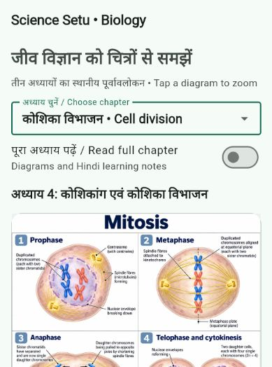

# Science Setu biology illustration plan

Planning target: **46 visuals for Biology Part 1 (16 chapters)** and **64 visuals for Biology Part 2 (24 chapters)**: **110 visual placements in total**. This is an editorial estimate, not a minimum image quota. Count each multi-panel educational plate as one visual. Counts include labelled illustrations, process charts, comparison plates and revision maps; covers, icons and decorative images are excluded.

The three completed local pilot images are already included in these targets. Remaining planned placements: 107. Reuse suitable tissue, inheritance, virus and revision illustrations across chapters/books rather than generating duplicates. Expect roughly 100–105 distinct files after reuse; confirm the exact asset count during storyboarding.

A chapter with several organ systems or mechanisms needs more illustrations than an introductory or policy chapter. Every visual should answer a clear learning question, sit beside its corresponding explanation, and include Hindi terms/English scientific labels and a concise caption. Detailed diagrams must remain readable in full-screen zoom.

## Biology Part 1

Rows follow the actual app order. Existing source title numbering jumps from chapter 10 to 17; this plan follows the 16 stored chapters and does not infer extra chapters from those numbers.

| App chapter | Topic | Planned visuals | Subjects |
|---|---|---:|---|
| 1 | Introduction and living world | 1 | Levels of biological organisation |
| 2 | Classification and binomial nomenclature | 2 | Taxonomic hierarchy; three-domain/five-kingdom comparison |
| 3 | Cell theory and cell structure | 3 | Plant versus animal cells (pilot completed); prokaryotic versus eukaryotic cells; bacterial cell |
| 4 | Organelles and cell division | 5 | ER/Golgi pathway; mitochondrion; chloroplast; mitosis (pilot completed); meiosis with crossing-over |
| 5 | Plant and animal tissues | 4 | Plant tissue map; xylem/phloem; epithelial/connective tissues; muscle/nerve tissues |
| 6 | Biomolecules and enzymes | 3 | Carbohydrate/lipid/protein comparison; DNA/RNA structure comparison; enzyme action |
| 7 | Microorganisms | 3 | Bacterial forms; virus versus bacterium; fungi/protist comparison |
| 8 | Useful and harmful microbes | 3 | Fermentation; nitrogen fixation; sewage treatment/biogas flow |
| 9 | Plant kingdom | 3 | Plant group comparison; representative structures; alternation of generations |
| 10 | Animal kingdom | 4 | Invertebrate phyla identification plates; body symmetry; vertebrate classes; chordate characters |
| 11 | Mendelian inheritance | 4 | Monohybrid cross; dihybrid cross; test cross; incomplete dominance/codominance |
| 12 | Sex determination, blood groups and linkage | 3 | Sex determination cross; ABO inheritance; linkage/recombination |
| 13 | Mutation and genetic disorders | 2 | Gene/chromosome mutation types; nondisjunction schematic |
| 14 | Evolution and adaptation | 3 | Natural selection; homologous versus analogous organs; evolutionary relationships |
| 15 | Biofertilisers and economic botany | 2 | Root nodules/mycorrhiza; Rajasthan plants identification plate |
| 16 | Revision and model paper | 1 | One visual revision map; reuse earlier figures in questions where useful |
| | **Total** | **46** | |

## Biology Part 2

| App chapter | Topic | Planned visuals | Subjects |
|---|---|---:|---|
| 1 | Organisation and homeostasis | 2 | Organ-system overview; negative-feedback loop |
| 2 | Bones, joints and muscles | 4 | Skeleton; synovial joint; sarcomere; sliding-filament sequence |
| 3 | Digestion | 4 | Digestive tract (pilot completed); villus; enzyme/site pathway; liver-pancreas secretions |
| 4 | Respiration | 3 | Respiratory tract; alveolar gas exchange; inhalation/exhalation |
| 5 | Circulation and blood | 4 | Heart; double circulation; cardiac cycle; blood components |
| 6 | Lymphatic system | 2 | Lymphatic organs/vessels; tissue-fluid return |
| 7 | Excretion and osmoregulation | 4 | Urinary tract; nephron; filtration/reabsorption/secretion; countercurrent mechanism |
| 8 | Nervous system | 4 | Neuron; brain; reflex arc; synapse |
| 9 | Sense organs | 4 | Eye; ear; visual pathway; skin/sensory receptors |
| 10 | Endocrine system | 3 | Endocrine glands; hormone feedback; hormone action comparison |
| 11 | Reproduction and development | 4 | Male/female reproductive anatomy plates; gametogenesis; fertilisation-to-implantation |
| 12 | Reproductive health | 2 | Contraceptive mechanism comparison; assisted reproduction process |
| 13 | Balanced diet | 2 | Balanced-food plate; nutrient functions and sources |
| 14 | Vitamins, minerals and deficiencies | 2 | Deficiency association chart; malnutrition comparison |
| 15 | Infection and transmission | 2 | Chain of infection; transmission-route map |
| 16 | Viral infections | 3 | Virus replication; HIV immune-cell pathway; mosquito transmission cycle |
| 17 | Bacterial, fungal and parasitic diseases | 3 | Malaria life cycle; pathogen identification plate; antimicrobial resistance pathway |
| 18 | Immunity and vaccination | 3 | Innate/adaptive immunity; antibody; primary/secondary immune response |
| 19 | Lifestyle and noncommunicable disease | 2 | Insulin/glucose regulation; risk-factor concept map |
| 20 | Genetic and congenital disorders | 2 | Chromosomal disorder comparison; recessive/X-linked inheritance (reuse Book 1 where possible) |
| 21 | Public health, hygiene and first aid | 2 | Waste-management/hygiene flow; emergency response decision flow, checked against current authoritative guidance before creation |
| 22 | Substance use and addiction | 1 | Dependence-and-recovery concept map |
| 23 | Health policies and programmes | 1 | Programme purpose/beneficiary map, verified against current sources before creation |
| 24 | Revision and model paper | 1 | Human-system revision map; reuse existing diagrams in questions where useful |
| | **Total** | **64** | |

## Production order

1. Review the three-image local pilot for illustration style, Hindi guidance and zoom readability.
2. Complete Biology Part 1: cell structure/division and tissues first, then classification, genetics and remaining chapters. Review batches of 8–10 visuals locally.
3. Complete Biology Part 2: anatomy/physiology first, then nutrition, infection, immunity and public health. Reuse reviewed diagrams where appropriate.
4. Verify label endpoints, anatomical orientation, arrows, stage order and counts for each figure. Retain all original teaching text and MCQs. Check phone-width rendering and dark mode; keep illustration surfaces white when required for contrast.
5. Optimize final image files and measure added download size before APK packaging. This step has not been performed for the pilot; no APK was built.

## Local pilot

[Open local Flutter preview](http://127.0.0.1:8765/). Dropdown selects cell structure, cell division or digestion. Tap a diagram to enlarge; the full-chapter switch shows all original lesson text with the inserted visual.

148 Flutter tests passed after the pilot changes. The source completeness audit matched all 1,817 raw chapter records and found no omitted paragraphs. The insertion script also checks complete pre-pilot hashes of the three affected chapters, including existing MCQs.
