# RPSC First Grade: Literature MCQs

## Main study material

RPSC First Grade Exam: An Objective Approach to Literature

With 15 Free Practice Tests

(Part - 1)

Mukesh K Sharma

(M.A., B.Ed., M.Phil., NET, SET)

Copyright © 2024 by Mukesh K Sharma

All rights reserved. No part of this publication may be reproduced, distributed, or transmitted in any form or by any means, including photocopying, recording, or other electronic or mechanical methods, without the prior written permission of the author, except in the case of brief quotations embodied in critical reviews and certain other noncommercial uses permitted by copyright law.

First Edition, April 2024

Published by Mukesh K Sharma

For any inquiries, please contact the author at Mukesh.mphil@gmail.com

Disclaimer: The information provided in this book is for educational purposes only. The author and publisher have made every effort to ensure the accuracy of the information within this book was correct at time of publication. The author and publisher do not assume and hereby disclaim any liability to any party for any loss, damage, or disruption caused by errors or omissions, whether such errors or omissions result from accident, negligence, or any other cause.

Made with ❤ on the Notion Press Platform

www.notionpress.com

## Introduction by the Author

# Introduction by the Author

Dear Aspirants,

It is with great pleasure that I present to you the newly updated edition of my book, "RPSC First Grade Exam: An Objective Approach to Literature with 15 Free Practice Tests." This is the part one of the two book series. As an educator and author, my primary goal has always been to provide aspiring First Grade Teachers, also known as School Lecturers, with the essential tools and knowledge required to excel in the highly competitive RPSC First Grade Exam.

This book has been meticulously designed to align with the syllabus prescribed for the RPSC First Grade Exam, covering a wide range of topics in English Literature. From the timeless works of renowned poets like John Milton, John Donne, William Wordsworth, P.B. Shelley, John Keats, Robert Browning, Nissim Ezekiel, and Kamala Das to the dramatic brilliance of Shakespeare's "Macbeth" and "As You Like It," this book offers a comprehensive overview of the literary masterpieces that form the core of the examination.

To further enhance your understanding of prose and fiction, I have included multiple-choice questions based on the insightful essays of Francis Bacon and Charles Lamb, as well as the captivating novels of Thomas Hardy and R.K. Narayan. These works not only showcase the depth and diversity of English Literature but also provide valuable insights into the art of critical analysis and interpretation.

In addition to the study of specific literary works, this book also covers a wide array of literary forms and figures of speech. From Odes and Elegies to Ballads and Sonnets, and from Similes and Metaphors to Personification and Irony, I have included questions that will help you develop a keen understanding of these essential literary devices. A strong grasp of these concepts will undoubtedly give you a competitive edge in the examination.

Moreover, I have incorporated a section dedicated to the study of varieties of languages, such as Creole, Pidgin, Code-Switching, and Code-Mixing. As a prospective First Grade Teacher, it is crucial to have a well-rounded understanding of linguistic diversity and its impact on language education.

To complement your learning experience, I have included 15 free practice tests that will help you assess your progress, identify areas for improvement, and build the confidence needed to excel in the examination. These tests have been carefully designed to mirror the format and difficulty level of the actual RPSC First Grade Exam, ensuring that you are well-prepared for the challenges that lie ahead.

I firmly believe that success in the RPSC First Grade Exam is not merely about memorizing facts but about developing a deep understanding of the subject matter and applying that knowledge effectively. This book is a tool to help you cultivate that understanding and unlock your true potential as a future educator.

As you embark on this transformative journey, remember that dedication, perseverance, and a passion for teaching are the keys to success. I am confident that with the right guidance and unwavering commitment, you will achieve your goals and make a positive impact on the lives of your future students.

I wish you the very best in your endeavors, and I am honored to be a part of your journey towards becoming a successful First Grade Teacher.

Happy studying, and may success be yours!

Mukesh K Sharma

## Free Bonus Practice Tests!!

# Free Bonus Practice Tests!!

Attention RPSC First Grade Aspirants!

Get ready to skyrocket your exam preparation with an exclusive bonus feature that comes complimentary with this book – 15 Practice Tests that will transform your journey to success!

These practice tests are not just any ordinary mock exams; they are the secret weapon that propelled 23 out of 49 students to triumph in the previous year's RPSC First Grade Teacher Exam. Crafted meticulously to cover the essential literature portion of the exam, these tests offer you the unparalleled opportunity to experience the actual examination environment and assess your readiness.

Imagine walking into the exam hall with the confidence of having already encountered similar questions. These 15 practice tests provide you with that competitive edge, empowering you to showcase your knowledge and skills to the fullest.

The best part? These invaluable resources come to you absolutely FREE with the purchase of this book. It's like having a personal mentor guiding you through the exam preparation process, without any additional cost.

Don't miss out on this golden opportunity to elevate your preparation and join the ranks of successful aspirants. Dive into the world of poetry, essays, forms, and figures, armed with the expertise of Mukesh K Sharma and the unbeatable advantage of the 15 practice tests.

Your path to becoming a first-grade teacher is just a few pages away. Seize this moment, unlock your potential, and ace the RPSC First Grade Exam like never before!

## Bonus Free Practice Tests

# Bonus Free Practice Tests

# Set 1

Q1: Which of the following lines has Onomatopoeia?

A) Tattoos on their cheeks, jasmines in their hair

B) Cymbals richly clashing, and anklets jingling, jingling Jingling

C) The sky crackled then, thunder came, and lightning

D) Both 2 and 3

Q2: What does 'fiery' in the phrase 'fiery Gulmohar' mean?

A) Dangerous

B) Aggressive

C) Red

D) None of the above

Q3: In which collection was the poem published?

A) A Hot Summer in Malabar

B) Summer in Calcutta

C) Summer in Kolkata

D) Introduction

Q4: The poem shows Kamala Das's:

A) Love for the eunuchs

B) Frustration

C) Hatred for eunuchs

D) None of the above

Q5: Find out the figure of speech in the phrase 'vacant ecstacy'?

A) Antithesis

B) Paradox

C) Oxymoron

D) Metaphor

Q6: Eunuchs in the poem symbolize:

A) Dance icons

B) Barrenness

C) Love

D) Fruitfulness of love

Q7: When was the poem 'Dance of the Eunuchs' published?

A) 1967

B) 1969

C) 1965

D) 1963

Q8: Which of the following do the eunuchs not represent in the poem?

A) Barrenness

B) Futility of love

C) Grief

D) Perfection in the art of dancing

Q9: 'Some were dark and some were.....fair'.

Fill in the blank with the appropriate word.

A) Very

B) Absolutely

C) Almost

D) About

Q10: 'Some beat their drums; others beat their sorry breasts'.

Find out the figure of speech in the line above.

A) Anaphora

B) Epiphora

C) Onomatopoeia

D) Transferred epithet

Q11: In which Country, Milton's form of sonnet was originated?

A) England

B) Germany

C) Italy

D) America

Q12: Which part of On His Blindness frames a foolish question?

A) Octave

B) Sestet

C) Tercet

D) None

Q13: Which of the following meters is used in On His Blindness?

A) Iambic pentameter

B) Trochaic

C) Anapestic

D) Dactylic

Q14: In which of the following collections of poems On His Blindness first appeared?

A) Sonnets

B) Poems

C) Lyrics

D) None

Q15: What is the rhyme-scheme of the sestet of Milton's On His Blindness?

A) cde, dcd

B) cde, cde

C) abc, abc

D) cde, ddd

Q16: Who are the best devotees of God?

A) Those who bear His mild yoke

B) Those who post over land and ocean with out rest

C) Those who only stand and wait

D) All of the above

Q17: In the last two tercets the poet feels himself:

A) frustrated and despaired

B) depressed and sad

C) cheated and gloomy

D) reassured and optimistic

Q18: The word Talent in On His Blindness can refer to:

A) Milton's poetic ability

B) A kind of currency

C) Either of the two

D) Neither of the two

Q19: How old was Milton when he became completely blind?

A) 43

B) 45

C) 44

D) 47

Q20: Which of the following does not have any figure of speech in the poem On His Blindness? (RPSC prescribed figures of speech are: Simile, Metaphor, Personification, Irony, Hyperbole, Synecdoche, Oxymoron)

A) Patience

B) thousands at his bidding

C) mild yoke

D) Talent

Q21: The phrase 'Writhed in vacant ecstasy', symbolizes:

A) Sorrow of people

B) Barrenness of the nature

C) Barrenness of Eunuchs

D) All of the above

Q22: In Go and Catch a Falling Star the line ' Till age snow white hairs on thee.' is an example of:

A) Sensual imagery

B) visual imagery

C) phonic imagery

D) None of the above

Q23: Which of the following figures of speech has been used in the lines given below:

"Yet do not, I would not go,

Though at next door we might meet.

Though she were true when you met her,"

A) Hyperbole

B) Anaphora

C) Personification

D) Metaphor

Q24: What is the rhyme scheme of the sestet in the poem Go and Catch a Falling Star?

A) ababcc

B) ababab

C) abcabc

D) aabbcc

Q25: How many sestets does the poem Go and Catch a Falling Star have?

A) 4

B) 3

C) 6

D) 5

Q26: Mandrake root mentioned in the poem Go and Catch a Falling Star is believed to have:

A) Child bearing capacities

B) Child killing capacities

C) Magical powers

D) Sweetness like a sugarcane

Q27: The phrase envy's stinging contains which of the following figures of speech.

A) Personification

B) Metonymy

C) Synecdoche

D) Alliteration

Q28: Which of the following meters has been used in the sestets of the poem?

A) Iambic Pentameter

B) Iambic Hexameter

C) Iambic Monometer

D) Iambic Tetrameter

Q29: Which of the following tones is not found in the poem Go and Catch a Falling Star?

A) Pessimistic

B) Cynic

C) Sarcastic

D) Androphobiac

Q30: The poem Go and Catch a Falling Star talks about the...........of women.

A) Beauty

B) Love

C) Nature

D) None of the above

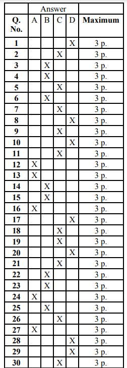

## Set 2

# Set 2

Q1: Which of the following objects is personified in the poem Ode on a Grecian Urn?

A) heifer

B) priest

C) urn

D) bride

Q2: Which of the following is not an example of metaphor?

A) Foster child

B) Sylvan historian

C) An unravished bride

D) All are metaphors

Q3: "That leaves a heart high-sorrowful and cloy'd." Which figure of speech the poet uses in the line?

A) metonymy

B) synecdoche

C) oxymoron

D) anaphora

Q4: Which figure of speech is used in the line, 'Heard melodies are sweet, but those unheard are sweeter'?

A) oxymoron

B) paradox

C) metaphor

D) synecdoche

Q5: 'Who are these coming to the sacrifice' name the device used in the line?

A) apostrophe

B) metaphor

C) rhetorical question

D) synecdoche

Q6: 'Tempe' and 'Arcady' are symbols for places where people lived:

A) a forest life

B) in castle

C) old buildings

D) huts

Q7: Which of the following meter is used in Ode on a Grecian Urn?

A) Iambic pentameter

B) Iambic tetrameter

C) Trochaic

D) Anapestic

Q8: Which of the following is a setting to Ode on a Grecian Urn?

A) The world of Grecian urn

B) The world of plants

C) The world of musician

D) The world of men and maidens

Q9: The locale depicted in the poem Ode on a Grecian Urn is entirely:

A) urban

B) semi-rural

C) pastoral

D) none

Q10: What is the word used for a small fortress in Ode on a Grecian Urn?

A) fort

B) castle

C) citadel

D) enclosure

Answer: C

Q11: Who among the following are coming towards the green altar?

A) mysterious priest

B) heifer

C) folk

D) all

Q12: Keats in his Ode on a Grecian Urn expresses the superiority of:

A) Art

B) Nature

C) Mankind

D) Children

Q13: According to the text critics, which of the following lines from John Keats' Ode on a Grecian Urn are possibly the most discussed and debated in English poetry?

A) 'Heard melodies are sweet, but those unheard are sweeter'.

B) Thou, silent form, dost tease us out of thought As doth eternity:

C) "Beauty is truth, truth beauty,"—that is all Ye know on earth, and all ye need.."

D) Who are these coming to the sacrifice?

Q14: When Keats says 'Beauty is Truth, Truth Beauty", he is very close to:

A) Plato

B) Shelley

C) Aristotle

D) Shakespeare

Q15: Which of the following literary devices is used in the first line of Ode on a Grecian Urn?

A) apostrophe

B) personification

C) metaphor

D) all are used

Q16: Which literary device Ezekiel uses when he says 'like swarms of flies'?

A) metaphor

B) simile

C) alliteration

D) pun

Q17: Name the literary device used in Ezekiel's line 'buzzed the name of God' repeatedly?

A) metaphor

B) Onomatopoeia

C) alliteration

D) pun

Q18: Name the figurative device when the poet says that these people 'clicked their tongues'.

A) metaphor

B) simile

C) hyperbole

D) onomatopoeia

Q19: Ezekiel uses the phrase 'diabolic tail' comparing the scorpion to:

A) a sword

B) evil

C) double standard

D) his father

Q20: Which of the following applies to Night of the Scorpion?

A) a poignant poem

B) a cheerful poem

C) a poem full of love-sickness

D) a poem depicting a journey

Q21: 'The Evil One' in the poem Night of the Scorpion refers to?

A) scorpion

B) his father

C) the incident of scorpion bite

D) the farmers

Q22: The word 'superstitious' in the poem Night of Scorpion is used for:

A) poet's father

B) the poet

C) peasants

D) poet's mother

Q23: How many hours after the scorpion's string did the poet's mother get relief from the pain?

A) twenty

B) ten

C) twenty four

D) twelve

Q24: Who was called to perform his rites to tame the poison with an incantation?

A) farmers

B) a doctor

C) the poet's father

D) holy man

Q25: In the poem Night of Scorpion, the world of blind faith and superstition is juxtaposed with the world of:

A) common men

B) metaphysics

C) science and rationality

D) philosophy and psychology

Q26: The rain in the poem Night of Scorpion lasted continuously for:

A) ten hours

B) eight hours

C) twelve hours

D) fifteen hours

Q27: Fill in the blanks with the most appropriate word:

May the poison purify your flesh of .........., and your spirit of.......,

A) desire, ambition

B) ambition, desire

C) ambition, hopes

D) desire, needs

Q28: The poem ends with thanks to God from the side of:

A) narrator's father

B) narrator's mother

C) peasants

D) narrator himself

Q29: The poem, Night of the Scorpion, is taken from:

A) The Exact Name

B) The Unfinished Man

C) Hymn In Darkness

D) The Enterprise

Q30: Who is the speaker in the poem, Night of Scorpion?

A) The Peasant

B) Village folk

C) The Poet himself

D) not clear from the text of the poem

Q31: When was the final version of the poem Daffodils first published?

A) 1807

B) 1815

C) 1808

D) 1816

Q32: Name the collection in which the final version of the poem Daffodils published.

A) Poems in Two Volumes

B) Collected Poems

C) Lyrical Ballads

D) Preface to Lyrical Ballads

Q33: What is the rhyme scheme of each stanza in Daffodils?

A) ab ab cc

B) aa bb cc

C) abc abc

D) aba aba

Q34: Where did Wordsworth wrote Daffodils?

A) At Dove Cottage in Grasmere

B) A Cottage in Cumberland

C) Westmoreland

D) None of the above

Q35: Name the literary device which Wordsworth uses while calling the daffodils, 'a crowd', 'a host', 'their heads' etc.

A) Hyperbole

B) Metaphor

C) Personification

D) Simile

Q36: What is the original title of Daffodils?

A) Daffodils

B) The Daffodils

C) I wandered lonely as a cloud

D) As a Cloud

Q37: 'Ten thousand saw I at a glance'.

Which figurative device is used in the line?

A) Metaphor

B) Personification

C) Hyperbole

D) Simile

Q38: 'They stretched in never ending line'.

Identify the figure of speech used in the line?

A) Hyperbole

B) Metaphor

C) Simile

D) Pun

Q39: 'Jocund company' in Daffodils refers to:

A) Company of Daffodils

B) Company of Coleridge

C) Company of Wordsworth

D) Company of Dorothy

Q40: Name the meter used in the poem Daffodils:

A) iambic pentameter

B) iambic tetrameter

C) heroic couplet

D) trochaic meter

Q41: How many daffodils did Wordsworth see in total?

A) twenty thousand

B) ten thousand

C) thirty thousand

D) the poem doesn't tell this

Q42: Which verse form has Night of Scorpion been written in?

A) Blank verse

B) Free verse

C) Heroic couplet

D) None of the above

Q43: Which line of the poem Night of Scorpion shows that the prayers of the villagers had no soothing effect on the mother of the poet?

A) May he sit still, they said

B) May the sins of your previous birth be burned away tonight

C) May your suffering decrease the misfortunes of your next birth

D) My mother twisted through and through

Q44: Find out the figure of speech in the following line:

'The peasants... buzzed the name of God a hundred times.'

A) Simile

B) Onomatopoeia

C) Hyperbole

D) Both onomatopoeia and hyperbole

Q45: Which of the following is a NOT theme in the poem?

A) A mother's unconditional love for her children

B) The rational and scientific nature of poet's father

C) The danger of insects in Indian villages

D) Superstitions prevalent in the Indian village life

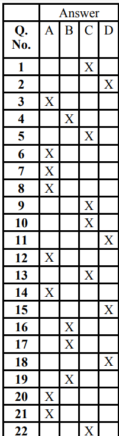

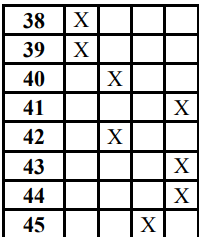

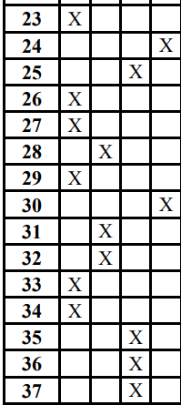

### अभ्यास प्रश्न

1. What is the word used for a small fortress in Ode on a Grecian Urn?
   A. fort
   B. castle
   C. citadel
   D. enclosure
   **उत्तर:** C
   **व्याख्या:** उत्तर स्रोत पुस्तक की उत्तर-कुंजी के अनुसार है।

## Set 3

# Set 3

1\. In the poem "Ode to the West Wind," Shelley describes the power of the west wind on:

A. The ocean

B. The earth

C. The sky

D. All of the above

2\. In "Ode to the West Wind," the seeds lying underground are compared to:

A. Sheep

B. Corpses in a grave

C. A flock of birds

D. Fallen leaves

3\. Percy Bysshe Shelley wrote "Ode to the West Wind" in:

A. 1819

B. 1821

C. 1820

D. 1818

4\. According to the poem, the west wind preserves the:

A. Clouds

B. Seeds

C. Leaves

D. None of the above

5\. The first stanza of "Ode to the West Wind" describes the west wind's activities on:

A. The sky

B. The ocean

C. The earth

D. Bodies of water

6\. In the context of the poem, spring symbolizes:

A. Realism

B. Flowers

C. Nationalism

D. Rebirth

7\. In the line "A heavy weight of....... one too like thee," the word "thee" refers to:

A. The sea

B. The west wind

C. Clouds

D. Leaves

8\. The west wind is described as the breath of:

A. Autumn

B. Spring

C. Summer

D. Winter

9\. "Ode to the West Wind" is part of which collection of Shelley's poems?

A. Prometheus Unbound and Other Poems

B. Ode to a Skylark and Other Poems

C. Ode to the West Wind and Other Poems

D. None of the above

10\. "Ode to the West Wind" is divided into how many stanzas?

A. Three

B. Four

C. Five

D. Six

11\. In the poem, which body of water is described as dreaming of old palaces and towers?

A. The Pacific Ocean

B. The Atlantic Ocean

C. The Mediterranean Sea

D. The Indian Ocean

12\. According to the poem, the west wind destroys:

A. Dead trees

B. Water

C. Dead leaves

D. Dead bodies

13\. The west wind is described as the messenger of:

A. The ocean

B. Rain and lightning

C. Spring

D. Clouds

14\. The Mediterranean Sea is said to be enjoying its sleep in:

A. Autumn

B. Winter

C. Spring

D. Summer

15\. Which of the following statements about "Ode to the West Wind" is incorrect?

A. It was written in 1819

B. It was published in 1820

C. It was published anonymously

D. All of the above statements are correct

16\. In "My Last Duchess," the repetition of the word "Too" suggests the Duke's:

A. Love for his wife

B. Irritation

C. Patience

D. Greed

17\. The lines "Looking as if she were alive. I call / That piece....." are an example of which literary device?

A. Catharsis

B. Enjambment

C. Apostrophe

D. Metaphor

18\. According to the Duke in "My Last Duchess," what is his priority?

A. The Count's daughter

B. The Count's money

C. Both the daughter and the money

D. None of the above

19\. Robert Browning's poem "My Last Duchess" was published in:

A. 1843

B. 1841

C. 1840

D. 1842

20\. The title "My Last Duchess" suggests that:

A. The Duke sees his wife as a replaceable object

B. The Duke is possessive

C. The Duke is planning to marry again

D. All of the above

21\. In "My Last Duchess," who carved the statue of Neptune?

A. Claus

B. Clause

C. Ferrara

D. Fra Pandolf

22\. The statue of Neptune in "My Last Duchess" was carved in which metal?

A. Gold

B. Iron

C. Silver

D. Bronze

23\. The lines "I gave commands; / Then all smiles stopped together." contain which figure of speech?

A. Euphemism

B. Personification

C. Eupheism

D. None of the above

24\. The Duke's family name in "My Last Duchess" is said to be how many years old?

A. 800 years

B. 1800 years

C. 900 years

D. 1900 years

25\. The line "Who'd stoop to blame this sort of trifling?" is an example of which literary device?

A. Rhetorical question

B. Complex question

C. Echo question

D. None of the above

26\. "My Last Duchess" is written in which meter?

A. Iambic tetrameter

B. Iambic pentameter

C. Trochaic meter

D. None of the above

27\. "My Last Duchess" was published in which collection of Robert Browning's poems?

A. Our Last Ride Together

B. Dramatic Lyrics

C. Dramatic Songs

D. Songs and Sonnets

28\. Who is the speaker in "My Last Duchess"?

A. Robert Browning

B. The envoy

C. Duke Alfonso

D. Duke of Ferrara

29\. What is the name of the Duke in "My Last Duchess"?

A. Pandolf

B. Neptune

C. Ferrara

D. Alfonso

30\. In the context of the poem, what does the word "Fra" stand for?

A. Fraudulent

B. Friar

C. Friend

D. Freud

31\. "Ode to the West Wind" ends on:

A. A pessimistic note

B. An optimistic note

C. Both pessimistic and optimistic notes

D. Neither a pessimistic nor an optimistic note

32\. In the presence of the west wind, the dead leaves are driven like:

A. "Ghosts from an enchanter fleeing"

B. "Clarion over the dreaming Earth"

C. "Flocks to feed in air"

D. "Sweet buds"

33\. The first line of "Ode to the West Wind" contains which figurative device?

A. Alliteration

B. Apostrophe

C. Both alliteration and apostrophe

D. Neither alliteration nor apostrophe

34\. Which figure of speech is used in the expression "thorns of life"?

A. Personification

B. Metaphor

C. Onomatopoeia

D. Oxymoron

35\. Which of the following roles is the west wind described as in the poem?not

A. Preserver

B. Destroyer

C. Agent of change

D. Agent of calm

36\. In the phrase "Thine azure sister of spring," who is the "azure sister"?

A. Spring

B. The west wind

C. The east wind

D. Summer

37\. Complete the line: "A heavy weight of hours has chain'd and bow'd / One too like thee: tameless, and ......., and proud."

A. Humble

B. Swift

C. Agile

D. Free

38\. In the line "Thou dirge Of the dying year," what does the word "dirge" mean?

A. A song of lament for a general loss

B. A song of lament for the death of someone close

C. A funeral song

D. None of the above

39\. Identify the figure of speech in the line: "Loose clouds like earth's decaying leaves are shed."

A. Personification

B. Simile

C. Apostrophe

D. Pun

40\. Complete the line: "Yellow, and black, and pale, and hectic......, / Pestilence-stricken multitudes:"

A. Green

B. Red

C. Blue

D. Purple

41\. How many lines does each stanza in "Ode to the West Wind" contain?

A. 12

B. 13

C. 14

D. 15

42\. The rhyme scheme in each part of "Ode to the West Wind" follows a pattern known as:

A. Tri-meter

B. Tetra-meter

C. Terza rima

D. Texa rhyme

43\. "My Last Duchess" by Robert Browning is a dramatic monologue written in five sections and made up of:

A. Rhyming tercets

B. Rhyming couplets

C. Unrhyming couplets

D. Unrhyming tercets

44\. In the statue of Neptune taming a sea horse, what does the sea horse symbolize?

A. Art

B. The Duke

C. Any Duchess the Duke would marry

D. Vigour

45\. Robert Browning belonged to which literary period?

A. Romantic

B. Jacobean

C. Victorian

D. Elizabethan

46\. Which of the following themes is addressed in "My Last Duchess"?not

A. The objectification of women

B. Control and manipulation

C. Social status, art, and elitism

D. The vindication of women's rights

47\. Complete the line: "Sir, 'twas not / Her husband's presence only, called that spot / Of ................ into the Duchess' cheek:"

A. Happiness

B. Joy

C. Shyness

D. Smiling

48\. According to the Duke, the Duchess used to ride a:

A. White mule

B. Black mule

C. Brown mule

D. Grey mule

49\. In the lines "Even had you skill / In speech—which I have not—to make your will / Quite clear to such an one..," who is "you"?

A. Fra Pandolf

B. Alfonso

C. The envoy

D. Claus

50\. How many speakers are there in the poem "My Last Duchess"?

A. Two

B. Three

C. One

D. Four

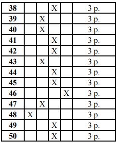

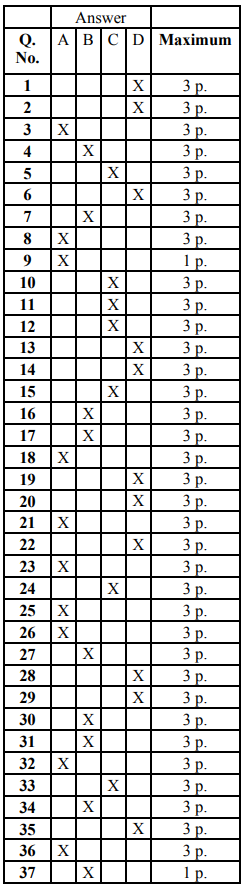

## Set 4

# Set 4

1\. Which of the following motifs is not introduced in the first scene of Macbeth?

A. Supernatural influences

B. Man as a sinner

C. Fair being foul

D. The stormy fate of Scotland

2\. When Duncan hears that Macbeth has defeated Macdonwald, he calls Macbeth:

A. "Treacherous rebel! Despised rogue!"

B. "Your Majesty, Lord of all Scotland!"

C. "Murderous beast! Evil of soul!"

D. "Valiant cousin! Worthy gentleman!"

3\. In the first act, who is sentenced to death?

A. Duncan

B. Ross

C. The Thane of Cawdor

D. The Captain

4\. In Act 1, the witches predict that:

A. Macbeth will become Thane of Cawdor and eventually king, and Banquo's descendants will be kings, although he will not be one.

B. Macbeth will conquer Norway, and Banquo will become king.

C. Macbeth will remain Thane of Glamis, and Banquo will be Thane of Cawdor.

D. Macbeth will be king, and Banquo will be Thane of Glamis and Cawdor.

5\. What news does Ross bring Macbeth in Act 1?

A. Lady Macbeth has had a son

B. The Thane of Glamis has been killed

C. Macbeth now holds the title of Thane of Cawdor

D. The army has just lost the battle with the Norwegians

6\. In Act 1, Banquo says about the motives of the "instruments of darkness":

A. They often tell of good things without revealing the bad consequences

B. They are greedy and only make predictions when someone pays enough

C. Good conquers evil, and their predictions will not come true

D. The witches are crazy and don't know what they're saying

7\. When Malcolm describes Cawdor's last moments before execution in Act 1, Duncan replies:

A. "You should never turn your back, even on a friend"

B. "You shouldn't sympathize with one who has committed evil deeds"

C. "You should always be ready, for you never know when death will strike"

D. "You can't tell what is in a person's heart by looking at his face"

8\. Macbeth says, "Stars, hide your fires, let not light see my black and deep desires." What are Macbeth's desires?

A. He wants to go home to see Lady Macbeth

B. He wants to raise the taxes in the lands he rules

C. He is tired and wants the stars to stop shining so he can sleep

D. He wants to become king

9\. After reading Macbeth's letter, Lady Macbeth believes he:

A. Would not be a good king, but as her husband, she will support him

B. Could be a good king but lacks the hardheartedness to achieve the position, so she will persuade him

C. Should not be king, and she vows to stop him

D. Thinks Banquo would be a better king, so she plans to convince Macbeth to support Banquo instead

10\. After learning Duncan is coming, Lady Macbeth prays to the spirits to:

A. Fill her with cruelty and harden her heart to do what must be done to make Macbeth king

B. Have Duncan die on the way to see Macbeth and for the witches to create a terrible storm

C. Strengthen Macbeth's resolve so she won't have to do the actual stabbing

D. Give her a sign that her decision is right for her husband and the country

11\. When Macbeth arrives home, Lady Macbeth advises him to:

A. Not eat too much to avoid becoming sluggish, or he won't be able to commit the murder quickly

B. Let Banquo in on the plan to have more help

C. Learn to look innocent even when his heart is full of evil

D. Wait a few days before murdering Duncan

12\. Macbeth's arguments to himself against killing Duncan include:

A. There are too many witnesses in the castle, and he could never get away with it

B. Macbeth is Duncan's kinsman and subject, Duncan is a good and popular king, and his death would bring sorrow to Scotland

C. Macbeth doesn't truly have the ambition to be king and is doing this to please his wife, but he may be able to change her mind

D. If anyone found out, they would kill him, so he is better off remaining a Thane and staying alive

13\. Lady Macbeth convinces Macbeth to commit the murder by:

A. Telling him not to be a coward but to be a man and take what he wants

B. Warning that if Duncan suspects anything and they fail, they will lose their lives, so he should proceed with the plan

C. Saying the people of Scotland will grow to love Macbeth even more than Duncan, and he should do it for the good of the country

D. Reminding him that when they married, he promised to always make her happy, and she won't be happy until he is king

14\. Lady Macbeth's plan involves:

A. Putting poison in the king's food so he dies in his sleep, making it look like a natural death

B. Bribing the guards with money and power to kill the king

C. Having Macbeth's soldiers disguise themselves as robbers to commit the murder and wound Macbeth to avoid suspicion

D. Drugging the king's guards so Macbeth can go into the king's room and kill him

15\. Regarding the witches' predictions, Macbeth lies to Banquo by saying:

A. He does not remember what they said

B. He doesn't even think about them

C. They made a lucky guess, but they are wrong about him becoming king

D. Only fools and women believe such nonsense

16\. The signal Lady Macbeth is to give Macbeth to let him know she has taken care of the guards is:

A. Ringing a bell

B. Sending a servant to say she is ill and wants to see him

C. Lighting three candles in her bedroom window

D. Standing at the window and whistling like a bird

17\. Lady Macbeth claims she did not kill Duncan herself because:

A. It would diminish Macbeth's power if she did the killing

B. She is not strong and might not be able to use the knife effectively

C. She saw in a dream that only Macbeth could commit the murder

D. Duncan reminded her of her father sleeping there

18\. When Macbeth is concerned about not being able to say "Amen," Lady Macbeth advises him to:

A. Keep trying, and soon he will succeed

B. Not think about it, as it does not matter whether he can say it or not

C. Stop thinking about it, or it will drive them crazy

D. Go to a priest and ask for forgiveness after things calm down

19\. Macbeth is worried about hearing a voice saying, "Macbeth does murder sleep." Lady Macbeth then tells him to:

A. Have a glass of wine and relax

B. Get cleaned up and forget about it

C. Have a minstrel come and sing quiet tunes to help them sleep

D. Go for a walk in the garden and get some fresh air

20\. Macbeth refuses to take the daggers back to the scene of the crime because:

A. He can't bear to look at Duncan again

B. He is afraid of being seen and looking suspicious

C. He thinks it will bring bad luck to touch them again

D. He says he has done enough, and Lady Macbeth can return the daggers

21\. In Act 2, who was knocking at the door?

A. A servant bringing a glass of wine to Macbeth's chamber

B. Macduff and Lennox at the gate

C. A drunkard who had lost his way and wanted a place to sleep

D. A messenger with a note for Lady Macbeth

22\. According to the porter, drinking provokes:

A. "Sin, ill tempers, and ruin"

B. "Poor health, nightmares, and poverty"

C. "Nose-painting, sleep, and urine"

D. "Fighting, hatred, and trouble"

23\. Lennox describes the night, and Macbeth responds by:

A. Saying it was a terrible night that predicted terrible, confusing times ahead, but Macbeth brushes it off as merely a rough night

B. Saying it was truly beautiful and peaceful-looking, but Macbeth says appearances can be deceiving

C. Saying it was an awful night, and Macbeth agrees and blames the witches

D. Saying it started out looking like an ordinary night, but Macbeth disagrees and says it was terrible

24\. After reaching Duncan's room, Macduff discovers:

A. A note containing the outline of a plot to kill Duncan

B. An unlocked gate and a drunk porter

C. Another omen -- dead flowers in the garden

D. Duncan's body

25\. When Macduff says to Lady Macbeth, "Oh, gentle lady, 'Tis not for you to hear what I can speak. The repetition, in a woman's ear, Would murder as it fell," the irony is that:

A. He pretended to be brave, but he really wasn't

B. He sounded concerned about Lady Macbeth but really thought women were weak and foolish

C. He tried to sound upset but was glad the king was dead

D. He didn't know about Lady Macbeth's part in the murder

26\. Macbeth's excuse for killing the guards (grooms) was:

A. He was drunk and didn't realize what he had done, but he didn't want anyone to suspect Lady Macbeth

B. He did it out of pain and rage, but he actually wanted to eliminate any possible witnesses

C. They were attacking him, and he did it in self-defense, but he wanted it to look like a plot to murder him too

D. The witches predicted it, and he could not help himself, but he was afraid they would not be loyal to him once he became king

27\. After Duncan's murder, Malcolm and Donalbain leave because:

A. They don't want to be accused of the crime

B. They are going to take the sad news to their mother

C. They are afraid the murderer will be after them too

D. They want to start making the funeral arrangements

28\. Ross does not believe Malcolm and Donalbain were responsible for Duncan's murder because:

A. He was with them and knows they are innocent

B. It was against their personal natures and against nature as the ruling force in the universe

C. They know that killing their father would only provoke a fight between themselves, and one or both of them would probably be killed

D. Both are too weak, cowardly, and unambitious to want to be king

29\. Macbeth wants Banquo and Fleance dead because:

A. He knows they suspect him, and he is furious that he has done the work to become king, but Banquo's descendants will benefit

B. He thinks they suspect him and may try to kill Lady Macbeth in retaliation

C. He is afraid they will try to bring Malcolm and Donalbain back and make one of them king instead

D. He has gone crazy and wants to kill anyone associated with Duncan

30\. Macbeth's plan for killing Banquo and Fleance:

A. He poisons their meal, and they both die

B. He has his soldiers attack them; Banquo is wounded, but Fleance dies

C. He plans to kill them that night, but they find out and both escape

D. He gets two convicted murderers to wait along the road and ambush them; Banquo is killed, but Fleance escapes

31\. When Macbeth says, "The worm that's fled Hath nature that in time will venom breed, No teeth for the present," he means:

A. He is having nightmares about snakes

B. Once a man commits murder, he has the urge to do it again

C. Fleance's descendants will be a problem in the future, but Fleance is no immediate threat, so Macbeth will not pursue him now

D. He regrets that he and Lady Macbeth have no children to carry on his reign after he dies

32\. At the banquet table, Macbeth sees:

A. The three witches laughing at him

B. Banquo's ghost

C. Blood from the daggers in his wine cup

D. The image of Duncan's beating heart

33\. Lady Macbeth covers for Macbeth at the banquet scene by:

A. Telling the guests he often has fits and sending them home when he gets out of hand

B. Pretending to be ill and convincing him to go to their chambers, asking Macduff to entertain the guests

C. Saying he is still grieving for Duncan, giving him wine to quiet him, and hosting the banquet herself

D. Laughing and saying he is in high spirits, encouraging the others to make merry with her and Macbeth

34\. Besides Banquo, who else was missing from the banquet table?

A. Lady Macbeth

B. Macbeth

C. Macduff

D. Lennox

35\. When Macbeth says, "I am in blood Stepped in so far that should I wade no more, Returning were as tedious as go o'er," he means:

A. He is sorry for what he did and will give up the throne

B. He is committed to his course of action, no matter what he has to do

C. He is still alive and intends to stay that way

D. He does not want to return to see the room where he killed Duncan

36\. Hecate wants the witches to:

A. Put a spell on Macbeth to make him invincible

B. Leave the country before Macbeth bothers them again

C. Give Macbeth visions to give him false hopes for his safety so he will continue on his path of destruction

D. Haunt Macbeth's dreams so that he realizes the evil he has done

37\. Lennox thinks that:

A. Macbeth, Fleance, and Duncan's sons are all in on the plot together

B. Macbeth is a murderer, and the others are innocent

C. Macbeth is innocent, Fleance killed Banquo, and Banquo killed Duncan

D. Macbeth is good, Fleance killed Banquo, and Duncan's son killed him

38\. In Act 4, when the second witch says, "By the pricking of my thumb, Something wicked this way comes," who comes?

A. Banquo's ghost

B. Macbeth

C. Donalbain

D. Hecate

39\. In the beginning of Act 4, when Macbeth meets the witches, his attitude towards them is:

A. Demanding, trying to take charge

B. Scared and full of remorse

C. Kind and considerate, trying to get them to help him

D. Rude, saying he has no further need of them

40\. Which of the following pairs of apparitions and their meanings is incorrectly matched?

A. An armed head - Macbeth should beware of Macduff

B. A bloody child - He would not be harmed by anyone "born of woman"

C. A crowned child with a tree in its hand - He would not be vanquished until Birnam Wood comes to Dunsinane

D. Eight kings followed by Banquo's ghost - Banquo's son would be king

41\. When Macbeth says (about the witches), "Infected be the air whereon they ride, And damned all those that trust them!" he is saying about himself:

A. He is damned

B. He has been poisoned by them

C. He is too trusting a person

D. He is stronger than they are

42\. After Duncan's death, where is Macduff?

A. Keeping vigil over Duncan's grave

B. Fled to France

C. In England helping Malcolm

D. Barricaded in his room at the castle

43\. Macbeth has Macduff's family and servants killed because:

A. He wants to lure Macduff from England

B. Lady Macbeth does not get along with them

C. Macbeth is angry because Macduff has not been loyal to him

D. None of the above

44\. Lady Macduff's son says liars and swearers are fools because:

A. They are foolish to think they can get away with their dishonesty

B. They should not leave themselves in jeopardy when they could overcome and hang the honest people

C. People who have any intelligence don't lie and swear

D. They don't realize the rewards of a virtuous life

45\. When Malcolm says, "Angels are bright still, though the brightest fell. Though all things foul would wear the brows of grace, Yet grace must still look so," he means:

A. It is almost dawn, and things will look brighter in the morning

B. God forgives all who repent

C. Things are not always what they seem

D. Even good men sometimes make mistakes

46\. When Macduff says, "Oh, Scotland, Scotland," he is:

A. Missing his family

B. Fearing for his country's future

C. Cursing Macbeth

D. Promising to be loyal to his country

47\. In Act 4, Ross brings Macduff the news that:

A. The army is ready to march against Macbeth

B. Duncan's sons have been found

C. It is safe for Macduff to return home

D. Lady Macduff and the children have been murdered

48\. The doctor and gentlewoman see Lady Macbeth:

A. Sleepwalking and talking about the murders, so they decide to keep an eye on her but not say anything

B. Crying and tearing at her clothes, so the doctor gives her something to make her sleep and tells the gentlewoman to stay close by

C. Sleepwalking and calling out to Macbeth, so the doctor wakes her up, locks her in her room, and has the gentlewoman guard her

D. Singing and dancing, so they think she is fine and accompany her

49\. Macbeth wants the doctor to:

A. Take Lady Macbeth to his house in the country for a rest

B. Listen to her talk about her problems

C. Take her to a priest for confession

D. Give her something to make her unaware of her troubles

50\. To hide the number of men in his army, Malcolm:

A. Has them march very closely next to each other

B. Only brings half of them forward at first

C. Has them use tree branches as camouflage

D. Marches at night so the enemy can't see to count them

51\. When Malcolm says, "And none serve with him but constrained things Whose hearts are absent, too," he means:

A. Macbeth is being haunted by the ghosts of Duncan and Banquo

B. Macbeth's armies are there in body but not spirit and should be easy to defeat

C. The witches played an evil trick on Macbeth and deserve punishment

D. He is mourning for all of the soldiers who will die in the battle

52\. Macbeth's reaction to Lady Macbeth's death is:

A. He is glad because now his secret has died with her

B. He is calm, saying she would have died sooner or later anyway

C. He flies into a rage and kills the doctor

D. He calls on the witches to bring her back to life

53\. When Macbeth hears the news that Birnam Wood is moving, he:

A. Laughs and says it is an illusion

B. Is afraid and barricades himself in the castle

C. Vows to fight to the bitter end

D. Orders his men to set fire to the woods

54\. The first to fight Macbeth is:

A. Seyton, who wounds Macbeth

B. Malcolm, and they are both wounded

C. Ross, who defeats Macbeth

D. Young Siward, who is killed

55\. When Macbeth says to Macduff, "But get thee back, my soul is too much charged With blood of thine already," he is referring to:

A. Not wanting to fight Macduff because he has already killed Macduff's family

B. Having the urge to kill anyone who comes near him

C. Being wounded and wanting compassion

D. Being ready to stop the bloodshed and give up the throne

56\. Macbeth realizes he's in trouble when:

A. He sees the actual size of the army

B. Macduff tells him he was taken from his mother's womb instead of being "born of woman"

C. He sees his wife's ghost in front of him

D. He feels dizzy and is not able to pick up his sword

57\. Macbeth dies when:

A. Macduff beheads him

B. He accidentally falls on his own sword

C. One of his own soldiers mistakenly kills him

D. He is attacked by a group of Macduff's soldiers

58\. After Macbeth's death, the King of Scotland will be:

A. Ross

B. Macduff

C. Malcolm

D. Siward

59\. Lady Macbeth says, "All the perfumes of \_\_\_\_\_ will not sweeten this little hand." The missing word is:

A. Albania

B. Arabia

C. The Orient

D. The apothecary

60\. Macbeth says, "Bring me no more reports; let them fly all: Till \_\_\_\_\_ wood remove to Dunsinane." The name of the "wood" is:

A. Beech

B. Birnam

C. Cawdor

D. Caithness

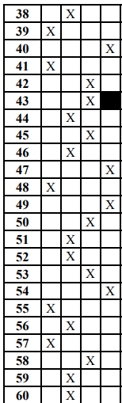

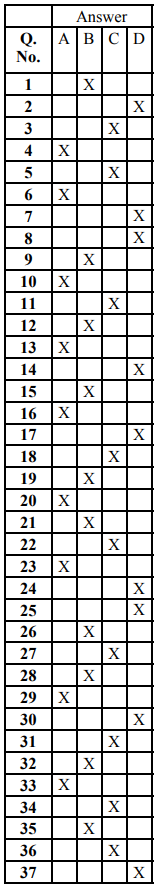

## Set 5

# Set 5

1\. In As You Like It, whom does Oliver financially support instead of supporting Orlando?

A. Jaques

B. Adam

C. Charles

D. Dennis

2\. How many crowns is Orlando left by his late father?

A. 1000

B. 1500

C. 2500

D. 2000

3\. What does Dennis tell Oliver that Duke Frederick has done to Duke Senior?

A. Banished him

B. Stolen from him

C. Killed him

D. Made amends with him

4\. Who is being kept at court as a companion to Celia, Duke Frederick's daughter?

A. Adam

B. Orlando

C. Rosalind

D. Oliver

5\. How many brothers does Orlando have?

A. 2

B. 3

C. 1

D. 4

6\. In the first scene of Act 1, what does Oliver call Adam?

A. A dog

B. A lion

C. An old lion

D. An old dog

7\. At the opening of the play, who is Orlando talking to in the orchard?

A. Jaques

B. Oliver

C. Adam

D. His father

8\. Who is the father of Orlando and Oliver?

A. Duke Frederick

B. Sir Rowland

C. Duke Senior

D. Sir Adam

9\. For what purpose did Orlando's father intend the crowns to go toward?

A. Orlando's house

B. Orlando's military training

C. Orlando's education

D. Orlando's wedding

10\. What does Oliver do when Orlando demands that Oliver give him the money left by their father?

A. Stabs him

B. Slaps him

C. Kicks him

D. Kicks him out

11\. After an eye-opening stroll around the Forest of Arden, what profession does Jaques intend to pursue?

A. A butler

B. A fool

C. A highwayman

D. A shepherd

12\. At what event do Orlando and Rosalind meet?

A. The wedding of Duke Frederick

B. A travelling circus

C. A public execution

D. A wrestling match

13\. What name does Rosalind assume for her disguised self?

A. Icarus

B. Harry

C. Jove

D. Ganymede

14\. In Act 2, Scene 1, for what purpose does Duke Senior gather his loyal followers in the Forest of Arden?

A. To tease the melancholy Jaques

B. To swim the brook

C. To mount an army against Duke Frederick

D. To hunt deer

15\. How does Duke Frederick plan to find Celia and Rosalind after their departure from the court?

A. He will assume a disguise and go looking for them himself

B. He will recruit Oliver to help find Orlando, whom he suspects has teamed up with the women

C. He will interview every person in his castle until someone confesses information

D. He has no plans to find them and is glad that they are gone

16\. According to Oliver, what would Orlando bring to a wrestling match with Charles?

A. A strong competitive edge

B. A lust for prize money

C. Poison, or some other deceitful means of securing victory

D. A comprehensive knowledge of strategic physical combat

17\. On what topic does Corin attempt to counsel the young shepherd Silvius?

A. Friendship

B. Love

C. The politics of court life

D. The maintenance of the flock

18\. Why does Duke Frederick dislike Orlando?

A. The Duke and Orlando's father were enemies

B. Orlando beat the Duke's prized wrestler, Charles

C. Orlando's brother, Oliver, owes the Duke a considerable sum of money

D. Orlando finds Rosalind more beautiful than the Duke's own daughter, Celia

19\. Why does Oliver inherit the bulk of his father's estate?

A. Oliver doctors his father's will

B. Oliver is more loving than his brothers

C. Oliver is the oldest son and therefore guaranteed the inheritance by law

D. Oliver was the son least able to make his own way in the world

20\. Upon arriving in the Forest of Arden, what does Adam assume will be the cause of his death?

A. Gout

B. Hunger

C. Lovesickness

D. Old age

21\. How is Ganymede related to Celia?

A. Ganymede is Celia in disguise

B. Ganymede is Rosalind in disguise, who is Celia's cousin

C. Ganymede is Oliver's disguise, who marries Celia

D. Ganymede is Orlando's cousin and is of no relation to Celia

22\. What is Duke Frederick's relation to Duke Senior?

A. Son

B. Uncle

C. Brother

D. Father

23\. Who writes a love letter to Rosalind (as Ganymede)?

A. Amiens

B. Silvius

C. Phoebe

D. Orlando

24\. As You Like It opens with a dispute between two brothers, and the theme of brotherly relationships is central to the play. What are the names of the two sets of brothers in the play?

A. Duke Frederick and Duke Charles; Oliver, Orlando, and Jaques de Boys

B. Duke Frederick and Duke Charles; Oliver and Orlando de Boys

C. Duke Frederick and Duke Senior; Oliver, Orlando, and Jaques de Boys

D. Duke Frederick and Duke Senior; Oliver and Orlando de Boys

25\. Who says, "Do you not know I am a woman? When I think, I must speak"?

A. Celia

B. Rosalind

C. Phoebe

D. Silvius

26\. Who says, "The fool doth think he is wise, but the wise man knows himself to be a fool"?

A. Jaques

B. Touchstone

C. Oliver

D. Orlando

27\. In the line "I pray you, do not fall in love with me, for I am falser than vows made in wine," who is the speaker and to whom is it spoken?

A. Phoebe to Rosalind

B. Rosalind to Silvius

C. Celia to Oliver

D. Rosalind to Phoebe

28\. Complete the quote: "\_\_\_ is merely a madness and, I tell you, deserves as well a dark house and a whip as madmen do, and the reason why they are not so punish'd and cured is that the lunacy is so ordinary that the whippers..."

A. Hate

B. Love

C. Hope

D. Friendship

29\. Who says, "Most friendship is feigning, most loving mere folly"?

A. Touchstone

B. Amiens

C. Rosalind

D. Orlando

30\. In the statement "Time travels in diverse paces with diverse persons," what travels in diverse paces?

A. Man

B. Human

C. Time

D. Day

31\. Who says, "Oh, how bitter a thing it is to look into happiness through another man's eyes!"?

A. Orlando

B. Oliver

C. Duke Frederick

D. Duke Senior

32\. Who says, "Therefore my age is as a lusty winter, Frosty, but kindly"?

A. Duke Senior

B. Adam

C. Touchstone

D. Charles

33\. Who sings the celebrated song "Under the greenwood tree"?

A. Amiens

B. Jaques

C. Touchstone

D. Phoebe

34\. What type of love do you find between Oliver and Celia?

A. It is not love at all

B. It is only superficial love

C. It is love for only wealth

D. It is love at first sight

35\. Why does Orlando accept the challenge of Charles?

A. He wants to attract Rosalind

B. He wants to win the gold chain from Rosalind

C. He is highly disappointed with his life

D. He wants to kill Charles

36\. Why does Rosalind remain in the court of Duke Frederick?

A. She preferred to stay in the court

B. She was in love with her cousin

C. She liked Orlando

D. She was detained for the sake of the company of Celia

37\. For the sake of Adam, what does Orlando go in search of?

A. Medical aid

B. A companion

C. The old duke

D. Food

38\. How many pairs of lovers are there in the play?

A. 2

B. 3

C. 4

D. 5

39\. As You Like It was first published in:

A. Collected Plays

B. Collected Poems and Plays

C. The First Folio

D. Venus and Adonis

40\. When was As You Like It published?

A. 1600

B. 1615

C. 1623

D. 1630

41\. Why does Duke Frederick order the banishment of Rosalind?

A. Rosalind has fallen in love with Orlando

B. Rosalind's behavior is not good

C. Rosalind is the daughter of the senior Duke

D. Celia's qualities are undervalued before her

42\. How does the Duke respond to Orlando's rudeness the first time they meet?

A. He shows no interest in what Orlando says

B. He speaks to him gently

C. He asks for his father

D. He challenges him to fight

43\. Who is Hymen in the play As You Like It?

A. God of love

B. Goddess of love

C. God of marriage

D. Goddess of marriage

44\. Who was Hesperia?

A. Servant of Celia

B. Servant of Rosalind

C. Servant of Duke Senior

D. Wife of Hymen

45\. Who says, "Sweet are the uses of adversity, which, like the toad, ugly and venomous, wears yet a precious jewel in his head; and this our life, exempt from public haunt, finds tongues in trees, books in the running brooks, sermons in stones, and good in every thing"?

A. Orlando

B. Duke Senior

C. Adam

D. Celia

46\. What is the primary source of As You Like It?

A. Thomas Lodge's novel Rosalynde

B. Raphael Holinshed's Chronicles

C. Boccaccio's Decameron

D. Robert Greene's prose pastoral

47\. With whom is Audrey married?

A. Corin

B. Jaques

C. Touchstone

D. Amiens

48\. In the Forest of Arden, Duke Senior lives like:

A. A monk

B. A king

C. Robin Hood

D. A god

49\. Why does Rosalind, in disguise as Ganymede, agree to pretend to be Rosalind for Orlando?

A. So that Orlando can practice wooing her

B. To cure Orlando of love

C. To keep them entertained in the forest

D. Because Orlando misses her

50\. What is Celia's name while she is disguised in the forest?

A. She does not change her name

B. Audrey

C. Aliena

D. Phoebe

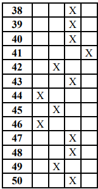

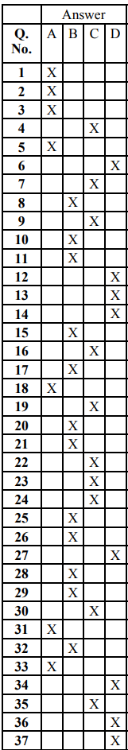

## Set 6

# Set 6

1\. Why does Lamb believe that all chimney sweepers must be the kidnapped children of certain families?

A. Aristocratic families

B. Poor families

C. Middle class families

D. Lamb does not believe this about chimney sweepers

2\. Which of the following references is not mentioned by Lamb in the essay "In Praise of Chimney Sweepers"?

A. Slipping while taking a walk

B. Jem White's dinners for the sweeps

C. The feasts ended with Jem White's death

D. All of the above are mentioned in the essay

3\. According to the essay "In Praise of Chimney Sweepers", who painted a picture depicting soldiers marching through streets?

A. Mr. Read

B. Jem White

C. Hogarth

D. None of the above

4\. In Bacon's view, studying law cases is beneficial for:

A. An unsteady memory

B. Confused thinking

C. Wandering wits

D. None of the above

5\. Bacon describes philosophers as:

A. Hair splitters

B. Professors

C. Lawyers

D. Doctors

6\. In Bacon's essay "Of Studies", 'Cymini sectors' refers to:

A. Lawyers

B. Doctors

C. Professors

D. Philosophers

7\. In "Ode on a Grecian Urn", Keats expresses the superiority of:

A. Art

B. Nature

C. Mankind

D. Children

8\. Which of the following is not a feature of "Ode on a Grecian Urn"?

A. Hellenism

B. Sensuousness

C. Cult of beauty

D. All of the above are features of the poem

9\. How many lines are there in "Ode on a Grecian Urn"?

A. Forty

B. Fifty

C. Sixty

D. Thirty

10\. Milton's "On His Blindness" follows the rhyme scheme of:

A. The Petrarchan sonnet

B. The English sonnet

C. The Shakespearean sonnet

D. None of the above

11\. What is the rhyme scheme of Milton's "On His Blindness"?

A. ABAB CDCD EFEF GG

B. ABBA ABBA CDE CDE

C. ABC ABC ABC ABC DD

D. ABA BCB CDC DED EE

12\. In "On His Blindness", what consumes Milton's faith in God?

A. Affliction

B. Talent

C. Poetry

D. Nothing consumes his faith

13\. In the poem "Eunuch", what was depicted on the cheeks of the eunuchs?

A. Images of flowers

B. Blue painting

C. Dark makeup

D. Green tattoos

14\. What sound was produced by the anklets worn by the eunuchs in the poem "Eunuch"?

A. Whistling

B. Clarion

C. Tumbling

D. Jingling

15\. In the poem "Eunuch", the cymbals played by the eunuchs create a:

A. Cracking sound

B. Clashing sound

C. Flute sound

D. Joyful sound

16\. Which flowers were worn by the eunuchs in their hair in the poem "Eunuch"?

A. Roses

B. Gulmohur

C. Jasmine

D. Lilies

17\. According to the passage, the human skeletal system is described as:

A. Flexible

B. Strong

C. Very firm

D. Normal

18\. What do experts believe about the relationship between nutrition and the skeletal system in children?

A. Functioning strengthens the skeletal system

B. Sports strengthen the skeletal system

C. Mental and physical strength lead to a stronger skeletal system

D. Higher quality nutrition leads to a stronger skeletal system

19\. How many methods are mentioned in the passage for determining a child's age?

A. Two

B. One

C. Three

D. None of the above

20\. According to the passage, how do experts determine children's age during sporting events?

A. By counting their teeth

B. By checking their mental strength

C. By examining their skeletal system

D. By checking their physical strength

21\. What is stated as the most common way to determine a child's age?

A. Counting their teeth

B. Counting years, months and days chronologically

C. Examining their skeletal system

D. Checking their physical strength

22\. In the word "workaholic", the stress falls on the syllable:

A. /'wɜː.kəhɒl.ɪk/

B. /ˌwɜː.kə'hɒl.ɪk/

C. /ˌwɜː.'kəhɒl.ɪk/

D. /ˌwɜː.kəhɒ'l.ɪk/

23\. In the word "listless", the stress falls on the syllable:

A. /'lɪst.ləs/

B. /lɪ'st.ləs/

C. /,lɪst 'ləs/

D. /lɪs't.ləs/

24\. In the word "advisable", the stress falls on the syllable:

A. /'ədvaɪ.zə.bəl/

B. /əd'vaɪ.zə.bəl/

C. /ədvaɪ.zə.'bəl/

D. /ədvaɪ.'zə.bəl/

25\. Which is the correct phonetic transcription of "inertia"?

A. /ɪˈnɜː.ʃəa/

B. /ɪˈnaː.ʃə/

C. /ɪˈnɜː.ʃə/

D. /ɪˈnnɜː.ʃə/

26\. Which is the correct phonetic transcription of "colloquial"?

A. /koˈləʊ.kwi.əl/

B. /kˈləʊ.kwi.əl/

C. /kəˈlə.kwi.əl/

D. /kəˈləʊ.kwi.əl/

27\. Which is the correct phonetic transcription of "expense"?

A. /ekˈspens/

B. /ɪkˈspns/

C. /ɪkˈspens/

D. /ɪkˈspense/

28\. Convert the sentence "The vintage cars hold a special place in the hearts of their owners" into the passive voice:

A. A special place in the hearts of the vintage car owners is held by them.

B. A special place was held by the vintage cars in the hearts of their owners.

C. A special place is held by the vintage cars in the hearts of their owners.

D. A special place is being held by the vintage cars in the hearts of their owners.

29\. Change the sentence "The storm has destroyed twelve houses" into the passive voice:

A. Twelve houses had been destroyed by the storm.

B. Twelve houses have been destroyed by the storm.

C. Twelve houses were destroyed by the storm.

D. Twelve houses have been stormed.

30\. Convert the sentence "The pilot landed the plane safely" into the passive voice:

A. The plane had been landed safely by the pilot.

B. The plane was landed safely by the pilot.

C. The plane has been landed safely by the pilot.

D. The plane was to be landed safely by the pilot.

31\. Change the sentence "Rome was not built in a day" into the active voice:

A. They did not build Rome in a day.

B. They could not build Rome in a day.

C. The Romans did not build Rome in a day.

D. They have not built Rome in a day.

32\. Convert the direct speech "Socrates said, 'Virtue is its own reward.'" into indirect speech:

A. Socrates said that virtue had its own rewards.

B. Socrates says that virtue is its own reward.

C. Socrates said that virtue is its own reward.

D. Socrates said that virtue was its own reward.

33\. Convert the direct speech "'Would you open the door please?'" into indirect speech:

A. She asked me to please open the door.

B. She requested me to open the door.

C. She requested me to please open the door.

D. She asked me open the door.

34\. Change the direct speech "'Make me another suit like this,' he said to the tailor." into indirect speech:

A. He asked the tailor to make him another suit like this.

B. He asks the tailor to make him another suit like this.

C. He told the tailor to make him another suit like that.

D. He told the tailor to make me another suit like this.

35\. Convert the direct speech "Geeta said, 'I did not do this deliberately.'" into indirect speech:

A. Geeta said that I had not done that deliberately.

B. Geeta said that she had not done that deliberately.

C. Geeta said that she has not done this deliberately.

D. Geeta said that I have not done this deliberately.

36\. Change the direct speech "A poet said, 'The night is dark and I am far from home.'" into indirect speech:

A. A poet said that the night was dark and he was far from home.

B. A poet told his friend that the night is dark and that he is far from home.

C. The friend was told by the poet that the night was dark and he was far from home.

D. A poet said that the night is dark and he is far from home.

37\. Choose the correct article to complete the sentence: "He is .......... best student of our class."

A. a

B. an

C. the

D. No article needed

38\. Select the appropriate article for the blank in the sentence: "Elections will be held later in ............ year."

A. the

B. a

C. an

D. No article needed

39\. Fill in the blank with the correct article: "Children start ............. school at 4 or 5."

A. the

B. No article needed

C. a

D. an

40\. Which article best completes the sentence: "There was ............ beating of wings overhead."

A. an

B. a

C. the

D. No article needed

41\. Choose the appropriate word to fill in the blank: "There aren't ............. chairs for everyone."

A. some

B. enough

C. few

D. a few

42\. Select the word that best fits the sentence: "A ......... of the people were getting annoyed."

A. few

B. little

C. many

D. much

43\. Complete the sentence with the correct option: "Her ...... boy was Rohit, seven years old, dark-eyed and sweet."

A. few

B. little

C. a little

D. a few

44\. Fill in the blank with the appropriate preposition: "I really like the paintings ....... Picasso."

A. by

B. of

C. from

D. None of the above

45\. Choose the correct preposition to complete the sentence: "He was .............. his hands and knees searching for something."

A. on

B. with

C. by

D. under

46\. Select the preposition that best fits the sentence: "They live ............ 18 Victoria Street."

A. on

B. at

C. in

D. with

47\. Which preposition accurately completes the sentence: "Some customers prefer to pay ........... cheque."

A. with

B. of

C. by

D. from

48\. Fill in the blank with the appropriate preposition: "We had been talking ........... a good half hour."

A. since

B. by

C. for

D. from

49\. Choose the correct preposition to complete the sentence: "Amrita worked .................. PepsiCo until last year."

A. for

B. at

C. under

D. No preposition needed

50\. Identify the tense of the verb in the main clause: "When you are filled with positive attitude, difficulties seem challenges, not hurdles."

A. Present continuous

B. Present perfect

C. Present indefinite

D. None of the above

51\. Complete the sentence with the correct option: "I'd rather you ............ go out alone."

A. don't

B. haven't

C. didn't

D. wouldn't

52\. Select the appropriate verb form to fill in the blank: "I'd rather ........... a quiet night in front of the TV."

A. had

B. have

C. enjoyed

D. None of the above

53\. Choose the correct verb form to complete the sentence: "I ......... him for two years."

A. have known

B. have been knowing

C. am knowing

D. know

54\. Convert the statement "I could never cheat him." into an interrogative sentence:

A. Could I never cheat him?

B. Can I never cheat him?

C. Could I ever cheat him?

D. Could I cheat him?

55\. Change the sentence "This is all I want." into a negative statement:

A. Not all I want is this.

B. This is not everything I want.

C. I don't want anything else.

D. I want not all of this.

56\. Transform the comparative sentence "Vini is better than Vishi." into a negative statement:

A. Vishi is not good as Vini.

B. Vini is not better than Vishi.

C. Vishi is not better than Vini.

D. Vishi is not as good as Vini.

57\. Fill in the blanks with the appropriate verbs: "Gandhi .......... one of the greatest reformers that ................ every lived."

A. was/has

B. has/have

C. is/has

D. was/have

58\. The idiom "under the weather" means:

A. Very bad weather

B. Under some bad effect

C. To be ill

D. Enjoy the surroundings

59\. The phrase "break a leg" is used to:

A. Get hurt

B. Work very hard

C. To fight someone

D. Wish someone luck

60\. The expression "sit on the fence" means:

A. To be at a very high place

B. To have a political approach

C. To be undecided

D. None of the above

61\. The family imparts education to a child:

A. Formally

B. Informally

C. Deliberately

D. None of the above

62\. The common goal of education and psychology is:

A. Better education

B. Study of behaviour

C. Change in behaviour

D. None of the above

63\. Which of the following cannot be a type of interview?

A. Focused interview

B. Grudge interview

C. Research interview

D. Personal interview

64\. Who wrote the book 'Educational Psychology: A Cognitive View'?

A. Skinner

B. Ausubel

C. Gates

D. Bruner

65\. Which of the following is an independent variable in the process of teaching?

A. Student

B. Teacher

C. Teaching methods

D. Teaching environment

66\. Which of the following is not a correct term?

A. Mental age

B. Dental age

C. Skeletal age

D. Social age

67\. At which stage is the teaching of counselling to a child very active?

A. Childhood

B. Adolescence

C. Post-childhood

D. None of the above

68\. Which agency has the maximum effect on the abnormal behaviour of adolescents?

A. Family

B. Neighbours

C. Society

D. School

69\. Which of the following statements about learning is incorrect?

A. Learning is not affected by maturation

B. Motivation facilitates learning

C. Problem solving is the highest level of learning

D. Learning is a change in behaviour

70\. According to NCF-2005, learning is:

A. An active activity

B. Only mental development

C. An active and social activity

D. An active and cognitive activity

71\. Chain learning is associated with:

A. Tolman

B. Gagne

C. Thorndike

D. Bruner

72\. The process of designing and performing activities to produce change in student behaviour is called:

A. Instruction

B. Teaching

C. Training

D. Indoctrination

73\. The law of exercise enables students to develop:

A. Skillfulness

B. Problem-solving abilities

C. Intelligence

D. Insight

74\. Which of the following is a principal characteristic of a good learner?

A. Willpower

B. Attention

C. Academic ability

D. Maturity

75\. A learner's aspiration level is directly correlated with their:

A. Aptitude

B. Attitude

C. Intrinsic motivation

D. Interest

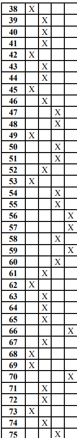

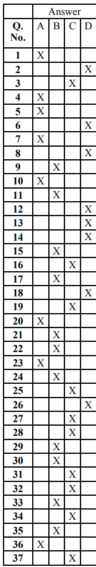

## Set 7

# Set 7

1\. In Act 1, how many men does Petey tell Meg he encountered that may be boarding with them?

A. 1

B. 2

C. 4

D. 5

2\. What item is the first character carrying when appearing in the play?

A. A book

B. An apple

C. A newspaper

D. A dog

3\. Who is the first character to appear on stage in The Birthday Party?

A. Stanley

B. Lulu

C. Meg

D. Petey

4\. In Act 1, what section of the newspaper does Petey read aloud?

A. The horoscopes

B. A birth announcement

C. The classifieds

D. A comic strip

5\. During her conversation with Petey in Act 1, what does Meg assume Stanley is doing?

A. Taking a shower

B. Watching television

C. Sleeping

D. Eating

6\. What does Meg serve for breakfast in Act 1?

A. Pancakes and waffles

B. Cornflakes and fried bread

C. Toast and jam

D. Eggs and bacon

7\. Approximately how old is the character Meg?

A. In her 30s

B. In her 60s

C. In her 50s

D. In her 40s

8\. What is the relationship between the characters Meg and Petey?

A. Roommates

B. Husband and wife

C. Friends

D. Brother and sister

9\. What type of cereal is Petey eating at the start of the play?

A. Bran flakes

B. Oat bran

C. Cheerios

D. Corn flakes

10\. The setting of The Birthday Party is the Boles' \_\_\_\_\_\_.

A. Attic

B. Living room

C. Bedroom

D. Porch

11\. What is contained in the package that Lulu delivers?

A. Groceries

B. A camera

C. Alcohol

D. A toy drum

12\. Who gets Stanley out of bed in Act 1?

A. Lulu

B. Petey

C. Meg

D. No one

13\. In the play, how does Petey describe a "straight show"?

A. A show with no singing and dancing

B. A ballet

C. An opera

D. A musical

14\. According to Stanley, who is coming to take Meg away?

A. A wheelbarrow

B. A cart

C. A doctor

D. A police officer

15\. Goldberg compares the character Meg to which flower?

A. Lily

B. Tulip

C. Daffodil

D. Rose

16\. What beverage does Meg bring to Stanley's room each morning?

A. Orange juice

B. Tea

C. Coffee

D. Milk

17\. Where does the character Petey meet Goldberg and McCann?

A. On the beach

B. In town

C. At the pier

D. On the road

18\. Which character tears the newspaper into strips in the play?

A. Petey

B. Stanley

C. McCann

D. Goldberg

19\. Who whistles the tune "The Mountains of Morne" in the play?

A. McCann and Lulu

B. McCann and Goldberg

C. McCann and Meg

D. McCann and Stanley

20\. Where does Stanley hit Goldberg during their confrontation?

A. Head

B. Back

C. Face

D. Stomach

21\. Pinter's The Birthday Party is considered a classic example of the theatre of:

A. Menace

B. The Absurd

C. Madness

D. The Unconscious

22\. In The Birthday Party, the characters struggle to have \_\_\_\_\_\_ conversations.

A. Sexual

B. Meaningless

C. Meaningful

D. Distorted

23\. The deliberate absurdity in The Birthday Party blurs the line between \_\_\_\_\_\_.

A. The real world

B. The metaphysical world

C. Both the real world and illusion

D. None of the above

24\. The play explores the meaninglessness of human existence primarily through which character?

A. Lulu

B. Stanley

C. Meg

D. None of the above

25\. In the play, what do the persecutor characters McCann and Goldberg represent?

A. Human mysteries

B. Human harshness

C. Individual harshness

D. A society that mistreats individualistic artists

26\. Which of the following elements of Absurd theatre are present in The Birthday Party?

A. Confusion and chaos

B. Disintegration of language

C. Both confusion and disintegration of language

D. None of the above

27\. How do the visitors, McCann and Goldberg, torment Stanley in the play?

A. With direct death threats

B. With ambiguous and illogical interrogation

C. By demanding a large sum of money from him

D. None of the above

28\. After the visitors arrive, Stanley becomes delirious and tries to:

A. Attack Meg

B. Rape Lulu

C. Both attack Meg and rape Lulu

D. None of the above

29\. In which theatre did The Birthday Party have its premiere performance?

A. The Globe Theatre

B. London Theatre

C. Lyric Theatre

D. Oval Theatre

30\. What year was The Birthday Party first performed on stage?

A. 1957

B. 1958

C. 1960

D. 1964

31\. The Birthday Party is an example of which type of comedy?

A. Comedy of Humour

B. Comedy of Errors

C. Comedy of Menace

D. Sentimental Comedy

32\. What musical instrument does the character Stanley play in the play?

A. Flute

B. Guitar

C. Piano

D. Tabla

33\. When Lulu asks Stanley where they will go, how does he respond?

A. London

B. Paris

C. Nowhere

D. The beach

34\. What affectionate nickname does Lulu call Stanley when she is first shown with him

and about to leave?

A. A teddy

B. A rabbit

C. A washout

D. None of the above

35\. When Goldberg and McCann first enter from the street, which one seems nervous?

A. Goldberg

B. McCann

C. Both seem nervous

D. Neither seems nervous

## Set 8

# Set 8

1\. In the poem "Dance of Eunuchs", what were the eunuchs wearing?

A. Skirts and anklets

B. Skirts and t-shirts

C. Sari and bangles

D. Dhoti and kurta

2\. Identify the figure of speech used in the phrase "vacant ecstasy" from the poem "Dance of Eunuchs".

A. Antithesis

B. Paradox

C. Oxymoron

D. Metaphor

3\. Complete the line from the poem "Dance of Eunuchs": "There were \_\_\_\_\_ tattoos on their cheeks, jasmines in their \_\_\_\_\_."

A. Red, hands

B. Green, hands

C. Red, hair

D. Red, hands

4\. In the poem "Night of Scorpion", the peasants buzzed the name of God to:

A. Kill the scorpion

B. Drive away the scorpion

C. Paralyze the scorpion

D. Catch the scorpion

5\. In the context of the poem "Night of Scorpion", what does the word "Diabolic" mean?

A. Very short

B. Devilish

C. Double-edged

D. Causing disease

6\. In the poem "Night of Scorpion", what was the mother lying on?

A. Her bed

B. A coat

C. A mat

D. A rug

7\. What is the rhyme scheme of Robert Browning's poem "My Last Duchess"?

A. Enjambed blank verse

B. Enjambed rhyming couplets

C. End-stopped rhyming couplets

D. End-stopped blank verse

8\. In "My Last Duchess", what is the Duke arranging?

A. The Duchess's funeral

B. The painting of the Duchess's portrait

C. A new marriage for himself

D. The sale of his art collection

9\. Considering its tone, the Duke's monologue in "My Last Duchess" is best described as a:

A. Tirade

B. Epitaph

C. Elegy

D. Charade

10\. Which phrase from Keats' "Ode on a Grecian Urn" summarizes his Romantic philosophy?

A. "Heard melodies are sweet, but those unheard are sweeter"

B. "Old age shall this generation waste"

C. "For ever wilt thou love"

D. "Beauty is truth, truth beauty"

11\. In "Ode on a Grecian Urn", the term "sylvan historian" refers to anything pertaining to:

A. Balloons

B. Bears

C. Woods

D. Nymphs

12\. How many scenes in total are presented in Keats' poem "Ode on a Grecian Urn"?

A. 2

B. 20

C. 3

D. 30

13\. In Shelley's "Ode to the West Wind", the phrase "locks of the approaching storm" refers to:

A. Jails

B. The beloved's tresses

C. An angelic host

D. Clouds

14\. In "Ode to the West Wind", the one "wakened from his summer dreams" describes:

A. The Poet

B. The blue Mediterranean

C. The West Wind

D. Baiae

15\. In Shelley's "Ode to the West Wind", who are "growing gray with fear"?

A. Aristocrats

B. Woods and flowers

C. Seaweed

D. Wordsworth and Coleridge

16\. Identify the literary device Wordsworth uses when calling the daffodils "a crowd", "a host", "their heads", etc. in "I Wandered Lonely as a Cloud".

A. Hyperbole

B. Metaphor

C. Personification

D. Simile

17\. Identify the figure of speech used in the line "They stretched in never-ending line" from Wordsworth's "I Wandered Lonely as a Cloud".

A. Hyperbole

B. Metaphor

C. Simile

D. Pun

18\. What is the rhyme scheme of each stanza in Wordsworth's poem "I Wandered Lonely as a Cloud"?

A. ABABCC

B. AABBCC

C. ABCABC

D. ABAABA

19\. In Milton's poem "On His Blindness", the word "talent" can refer to:

A. Milton's poetic ability

B. A kind of currency

C. Either of the two

D. Neither of the two

20\. John Donne's poem "Go and Catch a Falling Star" throws light on the life of:

A. Impossibilities

B. Improbabilities

C. Impracticality

D. All of the above

21\. In "Go and Catch a Falling Star", the speaker wants to:

A. Catch a falling star

B. Ride for 10,000 days and nights

C. Find a woman for himself

D. Find a woman who is true and fair

22\. In which year was William Wordsworth born?

A. 1777

B. 1770

C. 1773

D. 1780

23\. In which year did William Shakespeare die?

A. 1623

B. 1615

C. 1616

D. 1624

24\. In "Go and Catch a Falling Star", the line "Till age snow white hairs on thee" is an example of:

A. Sensual imagery

B. Visual imagery

C. Phonic imagery

D. None of the above

25\. What happens to Lady Macbeth before she dies in Shakespeare's play "Macbeth"?

A. She is plagued by fits of sleepwalking.

B. She is haunted by the ghost of Duncan.

C. She sees her children killed in battle.

D. She sees her children killed by Macbeth.

26\. In "Macbeth", who informs Macduff that his family has been killed?

A. Donalbain

B. Macbeth

C. Lady Macduff

D. Ross

27\. In "Macbeth", who jokes that he works at "hell gate"?

A. Macbeth

B. Macduff

C. The porter

D. Duncan

28\. Why is Macduff able to kill Macbeth despite the witches' prophecy?

A. He kills the witches first.

B. He receives a charm from Grinswindle.

C. He is a powerful warlock himself.

D. He was born by cesarean section.

29\. In "Macbeth", who flees Scotland to join Malcolm in England?

A. Donalbain

B. Ross

C. Macduff

D. Lennox

30\. In Shakespeare's "As You Like It", upon arriving in the Forest of Ardenne, Adam claims that he will soon die. What does he assume the cause of his death will be?

A. Gout

B. Hunger

C. Lovesickness

D. Old age

31\. In "As You Like It", according to Oliver, what would Orlando bring to a wrestling match with Charles?

A. A strong competitive edge

B. A lust for prize money

C. Poison, or some other deceitful means of securing victory

D. A comprehensive knowledge of strategic physical combat

32\. Why does Duke Frederick dislike Orlando in "As You Like It"?

A. The duke and Orlando's father were enemies.

B. Orlando beat the duke's prized wrestler, Charles.

C. Orlando's brother, Oliver, owes the duke a considerable sum of money.

D. Orlando finds Rosalind more beautiful than the duke's own daughter, Celia.

33\. In "As You Like It", who is the recently deceased father of Orlando and Oliver?

A. Duke Frederick

B. Sir Rowland

C. Duke Senior

D. Sir Adam

34\. How many crowns is Orlando left by his late father in "As You Like It"?

A. 1,000

B. 1,500

C. 2,500

D. 2,000

35\. What does Oliver call Adam in the first scene of Act I in "As You Like It"?

A. A dog

B. A lion

C. An old lion

D. An old dog

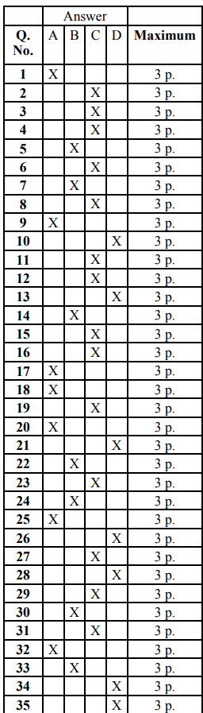

## Set 9

# Set 9

1\. On which day is the wedding of Farfrae and Jane held in The Mayor of Casterbridge?

A. Easter Sunday

B. St Martin's Day

C. Christmas

D. New Year's Eve

2\. In Bacon's essay "Of Studies", the term 'Cymini sectors' refers to:

A. Lawyers

B. Doctors

C. Professors

D. Philosophers

3\. According to Bacon's "Of Studies", poems make men:

A. Subtle

B. Grave

C. Able to contend

D. Witty

4\. In Bacon's "Of Studies", what does he mean by the line "And some few to be chewed and digested"?

A. Some books are to be read wholly, and with diligence and attention

B. Some books are to be read only in parts

C. Others to be read, but not curiously

D. All of the above

5\. In the essay "In Praise of Chimney Sweepers", the lines "A sable cloud/Terms forth her silver lining on the night" are taken from:

A. Milton's Comus

B. Milton's Paradise Lost

C. Milton's On His Blindness

D. None of the above

6\. In the essay "In Praise of Chimney Sweepers", the Latin word 'incunabula' means:

A. Birth Place

B. Death place

C. Childhood

D. None of the above

7\. Which of the following lines is not taken from the essay "In Praise of Chimney Sweepers"?

A. All is not soot which looks so

B. All that glitters is not gold

C. The lap where Venus lulled Ascanius

D. I like to meet a sweep ..... not a grown

8\. In "In Praise of Chimney Sweepers", what attracts Charles Lamb the most?

A. Young ladies' teeth

B. Jeers of crowd

C. White teeth of chimney sweepers

D. All of the above

9\. In The Mayor of Casterbridge, who is the widow of the banker?

A. Mrs. Templeman

B. Susan

C. Mrs. Goodenough

D. None of the above

10\. In The Mayor of Casterbridge, who lived in the company of Lucetta at High Place Hall?

A. Henchard

B. Farfrae

C. Elizabeth-Jane

D. Susan

11\. In The Mayor of Casterbridge, Lucetta inherited the property of her rich aunt, the banker's widow, who recently died. Who was Lucetta's aunt?

A. Mrs. Templeman

B. Susan

C. Mrs. Goodenough

D. None of the above

12\. In The Mayor of Casterbridge, who crossed Henchard in both love and business?

A. Farfrae

B. Lucetta

C. Newson

D. Elizabeth-Jane

13\. In The Mayor of Casterbridge, who was behaving like a fool in the view of Henchard's servant?

A. Susan

B. Lucetta

C. Farfrae

D. Elizabeth-Jane

14\. In The Mayor of Casterbridge, who threatened Lucetta that if she refused to marry him, he would make her life miserable by disclosing her past love affairs with him?

A. Farfrae

B. Henchard

C. Susan

D. Newson

15\. In The Mayor of Casterbridge, where did Henchard take the oath to avoid all strong liquors for twenty-one years?

A. In a furmity tent

B. In a church

C. In the street

D. In a village fair

16\. In The Mayor of Casterbridge, after how many years is Susan reunited with Henchard?

A. Two years

B. Four years

C. Eighteen years

D. Twenty years

17\. Who introduced the sonnet form to English poetry?

A. Thomas Wyatt

B. William Shakespeare

C. John Milton

D. Edmund Spenser

18\. A classical ode is a poem that:

A. Is classical in nature

B. Is a eulogy

C. Praises someone or something

D. Is both a eulogy and praises someone or something

19\. An elegy is typically written for:

A. A friend or family member

B. A celebrity

C. A historical figure

D. Any of the above

20\. Which of the following is not a type of elegy?

A. Personal Elegy

B. Impersonal Elegy

C. Pastoral Elegy

D. Historical Elegy

21\. Which of the following is not a characteristic of a ballad?

A. Tells a story in 1st person

B. Focus is on actions and dialogue

C. Is often based on true stories

D. Is based on oral traditions

22\. Which of the following is not a typical trait of an epic hero?

A. The hero faces a quest or challenge

B. The hero typically visits a supernatural or underworld

C. The hero has superpowers

D. The hero is typically affected by gods or supernatural beings

23\. Gothic literature can be defined as writing that employs:

A. Dark and picturesque scenery

B. Startling and melodramatic narrative devices

C. An overall atmosphere of exoticism, mystery, fear, and dread

D. All of the above

24\. The hidden story in an allegory is usually about:

A. Religion

B. Politics

C. Moral philosophy

D. All of the above

25\. George Orwell's Animal Farm is an allegory for:

A. The Russian Revolution

B. World War II

C. The American Revolution

D. None of the above

26\. Identify the figure of speech in the line "Parting is such sweet sorrow."

A. Hyperbole

B. Oxymoron

C. Irony

D. Paradox

27\. "Loose clouds like Earth's decaying leaves are shed" is an example of:

A. Simile

B. Metaphor

C. Alliteration

D. None of the above

28\. In Vendor of Sweets, Jagan decides to leave his business because:

A. His son Mali is in jail

B. Mali and Grace are living a sinful life

C. Chinna Dorai changes his mind

D. He is bored with his life

29\. In Vendor of Sweets, what is meant by "writer" in Jagan's dictionary?

A. Officer

B. Clerk

C. Attendant

D. Assistant

30\. In Vendor of Sweets, who declared, "It's unthinkable that anyone should bite a pig's tail first thing in the morning"?

A. Jagan

B. Mali

C. Cousin

D. Ambika

31\. In Vendor of Sweets, where did Mali see an advertisement for a competition for novel writing?

A. Magazine

B. Ananda Vikatan

C. The Times

D. The Hindu

32\. In Vendor of Sweets, the white-bearded man was a:

A. Maker of idols

B. Maker of hair dyes

C. Maker of sweets

D. None of the above

33\. Which of the following is the correct phonetic transcription of the word "auspicious"?

A. /ɔːˈspɪʃəs/

B. /aʊˈspɪʃəs/

C. /ɑːˈspɪʃəs/

D. /ɔːˈspɪʃəs/

34\. Identify the correct phonetic symbol for the vowel sound in the word "book".

A. /ʊ/

B. /uː/

C. /ʌ/

D. /ɒ/

35\. Which word contains the phonetic sound /ʒ/?

A. Purpose

B. Jingle

C. Vision

D. Shark

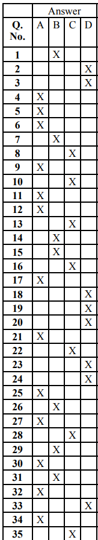

## Set 10

# Set 10

1\. In The Waste Land, in whose company did Tiresias spend a weekend at the Metropole?

A. Eugenides

B. Sweeney

C. Stetson

D. Belladonna

2\. In The Waste Land, whose waiting is described as "like a taxi throbbing"?

A. The Typist

B. The Clerk

C. Lil

D. Belladonna

3\. In the section "The Fire Sermon" of The Waste Land, who is referred to as "the young man carbuncular"?

A. The Clerk

B. The Typist

C. Stetson

D. Sweeney

4\. In The Waste Land, whose assurance "sits as a silk hat on a Bradford millionaire"?

A. The Clerk

B. The Typist

C. Stetson

D. Sweeney

5\. In The Waste Land, the song of the Three Thames Daughters appears in which section?

A. A Game of Chess

B. Death by Water

C. A Burial of the Dead

D. The Fire Sermon

6\. In the final section of The Waste Land, who is referred to as "He who was living is now dead"?

A. The sailor

B. Christ

C. The merchant

D. The fisher king

7\. In what season does Harold Pinter's play The Birthday Party take place?

A. Winter

B. Spring

C. Summer

D. Fall

8\. In The Birthday Party, where does Petey meet Goldberg and McCann?

A. On the road

B. In town

C. At the pier

D. On the beach

9\. What musical instrument does the character Stanley play professionally in The Birthday Party?

A. Piano

B. Violin

C. Flute

D. Drums

10\. In The Birthday Party, who whistles the tune "The Mountains of Morne"?

A. McCann and Lulu

B. McCann and Goldberg

C. McCann and Meg

D. McCann and Stanley

11\. In The Birthday Party, Goldberg compares birthdays to:

A. Fish

B. Sunsets

C. Getting up in the morning

D. Beer

12\. What is the name of the game played in The Birthday Party?

A. Hide and Seek

B. Cheese

C. Truth or Dare

D. Blind Man's Buff

13\. In The Birthday Party, who accuses Stanley of killing his wife?

A. Goldberg

B. McCann

C. Petey

D. Meg

14\. In the novel Cry, the Peacock by Anita Desai, what is Gautam's profession?

A. Lawyer

B. Teacher

C. Both lawyer and teacher

D. None of the above

15\. Who is Mr. Sapru in the novel Cry, the Peacock?

A. Gautama's maternal uncle

B. Gautama's friend

C. Maya's friend

D. A friend of Maya's father

16\. Who is Maya's brother in the novel Cry, the Peacock?

A. Arjun

B. Vishnu

C. Both Arjun and Vishnu

D. None of the above

17\. In Cry, the Peacock, who reminds Maya of poppies, a kind of pain reliever?

A. Gautama

B. Her father

C. Leila

D. Mr. Sapru

18\. When a pidgin language, developed by adults for use as a second language, becomes the native and primary language of their children, the process is called:

A. Creolization

B. Nativization

C. Colonization

D. None of the above

19\. What is required for pidgin languages to evolve?

A. People wanting to improve their own language so they create a new one

B. One group of people moving to a new place and changing to another language

C. People deciding to learn their neighbors' languages

D. Two or more groups of people who need to communicate but do not have a common language

20\. A creole language is:

A. A mixed language with a simplified grammar that people rarely learn as a mother tongue

B. A slang language

C. A pidgin language

D. A language of mixed origin that developed from complex blending of two parent languages

21\. A pidgin language is:

A. The same as slang

B. A language of mixed origin that developed from complex blending of two parent languages

C. A mixed language with a simplified grammar that people rarely learn as a mother tongue

D. A creole language

22\. Code-mixing and code-switching are often seen in:

A. Monolingual children

B. Bilingual children

C. Dyslexic children

D. None of the above

23\. Code-mixing and code-switching cannot be used in:

A. Informal speech

B. Personal letters

C. Report writing

D. None of the above

24\. Multilingualism must be used as a resource so that:

A. Children can learn many languages

B. Teachers can learn many languages

C. Every child feels secure and accepted

D. Children get confused with many languages

25\. In The Waste Land, Magnus Martyr is portrayed as a:

A. Church

B. Ocean

C. Football stadium

D. Epic poem

26\. In The Waste Land, the clairvoyant is named:

A. Vivienne

B. Aldous Huxley

C. Madame Sosostris

D. Mrs. Porter

27\. In The Waste Land, Mr. Eugenides invites the narrator to:

A. Venice

B. The Plaza

C. The Ritz Carlton

D. The Cannon Street Hotel

28\. The line "This music crept by me upon the waters" from The Waste Land is taken from:

A. Paradise Lost

B. The Tempest

C. Parliament of Bees

D. To His Coy Mistress

29\. The line "Shall I at least set my lands in order?" from The Waste Land is a reference from:

A. From Ritual to Romance

B. The Golden Bough

C. The Bible

D. None of the above

30\. In which year was the novelist Anita Desai born?

A. 1936

B. 1937

C. 1938

D. 1940

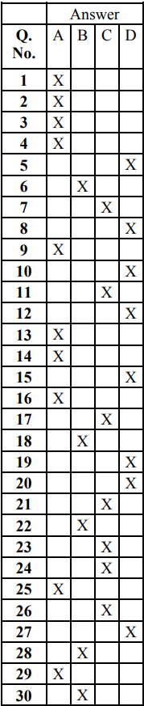

## Set 11

# Set 11

1\. What is the origin of the word "pidgin"?

A. Chinese pronunciation of the word "pigeon"

B. Chinese pronunciation of the word "business"

C. English pronunciation of the word "pigeon"

D. English word "business"

2\. The use of pidgin is considered:

A. Standard

B. Sub-standard

C. Highly decorated

D. None of the above

3\. Which of the following is considered the most unsophisticated form of language?

A. Pidgin

B. Creole

C. Code-switching

D. Code-mixing

4\. Which of the following is a characteristic of creole languages?

A. It is created when two persons or groups from different linguistic communities talk to each other

B. It is the native language of all the members of a particular community

C. It is more complex than the two languages it is developed from

D. Children of a particular community make it their native language

5\. Historically, pidgins have been considered as:

A. Lexifiers

B. Lexicons

C. Patois

D. Creoles

6\. What is a lexifier in the context of pidgin and creole languages?

A. Dominant language

B. Primary language

C. Both dominant and primary language

D. None of the above

7\. Which of the following is not a characteristic of a creole language?

A. It is a developed form of pidgin

B. It develops from mixing and simplifying two languages

C. It possesses large stable vocabularies

D. It has an inconsistent system of grammar

8\. Which of the following varieties of English is not in use?

A. Hinglish

B. Chinglish

C. Urdinglish

D. Mix-mix

9\. The utterance "You can go now. Main thodi der me aaunga." is an example of:

A. Creole

B. Code-switching

C. Code-mixing

D. Pidgin

10\. Approximately how many creole languages have developed in the past 500 years?

A. 1,500

B. 1,000

C. 150

D. 100

11\. A stable, fully functional, natural language developed from a mixture of different languages is called:

A. Pidgin

B. Creole

C. Quechua

D. Lingua Adeptive

12\. Code-mixing refers to:

A. The ability to use several languages fluently

B. Translating words and phrases from one language to another

C. Using words and phrases from one language only

D. Using lexical and grammatical items from two languages in the same utterance

13\. Which of the following statements is not true of pidgin languages?

A. It is a contact language used specially for specific business

B. It is used by communities which do not share a common language

C. It is not a hybrid language

D. It has low prestige in comparison to other standard languages

14\. Code-switching is only possible when the speaker:

A. Knows his mother tongue

B. Knows at least two languages

C. Falls short of adequate conventions

D. Intends to be secretive

15\. Which of the following statements is not true of creole languages?

A. Pidgin is a necessary precedent of creole

B. It is nativized by children as their first language

C. It acquires a standardized vocabulary over time

D. It does not have any sound system

16\. Which of the following is required for both code-mixing and code-switching?

A. Knowledge of English

B. Knowledge of Hindi

C. Linguistic competence

D. Lack of linguistic competence

17\. The sentence "Jab jab bhi mere examinations approach karte hain, main nervous ho jata hu." is an example of:

A. Code-mixing

B. Code-switching

C. Both code-mixing and code-switching

D. None of the above

18\. A person who knows and uses more than two languages is called:

A. Bilingual

B. Multilingual

C. Both bilingual and multilingual

D. None of the above

19\. A language constructed impromptu, serving as a makeshift communication bridge, is called:

A. Patois

B. Pidgin

C. Parole

D. Paraole

20\. In language acquisition, a developmental stage during which children mix elements of more than one language is called:

A. Pidgin

B. Creole

C. Code-mixing

D. Borrowing

21\. When people switch languages to either include or exclude other people from the conversation, it serves a:

A. Directive function

B. Expressive function

C. Referential function

D. None of the above

22\. Which of the following is considered intra-sentential?

A. Code-mixing

B. Code-switching

C. Both code-mixing and code-switching

D. None of the above

23\. Which of the following language contact phenomena reflects the grammar of both languages working simultaneously?

A. Code-switching

B. Code-mixing

C. Both code-switching and code-mixing

D. None of the above

24\. An ethnic professional might use standard English with most colleagues but switch to a regional or ethnic language with a client or patient of the same ethnicity in order to:

A. Put the patient or client at ease by sending a meta-message about their shared ethnicity

B. Send a strong meta-message of professional competence and education

C. Emphasize the difference in income and socio-economic status between them

D. Send only a strong meta-message of regional solidarity

25\. If you code-switch, you are:

A. Using normal multilingual or multi-dialect language

B. Someone who doesn't understand the grammar and vocabulary of either language or dialect

C. More confused about your ethnic or religious identity compared to people who don't code-switch

D. Demonstrating an example of a linguistic situation that most scientists disagree about

26\. Code-switching is:

A. Replacing semantic meaning in conversations

B. Decoding language in multiple forms

C. Moving between one language and another

D. Reversing the way words are read

27\. The linguistic term "code-switching" refers to which of the following?

A. Using a secret or exclusive language in certain circumstances

B. The use of jargon within language

C. A speaker's use of more than one language, dialect, or register in an utterance or interaction

D. A type of cryptology

28\. To what does the term "lingua franca" refer?

A. Speaking French

B. A dialect spoken in the Franconian region of Germany

C. Speaking bluntly or directly

D. A shared language primarily used for business, education, or political reasons

29\. The term "pidgin" most closely refers to:

A. An extinct Native American language

B. A language group in central Africa

C. People who speak multiple dialects

D. A rudimentary language used primarily for business/trade interactions

30\. A pidgin language develops in a situation when:

A. Different and mutually unintelligible languages exist side-by-side

B. A creole becomes the mother tongue of a linguistic community

C. A language with restricted vocabulary undergoes an expansion in grammar and vocabulary

D. Two similar languages are mixed to create a new language

31\. A pidgin becomes a creole when:

A. It ceases to be a means of communication

B. It becomes the mother tongue for a few generations of speakers

C. Two or more languages are mixed with an existing pidgin

D. Its vocabulary undergoes some kind of change

32\. What is a creole continuum?

A. A linguistic term for the mixture of more than two languages

B. A scale which measures the linguistic competence of the speaker

C. A scale in which the proximity of the creole to the standard language is measured

D. A record of the continuous history of creole

33\. In relation to creole languages, what is the meaning of "basilect"?

A. An impure form of a creole

B. A form of creole which is furthest from the standard language

C. A form of creole which has an extended vocabulary

D. A form of creole which is very close to the standard language

34\. To cope with the consequent expansion of communicative functions while forming a creole, what is done?

A. The vocabulary is increased

B. The grammar becomes more complex

C. The lexicon is enriched

D. All of the above

35\. In relation to creole languages, what does the word "acrolect" mean?

A. An impure form of creole

B. A form of creole which is furthest from the standard language

C. A form of creole which has an extended vocabulary

D. A form of creole which is very close to the standard language

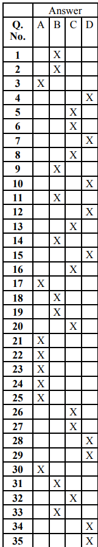

## Set 12

# Set 12

1\. What is the full name of the author Anita Desai?

A. Anita Mazumdar Desai

B. Anita Devi Desai

C. Anita Haribhai Desai

D. None of the above

2\. In the novel Cry, the Peacock, what haunts the protagonist?

A. Her husband's illegal business

B. A childhood prophecy of a fatal disaster

C. A prophecy of her mother's death

D. A prophecy of her being insane

3\. When was the novel Cry, the Peacock first published?

A. 1962

B. 1964

C. 1963

D. 1967

4\. What is the effect of the excessive love that the protagonist receives during her childhood in Cry, the Peacock?

A. She gets bored of life

B. She feels the world to be a toy made especially for her

C. Both A and B

D. None of the above

5\. In Cry, the Peacock, where has the protagonist's brother left for when she is young?

A. United Kingdom

B. United States

C. United Arab Emirates

D. Union of Soviet Socialist Republics

6\. Who is the protagonist of the novel Cry, the Peacock?

A. Maya

B. Trishna

C. Geeta

D. Gautami

7\. In Cry, the Peacock, who is the husband of the protagonist?

A. Gautam

B. Kabir

C. Mahaveer

D. None of the above

8\. What is the profession of the protagonist's husband in Cry, the Peacock?

A. A lawyer

B. An engineer

C. A veteran doctor

D. A writer

9\. According to Gautama in Cry, the Peacock, who is to blame for his wife's neurotic condition?

A. Her extravagance

B. Her father

C. Her caring nature

D. None of the above

10\. In Cry, the Peacock, what does the novel tell us about the astrologer?

A. He was very dangerous

B. He made false predictions

C. He has a pigmentation problem

D. None of the above

11\. Cry, the Peacock is what kind of novel?

A. Bildungsroman

B. Coming of Age novel

C. Psychological novel

D. None of the above

12\. In Cry, the Peacock, what does the Albino Astrologer predict about Maya's life?

A. She will die after a certain period of time

B. Her husband will die after a certain period of time

C. Either she or her husband will die after a certain period of time

D. She will die very young

13\. According to the Albino Astrologer in Cry, the Peacock, after how much time was either Maya or Gautama going to die?

A. 4 months

B. 40 months

C. 4 years

D. 14 years

14\. Which of the following statements is true about the marriage of Maya and Gautama in Cry, the Peacock?

A. There is no compatibility between Maya and Gautama

B. Maya has a romantic love for the beautiful, the colorful, and the sensuous

C. Gautama is not romantic and has no use for flowers

D. All of the above are true

15\. In Cry, the Peacock, what does the name Maya symbolize?

A. Disillusionment

B. The world of sensations

C. The world of joy

D. The world of despair

16\. In Cry, the Peacock, what does the name Gautama symbolize?

A. Cruelty

B. Love

C. Asceticism and detachment from life

D. None of the above

17\. In Cry, the Peacock, what kind of fears does Maya face?

A. Of shadows and drums

B. Of ghosts

C. Of djinns

D. None of the above

18\. In Cry, the Peacock, what are the names of Maya's friends?

A. Lina and Tom

B. Leila and Pom

C. Leila and Tom

D. Lina and Pom

19\. In Cry, the Peacock, which of the following places does Maya visit to divert her attention from the fear of the astrologer's prediction?

A. Mrs. Lal's party

B. The restaurant

C. The cabaret

D. All of the above

20\. In Cry, the Peacock, what is the name of Maya's sister?

A. Lila

B. Leila

C. Pom

D. Nila

21\. Who is the narrator in the novel Cry, the Peacock?

A. Maya

B. Gautama

C. The author

D. The novel is not narrated by a single narrator

22\. In Cry, the Peacock, which myth is Maya reminded of when she thinks about the prophecy?

A. The myth of death

B. The myth of the peacock's dance

C. The myth surrounding the peacock's cry

D. The myth of life and death

23\. Complete the following quote from Cry, the Peacock: "Am I gone insane? Father! Brother! Husband! Who is my savior? I am in need of one. I am dying, and I am in love with \_\_\_\_\_."

A. Gautama

B. Nila

C. Living

D. Life

24\. In Cry, the Peacock, as Maya moves towards insanity towards the end of the novel, which of the following creatures does she not see crawling upon her?

A. Rats

B. Lizards

C. Snakes

D. Caterpillars

25\. In Cry, the Peacock, what is Maya's excuse for planning to kill her husband?

A. He is harsh

B. He is detached and indifferent to life

C. He does not love her

D. He is sick and is going to die soon anyway

26\. In Cry, the Peacock, to which god does Maya pray for the well-being of the couple?

A. Krishna

B. Shiva

C. Rama

D. Hanuman

27\. How is Gautama killed in Cry, the Peacock?

A. It's an accident

B. Maya pushes him over the parapet

C. Both A and B are true

D. None of the above

28\. In Cry, the Peacock, where is Maya taken by Gautama's mother and sister after his death?

A. To the ancestral house of Gautama

B. To the house of Maya's father

C. To a doctor

D. To a police station

29\. Which of the following awards did Anita Desai receive for Cry, the Peacock?

A. Gyanpeeth Award

B. Sahitya Akademi Award

C. Booker Prize

D. None of the above

30\. In which year did Anita Desai receive the Sahitya Akademi Award for Cry, the Peacock?

A. 1963

B. 1964

C. 1965

D. 1966

31\. In Cry, the Peacock, what is the name of Maya's pet dog?

A. Tommy

B. Toto

C. Tutu

D. Tom

32\. In Cry, the Peacock, who considers that love is always without any ambition or desire?

A. Maya

B. Pom

C. Gautama

D. Mrs. Lal

33\. Which part(s) of the novel Cry, the Peacock is/are narrated in the third-person narration?

A. Part 1

B. Parts 1 and 2

C. Parts 2 and 3

D. Parts 1 and 3

34\. Which part of the novel Cry, the Peacock is considered to be the essence of the novel?

A. Part 1

B. Part 2

C. Part 3

D. Both Parts 2 and 3

35\. Which part of the novel Cry, the Peacock has the maximum number of chapters?

A. Part 2

B. Part 3

C. Part 1

D. Parts 2 and 3 have the same number of chapters

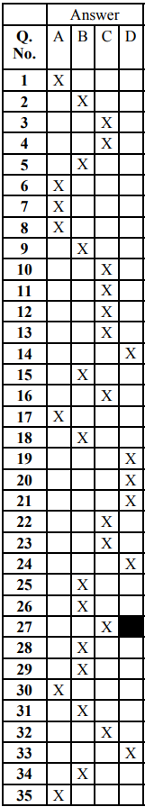

## Set 13

# Set 13

1\. Identify the figure of speech in the following lines:

"His honour rooted in dishonour stood,

And faith unfaithful kept him falsely true."

A. Antithesis

B. Oxymoron

C. Simile

D. Anaphora

2\. In the line "I must be cruel to be kind," which figure of speech is used?

A. Antithesis

B. Paradox

C. Oxymoron

D. None of the above

3\. Identify the figure of speech in the following lines:

"The Eyes around – had wrung them dry

And Breaths were gathering firm

For that last Onset.."

A. Synecdoche

B. Metonymy

C. Metaphor

D. Simile

4\. What figure of speech is used in the following lines?

"My life is my purpose.

My life is my goal.

My life is my inspiration."

A. Epiphora

B. Anaphora

C. Antithesis

D. Paradox

5\. In the phrase "Time is a thief," which figure of speech is employed?

A. Simile

B. Metaphor

C. Both simile and metaphor

D. None of the above

6\. Identify the figure of speech in the line "To err is human; to forgive divine."

A. Paradox

B. Oxymoron

C. Antithesis

D. None of the above

7\. What figure of speech is used in the following lines?

"This is flesh I'm talking about here. Flesh that needs to be loved. Feet that need to rest and to dance; backs that need support; shoulders that need arms, strong arms I'm telling you."

A. Metaphor

B. Simile

C. Synecdoche

D. Metonymy

8\. In the line "The child is father of the man," which figure of speech is used?

A. Litotes

B. Paradox

C. Simile

D. Metaphor

9\. Identify the figure of speech in the following sentence:

"My alarm clock yells at me to get out of bed every morning."

A. Metaphor

B. Apostrophe

C. Personification

D. Onomatopoeia

10\. What figure of speech is used in the following lines?

"The grey-ey'd morn smiles on the frowning night,

Check'ring the Eastern clouds with streaks of light."

A. Simile

B. Metaphor

C. Personification

D. Apostrophe

11\. Identify the figure of speech in the sentence "The Oval Office was busy in work."

A. Metonymy

B. Synecdoche

C. Metaphor

D. Simile

12\. In the sentence "The Oval Office was busy in work," which figure of speech is used?

A. Metonymy

B. Synecdoche

C. Metaphor

D. Simile

13\. What figure of speech is used in the line "Strips of tinfoil winking like people"?

A. Anaphora

B. Assonance

C. Alliteration

D. None of the above

14\. Identify the figure of speech in the following sentence:

"The river swallowed the earth as the water continued to rise higher and higher."

A. Anaphora

B. Antithesis

C. Paradox

D. Personification

15\. What figure of speech is used in the sentence "Success is a sense of achievement; it is not an illegitimate child"?

A. Simile

B. Metaphor

C. Apostrophe

D. Pun

16\. Which figure of speech makes a statement emphatic by overstatement?

A. Hyperbole

B. Onomatopoeia

C. Apostrophe

D. Oxymoron

17\. Which of the following words is an example of onomatopoeia?

A. Murmuring

B. Tiring

C. Charming

D. Glorious

18\. Alliteration can be defined as:

A. A literary genre

B. Repeated consonants in a sentence

C. A repetition of a speech sound in a sequence of words

D. Literary aptitude

19\. In which of the following phrases is personification used?

A. Revenge is an evil

B. Swift as a wind

C. Thirsty Earth

D. Honest thief

20\. The figure of speech that consists of the use of words which suggest their meaning through their sound is called:

A. Onomatopoeia

B. Oxymoron

C. Personification

D. Hyperbole

21\. Identify the figure of speech used in the line "Let not Ambition mock their useful toil."

A. Personification

B. Oxymoron

C. Metaphor

D. Simile

22\. What figure of speech is used in the line "The fire of passion made him blind"?

A. Simile

B. Personification

C. Metaphor

D. Oxymoron

23\. The figure of speech in which two opposite ideas, words, or phrases are put together is:

A. Oxymoron

B. Onomatopoeia

C. Hyperbole

D. Simile

24\. When lifeless objects and abstract ideas are thought of as living beings, the figure of speech is:

A. Personification

B. Hyperbole

C. Apostrophe

D. Oxymoron

25\. The statement "They were swifter than eagles and stronger than lions" contains which figure of speech?

A. Oxymoron

B. Onomatopoeia

C. Hyperbole

D. Personification

26\. Identify the figure of speech used in the following lines:

"Even thus last night and two nights more, I lay and could win thee, sleep! by any stealth."

A. Onomatopoeia

B. Oxymoron

C. Apostrophe

D. Personification

27\. What figure of speech is used in the line "O World! O Life! O Time!"?

A. Hyperbole

B. Oxymoron

C. Apostrophe

D. Personification

28\. Figures of speech are sometimes called:

A. Rhetoric

B. Prosody

C. Usage

D. Syntax

29\. Simile, metaphor, personification, and apostrophe are figures of speech based on:

A. Contrast

B. Association

C. Resemblance

D. Construction

30\. Antithesis and epigram are figures of speech based on:

A. Contrast

B. Resemblance

C. Association

D. Construction

31\. Metonymy and synecdoche are figures of speech based on:

A. Simile and metaphor

B. Association

C. Climax and anti-climax

D. Antithesis and epigram

32\. Identify the figure of speech in the following lines:

"I see a lily on thy brow

Pale with anguish."

A. Simile

B. Personification

C. Hyperbole

D. Metaphor

33\. Which figure of speech is the opposite of hyperbole?

A. Litotes

B. Pun

C. Metaphor

D. Apostrophe

34\. Identify the figure of speech in the line "He that loseth his life shall save it."

A. Paradox

B. Pun

C. Metaphor

D. Litotes

35\. Which figure of speech is also known as a rhetorical question?

A. Litotes

B. Synecdoche

C. Interrogation

D. Echo question

36\. Identify the figure of speech in the following line:

"Gentlemen, you can't fight in here! This is the War Room."

A. Paradox

B. Hyperbole

C. Litotes

D. Metaphor

37\. What figure of speech is used in the following line?

"You never know what worse luck your bad luck has saved you from."

A. Metaphor

B. Antithesis

C. Paradox

D. Oxymoron

38\. A story, play, picture, etc., in which each character or event is a symbol representing an idea or quality, such as truth, evil, death, etc., is called:

A. Allegory

B. Hyperbole

C. Symbolism

D. Ballad

39\. The Gothic is associated with:

A. Germanic culture, especially the Germanic culture dominant during the medieval period after the fall of Rome

B. Something that is characterized by mystery, horror, and gloom

C. Something relating to an architectural style reflecting the influence of the medieval

D. All of the above

40\. Which of the following is not a characteristic of an epic?

A. The setting is large

B. The action is made of deeds of great valor or requiring superhuman courage

C. Great villains with human qualities

D. Supernatural forces—gods, angels, demons—insert themselves in the action

41\. Which of the following is not a popular type of sonnet?

A. Shakespearean sonnet

B. Marlowian sonnet

C. Miltonic sonnet

D. Spenserian sonnet

42\. A simple narrative poem of folk origin, composed in short stanzas and adapted for singing, is called a:

A. Epic

B. Lyric

C. Ballad

D. Mock epic

43\. Which of the following can be called an example of an impersonal elegy?

A. Lycidas

B. Thyrsis

C. Elegy Written in a Country Churchyard

D. Adonais

44\. An elaborately structured poem praising or glorifying an event or individual, describing nature intellectually, is called an:

A. Lyric

B. Ode

C. Ballad

D. Epic

45\. Which of the following is not a type of irony?

A. Verbal irony

B. Situational irony

C. Socratic irony

D. Platonic irony

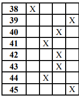

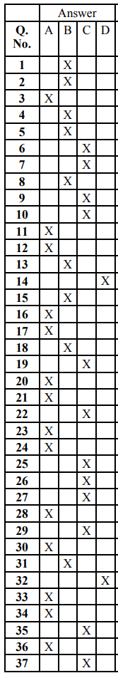

## Set 14

# Set 14

1\. What was Mali's reason for going to America?

A. To start a business

B. To get training to write a book

C. To enjoy a holiday

D. All of the above

2\. In the story, who is arrested by the police for drunkenness?

A. Mali

B. Cousin

C. Jagan

D. Grace

3\. Which character abandons his wife in the story?

A. Mali

B. Jagan

C. Cousin

D. None of the above

4\. Who provides money to the cousin to buy a plane ticket for Grace to return to her hometown?

A. Jagan

B. Mali

C. Grace

D. Cousin

5\. In the story, who holds Jagan responsible for his wife's death?

A. Mali

B. Jagan himself

C. Cousin

D. Grace

6\. Who frequently visits Jagan's shop?

A. Mali

B. Cousin

C. Grace

D. None of the above

7\. What is the central theme of The Vendor of Sweets?

A. Clash between Eastern and Western cultures

B. Generational conflict

C. Both A and B

D. None of the above

8\. The opening line of R.K. Narayan's The Vendor of Sweets is spoken by:

A. Jagan

B. Mali

C. Cousin

D. Listener

9\. Which character is portrayed as a 55-year-old man with a whitening bristly chin, wearing a loose jibba over his dhoti?

A. Jagan

B. Cousin

C. Mali

D. Grace

10\. Who was imprisoned for raising the Indian flag during India's struggle for independence?

A. Jagan

B. Mali

C. Cousin

D. Grace

11\. In the story, which character sits beneath a framed picture of the goddess Laxshmi on the wall?

A. Jagan

B. Ambika

C. Grace

D. Mali

12\. To honor his wife's final wish after her death, what did Jagan give up?

A. Wine

B. Sweetshop

C. Tanning activity

D. Spinning habit

13\. Who perceives significant differences between various types of sweets?

A. Jagan

B. Cousin

C. Ambika

D. Mali

14\. Which character remarks, "All sweetmeats, after all, are the same"?

A. Jagan

B. Cousin

C. Mali

D. Natrajan

15\. Where does Jagan's wife keep her headache medication?

A. Cupboard

B. First aid box

C. Drawing room

D. Purse

16\. Where did Jagan's father construct their family home?

A. Behind the Ahimsa Circle

B. Behind Lawley Street

C. Behind the Lawley Statue

D. Behind the Gandhi Statue

17\. At what time does the cousin regularly visit Jagan?

A. In the morning

B. At 4:30 pm

C. At 12 noon

D. At 8 pm

18\. According to Jagan, what did he tell his son was poisonous?

A. Neem tree

B. Brush

C. Headache pills

D. Pizza

19\. What does Jagan use to brush his teeth?

A. A nylon brush

B. A twig from the Margosa tree

C. A rubber brush

D. His fingers

20\. At what time in the morning does Jagan brush his teeth?

A. 6 am

B. 5 am

C. 7 am

D. 5:30 am

21\. Who makes the statement, "After all, everything consists of flour, sugar, and flavors"?

A. Jagan

B. Cousin

C. Jagan's Sweet Maker

D. Mali

22\. To whom does Jagan sell his surplus yarn?

A. Cotton mills

B. Local handloom committees

C. Shopkeepers

D. Customers

23\. What name does Jagan give to the Margosa tree?

A. Sanjivani

B. Amrita

C. Both Sanjivani and Amrita

D. None of the above

24\. Which character remarks, "You have simplified your life so completely and made yourself absolutely self-dependent"?

A. Jagan

B. Cousin

C. Mali

D. Grace

25\. Where did Jagan spend the prime years of his student life?

A. At home

B. In college

C. In prison

D. In a foreign country

26\. Who is Mr. Noble in the story?

A. A Frenchman

B. A Publisher

C. An American

D. The District Collector

27\. In his small notebook, Jagan records only the cash received after:

A. 5 pm

B. 5:30 pm

C. 6 pm

D. 7pm

28\. How much money was taken from the bundled currency?

A. Ten thousand rupees

B. Five thousand rupees

C. Fifteen thousand rupees

D. None of the above

29\. In which year did Jagan first learn about Gandhi?

A. 1937

B. 1942

C. 1940

D. 1947

30\. Just before Mali leaves for America, what is the only connection between him and Jagan?

A. Breakfast

B. Cousin

C. Bhagwat Gita

D. Five rupee note

31\. In the novel-writing competition, what is the prize for the best novel?

A. 20,000 rupees

B. 25,000 rupees

C. 30,000 rupees

D. 35,000 rupees

32\. In which magazine did Mali find the advertisement for the novel-writing competition?

A. Ananda Bhavan

B. Anand Varsha

C. Ananda Vikatan

D. Harsh Vikatan

33\. Why does Jagan claim that their merchants are becoming heartless?

A. Because they only care about their own profit

B. Because they exploit the poor

C. Because they are dishonest

D. Because they are inhumane

34\. How did Mali inform about his safe arrival?

A. An airletter

B. A telegram

C. Telephone

D. Wireless

35\. What is the name of the publishing house where Jagan submitted his book manuscript?

A. Natraj Printing

B. Truth Printing

C. Natrajan Printing

D. Shiva Printing

36\. According to Jagan, from where did the Vedas originate?

A. God's eyes

B. God's mouth

C. God's ears

D. God's feet

37\. What is the title of the book written by Jagan?

A. Nature Cure and Natural Diet

B. Natural Cure and Nature Diet

C. Natural Way of Life

D. None of the above

38\. What is Grace's ethnicity?

A. Half English, Half American

B. Half Indian, Half American

C. Half Korean, Half English

D. Half Korean, Half American

39\. The sentence "Why do you blame the country for everything? It has been good enough for 400 Millions" reflects:

A. Jagan's love for Indians

B. Jagan's love for his children

C. Jagan's love for India's ancient cultural heritage

D. Jagan's love for Mali

40\. What affectionate nickname does Grace use for Mali?

A. Ma

B. Mo

C. Mu

D. Moo

41\. Who, according to Jagan, advocated for the eradication of the caste system in India?

A. Raja Ram Mohan Roy

B. Swami Vivekanand

C. Dayanand Saraswati

D. Mahatma Gandhi

42\. Which hotel in the story serves European cuisine?

A. The Grand Palace

B. The Palace Hotel

C. The Grand Hotel

D. None of the above

43\. In The Vendor of Sweets, on which date is Jagan's marriage arranged?

A. 12th of December

B. 11th of September

C. 9th of December

D. 10th of September

44\. Who plays a catalytic role in Jagan's transformation in The Vendor of Sweets?

A. Natraj

B. Cousin

C. Chinna Durai

D. Grace

45\. Which of the following is NOT a characteristic of Jagan?

A. Follower of Gandhian objectives

B. Believes in Naturopathy

C. Follows Grace's principles of renouncing worldly concerns

D. Cowardly Father

46\. When was The Vendor of Sweets first published?

A. 1966

B. 1968

C. 1967

D. 1965

47\. Where is the story of The Vendor of Sweets set?

A. Malgudi

B. Cochin

C. Vizag

D. Not mentioned

48\. In R.K. Narayan's name, what does "Rasipuram" refer to?

A. His father

B. His village

C. His own name

D. None of the above

49\. In which language was The Vendor of Sweets originally written?

A. Kannada

B. Tamil

C. Telugu

D. English

50\. Who overheard vague words like 'appeal', 'lawyers', 'lower court', and 'upper court' from his father?

A. Mali

B. Grace

C. Cousin

D. Jagan

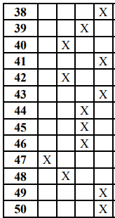

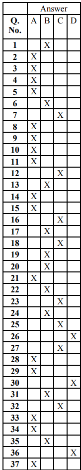

## Set 15

# Set 15

1\. Which character in the story commits a mistake similar to King Lear, has a self-destructive impulse, and displays traits of a picaro?

A. Farfrae

B. Henchard

C. Newson

D. Joshua Jopp

2\. Who among the following characters can be considered a "Picaresque Saint"?

A. Farfrae

B. Henchard

C. Newson

D. Joshua Jopp

3\. The final line of The Mayor of Casterbridge is:

A. "My punishment is not greater than I can bear."

B. "The chief attraction of young woman's face was its mobility."

C. "There is something going on here."

D. "Ay. 'Tis Fair Day."

4\. Which character in the novel uses Scottish dialect?

A. Henchard

B. Newson

C. Farfrae

D. Joshua Jopp

5\. The Mayor of Casterbridge was initially published in May 1886 in:

A. One volume

B. Two volumes

C. Three volumes

D. Four volumes

6\. Which of the following real-life events inspired Thomas Hardy to write The Mayor of Casterbridge?

A. A husband selling his wife

B. The uncertain harvests preceding the repeal of the Corn Laws

C. A royal visit to the town of Casterbridge

D. All of the above events in the history of the real town represented by Casterbridge

7\. The opening line of The Mayor of Casterbridge is:

A. "One evening of late summer, before the nineteenth century had reached one-third of its span, a young man and woman, the latter carrying a child, were approaching the large village of Weydon-Priors, in Upper Wessex, on foot."

B. "Ay. 'Tis Fair Day."

C. "The chief attraction of young woman's face was its mobility."

D. "There is something going on here."

8\. What was written on the sign of the refreshment tent that Henchard and his wife entered?

A. "Good Home-Brewed Beer, Ale, and Cyder"

B. "Good Furmity Sold Here"

C. "Furmity Tent"

D. None of the above

9\. Who says, "I always like furmity, and so does Elizabeth-Jane, and so will you. It is nourishing after a long hard day"?

A. Henchard

B. Susan

C. Elizabeth

D. Farfrae

10\. In the first chapter of The Mayor of Casterbridge, who is described as reading or pretending to read a ballad sheet?

A. Henchard

B. Susan

C. Elizabeth-Jane

D. The Furmity Woman

11\. Who encounters Henchard's family as they approach the village of Weydon-Priors in the first chapter of The Mayor of Casterbridge?

A. A turnip-hoer

B. A farmer

C. A musician

D. The Furmity Woman

12\. Who asks a turnip-hoer if he can find work at the fair?

A. Farfrae

B. Susan

C. Henchard

D. None of the above

13\. What type of liquor is added to Henchard's furmity?

A. Whisky

B. Rum

C. Wine

D. Beer

14\. Who removes her wedding ring and throws it across the booth into the hay-trusser's face?

A. Lucetta

B. Elizabeth-Jane

C. Susan

D. The Furmity Woman

15\. To whom does Henchard reply, "Saying is one thing, and paying is another. Where is the money"?

A. Farfrae

B. Susan

C. Newson

D. Joshua Jopp

16\. Which incident is described as "a piece of mirthful irony carried to extremes"?

A. Henchard selling Susan and her daughter

B. The selling of horses

C. Henchard's drinking

D. None of the above

17\. What small, shiny object does Henchard notice when he wakes up the following morning?

A. A blue fly

B. His wife's ring

C. A coin

D. Nothing

18\. Where does Henchard take his oath, swearing to avoid strong liquors for twenty-one years, one year for each year he has lived?

A. In the furmity tent

B. In a church

C. In the street

D. At a village fair

19\. After taking his oath and having breakfast at a housewife's home, where does Henchard decide to spend the money he received from the sailor?

A. On drinking

B. In searching for his wife

C. At the furmity shop

D. On buying a horse

20\. Who asks the Furmity Woman, "Can you recall the sale of a wife by her husband in your tent eighteen years ago today"?

A. Henchard

B. Susan

C. Elizabeth-Jane

D. Lucetta

21\. Which character is referred to as a "hag" in the novel?

A. Lucetta

B. Susan

C. The Furmity Woman

D. Henchard

22\. Why does Susan refrain from telling Elizabeth-Jane the true story of her past?

A. She doesn't want to risk damaging a child's strong affection

B. She is afraid of Henchard

C. She feels ashamed about it

D. All of the above

23\. After purchasing Susan and her daughter, where does Newson take them?

A. Canada

B. England

C. Falmouth

D. London

24\. Where does the Newson family eventually settle?

A. England

B. Canada

C. London

D. Ireland

25\. How does Newson make a living after settling in Falmouth?

A. As a boatman and general handy shore-man

B. As a farmer

C. As a painter

D. As a teacher

26\. Which of the following is a weakness in Susan's character?

A. Her meek conscience

B. Her rebellious nature

C. Her honesty

D. All of the above

27\. Who remarks about Susan, "...that meekness has done me more harm than the bitterest temper"?

A. Newson

B. Henchard

C. Lucetta

D. Farfrae

28\. Where does Newson go for work, leading people to believe he was lost at sea?

A. Newfoundland trade

B. London trade

C. Falmouth trade

D. None of the above

29\. What is the name of the principal hotel in Casterbridge?

A. King's Arms

B. Old England

C. The Three Mariners

D. Town Hall

30\. The public dinner at the King's Arms is arranged in honor of:

A. Farfrae

B. Henchard

C. Lucetta

D. Susan

31\. Who is described as wearing "a corduroy jacket, a waistcoat, breeches, and tanned leather leggings"?

A. Farfrae

B. Henchard

C. Newson

D. None of the above

32\. At the dinner party, Susan notices that while everyone else is drinking liquor, Henchard is drinking:

A. Beer

B. Rum

C. Water

D. Cold drink

33\. Who informs Susan that Henchard has taken an oath not to drink wine and that he still has two years remaining in his pledge?

A. Solomon Longways

B. An old man

C. Both Solomon Longways and an old man

D. Farfrae

34\. Who is described as "ruddy and of a fair countenance, bright-eyed, and slight in build"?

A. Susan

B. Farfrae

C. Newson

D. Henchard

35\. Who smiles impulsively at Henchard's words, "If anybody will tell me how to turn grown wheat into wholesome wheat, I'll take it back with pleasure. But it can't be done"?

A. Susan

B. Newson

C. Farfrae

D. Lucetta

36\. Where does Farfrae stay after handing his hasty note to the waiter?

A. King's Arms

B. The Three Mariners

C. Hotel Prime

D. None of the above

37\. Who owns The Three Mariners hotel?

A. Lucetta

B. Mrs. Stannidge

C. Mrs. Goodenough

D. None of the above

38\. Who asks Mrs. Stannidge for a part-time job as a waitress at The Three Mariners hotel?

A. Elizabeth-Jane

B. Lucetta

C. Susan

D. Mrs. Goodenough

39\. Who is described as a consummate musician who captivates the hearts of men and women with his rapturous melodies?

A. Henchard

B. Elizabeth

C. Susan

D. Farfrae

40\. After his meeting with Henchard, Farfrae intends to leave for:

A. London

B. Casterbridge

C. Canada

D. Bristol

41\. Who does Susan send as a messenger to inform Henchard about the arrival of his wife?

A. A waiter

B. Elizabeth-Jane

C. Farfrae

D. None of the above

42\. Who remarks, "It never rains but it pours"?

A. Farfrae

B. Henchard

C. Susan

D. Newson

43\. In response to Susan's letter, Henchard writes a letter and hands the envelope to Elizabeth-Jane, enclosing:

A. A five-pound note and an additional five shillings

B. A ten-pound note

C. A ten-pound note and an additional five shillings

D. A five-pound note

44\. Where does Henchard decide to meet Susan?

A. At the Ring on the Budmouth road

B. At The Three Mariners hotel

C. At the King's Arms

D. None of the above

45\. What is the Ring in Casterbridge?

A. A Roman amphitheatre

B. A hotel

C. An inn

D. A garden

46\. Henchard travels to Jersey for business, falls ill, and is nursed by a frank and affectionate young lady. Who is this nurse?

A. Lucetta

B. Mrs. Goodenough

C. Susan

D. Elizabeth

47\. Which character is nicknamed "The Ghost" by some boys?

A. Lucetta

B. Mrs. Goodenough

C. Susan

D. Newson

48\. Who among the following is not present at the marriage ceremony of Henchard and Susan?

A. Christopher Coney

B. Solomon Longways

C. Buzzford

D. All are present

49\. Whose letter does Elizabeth-Jane receive, asking her to meet the writer at a place called Durnover? (Revealed later)

A. Susan

B. Farfrae

C. Lucetta

D. Henchard

50\. Who meets at Durnover after receiving a similar letter?

A. Henchard and Susan

B. Henchard and Lucetta

C. Farfrae and Elizabeth-Jane

D. Farfrae and Lucetta

51\. Which of Henchard's workers becomes a point of contention between Henchard and Farfrae for the first time?

A. Abel Whittle

B. Buzzford

C. Christopher Coney

D. None of the above

52\. Which matter greatly troubles Henchard?

A. The revelation of his past to Farfrae

B. His friendship with Susan

C. The marriage between Henchard and Susan

D. All of the above

53\. Who writes to Henchard, "I shall return through Casterbridge and Budmouth, where I shall take the packet-boat. Can you meet me with the letters and other trifles? I shall be in the coach which changes horses at the Antelope Hotel at half-past five Wednesday evening; I shall be wearing a paisley shawl with a red centre, and thus may easily be found"?

A. Susan

B. Elizabeth-Jane

C. Lucetta

D. Farfrae

54\. How does Susan die?

A. From an ailment

B. In an accident

C. Of natural causes

D. From a roof collapse

55\. Who wants Elizabeth-Jane to marry Mr. Farfrae?

A. Henchard

B. Lucetta

C. Susan

D. Mrs. Goodenough

56\. Towards the end of the novel, why do we find Henchard a miserable man?

A. He has lost his wife

B. He has lost a friend

C. He has lost Elizabeth-Jane

D. All of the above

57\. At The Three Mariners hotel, whom does Elizabeth-Jane serve as a waitress?

A. Farfrae

B. Lucetta

C. Susan

D. Henchard

58\. Who is the widow of a banker?

A. Mrs. Templeman

B. Susan

C. Mrs. Goodenough

D. None of the above

59\. Who lives with Lucetta at High Place Hall?

A. Henchard

B. Farfrae

C. Elizabeth-Jane

D. Susan

60\. According to Henchard's servant, who is behaving like a fool?

A. Henchard

B. Lucetta

C. Farfrae

D. Elizabeth-Jane

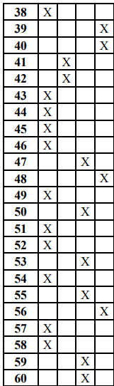

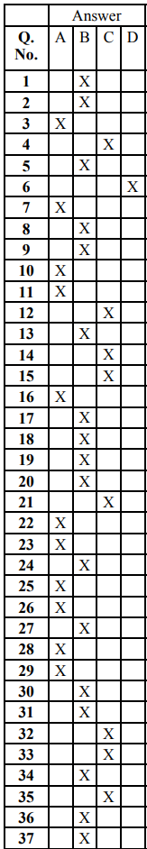

## On His Blindness

# On His Blindness

Q1: When did John Milton live?

A) 1508-1574

B) 1608-1674

C) 1708-1774

D) 1808-1874

Answer: B

Ex- John Milton lived from 1608 to 1674.

Q2: What is the unique aspect of "On His Blindness" in Milton's body of work?

A) It captures his reflections on his limitations as a servant of God

B) It is his only poem about blindness

C) It was written when he was completely blind

D) It is his longest poem

Answer: A

Ex- The poem captures Milton's reflections on his limitations as a servant of God and his difficulties with blindness.

Q3: What does "On His Blindness" explore?

A) Acceptance and faith

B) The search for meaning in the face of tragedy

C) The human condition and effects of physical and spiritual difficulties

D) All of the above

Answer: D

Ex- The poem explores acceptance, faith, the search for meaning in the face of tragedy, and the human condition.

Q4: What poetic form is "On His Blindness" set up like?

A) Shakespearean sonnet

B) Petrarchan sonnet

C) Villanelle

D) Haiku

Answer: B

Ex- "On His Blindness" is set up like a Petrarchan sonnet, with an octave and a sestet.

Q5: What is the rhyme pattern of the octave in a Petrarchan sonnet?

A) ABABCDCD

B) ABBAABBA

C) ABCDEFGH

D) AABBCCDD

Answer: B

Ex- The octave is usually broken up into two quatrains with the rhyme pattern ABBAABBA.

Q6: What does the octave introduce in "On His Blindness"?

A) The main conflict

B) The resolution

C) The moral lesson

D) The poet's biography

Answer: A

Ex- In the octave, Milton introduces the main conflict and lays the groundwork for the poem's examination of his battle with blindness.

Q7: What does the sestet introduce in "On His Blindness"?

A) A change in tenor and viewpoint

B) A new character

C) A different setting

D) A shift in poetic form

Answer: A

Ex- Following the octave, the sestet introduces a change in tenor and viewpoint.

Q8: What meter does "On His Blindness" strictly follow?

A) Iambic pentameter

B) Trochaic tetrameter

C) Anapestic trimeter

D) It does not strictly follow a specific meter

Answer: D

Ex- Though the structure follows the sonnet form, the poem does not strictly follow the iambic pentameter meter.

Q9: How does Milton establish a natural rhythm in the poem?

A) By using a variety of metrical patterns

B) By using only iambic pentameter

C) By using free verse

D) By using rhyming couplets

Answer: A

Ex- Milton uses a variety of metrical patterns throughout the poem to establish a natural rhythm.

Q10: What does the speaker lament about his blindness?

A) That he cannot see the beauty of nature

B) That he cannot read books anymore

C) That his talent is left unutilized and unsatisfied

D) That he cannot recognize his friends and family

Answer: C

Ex- The speaker laments that because he cannot actively serve God, his potential is left unutilized and dissatisfied.

Q11: What does the speaker question about his blindness?

A) Whether it will consign him to an eternity of darkness

B) Whether his days will be barren wastes

C) Whether God values patience and understanding more than rigorous service

D) All of the above

Answer: D

Ex- The speaker questions all of these aspects related to his blindness.

Q12: What change occurs in the sestet of the poem?

A) The speaker becomes more frustrated

B) The speaker loses faith in God

C) The speaker experiences a change in tone

D) The speaker decides to ignore his blindness

Answer: C

Ex- The sestet experiences a change in tone as the poem goes on, and the speaker considers God's innate intelligence and wisdom.

Q13: What does the speaker take comfort in?

A) The idea that God prefers sincerity and perseverance to hasty action

B) The thought that his blindness is only temporary

C) The belief that he will be healed miraculously

D) The notion that he is superior to others despite his blindness

Answer: A

Ex- The speaker takes comfort in the idea that God prefers sincerity and perseverance to hasty action.

Q14: What do the poem's concluding lines emphasize?

A) The speaker's anger towards God

B) The speaker's willingness to accept his situation

C) The speaker's desire to be famous despite his blindness

D) The speaker's plan to overcome his blindness

Answer: B

Ex- The poem's concluding lines emphasize the speaker's willingness to accept his situation and reliance on God's divine plan.

Q15: What is one of the main themes in "On His Blindness"?

A) The pursuit of fame and fortune

B) The importance of romantic love

C) The struggle between personal limitations and the desire to serve a greater good

D) The celebration of nature's beauty

Answer: C

Ex- The poem explores the speaker's inner turmoil as he struggles with his physical constraints and the conflict between his desire to serve God and the limitations that prevent him from doing so successfully.

Q16: What does the poem highlight about faith and reliance on God?

A) They are unnecessary in the face of personal challenges

B) They are valuable in the face of hardship

C) They are only relevant for religious leaders

D) They are a sign of weakness

Answer: B

Ex- The poem examines the value of holding onto faith in the face of hardship and believing in a higher power's plan, even when constrained by limitations.

Q17: What does the loss of sight represent in the poem?

A) The speaker's apparent loss of productivity and usefulness

B) The speaker's gain of spiritual insight

C) The speaker's improved physical health

D) The speaker's enhanced creativity

Answer: A

Ex- The loss of sight represents the speaker's apparent loss of productivity, usefulness, and capacity to serve God.

Q18: What does the poem argue about redemption and compensation?

A) They are impossible to achieve

B) They can be found through hasty action

C) They can be discovered through steadfast endurance and acceptance of limitations

D) They are unrelated to spiritual growth

Answer: C

Ex- The poem makes the case that redemption and compensation can be discovered with steadfast endurance and acceptance of one's limits.

Q19: What does the coming of night represent in the poem?

A) The completion of the day's work

B) The end of the speaker's life

C) The beginning of a new era

D) The arrival of spiritual enlightenment

Answer: A

Ex- The coming of night represents the completion of the day's work and reminds the speaker of how little time is left to accomplish their goals.

Q20: What does the darkness associated with the speaker's blindness allude to?

A) His improved spiritual vision

B) His feelings of joy and contentment

C) His sentiments of doubt and hopelessness

D) His enhanced physical senses

Answer: C

Ex- In addition to the literal lack of light, the darkness connected to his blindness also alludes to his sentiments of doubt and hopelessness.

Q21: What does light represent in the poem?

A) Physical sight

B) Clarity, direction, and spiritual illumination

C) Fame and fortune

D) Worldly distractions

Answer: B

Ex- Light represents the clarity, direction, and spiritual illumination the speaker is working to reclaim or understand.

Q22: How does Milton use metaphorical expressions in the poem?

A) To simplify the speaker's experiences

B) To add depth and complexity to the speaker's reflections

C) To confuse the reader

D) To make the poem more difficult to understand

Answer: B

Ex- The speaker's reflections gain depth and complexity thanks to Milton's use of metaphorical language.

Q23: How does Milton use sensory images in the poem?

A) To focus solely on the sense of sight

B) To provide a rich and multimodal experience despite the speaker's blindness

C) To confuse the reader's senses

D) To make the poem less engaging

Answer: B

Ex- Milton uses sensory images to provide a rich and multimodal experience, allowing readers to connect viscerally with the speaker's experience through senses other than sight.

Q24: What effect does the use of visual imagery have in the poem?

A) It contradicts the speaker's blindness

B) It elicits strong mental images and expresses abstract ideas

C) It makes the poem less meaningful

D) It detracts from the poem's themes

Answer: B

Ex- Despite the speaker's possible blindness, the poem uses visual imagery to elicit strong mental images and express abstract ideas.

Q25: What dimension does the use of religious and biblical vocabulary add to the poem?

A) A scientific dimension

B) A political dimension

C) A religious and theological dimension

D) A comedic dimension

Answer: C

Ex- The poem has a religious and theological dimension due to references to serving God, divine will, and ideas of faith and redemption.

Q26: How does Milton use emotionally charged language in the poem?

A) To express the speaker's single emotional state

B) To confuse the reader's emotions

C) To express the speaker's spectrum of emotions

D) To make the poem less impactful

Answer: C

Ex- Milton uses emotionally charged language to express the speaker's spectrum of emotions, from irritation and despair to acceptance and trust.

Q27: What idea does the speaker struggle with regarding his blindness?

A) That his blindness is a punishment from God

B) That his blindness is a temporary condition

C) That his blindness is a talent or gift he must use differently

D) That his blindness is a sign of his superiority

Answer: C

Ex- The speaker struggles with the notion that his blindness is a talent or gift that he must use differently as part of God's purpose for him.

Q28: What conflict does the speaker experience in the poem?

A) The conflict between actively serving God and the limitations imposed by his blindness

B) The conflict between his desire for fame and his humility

C) The conflict between his love for others and his self-love

D) The conflict between his religious beliefs and scientific knowledge

Answer: A

Ex- The speaker struggles with the conflict between actively serving God and the limits he feels his blindness has placed on him.

Q29: What does the speaker's change in perspective reflect?

A) A loss of faith in God

B) A growing arrogance and pride

C) A path of faith and trust in God

D) A rejection of religious beliefs

Answer: C

Ex- The speaker's path of faith and confidence in God is shown as his perspective changes, leading to an awareness of God's wisdom and readiness to submit to His divine purpose.

Q30: What does the poem emphasize about patience and endurance?

A) They are unnecessary in spiritual growth

B) They are often required in the face of trying circumstances

C) They are signs of weakness

D) They are outdated virtues

Answer: B

Ex- The poem examines the benefits of tolerance and perseverance, reflecting that enduring and persevering through trying conditions is frequently necessary for spiritual progress.

Q31: How does Milton use biblical allusions in the poem?

A) To secularize the poem's themes

B) To contradict religious teachings

C) To emphasize the spiritual nature of the speaker's reflections

D) To make the poem harder to comprehend

Answer: C

Ex- Milton uses biblical allusions and religious imagery throughout the poem to emphasize the spiritual content of the speaker's observations.

Q32: What does the speaker seek to reconcile in the poem?

A) His desire for wealth and his vow of poverty

B) His love for two different people

C) His ambitions with God's purpose

D) His interest in art and his religious duties

Answer: C

Ex- The speaker struggles to reconcile his goals with God's purpose as the poem dives into themes of divine providence, service, faith, and patience.

Q33: What does Milton encourage readers to consider through the religious and spiritual subtexts?

A) The irrelevance of faith in personal growth

B) The impossibility of spiritual development during hardship

C) The connection between faith, challenges, and opportunities for spiritual growth

D) The superiority of secular philosophies over religious beliefs

Answer: C

Ex- Milton encourages readers to consider their connection with faith, their difficulties, and the possibilities for spiritual growth amid hardship through the subtexts.

Q34: What is the main focus of the speaker's spiritual journey in the poem?

A) His relationship with God and the challenges posed by his blindness

B) His desire for fame and recognition

C) His quest for material wealth

D) His search for romantic love

Answer: A

Ex- The poem explores the speaker's spiritual development, focusing on his relationship with God, the difficulties he encounters due to his blindness, and the ultimate resolution he finds through trust and surrender to God's purpose.

Q35: What larger philosophical and theological themes does the speaker's personal struggle reflect?

A) The importance of self-reliance over faith

B) The futility of spiritual growth

C) The necessity of rejecting religious beliefs

D) Themes of submission, service, and finding one's place in the divine plan

Answer: D

Ex- The speaker's conflict mirrors more overarching theological themes of submission, service, and discovering one's position in the divine scheme.

### अभ्यास प्रश्न

1. When did John Milton live?
   A. 1508-1574
   B. 1608-1674
   C. 1708-1774
   D. 1808-1874
   **उत्तर:** B
   **व्याख्या:** Ex- John Milton lived from 1608 to 1674.

2. What is the unique aspect of "On His Blindness" in Milton's body of work?
   A. It captures his reflections on his limitations as a servant of God
   B. It is his only poem about blindness
   C. It was written when he was completely blind
   D. It is his longest poem
   **उत्तर:** A
   **व्याख्या:** Ex- The poem captures Milton's reflections on his limitations as a servant of God and his difficulties with blindness.

3. What does "On His Blindness" explore?
   A. Acceptance and faith
   B. The search for meaning in the face of tragedy
   C. The human condition and effects of physical and spiritual difficulties
   D. All of the above
   **उत्तर:** D
   **व्याख्या:** Ex- The poem explores acceptance, faith, the search for meaning in the face of tragedy, and the human condition.

4. What poetic form is "On His Blindness" set up like?
   A. Shakespearean sonnet
   B. Petrarchan sonnet
   C. Villanelle
   D. Haiku
   **उत्तर:** B
   **व्याख्या:** Ex- "On His Blindness" is set up like a Petrarchan sonnet, with an octave and a sestet.

5. What is the rhyme pattern of the octave in a Petrarchan sonnet?
   A. ABABCDCD
   B. ABBAABBA
   C. ABCDEFGH
   D. AABBCCDD
   **उत्तर:** B
   **व्याख्या:** Ex- The octave is usually broken up into two quatrains with the rhyme pattern ABBAABBA.

6. What does the octave introduce in "On His Blindness"?
   A. The main conflict
   B. The resolution
   C. The moral lesson
   D. The poet's biography
   **उत्तर:** A
   **व्याख्या:** Ex- In the octave, Milton introduces the main conflict and lays the groundwork for the poem's examination of his battle with blindness.

7. What does the sestet introduce in "On His Blindness"?
   A. A change in tenor and viewpoint
   B. A new character
   C. A different setting
   D. A shift in poetic form
   **उत्तर:** A
   **व्याख्या:** Ex- Following the octave, the sestet introduces a change in tenor and viewpoint.

8. What meter does "On His Blindness" strictly follow?
   A. Iambic pentameter
   B. Trochaic tetrameter
   C. Anapestic trimeter
   D. It does not strictly follow a specific meter
   **उत्तर:** D
   **व्याख्या:** Ex- Though the structure follows the sonnet form, the poem does not strictly follow the iambic pentameter meter.

9. How does Milton establish a natural rhythm in the poem?
   A. By using a variety of metrical patterns
   B. By using only iambic pentameter
   C. By using free verse
   D. By using rhyming couplets
   **उत्तर:** A
   **व्याख्या:** Ex- Milton uses a variety of metrical patterns throughout the poem to establish a natural rhythm.

10. What does the speaker lament about his blindness?
   A. That he cannot see the beauty of nature
   B. That he cannot read books anymore
   C. That his talent is left unutilized and unsatisfied
   D. That he cannot recognize his friends and family
   **उत्तर:** C
   **व्याख्या:** Ex- The speaker laments that because he cannot actively serve God, his potential is left unutilized and dissatisfied.

11. What does the speaker question about his blindness?
   A. Whether it will consign him to an eternity of darkness
   B. Whether his days will be barren wastes
   C. Whether God values patience and understanding more than rigorous service
   D. All of the above
   **उत्तर:** D
   **व्याख्या:** Ex- The speaker questions all of these aspects related to his blindness.

12. What change occurs in the sestet of the poem?
   A. The speaker becomes more frustrated
   B. The speaker loses faith in God
   C. The speaker experiences a change in tone
   D. The speaker decides to ignore his blindness
   **उत्तर:** C
   **व्याख्या:** Ex- The sestet experiences a change in tone as the poem goes on, and the speaker considers God's innate intelligence and wisdom.

13. What does the speaker take comfort in?
   A. The idea that God prefers sincerity and perseverance to hasty action
   B. The thought that his blindness is only temporary
   C. The belief that he will be healed miraculously
   D. The notion that he is superior to others despite his blindness
   **उत्तर:** A
   **व्याख्या:** Ex- The speaker takes comfort in the idea that God prefers sincerity and perseverance to hasty action.

14. What do the poem's concluding lines emphasize?
   A. The speaker's anger towards God
   B. The speaker's willingness to accept his situation
   C. The speaker's desire to be famous despite his blindness
   D. The speaker's plan to overcome his blindness
   **उत्तर:** B
   **व्याख्या:** Ex- The poem's concluding lines emphasize the speaker's willingness to accept his situation and reliance on God's divine plan.

15. What is one of the main themes in "On His Blindness"?
   A. The pursuit of fame and fortune
   B. The importance of romantic love
   C. The struggle between personal limitations and the desire to serve a greater good
   D. The celebration of nature's beauty
   **उत्तर:** C
   **व्याख्या:** Ex- The poem explores the speaker's inner turmoil as he struggles with his physical constraints and the conflict between his desire to serve God and the limitations that prevent him from doing so successfully.

16. What does the poem highlight about faith and reliance on God?
   A. They are unnecessary in the face of personal challenges
   B. They are valuable in the face of hardship
   C. They are only relevant for religious leaders
   D. They are a sign of weakness
   **उत्तर:** B
   **व्याख्या:** Ex- The poem examines the value of holding onto faith in the face of hardship and believing in a higher power's plan, even when constrained by limitations.

17. What does the loss of sight represent in the poem?
   A. The speaker's apparent loss of productivity and usefulness
   B. The speaker's gain of spiritual insight
   C. The speaker's improved physical health
   D. The speaker's enhanced creativity
   **उत्तर:** A
   **व्याख्या:** Ex- The loss of sight represents the speaker's apparent loss of productivity, usefulness, and capacity to serve God.

18. What does the poem argue about redemption and compensation?
   A. They are impossible to achieve
   B. They can be found through hasty action
   C. They can be discovered through steadfast endurance and acceptance of limitations
   D. They are unrelated to spiritual growth
   **उत्तर:** C
   **व्याख्या:** Ex- The poem makes the case that redemption and compensation can be discovered with steadfast endurance and acceptance of one's limits.

19. What does the coming of night represent in the poem?
   A. The completion of the day's work
   B. The end of the speaker's life
   C. The beginning of a new era
   D. The arrival of spiritual enlightenment
   **उत्तर:** A
   **व्याख्या:** Ex- The coming of night represents the completion of the day's work and reminds the speaker of how little time is left to accomplish their goals.

20. What does the darkness associated with the speaker's blindness allude to?
   A. His improved spiritual vision
   B. His feelings of joy and contentment
   C. His sentiments of doubt and hopelessness
   D. His enhanced physical senses
   **उत्तर:** C
   **व्याख्या:** Ex- In addition to the literal lack of light, the darkness connected to his blindness also alludes to his sentiments of doubt and hopelessness.

21. What does light represent in the poem?
   A. Physical sight
   B. Clarity, direction, and spiritual illumination
   C. Fame and fortune
   D. Worldly distractions
   **उत्तर:** B
   **व्याख्या:** Ex- Light represents the clarity, direction, and spiritual illumination the speaker is working to reclaim or understand.

22. How does Milton use metaphorical expressions in the poem?
   A. To simplify the speaker's experiences
   B. To add depth and complexity to the speaker's reflections
   C. To confuse the reader
   D. To make the poem more difficult to understand
   **उत्तर:** B
   **व्याख्या:** Ex- The speaker's reflections gain depth and complexity thanks to Milton's use of metaphorical language.

23. How does Milton use sensory images in the poem?
   A. To focus solely on the sense of sight
   B. To provide a rich and multimodal experience despite the speaker's blindness
   C. To confuse the reader's senses
   D. To make the poem less engaging
   **उत्तर:** B
   **व्याख्या:** Ex- Milton uses sensory images to provide a rich and multimodal experience, allowing readers to connect viscerally with the speaker's experience through senses other than sight.

24. What effect does the use of visual imagery have in the poem?
   A. It contradicts the speaker's blindness
   B. It elicits strong mental images and expresses abstract ideas
   C. It makes the poem less meaningful
   D. It detracts from the poem's themes
   **उत्तर:** B
   **व्याख्या:** Ex- Despite the speaker's possible blindness, the poem uses visual imagery to elicit strong mental images and express abstract ideas.

25. What dimension does the use of religious and biblical vocabulary add to the poem?
   A. A scientific dimension
   B. A political dimension
   C. A religious and theological dimension
   D. A comedic dimension
   **उत्तर:** C
   **व्याख्या:** Ex- The poem has a religious and theological dimension due to references to serving God, divine will, and ideas of faith and redemption.

26. How does Milton use emotionally charged language in the poem?
   A. To express the speaker's single emotional state
   B. To confuse the reader's emotions
   C. To express the speaker's spectrum of emotions
   D. To make the poem less impactful
   **उत्तर:** C
   **व्याख्या:** Ex- Milton uses emotionally charged language to express the speaker's spectrum of emotions, from irritation and despair to acceptance and trust.

27. What idea does the speaker struggle with regarding his blindness?
   A. That his blindness is a punishment from God
   B. That his blindness is a temporary condition
   C. That his blindness is a talent or gift he must use differently
   D. That his blindness is a sign of his superiority
   **उत्तर:** C
   **व्याख्या:** Ex- The speaker struggles with the notion that his blindness is a talent or gift that he must use differently as part of God's purpose for him.

28. What conflict does the speaker experience in the poem?
   A. The conflict between actively serving God and the limitations imposed by his blindness
   B. The conflict between his desire for fame and his humility
   C. The conflict between his love for others and his self-love
   D. The conflict between his religious beliefs and scientific knowledge
   **उत्तर:** A
   **व्याख्या:** Ex- The speaker struggles with the conflict between actively serving God and the limits he feels his blindness has placed on him.

29. What does the speaker's change in perspective reflect?
   A. A loss of faith in God
   B. A growing arrogance and pride
   C. A path of faith and trust in God
   D. A rejection of religious beliefs
   **उत्तर:** C
   **व्याख्या:** Ex- The speaker's path of faith and confidence in God is shown as his perspective changes, leading to an awareness of God's wisdom and readiness to submit to His divine purpose.

30. What does the poem emphasize about patience and endurance?
   A. They are unnecessary in spiritual growth
   B. They are often required in the face of trying circumstances
   C. They are signs of weakness
   D. They are outdated virtues
   **उत्तर:** B
   **व्याख्या:** Ex- The poem examines the benefits of tolerance and perseverance, reflecting that enduring and persevering through trying conditions is frequently necessary for spiritual progress.

31. How does Milton use biblical allusions in the poem?
   A. To secularize the poem's themes
   B. To contradict religious teachings
   C. To emphasize the spiritual nature of the speaker's reflections
   D. To make the poem harder to comprehend
   **उत्तर:** C
   **व्याख्या:** Ex- Milton uses biblical allusions and religious imagery throughout the poem to emphasize the spiritual content of the speaker's observations.

32. What does the speaker seek to reconcile in the poem?
   A. His desire for wealth and his vow of poverty
   B. His love for two different people
   C. His ambitions with God's purpose
   D. His interest in art and his religious duties
   **उत्तर:** C
   **व्याख्या:** Ex- The speaker struggles to reconcile his goals with God's purpose as the poem dives into themes of divine providence, service, faith, and patience.

33. What does Milton encourage readers to consider through the religious and spiritual subtexts?
   A. The irrelevance of faith in personal growth
   B. The impossibility of spiritual development during hardship
   C. The connection between faith, challenges, and opportunities for spiritual growth
   D. The superiority of secular philosophies over religious beliefs
   **उत्तर:** C
   **व्याख्या:** Ex- Milton encourages readers to consider their connection with faith, their difficulties, and the possibilities for spiritual growth amid hardship through the subtexts.

34. What is the main focus of the speaker's spiritual journey in the poem?
   A. His relationship with God and the challenges posed by his blindness
   B. His desire for fame and recognition
   C. His quest for material wealth
   D. His search for romantic love
   **उत्तर:** A
   **व्याख्या:** Ex- The poem explores the speaker's spiritual development, focusing on his relationship with God, the difficulties he encounters due to his blindness, and the ultimate resolution he finds through trust and surrender to God's purpose.

35. What larger philosophical and theological themes does the speaker's personal struggle reflect?
   A. The importance of self-reliance over faith
   B. The futility of spiritual growth
   C. The necessity of rejecting religious beliefs
   D. Themes of submission, service, and finding one's place in the divine plan
   **उत्तर:** D
   **व्याख्या:** Ex- The speaker's conflict mirrors more overarching theological themes of submission, service, and discovering one's position in the divine scheme. Set 2

## Set 2

# Set 2

Q1: When was "Sonnet 19" most likely written?

A) Early 1640s

B) Mid-1650s

C) Late 1660s

D) Early 1670s

Answer: B

Ex- The text states that the poem was likely written in the mid-1650s, after Milton lost his eye-sight.

Q2: What is the alternate title of "Sonnet 19"?

A) "How Soon Hath Time"

B) "On His Blindness"

C) "Parable of the Talents"

D) "Paradise Lost"

Answer: B

Ex- The text mentions that the poem is more commonly called "On His Blindness".

Q3: What Protestant position does the poem defend?

A) Salvation comes from good deeds

B) Salvation comes from faith, rather than work

C) Salvation comes from attending church regularly

D) Salvation comes from donating to charity

Answer: B

Ex- The poem argues that salvation comes from faith, rather than work, which is a Protestant position.

Q4: What does the speaker feel unable to complete due to his blindness?

A) Traveling the world

B) Writing poetry

C) Tasks that God has set for him

D) Providing for his family

Answer: C

Ex- The speaker feels unable to complete the tasks that God has set for him because of his blindness.

Q5: What poetic form is "Sonnet 19"?

A) Shakespearean sonnet

B) Spenserian sonnet

C) Petrarchan sonnet

D) Miltonic sonnet

Answer: C

Ex- The text states that "Sonnet 19" is a Petrarchan sonnet.

Q6: In what meter is "Sonnet 19" written?

A) Iambic tetrameter

B) Iambic pentameter

C) Trochaic tetrameter

D) Anapestic trimeter

Answer: B

Ex- Like most English sonnets, "Sonnet 19" is written in iambic pentameter.

Q7: What does the speaker allude to in the first eight lines of the poem?

A) Parable of the Prodigal Son

B) Parable of the Good Samaritan

C) Parable of the Foolish Virgins

D) Parable of the Talents

Answer: D

Ex- The speaker alludes to the Parable of the Talents from the Book of Matthew in the first eight lines.

Q8: What is the speaker's "one Talent which is death to hide" most likely referring to?

A) His skill in painting

B) His skill in music

C) His skill in poetry or scholarship

D) His skill in public speaking

Answer: C

Ex- The "one Talent" is most likely Milton's gift as a poet or a scholar.

Q9: What allegorical figure enters the poem to counter the speaker's frustration?

A) Faith

B) Hope

C) Charity

D) Patience

Answer: D

Ex- The text states that a new voice, which the speaker calls "patience", enters the poem to make counterarguments.

Q10: According to the poem, what is the best way to serve and please God?

A) Traveling across land and sea

B) Performing great works

C) Obeying God's commands

D) Donating money to the church

Answer: C

Ex- The poem suggests that the best way to serve God is to obey his commands, whether that means taking action or waiting patiently.

Q11: What did Milton despise and regularly attack throughout his career?

A) Protestantism

B) Catholicism

C) Judaism

D) Islam

Answer: B

Ex- The text mentions that Milton himself despised Catholicism and regularly attacked it throughout his career.

Q12: Where does the "volta" or "turn" usually occur in a Petrarchan sonnet?

A) Between lines 4 and 5

B) Between lines 6 and 7

C) Between lines 8 and 9

D) Between lines 10 and 11

Answer: C

Ex- In a Petrarchan sonnet, the volta usually comes between line 8 and 9, right on the border between the octave and sestet.

Q13: Where does the volta occur in "Sonnet 19"?

A) At the beginning of line 8

B) Midway through line 8

C) At the end of line 8

D) At the beginning of line 9

Answer: B

Ex- In "Sonnet 19", the volta comes a little early, midway through line eight with: "But patience, to prevent..."

Q14: What does the speaker transform the symbol of a "yoke" to represent in this poem?

A) An unjust burden

B) A satisfying relationship between servant and master

C) A symbol of religious oppression

D) A representation of blindness

Answer: B

Ex- The speaker transforms the "yoke" from a symbol of burden to a representation of a mild, satisfying relationship between servant (man) and master (God).

Q15: What is the rhyme scheme of "Sonnet 19"?

A) ABABCDCDEFEFGG

B) ABBAABBACDECDE

C) ABABBCBCCDCDEE

D) ABBAACCADEDEFF

Answer: B

Ex- The full rhyme scheme for "Sonnet 19", a Petrarchan sonnet, is ABBAABBACDECDE.

Q16: What do the first eight lines of the poem's rhyme scheme reflect?

A) The speaker's joy and contentment

B) The speaker's anger and resentment

C) The speaker's uncertainty and confusion

D) The speaker's anxiety and obsessive thoughts

Answer: D

Ex- The first eight lines use only two rhyme sounds, giving them a churning, obsessive feel that mimics the speaker's anxiety.

Q17: What do the last six lines of the poem's rhyme scheme represent?

A) The speaker's expanded sense of possibility and freedom

B) The speaker's increased confusion and doubt

C) The speaker's growing resentment towards God

D) The speaker's resignation to his fate

Answer: A

Ex- The final six lines introduce new rhyme sounds, mirroring the expanded sense of possibility and freedom from anxiety that the speaker describes.

Q18: Who is assumed to be the speaker of "Sonnet 19" based on biographical details?

A) William Shakespeare

B) John Donne

C) John Milton

D) Andrew Marvell

Answer: C

Ex- Most scholars assume the speaker is John Milton himself, as the poem closely aligns with events in Milton's life.

Q19: When did Milton lose his eyesight?

A) Early 1640s

B) Mid-1650s

C) Late 1660s

D) Early 1670s

Answer: B

Ex- The text states that Milton lost his eyesight in the mid-1650s.

Q20: What epic poem was Milton likely referring to as the work he wanted to complete, his "true account"?

A) The Faerie Queene

B) The Divine Comedy

C) Beowulf

D) Paradise Lost

Answer: D

Ex- The text suggests that the work Milton wanted to complete, referred to as his "true account", was likely Paradise Lost.

Q21: What is the main difference between how Puritan poets like Milton used sonnets compared to earlier poets?

A) Puritan poets focused more on religious themes rather than erotic love

B) Puritan poets wrote sonnets in Latin rather than English

C) Puritan poets invented a new rhyme scheme for their sonnets

D) Puritan poets only wrote sonnets praising God

Answer: A

Ex- Puritan poets like Milton were interested in separating sonnets from erotic themes, which they considered sinful, and instead used them for religious and philosophic disputes.

Q22: What major event preceded the writing of "Sonnet 19" and influenced its religious themes?

A) The Crusades

B) The Spanish Inquisition

C) The English Civil War

D) The French Revolution

Answer: C

Ex- The English Civil War, which ended in the 1650s just before "Sonnet 19" was written, was partly caused by religious disagreements and influenced the poem's themes.

Q23: Who led the government that replaced King Charles I after the English Civil War?

A) William Shakespeare

B) John Milton

C) Andrew Marvell

D) Oliver Cromwell

Answer: D

Ex- After King Charles I was deposed and executed, a democratic government led by Oliver Cromwell governed England.

Q24: What was Milton's role in Cromwell's government?

A) Foreign Minister

B) Lord Chancellor

C) Latin Secretary

D) Attorney General

Answer: C

Ex- Milton became Cromwell's Latin Secretary, responsible for defending Cromwell's government to important intellectual figures in Europe.

Q25: What happened to Milton in the mid-1650s that forced him to retire from public life?

A) He was exiled from England

B) He lost his hearing

C) He lost his eyesight

D) He contracted a serious illness

Answer: C

Ex- Milton lost his eyesight in the mid-1650s, at the height of his political involvement, which forced him to retire from public life.

Q26: How did Milton's enemies interpret his blindness?

A) As a sign of his wisdom and insight

B) As a punishment from God

C) As a test of his faith

D) As an opportunity for him to focus on his writing

Answer: B

Ex- The text states that Milton's enemies interpreted his blindness as a punishment from God.

Q27: Despite his blindness, what did Milton produce in the following years?

A) Scientific treatises

B) Historical novels

C) Some of the most important poetry in the English language

D) Political manifestos

Answer: C

Ex- In the years after he went blind, Milton produced some of the most important poetry in the English language, including Paradise Lost, Samson Agonistes, and Paradise Regained.

Q28: Who assisted Milton in writing after he became blind?

A) His wife

B) His sons

C) His daughters

D) His students

Answer: C

Ex- Milton's daughters would read aloud to him and transcribe his poems for him after he became blind.

Q29: What happened to the monarchy after Cromwell's government?

A) It was permanently abolished

B) It was restored

C) It was replaced by a theocracy

D) It was replaced by a republic

Answer: B

Ex- The text mentions that the monarchy was restored at the end of the 1650s, after Cromwell's government.

Q30: What nearly happened to Milton after the restoration of the monarchy?

A) He was knighted for his service

B) He was executed for his political work

C) He was exiled to France

D) He was appointed Poet Laureate

Answer: B

Ex- Milton narrowly escaped execution for his political work in support of the Cromwell government after the restoration of the monarchy.

Q31: Who intervened to save Milton's life after the restoration of the monarchy?

A) Oliver Cromwell

B) King Charles II

C) John Donne

D) Andrew Marvell

Answer: D

Ex- Fellow poet and member of Parliament, Andrew Marvell, intervened to save Milton's life after the restoration.

Q32: What was the original purpose of the sonnet form before it evolved into a prestigious form of poetry?

A) Religious hymns

B) Popular songs

C) Political satire

D) Philosophical debates

Answer: B

Ex- The sonnet form originally developed as a kind of popular song in Italy during the Middle Ages.

Q33: Which Italian poets were instrumental in elevating the sonnet to a prestigious form of poetry?

A) Boccaccio and Ariosto

B) Petrarch and Dante

C) Tasso and Marino

D) Cavalcanti and Guinizelli

Answer: B

Ex- The Italian poets Petrarch and Dante made the sonnet into an elevated, prestigious kind of formal verse in the 13th and 14th centuries.

Q34: What was the typical subject matter of sonnets after Petrarch and Dante's influence?

A) Unrequited love for beautiful, distant women

B) Praise for great military victories

C) Mourning the loss of a loved one

D) Celebrating the beauty of nature

Answer: A

Ex- After Petrarch and Dante, most sonnets were written by men about their unrequited love for beautiful, inaccessible women.

Q35: What made the sonnet form particularly suitable for poetic arguments?

A) Its brevity and simplicity

B) Its complex rhyme schemes

C) Its structure divided into two halves

D) Its use of iambic pentameter

Answer: C

Ex- The sonnet's structure, neatly divided into two halves (octave and sestet), makes it particularly suitable for poetic arguments, allowing the speaker to propose an idea and then dispute it.

### अभ्यास प्रश्न

1. When was "Sonnet 19" most likely written?
   A. Early 1640s
   B. Mid-1650s
   C. Late 1660s
   D. Early 1670s
   **उत्तर:** B
   **व्याख्या:** Ex- The text states that the poem was likely written in the mid-1650s, after Milton lost his eye-sight.

2. What is the alternate title of "Sonnet 19"?
   A. "How Soon Hath Time"
   B. "On His Blindness"
   C. "Parable of the Talents"
   D. "Paradise Lost"
   **उत्तर:** B
   **व्याख्या:** Ex- The text mentions that the poem is more commonly called "On His Blindness".

3. What Protestant position does the poem defend?
   A. Salvation comes from good deeds
   B. Salvation comes from faith, rather than work
   C. Salvation comes from attending church regularly
   D. Salvation comes from donating to charity
   **उत्तर:** B
   **व्याख्या:** Ex- The poem argues that salvation comes from faith, rather than work, which is a Protestant position.

4. What does the speaker feel unable to complete due to his blindness?
   A. Traveling the world
   B. Writing poetry
   C. Tasks that God has set for him
   D. Providing for his family
   **उत्तर:** C
   **व्याख्या:** Ex- The speaker feels unable to complete the tasks that God has set for him because of his blindness.

5. What poetic form is "Sonnet 19"?
   A. Shakespearean sonnet
   B. Spenserian sonnet
   C. Petrarchan sonnet
   D. Miltonic sonnet
   **उत्तर:** C
   **व्याख्या:** Ex- The text states that "Sonnet 19" is a Petrarchan sonnet.

6. In what meter is "Sonnet 19" written?
   A. Iambic tetrameter
   B. Iambic pentameter
   C. Trochaic tetrameter
   D. Anapestic trimeter
   **उत्तर:** B
   **व्याख्या:** Ex- Like most English sonnets, "Sonnet 19" is written in iambic pentameter.

7. What does the speaker allude to in the first eight lines of the poem?
   A. Parable of the Prodigal Son
   B. Parable of the Good Samaritan
   C. Parable of the Foolish Virgins
   D. Parable of the Talents
   **उत्तर:** D
   **व्याख्या:** Ex- The speaker alludes to the Parable of the Talents from the Book of Matthew in the first eight lines.

8. What is the speaker's "one Talent which is death to hide" most likely referring to?
   A. His skill in painting
   B. His skill in music
   C. His skill in poetry or scholarship
   D. His skill in public speaking
   **उत्तर:** C
   **व्याख्या:** Ex- The "one Talent" is most likely Milton's gift as a poet or a scholar.

9. What allegorical figure enters the poem to counter the speaker's frustration?
   A. Faith
   B. Hope
   C. Charity
   D. Patience
   **उत्तर:** D
   **व्याख्या:** Ex- The text states that a new voice, which the speaker calls "patience", enters the poem to make counterarguments.

10. According to the poem, what is the best way to serve and please God?
   A. Traveling across land and sea
   B. Performing great works
   C. Obeying God's commands
   D. Donating money to the church
   **उत्तर:** C
   **व्याख्या:** Ex- The poem suggests that the best way to serve God is to obey his commands, whether that means taking action or waiting patiently.

11. What did Milton despise and regularly attack throughout his career?
   A. Protestantism
   B. Catholicism
   C. Judaism
   D. Islam
   **उत्तर:** B
   **व्याख्या:** Ex- The text mentions that Milton himself despised Catholicism and regularly attacked it throughout his career.

12. Where does the "volta" or "turn" usually occur in a Petrarchan sonnet?
   A. Between lines 4 and 5
   B. Between lines 6 and 7
   C. Between lines 8 and 9
   D. Between lines 10 and 11
   **उत्तर:** C
   **व्याख्या:** Ex- In a Petrarchan sonnet, the volta usually comes between line 8 and 9, right on the border between the octave and sestet.

13. Where does the volta occur in "Sonnet 19"?
   A. At the beginning of line 8
   B. Midway through line 8
   C. At the end of line 8
   D. At the beginning of line 9
   **उत्तर:** B
   **व्याख्या:** Ex- In "Sonnet 19", the volta comes a little early, midway through line eight with: "But patience, to prevent..."

14. What does the speaker transform the symbol of a "yoke" to represent in this poem?
   A. An unjust burden
   B. A satisfying relationship between servant and master
   C. A symbol of religious oppression
   D. A representation of blindness
   **उत्तर:** B
   **व्याख्या:** Ex- The speaker transforms the "yoke" from a symbol of burden to a representation of a mild, satisfying relationship between servant (man) and master (God).

15. What is the rhyme scheme of "Sonnet 19"?
   A. ABABCDCDEFEFGG
   B. ABBAABBACDECDE
   C. ABABBCBCCDCDEE
   D. ABBAACCADEDEFF
   **उत्तर:** B
   **व्याख्या:** Ex- The full rhyme scheme for "Sonnet 19", a Petrarchan sonnet, is ABBAABBACDECDE.

16. What do the first eight lines of the poem's rhyme scheme reflect?
   A. The speaker's joy and contentment
   B. The speaker's anger and resentment
   C. The speaker's uncertainty and confusion
   D. The speaker's anxiety and obsessive thoughts
   **उत्तर:** D
   **व्याख्या:** Ex- The first eight lines use only two rhyme sounds, giving them a churning, obsessive feel that mimics the speaker's anxiety.

17. What do the last six lines of the poem's rhyme scheme represent?
   A. The speaker's expanded sense of possibility and freedom
   B. The speaker's increased confusion and doubt
   C. The speaker's growing resentment towards God
   D. The speaker's resignation to his fate
   **उत्तर:** A
   **व्याख्या:** Ex- The final six lines introduce new rhyme sounds, mirroring the expanded sense of possibility and freedom from anxiety that the speaker describes.

18. Who is assumed to be the speaker of "Sonnet 19" based on biographical details?
   A. William Shakespeare
   B. John Donne
   C. John Milton
   D. Andrew Marvell
   **उत्तर:** C
   **व्याख्या:** Ex- Most scholars assume the speaker is John Milton himself, as the poem closely aligns with events in Milton's life.

19. When did Milton lose his eyesight?
   A. Early 1640s
   B. Mid-1650s
   C. Late 1660s
   D. Early 1670s
   **उत्तर:** B
   **व्याख्या:** Ex- The text states that Milton lost his eyesight in the mid-1650s.

20. What epic poem was Milton likely referring to as the work he wanted to complete, his "true account"?
   A. The Faerie Queene
   B. The Divine Comedy
   C. Beowulf
   D. Paradise Lost
   **उत्तर:** D
   **व्याख्या:** Ex- The text suggests that the work Milton wanted to complete, referred to as his "true account", was likely Paradise Lost.

21. What is the main difference between how Puritan poets like Milton used sonnets compared to earlier poets?
   A. Puritan poets focused more on religious themes rather than erotic love
   B. Puritan poets wrote sonnets in Latin rather than English
   C. Puritan poets invented a new rhyme scheme for their sonnets
   D. Puritan poets only wrote sonnets praising God
   **उत्तर:** A
   **व्याख्या:** Ex- Puritan poets like Milton were interested in separating sonnets from erotic themes, which they considered sinful, and instead used them for religious and philosophic disputes.

22. What major event preceded the writing of "Sonnet 19" and influenced its religious themes?
   A. The Crusades
   B. The Spanish Inquisition
   C. The English Civil War
   D. The French Revolution
   **उत्तर:** C
   **व्याख्या:** Ex- The English Civil War, which ended in the 1650s just before "Sonnet 19" was written, was partly caused by religious disagreements and influenced the poem's themes.

23. Who led the government that replaced King Charles I after the English Civil War?
   A. William Shakespeare
   B. John Milton
   C. Andrew Marvell
   D. Oliver Cromwell
   **उत्तर:** D
   **व्याख्या:** Ex- After King Charles I was deposed and executed, a democratic government led by Oliver Cromwell governed England.

24. What was Milton's role in Cromwell's government?
   A. Foreign Minister
   B. Lord Chancellor
   C. Latin Secretary
   D. Attorney General
   **उत्तर:** C
   **व्याख्या:** Ex- Milton became Cromwell's Latin Secretary, responsible for defending Cromwell's government to important intellectual figures in Europe.

25. What happened to Milton in the mid-1650s that forced him to retire from public life?
   A. He was exiled from England
   B. He lost his hearing
   C. He lost his eyesight
   D. He contracted a serious illness
   **उत्तर:** C
   **व्याख्या:** Ex- Milton lost his eyesight in the mid-1650s, at the height of his political involvement, which forced him to retire from public life.

26. How did Milton's enemies interpret his blindness?
   A. As a sign of his wisdom and insight
   B. As a punishment from God
   C. As a test of his faith
   D. As an opportunity for him to focus on his writing
   **उत्तर:** B
   **व्याख्या:** Ex- The text states that Milton's enemies interpreted his blindness as a punishment from God.

27. Despite his blindness, what did Milton produce in the following years?
   A. Scientific treatises
   B. Historical novels
   C. Some of the most important poetry in the English language
   D. Political manifestos
   **उत्तर:** C
   **व्याख्या:** Ex- In the years after he went blind, Milton produced some of the most important poetry in the English language, including Paradise Lost, Samson Agonistes, and Paradise Regained.

28. Who assisted Milton in writing after he became blind?
   A. His wife
   B. His sons
   C. His daughters
   D. His students
   **उत्तर:** C
   **व्याख्या:** Ex- Milton's daughters would read aloud to him and transcribe his poems for him after he became blind.

29. What happened to the monarchy after Cromwell's government?
   A. It was permanently abolished
   B. It was restored
   C. It was replaced by a theocracy
   D. It was replaced by a republic
   **उत्तर:** B
   **व्याख्या:** Ex- The text mentions that the monarchy was restored at the end of the 1650s, after Cromwell's government.

30. What nearly happened to Milton after the restoration of the monarchy?
   A. He was knighted for his service
   B. He was executed for his political work
   C. He was exiled to France
   D. He was appointed Poet Laureate
   **उत्तर:** B
   **व्याख्या:** Ex- Milton narrowly escaped execution for his political work in support of the Cromwell government after the restoration of the monarchy.

31. Who intervened to save Milton's life after the restoration of the monarchy?
   A. Oliver Cromwell
   B. King Charles II
   C. John Donne
   D. Andrew Marvell
   **उत्तर:** D
   **व्याख्या:** Ex- Fellow poet and member of Parliament, Andrew Marvell, intervened to save Milton's life after the restoration.

32. What was the original purpose of the sonnet form before it evolved into a prestigious form of poetry?
   A. Religious hymns
   B. Popular songs
   C. Political satire
   D. Philosophical debates
   **उत्तर:** B
   **व्याख्या:** Ex- The sonnet form originally developed as a kind of popular song in Italy during the Middle Ages.

33. Which Italian poets were instrumental in elevating the sonnet to a prestigious form of poetry?
   A. Boccaccio and Ariosto
   B. Petrarch and Dante
   C. Tasso and Marino
   D. Cavalcanti and Guinizelli
   **उत्तर:** B
   **व्याख्या:** Ex- The Italian poets Petrarch and Dante made the sonnet into an elevated, prestigious kind of formal verse in the 13th and 14th centuries.

34. What was the typical subject matter of sonnets after Petrarch and Dante's influence?
   A. Unrequited love for beautiful, distant women
   B. Praise for great military victories
   C. Mourning the loss of a loved one
   D. Celebrating the beauty of nature
   **उत्तर:** A
   **व्याख्या:** Ex- After Petrarch and Dante, most sonnets were written by men about their unrequited love for beautiful, inaccessible women.

35. What made the sonnet form particularly suitable for poetic arguments?
   A. Its brevity and simplicity
   B. Its complex rhyme schemes
   C. Its structure divided into two halves
   D. Its use of iambic pentameter
   **उत्तर:** C
   **व्याख्या:** Ex- The sonnet's structure, neatly divided into two halves (octave and sestet), makes it particularly suitable for poetic arguments, allowing the speaker to propose an idea and then dispute it.

## Go and Catch a Falling Star

# Go and Catch a Falling Star

Q1: When was John Donne's "Go and catch a falling star" first published?

A) 1603

B) 1613

C) 1623

D) 1633

Answer: D

Ex- The poem was first published in 1633.

Q2: What is the traditional theme that the poem takes a fantastical approach to?

A) Women's beauty

B) Women's intelligence

C) Women's infidelity

D) Women's strength

Answer: C

Ex- The poem explores the theme of women's supposedly inevitable infidelity in a fantastical way.

Q3: What does the speaker direct the listener to do first?

A) Catch a falling star

B) Impregnate a mandrake root

C) Find what happens to time that has passed

D) Discover who divided the devil's hoof

Answer: A

Ex- The speaker begins by directing the listener to catch a falling star.

Q4: What does the speaker suggest the listener do if they were born with the power to see mysterious and invisible things?

A) Go on a quest of a thousand days

B) Go on a quest of ten thousand days

C) Go on a quest of a hundred thousand days

D) Stay at home and not go on a quest

Answer: B

Ex- The speaker suggests the listener go on an impossibly long quest of ten thousand days if they have the power to see mysterious things.

Q5: According to the speaker, what would the listener never find among all the magical things they saw on their quest?

A) A mermaid

B) The devil's hoof

C) A woman who was both faithful and beautiful

D) A mandrake root

Answer: C

Ex- The speaker claims that among all the magical things, the listener would never find a woman who was both faithful and beautiful.

Q6: If the listener did find a faithful and beautiful woman, what does the speaker initially say he would do?

A) Refuse to believe it

B) Go on a journey to meet her

C) Write a letter to her

D) Ignore the discovery

Answer: B

Ex- The speaker initially says it would be wonderful to journey to meet this imaginary faithful and beautiful woman.

Q7: Why does the speaker change his mind about going to meet the hypothetical faithful woman?

A) Because she lives too far away

B) Because she would inevitably cheat by the time he got to her

C) Because he doesn't believe she exists

D) Because he's not interested in meeting her

Answer: B

Ex- The speaker changes his mind because he believes that even if the woman were faithful when the listener met her, she'd have cheated on lovers by the time the speaker got to her.

Q8: What is the main theme of "Go and catch a falling star"?

A) Women's beauty

B) Women's intelligence

C) Women's infidelity

D) Women's strength

Answer: C

Ex- The main theme of the poem is women's romantic infidelity.

Q9: What literary era is the theme of women's infidelity associated with?

A) Victorian era

B) Romantic era

C) Donne's era

D) Modern era

Answer: C

Ex- The theme of women's infidelity was a traditional literary theme of Donne's era.

Q10: What tone does the poem's rhyme scheme, meter, and hyperbole create?

A) Serious and somber

B) Light-hearted and satirical

C) Angry and bitter

D) Romantic and nostalgic

Answer: B

Ex- The poem's rhyme scheme, relatively steady meter, and clear hyperbole make its tone feel light-hearted and satirical.

Q11: Despite the light-hearted tone, what genuine emotions does the speaker seem to harbor towards women and relationships?

A) Joy and excitement

B) Melancholy, bitterness, and cynicism

C) Love and adoration

D) Indifference and apathy

Answer: B

Ex- The speaker seems to harbor genuine melancholy, bitterness, and cynicism towards women and relationships.

Q12: What sort of connotations do the magical tasks in the first stanza have?

A) Wholesome and pure

B) Transgressive and sexual

C) Boring and mundane

D) Intellectual and philosophical

Answer: B

Ex- The magical tasks like impregnating a mandrake root and investigating the devil's foot have transgressive and sexual connotations.

Q13: What do mermaids symbolize in the poem?

A) Beauty and grace

B) Wisdom and intelligence

C) Purity and innocence

D) The attractions and dangers of sex

Answer: D

Ex- Mermaids, thought to lure sailors to their deaths with enchanting songs, symbolize the attractions and dangers of sex.

Q14: What does seeking "past years" suggest about the speaker?

A) A longing for lost time

B) A desire to forget the past

C) Contentment with the present

D) Excitement for the future

Answer: A

Ex- Seeking "past years" suggests a longing for lost time and hints at the speaker's painful romantic disappointments.

Q15: What does preventing "envy's stinging" imply about the speaker's past?

A) He had great success in his relationships

B) He had some painful romantic disappointments

C) He never experienced envy in his life

D) He enjoys the feeling of envy

Answer: B

Ex- The mention of preventing "envy's stinging" makes the reader suspect that the speaker might have had some painful romantic disappointments.

Q16: How does the speaker present the possibility of finding a faithful woman compared to finding legendary creatures?

A) Finding a faithful woman is more likely

B) Finding a faithful woman is just as likely

C) Finding a faithful woman is even less likely

D) The speaker doesn't make this comparison

Answer: C

Ex- The speaker presents finding a faithful woman as even more legendary and unlikely than finding magical creatures like mermaids.

Q17: What does the speaker imagine would happen even if his listener did find a faithful woman?

A) She would remain faithful forever

B) She would become even more faithful over time

C) Her faithfulness would never last

D) She would disappear like a mythical creature

Answer: C

Ex- The speaker concludes that even if the listener found a faithful woman, her faithfulness would inevitably not last.

Q18: How does the final stanza differ in tone from the earlier parts of the poem?

A) It becomes more magical and mysterious

B) It becomes more grounded and cynical

C) It becomes more romantic and idealistic

D) It maintains the exact same tone throughout

Answer: B

Ex- The final stanza moves from the magical uncertainty of the earlier parts to a more grounded, earthly cynicism about women's faithfulness.

Q19: What poetic device is used in the opening line "Go and catch a falling star"?

A) Metaphor

B) Simile

C) Personification

D) Apostrophe

Answer: D

Ex- The speaker uses apostrophe, a figure of speech in which the speaker addresses an absent person or abstract idea, to command his listener.

Q20: What meter is predominantly used in the poem?

A) Iambic pentameter

B) Trochaic tetrameter

C) Anapestic trimeter

D) Dactylic hexameter

Answer: B

Ex- The predominant meter in "Go and catch a falling star" is a forceful, percussive trochaic tetrameter, with four feet per line in a stressed-unstressed pattern.

Q21: What is the rhyme scheme of each stanza in the poem?

A) ABABCDCD

B) ABABCCDDD

C) AABBCCDD

D) ABCDEFGH

Answer: B

Ex- The consistent rhyme scheme in each stanza is ABABCCDDD, which keeps the poem moving forward steadily with a gentle, sing-song pattern.

Q22: What is unusual about the "D" rhymes in each stanza?

A) They are half rhymes

B) They are slant rhymes

C) They form a triplet

D) They don't rhyme at all

Answer: C

Ex- The "D" rhymes are notable for forming a triplet, stepping outside the poetic conventions of Donne's time where couplets were more common.

Q23: How does the alliteration contribute to the poem's tone?

A) It makes the poem feel more serious and somber

B) It makes the poem feel more lively and witty

C) It makes the poem feel more romantic and idealistic

D) It makes the poem feel more angry and bitter

Answer: B

Ex- The alliteration, often appearing in two-word sequences, contributes to the poem's lively, energetic, and witty tone despite its sour themes.

Q24: What form does Donne use for this poem?

A) Sonnet

B) Villanelle

C) Ballad

D) His own invented form

Answer: D

Ex- Donne invents his own form for this poem, using three nine-line stanzas each with the same rhyme scheme and meter.

Q25: How does the three-part structure of the poem support the speaker's argument?

A) It weakens the argument by introducing too many contradictions

B) It has no effect on the argument

C) It strengthens the argument by allowing the speaker to make a forceful, almost formal case

D) It distracts from the argument with its complex rhyme scheme

Answer: C

Ex- The three-part structure allows the speaker to make a forceful argument, establishing his point, providing a counterpoint, and then reinforcing his original stance.

Q26: What is unusual about the seventh and eighth lines in each stanza?

A) They are in iambic pentameter

B) They are in iambic monometer

C) They don't rhyme with anything

D) They are not in English

Answer: B

Ex- The seventh and eighth lines of each stanza are in iambic monometer, consisting of a single iamb each, which is a rare and attention-grabbing meter.

Q27: How does the speaker's personal experience seem to influence his perspective on women?

A) He has had positive experiences that make him idealize women

B) He has had neutral experiences that make him indifferent to women

C) He seems to have suffered embittering romantic experiences that fuel his cynicism

D) His personal experiences are not discernible in the poem

Answer: C

Ex- Hints throughout the poem, such as the mention of "past years" and "envy's stinging," suggest the speaker has suffered embittering romantic disappointments that influence his cynical view of women's fidelity.

Q28: What two worlds exist side by side in the poem's setting?

A) The world of men and the world of women

B) The world of the past and the world of the present

C) The world of magic and the mundane, earthly world

D) The world of love and the world of hate

Answer: C

Ex- The poem juxtaposes a world of magic, where one might find mermaids and mandrakes, with the down-to-earth, mundane world of "next door."

Q29: How does the speaker's attitude towards the magical world change over the course of the poem?

A) He becomes more convinced that magic is real

B) He becomes less convinced that magic is real

C) His attitude towards magic remains constant

D) He uses the magical world to emphasize the impossibility of finding a faithful woman

Answer: D

Ex- While the first stanza presents the magical world as impossible, the speaker uses the second stanza's suggestion that one might find magical things to underline the even greater impossibility of finding a faithful woman.

Q30: What genre is John Donne best known for?

A) Epic poetry

B) Metaphysical poetry

C) Romantic poetry

D) Confessional poetry

Answer: B

Ex- John Donne is perhaps the foremost of the metaphysical poets, known for their elaborate conceits and richly symbolic poetry often on religious and spiritual themes.

Q31: What two themes often interweave in Donne's work?

A) Love and nature

B) Politics and religion

C) Love and religion

D) War and peace

Answer: C

Ex- Donne is known in particular for his love poetry and his religious poetry, and these two themes often interweave in his work.

Q32: When did Donne's poetry become widely influential?

A) During his lifetime

B) Immediately after his death

C) In the 18th century

D) In the 20th century

Answer: D

Ex- Though less widely read in his own time, Donne's poetry underwent a renaissance in the 20th century when modernist poets like Eliot and Yeats rediscovered him.

Q33: What was the religious climate like in England during Donne's lifetime?

A) Catholicism and Protestantism were equally accepted

B) Catholicism was the official state religion

C) Protestantism was illegal

D) Catholicism was illegal

Answer: D

Ex- During Donne's life, Catholicism was illegal in England, creating a divided and uncertain religious landscape.

Q34: What was Donne's personal religious journey?

A) He was born Protestant and remained so all his life

B) He was born Catholic, left the faith, and later returned to it

C) He was born Catholic, renounced it to become a Protestant clergyman

D) He was born Protestant and converted to Catholicism

Answer: C

Ex- Donne was born to a Catholic family but struggled with this inheritance, eventually renouncing Catholicism to become a Protestant clergyman.

Q35: What prominent position did Donne hold in the Church of England?

A) Archbishop of Canterbury

B) Bishop of London

C) Dean of Westminster Abbey

D) Dean of St. Paul's Cathedral

Answer: D

Ex- In 1621, Donne rose to the prominent position of Dean of St. Paul's Cathedral, London's central and most important church, where he served for some years.

### अभ्यास प्रश्न

1. When was John Donne's "Go and catch a falling star" first published?
   A. 1603
   B. 1613
   C. 1623
   D. 1633
   **उत्तर:** D
   **व्याख्या:** Ex- The poem was first published in 1633.

2. What is the traditional theme that the poem takes a fantastical approach to?
   A. Women's beauty
   B. Women's intelligence
   C. Women's infidelity
   D. Women's strength
   **उत्तर:** C
   **व्याख्या:** Ex- The poem explores the theme of women's supposedly inevitable infidelity in a fantastical way.

3. What does the speaker direct the listener to do first?
   A. Catch a falling star
   B. Impregnate a mandrake root
   C. Find what happens to time that has passed
   D. Discover who divided the devil's hoof
   **उत्तर:** A
   **व्याख्या:** Ex- The speaker begins by directing the listener to catch a falling star.

4. What does the speaker suggest the listener do if they were born with the power to see mysterious and invisible things?
   A. Go on a quest of a thousand days
   B. Go on a quest of ten thousand days
   C. Go on a quest of a hundred thousand days
   D. Stay at home and not go on a quest
   **उत्तर:** B
   **व्याख्या:** Ex- The speaker suggests the listener go on an impossibly long quest of ten thousand days if they have the power to see mysterious things.

5. According to the speaker, what would the listener never find among all the magical things they saw on their quest?
   A. A mermaid
   B. The devil's hoof
   C. A woman who was both faithful and beautiful
   D. A mandrake root
   **उत्तर:** C
   **व्याख्या:** Ex- The speaker claims that among all the magical things, the listener would never find a woman who was both faithful and beautiful.

6. If the listener did find a faithful and beautiful woman, what does the speaker initially say he would do?
   A. Refuse to believe it
   B. Go on a journey to meet her
   C. Write a letter to her
   D. Ignore the discovery
   **उत्तर:** B
   **व्याख्या:** Ex- The speaker initially says it would be wonderful to journey to meet this imaginary faithful and beautiful woman.

7. Why does the speaker change his mind about going to meet the hypothetical faithful woman?
   A. Because she lives too far away
   B. Because she would inevitably cheat by the time he got to her
   C. Because he doesn't believe she exists
   D. Because he's not interested in meeting her
   **उत्तर:** B
   **व्याख्या:** Ex- The speaker changes his mind because he believes that even if the woman were faithful when the listener met her, she'd have cheated on lovers by the time the speaker got to her.

8. What is the main theme of "Go and catch a falling star"?
   A. Women's beauty
   B. Women's intelligence
   C. Women's infidelity
   D. Women's strength
   **उत्तर:** C
   **व्याख्या:** Ex- The main theme of the poem is women's romantic infidelity.

9. What literary era is the theme of women's infidelity associated with?
   A. Victorian era
   B. Romantic era
   C. Donne's era
   D. Modern era
   **उत्तर:** C
   **व्याख्या:** Ex- The theme of women's infidelity was a traditional literary theme of Donne's era.

10. What tone does the poem's rhyme scheme, meter, and hyperbole create?
   A. Serious and somber
   B. Light-hearted and satirical
   C. Angry and bitter
   D. Romantic and nostalgic
   **उत्तर:** B
   **व्याख्या:** Ex- The poem's rhyme scheme, relatively steady meter, and clear hyperbole make its tone feel light-hearted and satirical.

11. Despite the light-hearted tone, what genuine emotions does the speaker seem to harbor towards women and relationships?
   A. Joy and excitement
   B. Melancholy, bitterness, and cynicism
   C. Love and adoration
   D. Indifference and apathy
   **उत्तर:** B
   **व्याख्या:** Ex- The speaker seems to harbor genuine melancholy, bitterness, and cynicism towards women and relationships.

12. What sort of connotations do the magical tasks in the first stanza have?
   A. Wholesome and pure
   B. Transgressive and sexual
   C. Boring and mundane
   D. Intellectual and philosophical
   **उत्तर:** B
   **व्याख्या:** Ex- The magical tasks like impregnating a mandrake root and investigating the devil's foot have transgressive and sexual connotations.

13. What do mermaids symbolize in the poem?
   A. Beauty and grace
   B. Wisdom and intelligence
   C. Purity and innocence
   D. The attractions and dangers of sex
   **उत्तर:** D
   **व्याख्या:** Ex- Mermaids, thought to lure sailors to their deaths with enchanting songs, symbolize the attractions and dangers of sex.

14. What does seeking "past years" suggest about the speaker?
   A. A longing for lost time
   B. A desire to forget the past
   C. Contentment with the present
   D. Excitement for the future
   **उत्तर:** A
   **व्याख्या:** Ex- Seeking "past years" suggests a longing for lost time and hints at the speaker's painful romantic disappointments.

15. What does preventing "envy's stinging" imply about the speaker's past?
   A. He had great success in his relationships
   B. He had some painful romantic disappointments
   C. He never experienced envy in his life
   D. He enjoys the feeling of envy
   **उत्तर:** B
   **व्याख्या:** Ex- The mention of preventing "envy's stinging" makes the reader suspect that the speaker might have had some painful romantic disappointments.

16. How does the speaker present the possibility of finding a faithful woman compared to finding legendary creatures?
   A. Finding a faithful woman is more likely
   B. Finding a faithful woman is just as likely
   C. Finding a faithful woman is even less likely
   D. The speaker doesn't make this comparison
   **उत्तर:** C
   **व्याख्या:** Ex- The speaker presents finding a faithful woman as even more legendary and unlikely than finding magical creatures like mermaids.

17. What does the speaker imagine would happen even if his listener did find a faithful woman?
   A. She would remain faithful forever
   B. She would become even more faithful over time
   C. Her faithfulness would never last
   D. She would disappear like a mythical creature
   **उत्तर:** C
   **व्याख्या:** Ex- The speaker concludes that even if the listener found a faithful woman, her faithfulness would inevitably not last.

18. How does the final stanza differ in tone from the earlier parts of the poem?
   A. It becomes more magical and mysterious
   B. It becomes more grounded and cynical
   C. It becomes more romantic and idealistic
   D. It maintains the exact same tone throughout
   **उत्तर:** B
   **व्याख्या:** Ex- The final stanza moves from the magical uncertainty of the earlier parts to a more grounded, earthly cynicism about women's faithfulness.

19. What poetic device is used in the opening line "Go and catch a falling star"?
   A. Metaphor
   B. Simile
   C. Personification
   D. Apostrophe
   **उत्तर:** D
   **व्याख्या:** Ex- The speaker uses apostrophe, a figure of speech in which the speaker addresses an absent person or abstract idea, to command his listener.

20. What meter is predominantly used in the poem?
   A. Iambic pentameter
   B. Trochaic tetrameter
   C. Anapestic trimeter
   D. Dactylic hexameter
   **उत्तर:** B
   **व्याख्या:** Ex- The predominant meter in "Go and catch a falling star" is a forceful, percussive trochaic tetrameter, with four feet per line in a stressed-unstressed pattern.

21. What is the rhyme scheme of each stanza in the poem?
   A. ABABCDCD
   B. ABABCCDDD
   C. AABBCCDD
   D. ABCDEFGH
   **उत्तर:** B
   **व्याख्या:** Ex- The consistent rhyme scheme in each stanza is ABABCCDDD, which keeps the poem moving forward steadily with a gentle, sing-song pattern.

22. What is unusual about the "D" rhymes in each stanza?
   A. They are half rhymes
   B. They are slant rhymes
   C. They form a triplet
   D. They don't rhyme at all
   **उत्तर:** C
   **व्याख्या:** Ex- The "D" rhymes are notable for forming a triplet, stepping outside the poetic conventions of Donne's time where couplets were more common.

23. How does the alliteration contribute to the poem's tone?
   A. It makes the poem feel more serious and somber
   B. It makes the poem feel more lively and witty
   C. It makes the poem feel more romantic and idealistic
   D. It makes the poem feel more angry and bitter
   **उत्तर:** B
   **व्याख्या:** Ex- The alliteration, often appearing in two-word sequences, contributes to the poem's lively, energetic, and witty tone despite its sour themes.

24. What form does Donne use for this poem?
   A. Sonnet
   B. Villanelle
   C. Ballad
   D. His own invented form
   **उत्तर:** D
   **व्याख्या:** Ex- Donne invents his own form for this poem, using three nine-line stanzas each with the same rhyme scheme and meter.

25. How does the three-part structure of the poem support the speaker's argument?
   A. It weakens the argument by introducing too many contradictions
   B. It has no effect on the argument
   C. It strengthens the argument by allowing the speaker to make a forceful, almost formal case
   D. It distracts from the argument with its complex rhyme scheme
   **उत्तर:** C
   **व्याख्या:** Ex- The three-part structure allows the speaker to make a forceful argument, establishing his point, providing a counterpoint, and then reinforcing his original stance.

26. What is unusual about the seventh and eighth lines in each stanza?
   A. They are in iambic pentameter
   B. They are in iambic monometer
   C. They don't rhyme with anything
   D. They are not in English
   **उत्तर:** B
   **व्याख्या:** Ex- The seventh and eighth lines of each stanza are in iambic monometer, consisting of a single iamb each, which is a rare and attention-grabbing meter.

27. How does the speaker's personal experience seem to influence his perspective on women?
   A. He has had positive experiences that make him idealize women
   B. He has had neutral experiences that make him indifferent to women
   C. He seems to have suffered embittering romantic experiences that fuel his cynicism
   D. His personal experiences are not discernible in the poem
   **उत्तर:** C
   **व्याख्या:** Ex- Hints throughout the poem, such as the mention of "past years" and "envy's stinging," suggest the speaker has suffered embittering romantic disappointments that influence his cynical view of women's fidelity.

28. What two worlds exist side by side in the poem's setting?
   A. The world of men and the world of women
   B. The world of the past and the world of the present
   C. The world of magic and the mundane, earthly world
   D. The world of love and the world of hate
   **उत्तर:** C
   **व्याख्या:** Ex- The poem juxtaposes a world of magic, where one might find mermaids and mandrakes, with the down-to-earth, mundane world of "next door."

29. How does the speaker's attitude towards the magical world change over the course of the poem?
   A. He becomes more convinced that magic is real
   B. He becomes less convinced that magic is real
   C. His attitude towards magic remains constant
   D. He uses the magical world to emphasize the impossibility of finding a faithful woman
   **उत्तर:** D
   **व्याख्या:** Ex- While the first stanza presents the magical world as impossible, the speaker uses the second stanza's suggestion that one might find magical things to underline the even greater impossibility of finding a faithful woman.

30. What genre is John Donne best known for?
   A. Epic poetry
   B. Metaphysical poetry
   C. Romantic poetry
   D. Confessional poetry
   **उत्तर:** B
   **व्याख्या:** Ex- John Donne is perhaps the foremost of the metaphysical poets, known for their elaborate conceits and richly symbolic poetry often on religious and spiritual themes.

31. What two themes often interweave in Donne's work?
   A. Love and nature
   B. Politics and religion
   C. Love and religion
   D. War and peace
   **उत्तर:** C
   **व्याख्या:** Ex- Donne is known in particular for his love poetry and his religious poetry, and these two themes often interweave in his work.

32. When did Donne's poetry become widely influential?
   A. During his lifetime
   B. Immediately after his death
   C. In the 18th century
   D. In the 20th century
   **उत्तर:** D
   **व्याख्या:** Ex- Though less widely read in his own time, Donne's poetry underwent a renaissance in the 20th century when modernist poets like Eliot and Yeats rediscovered him.

33. What was the religious climate like in England during Donne's lifetime?
   A. Catholicism and Protestantism were equally accepted
   B. Catholicism was the official state religion
   C. Protestantism was illegal
   D. Catholicism was illegal
   **उत्तर:** D
   **व्याख्या:** Ex- During Donne's life, Catholicism was illegal in England, creating a divided and uncertain religious landscape.

34. What was Donne's personal religious journey?
   A. He was born Protestant and remained so all his life
   B. He was born Catholic, left the faith, and later returned to it
   C. He was born Catholic, renounced it to become a Protestant clergyman
   D. He was born Protestant and converted to Catholicism
   **उत्तर:** C
   **व्याख्या:** Ex- Donne was born to a Catholic family but struggled with this inheritance, eventually renouncing Catholicism to become a Protestant clergyman.

35. What prominent position did Donne hold in the Church of England?
   A. Archbishop of Canterbury
   B. Bishop of London
   C. Dean of Westminster Abbey
   D. Dean of St. Paul's Cathedral
   **उत्तर:** D
   **व्याख्या:** Ex- In 1621, Donne rose to the prominent position of Dean of St. Paul's Cathedral, London's central and most important church, where he served for some years. Set 2

## Set 2

# Set 2

Q1: What is the rhyme scheme of John Donne's "Song: Go and catch a falling star"?

A) ABABCCDD

B) ABABCDCD

C) ABABCCDDD

D) ABABCCDED

Answer: C

Ex- The poem follows a consistent rhyme scheme of ABABCCDDD.

Q2: How many stanzas are in "Song: Go and catch a falling star"?

A) Two

B) Three

C) Four

D) Five

Answer: B

Ex- The poem is separated into three stanzas.

Q3: What is the syllable pattern in the first four lines of each stanza?

A) Six syllables

B) Seven syllables

C) Eight syllables

D) Nine syllables

Answer: B

Ex- The first four lines of each stanza have seven syllables.

Q4: What tone does John Donne employ throughout the poem?

A) Serious and somber

B) Light and humorous

C) Angry and resentful

D) Melancholic and depressed

Answer: B

Ex- Donne employs a light and sometimes humorous tone throughout the poem.

Q5: What is John Donne annoyed by in the poem?

A) The inconstancy of men

B) The inconstancy of women

C) The inconstancy of love

D) The inconstancy of life

Answer: B

Ex- Donne is annoyed by the general theme of the poem, the inconstancy of women.

Q6: What characteristic of Donne's other works is not featured in this poem?

A) Metaphysical conceit

B) Unusual rhyme scheme

C) Syllable pattern

D) Comparison between stanzas

Answer: A

Ex- While this piece does not feature the characteristics of metaphysical conceit found in other Donne works, there is an interesting comparison presented between the stanzas.

Q7: What does the speaker compare the impossibility of finding an honest and beautiful woman to?

A) Riding a unicorn

B) Catching a star

C) Finding a four-leaf clover

D) Taming a wild lion

Answer: B

Ex- The speaker compares the impossibility of catching a star to finding an honest and beautiful woman.

Q8: What does the speaker ask the listener to teach him in the first stanza?

A) To fly like a bird

B) To hear mermaids singing

C) To turn lead into gold

D) To speak with animals

Answer: B

Ex- In the first stanza, the speaker asks the listener to teach him to hear mermaids singing.

Q9: What does the speaker want to know about the devil's foot?

A) Who clipped its nails

B) Who polished its hooves

C) Who cleft it

D) Who massaged it

Answer: C

Ex- The speaker wants to know who cleft the devil's foot.

Q10: What does the speaker believe makes some people honest?

A) Education

B) Religion

C) Upbringing

D) The poem does not specify

Answer: D

Ex- The speaker asks what "wind" or reason makes some people honest, but the poem does not provide a specific answer.

Q11: What does the speaker reveal in the second stanza?

A) His love for a specific woman

B) His belief that there are no honest and beautiful women

C) His desire to go on a pilgrimage

D) His fear of growing old

Answer: B

Ex- In the second stanza, the speaker reveals his belief that there are no women who are both honest and beautiful in the world.

Q12: How long does the speaker suggest one would have to ride to find an honest and beautiful woman?

A) Ten days

B) Ten months

C) Ten years

D) Ten thousand days and nights

Answer: D

Ex- The speaker suggests that one would have to ride ten thousand days and nights to find an honest and beautiful woman.

Q13: What physical change would occur during the long ride to find an honest and beautiful woman?

A) Hair turning white

B) Skin wrinkling

C) Teeth falling out

D) Eyes losing sight

Answer: A

Ex- The speaker states that during the long ride to find an honest and beautiful woman, one's hair would turn white with age.

Q14: What does the speaker promise to do if someone finds an honest and beautiful woman?

A) Marry her

B) Write a poem about her

C) Go on a pilgrimage to meet her

D) Give the finder a reward

Answer: C

Ex- The speaker promises to go on a pilgrimage to meet an honest and beautiful woman if someone finds one.

Q15: Despite the promise, what does the speaker say he would not do?

A) Actually go on the pilgrimage

B) Believe that the woman is truly honest

C) Marry the woman

D) Meet the woman, even if she lived next door

Answer: D

Ex- The speaker says he would not go to meet the woman, even if she lived next door.

Q16: According to the speaker, how long would a woman remain true?

A) Forever

B) Until he writes her a letter

C) Until he comes to meet her

D) Until he marries her

Answer: B

Ex- The speaker believes that even if a woman were true when first met, she would be false by the time he writes her a letter.

Q17: How many other men does the speaker believe a woman would be false with?

A) One

B) Two or three

C) Four or five

D) The poem does not specify

Answer: B

Ex- The speaker states that a woman would be false with two or three other men before he even comes to meet her.

Q18: What is the speaker's overall view of women in the poem?

A) They are all honest and beautiful

B) They are all dishonest and ugly

C) They are either honest or beautiful, but not both

D) They are complex and varied individuals

Answer: C

Ex- The speaker's overall view is that women are either honest or beautiful, but not both.

Q19: What magical element is associated with the mandrake root?

A) Healing properties

B) Granting wishes

C) Providing eternal youth

D) Witchcraft or hallucinogens

Answer: D

Ex- The mandrake root is commonly associated with witchcraft or hallucinogens.

Q20: What does the speaker ask the listener to tell him about the past?

A) Where all past years are

B) Who the most famous historical figures were

C) What the most significant events were

D) How people lived in ancient times

Answer: A

Ex- The speaker asks the listener to tell him where all past years are.

Q21: What does the speaker ask the listener to keep off?

A) Envy's stinging

B) Jealousy's burning

C) Hatred's venom

D) Anger's fire

Answer: A

Ex- The speaker asks the listener to teach him how to keep off envy's stinging.

Q22: What does the speaker believe is the likelihood of finding an honest and beautiful woman?

A) Very likely

B) Somewhat likely

C) Unlikely

D) Impossible

Answer: D

Ex- The speaker believes it is impossible to find a woman who is both honest and beautiful.

Q23: What does the speaker compare the journey to find an honest and beautiful woman to?

A) A quest

B) An adventure

C) A pilgrimage

D) A mission

Answer: C

Ex- The speaker compares the journey to find an honest and beautiful woman to a pilgrimage.

Q24: How does the speaker describe the potential pilgrimage to find an honest and beautiful woman?

A) Bitter

B) Sweet

C) Sour

D) Spicy

Answer: B

Ex- The speaker describes the potential pilgrimage to find an honest and beautiful woman as sweet.

Q25: What does the speaker say about the possibility of an honest and beautiful woman living next door?

A) He would gladly go meet her

B) He would be skeptical of her honesty

C) He would not go meet her

D) He would send her a letter

Answer: C

Ex- The speaker says he would not go meet an honest and beautiful woman, even if she lived next door.

Q26: According to the speaker, how long would a woman remain true after meeting her?

A) Until he writes her a letter

B) Until he comes to meet her

C) Until they get married

D) Forever

Answer: A

Ex- The speaker believes that a woman would be true when first met, but would become false by the time he writes her a letter.

Q27: What does the speaker imply about women who are not beautiful?

A) They are honest

B) They are intelligent

C) They are kind

D) They are not worth considering

Answer: D

Ex- The speaker separates women into two categories: beautiful and faithless, and ugly and not worth considering.

Q28: What is the speaker's attitude towards finding love?

A) Hopeful and optimistic

B) Desperate and determined

C) Skeptical and pessimistic

D) Indifferent and apathetic

Answer: C

Ex- The speaker's attitude towards finding love is skeptical and pessimistic, as he believes there are no women who are both honest and beautiful.

Q29: What does the speaker's categorization of women reveal about his perspective?

A) He has a nuanced understanding of women

B) He appreciates women's individuality

C) He has a simplistic and problematic view of women

D) He values women's inner beauty over physical appearance

Answer: C

Ex- The speaker's categorization of women reveals that he has a simplistic and problematic view of women.

Q30: What is the central theme of "Song: Go and catch a falling star"?

A) The beauty of falling in love

B) The importance of honesty in relationships

C) The speaker's belief in the impossibility of finding an honest and beautiful woman

D) The joy of going on a pilgrimage

Answer: C

Ex- The central theme of the poem is the speaker's belief in the impossibility of finding an honest and beautiful woman.

Q31: What literary device does Donne use to compare the impossibility of finding an honest and beautiful woman to other impossible tasks?

A) Metaphor

B) Simile

C) Personification

D) Hyperbole

Answer: A

Ex- Donne uses metaphor to compare the impossibility of finding an honest and beautiful woman to other impossible tasks, such as catching a falling star.

Q32: What does the speaker's request to hear mermaids singing suggest about his view of love?

A) Love is a magical and enchanting experience

B) Love is a rare and elusive phenomenon

C) Love is a dangerous and deceptive force

D) Love is a harmonious and peaceful state

Answer: B

Ex- The speaker's request to hear mermaids singing suggests that he views love as a rare and elusive phenomenon, much like the mythical creatures.

Q33: What does the image of riding "ten thousand days and nights" symbolize?

A) The enduring power of love

B) The futility of searching for an honest and beautiful woman

C) The importance of perseverance in relationships

D) The transformative journey of self-discovery

Answer: B

Ex- The image of riding "ten thousand days and nights" symbolizes the futility of searching for an honest and beautiful woman, as the speaker believes it is an impossible task.

Q34: What does the speaker's resignation to women's falseness reveal about his emotional state?

A) He is angry and resentful

B) He is hurt and betrayed

C) He is accepting and resigned

D) He is hopeful and optimistic

Answer: C

Ex- The speaker's resignation to women's falseness reveals that he is accepting and resigned to what he believes is an inevitable reality.

Q35: What is the significance of the poem's title, "Song: Go and catch a falling star"?

A) It emphasizes the musical quality of the poem

B) It highlights the central metaphor of the impossibility of finding an honest and beautiful woman

C) It suggests the speaker's desire to make a grand romantic gesture

D) It reflects the speaker's belief in the fleeting nature of love

Answer: B

Ex- The title "Song: Go and catch a falling star" highlights the central metaphor of the poem, comparing the impossibility of finding an honest and beautiful woman to the impossible task of catching a falling star.

### अभ्यास प्रश्न

1. What is the rhyme scheme of John Donne's "Song: Go and catch a falling star"?
   A. ABABCCDD
   B. ABABCDCD
   C. ABABCCDDD
   D. ABABCCDED
   **उत्तर:** C
   **व्याख्या:** Ex- The poem follows a consistent rhyme scheme of ABABCCDDD.

2. How many stanzas are in "Song: Go and catch a falling star"?
   A. Two
   B. Three
   C. Four
   D. Five
   **उत्तर:** B
   **व्याख्या:** Ex- The poem is separated into three stanzas.

3. What is the syllable pattern in the first four lines of each stanza?
   A. Six syllables
   B. Seven syllables
   C. Eight syllables
   D. Nine syllables
   **उत्तर:** B
   **व्याख्या:** Ex- The first four lines of each stanza have seven syllables.

4. What tone does John Donne employ throughout the poem?
   A. Serious and somber
   B. Light and humorous
   C. Angry and resentful
   D. Melancholic and depressed
   **उत्तर:** B
   **व्याख्या:** Ex- Donne employs a light and sometimes humorous tone throughout the poem.

5. What is John Donne annoyed by in the poem?
   A. The inconstancy of men
   B. The inconstancy of women
   C. The inconstancy of love
   D. The inconstancy of life
   **उत्तर:** B
   **व्याख्या:** Ex- Donne is annoyed by the general theme of the poem, the inconstancy of women.

6. What characteristic of Donne's other works is not featured in this poem?
   A. Metaphysical conceit
   B. Unusual rhyme scheme
   C. Syllable pattern
   D. Comparison between stanzas
   **उत्तर:** A
   **व्याख्या:** Ex- While this piece does not feature the characteristics of metaphysical conceit found in other Donne works, there is an interesting comparison presented between the stanzas.

7. What does the speaker compare the impossibility of finding an honest and beautiful woman to?
   A. Riding a unicorn
   B. Catching a star
   C. Finding a four-leaf clover
   D. Taming a wild lion
   **उत्तर:** B
   **व्याख्या:** Ex- The speaker compares the impossibility of catching a star to finding an honest and beautiful woman.

8. What does the speaker ask the listener to teach him in the first stanza?
   A. To fly like a bird
   B. To hear mermaids singing
   C. To turn lead into gold
   D. To speak with animals
   **उत्तर:** B
   **व्याख्या:** Ex- In the first stanza, the speaker asks the listener to teach him to hear mermaids singing.

9. What does the speaker want to know about the devil's foot?
   A. Who clipped its nails
   B. Who polished its hooves
   C. Who cleft it
   D. Who massaged it
   **उत्तर:** C
   **व्याख्या:** Ex- The speaker wants to know who cleft the devil's foot.

10. What does the speaker believe makes some people honest?
   A. Education
   B. Religion
   C. Upbringing
   D. The poem does not specify
   **उत्तर:** D
   **व्याख्या:** Ex- The speaker asks what "wind" or reason makes some people honest, but the poem does not provide a specific answer.

11. What does the speaker reveal in the second stanza?
   A. His love for a specific woman
   B. His belief that there are no honest and beautiful women
   C. His desire to go on a pilgrimage
   D. His fear of growing old
   **उत्तर:** B
   **व्याख्या:** Ex- In the second stanza, the speaker reveals his belief that there are no women who are both honest and beautiful in the world.

12. How long does the speaker suggest one would have to ride to find an honest and beautiful woman?
   A. Ten days
   B. Ten months
   C. Ten years
   D. Ten thousand days and nights
   **उत्तर:** D
   **व्याख्या:** Ex- The speaker suggests that one would have to ride ten thousand days and nights to find an honest and beautiful woman.

13. What physical change would occur during the long ride to find an honest and beautiful woman?
   A. Hair turning white
   B. Skin wrinkling
   C. Teeth falling out
   D. Eyes losing sight
   **उत्तर:** A
   **व्याख्या:** Ex- The speaker states that during the long ride to find an honest and beautiful woman, one's hair would turn white with age.

14. What does the speaker promise to do if someone finds an honest and beautiful woman?
   A. Marry her
   B. Write a poem about her
   C. Go on a pilgrimage to meet her
   D. Give the finder a reward
   **उत्तर:** C
   **व्याख्या:** Ex- The speaker promises to go on a pilgrimage to meet an honest and beautiful woman if someone finds one.

15. Despite the promise, what does the speaker say he would not do?
   A. Actually go on the pilgrimage
   B. Believe that the woman is truly honest
   C. Marry the woman
   D. Meet the woman, even if she lived next door
   **उत्तर:** D
   **व्याख्या:** Ex- The speaker says he would not go to meet the woman, even if she lived next door.

16. According to the speaker, how long would a woman remain true?
   A. Forever
   B. Until he writes her a letter
   C. Until he comes to meet her
   D. Until he marries her
   **उत्तर:** B
   **व्याख्या:** Ex- The speaker believes that even if a woman were true when first met, she would be false by the time he writes her a letter.

17. How many other men does the speaker believe a woman would be false with?
   A. One
   B. Two or three
   C. Four or five
   D. The poem does not specify
   **उत्तर:** B
   **व्याख्या:** Ex- The speaker states that a woman would be false with two or three other men before he even comes to meet her.

18. What is the speaker's overall view of women in the poem?
   A. They are all honest and beautiful
   B. They are all dishonest and ugly
   C. They are either honest or beautiful, but not both
   D. They are complex and varied individuals
   **उत्तर:** C
   **व्याख्या:** Ex- The speaker's overall view is that women are either honest or beautiful, but not both.

19. What magical element is associated with the mandrake root?
   A. Healing properties
   B. Granting wishes
   C. Providing eternal youth
   D. Witchcraft or hallucinogens
   **उत्तर:** D
   **व्याख्या:** Ex- The mandrake root is commonly associated with witchcraft or hallucinogens.

20. What does the speaker ask the listener to tell him about the past?
   A. Where all past years are
   B. Who the most famous historical figures were
   C. What the most significant events were
   D. How people lived in ancient times
   **उत्तर:** A
   **व्याख्या:** Ex- The speaker asks the listener to tell him where all past years are.

21. What does the speaker ask the listener to keep off?
   A. Envy's stinging
   B. Jealousy's burning
   C. Hatred's venom
   D. Anger's fire
   **उत्तर:** A
   **व्याख्या:** Ex- The speaker asks the listener to teach him how to keep off envy's stinging.

22. What does the speaker believe is the likelihood of finding an honest and beautiful woman?
   A. Very likely
   B. Somewhat likely
   C. Unlikely
   D. Impossible
   **उत्तर:** D
   **व्याख्या:** Ex- The speaker believes it is impossible to find a woman who is both honest and beautiful.

23. What does the speaker compare the journey to find an honest and beautiful woman to?
   A. A quest
   B. An adventure
   C. A pilgrimage
   D. A mission
   **उत्तर:** C
   **व्याख्या:** Ex- The speaker compares the journey to find an honest and beautiful woman to a pilgrimage.

24. How does the speaker describe the potential pilgrimage to find an honest and beautiful woman?
   A. Bitter
   B. Sweet
   C. Sour
   D. Spicy
   **उत्तर:** B
   **व्याख्या:** Ex- The speaker describes the potential pilgrimage to find an honest and beautiful woman as sweet.

25. What does the speaker say about the possibility of an honest and beautiful woman living next door?
   A. He would gladly go meet her
   B. He would be skeptical of her honesty
   C. He would not go meet her
   D. He would send her a letter
   **उत्तर:** C
   **व्याख्या:** Ex- The speaker says he would not go meet an honest and beautiful woman, even if she lived next door.

26. According to the speaker, how long would a woman remain true after meeting her?
   A. Until he writes her a letter
   B. Until he comes to meet her
   C. Until they get married
   D. Forever
   **उत्तर:** A
   **व्याख्या:** Ex- The speaker believes that a woman would be true when first met, but would become false by the time he writes her a letter.

27. What does the speaker imply about women who are not beautiful?
   A. They are honest
   B. They are intelligent
   C. They are kind
   D. They are not worth considering
   **उत्तर:** D
   **व्याख्या:** Ex- The speaker separates women into two categories: beautiful and faithless, and ugly and not worth considering.

28. What is the speaker's attitude towards finding love?
   A. Hopeful and optimistic
   B. Desperate and determined
   C. Skeptical and pessimistic
   D. Indifferent and apathetic
   **उत्तर:** C
   **व्याख्या:** Ex- The speaker's attitude towards finding love is skeptical and pessimistic, as he believes there are no women who are both honest and beautiful.

29. What does the speaker's categorization of women reveal about his perspective?
   A. He has a nuanced understanding of women
   B. He appreciates women's individuality
   C. He has a simplistic and problematic view of women
   D. He values women's inner beauty over physical appearance
   **उत्तर:** C
   **व्याख्या:** Ex- The speaker's categorization of women reveals that he has a simplistic and problematic view of women.

30. What is the central theme of "Song: Go and catch a falling star"?
   A. The beauty of falling in love
   B. The importance of honesty in relationships
   C. The speaker's belief in the impossibility of finding an honest and beautiful woman
   D. The joy of going on a pilgrimage
   **उत्तर:** C
   **व्याख्या:** Ex- The central theme of the poem is the speaker's belief in the impossibility of finding an honest and beautiful woman.

31. What literary device does Donne use to compare the impossibility of finding an honest and beautiful woman to other impossible tasks?
   A. Metaphor
   B. Simile
   C. Personification
   D. Hyperbole
   **उत्तर:** A
   **व्याख्या:** Ex- Donne uses metaphor to compare the impossibility of finding an honest and beautiful woman to other impossible tasks, such as catching a falling star.

32. What does the speaker's request to hear mermaids singing suggest about his view of love?
   A. Love is a magical and enchanting experience
   B. Love is a rare and elusive phenomenon
   C. Love is a dangerous and deceptive force
   D. Love is a harmonious and peaceful state
   **उत्तर:** B
   **व्याख्या:** Ex- The speaker's request to hear mermaids singing suggests that he views love as a rare and elusive phenomenon, much like the mythical creatures.

33. What does the image of riding "ten thousand days and nights" symbolize?
   A. The enduring power of love
   B. The futility of searching for an honest and beautiful woman
   C. The importance of perseverance in relationships
   D. The transformative journey of self-discovery
   **उत्तर:** B
   **व्याख्या:** Ex- The image of riding "ten thousand days and nights" symbolizes the futility of searching for an honest and beautiful woman, as the speaker believes it is an impossible task.

34. What does the speaker's resignation to women's falseness reveal about his emotional state?
   A. He is angry and resentful
   B. He is hurt and betrayed
   C. He is accepting and resigned
   D. He is hopeful and optimistic
   **उत्तर:** C
   **व्याख्या:** Ex- The speaker's resignation to women's falseness reveals that he is accepting and resigned to what he believes is an inevitable reality.

35. What is the significance of the poem's title, "Song: Go and catch a falling star"?
   A. It emphasizes the musical quality of the poem
   B. It highlights the central metaphor of the impossibility of finding an honest and beautiful woman
   C. It suggests the speaker's desire to make a grand romantic gesture
   D. It reflects the speaker's belief in the fleeting nature of love
   **उत्तर:** B
   **व्याख्या:** Ex- The title "Song: Go and catch a falling star" highlights the central metaphor of the poem, comparing the impossibility of finding an honest and beautiful woman to the impossible task of catching a falling star.

## Daffodils

# Daffodils

Q1: What does the poet compare himself to in the first stanza?

A) A bird

B) A cloud

C) A tree

D) A hill

Answer: B

Ex- The poet says he "wandered lonely as a Cloud" in the first stanza.

Q2: Where does the poet see the daffodils?

A) In a garden

B) Beside the lake

C) On a mountain

D) In a forest

Answer: B

Ex- The poet mentions seeing the daffodils "beside the lake, beneath the trees".

Q3: How does the poet describe the daffodils?

A) Red and vibrant

B) Golden and dancing

C) Small and delicate

D) Tall and still

Answer: B

Ex- The poet calls the daffodils "golden" and describes them as "fluttering and dancing in the breeze".

Q4: What literary device is used when the poet attributes human qualities to the daffodils?

A) Simile

B) Metaphor

C) Personification

D) Alliteration

Answer: C

Ex- The poet personifies the daffodils by describing them as a "crowd" or "host" and showing them "dancing".

Q5: What does the poet imagine the daffodils possessing qualities of?

A) Earth and sky

B) Water and fire

C) Angels and humans

D) Sun and moon

Answer: C

Ex- The poet imagines the daffodils having qualities of both angels (fluttering wings) and humans (dancing).

Q6: In the second stanza, the daffodils are compared to what?

A) Clouds in the sky

B) Stars in the Milky Way

C) Waves in the ocean

D) Trees in a forest

Answer: B

Ex- The poet compares the daffodils stretching along the shore to "stars that shine and twinkle on the milky way".

Q7: How many daffodils does the poet claim to see at a glance?

A) Hundreds

B) Thousands

C) Ten thousand

D) Millions

Answer: C

Ex- The poet uses the hyperbole "Ten thousand saw I at a glance" to express seeing a large number of daffodils.

Q8: What is the daffodils' "sprightly dance" referring to?

A) The flowers swaying in the wind

B) The flowers blooming

C) The flowers changing color

D) The flowers closing at night

Answer: A

Ex- The "sprightly dance" refers to the daffodils' flower heads tossing and moving in the breeze.

Q9: In the third stanza, what else is described as dancing besides the daffodils?

A) The clouds

B) The trees

C) The waves

D) The stars

Answer: C

Ex- The poet says "The waves beside them danced" in addition to the dancing daffodils.

Q10: How did the waves' dance compare to the daffodils' dance?

A) The waves danced better

B) The daffodils outdid the waves

C) They danced equally well

D) They did not dance at the same time

Answer: B

Ex- The poet states the daffodils "Out-did the sparkling waves in glee".

Q11: What could a poet not help but feel in the company of the daffodils?

A) Gay

B) Sad

C) Angry

D) Bored

Answer: A

Ex- The poet says "A poet could not but be gay, In such a jocund company".

Q12: What does the "jocund company" refer to?

A) The other poets

B) The dancing waves

C) The golden daffodils

D) The twinkling stars

Answer: C

Ex- The joyful, jocund company is the crowd of lively daffodils that brings the poet pleasure.

Q13: How long did the poet gaze at the daffodils?

A) For a few seconds

B) For several minutes

C) For about an hour

D) The duration is not specified

Answer: D

Ex- The poet just says "I gazed - and gazed" without indicating exactly how long he looked at the flowers.

Q14: What did the poet give little thought to while looking at the daffodils?

A) How much money he could make selling the flowers

B) How much poetic inspiration the scene would provide

C) How much happiness and wealth the experience brought him

D) How much time he was wasting

Answer: C

Ex- The poet says he "little thought what wealth the show to me had brought" while absorbed in gazing at the scene.

Q15: When does the poet lie on his couch?

A) Every evening

B) When in a vacant or pensive mood

C) When he can't fall asleep

D) When he's ill

Answer: B

Ex- The poet says "when on my couch I lie in vacant or in pensive mood" the daffodils come to mind.

Q16: What does "flash upon that inward eye" mean?

A) The poet imagines the scene

B) The poet dreams about the daffodils

C) The poet looks at a painting of the flowers

D) The poet goes back to the lake to see the flowers again

Answer: A

Ex- The "inward eye" is the poet's imagination or memory, where the scene of the daffodils flashes.

Q17: What is the "bliss of solitude" referring to?

A) The joy of being alone

B) The memory of the daffodils

C) The beauty of the lake

D) The peacefulness of nature

Answer: B

Ex- The memory of the daffodils flashing on the "inward eye" is the bliss that the poet experiences in his solitude.

Q18: When the poet remembers the daffodils, what happens to his heart?

A) It fills with sorrow

B) It fills with pleasure

C) It aches with longing

D) It beats faster with excitement

Answer: B

Ex- The poet states "And then my heart with pleasure fills" when he remembers the joyful daffodils later on.

Q19: What do the daffodils symbolize in the poem?

A) The beauty of solitude

B) The passage of time

C) The joy and beauty of nature

D) The impermanence of life

Answer: C

Ex- Throughout the poem, the daffodils represent the uplifting power and beauty of nature.

Q20: The poem reflects the ideals of which literary movement?

A) Romanticism

B) Modernism

C) Realism

D) Surrealism

Answer: A

Ex- The poem's emphasis on emotion, imagination, solitude and reverence for nature reflects Romantic ideals.

Q21: What is the "ultimate wealth" for the Romantics according to the poem?

A) Money and material possessions

B) Fame and success

C) Nature and its beauty

D) Love and relationships

Answer: C

Ex- The poem suggests that for Romantic poets, the beauty of nature is the greatest wealth.

Q22: What poetic device is used in "lonely as a cloud"?

A) Metaphor

B) Simile

C) Personification

D) Hyperbole

Answer: B

Ex- This is a simile comparing the poet's solitude and aimless wandering to a single cloud.

Q23: What poetic device is used in "Ten thousand saw I at a glance"?

A) Simile

B) Metaphor

C) Personification

D) Hyperbole

Answer: D

Ex- This is hyperbole, an exaggeration used to emphasize the large number of daffodils the poet saw.

Q24: What is the rhyme scheme of each stanza?

A) ABABCC

B) AABBCC

C) ABCABC

D) AAABBB

Answer: A

Ex- The rhyme scheme in each stanza is ABABCC, with the last two lines rhyming as a couplet.

Q25: What type of poem is "I Wandered Lonely as a Cloud"?

A) Haiku

B) Sonnet

C) Lyric

D) Epic

Answer: C

Ex- This is a lyric poem expressing the poet's emotions and imagination.

Q26: What is the main theme of the poem?

A) The power of the imagination

B) The beauty and joy of nature

C) The importance of solitude

D) All of the above

Answer: D

Ex- The main themes include the imagination, the beauty of nature, and the value of solitude.

Q27: What does the poet's experience with the daffodils provide him later on?

A) Poetic inspiration

B) A cure for boredom

C) Relief from sorrow

D) All of the above

Answer: D

Ex- The memory of the daffodils later provides the poet with inspiration, a joyful daydream, and solace when feeling sad or idle.

Q28: What is the "inward eye"?

A) The mind's eye

B) A spiritual vision

C) The imagination and memory

D) All of the above

Answer: D

Ex- The "inward eye" represents a combination of imagination, memory, and poetic or spiritual vision.

Q29: What does the poet's heart do when he remembers the daffodils?

A) Dance with the daffodils

B) Long to see the daffodils again

C) Fill with pleasure

D) Both A and C

Answer: D

Ex- The poet says when he remembers the scene "my heart with pleasure fills, and dances with the daffodils".

Q30: What is the significance of the daffodils being "golden"?

A) It represents their monetary value

B) It emphasizes their beauty and majesty

C) It contrasts with the "milky" way

D) It has no special meaning

Answer: B

Ex- The poet describes the daffodils as "golden" to highlight their visual beauty, radiance and splendor.

Q31: Why are the daffodils described as a "crowd" and "host"?

A) To emphasize their large number

B) To personify them as a joyful company

C) To create a contrast with the poet's solitude

D) All of the above

Answer: D

Ex- The personification emphasizes the multitude of flowers, their lively "dancing", and contrasts with the poet being alone.

Q32: What does "beneath the trees" suggest about the daffodils' location?

A) They are growing in a forest

B) They are scattered randomly

C) They are in the shade

D) They are near the shore of the lake

Answer: D

Ex- The daffodils are located "beside the lake, beneath the trees", suggesting they are growing near the lakeshore under some trees.

Q33: What is the effect of the poet repeating "I gazed - and gazed"?

A) It shows he was bored

B) It emphasizes how long he looked at the scene

C) It suggests he was daydreaming

D) It implies he was waiting for something

Answer: B

Ex- The repetition of "I gazed" twice emphasizes how transfixed the poet was and how much time he spent admiring the daffodils.

Q34: What does "For oft" at the start of the final stanza mean?

A) For a short time

B) Frequently

C) Occasionally

D) In the future

Answer: B

Ex- "For oft" means often or frequently, indicating the poet frequently lies on his couch and remembers the daffodils.

Q35: What is the overall tone of the poem?

A) Melancholic

B) Joyful and reflective

C) Angry and regretful

D) Hopeless and despairing

Answer: B

Ex- The poem has a joyful tone in its depiction of the lively daffodils and a reflective tone in the poet's thoughtful solitude and pleasant memory of the flowers later on.

### अभ्यास प्रश्न

1. What does the poet compare himself to in the first stanza?
   A. A bird
   B. A cloud
   C. A tree
   D. A hill
   **उत्तर:** B
   **व्याख्या:** Ex- The poet says he "wandered lonely as a Cloud" in the first stanza.

2. Where does the poet see the daffodils?
   A. In a garden
   B. Beside the lake
   C. On a mountain
   D. In a forest
   **उत्तर:** B
   **व्याख्या:** Ex- The poet mentions seeing the daffodils "beside the lake, beneath the trees".

3. How does the poet describe the daffodils?
   A. Red and vibrant
   B. Golden and dancing
   C. Small and delicate
   D. Tall and still
   **उत्तर:** B
   **व्याख्या:** Ex- The poet calls the daffodils "golden" and describes them as "fluttering and dancing in the breeze".

4. What literary device is used when the poet attributes human qualities to the daffodils?
   A. Simile
   B. Metaphor
   C. Personification
   D. Alliteration
   **उत्तर:** C
   **व्याख्या:** Ex- The poet personifies the daffodils by describing them as a "crowd" or "host" and showing them "dancing".

5. What does the poet imagine the daffodils possessing qualities of?
   A. Earth and sky
   B. Water and fire
   C. Angels and humans
   D. Sun and moon
   **उत्तर:** C
   **व्याख्या:** Ex- The poet imagines the daffodils having qualities of both angels (fluttering wings) and humans (dancing).

6. In the second stanza, the daffodils are compared to what?
   A. Clouds in the sky
   B. Stars in the Milky Way
   C. Waves in the ocean
   D. Trees in a forest
   **उत्तर:** B
   **व्याख्या:** Ex- The poet compares the daffodils stretching along the shore to "stars that shine and twinkle on the milky way".

7. How many daffodils does the poet claim to see at a glance?
   A. Hundreds
   B. Thousands
   C. Ten thousand
   D. Millions
   **उत्तर:** C
   **व्याख्या:** Ex- The poet uses the hyperbole "Ten thousand saw I at a glance" to express seeing a large number of daffodils.

8. What is the daffodils' "sprightly dance" referring to?
   A. The flowers swaying in the wind
   B. The flowers blooming
   C. The flowers changing color
   D. The flowers closing at night
   **उत्तर:** A
   **व्याख्या:** Ex- The "sprightly dance" refers to the daffodils' flower heads tossing and moving in the breeze.

9. In the third stanza, what else is described as dancing besides the daffodils?
   A. The clouds
   B. The trees
   C. The waves
   D. The stars
   **उत्तर:** C
   **व्याख्या:** Ex- The poet says "The waves beside them danced" in addition to the dancing daffodils.

10. How did the waves' dance compare to the daffodils' dance?
   A. The waves danced better
   B. The daffodils outdid the waves
   C. They danced equally well
   D. They did not dance at the same time
   **उत्तर:** B
   **व्याख्या:** Ex- The poet states the daffodils "Out-did the sparkling waves in glee".

11. What could a poet not help but feel in the company of the daffodils?
   A. Gay
   B. Sad
   C. Angry
   D. Bored
   **उत्तर:** A
   **व्याख्या:** Ex- The poet says "A poet could not but be gay, In such a jocund company".

12. What does the "jocund company" refer to?
   A. The other poets
   B. The dancing waves
   C. The golden daffodils
   D. The twinkling stars
   **उत्तर:** C
   **व्याख्या:** Ex- The joyful, jocund company is the crowd of lively daffodils that brings the poet pleasure.

13. How long did the poet gaze at the daffodils?
   A. For a few seconds
   B. For several minutes
   C. For about an hour
   D. The duration is not specified
   **उत्तर:** D
   **व्याख्या:** Ex- The poet just says "I gazed - and gazed" without indicating exactly how long he looked at the flowers.

14. What did the poet give little thought to while looking at the daffodils?
   A. How much money he could make selling the flowers
   B. How much poetic inspiration the scene would provide
   C. How much happiness and wealth the experience brought him
   D. How much time he was wasting
   **उत्तर:** C
   **व्याख्या:** Ex- The poet says he "little thought what wealth the show to me had brought" while absorbed in gazing at the scene.

15. When does the poet lie on his couch?
   A. Every evening
   B. When in a vacant or pensive mood
   C. When he can't fall asleep
   D. When he's ill
   **उत्तर:** B
   **व्याख्या:** Ex- The poet says "when on my couch I lie in vacant or in pensive mood" the daffodils come to mind.

16. What does "flash upon that inward eye" mean?
   A. The poet imagines the scene
   B. The poet dreams about the daffodils
   C. The poet looks at a painting of the flowers
   D. The poet goes back to the lake to see the flowers again
   **उत्तर:** A
   **व्याख्या:** Ex- The "inward eye" is the poet's imagination or memory, where the scene of the daffodils flashes.

17. What is the "bliss of solitude" referring to?
   A. The joy of being alone
   B. The memory of the daffodils
   C. The beauty of the lake
   D. The peacefulness of nature
   **उत्तर:** B
   **व्याख्या:** Ex- The memory of the daffodils flashing on the "inward eye" is the bliss that the poet experiences in his solitude.

18. When the poet remembers the daffodils, what happens to his heart?
   A. It fills with sorrow
   B. It fills with pleasure
   C. It aches with longing
   D. It beats faster with excitement
   **उत्तर:** B
   **व्याख्या:** Ex- The poet states "And then my heart with pleasure fills" when he remembers the joyful daffodils later on.

19. What do the daffodils symbolize in the poem?
   A. The beauty of solitude
   B. The passage of time
   C. The joy and beauty of nature
   D. The impermanence of life
   **उत्तर:** C
   **व्याख्या:** Ex- Throughout the poem, the daffodils represent the uplifting power and beauty of nature.

20. The poem reflects the ideals of which literary movement?
   A. Romanticism
   B. Modernism
   C. Realism
   D. Surrealism
   **उत्तर:** A
   **व्याख्या:** Ex- The poem's emphasis on emotion, imagination, solitude and reverence for nature reflects Romantic ideals.

21. What is the "ultimate wealth" for the Romantics according to the poem?
   A. Money and material possessions
   B. Fame and success
   C. Nature and its beauty
   D. Love and relationships
   **उत्तर:** C
   **व्याख्या:** Ex- The poem suggests that for Romantic poets, the beauty of nature is the greatest wealth.

22. What poetic device is used in "lonely as a cloud"?
   A. Metaphor
   B. Simile
   C. Personification
   D. Hyperbole
   **उत्तर:** B
   **व्याख्या:** Ex- This is a simile comparing the poet's solitude and aimless wandering to a single cloud.

23. What poetic device is used in "Ten thousand saw I at a glance"?
   A. Simile
   B. Metaphor
   C. Personification
   D. Hyperbole
   **उत्तर:** D
   **व्याख्या:** Ex- This is hyperbole, an exaggeration used to emphasize the large number of daffodils the poet saw.

24. What is the rhyme scheme of each stanza?
   A. ABABCC
   B. AABBCC
   C. ABCABC
   D. AAABBB
   **उत्तर:** A
   **व्याख्या:** Ex- The rhyme scheme in each stanza is ABABCC, with the last two lines rhyming as a couplet.

25. What type of poem is "I Wandered Lonely as a Cloud"?
   A. Haiku
   B. Sonnet
   C. Lyric
   D. Epic
   **उत्तर:** C
   **व्याख्या:** Ex- This is a lyric poem expressing the poet's emotions and imagination.

26. What is the main theme of the poem?
   A. The power of the imagination
   B. The beauty and joy of nature
   C. The importance of solitude
   D. All of the above
   **उत्तर:** D
   **व्याख्या:** Ex- The main themes include the imagination, the beauty of nature, and the value of solitude.

27. What does the poet's experience with the daffodils provide him later on?
   A. Poetic inspiration
   B. A cure for boredom
   C. Relief from sorrow
   D. All of the above
   **उत्तर:** D
   **व्याख्या:** Ex- The memory of the daffodils later provides the poet with inspiration, a joyful daydream, and solace when feeling sad or idle.

28. What is the "inward eye"?
   A. The mind's eye
   B. A spiritual vision
   C. The imagination and memory
   D. All of the above
   **उत्तर:** D
   **व्याख्या:** Ex- The "inward eye" represents a combination of imagination, memory, and poetic or spiritual vision.

29. What does the poet's heart do when he remembers the daffodils?
   A. Dance with the daffodils
   B. Long to see the daffodils again
   C. Fill with pleasure
   D. Both A and C
   **उत्तर:** D
   **व्याख्या:** Ex- The poet says when he remembers the scene "my heart with pleasure fills, and dances with the daffodils".

30. What is the significance of the daffodils being "golden"?
   A. It represents their monetary value
   B. It emphasizes their beauty and majesty
   C. It contrasts with the "milky" way
   D. It has no special meaning
   **उत्तर:** B
   **व्याख्या:** Ex- The poet describes the daffodils as "golden" to highlight their visual beauty, radiance and splendor.

31. Why are the daffodils described as a "crowd" and "host"?
   A. To emphasize their large number
   B. To personify them as a joyful company
   C. To create a contrast with the poet's solitude
   D. All of the above
   **उत्तर:** D
   **व्याख्या:** Ex- The personification emphasizes the multitude of flowers, their lively "dancing", and contrasts with the poet being alone.

32. What does "beneath the trees" suggest about the daffodils' location?
   A. They are growing in a forest
   B. They are scattered randomly
   C. They are in the shade
   D. They are near the shore of the lake
   **उत्तर:** D
   **व्याख्या:** Ex- The daffodils are located "beside the lake, beneath the trees", suggesting they are growing near the lakeshore under some trees.

33. What is the effect of the poet repeating "I gazed - and gazed"?
   A. It shows he was bored
   B. It emphasizes how long he looked at the scene
   C. It suggests he was daydreaming
   D. It implies he was waiting for something
   **उत्तर:** B
   **व्याख्या:** Ex- The repetition of "I gazed" twice emphasizes how transfixed the poet was and how much time he spent admiring the daffodils.

34. What does "For oft" at the start of the final stanza mean?
   A. For a short time
   B. Frequently
   C. Occasionally
   D. In the future
   **उत्तर:** B
   **व्याख्या:** Ex- "For oft" means often or frequently, indicating the poet frequently lies on his couch and remembers the daffodils.

35. What is the overall tone of the poem?
   A. Melancholic
   B. Joyful and reflective
   C. Angry and regretful
   D. Hopeless and despairing
   **उत्तर:** B
   **व्याख्या:** Ex- The poem has a joyful tone in its depiction of the lively daffodils and a reflective tone in the poet's thoughtful solitude and pleasant memory of the flowers later on. Set 2

36. What is the rhyme scheme of each stanza?
   A. AABB
   B. ABAB
   C. ABABCC
   D. ABCABC
   **उत्तर:** C
   **व्याख्या:** Ex- Each stanza follows an ABABCC rhyme scheme.

37. What is the main theme of the poem?
   A. The beauty of art
   B. The power of love
   C. The consequences of jealousy
   D. The importance of communication
   **उत्तर:** C
   **व्याख्या:** Ex- The poem explores the destructive nature of jealousy and the ways in which it can lead to control and violence.

38. What is the overall tone of the poem?
   A. Humorous and lighthearted
   B. Romantic and sentimental
   C. Serious and somber
   D. Angry and vengeful
   **उत्तर:** C
   **व्याख्या:** Ex- The poem's tone is serious and somber, reflecting the gravity of the situation and the mother's suffering.

## Set 2

# Set 2

Q1: When was "I Wandered Lonely as a Cloud" first composed?

A) 1798

B) 1802

C) 1804

D) 1815

Answer: C

Ex- The poem was composed by Wordsworth around 1804.

Q2: Who is the poet of "I Wandered Lonely as a Cloud"?

A) Samuel Coleridge

B) John Keats

C) William Wordsworth

D) Lord Byron

Answer: C

Ex- "I Wandered Lonely as a Cloud" was written by William Wordsworth.

Q3: Where did Wordsworth encounter the daffodils that inspired the poem?

A) In his garden

B) In the countryside of England's Lake District

C) In a park in London

D) In a dream

Answer: B

Ex- The poem is based on one of Wordsworth's walks in the Lake District countryside.

Q4: How does the speaker compare himself to a natural element in the first line?

A) A tree

B) A river

C) A cloud

D) A bird

Answer: C

Ex- In the first line, the speaker compares himself to a cloud.

Q5: What poetic device is used when the daffodils are described as "dancing"?

A) Metaphor

B) Simile

C) Personification

D) Alliteration

Answer: C

Ex- Attributing human characteristics (dancing) to non-human entities (daffodils) is personification.

Q6: How many daffodils does the speaker estimate seeing?

A) A hundred

B) A thousand

C) Ten thousand

D) A million

Answer: C

Ex- The speaker guesses there are ten thousand or so daffodils.

Q7: What is the daffodils' movement compared to?

A) Stars in the sky

B) Waves in the bay

C) Both A and B

D) Neither A nor B

Answer: C

Ex- The daffodils are compared to both stars in the sky and waves in the bay.

Q8: What effect does the sight of the daffodils have on the speaker?

A) It makes him sad

B) It makes him angry

C) It makes him cheerful

D) It has no effect

Answer: C

Ex- The speaker notes that a poet couldn't help being cheerful in the company of the daffodils.

Q9: Where is the speaker often when the memory of the daffodils returns?

A) Walking outdoors

B) Lying on the couch

C) At a party

D) At work

Answer: B

Ex- The speaker often lies on the couch when the daffodils come back to his mind.

Q10: What does the speaker credit for his ability to recall the daffodils?

A) A strong memory

B) A gift of solitude

C) Frequent walks outdoors

D) Reading poetry

Answer: B

Ex- Access to the imaginative memory of the daffodils is a gift of solitude.

Q11: What happens in the speaker's mind when he remembers the daffodils?

A) His mind sleeps

B) His mind dances with the daffodils

C) His mind forgets the daffodils

D) His mind becomes confused

Answer: B

Ex- The speaker's mind dances with the daffodils in his memory.

Q12: What does the poem suggest about humanity's relationship with nature?

A) Humanity is separate from nature

B) Humanity is part of nature

C) Humanity should avoid nature

D) Humanity is superior to nature

Answer: B

Ex- The poem argues that humanity is not separate from nature, but rather part of it.

Q13: What does the poem imply is essential to human happiness?

A) Wealth

B) Fame

C) The natural world

D) Technology

Answer: C

Ex- The poem suggests that the natural world and a strong bond with it are essential to human happiness.

Q14: What two elements are mentioned in stanzas 2 and 3 besides the daffodils?

A) The sun and the moon

B) The stars and the waves

C) The trees and the grass

D) The birds and the bees

Answer: B

Ex- "The stars" and "the sparkling waves" are both mentioned in stanzas 2 and 3.

Q15: What does the poem argue for regarding humanity's engagement with nature?

A) Passive observation

B) Active engagement

C) Complete avoidance

D) Exploitation for resources

Answer: B

Ex- The poem is an argument for active engagement with nature.

Q16: What poetic device does the speaker use to bring the daffodils back to life on the page?

A) Rhyme

B) Alliteration

C) Imagination

D) Onomatopoeia

Answer: C

Ex- The speaker uses the power of imagination to bring the daffodils back to life on the page.

Q17: Whose imagination does the poem ultimately depend on to be successful?

A) The speaker's only

B) The reader's only

C) Both the speaker's and the reader's

D) Neither the speaker's nor the reader's

Answer: C

Ex- The poem's success depends on both the speaker bringing the experience to life and the reader using their imagination.

Q18: What mood is the speaker in when the memory of the daffodils returns?

A) Angry

B) Vacant or pensive

C) Excited

D) Confused

Answer: B

Ex- The speaker describes being in a "vacant" or "pensive" mood when the daffodils return to his mind.

Q19: What does the poem suggest imaginative acts can have on the reader?

A) Negative effects

B) No effects

C) Positive effects

D) Unpredictable effects

Answer: C

Ex- The poem argues that imaginative acts can have positive effects for the reader.

Q20: What does the speaker link imagination to throughout the poem?

A) Sadness

B) Anger

C) Happiness

D) Fear

Answer: C

Ex- Throughout, the speaker links imagination to happiness.

Q21: What do daffodils traditionally symbolize in the United Kingdom?

A) The arrival of spring

B) The end of summer

C) The middle of winter

D) The start of autumn

Answer: A

Ex- In the UK, the blooming of daffodils traditionally symbolizes the arrival of spring.

Q22: What aspect of nature's beauty do the daffodils represent in the poem?

A) Its scarcity

B) Its subtlety

C) Its uniformity

D) Its dullness

Answer: B

Ex- The daffodils represent nature's ability to manifest beauty in subtle and innovative ways.

Q23: What poetic device is used when the speaker feels lonely like a cloud?

A) Personification

B) Metaphor

C) Irony

D) Hyperbole

Answer: A

Ex- Attributing human loneliness to a cloud is a subtle form of personification.

Q24: How many stanzas are in "I Wandered Lonely as a Cloud"?

A) Two

B) Three

C) Four

D) Five

Answer: C

Ex- The poem consists of four stanzas, each with six lines.

Q25: What tense is the poem told in up until the final stanza?

A) Past tense

B) Present tense

C) Future tense

D) A mix of tenses

Answer: A

Ex- The poem is told in the past tense up until the final stanza.

Q26: Where is the main shift in the poem's focus?

A) Line 4

B) Line 10

C) Line 17

D) Line 22

Answer: C

Ex- Line 17 marks the main shift, introducing why the daffodils are important to the speaker.

Q27: What is the poem's meter?

A) Iambic pentameter

B) Iambic tetrameter

C) Trochaic tetrameter

D) Dactylic hexameter

Answer: B

Ex- The meter in "I Wandered Lonely as a Cloud" is consistently iambic tetrameter.

Q28: What is the rhyme scheme of each stanza?

A) AABB

B) ABAB

C) ABABCC

D) ABCABC

Answer: C

Ex- Each stanza follows an ABABCC rhyme scheme.

Q29: What does the poem's strict rhyme pattern embody?

A) Loneliness

B) Dance

C) Sadness

D) Anger

Answer: B

Ex- The strictness of the rhyme pattern embodies the idea of "dance" that runs through the poem.

Q30: How is the speaker's solitude portrayed in the final stanza?

A) Negatively

B) Positively

C) Neutrally

D) It's not mentioned

Answer: B

Ex- The speaker's solitude in the end is portrayed as a state of "bliss," not negatively.

Q31: Who is the speaker of the poem likely to be?

A) Samuel Coleridge

B) John Keats

C) William Wordsworth

D) Percy Shelley

Answer: C

Ex- It's fair to interpret the speaker as being Wordsworth himself, given biographical details.

Q32: Where is the poem's outdoor setting?

A) In a city park

B) In the countryside

C) By the sea

D) In a forest

Answer: B

Ex- The outdoor setting is in the countryside, with "vales and hills."

Q33: What other setting does the poem have besides the outdoors?

A) The speaker's house

B) The speaker's workplace

C) The speaker's psyche

D) The speaker's dreams

Answer: C

Ex- Besides the outdoors, the poem's setting is also the speaker's psyche or "inward eye."

Q34: William Wordsworth was a key figure in which poetic movement?

A) Romanticism

B) Modernism

C) Symbolism

D) Surrealism

Answer: A

Ex- Wordsworth was a key figure of the Romantic poets.

Q35: What historical event influenced the Romantic emphasis on returning to nature?

A) World War I

B) The French Revolution

C) The Industrial Revolution

D) The American Revolution

Answer: C

Ex- The Industrial Revolution informed the Romantic emphasis on people communing with nature.

### अभ्यास प्रश्न

1. When was "I Wandered Lonely as a Cloud" first composed?
   A. 1798
   B. 1802
   C. 1804
   D. 1815
   **उत्तर:** C
   **व्याख्या:** Ex- The poem was composed by Wordsworth around 1804.

2. Who is the poet of "I Wandered Lonely as a Cloud"?
   A. Samuel Coleridge
   B. John Keats
   C. William Wordsworth
   D. Lord Byron
   **उत्तर:** C
   **व्याख्या:** Ex- "I Wandered Lonely as a Cloud" was written by William Wordsworth.

3. Where did Wordsworth encounter the daffodils that inspired the poem?
   A. In his garden
   B. In the countryside of England's Lake District
   C. In a park in London
   D. In a dream
   **उत्तर:** B
   **व्याख्या:** Ex- The poem is based on one of Wordsworth's walks in the Lake District countryside.

4. How does the speaker compare himself to a natural element in the first line?
   A. A tree
   B. A river
   C. A cloud
   D. A bird
   **उत्तर:** C
   **व्याख्या:** Ex- In the first line, the speaker compares himself to a cloud.

5. What poetic device is used when the daffodils are described as "dancing"?
   A. Metaphor
   B. Simile
   C. Personification
   D. Alliteration
   **उत्तर:** C
   **व्याख्या:** Ex- Attributing human characteristics (dancing) to non-human entities (daffodils) is personification.

6. How many daffodils does the speaker estimate seeing?
   A. A hundred
   B. A thousand
   C. Ten thousand
   D. A million
   **उत्तर:** C
   **व्याख्या:** Ex- The speaker guesses there are ten thousand or so daffodils.

7. What is the daffodils' movement compared to?
   A. Stars in the sky
   B. Waves in the bay
   C. Both A and B
   D. Neither A nor B
   **उत्तर:** C
   **व्याख्या:** Ex- The daffodils are compared to both stars in the sky and waves in the bay.

8. What effect does the sight of the daffodils have on the speaker?
   A. It makes him sad
   B. It makes him angry
   C. It makes him cheerful
   D. It has no effect
   **उत्तर:** C
   **व्याख्या:** Ex- The speaker notes that a poet couldn't help being cheerful in the company of the daffodils.

9. Where is the speaker often when the memory of the daffodils returns?
   A. Walking outdoors
   B. Lying on the couch
   C. At a party
   D. At work
   **उत्तर:** B
   **व्याख्या:** Ex- The speaker often lies on the couch when the daffodils come back to his mind.

10. What does the speaker credit for his ability to recall the daffodils?
   A. A strong memory
   B. A gift of solitude
   C. Frequent walks outdoors
   D. Reading poetry
   **उत्तर:** B
   **व्याख्या:** Ex- Access to the imaginative memory of the daffodils is a gift of solitude.

11. What happens in the speaker's mind when he remembers the daffodils?
   A. His mind sleeps
   B. His mind dances with the daffodils
   C. His mind forgets the daffodils
   D. His mind becomes confused
   **उत्तर:** B
   **व्याख्या:** Ex- The speaker's mind dances with the daffodils in his memory.

12. What does the poem suggest about humanity's relationship with nature?
   A. Humanity is separate from nature
   B. Humanity is part of nature
   C. Humanity should avoid nature
   D. Humanity is superior to nature
   **उत्तर:** B
   **व्याख्या:** Ex- The poem argues that humanity is not separate from nature, but rather part of it.

13. What does the poem imply is essential to human happiness?
   A. Wealth
   B. Fame
   C. The natural world
   D. Technology
   **उत्तर:** C
   **व्याख्या:** Ex- The poem suggests that the natural world and a strong bond with it are essential to human happiness.

14. What two elements are mentioned in stanzas 2 and 3 besides the daffodils?
   A. The sun and the moon
   B. The stars and the waves
   C. The trees and the grass
   D. The birds and the bees
   **उत्तर:** B
   **व्याख्या:** Ex- "The stars" and "the sparkling waves" are both mentioned in stanzas 2 and 3.

15. What does the poem argue for regarding humanity's engagement with nature?
   A. Passive observation
   B. Active engagement
   C. Complete avoidance
   D. Exploitation for resources
   **उत्तर:** B
   **व्याख्या:** Ex- The poem is an argument for active engagement with nature.

16. What poetic device does the speaker use to bring the daffodils back to life on the page?
   A. Rhyme
   B. Alliteration
   C. Imagination
   D. Onomatopoeia
   **उत्तर:** C
   **व्याख्या:** Ex- The speaker uses the power of imagination to bring the daffodils back to life on the page.

17. Whose imagination does the poem ultimately depend on to be successful?
   A. The speaker's only
   B. The reader's only
   C. Both the speaker's and the reader's
   D. Neither the speaker's nor the reader's
   **उत्तर:** C
   **व्याख्या:** Ex- The poem's success depends on both the speaker bringing the experience to life and the reader using their imagination.

18. What mood is the speaker in when the memory of the daffodils returns?
   A. Angry
   B. Vacant or pensive
   C. Excited
   D. Confused
   **उत्तर:** B
   **व्याख्या:** Ex- The speaker describes being in a "vacant" or "pensive" mood when the daffodils return to his mind.

19. What does the poem suggest imaginative acts can have on the reader?
   A. Negative effects
   B. No effects
   C. Positive effects
   D. Unpredictable effects
   **उत्तर:** C
   **व्याख्या:** Ex- The poem argues that imaginative acts can have positive effects for the reader.

20. What does the speaker link imagination to throughout the poem?
   A. Sadness
   B. Anger
   C. Happiness
   D. Fear
   **उत्तर:** C
   **व्याख्या:** Ex- Throughout, the speaker links imagination to happiness.

21. What do daffodils traditionally symbolize in the United Kingdom?
   A. The arrival of spring
   B. The end of summer
   C. The middle of winter
   D. The start of autumn
   **उत्तर:** A
   **व्याख्या:** Ex- In the UK, the blooming of daffodils traditionally symbolizes the arrival of spring.

22. What aspect of nature's beauty do the daffodils represent in the poem?
   A. Its scarcity
   B. Its subtlety
   C. Its uniformity
   D. Its dullness
   **उत्तर:** B
   **व्याख्या:** Ex- The daffodils represent nature's ability to manifest beauty in subtle and innovative ways.

23. What poetic device is used when the speaker feels lonely like a cloud?
   A. Personification
   B. Metaphor
   C. Irony
   D. Hyperbole
   **उत्तर:** A
   **व्याख्या:** Ex- Attributing human loneliness to a cloud is a subtle form of personification.

24. How many stanzas are in "I Wandered Lonely as a Cloud"?
   A. Two
   B. Three
   C. Four
   D. Five
   **उत्तर:** C
   **व्याख्या:** Ex- The poem consists of four stanzas, each with six lines.

25. What tense is the poem told in up until the final stanza?
   A. Past tense
   B. Present tense
   C. Future tense
   D. A mix of tenses
   **उत्तर:** A
   **व्याख्या:** Ex- The poem is told in the past tense up until the final stanza.

26. Where is the main shift in the poem's focus?
   A. Line 4
   B. Line 10
   C. Line 17
   D. Line 22
   **उत्तर:** C
   **व्याख्या:** Ex- Line 17 marks the main shift, introducing why the daffodils are important to the speaker.

27. What is the poem's meter?
   A. Iambic pentameter
   B. Iambic tetrameter
   C. Trochaic tetrameter
   D. Dactylic hexameter
   **उत्तर:** B
   **व्याख्या:** Ex- The meter in "I Wandered Lonely as a Cloud" is consistently iambic tetrameter.

28. What does the poem's strict rhyme pattern embody?
   A. Loneliness
   B. Dance
   C. Sadness
   D. Anger
   **उत्तर:** B
   **व्याख्या:** Ex- The strictness of the rhyme pattern embodies the idea of "dance" that runs through the poem.

29. How is the speaker's solitude portrayed in the final stanza?
   A. Negatively
   B. Positively
   C. Neutrally
   D. It's not mentioned
   **उत्तर:** B
   **व्याख्या:** Ex- The speaker's solitude in the end is portrayed as a state of "bliss," not negatively.

30. Who is the speaker of the poem likely to be?
   A. Samuel Coleridge
   B. John Keats
   C. William Wordsworth
   D. Percy Shelley
   **उत्तर:** C
   **व्याख्या:** Ex- It's fair to interpret the speaker as being Wordsworth himself, given biographical details.

31. Where is the poem's outdoor setting?
   A. In a city park
   B. In the countryside
   C. By the sea
   D. In a forest
   **उत्तर:** B
   **व्याख्या:** Ex- The outdoor setting is in the countryside, with "vales and hills."

32. What other setting does the poem have besides the outdoors?
   A. The speaker's house
   B. The speaker's workplace
   C. The speaker's psyche
   D. The speaker's dreams
   **उत्तर:** C
   **व्याख्या:** Ex- Besides the outdoors, the poem's setting is also the speaker's psyche or "inward eye."

33. William Wordsworth was a key figure in which poetic movement?
   A. Romanticism
   B. Modernism
   C. Symbolism
   D. Surrealism
   **उत्तर:** A
   **व्याख्या:** Ex- Wordsworth was a key figure of the Romantic poets.

34. What historical event influenced the Romantic emphasis on returning to nature?
   A. World War I
   B. The French Revolution
   C. The Industrial Revolution
   D. The American Revolution
   **उत्तर:** C
   **व्याख्या:** Ex- The Industrial Revolution informed the Romantic emphasis on people communing with nature.

## Ode to the West Wind

# Ode to the West Wind

Q1: Who wrote the poem 'Ode to the West Wind'?

A) John Keats

B) William Wordsworth

C) Percy Bysshe Shelley

D) Lord Byron

Answer: C

Ex- The text clearly states that 'Ode to the West Wind' is a poem by Percy Bysshe Shelley.

Q2: The poem 'Ode to the West Wind' is considered a quintessential example of which literary movement?

A) Romanticism

B) Modernism

C) Realism

D) Surrealism

Answer: A

Ex- The text describes 'Ode to the West Wind' as a quintessential Romantic poem.

Q3: In the first section of the poem, what does the west wind blow away?

A) Autumn leaves

B) Snow

C) Dust

D) Flowers

Answer: A

Ex- Shelley describes how the west wind blows away the falling autumn leaves from the trees.

Q4: What colors are the leaves that the west wind blows away?

A) Yellow, black, and pale

B) Yellow, black, and red

C) Yellow, green, and red

D) Yellow, orange, and red

Answer: B

Ex- The text mentions that the leaves are various colors, including yellow, black, and red.

Q5: The west wind is described as both a destroyer and a preserver because:

A) It brings death and life

B) It blows leaves off trees but spreads seeds

C) It causes storms but clears the air

D) It is powerful but gentle

Answer: B

Ex- The wind is a destroyer because it helps bring leaves down from trees, but a preserver because it spreads seeds.

Q6: In the second section, Shelley compares the west wind's effect on clouds to its effect on what?

A) Oceans

B) Mountains

C) Deserts

D) Decaying leaves

Answer: D

Ex- Shelley says the wind bears the clouds along, much as it moves the "decaying leaves" from the trees.

Q7: The clouds are compared to the hair of whom?

A) Angels

B) Maenads

C) Gods

D) Demons

Answer: B

Ex- The clouds borne by the west wind are likened to locks of hair on the head of "some fierce Maenad."

Q8: The Maenads were followers of which Greek god?

A) Apollo

B) Zeus

C) Poseidon

D) Dionysus

Answer: D

Ex- The text explains that the Maenads were a group of women who followed the god Dionysus in classical myth.

Q9: The west wind is likened to a dirge mourning what?

A) The death of a loved one

B) The death of the year

C) The death of nature

D) The death of humanity

Answer: B

Ex- Shelley likens the sound of the west wind to a funeral song or "dirge," mourning the death of the year.

Q10: Where is the pumice isle mentioned in the third section located?

A) Baiae's bay

B) Aegean Sea

C) Adriatic Sea

D) Caribbean Sea

Answer: A

Ex- The text mentions "a pumice isle in Baiae's bay," which was an ancient Roman town on the Gulf of Naples.

Q11: The Mediterranean Sea is described as being awakened from what?

A) Its eternal slumber

B) Its summer dreams

C) Its winter hibernation

D) Its stormy nightmares

Answer: B

Ex- Shelley says that the west wind wakened the Mediterranean Sea from its "summer dreams."

Q12: In the fourth section, Shelley wishes to be free like a:

A) Bird

B) Leaf

C) River

D) Flame

Answer: B

Ex- Shelley thinks about how wonderful it would be to be free among nature, like a leaf borne by the west wind.

Q13: Shelley reflects on his boyhood, when he thought he could outrun what?

A) The east wind

B) The north wind

C) The south wind

D) The west wind

Answer: D

Ex- Shelley recalls his childhood, when it almost seemed possible that he could outrun the wild west wind itself.

Q14: Shelley metaphorically states, "I fall upon the thorns of life!" to express his:

A) Physical pain

B) Emotional suffering

C) Financial troubles

D) Creative struggles

Answer: B

Ex- Shelley uses the metaphor of falling on the thorns of life to represent his emotional and psychological torment.

Q15: In the fifth section, Shelley asks the west wind to play him like a:

A) Flute

B) Drum

C) Lyre

D) Trumpet

Answer: C

Ex- Shelley entreats the west wind to play him as a man would play a lyre, a stringed instrument similar to a harp.

Q16: Shelley compares himself to the forest because:

A) He is tall and strong

B) His leaves are falling

C) He is ancient and wise

D) His roots run deep

Answer: B

Ex- Shelley likens himself to the forest in that his "leaves are falling," suggesting he is withering away or growing older.

Q17: Shelley refers to the "tumult of \[the wind's\] harmonies," which is an example of:

A) Alliteration

B) Simile

C) Metaphor

D) Oxymoron

Answer: D

Ex- "Harmonious tumult" is somewhat paradoxical, making it an oxymoron.

Q18: Shelley's call for the wind to make them both as one has a:

A) Romantic subtext

B) Political subtext

C) Religious subtext

D) Philosophical subtext

Answer: B

Ex- The text suggests there's a political subtext here, as Shelley was calling for revolution in 1819.

Q19: Shelley entreats the wind to scatter his "dead thoughts" across the universe in order to:

A) Destroy them completely

B) Preserve them forever

C) Transform them into new ideas

D) Share them with all humanity

Answer: C

Ex- Shelley believes that by having his old ideas blown away, he can dream of new ones, leading to "a new birth."

Q20: Shelley sees his poem as a religious incantation that will make the wind scatter his thoughts like:

A) Dust and sand

B) Petals and leaves

C) Ashes and sparks

D) Snow and hail

Answer: C

Ex- Shelley's poem will magically make the wind scatter his thoughts like ashes and sparks in a fireplace.

Q21: In the closing lines, Shelley tells the wind to be like a trumpet announcing:

A) The arrival of spring

B) A call to arms

C) A prophecy

D) The end of days

Answer: C

Ex- Shelley tells the wind to be like a trumpet announcing a prophecy.

Q22: The famous closing line, "If Winter comes, can Spring be far behind?" expresses:

A) Despair

B) Resignation

C) Uncertainty

D) Hope

Answer: D

Ex- The poem ends on a resounding note of hope for what the future could bring.

Q23: 'Ode to the West Wind' was written during a turbulent time in which country's history?

A) France

B) Germany

C) England

D) Italy

Answer: C

Ex- The text states that 'Ode to the West Wind' was written in 1819 during a turbulent time in English history.

Q24: Which historical event deeply affected Shelley and influenced his writing of this poem?

A) The French Revolution

B) The American Revolution

C) The Peterloo Massacre

D) The Battle of Waterloo

Answer: C

Ex- The Peterloo Massacre on 16 August 1819 deeply affected Shelley, as mentioned in the text.

Q25: Where was Shelley living when he wrote 'Ode to the West Wind'?

A) Rome

B) Venice

C) Florence

D) Naples

Answer: C

Ex- The text states that Shelley was living in Florence at the time he wrote the poem.

Q26: The west wind was significant for Shelley because it could carry him from Florence to:

A) France

B) Germany

C) England

D) Spain

Answer: C

Ex- The west wind is the wind that would carry Shelley back from Florence to England.

Q27: What did Shelley want to do in England?

A) Visit family and friends

B) Escape political turmoil

C) Fight for reform and revolution

D) Seek medical treatment

Answer: C

Ex- Shelley wanted to return to England to help fight for reform and revolution.

Q28: 'Ode to the West Wind' links the personal and the political through the wind's:

A) Visual potential

B) Tactile potential

C) Aural potential

D) Olfactory potential

Answer: C

Ex- The poem constantly draws attention to the aural (sound) potential of the wind.

Q29: The west wind's effects can be seen, but the wind itself:

A) Can be touched

B) Can be heard

C) Cannot be seen

D) Cannot be felt

Answer: C

Ex- The text states that the west wind cannot be seen, though its effects certainly can.

Q30: Shelley believed the sound of the west wind was like his words, which could:

A) Visually depict political reform

B) Physically force political reform

C) Announce and call for political reform

D) Secretly encode messages of political reform

Answer: C

Ex- Shelley's words could be heard, announcing and calling for political reform, much like the sound of the wind.

Q31: The poem 'Ode to the West Wind' is written in:

A) Free verse

B) Blank verse

C) Terza rima

D) Heroic couplets

Answer: C

Ex- Although not explicitly stated, the rhyme scheme and structure of the excerpts suggest the poem is written in terza rima.

Q32: The poem is divided into how many sections?

A) Three

B) Four

C) Five

D) Six

Answer: C

Ex- The analysis of the poem is structured in five parts, indicating the poem is divided into five sections.

Q33: What poetic device is used in "the leaves dead / Are driven"?

A) Alliteration

B) Assonance

C) Consonance

D) Enjambment

Answer: D

Ex- The line breaks in the middle of a phrase, without punctuation, which is an example of enjambment.

Q34: What literary device is exemplified in "Thou breath of Autumn's being"?

A) Simile

B) Metaphor

C) Personification

D) Hyperbole

Answer: C

Ex- The west wind is given human qualities, such as breath and being, which is an instance of personification.

Q35: The poem 'Ode to the West Wind' is an example of:

A) An ode

B) A sonnet

C) A ballad

D) An elegy

Answer: A

Ex- The title itself identifies the poem as an ode, which is a lyric poem typically addressed to a particular subject.

### अभ्यास प्रश्न

1. Who wrote the poem 'Ode to the West Wind'?
   A. John Keats
   B. William Wordsworth
   C. Percy Bysshe Shelley
   D. Lord Byron
   **उत्तर:** C
   **व्याख्या:** Ex- The text clearly states that 'Ode to the West Wind' is a poem by Percy Bysshe Shelley.

2. The poem 'Ode to the West Wind' is considered a quintessential example of which literary movement?
   A. Romanticism
   B. Modernism
   C. Realism
   D. Surrealism
   **उत्तर:** A
   **व्याख्या:** Ex- The text describes 'Ode to the West Wind' as a quintessential Romantic poem.

3. In the first section of the poem, what does the west wind blow away?
   A. Autumn leaves
   B. Snow
   C. Dust
   D. Flowers
   **उत्तर:** A
   **व्याख्या:** Ex- Shelley describes how the west wind blows away the falling autumn leaves from the trees.

4. What colors are the leaves that the west wind blows away?
   A. Yellow, black, and pale
   B. Yellow, black, and red
   C. Yellow, green, and red
   D. Yellow, orange, and red
   **उत्तर:** B
   **व्याख्या:** Ex- The text mentions that the leaves are various colors, including yellow, black, and red.

5. The west wind is described as both a destroyer and a preserver because:
   A. It brings death and life
   B. It blows leaves off trees but spreads seeds
   C. It causes storms but clears the air
   D. It is powerful but gentle
   **उत्तर:** B
   **व्याख्या:** Ex- The wind is a destroyer because it helps bring leaves down from trees, but a preserver because it spreads seeds.

6. In the second section, Shelley compares the west wind's effect on clouds to its effect on what?
   A. Oceans
   B. Mountains
   C. Deserts
   D. Decaying leaves
   **उत्तर:** D
   **व्याख्या:** Ex- Shelley says the wind bears the clouds along, much as it moves the "decaying leaves" from the trees.

7. The clouds are compared to the hair of whom?
   A. Angels
   B. Maenads
   C. Gods
   D. Demons
   **उत्तर:** B
   **व्याख्या:** Ex- The clouds borne by the west wind are likened to locks of hair on the head of "some fierce Maenad."

8. The Maenads were followers of which Greek god?
   A. Apollo
   B. Zeus
   C. Poseidon
   D. Dionysus
   **उत्तर:** D
   **व्याख्या:** Ex- The text explains that the Maenads were a group of women who followed the god Dionysus in classical myth.

9. The west wind is likened to a dirge mourning what?
   A. The death of a loved one
   B. The death of the year
   C. The death of nature
   D. The death of humanity
   **उत्तर:** B
   **व्याख्या:** Ex- Shelley likens the sound of the west wind to a funeral song or "dirge," mourning the death of the year.

10. Where is the pumice isle mentioned in the third section located?
   A. Baiae's bay
   B. Aegean Sea
   C. Adriatic Sea
   D. Caribbean Sea
   **उत्तर:** A
   **व्याख्या:** Ex- The text mentions "a pumice isle in Baiae's bay," which was an ancient Roman town on the Gulf of Naples.

11. The Mediterranean Sea is described as being awakened from what?
   A. Its eternal slumber
   B. Its summer dreams
   C. Its winter hibernation
   D. Its stormy nightmares
   **उत्तर:** B
   **व्याख्या:** Ex- Shelley says that the west wind wakened the Mediterranean Sea from its "summer dreams."

12. In the fourth section, Shelley wishes to be free like a:
   A. Bird
   B. Leaf
   C. River
   D. Flame
   **उत्तर:** B
   **व्याख्या:** Ex- Shelley thinks about how wonderful it would be to be free among nature, like a leaf borne by the west wind.

13. Shelley reflects on his boyhood, when he thought he could outrun what?
   A. The east wind
   B. The north wind
   C. The south wind
   D. The west wind
   **उत्तर:** D
   **व्याख्या:** Ex- Shelley recalls his childhood, when it almost seemed possible that he could outrun the wild west wind itself.

14. Shelley metaphorically states, "I fall upon the thorns of life!" to express his:
   A. Physical pain
   B. Emotional suffering
   C. Financial troubles
   D. Creative struggles
   **उत्तर:** B
   **व्याख्या:** Ex- Shelley uses the metaphor of falling on the thorns of life to represent his emotional and psychological torment.

15. In the fifth section, Shelley asks the west wind to play him like a:
   A. Flute
   B. Drum
   C. Lyre
   D. Trumpet
   **उत्तर:** C
   **व्याख्या:** Ex- Shelley entreats the west wind to play him as a man would play a lyre, a stringed instrument similar to a harp.

16. Shelley compares himself to the forest because:
   A. He is tall and strong
   B. His leaves are falling
   C. He is ancient and wise
   D. His roots run deep
   **उत्तर:** B
   **व्याख्या:** Ex- Shelley likens himself to the forest in that his "leaves are falling," suggesting he is withering away or growing older.

17. Shelley refers to the "tumult of [the wind's] harmonies," which is an example of:
   A. Alliteration
   B. Simile
   C. Metaphor
   D. Oxymoron
   **उत्तर:** D
   **व्याख्या:** Ex- "Harmonious tumult" is somewhat paradoxical, making it an oxymoron.

18. Shelley's call for the wind to make them both as one has a:
   A. Romantic subtext
   B. Political subtext
   C. Religious subtext
   D. Philosophical subtext
   **उत्तर:** B
   **व्याख्या:** Ex- The text suggests there's a political subtext here, as Shelley was calling for revolution in 1819.

19. Shelley entreats the wind to scatter his "dead thoughts" across the universe in order to:
   A. Destroy them completely
   B. Preserve them forever
   C. Transform them into new ideas
   D. Share them with all humanity
   **उत्तर:** C
   **व्याख्या:** Ex- Shelley believes that by having his old ideas blown away, he can dream of new ones, leading to "a new birth."

20. Shelley sees his poem as a religious incantation that will make the wind scatter his thoughts like:
   A. Dust and sand
   B. Petals and leaves
   C. Ashes and sparks
   D. Snow and hail
   **उत्तर:** C
   **व्याख्या:** Ex- Shelley's poem will magically make the wind scatter his thoughts like ashes and sparks in a fireplace.

21. In the closing lines, Shelley tells the wind to be like a trumpet announcing:
   A. The arrival of spring
   B. A call to arms
   C. A prophecy
   D. The end of days
   **उत्तर:** C
   **व्याख्या:** Ex- Shelley tells the wind to be like a trumpet announcing a prophecy.

22. The famous closing line, "If Winter comes, can Spring be far behind?" expresses:
   A. Despair
   B. Resignation
   C. Uncertainty
   D. Hope
   **उत्तर:** D
   **व्याख्या:** Ex- The poem ends on a resounding note of hope for what the future could bring.

23. 'Ode to the West Wind' was written during a turbulent time in which country's history?
   A. France
   B. Germany
   C. England
   D. Italy
   **उत्तर:** C
   **व्याख्या:** Ex- The text states that 'Ode to the West Wind' was written in 1819 during a turbulent time in English history.

24. Which historical event deeply affected Shelley and influenced his writing of this poem?
   A. The French Revolution
   B. The American Revolution
   C. The Peterloo Massacre
   D. The Battle of Waterloo
   **उत्तर:** C
   **व्याख्या:** Ex- The Peterloo Massacre on 16 August 1819 deeply affected Shelley, as mentioned in the text.

25. Where was Shelley living when he wrote 'Ode to the West Wind'?
   A. Rome
   B. Venice
   C. Florence
   D. Naples
   **उत्तर:** C
   **व्याख्या:** Ex- The text states that Shelley was living in Florence at the time he wrote the poem.

26. The west wind was significant for Shelley because it could carry him from Florence to:
   A. France
   B. Germany
   C. England
   D. Spain
   **उत्तर:** C
   **व्याख्या:** Ex- The west wind is the wind that would carry Shelley back from Florence to England.

27. What did Shelley want to do in England?
   A. Visit family and friends
   B. Escape political turmoil
   C. Fight for reform and revolution
   D. Seek medical treatment
   **उत्तर:** C
   **व्याख्या:** Ex- Shelley wanted to return to England to help fight for reform and revolution.

28. 'Ode to the West Wind' links the personal and the political through the wind's:
   A. Visual potential
   B. Tactile potential
   C. Aural potential
   D. Olfactory potential
   **उत्तर:** C
   **व्याख्या:** Ex- The poem constantly draws attention to the aural (sound) potential of the wind.

29. The west wind's effects can be seen, but the wind itself:
   A. Can be touched
   B. Can be heard
   C. Cannot be seen
   D. Cannot be felt
   **उत्तर:** C
   **व्याख्या:** Ex- The text states that the west wind cannot be seen, though its effects certainly can.

30. Shelley believed the sound of the west wind was like his words, which could:
   A. Visually depict political reform
   B. Physically force political reform
   C. Announce and call for political reform
   D. Secretly encode messages of political reform
   **उत्तर:** C
   **व्याख्या:** Ex- Shelley's words could be heard, announcing and calling for political reform, much like the sound of the wind.

31. The poem 'Ode to the West Wind' is written in:
   A. Free verse
   B. Blank verse
   C. Terza rima
   D. Heroic couplets
   **उत्तर:** C
   **व्याख्या:** Ex- Although not explicitly stated, the rhyme scheme and structure of the excerpts suggest the poem is written in terza rima.

32. The poem is divided into how many sections?
   A. Three
   B. Four
   C. Five
   D. Six
   **उत्तर:** C
   **व्याख्या:** Ex- The analysis of the poem is structured in five parts, indicating the poem is divided into five sections.

33. What poetic device is used in "the leaves dead / Are driven"?
   A. Alliteration
   B. Assonance
   C. Consonance
   D. Enjambment
   **उत्तर:** D
   **व्याख्या:** Ex- The line breaks in the middle of a phrase, without punctuation, which is an example of enjambment.

34. What literary device is exemplified in "Thou breath of Autumn's being"?
   A. Simile
   B. Metaphor
   C. Personification
   D. Hyperbole
   **उत्तर:** C
   **व्याख्या:** Ex- The west wind is given human qualities, such as breath and being, which is an instance of personification.

35. The poem 'Ode to the West Wind' is an example of:
   A. An ode
   B. A sonnet
   C. A ballad
   D. An elegy
   **उत्तर:** A
   **व्याख्या:** Ex- The title itself identifies the poem as an ode, which is a lyric poem typically addressed to a particular subject. Set 2

## Set 2

# Set 2

Q1: In Shelley's note on the poem, where does he mention composing 'Ode to the West Wind'?

A) In a forest near the Arno river, close to Florence

B) On the banks of the Mediterranean Sea

C) In the Bay of Baiae near Naples

D) In his home in England

Answer: A

Ex- Shelley's note states the poem was written in a wood near the Arno, close to Florence.

Q2: What does the speaker compare the West Wind to in relation to the Mediterranean Sea?

A) A lullaby soothing it to sleep

B) A force awakening it from summer dreams

C) A gentle breeze rippling its surface

D) A guardian protecting its shores

Answer: B

Ex- The text mentions the West Wind "woke the Mediterranean from its summer dreams."

Q3: The speaker describes the Mediterranean Sea as dreaming of what?

A) Shipwrecks and lost treasures

B) Mermaids and mythical creatures

C) Old palaces and towers

D) Fierce naval battles

Answer: C

Ex- The Mediterranean is described as dreaming of "old palaces and towers."

Q4: What effect does the West Wind have on the Atlantic, according to the speaker?

A) It calms the ocean's surface

B) It creates chasms in the ocean

C) It causes massive tidal waves

D) It brings forth sea monsters from the depths

Answer: B

Ex- The speaker mentions the Atlantic's "level powers cleave themselves into chasms" in the West Wind's path.

Q5: The speaker wishes to be like which of the following in relation to the West Wind?

A) A bird soaring alongside it

B) A leaf, cloud, or wave carried by it

C) A mountain standing firm against it

D) A sailor navigating through its gales

Answer: B

Ex- The speaker says, "Oh, lift me as a wave, a leaf, a cloud!"

Q6: What does the speaker mean by falling upon the "thorns of life"?

A) He is literally being pricked by thorns

B) He is experiencing physical pain

C) He is going through emotional and psychological turmoil

D) He is being attacked by his enemies

Answer: C

Ex- The phrase is a metaphor for the speaker's emotional and psychological torment.

Q7: The speaker asks the West Wind to make him its:

A) Companion

B) Master

C) Lyre

D) Servant

Answer: C

Ex- The speaker says, "Make me thy lyre," comparing himself to the wind's musical instrument.

Q8: The speaker compares his thoughts to:

A) Dead leaves

B) Withered flowers

C) Dying embers

D) Fading echoes

Answer: A

Ex- He asks the wind to "Drive my dead thoughts over the universe / Like wither'd leaves."

Q9: What does the speaker want the West Wind to do with his words?

A) Preserve them for eternity

B) Scatter them among mankind

C) Erase them from existence

D) Translate them into other languages

Answer: B

Ex- The speaker asks the wind to "Scatter, as from an unextinguish'd hearth / Ashes and sparks, my words among mankind!"

Q10: The speaker hopes his words will be like:

A) A soothing lullaby

B) A battle cry

C) A trumpet of prophecy

D) A melancholic elegy

Answer: C

Ex- He wants his words to "Be through my lips to unawaken'd earth / The trumpet of a prophecy!"

Q11: What poetic form is 'Ode to the West Wind' an example of?

A) Haiku

B) Limerick

C) Ode

D) Sonnet

Answer: C

Ex- As the title suggests, the poem is an ode, a lyrical poem addressing a particular subject.

Q12: 'Ode to the West Wind' was composed during what literary movement?

A) Romanticism

B) Modernism

C) Realism

D) Surrealism

Answer: A

Ex- Shelley was a key figure in the Romantic movement, which emphasized emotion, nature, and imagination.

Q13: What Italian poet's work influenced the structure of Shelley's poem?

A) Petrarch

B) Boccaccio

C) Dante

D) Ariosto

Answer: C

Ex- The poem's terza rima rhyme scheme is borrowed from Dante's Divine Comedy.

Q14: How many sections is the poem divided into?

A) Three

B) Four

C) Five

D) Six

Answer: C

Ex- The analysis of the poem is structured in five parts, indicating the poem has five sections.

Q15: In what year was 'Ode to the West Wind' written?

A) 1809

B) 1819

C) 1829

D) 1839

Answer: B

Ex- The text states that the poem was written in 1819.

Q16: What historical event is mentioned as having deeply affected Shelley?

A) The French Revolution

B) The American Revolution

C) The Peterloo Massacre

D) The Crimean War

Answer: C

Ex- The Peterloo Massacre of 1819 is cited as having a profound impact on Shelley.

Q17: The literary device used in "the leaves dead / Are driven" is:

A) Alliteration

B) Assonance

C) Consonance

D) Enjambment

Answer: D

Ex- The line breaks in the middle of a phrase without punctuation, which is enjambment.

Q18: The poem's speaker is:

A) A child

B) An elderly person

C) A man reflecting on his boyhood

D) A woman

Answer: C

Ex- The speaker refers to his "boyhood" being over, indicating he is an adult man.

Q19: What is the speaker's profession?

A) A farmer

B) A sailor

C) A politician

D) A poet

Answer: D

Ex- The speaker asks the wind to scatter his "verse," suggesting he is a poet.

Q20: The speaker's tone towards the end of the poem can be described as:

A) Despairing

B) Hopeful

C) Indifferent

D) Sarcastic

Answer: B

Ex- Despite the destructive power of the wind, the speaker ends on a note of hope for renewal and change.

Q21: The West Wind is portrayed as having the power to:

A) Create new life

B) Destroy and preserve

C) Bring eternal peace

D) Grant immortality

Answer: B

Ex- The speaker calls the West Wind both a "destroyer and preserver."

Q22: The West Wind is associated with which season?

A) Spring

B) Summer

C) Autumn

D) Winter

Answer: C

Ex- The poem refers to the West Wind as the "breath of Autumn's being."

Q23: What does the speaker ask the West Wind to do with his "dead thoughts"?

A) Bury them forever

B) Resurrect them

C) Scatter them to inspire new ideas

D) Ignore them completely

Answer: C

Ex- The speaker wants his "dead thoughts" driven over the universe "to quicken a new birth."

Q24: The West Wind is described as having the power to awaken:

A) The Mediterranean Sea

B) The Atlantic Ocean

C) The Pacific Ocean

D) The Dead Sea

Answer: A

Ex- The text mentions the West Wind awakening the Mediterranean from its summer dreams.

Q25: What does the speaker compare the poem to?

A) A love letter

B) A religious prayer

C) A political manifesto

D) A scientific treatise

Answer: B

Ex- The speaker refers to the poem as an "incantation," likening it to a religious prayer or chant.

Q26: The speaker's childhood is portrayed as a time of:

A) Confinement and restriction

B) Freedom and companionship with nature

C) Solitude and introspection

D) Hard work and responsibility

Answer: B

Ex- The speaker reflects on his boyhood when he could be the "comrade" of the West Wind's wanderings.

Q27: What does the speaker see as the outcome of the West Wind's destructive power?

A) Complete annihilation

B) Transformation and rebirth

C) Eternal stagnation

D) Cosmic chaos

Answer: B

Ex- The speaker believes the West Wind's destruction leads to "a new birth" and renewal.

Q28: The West Wind is likened to:

A) A gentle mother figure

B) A strict father figure

C) A wise old sage

D) A fierce, uncontrollable spirit

Answer: D

Ex- The West Wind is called a "Wild Spirit" and described as "uncontrollable" and "impetuous."

Q29: What does the speaker ask the West Wind to be?

A) His enemy

B) His master

C) His friend

D) His spirit

Answer: D

Ex- The speaker implores the West Wind, "Be thou, Spirit fierce, / My spirit!"

Q30: The speaker's ultimate hope is that his words will:

A) Make him famous

B) Bring him wealth

C) Inspire political change

D) Help him find love

Answer: C

Ex- Many interpret the ending as a call for social and political change through the power of poetry.

Q31: The poem's irregular meter and rhyme scheme reflect:

A) The speaker's confusion

B) The unpredictable nature of the West Wind

C) The influence of ancient Greek poetry

D) The poet's lack of skill

Answer: B

Ex- The chaotic meter and strained rhymes mirror the wild, untamed power of the West Wind.

Q32: What is the "azure sister of the Spring"?

A) The East Wind

B) The North Wind

C) The South Wind

D) The West Wind

Answer: C

Ex- The "azure sister" is likely the warm South Wind that brings spring, in contrast to the autumnal West Wind.

Q33: The poem is an example of:

A) A dramatic monologue

B) An epic poem

C) A lyrical ode

D) A satirical verse

Answer: C

Ex- 'Ode to the West Wind' is a lyrical poem in the form of an ode, addressing the West Wind.

Q34: The Romantics, including Shelley, valued:

A) Reason and rationality

B) Strict adherence to poetic forms

C) Imagination and emotion

D) Social conformity

Answer: C

Ex- The Romantic movement emphasized the importance of imagination, emotion, and individualism.

Q35: Shelley's political views at the time were considered:

A) Conservative

B) Moderate

C) Radical

D) Apolitical

Answer: C

Ex- Shelley held radical political beliefs for his time, including support for abolition and Irish independence.

### अभ्यास प्रश्न

1. In Shelley's note on the poem, where does he mention composing 'Ode to the West Wind'?
   A. In a forest near the Arno river, close to Florence
   B. On the banks of the Mediterranean Sea
   C. In the Bay of Baiae near Naples
   D. In his home in England
   **उत्तर:** A
   **व्याख्या:** Ex- Shelley's note states the poem was written in a wood near the Arno, close to Florence.

2. What does the speaker compare the West Wind to in relation to the Mediterranean Sea?
   A. A lullaby soothing it to sleep
   B. A force awakening it from summer dreams
   C. A gentle breeze rippling its surface
   D. A guardian protecting its shores
   **उत्तर:** B
   **व्याख्या:** Ex- The text mentions the West Wind "woke the Mediterranean from its summer dreams."

3. The speaker describes the Mediterranean Sea as dreaming of what?
   A. Shipwrecks and lost treasures
   B. Mermaids and mythical creatures
   C. Old palaces and towers
   D. Fierce naval battles
   **उत्तर:** C
   **व्याख्या:** Ex- The Mediterranean is described as dreaming of "old palaces and towers."

4. What effect does the West Wind have on the Atlantic, according to the speaker?
   A. It calms the ocean's surface
   B. It creates chasms in the ocean
   C. It causes massive tidal waves
   D. It brings forth sea monsters from the depths
   **उत्तर:** B
   **व्याख्या:** Ex- The speaker mentions the Atlantic's "level powers cleave themselves into chasms" in the West Wind's path.

5. The speaker wishes to be like which of the following in relation to the West Wind?
   A. A bird soaring alongside it
   B. A leaf, cloud, or wave carried by it
   C. A mountain standing firm against it
   D. A sailor navigating through its gales
   **उत्तर:** B
   **व्याख्या:** Ex- The speaker says, "Oh, lift me as a wave, a leaf, a cloud!"

6. What does the speaker mean by falling upon the "thorns of life"?
   A. He is literally being pricked by thorns
   B. He is experiencing physical pain
   C. He is going through emotional and psychological turmoil
   D. He is being attacked by his enemies
   **उत्तर:** C
   **व्याख्या:** Ex- The phrase is a metaphor for the speaker's emotional and psychological torment.

7. The speaker asks the West Wind to make him its:
   A. Companion
   B. Master
   C. Lyre
   D. Servant
   **उत्तर:** C
   **व्याख्या:** Ex- The speaker says, "Make me thy lyre," comparing himself to the wind's musical instrument.

8. The speaker compares his thoughts to:
   A. Dead leaves
   B. Withered flowers
   C. Dying embers
   D. Fading echoes
   **उत्तर:** A
   **व्याख्या:** Ex- He asks the wind to "Drive my dead thoughts over the universe / Like wither'd leaves."

9. What does the speaker want the West Wind to do with his words?
   A. Preserve them for eternity
   B. Scatter them among mankind
   C. Erase them from existence
   D. Translate them into other languages
   **उत्तर:** B
   **व्याख्या:** Ex- The speaker asks the wind to "Scatter, as from an unextinguish'd hearth / Ashes and sparks, my words among mankind!"

10. The speaker hopes his words will be like:
   A. A soothing lullaby
   B. A battle cry
   C. A trumpet of prophecy
   D. A melancholic elegy
   **उत्तर:** C
   **व्याख्या:** Ex- He wants his words to "Be through my lips to unawaken'd earth / The trumpet of a prophecy!"

11. What poetic form is 'Ode to the West Wind' an example of?
   A. Haiku
   B. Limerick
   C. Ode
   D. Sonnet
   **उत्तर:** C
   **व्याख्या:** Ex- As the title suggests, the poem is an ode, a lyrical poem addressing a particular subject.

12. 'Ode to the West Wind' was composed during what literary movement?
   A. Romanticism
   B. Modernism
   C. Realism
   D. Surrealism
   **उत्तर:** A
   **व्याख्या:** Ex- Shelley was a key figure in the Romantic movement, which emphasized emotion, nature, and imagination.

13. What Italian poet's work influenced the structure of Shelley's poem?
   A. Petrarch
   B. Boccaccio
   C. Dante
   D. Ariosto
   **उत्तर:** C
   **व्याख्या:** Ex- The poem's terza rima rhyme scheme is borrowed from Dante's Divine Comedy.

14. How many sections is the poem divided into?
   A. Three
   B. Four
   C. Five
   D. Six
   **उत्तर:** C
   **व्याख्या:** Ex- The analysis of the poem is structured in five parts, indicating the poem has five sections.

15. In what year was 'Ode to the West Wind' written?
   A. 1809
   B. 1819
   C. 1829
   D. 1839
   **उत्तर:** B
   **व्याख्या:** Ex- The text states that the poem was written in 1819.

16. What historical event is mentioned as having deeply affected Shelley?
   A. The French Revolution
   B. The American Revolution
   C. The Peterloo Massacre
   D. The Crimean War
   **उत्तर:** C
   **व्याख्या:** Ex- The Peterloo Massacre of 1819 is cited as having a profound impact on Shelley.

17. The literary device used in "the leaves dead / Are driven" is:
   A. Alliteration
   B. Assonance
   C. Consonance
   D. Enjambment
   **उत्तर:** D
   **व्याख्या:** Ex- The line breaks in the middle of a phrase without punctuation, which is enjambment.

18. The poem's speaker is:
   A. A child
   B. An elderly person
   C. A man reflecting on his boyhood
   D. A woman
   **उत्तर:** C
   **व्याख्या:** Ex- The speaker refers to his "boyhood" being over, indicating he is an adult man.

19. What is the speaker's profession?
   A. A farmer
   B. A sailor
   C. A politician
   D. A poet
   **उत्तर:** D
   **व्याख्या:** Ex- The speaker asks the wind to scatter his "verse," suggesting he is a poet.

20. The speaker's tone towards the end of the poem can be described as:
   A. Despairing
   B. Hopeful
   C. Indifferent
   D. Sarcastic
   **उत्तर:** B
   **व्याख्या:** Ex- Despite the destructive power of the wind, the speaker ends on a note of hope for renewal and change.

21. The West Wind is portrayed as having the power to:
   A. Create new life
   B. Destroy and preserve
   C. Bring eternal peace
   D. Grant immortality
   **उत्तर:** B
   **व्याख्या:** Ex- The speaker calls the West Wind both a "destroyer and preserver."

22. The West Wind is associated with which season?
   A. Spring
   B. Summer
   C. Autumn
   D. Winter
   **उत्तर:** C
   **व्याख्या:** Ex- The poem refers to the West Wind as the "breath of Autumn's being."

23. What does the speaker ask the West Wind to do with his "dead thoughts"?
   A. Bury them forever
   B. Resurrect them
   C. Scatter them to inspire new ideas
   D. Ignore them completely
   **उत्तर:** C
   **व्याख्या:** Ex- The speaker wants his "dead thoughts" driven over the universe "to quicken a new birth."

24. The West Wind is described as having the power to awaken:
   A. The Mediterranean Sea
   B. The Atlantic Ocean
   C. The Pacific Ocean
   D. The Dead Sea
   **उत्तर:** A
   **व्याख्या:** Ex- The text mentions the West Wind awakening the Mediterranean from its summer dreams.

25. What does the speaker compare the poem to?
   A. A love letter
   B. A religious prayer
   C. A political manifesto
   D. A scientific treatise
   **उत्तर:** B
   **व्याख्या:** Ex- The speaker refers to the poem as an "incantation," likening it to a religious prayer or chant.

26. The speaker's childhood is portrayed as a time of:
   A. Confinement and restriction
   B. Freedom and companionship with nature
   C. Solitude and introspection
   D. Hard work and responsibility
   **उत्तर:** B
   **व्याख्या:** Ex- The speaker reflects on his boyhood when he could be the "comrade" of the West Wind's wanderings.

27. What does the speaker see as the outcome of the West Wind's destructive power?
   A. Complete annihilation
   B. Transformation and rebirth
   C. Eternal stagnation
   D. Cosmic chaos
   **उत्तर:** B
   **व्याख्या:** Ex- The speaker believes the West Wind's destruction leads to "a new birth" and renewal.

28. The West Wind is likened to:
   A. A gentle mother figure
   B. A strict father figure
   C. A wise old sage
   D. A fierce, uncontrollable spirit
   **उत्तर:** D
   **व्याख्या:** Ex- The West Wind is called a "Wild Spirit" and described as "uncontrollable" and "impetuous."

29. What does the speaker ask the West Wind to be?
   A. His enemy
   B. His master
   C. His friend
   D. His spirit
   **उत्तर:** D
   **व्याख्या:** Ex- The speaker implores the West Wind, "Be thou, Spirit fierce, / My spirit!"

30. The speaker's ultimate hope is that his words will:
   A. Make him famous
   B. Bring him wealth
   C. Inspire political change
   D. Help him find love
   **उत्तर:** C
   **व्याख्या:** Ex- Many interpret the ending as a call for social and political change through the power of poetry.

31. The poem's irregular meter and rhyme scheme reflect:
   A. The speaker's confusion
   B. The unpredictable nature of the West Wind
   C. The influence of ancient Greek poetry
   D. The poet's lack of skill
   **उत्तर:** B
   **व्याख्या:** Ex- The chaotic meter and strained rhymes mirror the wild, untamed power of the West Wind.

32. What is the "azure sister of the Spring"?
   A. The East Wind
   B. The North Wind
   C. The South Wind
   D. The West Wind
   **उत्तर:** C
   **व्याख्या:** Ex- The "azure sister" is likely the warm South Wind that brings spring, in contrast to the autumnal West Wind.

33. The poem is an example of:
   A. A dramatic monologue
   B. An epic poem
   C. A lyrical ode
   D. A satirical verse
   **उत्तर:** C
   **व्याख्या:** Ex- 'Ode to the West Wind' is a lyrical poem in the form of an ode, addressing the West Wind.

34. The Romantics, including Shelley, valued:
   A. Reason and rationality
   B. Strict adherence to poetic forms
   C. Imagination and emotion
   D. Social conformity
   **उत्तर:** C
   **व्याख्या:** Ex- The Romantic movement emphasized the importance of imagination, emotion, and individualism.

35. Shelley's political views at the time were considered:
   A. Conservative
   B. Moderate
   C. Radical
   D. Apolitical
   **उत्तर:** C
   **व्याख्या:** Ex- Shelley held radical political beliefs for his time, including support for abolition and Irish independence.

## Ode on a Grecian Urn

# Ode on a Grecian Urn

Q1: In the first line, the urn is addressed as the "unravish'd bride of" what?

A) Silence

B) Solitude

C) Quietness

D) Tranquility

Answer: C

Ex- The first line directly calls the urn the "unravish'd bride of quietness".

Q2: The urn is described as the "foster-child" of which two things?

A) Silence and beauty

B) Silence and slow time

C) History and mystery

D) Rhyme and art

Answer: B

Ex- The second line states the urn is the "foster-child of silence and slow time".

Q3: What does the speaker call the urn that suggests it holds historical knowledge?

A) Ancient storyteller

B) Sylvan historian

C) Keeper of secrets

D) Mythical archive

Answer: B

Ex- The speaker refers to the urn as a "Sylvan historian" in the third line.

Q4: The speaker asks what men or gods are depicted in which two locations?

A) Olympus or Elysium

B) Tempe or the dales of Arcady

C) Athens or Sparta

D) Rome or Carthage

Answer: B

Ex- The speaker asks about figures "In Tempe or the dales of Arcady".

Q5: How does the speaker describe the maidens on the urn?

A) Loth

B) Eager

C) Indifferent

D) Joyful

Answer: A

Ex- The maidens are described as "loth", meaning reluctant or unwilling.

Q6: What two musical instruments are mentioned?

A) Lyres and harps

B) Pipes and timbrels

C) Flutes and drums

D) Horns and cymbals

Answer: B

Ex- The speaker asks "What pipes and timbrels?" are depicted on the urn.

Q7: The speaker states that "Heard melodies are sweet, but those unheard / Are sweeter". What does this paradox mean?

A) Imagined music is better than real music

B) The urn's silence is more meaningful than audible songs

C) Unfinished melodies are the most beautiful

D) Music should be felt, not heard

Answer: B

Ex- The urn's soundless scenes and unheard "melodies" have a profound impact.

Q8: The speaker tells the "soft pipes" to play on, but to what instead of the "sensual ear"?

A) The heart

B) The mind

C) The soul

D) The spirit

Answer: D

Ex- The pipes should play "to the spirit ditties of no tone", not the "sensual ear".

Q9: What will the "Fair youth" never be able to do, according to the speaker?

A) Sing his song

B) Leave the trees

C) Grow old

D) Both A and B

Answer: D

Ex- The youth "canst not leave / Thy song, nor ever can those trees be bare".

Q10: The "Bold Lover" is told he can never do what, even though close to his goal?

A) Win his maiden's heart

B) Escape the scene

C) Kiss his beloved

D) Marry his love

Answer: C

Ex- The lover is told "never, never canst thou kiss" despite "winning near the goal".

Q11: What does the speaker say about the love depicted on the urn compared to "breathing human passion"?

A) It is more joyful

B) It is more pure

C) It is more beautiful

D) All of the above

Answer: D

Ex- The love on the urn is "All breathing human passion far above", implying it is superior in multiple ways.

Q12: What three symptoms of unfulfilled human passion are listed?

A) A bleeding heart, teary eyes, and trembling hands

B) A heavy heart, cold skin, and dry mouth

C) A broken heart, flushed face, and parched tongue

D) A heart high-sorrowful and cloy'd, a burning forehead, and a parching tongue

Answer: D

Ex- The exact phrase is used: "That leaves a heart high-sorrowful and cloy'd, / A burning forehead, and a parching tongue."

Q13: In the fourth stanza, what is being led to the sacrifice at a green altar?

A) A lamb

B) A goat

C) A heifer

D) A bull

Answer: C

Ex- The "mysterious priest" leads a "heifer lowing at the skies" to be sacrificed.

Q14: How is the heifer described as it is led to the altar?

A) Quiet and docile

B) Lowing at the skies

C) Kicking and resisting

D) Adorned with flowers

Answer: B

Ex- The heifer is "lowing" or mooing at the skies as it is led.

Q15: Where is the little town that is emptied of its folk located?

A) By river or sea shore

B) In a peaceful citadel

C) On a mountain

D) Either A or C

Answer: D

Ex- The town is "by river or sea shore, / Or mountain-built with peaceful citadel".

Q16: What does the speaker say will happen to the streets of the little town?

A) They will bustle with activity again

B) They will crumble and decay

C) They will be silent for evermore

D) They will be filled with birdsong

Answer: C

Ex- The speaker states the town's streets "for evermore / Will silent be".

Q17: What shape is the urn described as having?

A) Attic shape

B) Spartan shape

C) Corinthian shape

D) Doric shape

Answer: A

Ex- The first line of the final stanza directly calls it an "Attic shape".

Q18: What does "brede" most likely mean in the context of the poem?

A) Breed, as in lineage

B) Bread, as in food

C) Braid, as in an interwoven pattern

D) Broad, as in wide

Answer: C

Ex- "Brede" comes from the same root as "braid" and means an interwoven pattern, likely describing the decorations on the urn.

Q19: With what are the marble figures on the urn decorated?

A) Gold and silver

B) Forest branches and trodden weed

C) Flowing robes and shining armor

D) Jewels and precious stones

Answer: B

Ex- The figures are "overwrought / With forest branches and the trodden weed".

Q20: What does the speaker say the "silent form" of the urn does to the observer?

A) Tease us out of thought

B) Make us forget our worries

C) Lull us to sleep

D) Inspire us to greatness

Answer: A

Ex- The urn is a "silent form" that "dost tease us out of thought".

Q21: To what does the speaker compare the effect of the urn's scenes?

A) Mortality

B) Eternity

C) Sorrow

D) Joy

Answer: B

Ex- The urn's profound impact and timeless scenes tease the speaker "out of thought / As doth eternity".

Q22: What type of artwork does the speaker call the urn?

A) Warm Pastoral

B) Timeless Idol

C) Cold Pastoral

D) Eternal Muse

Answer: C

Ex- The speaker directly calls the urn a "Cold Pastoral" near the end of the poem.

Q23: When the current generation has aged and passed, what will the urn do?

A) Decay and crumble

B) Be forgotten

C) Remain among new sorrows

D) Bring solace and wisdom

Answer: C

Ex- The speaker says when "old age shall this generation waste," the urn "shalt remain, in midst of other woe".

Q24: To whom does the speaker say the urn will be a friend?

A) Gods

B) Poets

C) Man

D) Nature

Answer: C

Ex- The urn will remain "a friend to man" even as time passes.

Q25: What message does the urn convey to mankind, according to the poem's conclusion?

A) "Art is long, life is short"

B) "Suffer now, rejoice later"

C) "Seize the day, for tomorrow we die"

D) "Beauty is Truth, Truth Beauty"

Answer: D

Ex- The urn "say'st, / 'Beauty is Truth, Truth Beauty'".

Q26: The speaker says this message is what two things?

A) All ye know on earth, and all ye need to know

B) The beginning and the end of wisdom

C) The key to happiness and fulfillment

D) The secret to immortality and peace

Answer: A

Ex- The message is "all / Ye know on earth, and all ye need to know", according to the speaker.

Q27: The paradox "Heard melodies are sweet, but those unheard / Are sweeter" is an example of what literary device?

A) Metaphor

B) Simile

C) Alliteration

D) Oxymoron

Answer: D

Ex- The juxtaposition of the contradictory terms "heard" and "unheard" being described as "sweet" and "sweeter" is an oxymoron.

Q28: The poem is written in what form?

A) Free verse

B) Blank verse

C) Sonnet

D) Ode

Answer: D

Ex- The poem is titled "Ode on a Grecian Urn" and follows the structure of an ode.

Q29: The poet uses "thou" and "ye" instead of "you". What is this an example of?

A) Archaic language

B) Informal speech

C) Regional dialect

D) Poetic license

Answer: A

Ex- "Thou" and "ye" are archaic pronouns no longer used in modern English, but they give the poem an elevated, timeless tone.

Q30: What poetic device is used in the phrase "leaf-fring'd legend"?

A) Metaphor

B) Assonance

C) Consonance

D) Hyperbole

Answer: C

Ex- The repetition of the "l" and "d" sounds in "leaf-fring'd legend" is an example of consonance.

Q31: The use of questions throughout the poem, such as "What men or gods are these?" is an example of what literary device?

A) Rhetorical question

B) Apostrophe

C) Metonymy

D) Synecdoche

Answer: A

Ex- The speaker asks questions without expecting an answer, using them for rhetorical effect to engage the reader.

Q32: The poem reflects on the relationship between art and what other theme?

A) Nature

B) Love

C) Mortality

D) Religion

Answer: C

Ex- The urn's timeless scenes and beauty are contrasted with the fleeting nature of human life and the inevitability of death.

Q33: The scenes described on the urn are examples of what type of art?

A) Realism

B) Impressionism

C) Cubism

D) Idealism

Answer: D

Ex- The urn depicts an idealized, pastoral world frozen in time, not a realistic portrayal.

Q34: The speaker's tone can best be described as:

A) Mournful and pessimistic

B) Angry and critical

C) Contemplative and awed

D) Joyful and celebratory

Answer: C

Ex- Throughout the poem, the speaker reflects on the urn with a sense of wonder and reverence, pondering its timeless beauty and meaning.

Q35: The poem's central theme revolves around:

A) The fleeting nature of human life

B) The immortality and wisdom of art

C) The relationship between truth and beauty

D) All of the above

Answer: D

Ex- The poem explores the contrast between mortal life and eternal art, the enduring truths art can convey, and the connection between beauty and truth.

Q36: When was "Ode on a Grecian Urn" written?

A) 1817

B) 1818

C) 1819

D) 1820

Answer: C

Ex- The poem was written in 1819 during a burst of creativity for Keats.

Q37: The poem is an example of which literary device?

A) Allegory

B) Metaphor

C) Ekphrasis

D) Synecdoche

Answer: C

Ex- Ekphrasis is the literary description of a visual work of art, which is what Keats does with the urn.

Q38: The speaker's tone shifts throughout the poem from:

A) Celebratory to melancholic

B) Angry to joyful

C) Fascinated to frustrated

D) Bored to excited

Answer: C

Ex- The speaker is initially fascinated by the urn but grows frustrated with its silence and limitations.

Q39: The urn is described as a "foster-child" of what two things?

A) Art and beauty

B) Silence and slow time

C) History and imagination

D) Truth and eternity

Answer: B

Ex- The urn is called a "foster-child of silence and slow time" in the second line.

Q40: The speaker suggests the urn is a better storyteller than what?

A) Paintings

B) Sculptures

C) Poetry

D) Music

Answer: C

Ex- The speaker says the urn expresses "A flowery tale more sweetly than our rhyme".

Q41: What does the speaker call the urn that suggests it holds knowledge of the past?

A) Ancient relic

B) Sylvan historian

C) Grecian storyteller

D) Pastoral archive

Answer: B

Ex- The urn is referred to as a "Sylvan historian" in the third line.

Q42: The poem explores the relationship between art and what other theme?

A) Love

B) Nature

C) Mortality

D) Religion

Answer: C

Ex- A central theme of the poem is the relationship between art and mortality, with the urn representing a form of immortality.

Q43: The speaker's effort to bring the urn's scenes to life represents the power of what?

A) Art

B) History

C) Imagination

D) Truth

Answer: C

Ex- The speaker uses their imagination to try to understand and enliven the scenes on the urn.

Q44: The "still unravish'd bride of quietness" is a metaphor for what?

A) The speaker

B) Ancient Greece

C) The urn

D) The artist

Answer: C

Ex- This metaphor in the opening line refers to the urn itself.

Q45: The urn is described as being able to express a "flowery tale" better than what?

A) Paintings of the time

B) The speaker's poetry

C) Ancient Greek literature

D) Other urns

Answer: B

Ex- The urn tells its story "more sweetly than our rhyme," referring to the speaker's own poetry.

Q46: What does the speaker wonder about the figures depicted on the urn?

A) Their names

B) Their occupations

C) Whether they are human or divine

D) Their relationships to each other

Answer: C

Ex- The speaker asks "What men or gods are these?" when contemplating the figures.

Q47: The "mad pursuit" and "struggle to escape" refer to what?

A) A war scene

B) A romantic chase

C) A hunting scene

D) A religious ritual

Answer: B

Ex- These phrases likely describe a scene of lovers chasing and evading each other.

Q48: According to the speaker, why are "unheard" melodies sweeter?

A) They are more mysterious

B) They allow for imagination

C) They are not bound by time

D) All of the above

Answer: D

Ex- The speaker finds unheard melodies superior for all these reasons, as they are not limited like audible music.

Q49: Who is the "Bold Lover" that the speaker addresses?

A) The urn itself

B) A figure depicted on the urn

C) The artist of the urn

D) The speaker's own lover

Answer: B

Ex- The "Bold Lover" is one of the characters portrayed on the urn.

Q50: What will the "Bold Lover" never be able to do, despite being close to the goal?

A) Marry his beloved

B) Escape the scene

C) Kiss his beloved

D) Catch his beloved

Answer: C

Ex- The speaker tells the lover "never, never canst thou kiss" even though close to achieving the goal.

Q51: What does the speaker call the love depicted on the urn?

A) "All breathing human passion far above"

B) "For ever panting, and for ever young"

C) "More happy love! more happy, happy love!"

D) All of the above

Answer: D

Ex- The speaker uses all of these phrases to describe the eternal, unchanging love shown on the urn.

Q52: The "happy, happy boughs" and "happy melodist" are happy because they cannot do what?

A) Shed their leaves or stop singing

B) Grow old or tired

C) Experience change or decay

D) All of the above

Answer: D

Ex- These figures are "happy" because they are frozen in time, unable to experience the changes of mortal life.

Q53: The immortal love on the urn is contrasted with "breathing human passion" which leads to what?

A) "A heart high-sorrowful and cloy'd"

B) "A burning forehead, and a parching tongue"

C) Both A and B

D) Neither A nor B

Answer: C

Ex- Human passion, unlike the eternal love on the urn, results in these symptoms of suffering according to the speaker.

Q54: In the fourth stanza, what is being led to a sacrifice?

A) A cow

B) A maiden

C) A child

D) A goat

Answer: A

Ex- The speaker describes "that heifer lowing at the skies" being led to sacrifice.

Q55: What does the speaker wonder about the town depicted on the urn?

A) Why it is empty

B) Where it is located

C) Who founded it

D) How it was built

Answer: B

Ex- The speaker asks if the town is "by river or sea shore, / Or mountain-built with peaceful citadel".

Q56: The speaker says the streets of the little town will be silent until when?

A) The people return

B) The sacrifice is complete

C) The urn is destroyed

D) For eternity

Answer: D

Ex- The speaker says the town's streets "for evermore / Will silent be".

Q57: The speaker calls the urn a "Cold Pastoral" because:

A) It depicts winter scenes

B) It is made of cold marble

C) Its beauty is unfeeling and immortal

D) It shows scenes of death and sacrifice

Answer: C

Ex- The urn is "Cold" because its eternal beauty is removed from the warmth and transience of human life.

Q58: When the speaker's generation is "wasted" by old age, what will the urn do?

A) Be forgotten

B) Remain among other woes

C) Provide answers to life's mysteries

D) Crumble to dust

Answer: B

Ex- The urn "shalt remain, in midst of other woe" after the speaker's generation has passed.

Q59: According to the urn, what is equivalent to truth?

A) Love

B) Art

C) Beauty

D) Eternity

Answer: C

Ex- The urn states "'Beauty is Truth, Truth Beauty'".

Q60: The poem is written in what form?

A) Sonnet

B) Free verse

C) Villanelle

D) Ode

Answer: D

Ex- The poem's title identifies it as an "Ode" and it follows the structure of an ode.

Q61: The poem's meter is predominantly:

A) Iambic pentameter

B) Trochaic tetrameter

C) Anapestic trimeter

D) Dactylic hexameter

Answer: A

Ex- The poem is largely written in iambic pentameter, with some deliberate variations.

Q62: The rhyme scheme of each stanza can be divided into two parts. What is the rhyme scheme of the first 4 lines in each stanza?

A) ABAB

B) ABBA

C) AABB

D) ABCB

Answer: A

Ex- The first 4 lines of each stanza follow an ABAB rhyme scheme.

Q63: The variations in the rhyme scheme of the last 6 lines are resolved in which stanza?

A) Second

B) Third

C) Fourth

D) Fifth

Answer: D

Ex- The fifth and final stanza returns to the exact same rhyme scheme as the first stanza.

Q64: What poetic device is used throughout the poem to address the urn?

A) Metaphor

B) Simile

C) Apostrophe

D) Personification

Answer: C

Ex- The speaker directly addresses the urn using apostrophe, speaking to it as "thou".

Q65: The setting of the poem is most likely:

A) Ancient Greece

B) The speaker's home

C) A museum

D) The countryside

Answer: C

Ex- Though not explicitly stated, the urn is likely being observed in a museum setting.

Q66: Keats is considered a key member of which group of poets?

A) Metaphysical poets

B) Cavalier poets

C) Romantic poets

D) Confessional poets

Answer: C

Ex- Keats is one of the most celebrated poets of the Romantic era.

Q67: Keats wrote this poem not long after which two major historical events?

A) The American Revolution and the French Revolution

B) World War I and World War II

C) The Renaissance and the Enlightenment

D) The Industrial Revolution and the Russian Revolution

Answer: A

Ex- The poem was written in the early 19th century, following the American and French Revolutions.

Q68: The poem reflects a resurgence of interest in what during Keats's time?

A) Medieval art and literature

B) Classical antiquity

C) Eastern philosophy

D) Folk traditions

Answer: B

Ex- The poem's focus on a Grecian urn reflects a renewed interest in classical art and culture in the early 19th century.

Q69: Keats's reputation as a poet was fully established:

A) During his lifetime

B) Immediately after his death

C) In the centuries following his death

D) In the mid-20th century

Answer: C

Ex- Though not well-received in his own time, Keats's reputation soared in the centuries after his untimely death.

Q70: The ethical debate surrounding institutions like the British Museum, which houses artifacts from other cultures, continues to this day. One controversial example is:

A) The Rosetta Stone

B) The Elgin Marbles

C) The Bust of Nefertiti

D) The Benin Bronzes

Answer: B

Ex- The Greek government is still trying to secure the return of the Elgin Marbles from the British Museum.

### अभ्यास प्रश्न

1. In the first line, the urn is addressed as the "unravish'd bride of" what?
   A. Silence
   B. Solitude
   C. Quietness
   D. Tranquility
   **उत्तर:** C
   **व्याख्या:** Ex- The first line directly calls the urn the "unravish'd bride of quietness".

2. The urn is described as the "foster-child" of which two things?
   A. Silence and beauty
   B. Silence and slow time
   C. History and mystery
   D. Rhyme and art
   **उत्तर:** B
   **व्याख्या:** Ex- The second line states the urn is the "foster-child of silence and slow time".

3. What does the speaker call the urn that suggests it holds historical knowledge?
   A. Ancient storyteller
   B. Sylvan historian
   C. Keeper of secrets
   D. Mythical archive
   **उत्तर:** B
   **व्याख्या:** Ex- The speaker refers to the urn as a "Sylvan historian" in the third line.

4. The speaker asks what men or gods are depicted in which two locations?
   A. Olympus or Elysium
   B. Tempe or the dales of Arcady
   C. Athens or Sparta
   D. Rome or Carthage
   **उत्तर:** B
   **व्याख्या:** Ex- The speaker asks about figures "In Tempe or the dales of Arcady".

5. How does the speaker describe the maidens on the urn?
   A. Loth
   B. Eager
   C. Indifferent
   D. Joyful
   **उत्तर:** A
   **व्याख्या:** Ex- The maidens are described as "loth", meaning reluctant or unwilling.

6. What two musical instruments are mentioned?
   A. Lyres and harps
   B. Pipes and timbrels
   C. Flutes and drums
   D. Horns and cymbals
   **उत्तर:** B
   **व्याख्या:** Ex- The speaker asks "What pipes and timbrels?" are depicted on the urn.

7. The speaker states that "Heard melodies are sweet, but those unheard / Are sweeter". What does this paradox mean?
   A. Imagined music is better than real music
   B. The urn's silence is more meaningful than audible songs
   C. Unfinished melodies are the most beautiful
   D. Music should be felt, not heard
   **उत्तर:** B
   **व्याख्या:** Ex- The urn's soundless scenes and unheard "melodies" have a profound impact.

8. The speaker tells the "soft pipes" to play on, but to what instead of the "sensual ear"?
   A. The heart
   B. The mind
   C. The soul
   D. The spirit
   **उत्तर:** D
   **व्याख्या:** Ex- The pipes should play "to the spirit ditties of no tone", not the "sensual ear".

9. What will the "Fair youth" never be able to do, according to the speaker?
   A. Sing his song
   B. Leave the trees
   C. Grow old
   D. Both A and B
   **उत्तर:** D
   **व्याख्या:** Ex- The youth "canst not leave / Thy song, nor ever can those trees be bare".

10. The "Bold Lover" is told he can never do what, even though close to his goal?
   A. Win his maiden's heart
   B. Escape the scene
   C. Kiss his beloved
   D. Marry his love
   **उत्तर:** C
   **व्याख्या:** Ex- The lover is told "never, never canst thou kiss" despite "winning near the goal".

11. What does the speaker say about the love depicted on the urn compared to "breathing human passion"?
   A. It is more joyful
   B. It is more pure
   C. It is more beautiful
   D. All of the above
   **उत्तर:** D
   **व्याख्या:** Ex- The love on the urn is "All breathing human passion far above", implying it is superior in multiple ways.

12. What three symptoms of unfulfilled human passion are listed?
   A. A bleeding heart, teary eyes, and trembling hands
   B. A heavy heart, cold skin, and dry mouth
   C. A broken heart, flushed face, and parched tongue
   D. A heart high-sorrowful and cloy'd, a burning forehead, and a parching tongue
   **उत्तर:** D
   **व्याख्या:** Ex- The exact phrase is used: "That leaves a heart high-sorrowful and cloy'd, / A burning forehead, and a parching tongue."

13. In the fourth stanza, what is being led to the sacrifice at a green altar?
   A. A lamb
   B. A goat
   C. A heifer
   D. A bull
   **उत्तर:** C
   **व्याख्या:** Ex- The "mysterious priest" leads a "heifer lowing at the skies" to be sacrificed.

14. How is the heifer described as it is led to the altar?
   A. Quiet and docile
   B. Lowing at the skies
   C. Kicking and resisting
   D. Adorned with flowers
   **उत्तर:** B
   **व्याख्या:** Ex- The heifer is "lowing" or mooing at the skies as it is led.

15. Where is the little town that is emptied of its folk located?
   A. By river or sea shore
   B. In a peaceful citadel
   C. On a mountain
   D. Either A or C
   **उत्तर:** D
   **व्याख्या:** Ex- The town is "by river or sea shore, / Or mountain-built with peaceful citadel".

16. What does the speaker say will happen to the streets of the little town?
   A. They will bustle with activity again
   B. They will crumble and decay
   C. They will be silent for evermore
   D. They will be filled with birdsong
   **उत्तर:** C
   **व्याख्या:** Ex- The speaker states the town's streets "for evermore / Will silent be".

17. What shape is the urn described as having?
   A. Attic shape
   B. Spartan shape
   C. Corinthian shape
   D. Doric shape
   **उत्तर:** A
   **व्याख्या:** Ex- The first line of the final stanza directly calls it an "Attic shape".

18. What does "brede" most likely mean in the context of the poem?
   A. Breed, as in lineage
   B. Bread, as in food
   C. Braid, as in an interwoven pattern
   D. Broad, as in wide
   **उत्तर:** C
   **व्याख्या:** Ex- "Brede" comes from the same root as "braid" and means an interwoven pattern, likely describing the decorations on the urn.

19. With what are the marble figures on the urn decorated?
   A. Gold and silver
   B. Forest branches and trodden weed
   C. Flowing robes and shining armor
   D. Jewels and precious stones
   **उत्तर:** B
   **व्याख्या:** Ex- The figures are "overwrought / With forest branches and the trodden weed".

20. What does the speaker say the "silent form" of the urn does to the observer?
   A. Tease us out of thought
   B. Make us forget our worries
   C. Lull us to sleep
   D. Inspire us to greatness
   **उत्तर:** A
   **व्याख्या:** Ex- The urn is a "silent form" that "dost tease us out of thought".

21. To what does the speaker compare the effect of the urn's scenes?
   A. Mortality
   B. Eternity
   C. Sorrow
   D. Joy
   **उत्तर:** B
   **व्याख्या:** Ex- The urn's profound impact and timeless scenes tease the speaker "out of thought / As doth eternity".

22. What type of artwork does the speaker call the urn?
   A. Warm Pastoral
   B. Timeless Idol
   C. Cold Pastoral
   D. Eternal Muse
   **उत्तर:** C
   **व्याख्या:** Ex- The speaker directly calls the urn a "Cold Pastoral" near the end of the poem.

23. When the current generation has aged and passed, what will the urn do?
   A. Decay and crumble
   B. Be forgotten
   C. Remain among new sorrows
   D. Bring solace and wisdom
   **उत्तर:** C
   **व्याख्या:** Ex- The speaker says when "old age shall this generation waste," the urn "shalt remain, in midst of other woe".

24. To whom does the speaker say the urn will be a friend?
   A. Gods
   B. Poets
   C. Man
   D. Nature
   **उत्तर:** C
   **व्याख्या:** Ex- The urn will remain "a friend to man" even as time passes.

25. What message does the urn convey to mankind, according to the poem's conclusion?
   A. "Art is long, life is short"
   B. "Suffer now, rejoice later"
   C. "Seize the day, for tomorrow we die"
   D. "Beauty is Truth, Truth Beauty"
   **उत्तर:** D
   **व्याख्या:** Ex- The urn "say'st, / 'Beauty is Truth, Truth Beauty'".

26. The speaker says this message is what two things?
   A. All ye know on earth, and all ye need to know
   B. The beginning and the end of wisdom
   C. The key to happiness and fulfillment
   D. The secret to immortality and peace
   **उत्तर:** A
   **व्याख्या:** Ex- The message is "all / Ye know on earth, and all ye need to know", according to the speaker.

27. The paradox "Heard melodies are sweet, but those unheard / Are sweeter" is an example of what literary device?
   A. Metaphor
   B. Simile
   C. Alliteration
   D. Oxymoron
   **उत्तर:** D
   **व्याख्या:** Ex- The juxtaposition of the contradictory terms "heard" and "unheard" being described as "sweet" and "sweeter" is an oxymoron.

28. The poem is written in what form?
   A. Free verse
   B. Blank verse
   C. Sonnet
   D. Ode
   **उत्तर:** D
   **व्याख्या:** Ex- The poem is titled "Ode on a Grecian Urn" and follows the structure of an ode.

29. The poet uses "thou" and "ye" instead of "you". What is this an example of?
   A. Archaic language
   B. Informal speech
   C. Regional dialect
   D. Poetic license
   **उत्तर:** A
   **व्याख्या:** Ex- "Thou" and "ye" are archaic pronouns no longer used in modern English, but they give the poem an elevated, timeless tone.

30. What poetic device is used in the phrase "leaf-fring'd legend"?
   A. Metaphor
   B. Assonance
   C. Consonance
   D. Hyperbole
   **उत्तर:** C
   **व्याख्या:** Ex- The repetition of the "l" and "d" sounds in "leaf-fring'd legend" is an example of consonance.

31. The use of questions throughout the poem, such as "What men or gods are these?" is an example of what literary device?
   A. Rhetorical question
   B. Apostrophe
   C. Metonymy
   D. Synecdoche
   **उत्तर:** A
   **व्याख्या:** Ex- The speaker asks questions without expecting an answer, using them for rhetorical effect to engage the reader.

32. The poem reflects on the relationship between art and what other theme?
   A. Nature
   B. Love
   C. Mortality
   D. Religion
   **उत्तर:** C
   **व्याख्या:** Ex- The urn's timeless scenes and beauty are contrasted with the fleeting nature of human life and the inevitability of death.

33. The scenes described on the urn are examples of what type of art?
   A. Realism
   B. Impressionism
   C. Cubism
   D. Idealism
   **उत्तर:** D
   **व्याख्या:** Ex- The urn depicts an idealized, pastoral world frozen in time, not a realistic portrayal.

34. The speaker's tone can best be described as:
   A. Mournful and pessimistic
   B. Angry and critical
   C. Contemplative and awed
   D. Joyful and celebratory
   **उत्तर:** C
   **व्याख्या:** Ex- Throughout the poem, the speaker reflects on the urn with a sense of wonder and reverence, pondering its timeless beauty and meaning.

35. The poem's central theme revolves around:
   A. The fleeting nature of human life
   B. The immortality and wisdom of art
   C. The relationship between truth and beauty
   D. All of the above
   **उत्तर:** D
   **व्याख्या:** Ex- The poem explores the contrast between mortal life and eternal art, the enduring truths art can convey, and the connection between beauty and truth.

36. When was "Ode on a Grecian Urn" written?
   A. 1817
   B. 1818
   C. 1819
   D. 1820
   **उत्तर:** C
   **व्याख्या:** Ex- The poem was written in 1819 during a burst of creativity for Keats.

37. The poem is an example of which literary device?
   A. Allegory
   B. Metaphor
   C. Ekphrasis
   D. Synecdoche
   **उत्तर:** C
   **व्याख्या:** Ex- Ekphrasis is the literary description of a visual work of art, which is what Keats does with the urn.

38. The speaker's tone shifts throughout the poem from:
   A. Celebratory to melancholic
   B. Angry to joyful
   C. Fascinated to frustrated
   D. Bored to excited
   **उत्तर:** C
   **व्याख्या:** Ex- The speaker is initially fascinated by the urn but grows frustrated with its silence and limitations.

39. The urn is described as a "foster-child" of what two things?
   A. Art and beauty
   B. Silence and slow time
   C. History and imagination
   D. Truth and eternity
   **उत्तर:** B
   **व्याख्या:** Ex- The urn is called a "foster-child of silence and slow time" in the second line.

40. The speaker suggests the urn is a better storyteller than what?
   A. Paintings
   B. Sculptures
   C. Poetry
   D. Music
   **उत्तर:** C
   **व्याख्या:** Ex- The speaker says the urn expresses "A flowery tale more sweetly than our rhyme".

41. What does the speaker call the urn that suggests it holds knowledge of the past?
   A. Ancient relic
   B. Sylvan historian
   C. Grecian storyteller
   D. Pastoral archive
   **उत्तर:** B
   **व्याख्या:** Ex- The urn is referred to as a "Sylvan historian" in the third line.

42. The poem explores the relationship between art and what other theme?
   A. Love
   B. Nature
   C. Mortality
   D. Religion
   **उत्तर:** C
   **व्याख्या:** Ex- A central theme of the poem is the relationship between art and mortality, with the urn representing a form of immortality.

43. The speaker's effort to bring the urn's scenes to life represents the power of what?
   A. Art
   B. History
   C. Imagination
   D. Truth
   **उत्तर:** C
   **व्याख्या:** Ex- The speaker uses their imagination to try to understand and enliven the scenes on the urn.

44. The "still unravish'd bride of quietness" is a metaphor for what?
   A. The speaker
   B. Ancient Greece
   C. The urn
   D. The artist
   **उत्तर:** C
   **व्याख्या:** Ex- This metaphor in the opening line refers to the urn itself.

45. The urn is described as being able to express a "flowery tale" better than what?
   A. Paintings of the time
   B. The speaker's poetry
   C. Ancient Greek literature
   D. Other urns
   **उत्तर:** B
   **व्याख्या:** Ex- The urn tells its story "more sweetly than our rhyme," referring to the speaker's own poetry.

46. What does the speaker wonder about the figures depicted on the urn?
   A. Their names
   B. Their occupations
   C. Whether they are human or divine
   D. Their relationships to each other
   **उत्तर:** C
   **व्याख्या:** Ex- The speaker asks "What men or gods are these?" when contemplating the figures.

47. The "mad pursuit" and "struggle to escape" refer to what?
   A. A war scene
   B. A romantic chase
   C. A hunting scene
   D. A religious ritual
   **उत्तर:** B
   **व्याख्या:** Ex- These phrases likely describe a scene of lovers chasing and evading each other.

48. According to the speaker, why are "unheard" melodies sweeter?
   A. They are more mysterious
   B. They allow for imagination
   C. They are not bound by time
   D. All of the above
   **उत्तर:** D
   **व्याख्या:** Ex- The speaker finds unheard melodies superior for all these reasons, as they are not limited like audible music.

49. Who is the "Bold Lover" that the speaker addresses?
   A. The urn itself
   B. A figure depicted on the urn
   C. The artist of the urn
   D. The speaker's own lover
   **उत्तर:** B
   **व्याख्या:** Ex- The "Bold Lover" is one of the characters portrayed on the urn.

50. What will the "Bold Lover" never be able to do, despite being close to the goal?
   A. Marry his beloved
   B. Escape the scene
   C. Kiss his beloved
   D. Catch his beloved
   **उत्तर:** C
   **व्याख्या:** Ex- The speaker tells the lover "never, never canst thou kiss" even though close to achieving the goal.

51. What does the speaker call the love depicted on the urn?
   A. "All breathing human passion far above"
   B. "For ever panting, and for ever young"
   C. "More happy love! more happy, happy love!"
   D. All of the above
   **उत्तर:** D
   **व्याख्या:** Ex- The speaker uses all of these phrases to describe the eternal, unchanging love shown on the urn.

52. The "happy, happy boughs" and "happy melodist" are happy because they cannot do what?
   A. Shed their leaves or stop singing
   B. Grow old or tired
   C. Experience change or decay
   D. All of the above
   **उत्तर:** D
   **व्याख्या:** Ex- These figures are "happy" because they are frozen in time, unable to experience the changes of mortal life.

53. The immortal love on the urn is contrasted with "breathing human passion" which leads to what?
   A. "A heart high-sorrowful and cloy'd"
   B. "A burning forehead, and a parching tongue"
   C. Both A and B
   D. Neither A nor B
   **उत्तर:** C
   **व्याख्या:** Ex- Human passion, unlike the eternal love on the urn, results in these symptoms of suffering according to the speaker.

54. In the fourth stanza, what is being led to a sacrifice?
   A. A cow
   B. A maiden
   C. A child
   D. A goat
   **उत्तर:** A
   **व्याख्या:** Ex- The speaker describes "that heifer lowing at the skies" being led to sacrifice.

55. What does the speaker wonder about the town depicted on the urn?
   A. Why it is empty
   B. Where it is located
   C. Who founded it
   D. How it was built
   **उत्तर:** B
   **व्याख्या:** Ex- The speaker asks if the town is "by river or sea shore, / Or mountain-built with peaceful citadel".

56. The speaker says the streets of the little town will be silent until when?
   A. The people return
   B. The sacrifice is complete
   C. The urn is destroyed
   D. For eternity
   **उत्तर:** D
   **व्याख्या:** Ex- The speaker says the town's streets "for evermore / Will silent be".

57. The speaker calls the urn a "Cold Pastoral" because:
   A. It depicts winter scenes
   B. It is made of cold marble
   C. Its beauty is unfeeling and immortal
   D. It shows scenes of death and sacrifice
   **उत्तर:** C
   **व्याख्या:** Ex- The urn is "Cold" because its eternal beauty is removed from the warmth and transience of human life.

58. When the speaker's generation is "wasted" by old age, what will the urn do?
   A. Be forgotten
   B. Remain among other woes
   C. Provide answers to life's mysteries
   D. Crumble to dust
   **उत्तर:** B
   **व्याख्या:** Ex- The urn "shalt remain, in midst of other woe" after the speaker's generation has passed.

59. According to the urn, what is equivalent to truth?
   A. Love
   B. Art
   C. Beauty
   D. Eternity
   **उत्तर:** C
   **व्याख्या:** Ex- The urn states "'Beauty is Truth, Truth Beauty'".

60. The poem is written in what form?
   A. Sonnet
   B. Free verse
   C. Villanelle
   D. Ode
   **उत्तर:** D
   **व्याख्या:** Ex- The poem's title identifies it as an "Ode" and it follows the structure of an ode.

61. The poem's meter is predominantly:
   A. Iambic pentameter
   B. Trochaic tetrameter
   C. Anapestic trimeter
   D. Dactylic hexameter
   **उत्तर:** A
   **व्याख्या:** Ex- The poem is largely written in iambic pentameter, with some deliberate variations.

62. The rhyme scheme of each stanza can be divided into two parts. What is the rhyme scheme of the first 4 lines in each stanza?
   A. ABAB
   B. ABBA
   C. AABB
   D. ABCB
   **उत्तर:** A
   **व्याख्या:** Ex- The first 4 lines of each stanza follow an ABAB rhyme scheme.

63. The variations in the rhyme scheme of the last 6 lines are resolved in which stanza?
   A. Second
   B. Third
   C. Fourth
   D. Fifth
   **उत्तर:** D
   **व्याख्या:** Ex- The fifth and final stanza returns to the exact same rhyme scheme as the first stanza.

64. What poetic device is used throughout the poem to address the urn?
   A. Metaphor
   B. Simile
   C. Apostrophe
   D. Personification
   **उत्तर:** C
   **व्याख्या:** Ex- The speaker directly addresses the urn using apostrophe, speaking to it as "thou".

65. The setting of the poem is most likely:
   A. Ancient Greece
   B. The speaker's home
   C. A museum
   D. The countryside
   **उत्तर:** C
   **व्याख्या:** Ex- Though not explicitly stated, the urn is likely being observed in a museum setting.

66. Keats is considered a key member of which group of poets?
   A. Metaphysical poets
   B. Cavalier poets
   C. Romantic poets
   D. Confessional poets
   **उत्तर:** C
   **व्याख्या:** Ex- Keats is one of the most celebrated poets of the Romantic era.

67. Keats wrote this poem not long after which two major historical events?
   A. The American Revolution and the French Revolution
   B. World War I and World War II
   C. The Renaissance and the Enlightenment
   D. The Industrial Revolution and the Russian Revolution
   **उत्तर:** A
   **व्याख्या:** Ex- The poem was written in the early 19th century, following the American and French Revolutions.

68. The poem reflects a resurgence of interest in what during Keats's time?
   A. Medieval art and literature
   B. Classical antiquity
   C. Eastern philosophy
   D. Folk traditions
   **उत्तर:** B
   **व्याख्या:** Ex- The poem's focus on a Grecian urn reflects a renewed interest in classical art and culture in the early 19th century.

69. Keats's reputation as a poet was fully established:
   A. During his lifetime
   B. Immediately after his death
   C. In the centuries following his death
   D. In the mid-20th century
   **उत्तर:** C
   **व्याख्या:** Ex- Though not well-received in his own time, Keats's reputation soared in the centuries after his untimely death.

70. The ethical debate surrounding institutions like the British Museum, which houses artifacts from other cultures, continues to this day. One controversial example is:
   A. The Rosetta Stone
   B. The Elgin Marbles
   C. The Bust of Nefertiti
   D. The Benin Bronzes
   **उत्तर:** B
   **व्याख्या:** Ex- The Greek government is still trying to secure the return of the Elgin Marbles from the British Museum. Set 2

## Set 2

# Set 2

Q1: What is the title of the poem?

A) Ode to the East Wind

B) Ode to the North Wind

C) Ode to the South Wind

D) Ode to the West Wind

Answer: D

Ex- The title of the poem is "Ode to the West Wind".

Q2: Who is the author of the poem?

A) John Keats

B) William Wordsworth

C) Percy Bysshe Shelley

D) Lord Byron

Answer: C

Ex- The poem was written by Percy Bysshe Shelley.

Q3: In which year was the poem written?

A) 1817

B) 1818

C) 1819

D) 1820

Answer: C

Ex- The poem was written in 1819.

Q4: The poem is divided into how many stanzas?

A) Three

B) Four

C) Five

D) Six

Answer: C

Ex- The poem is divided into five stanzas.

Q5: In the first stanza, the West Wind is described as the breath of which season?

A) Spring

B) Summer

C) Autumn

D) Winter

Answer: C

Ex- The West Wind is described as the "breath of Autumn's being".

Q6: The leaves driven by the West Wind are compared to what?

A) Ghosts fleeing from an enchanter

B) Soldiers marching to battle

C) Birds migrating south

D) Flowers blooming in a field

Answer: A

Ex- The leaves are compared to "ghosts from an enchanter fleeing".

Q7: In the second stanza, the clouds are compared to what?

A) Earth's decaying leaves

B) Snow falling from the sky

C) Birds soaring through the air

D) Waves crashing on the shore

Answer: A

Ex- The clouds are compared to "earth's decaying leaves".

Q8: The West Wind is called the "dirge" of what?

A) The dying day

B) The dying month

C) The dying year

D) The dying century

Answer: C

Ex- The West Wind is called the "dirge / Of the dying year".

Q9: In the third stanza, which sea is mentioned?

A) The Red Sea

B) The Black Sea

C) The Mediterranean Sea

D) The Caspian Sea

Answer: C

Ex- The "blue Mediterranean" is mentioned in the third stanza.

Q10: The Mediterranean Sea is described as being lulled by what?

A) The coil of its crystalline streams

B) The sound of the West Wind

C) The songs of sailors

D) The cry of seagulls

Answer: A

Ex- The Mediterranean is "Lull'd by the coil of his crystalline streams".

Q11: In the fourth stanza, the poet wishes to be which of the following?

A) A dead leaf

B) A swift cloud

C) A wave

D) All of the above

Answer: D

Ex- The poet wishes to be a dead leaf, a swift cloud, and a wave.

Q12: The poet feels chained and bowed by what?

A) A heavy weight of hours

B) The power of the West Wind

C) The beauty of nature

D) The sorrow of lost love

Answer: A

Ex- The poet feels chained and bowed by "A heavy weight of hours".

Q13: In the final stanza, the poet asks the West Wind to make him what?

A) Its lyre

B) Its companion

C) Its master

D) Its enemy

Answer: A

Ex- The poet asks the West Wind to "Make me thy lyre".

Q14: The poet wants the West Wind to drive his thoughts over the universe like what?

A) Withered leaves

B) Ashes and sparks

C) Raindrops

D) Snowflakes

Answer: A

Ex- The poet wants the West Wind to "Drive my dead thoughts over the universe / Like wither'd leaves".

Q15: The poet asks the West Wind to scatter his words among mankind like what?

A) Seeds

B) Ashes and sparks

C) Stardust

D) Flower petals

Answer: B

Ex- The poet asks the West Wind to "Scatter, as from an unextinguish'd hearth / Ashes and sparks, my words among mankind!"

Q16: The famous closing line of the poem is "If Winter comes, can Spring be far behind?" What does this suggest?

A) The cyclical nature of the seasons

B) The inevitability of death

C) The power of the West Wind

D) The importance of hope

Answer: A

Ex- The closing line suggests the cyclical, transformative power of nature.

Q17: The West Wind is personified as both a destroyer and a what?

A) Creator

B) Preserver

C) Protector

D) Nurturer

Answer: B

Ex- The West Wind is personified as both a "Destroyer and preserver".

Q18: In the second stanza, the West Wind is associated with which weather phenomena?

A) Rain and lightning

B) Snow and hail

C) Fog and mist

D) Sunshine and rainbows

Answer: A

Ex- The West Wind is associated with "Angels of rain and lightning".

Q19: The poet compares the West Wind to the "dirge" of the dying year. What is a dirge?

A) A love song

B) A lullaby

C) A funeral song

D) A battle hymn

Answer: C

Ex- A dirge is a funeral song or lament for the dead.

Q20: In the third stanza, the Atlantic Ocean is described as having "level powers" that cleave themselves into what?

A) Waves

B) Currents

C) Chasms

D) Whirlpools

Answer: C

Ex- The Atlantic's level powers "Cleave themselves into chasms".

Q21: The poet wishes to be as free as the West Wind, which he describes as what?

A) Uncontrollable

B) Gentle

C) Predictable

D) Weak

Answer: A

Ex- The poet describes the West Wind as "uncontrollable".

Q22: In the fourth stanza, the poet compares his younger self's ability to keep up with the West Wind to what?

A) A vision

B) A dream

C) A nightmare

D) A memory

Answer: A

Ex- The poet says that outstripping the West Wind's speed "Scarce seem'd a vision" when he was a boy.

Q23: The poet asks the West Wind to lift him as what three things?

A) A wave, a leaf, a cloud

B) A bird, a kite, a balloon

C) A star, a planet, a comet

D) A thought, a dream, a memory

Answer: A

Ex- The poet asks the West Wind to "lift me as a wave, a leaf, a cloud!"

Q24: In the final stanza, the poet wants his words to be scattered among mankind by what?

A) The power of love

B) The power of the West Wind

C) The power of God

D) The power of his own voice

Answer: B

Ex- The poet wants his words to be scattered among mankind by the power of the West Wind.

Q25: The poem reflects Shelley's belief in the transformative power of what?

A) Nature

B) Love

C) Poetry and imagination

D) Religion

Answer: C

Ex- The poem reflects Shelley's belief in the transformative power of poetry and imagination.

Q26: The West Wind is associated with which two seasons in the poem?

A) Spring and Summer

B) Summer and Autumn

C) Autumn and Winter

D) Winter and Spring

Answer: C

Ex- The West Wind is associated with Autumn (in the first stanza) and Winter (in the second stanza).

Q27: In the fourth stanza, the poet compares himself to the West Wind in terms of what quality?

A) Gentleness

B) Strength

C) Tamelessness

D) Wisdom

Answer: C

Ex- The poet compares himself to the West Wind, saying he is "One too like thee: tameless, and swift, and proud."

Q28: The poem employs which literary device to characterize the West Wind as a powerful force of nature?

A) Simile

B) Metaphor

C) Personification

D) Alliteration

Answer: C

Ex- The poem employs personification to characterize the West Wind as a powerful force of nature.

Q29: In the second stanza, the approaching storm is compared to the hair of what mythical figure?

A) A Fury

B) A Valkyrie

C) A Maenad

D) A Siren

Answer: C

Ex- The approaching storm is compared to the "bright hair uplifted from the head / Of some fierce Maenad".

Q30: The poem is an example of which poetic form?

A) Sonnet

B) Haiku

C) Villanelle

D) Ode

Answer: D

Ex- The poem is a lyrical ode, as indicated by its title "Ode to the West Wind".

Q31: In the third stanza, the West Wind is described as wakening the Mediterranean from what?

A) Its winter slumber

B) Its summer dreams

C) Its autumn melancholy

D) Its spring fever

Answer: B

Ex- The West Wind is described as wakening the Mediterranean "from his summer dreams".

Q32: The "sapless foliage of the ocean" mentioned in the third stanza refers to what?

A) Seaweed

B) Coral

C) Driftwood

D) Sea foam

Answer: A

Ex- The "sapless foliage of the ocean" refers to seaweed.

Q33: In the fourth stanza, the poet's boyhood is described as a time when he could do what?

A) Outrun the West Wind

B) Tame the West Wind

C) Ignore the West Wind

D) Embrace the West Wind

Answer: A

Ex- In his boyhood, the poet could "outstrip" the West Wind's "skiey speed".

Q34: The poem's structure consists of five stanzas, each containing how many lines?

A) 12

B) 14

C) 16

D) 18

Answer: B

Ex- Each of the five stanzas in the poem contains 14 lines.

Q35: The poem's closing question, "If Winter comes, can Spring be far behind?" is an example of what literary device?

A) Paradox

B) Irony

C) Rhetorical question

D) Understatement

Answer: C

Ex- The closing question is a rhetorical question, as it is not meant to be answered directly but rather to emphasize a point.

### अभ्यास प्रश्न

1. What is the title of the poem?
   A. Ode to the East Wind
   B. Ode to the North Wind
   C. Ode to the South Wind
   D. Ode to the West Wind
   **उत्तर:** D
   **व्याख्या:** Ex- The title of the poem is "Ode to the West Wind".

2. Who is the author of the poem?
   A. John Keats
   B. William Wordsworth
   C. Percy Bysshe Shelley
   D. Lord Byron
   **उत्तर:** C
   **व्याख्या:** Ex- The poem was written by Percy Bysshe Shelley.

3. In which year was the poem written?
   A. 1817
   B. 1818
   C. 1819
   D. 1820
   **उत्तर:** C
   **व्याख्या:** Ex- The poem was written in 1819.

4. The poem is divided into how many stanzas?
   A. Three
   B. Four
   C. Five
   D. Six
   **उत्तर:** C
   **व्याख्या:** Ex- The poem is divided into five stanzas.

5. In the first stanza, the West Wind is described as the breath of which season?
   A. Spring
   B. Summer
   C. Autumn
   D. Winter
   **उत्तर:** C
   **व्याख्या:** Ex- The West Wind is described as the "breath of Autumn's being".

6. The leaves driven by the West Wind are compared to what?
   A. Ghosts fleeing from an enchanter
   B. Soldiers marching to battle
   C. Birds migrating south
   D. Flowers blooming in a field
   **उत्तर:** A
   **व्याख्या:** Ex- The leaves are compared to "ghosts from an enchanter fleeing".

7. In the second stanza, the clouds are compared to what?
   A. Earth's decaying leaves
   B. Snow falling from the sky
   C. Birds soaring through the air
   D. Waves crashing on the shore
   **उत्तर:** A
   **व्याख्या:** Ex- The clouds are compared to "earth's decaying leaves".

8. The West Wind is called the "dirge" of what?
   A. The dying day
   B. The dying month
   C. The dying year
   D. The dying century
   **उत्तर:** C
   **व्याख्या:** Ex- The West Wind is called the "dirge / Of the dying year".

9. In the third stanza, which sea is mentioned?
   A. The Red Sea
   B. The Black Sea
   C. The Mediterranean Sea
   D. The Caspian Sea
   **उत्तर:** C
   **व्याख्या:** Ex- The "blue Mediterranean" is mentioned in the third stanza.

10. The Mediterranean Sea is described as being lulled by what?
   A. The coil of its crystalline streams
   B. The sound of the West Wind
   C. The songs of sailors
   D. The cry of seagulls
   **उत्तर:** A
   **व्याख्या:** Ex- The Mediterranean is "Lull'd by the coil of his crystalline streams".

11. In the fourth stanza, the poet wishes to be which of the following?
   A. A dead leaf
   B. A swift cloud
   C. A wave
   D. All of the above
   **उत्तर:** D
   **व्याख्या:** Ex- The poet wishes to be a dead leaf, a swift cloud, and a wave.

12. The poet feels chained and bowed by what?
   A. A heavy weight of hours
   B. The power of the West Wind
   C. The beauty of nature
   D. The sorrow of lost love
   **उत्तर:** A
   **व्याख्या:** Ex- The poet feels chained and bowed by "A heavy weight of hours".

13. In the final stanza, the poet asks the West Wind to make him what?
   A. Its lyre
   B. Its companion
   C. Its master
   D. Its enemy
   **उत्तर:** A
   **व्याख्या:** Ex- The poet asks the West Wind to "Make me thy lyre".

14. The poet wants the West Wind to drive his thoughts over the universe like what?
   A. Withered leaves
   B. Ashes and sparks
   C. Raindrops
   D. Snowflakes
   **उत्तर:** A
   **व्याख्या:** Ex- The poet wants the West Wind to "Drive my dead thoughts over the universe / Like wither'd leaves".

15. The poet asks the West Wind to scatter his words among mankind like what?
   A. Seeds
   B. Ashes and sparks
   C. Stardust
   D. Flower petals
   **उत्तर:** B
   **व्याख्या:** Ex- The poet asks the West Wind to "Scatter, as from an unextinguish'd hearth / Ashes and sparks, my words among mankind!"

16. The famous closing line of the poem is "If Winter comes, can Spring be far behind?" What does this suggest?
   A. The cyclical nature of the seasons
   B. The inevitability of death
   C. The power of the West Wind
   D. The importance of hope
   **उत्तर:** A
   **व्याख्या:** Ex- The closing line suggests the cyclical, transformative power of nature.

17. The West Wind is personified as both a destroyer and a what?
   A. Creator
   B. Preserver
   C. Protector
   D. Nurturer
   **उत्तर:** B
   **व्याख्या:** Ex- The West Wind is personified as both a "Destroyer and preserver".

18. In the second stanza, the West Wind is associated with which weather phenomena?
   A. Rain and lightning
   B. Snow and hail
   C. Fog and mist
   D. Sunshine and rainbows
   **उत्तर:** A
   **व्याख्या:** Ex- The West Wind is associated with "Angels of rain and lightning".

19. The poet compares the West Wind to the "dirge" of the dying year. What is a dirge?
   A. A love song
   B. A lullaby
   C. A funeral song
   D. A battle hymn
   **उत्तर:** C
   **व्याख्या:** Ex- A dirge is a funeral song or lament for the dead.

20. In the third stanza, the Atlantic Ocean is described as having "level powers" that cleave themselves into what?
   A. Waves
   B. Currents
   C. Chasms
   D. Whirlpools
   **उत्तर:** C
   **व्याख्या:** Ex- The Atlantic's level powers "Cleave themselves into chasms".

21. The poet wishes to be as free as the West Wind, which he describes as what?
   A. Uncontrollable
   B. Gentle
   C. Predictable
   D. Weak
   **उत्तर:** A
   **व्याख्या:** Ex- The poet describes the West Wind as "uncontrollable".

22. In the fourth stanza, the poet compares his younger self's ability to keep up with the West Wind to what?
   A. A vision
   B. A dream
   C. A nightmare
   D. A memory
   **उत्तर:** A
   **व्याख्या:** Ex- The poet says that outstripping the West Wind's speed "Scarce seem'd a vision" when he was a boy.

23. The poet asks the West Wind to lift him as what three things?
   A. A wave, a leaf, a cloud
   B. A bird, a kite, a balloon
   C. A star, a planet, a comet
   D. A thought, a dream, a memory
   **उत्तर:** A
   **व्याख्या:** Ex- The poet asks the West Wind to "lift me as a wave, a leaf, a cloud!"

24. In the final stanza, the poet wants his words to be scattered among mankind by what?
   A. The power of love
   B. The power of the West Wind
   C. The power of God
   D. The power of his own voice
   **उत्तर:** B
   **व्याख्या:** Ex- The poet wants his words to be scattered among mankind by the power of the West Wind.

25. The poem reflects Shelley's belief in the transformative power of what?
   A. Nature
   B. Love
   C. Poetry and imagination
   D. Religion
   **उत्तर:** C
   **व्याख्या:** Ex- The poem reflects Shelley's belief in the transformative power of poetry and imagination.

26. The West Wind is associated with which two seasons in the poem?
   A. Spring and Summer
   B. Summer and Autumn
   C. Autumn and Winter
   D. Winter and Spring
   **उत्तर:** C
   **व्याख्या:** Ex- The West Wind is associated with Autumn (in the first stanza) and Winter (in the second stanza).

27. In the fourth stanza, the poet compares himself to the West Wind in terms of what quality?
   A. Gentleness
   B. Strength
   C. Tamelessness
   D. Wisdom
   **उत्तर:** C
   **व्याख्या:** Ex- The poet compares himself to the West Wind, saying he is "One too like thee: tameless, and swift, and proud."

28. The poem employs which literary device to characterize the West Wind as a powerful force of nature?
   A. Simile
   B. Metaphor
   C. Personification
   D. Alliteration
   **उत्तर:** C
   **व्याख्या:** Ex- The poem employs personification to characterize the West Wind as a powerful force of nature.

29. In the second stanza, the approaching storm is compared to the hair of what mythical figure?
   A. A Fury
   B. A Valkyrie
   C. A Maenad
   D. A Siren
   **उत्तर:** C
   **व्याख्या:** Ex- The approaching storm is compared to the "bright hair uplifted from the head / Of some fierce Maenad".

30. The poem is an example of which poetic form?
   A. Sonnet
   B. Haiku
   C. Villanelle
   D. Ode
   **उत्तर:** D
   **व्याख्या:** Ex- The poem is a lyrical ode, as indicated by its title "Ode to the West Wind".

31. In the third stanza, the West Wind is described as wakening the Mediterranean from what?
   A. Its winter slumber
   B. Its summer dreams
   C. Its autumn melancholy
   D. Its spring fever
   **उत्तर:** B
   **व्याख्या:** Ex- The West Wind is described as wakening the Mediterranean "from his summer dreams".

32. The "sapless foliage of the ocean" mentioned in the third stanza refers to what?
   A. Seaweed
   B. Coral
   C. Driftwood
   D. Sea foam
   **उत्तर:** A
   **व्याख्या:** Ex- The "sapless foliage of the ocean" refers to seaweed.

33. In the fourth stanza, the poet's boyhood is described as a time when he could do what?
   A. Outrun the West Wind
   B. Tame the West Wind
   C. Ignore the West Wind
   D. Embrace the West Wind
   **उत्तर:** A
   **व्याख्या:** Ex- In his boyhood, the poet could "outstrip" the West Wind's "skiey speed".

34. The poem's structure consists of five stanzas, each containing how many lines?
   A. 12
   B. 14
   C. 16
   D. 18
   **उत्तर:** B
   **व्याख्या:** Ex- Each of the five stanzas in the poem contains 14 lines.

35. The poem's closing question, "If Winter comes, can Spring be far behind?" is an example of what literary device?
   A. Paradox
   B. Irony
   C. Rhetorical question
   D. Understatement
   **उत्तर:** C
   **व्याख्या:** Ex- The closing question is a rhetorical question, as it is not meant to be answered directly but rather to emphasize a point.

## My Last Duchess

# My Last Duchess

"My Last Duchess" is a dramatic monologue by Robert Browning, in which the Duke of Ferrara is showing a portrait of his late wife to an envoy of a Count whose daughter he wishes to marry. The Duke reveals his jealous and possessive nature as he describes his former wife's behavior and how he had her killed for not showing him the respect he believed he deserved. The poem explores themes of power, control, and the objectification of women.

Questions:

Q1: Who painted the portrait of the Duke's last Duchess?

A) The Duke himself

B) An unknown artist

C) Fra Pandolf

D) Claus of Innsbruck

Answer: C

Ex- The Duke mentions that "Fra Pandolf's hands worked busily a day" to paint the portrait.

Q2: What does the Duke imply about the Duchess's behavior?

A) She was too easily pleased

B) She was unfaithful

C) She was shy and reserved

D) She was arrogant

Answer: A

Ex- The Duke suggests that the Duchess was "too soon made glad" and "too easily impressed" by the attention she received.

Q3: Why did the Duchess often blush?

A) She was embarrassed by the Duke's presence

B) She was flattered by the attention she received

C) She had a naturally rosy complexion

D) She was angry with the Duke

Answer: B

Ex- The Duke indicates that the Duchess would blush at the slightest courtesies, such as a compliment from Fra Pandolf or a gift of cherries.

Q4: What does the Duke mean by "My favour at her breast"?

A) A medal he had given her

B) A bouquet of flowers

C) A love letter

D) A piece of jewelry

Answer: A

Ex- The Duke is referring to a token of his affection, likely a medallion or badge, that he had given to the Duchess to wear.

Q5: How did the Duchess treat the Duke's gift of a "nine-hundred-years-old name"?

A) She was honored and grateful

B) She was indifferent

C) She was offended

D) She was confused

Answer: B

Ex- The Duke complains that the Duchess treated his ancient family name as if it were no more valuable than "anybody's gift."

Q6: What did the Duke do to stop the Duchess's smiles?

A) He sent her away

B) He had her killed

C) He divorced her

D) He scolded her

Answer: B

Ex- The Duke ominously states, "I gave commands; / Then all smiles stopped together," implying that he had the Duchess killed.

Q7: Who is the Duke speaking to in the poem?

A) Fra Pandolf

B) The Count's envoy

C) Claus of Innsbruck

D) The Duchess's ghost

Answer: B

Ex- The Duke mentions "The Count your master's known munificence," indicating that he is speaking to an envoy sent by a Count.

Q8: What is the Duke's primary objective in entertaining the envoy?

A) To show off his art collection

B) To reminisce about his last Duchess

C) To arrange a new marriage

D) To discuss politics

Answer: C

Ex- The Duke states that "his fair daughter's self \[...\] is my object," revealing his intention to marry the Count's daughter.

Q9: What is the significance of the statue of Neptune taming a sea-horse?

A) It represents the Duke's power and control

B) It symbolizes the Duchess's free spirit

C) It is a gift from the Count

D) It has no particular meaning

Answer: A

Ex- The statue serves as a metaphor for the Duke's desire to dominate and control his wives, just as Neptune tames the sea-horse.

Q10: What can be inferred about the Duke's character from the poem?

A) He is kind and generous

B) He is jealous and possessive

C) He is humble and modest

D) He is lonely and misunderstood

Answer: B

Ex- The Duke's words and actions throughout the poem reveal his jealous and possessive nature, as he expects complete devotion and subservience from his wives.

Q11: What is the rhyme scheme of the poem?

A) ABAB

B) AABB

C) ABCB

D) No consistent rhyme scheme

Answer: D

Ex- The poem is written in heroic couplets with an irregular rhyme scheme, known as rhyming pentameter.

Q12: What is the tone of the Duke's monologue?

A) Remorseful and apologetic

B) Proud and arrogant

C) Sad and nostalgic

D) Angry and bitter

Answer: B

Ex- The Duke's tone throughout the poem is one of pride and arrogance, as he boasts about his power and control over his wives.

Q13: What literary device does Browning employ to reveal the Duke's character?

A) Metaphor

B) Hyperbole

C) Dramatic irony

D) Personification

Answer: C

Ex- Browning uses dramatic irony to reveal the Duke's true nature, as the reader understands the sinister implications of his words, even though the envoy may not.

Q14: What does the Duke's attitude towards the envoy suggest about his social status?

A) He sees the envoy as an equal

B) He feels inferior to the envoy

C) He considers himself superior to the envoy

D) He is indifferent to the envoy's status

Answer: C

Ex- The Duke's condescending tone and the way he speaks to the envoy indicate that he considers himself to be of a higher social standing.

Q15: What is the main theme of the poem?

A) The beauty of art

B) The power of love

C) The consequences of jealousy

D) The importance of communication

Answer: C

Ex- The poem explores the destructive nature of jealousy and the ways in which it can lead to control and violence.

Q16: What does the Duke's description of the Duchess's behavior reveal about his expectations for his wife?

A) He expects her to be independent and free-spirited

B) He expects her to be devoted solely to him

C) He expects her to be intelligent and well-educated

D) He expects her to be social and outgoing

Answer: B

Ex- The Duke's complaints about the Duchess's behavior show that he expects complete devotion and subservience from his wife.

Q17: Why does the Duke mention Fra Pandolf's comments about the Duchess's appearance?

A) To praise the Duchess's beauty

B) To show his own artistic knowledge

C) To emphasize the Duchess's flaws

D) To suggest that Fra Pandolf was inappropriate

Answer: D

Ex- The Duke brings up Fra Pandolf's comments to imply that the artist was overly familiar with the Duchess, hinting at his own jealousy.

Q18: What is the significance of the Duke drawing the curtain to reveal the portrait?

A) It shows his appreciation for art

B) It demonstrates his control over the Duchess's image

C) It highlights his generosity towards the envoy

D) It reveals his emotional attachment to the Duchess

Answer: B

Ex- The Duke's control over who can view the portrait emphasizes his power and possession over the Duchess, even after her death.

Q19: Why does the Duke mention the "bough of cherries" incident?

A) To show the Duchess's kindness

B) To demonstrate his own generosity

C) To illustrate the Duchess's indiscriminate approval

D) To suggest that the Duchess was unfaithful

Answer: C

Ex- The Duke uses the example of the cherries to show how the Duchess was too easily pleased by the attentions of others.

Q20: What can be inferred about the Duke's view of women?

A) He sees them as equals

B) He views them as objects to be possessed

C) He respects their independence

D) He values their intelligence

Answer: B

Ex- The Duke's treatment of his last Duchess and his objective in marrying the Count's daughter suggest that he sees women as possessions rather than individuals.

Q21: What is the purpose of the Duke's monologue?

A) To confess his guilt

B) To seek forgiveness

C) To justify his actions

D) To express his love for the Duchess

Answer: C

Ex- The Duke's monologue serves as a justification for his actions, as he attempts to portray himself in a positive light while revealing his true nature.

Q22: What is the significance of the poem's title, "My Last Duchess"?

A) It emphasizes the Duke's ownership of the Duchess

B) It suggests that the Duke has had multiple wives

C) It highlights the Duchess's unique qualities

D) It implies that the Duke is still mourning her death

Answer: B

Ex- The title "My Last Duchess" implies that the Duke has had previous wives and that the Duchess in the portrait was the most recent.

Q23: What does the Duke's reference to the Count's "known munificence" reveal about his intentions?

A) He is genuinely interested in the Count's daughter

B) He is primarily concerned with the dowry

C) He respects the Count's generosity

D) He is eager to form a political alliance

Answer: B

Ex- The Duke's mention of the Count's wealth suggests that he is more interested in the financial benefits of the marriage than in the Count's daughter herself.

Q24: What is the significance of the poem's historical setting in Ferrara?

A) It highlights the Duke's political power

B) It emphasizes the importance of art patronage

C) It reflects the cultural values of the Italian Renaissance

D) It has no particular significance to the poem's themes

Answer: C

Ex- The Italian Renaissance setting underscores the poem's themes of power, control, and the objectification of women, which were prevalent in that society.

Q25: What is the effect of the poem's use of enjambment?

A) It creates a sense of urgency

B) It reflects the Duke's scattered thoughts

C) It emphasizes the poem's rhyme scheme

D) It slows down the pace of the poem

Answer: A

Ex- The use of enjambment, or the continuation of a sentence across line breaks, creates a sense of urgency and forward momentum in the Duke's speech.

Q26: What is the Duke's attitude towards the envoy's master, the Count?

A) He is envious of the Count's wealth

B) He sees the Count as a potential rival

C) He respects the Count's authority

D) He considers the Count beneath him

Answer: D

Ex- The Duke's condescending tone when discussing the Count suggests that he considers himself superior to the Count in social standing.

Q27: What is the significance of the Duke's command, "Will't please you rise?"

A) It is a polite invitation to view the portrait more closely

B) It is a dismissive gesture indicating that the conversation is over

C) It is a demonstration of the Duke's authority over the envoy

D) It is a sign of the Duke's respect for the envoy

Answer: C

Ex- The Duke's command for the envoy to rise is a display of his authority and power, as he controls the movement and actions of those around him.

Q28: What is the Duke's attitude towards the Duchess's death?

A) He is genuinely grieving her loss

B) He feels guilty for his role in her death

C) He is indifferent to her death

D) He sees her death as a necessary consequence of her behavior

Answer: D

Ex- The Duke's matter-of-fact tone when discussing the Duchess's death suggests that he sees it as a justified result of her failure to meet his expectations.

Q29: What is the significance of the poem's dramatic monologue form?

A) It allows the reader to sympathize with the Duke

B) It provides insight into the Duchess's perspective

C) It creates a sense of intimacy between the Duke and the reader

D) It reveals the Duke's character through his own words

Answer: D

Ex- The dramatic monologue form allows the Duke to reveal his own character through his words and the way he presents himself to the envoy.

Q30: What is the overall message of the poem?

A) Love conquers all

B) Art is the highest form of expression

C) Power and control can corrupt individuals

D) Communication is key to a successful relationship

Answer: C

Ex- The poem's portrayal of the Duke's jealousy, possessiveness, and the consequences of his actions suggests that power and control can have a corrupting influence on individuals.

Q31: What does the Duke's mention of Claus of Innsbruck suggest about his interests?

A) He is a patron of the arts

B) He is interested in religion

C) He is a collector of rare objects

D) He is fond of traveling

Answer: C

Ex- The Duke's mention of the bronze statue cast by Claus of Innsbruck indicates his interest in collecting rare and valuable objects.

Q32: What is the significance of the word "munificence" in the poem?

A) It highlights the Count's generosity

B) It emphasizes the Duke's wealth

C) It suggests the envoy's humility

D) It implies the Duchess's extravagance

Answer: A

Ex- The word "munificence" is used to describe the Count's generosity, which the Duke sees as a positive trait that will work in his favor.

Q33: What is the effect of the poem's use of caesura?

A) It creates a sense of flow and continuity

B) It reflects the Duke's hesitation and uncertainty

C) It emphasizes the poem's meter and rhythm

D) It highlights the Duke's assertiveness and confidence

Answer: D

Ex- The use of caesura, or pauses within lines, adds emphasis to the Duke's statements and reinforces his confident and assertive tone.

Q34: What is the Duke's attitude towards the Duchess's portrait?

A) He sees it as a reminder of his love for her

B) He views it as a valuable possession

C) He finds it painful to look at

D) He considers it a poor likeness of the Duchess

Answer: B

Ex- The Duke's treatment of the portrait as a prized object to be shown off suggests that he values it more as a possession than as a reminder of his love for the Duchess.

Q35: What does the Duke's reference to "Neptune \[...\] taming a sea-horse" symbolize?

A) The Duke's appreciation for classical mythology

B) The Duchess's untamed spirit

C) The Count's power and influence

D) The Duke's desire for control and domination

Answer: D

Ex- The image of Neptune taming a sea-horse serves as a metaphor for the Duke's desire to control and dominate his wives, just as the god controls the sea creature.

Q36: What is the primary purpose of Browning's use of enjambment in the poem?

A) To create a sense of closure at the end of each line

B) To emphasize the rhyme scheme

C) To reflect the Duke's compulsive revelations

D) To mimic the Duchess's natural speech patterns

Answer: C

Ex- The use of enjambment, where sentences and grammatical units continue across line breaks, mirrors the Duke's compulsive and uninterrupted revelations about his last Duchess.

Q37: What is the significance of the Italian Renaissance setting in the poem?

A) It represents the dominance of religion over aesthetics

B) It symbolizes the conflict between morality and human desires

C) It highlights the Duke's progressive attitudes towards art

D) It reflects the poet's fascination with the era's artistic achievements

Answer: B

Ex- The Italian Renaissance setting allows Browning to explore the entanglement of sex, violence, and aesthetics, and how they can complicate and confuse each other.

Q38: What does the Duchess's supposed transgressions reveal about the Duke's character?

A) He is a fair and just ruler

B) He is paranoid and controlling

C) He is a patron of the arts

D) He is a product of his time

Answer: B

Ex- The Duke's ravings suggest that most of the Duchess's supposed transgressions took place only in his mind, revealing his paranoid and controlling nature.

Q39: How does the Duke's desire to control the Duchess's behavior reflect Victorian society?

A) It mirrors the efforts to mold individual behavior

B) It represents the increasing freedom of women

C) It highlights the decline of moral values

D) It reflects the growing importance of aesthetics over morality

Answer: A

Ex- The Duke's desperate need to control the Duchess's sexuality mirrors Victorian society's efforts to mold and regulate the behavior of individuals in an increasingly complex and anonymous modern world.

Q40: What is the main question posed by the poem regarding art?

A) Does art have a moral component, or is it merely an aesthetic exercise?

B) Should art be accessible to all classes of society?

C) Is art more important than religion?

D) Can art accurately represent reality?

Answer: A

Ex- The poem asks whether art has a moral component or if it is merely an aesthetic exercise, forcing the reader to consider their own response to the subject and its portrayal.

Q41: How does the poem test the Victorian reader's response to the modern world?

A) It asks if everyday life has made them numb

B) It questions their faith in religion

C) It challenges their belief in social hierarchy

D) It criticizes their fascination with the Italian Renaissance

Answer: A

Ex- By presenting the reader with a morally questionable character and situation, the poem tests whether the realities of everyday life have made the reader numb to such horrors.

Q42: In what way does Browning's work prefigure later writers like Charles Baudelaire and Oscar Wilde?

A) In their fascination with the Italian Renaissance

B) In their exploration of the relationship between art and morality

C) In their use of dramatic monologues

D) In their portrayal of powerful male figures

Answer: B

Ex- Browning's consideration of the moral component of art and its relationship to aesthetics prefigures the works of later writers like Baudelaire and Wilde, who further explored these ideas.

Q43: What is the effect of the poem's dramatic monologue form on the reader?

A) It creates a sense of detachment from the subject matter

B) It allows for a complete understanding of the situation

C) It forces the reader to piece together the story and become involved

D) It emphasizes the beauty of the language over the content

Answer: C

Ex- The dramatic monologue form forces the reader to become actively involved in the poem, as they must piece together the story based solely on the Duke's words and their own interpretation.

Q44: How does the poem's language contribute to the reader's experience?

A) It creates a sense of horror and disgust

B) It emphasizes the beauty and lushness of the imagery

C) It reflects the Duke's calm and rational demeanor

D) It contrasts with the disturbing content of the poem

Answer: B

Ex- The lush and beautiful language of the poem belies the disturbing nature of the Duke's actions and attitudes, creating a complex and unsettling experience for the reader.

Q45: What does the Duke's control over the Duchess's portrait symbolize?

A) His appreciation for fine art

B) His love and devotion to the Duchess

C) His desire to control and possess the Duchess, even after her death

D) His grief and mourning for his lost wife

Answer: C

Ex- The Duke's control over who can view the Duchess's portrait and his treatment of it as a prized possession symbolize his ongoing desire to control and possess her, even after her death.

Q46: In which year was "My Last Duchess" first published?

A) 1832

B) 1842

C) 1852

D) 1862

Answer: B

Ex- "My Last Duchess" was first published in 1842 as part of the collection "Dramatic Lyrics."

Q47: What is the poetic form used in "My Last Duchess"?

A) Free verse

B) Sonnet

C) Rhyming pentameter

D) Haiku

Answer: C

Ex- The poem is composed of rhyming pentameter lines, which means that each line contains five iambic feet and follows a consistent rhyme scheme.

### अभ्यास प्रश्न

1. Who painted the portrait of the Duke's last Duchess?
   A. The Duke himself
   B. An unknown artist
   C. Fra Pandolf
   D. Claus of Innsbruck
   **उत्तर:** C
   **व्याख्या:** Ex- The Duke mentions that "Fra Pandolf's hands worked busily a day" to paint the portrait.

2. What does the Duke imply about the Duchess's behavior?
   A. She was too easily pleased
   B. She was unfaithful
   C. She was shy and reserved
   D. She was arrogant
   **उत्तर:** A
   **व्याख्या:** Ex- The Duke suggests that the Duchess was "too soon made glad" and "too easily impressed" by the attention she received.

3. Why did the Duchess often blush?
   A. She was embarrassed by the Duke's presence
   B. She was flattered by the attention she received
   C. She had a naturally rosy complexion
   D. She was angry with the Duke
   **उत्तर:** B
   **व्याख्या:** Ex- The Duke indicates that the Duchess would blush at the slightest courtesies, such as a compliment from Fra Pandolf or a gift of cherries.

4. What does the Duke mean by "My favour at her breast"?
   A. A medal he had given her
   B. A bouquet of flowers
   C. A love letter
   D. A piece of jewelry
   **उत्तर:** A
   **व्याख्या:** Ex- The Duke is referring to a token of his affection, likely a medallion or badge, that he had given to the Duchess to wear.

5. How did the Duchess treat the Duke's gift of a "nine-hundred-years-old name"?
   A. She was honored and grateful
   B. She was indifferent
   C. She was offended
   D. She was confused
   **उत्तर:** B
   **व्याख्या:** Ex- The Duke complains that the Duchess treated his ancient family name as if it were no more valuable than "anybody's gift."

6. What did the Duke do to stop the Duchess's smiles?
   A. He sent her away
   B. He had her killed
   C. He divorced her
   D. He scolded her
   **उत्तर:** B
   **व्याख्या:** Ex- The Duke ominously states, "I gave commands; / Then all smiles stopped together," implying that he had the Duchess killed.

7. Who is the Duke speaking to in the poem?
   A. Fra Pandolf
   B. The Count's envoy
   C. Claus of Innsbruck
   D. The Duchess's ghost
   **उत्तर:** B
   **व्याख्या:** Ex- The Duke mentions "The Count your master's known munificence," indicating that he is speaking to an envoy sent by a Count.

8. What is the Duke's primary objective in entertaining the envoy?
   A. To show off his art collection
   B. To reminisce about his last Duchess
   C. To arrange a new marriage
   D. To discuss politics
   **उत्तर:** C
   **व्याख्या:** Ex- The Duke states that "his fair daughter's self [...] is my object," revealing his intention to marry the Count's daughter.

9. What is the significance of the statue of Neptune taming a sea-horse?
   A. It represents the Duke's power and control
   B. It symbolizes the Duchess's free spirit
   C. It is a gift from the Count
   D. It has no particular meaning
   **उत्तर:** A
   **व्याख्या:** Ex- The statue serves as a metaphor for the Duke's desire to dominate and control his wives, just as Neptune tames the sea-horse.

10. What can be inferred about the Duke's character from the poem?
   A. He is kind and generous
   B. He is jealous and possessive
   C. He is humble and modest
   D. He is lonely and misunderstood
   **उत्तर:** B
   **व्याख्या:** Ex- The Duke's words and actions throughout the poem reveal his jealous and possessive nature, as he expects complete devotion and subservience from his wives.

11. What is the rhyme scheme of the poem?
   A. ABAB
   B. AABB
   C. ABCB
   D. No consistent rhyme scheme
   **उत्तर:** D
   **व्याख्या:** Ex- The poem is written in heroic couplets with an irregular rhyme scheme, known as rhyming pentameter.

12. What is the tone of the Duke's monologue?
   A. Remorseful and apologetic
   B. Proud and arrogant
   C. Sad and nostalgic
   D. Angry and bitter
   **उत्तर:** B
   **व्याख्या:** Ex- The Duke's tone throughout the poem is one of pride and arrogance, as he boasts about his power and control over his wives.

13. What literary device does Browning employ to reveal the Duke's character?
   A. Metaphor
   B. Hyperbole
   C. Dramatic irony
   D. Personification
   **उत्तर:** C
   **व्याख्या:** Ex- Browning uses dramatic irony to reveal the Duke's true nature, as the reader understands the sinister implications of his words, even though the envoy may not.

14. What does the Duke's attitude towards the envoy suggest about his social status?
   A. He sees the envoy as an equal
   B. He feels inferior to the envoy
   C. He considers himself superior to the envoy
   D. He is indifferent to the envoy's status
   **उत्तर:** C
   **व्याख्या:** Ex- The Duke's condescending tone and the way he speaks to the envoy indicate that he considers himself to be of a higher social standing.

15. What does the Duke's description of the Duchess's behavior reveal about his expectations for his wife?
   A. He expects her to be independent and free-spirited
   B. He expects her to be devoted solely to him
   C. He expects her to be intelligent and well-educated
   D. He expects her to be social and outgoing
   **उत्तर:** B
   **व्याख्या:** Ex- The Duke's complaints about the Duchess's behavior show that he expects complete devotion and subservience from his wife.

16. Why does the Duke mention Fra Pandolf's comments about the Duchess's appearance?
   A. To praise the Duchess's beauty
   B. To show his own artistic knowledge
   C. To emphasize the Duchess's flaws
   D. To suggest that Fra Pandolf was inappropriate
   **उत्तर:** D
   **व्याख्या:** Ex- The Duke brings up Fra Pandolf's comments to imply that the artist was overly familiar with the Duchess, hinting at his own jealousy.

17. What is the significance of the Duke drawing the curtain to reveal the portrait?
   A. It shows his appreciation for art
   B. It demonstrates his control over the Duchess's image
   C. It highlights his generosity towards the envoy
   D. It reveals his emotional attachment to the Duchess
   **उत्तर:** B
   **व्याख्या:** Ex- The Duke's control over who can view the portrait emphasizes his power and possession over the Duchess, even after her death.

18. Why does the Duke mention the "bough of cherries" incident?
   A. To show the Duchess's kindness
   B. To demonstrate his own generosity
   C. To illustrate the Duchess's indiscriminate approval
   D. To suggest that the Duchess was unfaithful
   **उत्तर:** C
   **व्याख्या:** Ex- The Duke uses the example of the cherries to show how the Duchess was too easily pleased by the attentions of others.

19. What can be inferred about the Duke's view of women?
   A. He sees them as equals
   B. He views them as objects to be possessed
   C. He respects their independence
   D. He values their intelligence
   **उत्तर:** B
   **व्याख्या:** Ex- The Duke's treatment of his last Duchess and his objective in marrying the Count's daughter suggest that he sees women as possessions rather than individuals.

20. What is the purpose of the Duke's monologue?
   A. To confess his guilt
   B. To seek forgiveness
   C. To justify his actions
   D. To express his love for the Duchess
   **उत्तर:** C
   **व्याख्या:** Ex- The Duke's monologue serves as a justification for his actions, as he attempts to portray himself in a positive light while revealing his true nature.

21. What is the significance of the poem's title, "My Last Duchess"?
   A. It emphasizes the Duke's ownership of the Duchess
   B. It suggests that the Duke has had multiple wives
   C. It highlights the Duchess's unique qualities
   D. It implies that the Duke is still mourning her death
   **उत्तर:** B
   **व्याख्या:** Ex- The title "My Last Duchess" implies that the Duke has had previous wives and that the Duchess in the portrait was the most recent.

22. What does the Duke's reference to the Count's "known munificence" reveal about his intentions?
   A. He is genuinely interested in the Count's daughter
   B. He is primarily concerned with the dowry
   C. He respects the Count's generosity
   D. He is eager to form a political alliance
   **उत्तर:** B
   **व्याख्या:** Ex- The Duke's mention of the Count's wealth suggests that he is more interested in the financial benefits of the marriage than in the Count's daughter herself.

23. What is the significance of the poem's historical setting in Ferrara?
   A. It highlights the Duke's political power
   B. It emphasizes the importance of art patronage
   C. It reflects the cultural values of the Italian Renaissance
   D. It has no particular significance to the poem's themes
   **उत्तर:** C
   **व्याख्या:** Ex- The Italian Renaissance setting underscores the poem's themes of power, control, and the objectification of women, which were prevalent in that society.

24. What is the effect of the poem's use of enjambment?
   A. It creates a sense of urgency
   B. It reflects the Duke's scattered thoughts
   C. It emphasizes the poem's rhyme scheme
   D. It slows down the pace of the poem
   **उत्तर:** A
   **व्याख्या:** Ex- The use of enjambment, or the continuation of a sentence across line breaks, creates a sense of urgency and forward momentum in the Duke's speech.

25. What is the Duke's attitude towards the envoy's master, the Count?
   A. He is envious of the Count's wealth
   B. He sees the Count as a potential rival
   C. He respects the Count's authority
   D. He considers the Count beneath him
   **उत्तर:** D
   **व्याख्या:** Ex- The Duke's condescending tone when discussing the Count suggests that he considers himself superior to the Count in social standing.

26. What is the significance of the Duke's command, "Will't please you rise?"
   A. It is a polite invitation to view the portrait more closely
   B. It is a dismissive gesture indicating that the conversation is over
   C. It is a demonstration of the Duke's authority over the envoy
   D. It is a sign of the Duke's respect for the envoy
   **उत्तर:** C
   **व्याख्या:** Ex- The Duke's command for the envoy to rise is a display of his authority and power, as he controls the movement and actions of those around him.

27. What is the Duke's attitude towards the Duchess's death?
   A. He is genuinely grieving her loss
   B. He feels guilty for his role in her death
   C. He is indifferent to her death
   D. He sees her death as a necessary consequence of her behavior
   **उत्तर:** D
   **व्याख्या:** Ex- The Duke's matter-of-fact tone when discussing the Duchess's death suggests that he sees it as a justified result of her failure to meet his expectations.

28. What is the significance of the poem's dramatic monologue form?
   A. It allows the reader to sympathize with the Duke
   B. It provides insight into the Duchess's perspective
   C. It creates a sense of intimacy between the Duke and the reader
   D. It reveals the Duke's character through his own words
   **उत्तर:** D
   **व्याख्या:** Ex- The dramatic monologue form allows the Duke to reveal his own character through his words and the way he presents himself to the envoy.

29. What is the overall message of the poem?
   A. Love conquers all
   B. Art is the highest form of expression
   C. Power and control can corrupt individuals
   D. Communication is key to a successful relationship
   **उत्तर:** C
   **व्याख्या:** Ex- The poem's portrayal of the Duke's jealousy, possessiveness, and the consequences of his actions suggests that power and control can have a corrupting influence on individuals.

30. What does the Duke's mention of Claus of Innsbruck suggest about his interests?
   A. He is a patron of the arts
   B. He is interested in religion
   C. He is a collector of rare objects
   D. He is fond of traveling
   **उत्तर:** C
   **व्याख्या:** Ex- The Duke's mention of the bronze statue cast by Claus of Innsbruck indicates his interest in collecting rare and valuable objects.

31. What is the significance of the word "munificence" in the poem?
   A. It highlights the Count's generosity
   B. It emphasizes the Duke's wealth
   C. It suggests the envoy's humility
   D. It implies the Duchess's extravagance
   **उत्तर:** A
   **व्याख्या:** Ex- The word "munificence" is used to describe the Count's generosity, which the Duke sees as a positive trait that will work in his favor.

32. What is the effect of the poem's use of caesura?
   A. It creates a sense of flow and continuity
   B. It reflects the Duke's hesitation and uncertainty
   C. It emphasizes the poem's meter and rhythm
   D. It highlights the Duke's assertiveness and confidence
   **उत्तर:** D
   **व्याख्या:** Ex- The use of caesura, or pauses within lines, adds emphasis to the Duke's statements and reinforces his confident and assertive tone.

33. What is the Duke's attitude towards the Duchess's portrait?
   A. He sees it as a reminder of his love for her
   B. He views it as a valuable possession
   C. He finds it painful to look at
   D. He considers it a poor likeness of the Duchess
   **उत्तर:** B
   **व्याख्या:** Ex- The Duke's treatment of the portrait as a prized object to be shown off suggests that he values it more as a possession than as a reminder of his love for the Duchess.

34. What does the Duke's reference to "Neptune [...] taming a sea-horse" symbolize?
   A. The Duke's appreciation for classical mythology
   B. The Duchess's untamed spirit
   C. The Count's power and influence
   D. The Duke's desire for control and domination
   **उत्तर:** D
   **व्याख्या:** Ex- The image of Neptune taming a sea-horse serves as a metaphor for the Duke's desire to control and dominate his wives, just as the god controls the sea creature.

35. What is the primary purpose of Browning's use of enjambment in the poem?
   A. To create a sense of closure at the end of each line
   B. To emphasize the rhyme scheme
   C. To reflect the Duke's compulsive revelations
   D. To mimic the Duchess's natural speech patterns
   **उत्तर:** C
   **व्याख्या:** Ex- The use of enjambment, where sentences and grammatical units continue across line breaks, mirrors the Duke's compulsive and uninterrupted revelations about his last Duchess.

36. What is the significance of the Italian Renaissance setting in the poem?
   A. It represents the dominance of religion over aesthetics
   B. It symbolizes the conflict between morality and human desires
   C. It highlights the Duke's progressive attitudes towards art
   D. It reflects the poet's fascination with the era's artistic achievements
   **उत्तर:** B
   **व्याख्या:** Ex- The Italian Renaissance setting allows Browning to explore the entanglement of sex, violence, and aesthetics, and how they can complicate and confuse each other.

37. What does the Duchess's supposed transgressions reveal about the Duke's character?
   A. He is a fair and just ruler
   B. He is paranoid and controlling
   C. He is a patron of the arts
   D. He is a product of his time
   **उत्तर:** B
   **व्याख्या:** Ex- The Duke's ravings suggest that most of the Duchess's supposed transgressions took place only in his mind, revealing his paranoid and controlling nature.

38. How does the Duke's desire to control the Duchess's behavior reflect Victorian society?
   A. It mirrors the efforts to mold individual behavior
   B. It represents the increasing freedom of women
   C. It highlights the decline of moral values
   D. It reflects the growing importance of aesthetics over morality
   **उत्तर:** A
   **व्याख्या:** Ex- The Duke's desperate need to control the Duchess's sexuality mirrors Victorian society's efforts to mold and regulate the behavior of individuals in an increasingly complex and anonymous modern world.

39. What is the main question posed by the poem regarding art?
   A. Does art have a moral component, or is it merely an aesthetic exercise?
   B. Should art be accessible to all classes of society?
   C. Is art more important than religion?
   D. Can art accurately represent reality?
   **उत्तर:** A
   **व्याख्या:** Ex- The poem asks whether art has a moral component or if it is merely an aesthetic exercise, forcing the reader to consider their own response to the subject and its portrayal.

40. How does the poem test the Victorian reader's response to the modern world?
   A. It asks if everyday life has made them numb
   B. It questions their faith in religion
   C. It challenges their belief in social hierarchy
   D. It criticizes their fascination with the Italian Renaissance
   **उत्तर:** A
   **व्याख्या:** Ex- By presenting the reader with a morally questionable character and situation, the poem tests whether the realities of everyday life have made the reader numb to such horrors.

41. In what way does Browning's work prefigure later writers like Charles Baudelaire and Oscar Wilde?
   A. In their fascination with the Italian Renaissance
   B. In their exploration of the relationship between art and morality
   C. In their use of dramatic monologues
   D. In their portrayal of powerful male figures
   **उत्तर:** B
   **व्याख्या:** Ex- Browning's consideration of the moral component of art and its relationship to aesthetics prefigures the works of later writers like Baudelaire and Wilde, who further explored these ideas.

42. What is the effect of the poem's dramatic monologue form on the reader?
   A. It creates a sense of detachment from the subject matter
   B. It allows for a complete understanding of the situation
   C. It forces the reader to piece together the story and become involved
   D. It emphasizes the beauty of the language over the content
   **उत्तर:** C
   **व्याख्या:** Ex- The dramatic monologue form forces the reader to become actively involved in the poem, as they must piece together the story based solely on the Duke's words and their own interpretation.

43. How does the poem's language contribute to the reader's experience?
   A. It creates a sense of horror and disgust
   B. It emphasizes the beauty and lushness of the imagery
   C. It reflects the Duke's calm and rational demeanor
   D. It contrasts with the disturbing content of the poem
   **उत्तर:** B
   **व्याख्या:** Ex- The lush and beautiful language of the poem belies the disturbing nature of the Duke's actions and attitudes, creating a complex and unsettling experience for the reader.

44. What does the Duke's control over the Duchess's portrait symbolize?
   A. His appreciation for fine art
   B. His love and devotion to the Duchess
   C. His desire to control and possess the Duchess, even after her death
   D. His grief and mourning for his lost wife
   **उत्तर:** C
   **व्याख्या:** Ex- The Duke's control over who can view the Duchess's portrait and his treatment of it as a prized possession symbolize his ongoing desire to control and possess her, even after her death.

45. In which year was "My Last Duchess" first published?
   A. 1832
   B. 1842
   C. 1852
   D. 1862
   **उत्तर:** B
   **व्याख्या:** Ex- "My Last Duchess" was first published in 1842 as part of the collection "Dramatic Lyrics."

46. What is the poetic form used in "My Last Duchess"?
   A. Free verse
   B. Sonnet
   C. Rhyming pentameter
   D. Haiku
   **उत्तर:** C
   **व्याख्या:** Ex- The poem is composed of rhyming pentameter lines, which means that each line contains five iambic feet and follows a consistent rhyme scheme.

## Night of the Scorpion

# Night of the Scorpion

Q1: What drove the scorpion to crawl beneath a sack of rice?

A) The scorpion was searching for food

B) The scorpion was hiding from predators

C) Ten hours of steady rain

D) The scorpion was seeking warmth

Answer: C

Ex- The scorpion sought shelter beneath the sack of rice due to ten hours of steady rain.

Q2: How did the scorpion leave the dark room after stinging the poet's mother?

A) It crawled out slowly

B) It waited for the rain to stop

C) It risked the rain again

D) It hid beneath another sack

Answer: C

Ex- After stinging the poet's mother, the scorpion risked the rain again to leave the dark room.

Q3: What does the phrase "diabolic tail" suggest about the scorpion?

A) It had a long, curved tail

B) Its tail was a source of evil or cruelty

C) The tail was brightly colored

D) It had a venomous stinger

Answer: B

Ex- The phrase "diabolic tail" implies that the scorpion's tail was associated with evil or cruelty.

Q4: How did the peasants arrive at the poet's house after the scorpion sting incident?

A) They came in small groups

B) They arrived like swarms of flies

C) They came one by one

D) They were reluctant to come

Answer: B

Ex- The peasants came to the poet's house like swarms of flies after the scorpion sting incident.

Q5: What did the peasants do to paralyze the "Evil One"?

A) They performed a ritual dance

B) They buzzed the name of God a hundred times

C) They sprinkled holy water

D) They recited mantras

Answer: B

Ex- The peasants repeatedly chanted the name of God a hundred times to paralyze the scorpion, referred to as the "Evil One."

Q6: What did the peasants use to search for the scorpion?

A) Torches and flashlights

B) Candles and lanterns

C) Oil lamps and matches

D) Searchlights and flares

Answer: B

Ex- The peasants used candles and lanterns to search for the scorpion in the house.

Q7: What did the peasants believe would happen with every movement the scorpion made?

A) The scorpion would become more aggressive

B) The scorpion's poison would move in the mother's blood

C) The scorpion would hide in a new location

D) The scorpion would sting someone else

Answer: B

Ex- The peasants believed that with every movement the scorpion made, its poison would spread further in the mother's blood.

Q8: According to the peasants, what might the mother's suffering do for her next birth?

A) Increase her misfortunes

B) Guarantee her happiness

C) Decrease her misfortunes

D) Have no effect on her next birth

Answer: C

Ex- The peasants suggested that the mother's suffering in this life might decrease the misfortunes she would face in her next birth.

Q9: What did the peasants believe the sum of all evil balanced against the sum of good would become due to the mother's pain?

A) Increased

B) Diminished

C) Unchanged

D) Multiplied

Answer: B

Ex- The peasants believed that the mother's pain would diminish the sum of all evil balanced against the sum of good in the unreal world.

Q10: According to the peasants, what would the poison purify in the mother?

A) Her flesh of desire and spirit of ambition

B) Her mind and soul

C) Her heart and emotions

D) Her thoughts and actions

Answer: A

Ex- The peasants claimed that the poison would purify the mother's flesh of desire and her spirit of ambition.

Q11: How did the peasants position themselves around the mother?

A) They stood in a circle

B) They sat around on the floor with the mother in the center

C) They formed a line leading to the mother

D) They gathered in small groups near the mother

Answer: B

Ex- The peasants sat on the floor with the mother in the center, with a look of understanding on their faces.

Q12: What increased as the night progressed, according to the poet?

A) The number of candles, lanterns, neighbors, and insects

B) The intensity of the rain

C) The mother's pain and suffering

D) The father's skepticism and rationalism

Answer: A

Ex- As the night went on, the number of candles, lanterns, neighbors, and insects increased, along with the endless rain.

Q13: How did the mother react to the scorpion's sting?

A) She remained calm and composed

B) She twisted through and through, groaning on a mat

C) She fell unconscious

D) She cried out for help

Answer: B

Ex- The mother twisted through and through, groaning on a mat, indicating her pain and discomfort.

Q14: What is the father's approach to treating the mother's scorpion sting?

A) He relied solely on traditional remedies

B) He used a combination of curses, blessings, powders, mixtures, herbs, and hybrids

C) He waited for the poison to wear off naturally

D) He rushed her to the hospital

Answer: B

Ex- The father, a skeptic and rationalist, tried various methods to treat the mother, including curses, blessings, powders, mixtures, herbs, and hybrids.

Q15: What unconventional method did the father use to treat the scorpion sting?

A) He applied ice to the affected area

B) He made the mother drink a special potion

C) He poured a little paraffin upon the bitten toe and put a match to it

D) He performed a sacred ritual

Answer: C

Ex- The father poured a little paraffin on the bitten toe and lit it with a match as an unconventional treatment method.

Q16: How did the poet react to the father's attempt to treat the mother with fire?

A) The poet was amazed by the father's bravery

B) The poet watched the flame feeding on the mother

C) The poet tried to stop the father

D) The poet left the room, unable to watch

Answer: B

Ex- The poet watched as the flame from the paraffin and match seemed to feed on the mother.

Q17: Who performed rites to tame the poison with an incantation?

A) The father

B) The holy man

C) The peasants

D) The poet

Answer: B

Ex- A holy man performed rites and chanted incantations to tame the poison from the scorpion sting.

Q18: How long did it take for the scorpion's sting to lose its potency?

A) Five hours

B) Ten hours

C) Twenty hours

D) Thirty hours

Answer: C

Ex- It took twenty hours for the scorpion's sting to lose its potency and for the mother to find relief.

Q19: What did the mother say after the ordeal was over?

A) She cursed the scorpion

B) She thanked the peasants for their help

C) She expressed gratitude that the scorpion chose her over her children

D) She vowed to be more careful in the future

Answer: C

Ex- After the ordeal, the mother thanked God that the scorpion had picked her and spared her children.

Q20: What does the mother's reaction reveal about her character?

A) She is selfish and only concerned about her own well-being

B) She is grateful and prioritizes her children's safety

C) She is angry and resentful towards the scorpion

D) She is indifferent to the whole incident

Answer: B

Ex- The mother's words reveal her gratitude and her prioritization of her children's well-being over her own.

Q21: What is the overall tone of the poem?

A) Humorous and lighthearted

B) Romantic and sentimental

C) Serious and somber

D) Angry and vengeful

Answer: C

Ex- The poem's tone is serious and somber, reflecting the gravity of the situation and the mother's suffering.

Q22: What does the scorpion's presence in the house symbolize?

A) Good luck and prosperity

B) An unexpected and dangerous intrusion

C) A sign of impending doom

D) A test of the family's faith

Answer: B

Ex- The scorpion's presence in the house symbolizes an unexpected and dangerous intrusion that disrupts the family's life.

Q23: What is the significance of the endless rain in the poem?

A) It represents the cleansing of sins

B) It symbolizes the mother's tears and suffering

C) It creates a gloomy and oppressive atmosphere

D) It has no symbolic meaning

Answer: C

Ex- The endless rain contributes to the gloomy and oppressive atmosphere in the poem, reflecting the mother's pain and the family's distress.

Q24: What does the poem suggest about the peasants' beliefs?

A) They are based on scientific reasoning

B) They are rooted in superstition and religious faith

C) They are a mixture of traditional and modern ideas

D) They are not relevant to the situation

Answer: B

Ex- The peasants' beliefs, such as chanting God's name and attributing the mother's suffering to her sins and future births, suggest that they are rooted in superstition and religious faith.

Q25: What is the central theme of the poem?

A) The power of love and family bonds

B) The struggle between good and evil

C) The resilience of the human spirit in the face of adversity

D) The clash between traditional beliefs and modern rationalism

Answer: C

Ex- The central theme of the poem is the resilience of the human spirit, exemplified by the mother's endurance and the family's efforts to help her through the ordeal.

### अभ्यास प्रश्न

1. What drove the scorpion to crawl beneath a sack of rice?
   A. The scorpion was searching for food
   B. The scorpion was hiding from predators
   C. Ten hours of steady rain
   D. The scorpion was seeking warmth
   **उत्तर:** C
   **व्याख्या:** Ex- The scorpion sought shelter beneath the sack of rice due to ten hours of steady rain.

2. How did the scorpion leave the dark room after stinging the poet's mother?
   A. It crawled out slowly
   B. It waited for the rain to stop
   C. It risked the rain again
   D. It hid beneath another sack
   **उत्तर:** C
   **व्याख्या:** Ex- After stinging the poet's mother, the scorpion risked the rain again to leave the dark room.

3. What does the phrase "diabolic tail" suggest about the scorpion?
   A. It had a long, curved tail
   B. Its tail was a source of evil or cruelty
   C. The tail was brightly colored
   D. It had a venomous stinger
   **उत्तर:** B
   **व्याख्या:** Ex- The phrase "diabolic tail" implies that the scorpion's tail was associated with evil or cruelty.

4. How did the peasants arrive at the poet's house after the scorpion sting incident?
   A. They came in small groups
   B. They arrived like swarms of flies
   C. They came one by one
   D. They were reluctant to come
   **उत्तर:** B
   **व्याख्या:** Ex- The peasants came to the poet's house like swarms of flies after the scorpion sting incident.

5. What did the peasants do to paralyze the "Evil One"?
   A. They performed a ritual dance
   B. They buzzed the name of God a hundred times
   C. They sprinkled holy water
   D. They recited mantras
   **उत्तर:** B
   **व्याख्या:** Ex- The peasants repeatedly chanted the name of God a hundred times to paralyze the scorpion, referred to as the "Evil One."

6. What did the peasants use to search for the scorpion?
   A. Torches and flashlights
   B. Candles and lanterns
   C. Oil lamps and matches
   D. Searchlights and flares
   **उत्तर:** B
   **व्याख्या:** Ex- The peasants used candles and lanterns to search for the scorpion in the house.

7. What did the peasants believe would happen with every movement the scorpion made?
   A. The scorpion would become more aggressive
   B. The scorpion's poison would move in the mother's blood
   C. The scorpion would hide in a new location
   D. The scorpion would sting someone else
   **उत्तर:** B
   **व्याख्या:** Ex- The peasants believed that with every movement the scorpion made, its poison would spread further in the mother's blood.

8. According to the peasants, what might the mother's suffering do for her next birth?
   A. Increase her misfortunes
   B. Guarantee her happiness
   C. Decrease her misfortunes
   D. Have no effect on her next birth
   **उत्तर:** C
   **व्याख्या:** Ex- The peasants suggested that the mother's suffering in this life might decrease the misfortunes she would face in her next birth.

9. What did the peasants believe the sum of all evil balanced against the sum of good would become due to the mother's pain?
   A. Increased
   B. Diminished
   C. Unchanged
   D. Multiplied
   **उत्तर:** B
   **व्याख्या:** Ex- The peasants believed that the mother's pain would diminish the sum of all evil balanced against the sum of good in the unreal world.

10. According to the peasants, what would the poison purify in the mother?
   A. Her flesh of desire and spirit of ambition
   B. Her mind and soul
   C. Her heart and emotions
   D. Her thoughts and actions
   **उत्तर:** A
   **व्याख्या:** Ex- The peasants claimed that the poison would purify the mother's flesh of desire and her spirit of ambition.

11. How did the peasants position themselves around the mother?
   A. They stood in a circle
   B. They sat around on the floor with the mother in the center
   C. They formed a line leading to the mother
   D. They gathered in small groups near the mother
   **उत्तर:** B
   **व्याख्या:** Ex- The peasants sat on the floor with the mother in the center, with a look of understanding on their faces.

12. What increased as the night progressed, according to the poet?
   A. The number of candles, lanterns, neighbors, and insects
   B. The intensity of the rain
   C. The mother's pain and suffering
   D. The father's skepticism and rationalism
   **उत्तर:** A
   **व्याख्या:** Ex- As the night went on, the number of candles, lanterns, neighbors, and insects increased, along with the endless rain.

13. How did the mother react to the scorpion's sting?
   A. She remained calm and composed
   B. She twisted through and through, groaning on a mat
   C. She fell unconscious
   D. She cried out for help
   **उत्तर:** B
   **व्याख्या:** Ex- The mother twisted through and through, groaning on a mat, indicating her pain and discomfort.

14. What is the father's approach to treating the mother's scorpion sting?
   A. He relied solely on traditional remedies
   B. He used a combination of curses, blessings, powders, mixtures, herbs, and hybrids
   C. He waited for the poison to wear off naturally
   D. He rushed her to the hospital
   **उत्तर:** B
   **व्याख्या:** Ex- The father, a skeptic and rationalist, tried various methods to treat the mother, including curses, blessings, powders, mixtures, herbs, and hybrids.

15. What unconventional method did the father use to treat the scorpion sting?
   A. He applied ice to the affected area
   B. He made the mother drink a special potion
   C. He poured a little paraffin upon the bitten toe and put a match to it
   D. He performed a sacred ritual
   **उत्तर:** C
   **व्याख्या:** Ex- The father poured a little paraffin on the bitten toe and lit it with a match as an unconventional treatment method.

16. How did the poet react to the father's attempt to treat the mother with fire?
   A. The poet was amazed by the father's bravery
   B. The poet watched the flame feeding on the mother
   C. The poet tried to stop the father
   D. The poet left the room, unable to watch
   **उत्तर:** B
   **व्याख्या:** Ex- The poet watched as the flame from the paraffin and match seemed to feed on the mother.

17. Who performed rites to tame the poison with an incantation?
   A. The father
   B. The holy man
   C. The peasants
   D. The poet
   **उत्तर:** B
   **व्याख्या:** Ex- A holy man performed rites and chanted incantations to tame the poison from the scorpion sting.

18. How long did it take for the scorpion's sting to lose its potency?
   A. Five hours
   B. Ten hours
   C. Twenty hours
   D. Thirty hours
   **उत्तर:** C
   **व्याख्या:** Ex- It took twenty hours for the scorpion's sting to lose its potency and for the mother to find relief.

19. What did the mother say after the ordeal was over?
   A. She cursed the scorpion
   B. She thanked the peasants for their help
   C. She expressed gratitude that the scorpion chose her over her children
   D. She vowed to be more careful in the future
   **उत्तर:** C
   **व्याख्या:** Ex- After the ordeal, the mother thanked God that the scorpion had picked her and spared her children.

20. What does the mother's reaction reveal about her character?
   A. She is selfish and only concerned about her own well-being
   B. She is grateful and prioritizes her children's safety
   C. She is angry and resentful towards the scorpion
   D. She is indifferent to the whole incident
   **उत्तर:** B
   **व्याख्या:** Ex- The mother's words reveal her gratitude and her prioritization of her children's well-being over her own.

21. What does the scorpion's presence in the house symbolize?
   A. Good luck and prosperity
   B. An unexpected and dangerous intrusion
   C. A sign of impending doom
   D. A test of the family's faith
   **उत्तर:** B
   **व्याख्या:** Ex- The scorpion's presence in the house symbolizes an unexpected and dangerous intrusion that disrupts the family's life.

22. What is the significance of the endless rain in the poem?
   A. It represents the cleansing of sins
   B. It symbolizes the mother's tears and suffering
   C. It creates a gloomy and oppressive atmosphere
   D. It has no symbolic meaning
   **उत्तर:** C
   **व्याख्या:** Ex- The endless rain contributes to the gloomy and oppressive atmosphere in the poem, reflecting the mother's pain and the family's distress.

23. What does the poem suggest about the peasants' beliefs?
   A. They are based on scientific reasoning
   B. They are rooted in superstition and religious faith
   C. They are a mixture of traditional and modern ideas
   D. They are not relevant to the situation
   **उत्तर:** B
   **व्याख्या:** Ex- The peasants' beliefs, such as chanting God's name and attributing the mother's suffering to her sins and future births, suggest that they are rooted in superstition and religious faith.

24. What is the central theme of the poem?
   A. The power of love and family bonds
   B. The struggle between good and evil
   C. The resilience of the human spirit in the face of adversity
   D. The clash between traditional beliefs and modern rationalism
   **उत्तर:** C
   **व्याख्या:** Ex- The central theme of the poem is the resilience of the human spirit, exemplified by the mother's endurance and the family's efforts to help her through the ordeal. Set 2

## Set 2

# Set 2

Q1: Where was Nissim Ezekiel born?

A) London

B) Pondicherry

C) Bombay

D) Leeds

Answer: C

Ex- Nissim Ezekiel was born in Bombay, now known as Mumbai, India.

Q2: What degree did Nissim Ezekiel obtain from Wilson College in Mumbai?

A) BA in Literature

B) MA in Philosophy

C) BSc in Chemistry

D) PhD in English

Answer: A

Ex- Ezekiel earned his Bachelor of Arts (BA) degree in Literature from Wilson College, Mumbai.

Q3: In which year did Nissim Ezekiel receive the Padma Shri award from the Government of India?

A) 1952

B) 1960

C) 1988

D) 2004

Answer: C

Ex- The Government of India honored Nissim Ezekiel with the Padma Shri award in 1988.

Q4: What does the presence of sun-baked walls, dark rooms, lanterns, and candles in the poem suggest about the setting?

A) Urban environment

B) Industrial area

C) Rural impression

D) Modern city

Answer: C

Ex- The mention of sun-baked walls, dark rooms, lanterns, and candles creates a rural impression and design in the poem's setting.

Q5: Why did the scorpion enter the poet's house, according to the analysis?

A) To bite the poet's mother

B) To seek shelter from the rain

C) To hunt for food

D) To escape from predators

Answer: B

Ex- The analysis suggests that the scorpion entered the poet's house to take shelter from the unfavorable rain, as evident from the line "he risked the rain."

Q6: How did the villagers react when they learned about the scorpion bite incident?

A) They remained indifferent

B) They came to the poet's house in large numbers

C) They advised the family to visit a doctor

D) They celebrated the event

Answer: B

Ex- The villagers came to the poet's house in large numbers, described as a "swarm of flies," upon learning about the tragic incident.

Q7: What did the villagers do to try and paralyze the evil scorpion?

A) They used insecticides

B) They set traps

C) They murmured the name of God in a low voice

D) They called for professional help

Answer: C

Ex- The villagers murmured the name of God in a low voice, believing that their chants and prayers would immobilize the evil scorpion.

Q8: How did the poet's father approach the situation, in contrast to the villagers?

A) He was equally superstitious

B) He was rational and scientific

C) He was indifferent to the situation

D) He blamed the villagers for the incident

Answer: B

Ex- Unlike the villagers who were unscientific and irrational, the poet's father appeared rational and scientific in his approach to treating his wife's condition.

Q9: What did the poet's father use to relieve his wife's pain?

A) Herbs, hybrid, and a powder mixture

B) Antibiotics and painkillers

C) Traditional healing methods

D) Ice packs and bandages

Answer: A

Ex- The poet's father used a mixture of herbs, hybrid, and powder to relieve his wife's pain from the scorpion bite.

Q10: What did the poet's father sprinkle on the bitten toe?

A) Holy water

B) Paraffin

C) Antiseptic solution

D) Turmeric powder

Answer: B

Ex- The poet's father sprinkled paraffin on the bitten toe, believing it would help relieve the pain.

Q11: How did the poet's mother feel about the scorpion bite incident?

A) She was angry at the scorpion

B) She blamed her husband for not protecting her

C) She was thankful that the scorpion chose her instead of her children

D) She demanded revenge against the scorpion

Answer: C

Ex- The poet's mother expressed gratitude, saying, "Thank God the Scorpion picked on me/And spared my children," showing her concern for her children's well-being.

Q12: What is the writing style used in the poem "Night of the Scorpion"?

A) Rhyming couplets

B) Sonnet form

C) Haiku

D) Free verse

Answer: D

Ex- The poem is written in free verse, meaning it does not follow a specific rhyme scheme or formal structure.

Q13: How many stanzas are there in the poem "Night of the Scorpion"?

A) Four

B) Six

C) Eight

D) Ten

Answer: C

Ex- The poem "Night of the Scorpion" consists of eight stanzas.

Q14: What are the three perspectives presented in the poem?

A) The scorpion, the mother, and the father

B) The villagers, the father, and the mother

C) The poet, the scorpion, and the villagers

D) The mother, the children, and the villagers

Answer: B

Ex- The poem presents three perspectives: the natives (villagers), the father, and the mother.

Q15: How long did the rain last on the night of the scorpion bite incident?

A) Two hours

B) Five hours

C) Eight hours

D) Ten hours

Answer: D

Ex- The poem mentions that the night witnessed a continuous ten-hour rain when the scorpion entered the poet's home.

### अभ्यास प्रश्न

1. Where was Nissim Ezekiel born?
   A. London
   B. Pondicherry
   C. Bombay
   D. Leeds
   **उत्तर:** C
   **व्याख्या:** Ex- Nissim Ezekiel was born in Bombay, now known as Mumbai, India.

2. What degree did Nissim Ezekiel obtain from Wilson College in Mumbai?
   A. BA in Literature
   B. MA in Philosophy
   C. BSc in Chemistry
   D. PhD in English
   **उत्तर:** A
   **व्याख्या:** Ex- Ezekiel earned his Bachelor of Arts (BA) degree in Literature from Wilson College, Mumbai.

3. In which year did Nissim Ezekiel receive the Padma Shri award from the Government of India?
   A. 1952
   B. 1960
   C. 1988
   D. 2004
   **उत्तर:** C
   **व्याख्या:** Ex- The Government of India honored Nissim Ezekiel with the Padma Shri award in 1988.

4. What does the presence of sun-baked walls, dark rooms, lanterns, and candles in the poem suggest about the setting?
   A. Urban environment
   B. Industrial area
   C. Rural impression
   D. Modern city
   **उत्तर:** C
   **व्याख्या:** Ex- The mention of sun-baked walls, dark rooms, lanterns, and candles creates a rural impression and design in the poem's setting.

5. Why did the scorpion enter the poet's house, according to the analysis?
   A. To bite the poet's mother
   B. To seek shelter from the rain
   C. To hunt for food
   D. To escape from predators
   **उत्तर:** B
   **व्याख्या:** Ex- The analysis suggests that the scorpion entered the poet's house to take shelter from the unfavorable rain, as evident from the line "he risked the rain."

6. How did the villagers react when they learned about the scorpion bite incident?
   A. They remained indifferent
   B. They came to the poet's house in large numbers
   C. They advised the family to visit a doctor
   D. They celebrated the event
   **उत्तर:** B
   **व्याख्या:** Ex- The villagers came to the poet's house in large numbers, described as a "swarm of flies," upon learning about the tragic incident.

7. What did the villagers do to try and paralyze the evil scorpion?
   A. They used insecticides
   B. They set traps
   C. They murmured the name of God in a low voice
   D. They called for professional help
   **उत्तर:** C
   **व्याख्या:** Ex- The villagers murmured the name of God in a low voice, believing that their chants and prayers would immobilize the evil scorpion.

8. How did the poet's father approach the situation, in contrast to the villagers?
   A. He was equally superstitious
   B. He was rational and scientific
   C. He was indifferent to the situation
   D. He blamed the villagers for the incident
   **उत्तर:** B
   **व्याख्या:** Ex- Unlike the villagers who were unscientific and irrational, the poet's father appeared rational and scientific in his approach to treating his wife's condition.

9. What did the poet's father use to relieve his wife's pain?
   A. Herbs, hybrid, and a powder mixture
   B. Antibiotics and painkillers
   C. Traditional healing methods
   D. Ice packs and bandages
   **उत्तर:** A
   **व्याख्या:** Ex- The poet's father used a mixture of herbs, hybrid, and powder to relieve his wife's pain from the scorpion bite.

10. What did the poet's father sprinkle on the bitten toe?
   A. Holy water
   B. Paraffin
   C. Antiseptic solution
   D. Turmeric powder
   **उत्तर:** B
   **व्याख्या:** Ex- The poet's father sprinkled paraffin on the bitten toe, believing it would help relieve the pain.

11. How did the poet's mother feel about the scorpion bite incident?
   A. She was angry at the scorpion
   B. She blamed her husband for not protecting her
   C. She was thankful that the scorpion chose her instead of her children
   D. She demanded revenge against the scorpion
   **उत्तर:** C
   **व्याख्या:** Ex- The poet's mother expressed gratitude, saying, "Thank God the Scorpion picked on me/And spared my children," showing her concern for her children's well-being.

12. What is the writing style used in the poem "Night of the Scorpion"?
   A. Rhyming couplets
   B. Sonnet form
   C. Haiku
   D. Free verse
   **उत्तर:** D
   **व्याख्या:** Ex- The poem is written in free verse, meaning it does not follow a specific rhyme scheme or formal structure.

13. How many stanzas are there in the poem "Night of the Scorpion"?
   A. Four
   B. Six
   C. Eight
   D. Ten
   **उत्तर:** C
   **व्याख्या:** Ex- The poem "Night of the Scorpion" consists of eight stanzas.

14. What are the three perspectives presented in the poem?
   A. The scorpion, the mother, and the father
   B. The villagers, the father, and the mother
   C. The poet, the scorpion, and the villagers
   D. The mother, the children, and the villagers
   **उत्तर:** B
   **व्याख्या:** Ex- The poem presents three perspectives: the natives (villagers), the father, and the mother.

15. How long did the rain last on the night of the scorpion bite incident?
   A. Two hours
   B. Five hours
   C. Eight hours
   D. Ten hours
   **उत्तर:** D
   **व्याख्या:** Ex- The poem mentions that the night witnessed a continuous ten-hour rain when the scorpion entered the poet's home.

## The Dance of the Eunuchs

# The Dance of the Eunuchs

Q1: What was the weather like before the eunuchs came to dance?

A) Cold

B) Hot

C) Rainy

D) Windy

Answer: B

Ex- The text describes the weather as "hot, so hot" before the eunuchs arrived to dance.

Q2: What were the eunuchs wearing while dancing?

A) Tight skirts

B) Wide skirts

C) Shorts

D) Pants

Answer: B

Ex- The eunuchs were wearing wide skirts that went "round and round" as they danced.

Q3: What accessories did the eunuchs wear while dancing?

A) Necklaces and bracelets

B) Earrings and rings

C) Cymbals and anklets

D) Belts and scarves

Answer: C

Ex- The eunuchs wore cymbals and anklets that were "richly clashing" and "jingling" as they danced.

Q4: Where did the eunuchs dance?

A) In a palace

B) In a temple

C) Beneath a fiery gulmohur

D) On a stage

Answer: C

Ex- The eunuchs danced beneath a fiery gulmohur tree.

Q5: How did the eunuchs dance?

A) Slowly and gracefully

B) Until they bled

C) In perfect synchronization

D) With minimal movement

Answer: B

Ex- The eunuchs danced intensely, "till they bled," suggesting a frenzied and passionate performance.

Q6: What color were the tattoos on the eunuchs' cheeks?

A) Red

B) Blue

C) Green

D) Black

Answer: C

Ex- The eunuchs had green tattoos on their cheeks.

Q7: What flowers did the eunuchs have in their hair?

A) Roses

B) Lilies

C) Jasmines

D) Marigolds

Answer: C

Ex- The eunuchs had jasmines in their hair.

Q8: What was the complexion of the eunuchs?

A) All were dark

B) All were fair

C) Some were dark, and some were almost fair

D) Their complexion was not mentioned

Answer: C

Ex- The text describes the eunuchs' complexions as varied, with some being dark and others almost fair.

Q9: How were the eunuchs' voices described?

A) Soft and melodic

B) Loud and cheerful

C) Harsh

D) Not mentioned

Answer: C

Ex- The eunuchs' voices were described as harsh.

Q10: What was the mood of the songs sung by the eunuchs?

A) Joyful

B) Romantic

C) Patriotic

D) Melancholy

Answer: D

Ex- The songs sung by the eunuchs were melancholy, focusing on themes of "lovers dying" and "children left unborn."

Q11: What instruments did some of the eunuchs play?

A) Flutes

B) Guitars

C) Drums

D) Violins

Answer: C

Ex- Some of the eunuchs beat drums while performing.

Q12: What did some of the eunuchs do while dancing?

A) Sang loudly

B) Beat their breasts and wailed

C) Jumped high in the air

D) Clapped their hands

Answer: B

Ex- Some of the eunuchs beat their "sorry breasts" and wailed while dancing.

Q13: How were the eunuchs' limbs described?

A) Strong and muscular

B) Thin and dry

C) Long and graceful

D) Short and stubby

Answer: B

Ex- The eunuchs' limbs were described as thin and dry, likened to "half-burnt logs from funeral pyres."

Q14: What did the eunuchs' appearance suggest about their condition?

A) They were healthy and well-nourished

B) They were suffering from a drought and rottenness

C) They were wealthy and prosperous

D) They were young and vibrant

Answer: B

Ex- The text suggests that the eunuchs were suffering from "a drought and a rottenness," indicating poor health and living conditions.

Q15: How did the crows react to the eunuchs' dance?

A) They cawed loudly

B) They flew away

C) They were silent on the trees

D) They joined in the dance

Answer: C

Ex- The crows were unusually silent on the trees during the eunuchs' dance.

Q16: How did the children react to the eunuchs' dance?

A) They laughed and clapped

B) They cried in fear

C) They were wide-eyed and still

D) They ran away

Answer: C

Ex- The children were wide-eyed and still, suggesting they were transfixed by the eunuchs' performance.

Q17: What happened to the sky during the eunuchs' dance?

A) It turned bright and sunny

B) It crackled with thunder and lightning

C) It became dark and gloomy

D) It remained unchanged

Answer: B

Ex- During the eunuchs' dance, the sky crackled with thunder and lightning.

Q18: What followed the thunder and lightning?

A) Heavy snowfall

B) A meagre rain

C) Strong winds

D) A heat wave

Answer: B

Ex- After the thunder and lightning, a meagre rain fell.

Q19: What did the rain smell like?

A) Fresh flowers

B) Dust in attics and the urine of lizards and mice

C) Petrichor

D) Saltwater

Answer: B

Ex- The meagre rain had an unpleasant smell, reminiscent of dust in attics and the urine of lizards and mice.

Q20: From which poem is this excerpt taken?

A) "Winter in Delhi"

B) "Autumn in Mumbai"

C) "Spring in Chennai"

D) "Summer in Calcutta"

Answer: D

Ex- The excerpt is from the poem "Summer in Calcutta" by Kamala Das.

Q21: What is the central theme of "The Dance of the Eunuchs"?

A) The celebration of life and fertility

B) The futility of love and barrenness

C) The beauty of dance and music

D) The oppression of marginalized communities

Answer: B

Ex- The eunuch, incapable of reproduction, serves as a metaphor for the futility of love and the barrenness of the poet's own experiences.

Q22: What does the eunuch symbolize in the poem?

A) Joy and celebration

B) Unproductiveness and barrenness

C) Sexual liberation

D) Political resistance

Answer: B

Ex- The eunuch, being incapable of performing the sexual act and producing a child, symbolizes unproductiveness and serves as a metaphor for barrenness.

Q23: What do the eunuchs' dances represent for the poet?

A) Her own unfulfilling sexual experiences

B) Her desire for freedom and self-expression

C) Her admiration for the eunuchs' resilience

D) Her critique of societal norms

Answer: A

Ex- The poet uses the eunuchs' dances to express the futility of her own sexual experiences, which failed to satisfy her emotionally.

Q24: What is the significance of the phrase "writhed in vacant ecstasy"?

A) It depicts the eunuchs' genuine joy

B) It highlights the poet's own barrenness of life

C) It suggests the eunuchs' physical pain

D) It emphasizes the poet's sexual fulfillment

Answer: B

Ex- The phrase "writhed in vacant ecstasy" serves as a devastating image of the poet's own barrenness of life.

Q25: What literary device is employed through the repetition of words in some lines?

A) Metaphor

B) Simile

C) Personification

D) Reinforcement of meaning

Answer: D

Ex- The repetition of certain words in some of the lines reinforces the intended meaning of the poem.

Q26: What is the overall mood of the poem?

A) Joyful and celebratory

B) Gloomy and despondent

C) Angry and rebellious

D) Hopeful and optimistic

Answer: B

Ex- The whole poem is enveloped in gloom and despondency, reflecting the poet's sense of frustration and futility.

Q27: What does the meagre rain at the end of the poem symbolize?

A) The poet's emotional catharsis

B) The cleansing of societal norms

C) The futility of the poet's sexual experiences

D) The renewal of hope and life

Answer: C

Ex- The meagre rain, with its unpleasant smell, serves as a metaphor for the futility of the poet's sexual experiences.

Q28: What is the tone of the poem?

A) Celebratory

B) Frustrated

C) Indifferent

D) Hopeful

Answer: B

Ex- The tone of the poem is one of frustration, as the poet expresses her feeling of the futility of love and her unfulfilling sexual experiences.

Q29: What do the green tattoos and jasmines in the eunuchs' hair suggest?

A) Their connection to nature

B) Their femininity and beauty

C) Their cultural identity

D) Their social status

Answer: C

Ex- The green tattoos and jasmines in the eunuchs' hair are indicative of their cultural identity and traditions.

Q30: What do the eunuchs' harsh voices and melancholy songs convey?

A) Their physical pain

B) Their emotional suffering

C) Their anger towards society

D) Their joy in performing

Answer: B

Ex- The eunuchs' harsh voices and melancholy songs reflect their emotional suffering and the hardships they face.

Q31: What does the cracking sky and thunder at the end of the poem symbolize?

A) The poet's emotional turmoil

B) The eunuchs' powerful performance

C) The impending change in society

D) The arrival of the monsoon season

Answer: A

Ex- The cracking sky, thunder, and lightning at the end of the poem symbolize the poet's emotional turmoil and the intensity of her feelings.

Q32: What is the significance of the eunuchs dancing until they bleed?

A) It shows their dedication to their art

B) It symbolizes the poet's emotional pain

C) It highlights the physical strain of their performance

D) It represents the sacrifice they make for society

Answer: B

Ex- The eunuchs dancing until they bleed is a metaphor for the poet's own emotional pain and the intensity of her unfulfilling experiences.

Q33: What does the silence of the crows and the stillness of the children suggest?

A) The mesmerizing effect of the eunuchs' dance

B) The oppressive heat of the day

C) The impending arrival of the rain

D) The sadness of the occasion

Answer: A

Ex- The silence of the crows and the stillness of the children emphasize the mesmerizing and captivating nature of the eunuchs' dance.

Q34: What is the central metaphor in the poem?

A) The eunuchs as a symbol of societal oppression

B) The dance as a representation of the poet's emotional journey

C) The rain as a symbol of renewal and hope

D) The eunuch as a metaphor for barrenness and the futility of love

Answer: D

Ex- The central metaphor in the poem is the eunuch, which serves as a symbol of unproductiveness and a metaphor for the barrenness and futility of love.

Q35: What is the primary emotion conveyed through the poet's imagery?

A) Joy and celebration

B) Anger and rebellion

C) Despair and frustration

D) Hope and optimism

Answer: C

Ex- The poet's vivid imagery, including the meagre rain and the smell of dust and urine, primarily conveys a sense of despair and frustration.

Q36: In which year was the poem "The Dance of the Eunuchs" first published?

A) 1960

B) 1965

C) 1970

D) 1975

Answer: B

Ex- "The Dance of the Eunuchs" was first published in 1965 as part of Kamala Das' collection of poems titled "Summer in Calcutta."

### अभ्यास प्रश्न

1. What was the weather like before the eunuchs came to dance?
   A. Cold
   B. Hot
   C. Rainy
   D. Windy
   **उत्तर:** B
   **व्याख्या:** Ex- The text describes the weather as "hot, so hot" before the eunuchs arrived to dance.

2. What were the eunuchs wearing while dancing?
   A. Tight skirts
   B. Wide skirts
   C. Shorts
   D. Pants
   **उत्तर:** B
   **व्याख्या:** Ex- The eunuchs were wearing wide skirts that went "round and round" as they danced.

3. What accessories did the eunuchs wear while dancing?
   A. Necklaces and bracelets
   B. Earrings and rings
   C. Cymbals and anklets
   D. Belts and scarves
   **उत्तर:** C
   **व्याख्या:** Ex- The eunuchs wore cymbals and anklets that were "richly clashing" and "jingling" as they danced.

4. Where did the eunuchs dance?
   A. In a palace
   B. In a temple
   C. Beneath a fiery gulmohur
   D. On a stage
   **उत्तर:** C
   **व्याख्या:** Ex- The eunuchs danced beneath a fiery gulmohur tree.

5. How did the eunuchs dance?
   A. Slowly and gracefully
   B. Until they bled
   C. In perfect synchronization
   D. With minimal movement
   **उत्तर:** B
   **व्याख्या:** Ex- The eunuchs danced intensely, "till they bled," suggesting a frenzied and passionate performance.

6. What color were the tattoos on the eunuchs' cheeks?
   A. Red
   B. Blue
   C. Green
   D. Black
   **उत्तर:** C
   **व्याख्या:** Ex- The eunuchs had green tattoos on their cheeks.

7. What flowers did the eunuchs have in their hair?
   A. Roses
   B. Lilies
   C. Jasmines
   D. Marigolds
   **उत्तर:** C
   **व्याख्या:** Ex- The eunuchs had jasmines in their hair.

8. What was the complexion of the eunuchs?
   A. All were dark
   B. All were fair
   C. Some were dark, and some were almost fair
   D. Their complexion was not mentioned
   **उत्तर:** C
   **व्याख्या:** Ex- The text describes the eunuchs' complexions as varied, with some being dark and others almost fair.

9. How were the eunuchs' voices described?
   A. Soft and melodic
   B. Loud and cheerful
   C. Harsh
   D. Not mentioned
   **उत्तर:** C
   **व्याख्या:** Ex- The eunuchs' voices were described as harsh.

10. What was the mood of the songs sung by the eunuchs?
   A. Joyful
   B. Romantic
   C. Patriotic
   D. Melancholy
   **उत्तर:** D
   **व्याख्या:** Ex- The songs sung by the eunuchs were melancholy, focusing on themes of "lovers dying" and "children left unborn."

11. What instruments did some of the eunuchs play?
   A. Flutes
   B. Guitars
   C. Drums
   D. Violins
   **उत्तर:** C
   **व्याख्या:** Ex- Some of the eunuchs beat drums while performing.

12. What did some of the eunuchs do while dancing?
   A. Sang loudly
   B. Beat their breasts and wailed
   C. Jumped high in the air
   D. Clapped their hands
   **उत्तर:** B
   **व्याख्या:** Ex- Some of the eunuchs beat their "sorry breasts" and wailed while dancing.

13. How were the eunuchs' limbs described?
   A. Strong and muscular
   B. Thin and dry
   C. Long and graceful
   D. Short and stubby
   **उत्तर:** B
   **व्याख्या:** Ex- The eunuchs' limbs were described as thin and dry, likened to "half-burnt logs from funeral pyres."

14. What did the eunuchs' appearance suggest about their condition?
   A. They were healthy and well-nourished
   B. They were suffering from a drought and rottenness
   C. They were wealthy and prosperous
   D. They were young and vibrant
   **उत्तर:** B
   **व्याख्या:** Ex- The text suggests that the eunuchs were suffering from "a drought and a rottenness," indicating poor health and living conditions.

15. How did the crows react to the eunuchs' dance?
   A. They cawed loudly
   B. They flew away
   C. They were silent on the trees
   D. They joined in the dance
   **उत्तर:** C
   **व्याख्या:** Ex- The crows were unusually silent on the trees during the eunuchs' dance.

16. How did the children react to the eunuchs' dance?
   A. They laughed and clapped
   B. They cried in fear
   C. They were wide-eyed and still
   D. They ran away
   **उत्तर:** C
   **व्याख्या:** Ex- The children were wide-eyed and still, suggesting they were transfixed by the eunuchs' performance.

17. What happened to the sky during the eunuchs' dance?
   A. It turned bright and sunny
   B. It crackled with thunder and lightning
   C. It became dark and gloomy
   D. It remained unchanged
   **उत्तर:** B
   **व्याख्या:** Ex- During the eunuchs' dance, the sky crackled with thunder and lightning.

18. What followed the thunder and lightning?
   A. Heavy snowfall
   B. A meagre rain
   C. Strong winds
   D. A heat wave
   **उत्तर:** B
   **व्याख्या:** Ex- After the thunder and lightning, a meagre rain fell.

19. What did the rain smell like?
   A. Fresh flowers
   B. Dust in attics and the urine of lizards and mice
   C. Petrichor
   D. Saltwater
   **उत्तर:** B
   **व्याख्या:** Ex- The meagre rain had an unpleasant smell, reminiscent of dust in attics and the urine of lizards and mice.

20. From which poem is this excerpt taken?
   A. "Winter in Delhi"
   B. "Autumn in Mumbai"
   C. "Spring in Chennai"
   D. "Summer in Calcutta"
   **उत्तर:** D
   **व्याख्या:** Ex- The excerpt is from the poem "Summer in Calcutta" by Kamala Das.

21. What is the central theme of "The Dance of the Eunuchs"?
   A. The celebration of life and fertility
   B. The futility of love and barrenness
   C. The beauty of dance and music
   D. The oppression of marginalized communities
   **उत्तर:** B
   **व्याख्या:** Ex- The eunuch, incapable of reproduction, serves as a metaphor for the futility of love and the barrenness of the poet's own experiences.

22. What does the eunuch symbolize in the poem?
   A. Joy and celebration
   B. Unproductiveness and barrenness
   C. Sexual liberation
   D. Political resistance
   **उत्तर:** B
   **व्याख्या:** Ex- The eunuch, being incapable of performing the sexual act and producing a child, symbolizes unproductiveness and serves as a metaphor for barrenness.

23. What do the eunuchs' dances represent for the poet?
   A. Her own unfulfilling sexual experiences
   B. Her desire for freedom and self-expression
   C. Her admiration for the eunuchs' resilience
   D. Her critique of societal norms
   **उत्तर:** A
   **व्याख्या:** Ex- The poet uses the eunuchs' dances to express the futility of her own sexual experiences, which failed to satisfy her emotionally.

24. What is the significance of the phrase "writhed in vacant ecstasy"?
   A. It depicts the eunuchs' genuine joy
   B. It highlights the poet's own barrenness of life
   C. It suggests the eunuchs' physical pain
   D. It emphasizes the poet's sexual fulfillment
   **उत्तर:** B
   **व्याख्या:** Ex- The phrase "writhed in vacant ecstasy" serves as a devastating image of the poet's own barrenness of life.

25. What literary device is employed through the repetition of words in some lines?
   A. Metaphor
   B. Simile
   C. Personification
   D. Reinforcement of meaning
   **उत्तर:** D
   **व्याख्या:** Ex- The repetition of certain words in some of the lines reinforces the intended meaning of the poem.

26. What is the overall mood of the poem?
   A. Joyful and celebratory
   B. Gloomy and despondent
   C. Angry and rebellious
   D. Hopeful and optimistic
   **उत्तर:** B
   **व्याख्या:** Ex- The whole poem is enveloped in gloom and despondency, reflecting the poet's sense of frustration and futility.

27. What does the meagre rain at the end of the poem symbolize?
   A. The poet's emotional catharsis
   B. The cleansing of societal norms
   C. The futility of the poet's sexual experiences
   D. The renewal of hope and life
   **उत्तर:** C
   **व्याख्या:** Ex- The meagre rain, with its unpleasant smell, serves as a metaphor for the futility of the poet's sexual experiences.

28. What is the tone of the poem?
   A. Celebratory
   B. Frustrated
   C. Indifferent
   D. Hopeful
   **उत्तर:** B
   **व्याख्या:** Ex- The tone of the poem is one of frustration, as the poet expresses her feeling of the futility of love and her unfulfilling sexual experiences.

29. What do the green tattoos and jasmines in the eunuchs' hair suggest?
   A. Their connection to nature
   B. Their femininity and beauty
   C. Their cultural identity
   D. Their social status
   **उत्तर:** C
   **व्याख्या:** Ex- The green tattoos and jasmines in the eunuchs' hair are indicative of their cultural identity and traditions.

30. What do the eunuchs' harsh voices and melancholy songs convey?
   A. Their physical pain
   B. Their emotional suffering
   C. Their anger towards society
   D. Their joy in performing
   **उत्तर:** B
   **व्याख्या:** Ex- The eunuchs' harsh voices and melancholy songs reflect their emotional suffering and the hardships they face.

31. What does the cracking sky and thunder at the end of the poem symbolize?
   A. The poet's emotional turmoil
   B. The eunuchs' powerful performance
   C. The impending change in society
   D. The arrival of the monsoon season
   **उत्तर:** A
   **व्याख्या:** Ex- The cracking sky, thunder, and lightning at the end of the poem symbolize the poet's emotional turmoil and the intensity of her feelings.

32. What is the significance of the eunuchs dancing until they bleed?
   A. It shows their dedication to their art
   B. It symbolizes the poet's emotional pain
   C. It highlights the physical strain of their performance
   D. It represents the sacrifice they make for society
   **उत्तर:** B
   **व्याख्या:** Ex- The eunuchs dancing until they bleed is a metaphor for the poet's own emotional pain and the intensity of her unfulfilling experiences.

33. What does the silence of the crows and the stillness of the children suggest?
   A. The mesmerizing effect of the eunuchs' dance
   B. The oppressive heat of the day
   C. The impending arrival of the rain
   D. The sadness of the occasion
   **उत्तर:** A
   **व्याख्या:** Ex- The silence of the crows and the stillness of the children emphasize the mesmerizing and captivating nature of the eunuchs' dance.

34. What is the central metaphor in the poem?
   A. The eunuchs as a symbol of societal oppression
   B. The dance as a representation of the poet's emotional journey
   C. The rain as a symbol of renewal and hope
   D. The eunuch as a metaphor for barrenness and the futility of love
   **उत्तर:** D
   **व्याख्या:** Ex- The central metaphor in the poem is the eunuch, which serves as a symbol of unproductiveness and a metaphor for the barrenness and futility of love.

35. What is the primary emotion conveyed through the poet's imagery?
   A. Joy and celebration
   B. Anger and rebellion
   C. Despair and frustration
   D. Hope and optimism
   **उत्तर:** C
   **व्याख्या:** Ex- The poet's vivid imagery, including the meagre rain and the smell of dust and urine, primarily conveys a sense of despair and frustration.

36. In which year was the poem "The Dance of the Eunuchs" first published?
   A. 1960
   B. 1965
   C. 1970
   D. 1975
   **उत्तर:** B
   **व्याख्या:** Ex- "The Dance of the Eunuchs" was first published in 1965 as part of Kamala Das' collection of poems titled "Summer in Calcutta."

## In Praise of Chimney Sweepers

# In Praise of Chimney Sweepers

Q1: Who is Charles Lamb best known for his collaboration with on the children's book "Tales from Shakespeare"?

A) Robert Southey

B) William Wordsworth

C) Samuel Taylor Coleridge

D) Mary Lamb

Answer: D

Ex: Charles Lamb co-authored "Tales from Shakespeare" with his sister, Mary Lamb.

Q2: In which year was Lamb's first publication, which included four sonnets, published in Coleridge's "Poems on Various Subjects"?

A) 1794

B) 1795

C) 1796

D) 1797

Answer: C

Ex: Lamb's first publication was in 1796 when his four sonnets were included in Coleridge's "Poems on Various Subjects".

Q3: Which poet wrote to John Scott in 1815, praising Lamb's prose writing?

A) Samuel Taylor Coleridge

B) Robert Southey

C) William Wordsworth

D) William Hazlitt

Answer: C

Ex: William Wordsworth, one of the most celebrated poets of the day, wrote to John Scott in 1815, stating that Lamb "writes prose exquisitely".

Q4: What is the title of Lamb's most famous poem, which is still widely read and anthologized today?

A) "A Vision of Repentance"

B) "The Tomb of Douglas"

C) "The Old Familiar Faces"

D) "Blank Verse"

Answer: C

Ex: Lamb's most famous poem, "The Old Familiar Faces", is still remembered and widely read today due to its sentimental nature.

Q5: Which novella, written by Lamb in the late 18th century, features a young girl thought to be based on his early love interest, Ann Simmons?

A) Tales from Shakespeare

B) Rosamund Gray

C) The Adventures of Ulysses

D) Mrs. Leicester's School

Answer: B

Ex: Lamb's novella "Rosamund Gray" tells the story of a young girl believed to be based on his early love interest, Ann Simmons.

Q6: According to Lamb, which types of Shakespeare's plays did he primarily work on for "Tales from Shakespeare"?

A) Comedies

B) Tragedies

C) Histories

D) Romances

Answer: B

Ex: Lamb stated that he primarily worked on Shakespeare's tragedies for "Tales from Shakespeare", while his sister Mary focused on the comedies.

Q7: In which year was Lamb's collection "Specimens of the English Dramatic Poets Who Lived About the Time of Shakespeare" published?

A) 1806

B) 1807

C) 1808

D) 1809

Answer: C

Ex: Lamb compiled "Specimens of the English Dramatic Poets Who Lived About the Time of Shakespeare" in 1808, building his reputation as an antiquarian.

Q8: What is the name of the pseudonym under which Lamb wrote his famous essays?

A) Charles Lloyd

B) Elia

C) Edward Moxon

D) Robert Burton

Answer: B

Ex: Lamb used the pseudonym "Elia" for his essays, which were first published in "The London Magazine" from 1820 to 1825.

Q9: In which magazine did Lamb's essays, later collected in "Essays of Elia", first appear?

A) The London Magazine

B) The Reflector

C) The Gentleman's Magazine

D) Blackwood's Magazine

Answer: A

Ex: Lamb's essays, which were later collected in "Essays of Elia", first began appearing in "The London Magazine" from 1820 to 1825.

Q10: Who is referred to as "Cousin Bridget" in Lamb's "Essays of Elia"?

A) Ann Simmons

B) Dorothy Wordsworth

C) Mary Lamb

D) Sarah Stoddart

Answer: C

Ex: In "Essays of Elia", Lamb's sister Mary is referred to as "Cousin Bridget".

Q11: Which two writers are noted to have influenced Lamb's writing style in his essays?

A) William Shakespeare and Christopher Marlowe

B) John Milton and Alexander Pope

C) Sir Thomas Browne and Robert Burton

D) Geoffrey Chaucer and Edmund Spenser

Answer: C

Ex: Critics have traced the influence of Sir Thomas Browne and Robert Burton in Lamb's writing style for his essays.

Q12: What is the title of the collection of Lamb's later pieces written in the same style and spirit as "Essays of Elia"?

A) Eliana

B) Last Essays of Elia

C) Elia and Eliana

D) More Essays of Elia

Answer: A

Ex: Some of Lamb's later pieces, written in the same style and spirit as "Essays of Elia", were collected into a body called "Eliana".

Q13: Which essay in "Essays of Elia" was inspired by Blakesware in Hertfordshire, where Lamb's maternal grandmother worked as a housekeeper?

A) "Dream-Children"

B) "Blakesmoor in H——shire"

C) "Old China"

D) "Mackery End, in Hertfordshire"

Answer: B

Ex: The essay "Blakesmoor in H——shire" was written about Blakesware in Hertfordshire, where Lamb's maternal grandmother was a housekeeper for many years.

Q14: Which composer was inspired by Lamb's essay "Dream-Children" to create a short musical work?

A) Felix Mendelssohn

B) Edward Elgar

C) Johannes Brahms

D) Claude Debussy

Answer: B

Ex: Edward Elgar was inspired by Lamb's essay "Dream-Children" to compose a short musical work.

Q15: In which year was the first American edition of "Essays of Elia" published?

A) 1823

B) 1825

C) 1828

D) 1830

Answer: C

Ex: American editions of both "Essays of Elia" and "Last Essays of Elia" were published in Philadelphia in 1828.

Q16: Which of the following is NOT one of the essays included in "Essays of Elia"?

A) "A Dissertation Upon Roast Pig"

B) "The Praise of Chimney-Sweepers"

C) "Confessions of a Drunkard"

D) "My First Play"

Answer: C

Ex: "Confessions of a Drunkard" is included in "Last Essays of Elia", not in the first collection, "Essays of Elia".

Q17: In which essay does Lamb argue that Shakespeare should be read rather than performed?

A) "On the Tragedies of Shakespeare Considered with Reference to their Fitness for Stage Representation"

B) "On Garrick, and Acting; and the Plays of Shakspeare, considered with reference to their fitness for Stage Representation"

C) "On the Artificial Comedy of the Last Century"

D) "On Some of the Old Actors"

Answer: A

Ex: In "On the Tragedies of Shakespeare Considered with Reference to their Fitness for Stage Representation", Lamb argues that Shakespeare should be read rather than performed to protect his works from butchering by mass commercial performances.

Q18: What was the original title of Lamb's essay "On the Tragedies of Shakespeare Considered with Reference to their Fitness for Stage Representation" when it was first published in the Reflector in 1811?

A) "On Garrick, and Acting; and the Plays of Shakspeare, considered with reference to their fitness for Stage Representation"

B) "On the Plays of Shakespeare and their Suitability for the Stage"

C) "Shakespeare's Tragedies: A Critique of Stage Adaptations"

D) "The Case Against Staging Shakespeare's Tragedies"

Answer: A

Ex: The essay "On the Tragedies of Shakespeare Considered with Reference to their Fitness for Stage Representation" was originally published in the Reflector in 1811 with the title "On Garrick, and Acting; and the Plays of Shakspeare, considered with reference to their fitness for Stage Representation".

Q19: Which two essays in "Essays of Elia" and "Last Essays of Elia" are generally considered the most highly admired?

A) "The South-Sea House" and "Poor Relations"

B) "Christ's Hospital Five-and-Thirty Years Ago" and "The Convalescent"

C) "Dream-Children" and "Old China"

D) "A Bachelor's Complaint of the Behaviour of Married People" and "Popular Fallacies"

Answer: C

Ex: Among the individual essays in Lamb's collections, "Dream-Children" and "Old China" are perhaps the most highly and generally admired.

Q20: In which essay from "Last Essays of Elia" does Lamb discuss his experiences with alcohol addiction?

A) "The Convalescent"

B) "Sanity of True Genius"

C) "Confessions of a Drunkard"

D) "The Genteel Style of Writing"

Answer: C

Ex: In the essay "Confessions of a Drunkard" from "Last Essays of Elia", Lamb discusses his personal experiences with alcohol addiction.

### अभ्यास प्रश्न

1. Who is Charles Lamb best known for his collaboration with on the children's book "Tales from Shakespeare"?
   A. Robert Southey
   B. William Wordsworth
   C. Samuel Taylor Coleridge
   D. Mary Lamb
   **उत्तर:** D
   **व्याख्या:** Ex: Charles Lamb co-authored "Tales from Shakespeare" with his sister, Mary Lamb.

2. In which year was Lamb's first publication, which included four sonnets, published in Coleridge's "Poems on Various Subjects"?
   A. 1794
   B. 1795
   C. 1796
   D. 1797
   **उत्तर:** C
   **व्याख्या:** Ex: Lamb's first publication was in 1796 when his four sonnets were included in Coleridge's "Poems on Various Subjects".

3. Which poet wrote to John Scott in 1815, praising Lamb's prose writing?
   A. Samuel Taylor Coleridge
   B. Robert Southey
   C. William Wordsworth
   D. William Hazlitt
   **उत्तर:** C
   **व्याख्या:** Ex: William Wordsworth, one of the most celebrated poets of the day, wrote to John Scott in 1815, stating that Lamb "writes prose exquisitely".

4. What is the title of Lamb's most famous poem, which is still widely read and anthologized today?
   A. "A Vision of Repentance"
   B. "The Tomb of Douglas"
   C. "The Old Familiar Faces"
   D. "Blank Verse"
   **उत्तर:** C
   **व्याख्या:** Ex: Lamb's most famous poem, "The Old Familiar Faces", is still remembered and widely read today due to its sentimental nature.

5. Which novella, written by Lamb in the late 18th century, features a young girl thought to be based on his early love interest, Ann Simmons?
   A. Tales from Shakespeare
   B. Rosamund Gray
   C. The Adventures of Ulysses
   D. Mrs. Leicester's School
   **उत्तर:** B
   **व्याख्या:** Ex: Lamb's novella "Rosamund Gray" tells the story of a young girl believed to be based on his early love interest, Ann Simmons.

6. According to Lamb, which types of Shakespeare's plays did he primarily work on for "Tales from Shakespeare"?
   A. Comedies
   B. Tragedies
   C. Histories
   D. Romances
   **उत्तर:** B
   **व्याख्या:** Ex: Lamb stated that he primarily worked on Shakespeare's tragedies for "Tales from Shakespeare", while his sister Mary focused on the comedies.

7. In which year was Lamb's collection "Specimens of the English Dramatic Poets Who Lived About the Time of Shakespeare" published?
   A. 1806
   B. 1807
   C. 1808
   D. 1809
   **उत्तर:** C
   **व्याख्या:** Ex: Lamb compiled "Specimens of the English Dramatic Poets Who Lived About the Time of Shakespeare" in 1808, building his reputation as an antiquarian.

8. What is the name of the pseudonym under which Lamb wrote his famous essays?
   A. Charles Lloyd
   B. Elia
   C. Edward Moxon
   D. Robert Burton
   **उत्तर:** B
   **व्याख्या:** Ex: Lamb used the pseudonym "Elia" for his essays, which were first published in "The London Magazine" from 1820 to 1825.

9. In which magazine did Lamb's essays, later collected in "Essays of Elia", first appear?
   A. The London Magazine
   B. The Reflector
   C. The Gentleman's Magazine
   D. Blackwood's Magazine
   **उत्तर:** A
   **व्याख्या:** Ex: Lamb's essays, which were later collected in "Essays of Elia", first began appearing in "The London Magazine" from 1820 to 1825.

10. Who is referred to as "Cousin Bridget" in Lamb's "Essays of Elia"?
   A. Ann Simmons
   B. Dorothy Wordsworth
   C. Mary Lamb
   D. Sarah Stoddart
   **उत्तर:** C
   **व्याख्या:** Ex: In "Essays of Elia", Lamb's sister Mary is referred to as "Cousin Bridget".

11. Which two writers are noted to have influenced Lamb's writing style in his essays?
   A. William Shakespeare and Christopher Marlowe
   B. John Milton and Alexander Pope
   C. Sir Thomas Browne and Robert Burton
   D. Geoffrey Chaucer and Edmund Spenser
   **उत्तर:** C
   **व्याख्या:** Ex: Critics have traced the influence of Sir Thomas Browne and Robert Burton in Lamb's writing style for his essays.

12. What is the title of the collection of Lamb's later pieces written in the same style and spirit as "Essays of Elia"?
   A. Eliana
   B. Last Essays of Elia
   C. Elia and Eliana
   D. More Essays of Elia
   **उत्तर:** A
   **व्याख्या:** Ex: Some of Lamb's later pieces, written in the same style and spirit as "Essays of Elia", were collected into a body called "Eliana".

13. Which essay in "Essays of Elia" was inspired by Blakesware in Hertfordshire, where Lamb's maternal grandmother worked as a housekeeper?
   A. "Dream-Children"
   B. "Blakesmoor in H——shire"
   C. "Old China"
   D. "Mackery End, in Hertfordshire"
   **उत्तर:** B
   **व्याख्या:** Ex: The essay "Blakesmoor in H——shire" was written about Blakesware in Hertfordshire, where Lamb's maternal grandmother was a housekeeper for many years.

14. Which composer was inspired by Lamb's essay "Dream-Children" to create a short musical work?
   A. Felix Mendelssohn
   B. Edward Elgar
   C. Johannes Brahms
   D. Claude Debussy
   **उत्तर:** B
   **व्याख्या:** Ex: Edward Elgar was inspired by Lamb's essay "Dream-Children" to compose a short musical work.

15. In which year was the first American edition of "Essays of Elia" published?
   A. 1823
   B. 1825
   C. 1828
   D. 1830
   **उत्तर:** C
   **व्याख्या:** Ex: American editions of both "Essays of Elia" and "Last Essays of Elia" were published in Philadelphia in 1828.

16. Which of the following is NOT one of the essays included in "Essays of Elia"?
   A. "A Dissertation Upon Roast Pig"
   B. "The Praise of Chimney-Sweepers"
   C. "Confessions of a Drunkard"
   D. "My First Play"
   **उत्तर:** C
   **व्याख्या:** Ex: "Confessions of a Drunkard" is included in "Last Essays of Elia", not in the first collection, "Essays of Elia".

17. In which essay does Lamb argue that Shakespeare should be read rather than performed?
   A. "On the Tragedies of Shakespeare Considered with Reference to their Fitness for Stage Representation"
   B. "On Garrick, and Acting; and the Plays of Shakspeare, considered with reference to their fitness for Stage Representation"
   C. "On the Artificial Comedy of the Last Century"
   D. "On Some of the Old Actors"
   **उत्तर:** A
   **व्याख्या:** Ex: In "On the Tragedies of Shakespeare Considered with Reference to their Fitness for Stage Representation", Lamb argues that Shakespeare should be read rather than performed to protect his works from butchering by mass commercial performances.

18. What was the original title of Lamb's essay "On the Tragedies of Shakespeare Considered with Reference to their Fitness for Stage Representation" when it was first published in the Reflector in 1811?
   A. "On Garrick, and Acting; and the Plays of Shakspeare, considered with reference to their fitness for Stage Representation"
   B. "On the Plays of Shakespeare and their Suitability for the Stage"
   C. "Shakespeare's Tragedies: A Critique of Stage Adaptations"
   D. "The Case Against Staging Shakespeare's Tragedies"
   **उत्तर:** A
   **व्याख्या:** Ex: The essay "On the Tragedies of Shakespeare Considered with Reference to their Fitness for Stage Representation" was originally published in the Reflector in 1811 with the title "On Garrick, and Acting; and the Plays of Shakspeare, considered with reference to their fitness for Stage Representation".

19. Which two essays in "Essays of Elia" and "Last Essays of Elia" are generally considered the most highly admired?
   A. "The South-Sea House" and "Poor Relations"
   B. "Christ's Hospital Five-and-Thirty Years Ago" and "The Convalescent"
   C. "Dream-Children" and "Old China"
   D. "A Bachelor's Complaint of the Behaviour of Married People" and "Popular Fallacies"
   **उत्तर:** C
   **व्याख्या:** Ex: Among the individual essays in Lamb's collections, "Dream-Children" and "Old China" are perhaps the most highly and generally admired.

20. In which essay from "Last Essays of Elia" does Lamb discuss his experiences with alcohol addiction?
   A. "The Convalescent"
   B. "Sanity of True Genius"
   C. "Confessions of a Drunkard"
   D. "The Genteel Style of Writing"
   **उत्तर:** C
   **व्याख्या:** Ex: In the essay "Confessions of a Drunkard" from "Last Essays of Elia", Lamb discusses his personal experiences with alcohol addiction. Set 2

## Set 2

# Set 2

Q1: What type of chimney-sweepers does the author find most appealing?

A) Grown sweepers

B) Old chimney-sweepers

C) Tender novices

D) Experienced professionals

Answer: C

Ex- The author states a fondness for young, novice chimney-sweepers who are just starting out.

Q2: The author compares the young chimney-sweepers' professional notes to the sound of which bird?

A) Sparrow

B) Lark

C) Raven

D) Dove

Answer: A

Ex- The author likens the chimney-sweepers' professional notes to the "peep peep" of a young sparrow.

Q3: What emotion does the author feel towards the young chimney-sweepers?

A) Pity

B) Reverence

C) Disgust

D) Indifference

Answer: B

Ex- The author expresses reverence towards the young chimney-sweepers, referring to them as "innocent blacknesses".

Q4: According to the author, what lesson do the young chimney-sweepers preach from their "little pulpits"?

A) Diligence

B) Honesty

C) Patience

D) Humility

Answer: C

Ex- The author states that the chimney-sweepers preach a lesson of patience to mankind from the tops of chimneys.

Q5: As a child, what mysterious pleasure did the author find in witnessing the chimney-sweepers' operation?

A) Seeing them enter dark caverns

B) Hearing their feeble shouts

C) Watching them emerge victorious

D) All of the above

Answer: D

Ex- The author found pleasure in seeing the chimney-sweepers enter dark caverns, hearing their shouts, and watching them emerge safely.

Q6: What is the minimum amount the author suggests giving to a young chimney-sweeper encountered in early rambles?

A) A penny

B) Two-pence

C) A tester

D) A shilling

Answer: A

Ex- The author states that it is good to give a young chimney-sweeper a penny, but better to give two-pence.

Q7: What is the ground-work of the composition that the author discusses?

A) Sassafras

B) Cinnamon

C) Nutmeg

D) Clove

Answer: A

Ex- The author mentions that the ground-work of the composition is the sweet wood 'yclept sassafras'.

Q8: Who keeps open a shop for vending the "wholesome and pleasant beverage" made from sassafras?

A) Mr. Smith

B) Mr. Read

C) Mr. Johnson

D) Mr. Brown

Answer: B

Ex- The author refers to the judicious Mr. Read, who has kept open a shop for vending the sassafras beverage.

Q9: What does the author say about his own inclination towards the sassafras composition?

A) He finds it delightful

B) He has never tried it

C) He dislikes the smell

D) He is allergic to it

Answer: B

Ex- The author states that he has never yet adventured to dip his own lip in a basin of the commended ingredient.

Q10: According to the author, what is surprisingly gratifying to the palate of a young chimney-sweeper?

A) Sassafras composition

B) Coffee

C) Tea

D) Hot chocolate

Answer: A

Ex- The author notes that no taste or odour can convey a delicate excitement to a young chimney-sweeper comparable to the sassafras mixture.

Q11: What domestic animal does the author compare young chimney-sweepers to when they hang over the ascending steam of the sassafras composition?

A) Dogs

B) Cats

C) Rabbits

D) Hamsters

Answer: B

Ex- The author compares the chimney-sweepers to cats purring over a new-found sprig of valerian when they hang over the steam.

Q12: Who are the industrious imitators of Mr. Read that the author mentions?

A) Bakers

B) Butchers

C) Street vendors

D) Grocers

Answer: C

Ex- The author states that Mr. Read has industrious imitators who dispense the same savoury mess from stalls under open sky.

Q13: At what time of day do these imitators serve their humble customers?

A) Midnight

B) Early dawn

C) Noon

D) Dusk

Answer: B

Ex- The imitators serve their customers at the dead time of dawn, when rakes reel home and artisans leave for work.

Q14: What is the herb-woman's darling that the author refers to as "Saloop"?

A) Sassafras

B) Mint

C) Rosemary

D) Thyme

Answer: A

Ex- The author identifies "Saloop" as the precocious herb-woman's darling, which is the sassafras composition.

Q15: What does the author suggest one should do if they encounter a chimney-sweeper pendent over the grateful steam?

A) Ignore them

B) Give them a penny

C) Regale them with a basin and bread and butter

D) Scold them for loitering

Answer: C

Ex- The author advises regaling a chimney-sweeper with a sumptuous basin and a slice of bread and butter if encountered.

Q16: What does the author hope for in return for this kindness to the chimney-sweeper?

A) A cleaner chimney

B) A blessing from the sweep

C) Lighter volume of smoke from one's fires

D) Improved culinary skills

Answer: C

Ex- The author hopes that by showing kindness, one's culinary fires may curl up a lighter volume to the welkin.

Q17: What is the author extremely susceptible to by nature?

A) Street affronts

B) Chimney smoke

C) Charitable acts

D) Culinary delights

Answer: A

Ex- The author states being extremely susceptible to street affronts, jeers, and taunts from the populace.

Q18: What brought the author upon his back in an instant while walking along Cheapside?

A) A chimney-sweeper's brush

B) A treacherous slide

C) A crowd of people

D) A gust of wind

Answer: B

Ex- The author mentions that a treacherous slide caused him to fall on his back while walking along Cheapside.

Q19: Who does the author say has already captured the grinning chimney-sweep in the March to Finchley?

A) Rembrandt

B) Da Vinci

C) Hogarth

D) Monet

Answer: C

Ex- The author refers to Hogarth having already captured the grinning chimney-sweep in his work "The March to Finchley".

Q20: What does the author say about the grin of a genuine sweep?

A) It is full of malice

B) It is a sign of mischief

C) It has absolutely no malice

D) It is a display of pride

Answer: C

Ex- The author states that the grin of a genuine sweep has absolutely no malice in it.

Q21: What is the author obdurate to the seductiveness of, by theory?

A) Fine set of teeth

B) Rosy lips

C) Shining eyes

D) Smooth skin

Answer: A

Ex- The author claims to be obdurate to the seductiveness of what are called a fine set of teeth.

Q22: What does the author consider an agreeable anomaly in manners and an allowable piece of foppery?

A) A display of shining ossifications from a true sweep

B) A display of rosy lips from a fine lady

C) A display of smooth skin from a fine gentleman

D) A display of shining eyes from a young chimney-sweeper

Answer: A

Ex- The author finds a display of white and shining teeth (ossifications) from a true sweep to be an agreeable anomaly and allowable foppery.

Q23: What does the author fear the premature apprenticements of the young chimney-sweepers give too much encouragement to?

A) Infantile abductions

B) Forced adoptions

C) Clandestine activities

D) All of the above

Answer: D

Ex- The author fears that the premature apprenticements encourage infantile abductions, forced adoptions, and clandestine activities.

Q24: What do the seeds of civility and true courtesy in the young chimney-sweepers hint at, according to the author?

A) Noble ancestry

B) Fairy-spiriting

C) Forced adoptions

D) Lapsed pedigree

Answer: C

Ex- The author states that the civility and courtesy in the young chimney-sweepers plainly hint at some forced adoptions.

Q25: Who does the author say may be mourning for their children even in their days?

A) Many noble Rachels

B) Many kind Sarahs

C) Many gentle Rebeccas

D) Many caring Marys

Answer: A

Ex- The author mentions that many noble Rachels may be mourning for their children, even in their days.

Q26: What does the author say the recovery of the young Montagu is?

A) A common occurrence

B) A solitary instance of good fortune

C) A result of fairy-spiriting

D) A lamentable verity

Answer: B

Ex- The author states that the recovery of the young Montagu is but a solitary instance of good fortune out of many irreparable defiliations.

Q27: In which castle was a lost chimney-sweeper discovered in one of the state-beds?

A) Windsor Castle

B) Buckingham Palace

C) Arundel Castle

D) Kensington Palace

Answer: C

Ex- A lost chimney-sweeper was discovered in one of the state-beds at Arundel Castle.

Q28: Under what kind of canopy was the state-bed where the chimney-sweeper was found?

A) Royal

B) Regal

C) Ducal

D) Imperial

Answer: C

Ex- The state-bed where the chimney-sweeper was found was under a ducal canopy.

Q29: What was the chimney-sweeper unable to resist in the magnificent chamber?

A) The delicious invitement to repose

B) The starry coronets inwoven in the curtains

C) The crimson color of the curtains

D) The softness of the sheets

Answer: A

Ex- The chimney-sweeper was unable to resist the delicious invitement to repose exhibited in the magnificent chamber.

Q30: How did the chimney-sweeper end up in the state-bed?

A) He climbed through a window

B) He was carried there by a duke

C) He confounded his passage among the chimneys

D) He was placed there as a prank

Answer: C

Ex- The chimney-sweeper somehow confounded his passage among the intricacies of the lordly chimneys and alighted upon the chamber.

Q31: What are the curtains in the state-bed at Arundel Castle made of?

A) Delicatest silk

B) Finest velvet

C) Softest cotton

D) Delicatest crimson

Answer: D

Ex- The curtains in the state-bed at Arundel Castle are described as being made of delicatest crimson.

Q32: What is inwoven in the curtains of the state-bed?

A) Golden threads

B) Floral patterns

C) Starry coronets

D) Intricate designs

Answer: C

Ex- Starry coronets are inwoven in the curtains of the state-bed at Arundel Castle.

Q33: Between what was the chimney-sweeper found folded in the state-bed?

A) A pair of sheets

B) A pair of blankets

C) A pair of pillows

D) A pair of curtains

Answer: A

Ex- The chimney-sweeper was discovered folded between a pair of sheets whiter and softer than the lap where Venus lulled Ascanius.

Q34: At what time of day was the chimney-sweeper discovered in the state-bed?

A) Sunrise

B) Noon-day

C) Sunset

D) Midnight

Answer: B

Ex- The chimney-sweeper was discovered in the state-bed at noon-day, after all methods of search had failed.

Q35: How was the chimney-sweeper found in the state-bed?

A) By a maid

B) By a duke

C) By chance

D) By a search party

Answer: C

Ex- The chimney-sweeper was discovered by chance in the state-bed, after all methods of search had failed.

Q36: What did the chimney-sweeper do upon finding the magnificent chamber?

A) Explored the room

B) Admired the curtains

C) Crept between the sheets

D) Called for help

Answer: C

Ex- The chimney-sweeper, tired with his tedious explorations, crept between the sheets very quietly.

Q37: Where did the chimney-sweeper lay his head upon entering the state-bed?

A) On the mattress

B) On the pillow

C) On his arm

D) On the curtains

Answer: B

Ex- The chimney-sweeper laid his black head upon the pillow in the state-bed.

Q38: Who was the late duke at Arundel Castle especially a connoisseur of?

A) Beds

B) Curtains

C) Chimneys

D) Sheets

Answer: A

Ex- The late duke at Arundel Castle was especially a connoisseur of beds, which are an object of curiosity to visitors.

Q39: How did the chimney-sweeper likely end up confounding his passage among the chimneys?

A) By getting lost

B) By following a sound

C) By chasing an animal

D) By some unknown aperture

Answer: D

Ex- The author suggests that the chimney-sweeper somehow confounded his passage among the chimneys by some unknown aperture.

Q40: What does the author say the chimney-sweeper slept like in the state-bed?

A) A young prince

B) A young Howard

C) A young king

D) A young duke

Answer: B

Ex- The author states that the chimney-sweeper slept like a young Howard in the state-bed at Arundel Castle.

### अभ्यास प्रश्न

1. What type of chimney-sweepers does the author find most appealing?
   A. Grown sweepers
   B. Old chimney-sweepers
   C. Tender novices
   D. Experienced professionals
   **उत्तर:** C
   **व्याख्या:** Ex- The author states a fondness for young, novice chimney-sweepers who are just starting out.

2. The author compares the young chimney-sweepers' professional notes to the sound of which bird?
   A. Sparrow
   B. Lark
   C. Raven
   D. Dove
   **उत्तर:** A
   **व्याख्या:** Ex- The author likens the chimney-sweepers' professional notes to the "peep peep" of a young sparrow.

3. What emotion does the author feel towards the young chimney-sweepers?
   A. Pity
   B. Reverence
   C. Disgust
   D. Indifference
   **उत्तर:** B
   **व्याख्या:** Ex- The author expresses reverence towards the young chimney-sweepers, referring to them as "innocent blacknesses".

4. According to the author, what lesson do the young chimney-sweepers preach from their "little pulpits"?
   A. Diligence
   B. Honesty
   C. Patience
   D. Humility
   **उत्तर:** C
   **व्याख्या:** Ex- The author states that the chimney-sweepers preach a lesson of patience to mankind from the tops of chimneys.

5. As a child, what mysterious pleasure did the author find in witnessing the chimney-sweepers' operation?
   A. Seeing them enter dark caverns
   B. Hearing their feeble shouts
   C. Watching them emerge victorious
   D. All of the above
   **उत्तर:** D
   **व्याख्या:** Ex- The author found pleasure in seeing the chimney-sweepers enter dark caverns, hearing their shouts, and watching them emerge safely.

6. What is the minimum amount the author suggests giving to a young chimney-sweeper encountered in early rambles?
   A. A penny
   B. Two-pence
   C. A tester
   D. A shilling
   **उत्तर:** A
   **व्याख्या:** Ex- The author states that it is good to give a young chimney-sweeper a penny, but better to give two-pence.

7. What is the ground-work of the composition that the author discusses?
   A. Sassafras
   B. Cinnamon
   C. Nutmeg
   D. Clove
   **उत्तर:** A
   **व्याख्या:** Ex- The author mentions that the ground-work of the composition is the sweet wood 'yclept sassafras'.

8. Who keeps open a shop for vending the "wholesome and pleasant beverage" made from sassafras?
   A. Mr. Smith
   B. Mr. Read
   C. Mr. Johnson
   D. Mr. Brown
   **उत्तर:** B
   **व्याख्या:** Ex- The author refers to the judicious Mr. Read, who has kept open a shop for vending the sassafras beverage.

9. What does the author say about his own inclination towards the sassafras composition?
   A. He finds it delightful
   B. He has never tried it
   C. He dislikes the smell
   D. He is allergic to it
   **उत्तर:** B
   **व्याख्या:** Ex- The author states that he has never yet adventured to dip his own lip in a basin of the commended ingredient.

10. According to the author, what is surprisingly gratifying to the palate of a young chimney-sweeper?
   A. Sassafras composition
   B. Coffee
   C. Tea
   D. Hot chocolate
   **उत्तर:** A
   **व्याख्या:** Ex- The author notes that no taste or odour can convey a delicate excitement to a young chimney-sweeper comparable to the sassafras mixture.

11. What domestic animal does the author compare young chimney-sweepers to when they hang over the ascending steam of the sassafras composition?
   A. Dogs
   B. Cats
   C. Rabbits
   D. Hamsters
   **उत्तर:** B
   **व्याख्या:** Ex- The author compares the chimney-sweepers to cats purring over a new-found sprig of valerian when they hang over the steam.

12. Who are the industrious imitators of Mr. Read that the author mentions?
   A. Bakers
   B. Butchers
   C. Street vendors
   D. Grocers
   **उत्तर:** C
   **व्याख्या:** Ex- The author states that Mr. Read has industrious imitators who dispense the same savoury mess from stalls under open sky.

13. At what time of day do these imitators serve their humble customers?
   A. Midnight
   B. Early dawn
   C. Noon
   D. Dusk
   **उत्तर:** B
   **व्याख्या:** Ex- The imitators serve their customers at the dead time of dawn, when rakes reel home and artisans leave for work.

14. What is the herb-woman's darling that the author refers to as "Saloop"?
   A. Sassafras
   B. Mint
   C. Rosemary
   D. Thyme
   **उत्तर:** A
   **व्याख्या:** Ex- The author identifies "Saloop" as the precocious herb-woman's darling, which is the sassafras composition.

15. What does the author suggest one should do if they encounter a chimney-sweeper pendent over the grateful steam?
   A. Ignore them
   B. Give them a penny
   C. Regale them with a basin and bread and butter
   D. Scold them for loitering
   **उत्तर:** C
   **व्याख्या:** Ex- The author advises regaling a chimney-sweeper with a sumptuous basin and a slice of bread and butter if encountered.

16. What does the author hope for in return for this kindness to the chimney-sweeper?
   A. A cleaner chimney
   B. A blessing from the sweep
   C. Lighter volume of smoke from one's fires
   D. Improved culinary skills
   **उत्तर:** C
   **व्याख्या:** Ex- The author hopes that by showing kindness, one's culinary fires may curl up a lighter volume to the welkin.

17. What is the author extremely susceptible to by nature?
   A. Street affronts
   B. Chimney smoke
   C. Charitable acts
   D. Culinary delights
   **उत्तर:** A
   **व्याख्या:** Ex- The author states being extremely susceptible to street affronts, jeers, and taunts from the populace.

18. What brought the author upon his back in an instant while walking along Cheapside?
   A. A chimney-sweeper's brush
   B. A treacherous slide
   C. A crowd of people
   D. A gust of wind
   **उत्तर:** B
   **व्याख्या:** Ex- The author mentions that a treacherous slide caused him to fall on his back while walking along Cheapside.

19. Who does the author say has already captured the grinning chimney-sweep in the March to Finchley?
   A. Rembrandt
   B. Da Vinci
   C. Hogarth
   D. Monet
   **उत्तर:** C
   **व्याख्या:** Ex- The author refers to Hogarth having already captured the grinning chimney-sweep in his work "The March to Finchley".

20. What does the author say about the grin of a genuine sweep?
   A. It is full of malice
   B. It is a sign of mischief
   C. It has absolutely no malice
   D. It is a display of pride
   **उत्तर:** C
   **व्याख्या:** Ex- The author states that the grin of a genuine sweep has absolutely no malice in it.

21. What is the author obdurate to the seductiveness of, by theory?
   A. Fine set of teeth
   B. Rosy lips
   C. Shining eyes
   D. Smooth skin
   **उत्तर:** A
   **व्याख्या:** Ex- The author claims to be obdurate to the seductiveness of what are called a fine set of teeth.

22. What does the author consider an agreeable anomaly in manners and an allowable piece of foppery?
   A. A display of shining ossifications from a true sweep
   B. A display of rosy lips from a fine lady
   C. A display of smooth skin from a fine gentleman
   D. A display of shining eyes from a young chimney-sweeper
   **उत्तर:** A
   **व्याख्या:** Ex- The author finds a display of white and shining teeth (ossifications) from a true sweep to be an agreeable anomaly and allowable foppery.

23. What does the author fear the premature apprenticements of the young chimney-sweepers give too much encouragement to?
   A. Infantile abductions
   B. Forced adoptions
   C. Clandestine activities
   D. All of the above
   **उत्तर:** D
   **व्याख्या:** Ex- The author fears that the premature apprenticements encourage infantile abductions, forced adoptions, and clandestine activities.

24. What do the seeds of civility and true courtesy in the young chimney-sweepers hint at, according to the author?
   A. Noble ancestry
   B. Fairy-spiriting
   C. Forced adoptions
   D. Lapsed pedigree
   **उत्तर:** C
   **व्याख्या:** Ex- The author states that the civility and courtesy in the young chimney-sweepers plainly hint at some forced adoptions.

25. Who does the author say may be mourning for their children even in their days?
   A. Many noble Rachels
   B. Many kind Sarahs
   C. Many gentle Rebeccas
   D. Many caring Marys
   **उत्तर:** A
   **व्याख्या:** Ex- The author mentions that many noble Rachels may be mourning for their children, even in their days.

26. What does the author say the recovery of the young Montagu is?
   A. A common occurrence
   B. A solitary instance of good fortune
   C. A result of fairy-spiriting
   D. A lamentable verity
   **उत्तर:** B
   **व्याख्या:** Ex- The author states that the recovery of the young Montagu is but a solitary instance of good fortune out of many irreparable defiliations.

27. In which castle was a lost chimney-sweeper discovered in one of the state-beds?
   A. Windsor Castle
   B. Buckingham Palace
   C. Arundel Castle
   D. Kensington Palace
   **उत्तर:** C
   **व्याख्या:** Ex- A lost chimney-sweeper was discovered in one of the state-beds at Arundel Castle.

28. Under what kind of canopy was the state-bed where the chimney-sweeper was found?
   A. Royal
   B. Regal
   C. Ducal
   D. Imperial
   **उत्तर:** C
   **व्याख्या:** Ex- The state-bed where the chimney-sweeper was found was under a ducal canopy.

29. What was the chimney-sweeper unable to resist in the magnificent chamber?
   A. The delicious invitement to repose
   B. The starry coronets inwoven in the curtains
   C. The crimson color of the curtains
   D. The softness of the sheets
   **उत्तर:** A
   **व्याख्या:** Ex- The chimney-sweeper was unable to resist the delicious invitement to repose exhibited in the magnificent chamber.

30. How did the chimney-sweeper end up in the state-bed?
   A. He climbed through a window
   B. He was carried there by a duke
   C. He confounded his passage among the chimneys
   D. He was placed there as a prank
   **उत्तर:** C
   **व्याख्या:** Ex- The chimney-sweeper somehow confounded his passage among the intricacies of the lordly chimneys and alighted upon the chamber.

31. What are the curtains in the state-bed at Arundel Castle made of?
   A. Delicatest silk
   B. Finest velvet
   C. Softest cotton
   D. Delicatest crimson
   **उत्तर:** D
   **व्याख्या:** Ex- The curtains in the state-bed at Arundel Castle are described as being made of delicatest crimson.

32. What is inwoven in the curtains of the state-bed?
   A. Golden threads
   B. Floral patterns
   C. Starry coronets
   D. Intricate designs
   **उत्तर:** C
   **व्याख्या:** Ex- Starry coronets are inwoven in the curtains of the state-bed at Arundel Castle.

33. Between what was the chimney-sweeper found folded in the state-bed?
   A. A pair of sheets
   B. A pair of blankets
   C. A pair of pillows
   D. A pair of curtains
   **उत्तर:** A
   **व्याख्या:** Ex- The chimney-sweeper was discovered folded between a pair of sheets whiter and softer than the lap where Venus lulled Ascanius.

34. At what time of day was the chimney-sweeper discovered in the state-bed?
   A. Sunrise
   B. Noon-day
   C. Sunset
   D. Midnight
   **उत्तर:** B
   **व्याख्या:** Ex- The chimney-sweeper was discovered in the state-bed at noon-day, after all methods of search had failed.

35. How was the chimney-sweeper found in the state-bed?
   A. By a maid
   B. By a duke
   C. By chance
   D. By a search party
   **उत्तर:** C
   **व्याख्या:** Ex- The chimney-sweeper was discovered by chance in the state-bed, after all methods of search had failed.

36. What did the chimney-sweeper do upon finding the magnificent chamber?
   A. Explored the room
   B. Admired the curtains
   C. Crept between the sheets
   D. Called for help
   **उत्तर:** C
   **व्याख्या:** Ex- The chimney-sweeper, tired with his tedious explorations, crept between the sheets very quietly.

37. Where did the chimney-sweeper lay his head upon entering the state-bed?
   A. On the mattress
   B. On the pillow
   C. On his arm
   D. On the curtains
   **उत्तर:** B
   **व्याख्या:** Ex- The chimney-sweeper laid his black head upon the pillow in the state-bed.

38. Who was the late duke at Arundel Castle especially a connoisseur of?
   A. Beds
   B. Curtains
   C. Chimneys
   D. Sheets
   **उत्तर:** A
   **व्याख्या:** Ex- The late duke at Arundel Castle was especially a connoisseur of beds, which are an object of curiosity to visitors.

39. How did the chimney-sweeper likely end up confounding his passage among the chimneys?
   A. By getting lost
   B. By following a sound
   C. By chasing an animal
   D. By some unknown aperture
   **उत्तर:** D
   **व्याख्या:** Ex- The author suggests that the chimney-sweeper somehow confounded his passage among the chimneys by some unknown aperture.

40. What does the author say the chimney-sweeper slept like in the state-bed?
   A. A young prince
   B. A young Howard
   C. A young king
   D. A young duke
   **उत्तर:** B
   **व्याख्या:** Ex- The author states that the chimney-sweeper slept like a young Howard in the state-bed at Arundel Castle. Set 3

## Set 3

# Set 3

Q1: In the story told to visitors at the Castle, what did the poor child venture to do?

A) Sleep on the rug

B) Sleep on the carpet

C) Uncover the sheets of a Duke's bed and lay between them

D) Sleep on the floor

Answer: C

Ex- The child daringly uncovered the Duke's bed sheets and lay between them, despite the apparent risk.

Q2: What theory does the narrator propose to explain the child's actions?

A) The child was simply exhausted

B) The child was drawn by a memory of his infancy

C) The child was rebelling against authority

D) The child was sleepwalking

Answer: B

Ex- The narrator suggests the child's actions were prompted by a subconscious memory of being comforted in similar sheets as an infant.

Q3: Who instituted an annual feast of chimney-sweepers?

A) The Duke

B) Jem White

C) The narrator

D) The master-sweeps

Answer: B

Ex- Jem White, the narrator's friend, organized the yearly chimney-sweepers' feast.

Q4: Where was the annual feast held?

A) In the Castle

B) In Jem White's home

C) In Smithfield

D) In the metropolis

Answer: C

Ex- The feast took place in Smithfield, coinciding with the annual fair of St. Bartholomew.

Q5: Who were the main attendees of the feast?

A) Elderly chimney-sweepers

B) Young chimney-sweepers

C) The general public

D) The master-sweeps

Answer: B

Ex- The feast primarily hosted young chimney-sweepers, referred to as "infantry."

Q6: What happened to the person who intruded into the feast without being a chimney-sweeper?

A) He was welcomed as a guest

B) He was allowed to stay after being discovered

C) He was quoited out with universal indignation

D) He was given a warning

Answer: C

Ex- The imposter was forcefully ejected from the feast once discovered, as he did not belong to the chimney-sweeping community.

Q7: How many tables were set up for the feast?

A) One

B) Two

C) Three

D) Four

Answer: C

Ex- The feast was spread across three tables in the temporary parlours.

Q8: What role did James White play at the feast?

A) Head waiter

B) Cook

C) Host

D) Entertainer

Answer: A

Ex- James White served as the head waiter, taking charge of the first table.

Q9: What was the inaugural ceremony performed by James White?

A) Giving a speech

B) Kissing the fattest hostess

C) Serving the first course

D) Lighting the candles

Answer: B

Ex- To start the feast, James White would kiss the fattest of the three hostesses, old dame Ursula.

Q10: What would the crowd do when James White kissed the hostess?

A) Laugh

B) Boo

C) Shout

D) Remain silent

Answer: C

Ex- The crowd would let out a resounding shout when James White kissed the hostess, expressing their joy.

Q11: How did James White distribute the meat among the guests?

A) Randomly

B) Evenly

C) Based on age

D) Based on gender

Answer: C

Ex- James White would give the smaller pieces to the younger children and reserve the longer links for the older ones.

Q12: What would James White do if he thought a piece of meat was not fit for a gentleman's eating?

A) Serve it anyway

B) Throw it away

C) Send it back to the pan to be browned

D) Give it to the hostess

Answer: C

Ex- If a morsel was deemed unfit, James White would insist on sending it back to the pan for further browning.

Q13: What advice did James White give to the young guests about their teeth?

A) To brush them regularly

B) To have a care of cracking them

C) To get them checked by a dentist

D) To avoid eating hard food

Answer: B

Ex- James White advised the young chimney-sweepers to be careful not to crack their teeth, considering them their best asset.

Q14: How did James White treat the small ale?

A) As if it were water

B) As if it were juice

C) As if it were wine

D) As if it were medicine

Answer: C

Ex- James White would serve the small ale with the same reverence as if it were fine wine.

Q15: What was the crowning sentiment that never failed at the feast?

A) "Long live the King!"

B) "God bless us all!"

C) "May the Brush supersede the Laurel!"

D) "To chimney-sweepers!"

Answer: C

Ex- The most celebrated toast at the feast was "May the Brush supersede the Laurel!", alluding to the chimney-sweepers' trade.

Q16: How did the young chimney-sweepers respond to James White's sentiments?

A) With confusion

B) With indifference

C) With delight

D) With understanding

Answer: C

Ex- Although the children may not have fully understood James White's toasts, they found them diverting and flattering.

Q17: What did James White do while uttering his sentiments?

A) Sit at the table

B) Stand upon tables

C) Walk around the room

D) Kneel on the floor

Answer: B

Ex- James White would stand upon the tables while proposing his toasts and sentiments.

Q18: What did James White do with the sausages during the feast?

A) Avoided them

B) Ate them daintily

C) Stuffed them into his mouth indiscriminately

D) Fed them to the hostesses

Answer: C

Ex- James White would enthusiastically stuff pieces of the sausages into his mouth, not minding the messiness.

Q19: What did the young chimney-sweepers think of the sausages?

A) They disliked them

B) They were indifferent to them

C) They found them to be the savouriest part of the meal

D) They preferred other dishes

Answer: C

Ex- The sausages greatly pleased the young chimney-sweepers, being the most delicious part of the feast for them.

Q20: What happened to James White?

A) He moved away

B) He retired

C) He died

D) He became a chimney-sweeper

Answer: C

Ex- The text states that James White passed away, taking with him half the fun of the world.

Q21: What happened to the suppers after James White's death?

A) They continued as before

B) They were taken over by the narrator

C) They ceased

D) They became more elaborate

Answer: C

Ex- Following James White's death, the chimney-sweepers' suppers came to an end.

Q22: How do James White's old clients feel about his absence at the feast of St. Bartholomew?

A) They are relieved

B) They are indifferent

C) They reproach the altered feast

D) They celebrate his memory

Answer: C

Ex- The chimney-sweepers lament the changes in the feast and the loss of James White's presence.

Q23: What happened to the glory of Smithfield after James White's death?

A) It increased

B) It remained the same

C) It departed forever

D) It was transferred to another location

Answer: C

Ex- The text suggests that the splendor and joy of Smithfield vanished permanently with James White's passing.

Q24: What does the narrator call the chimney-sweepers' feast?

A) A solemn supper

B) A joyous celebration

C) A mournful gathering

D) A formal event

Answer: A

Ex- The chimney-sweepers' feast is described as a solemn supper, indicating its serious and meaningful nature.

Q25: What did James White call the young chimney-sweepers?

A) Gentlemen

B) Young orphans

C) Little ones

D) Sable younkers

Answer: D

Ex- James White affectionately referred to the young chimney-sweepers as "sable younkers."

Q26: What did James White recommend the young chimney-sweepers to wipe before drinking?

A) Their hands

B) Their faces

C) Their lips

D) Their chins

Answer: C

Ex- James White specifically advised the children to wipe their lips before drinking the ale.

Q27: Who assisted the narrator in serving the tables at the feast?

A) Jem White

B) Bigod

C) Dame Ursula

D) The master-sweeps

Answer: B

Ex- The narrator mentions that he and his trusty companion Bigod served the second and third tables.

Q28: What did the young chimney-sweepers do when they saw the sausages?

A) They turned away in disgust

B) They cried with joy

C) Their nostrils dilated at the savour

D) They asked for other food

Answer: C

Ex- The delicious aroma of the sausages caused the young chimney-sweepers' nostrils to dilate in anticipation.

Q29: How did James White propose his toasts?

A) By ringing a bell

B) By raising his glass

C) By prefacing with "Gentlemen, give me leave to propose so and so"

D) By singing a song

Answer: C

Ex- James White would introduce his toasts with the phrase "Gentlemen, give me leave to propose so and so."

Q30: What did the narrator consider to be James White's role in his world?

A) A mere acquaintance

B) A business partner

C) Half the fun of his world

D) A rival

Answer: C

Ex- The narrator believes that James White's death took away half the fun and joy from his own world.

Q31: What does the narrator believe about the young chimney-sweeper who slept in the Duke's bed?

A) He was a regular chimney-sweeper

B) He was a young nobleman

C) He was an orphan

D) He was a servant in the Castle

Answer: B

Ex- The narrator suggests that the child might have been a young nobleman, given his daring actions.

Q32: What does the narrator call the Duke's bed sheets?

A) Incunabula

B) Resting-place

C) Both A and B

D) Neither A nor B

Answer: C

Ex- The narrator refers to the Duke's bed sheets as both "incunabula" and "resting-place" for the child.

Q33: Who presided over each table at the feast?

A) A master-sweep

B) A comely hostess

C) James White

D) The narrator

Answer: B

Ex- Each table at the feast was presided over by a comely hostess.

Q34: What were the hostesses doing when James White approached dame Ursula?

A) Singing

B) Frying and fretting

C) Serving the guests

D) Cleaning the tables

Answer: B

Ex- When James White approached dame Ursula, she was frying sausages and fretting.

Q35: How did dame Ursula react to James White's kiss?

A) With complete joy

B) With utter disgust

C) Half-blessing, half-cursing

D) With indifference

Answer: C

Ex- Dame Ursula responded to James White's kiss with a mixture of blessing and cursing.

Q36: What did James White tell the young chimney-sweepers about the small ale?

A) It was from a famous brewery

B) It was expensive

C) It was brewed especially for them

D) He would lose their custom if it was not good

Answer: D

Ex- James White playfully warned the children that he would lose their patronage if the small ale was not satisfactory.

Q37: What did James White call the pieces of bread he recommended to the young chimney-sweepers?

A) Kissing-crust

B) White bread

C) Both A and B

D) Neither A nor B

Answer: C

Ex- James White specifically recommended pieces of white bread and kissing-crust to the young guests.

Q38: How often did the chimney-sweepers' feast take place?

A) Monthly

B) Biannually

C) Annually

D) Every five years

Answer: C

Ex- The chimney-sweepers' supper was an annual event, taking place on the return of the fair of St. Bartholomew.

Q39: What did James White's sentiments do for the young chimney-sweepers?

A) Confused them

B) Bored them

C) Provided prodigious comfort

D) Made them feel important

Answer: C

Ex- Although the children may not have fully grasped James White's sentiments, they found great solace in them.

Q40: What poetic line does the narrator quote to describe the fate of the chimney-sweepers?

A) "Golden lads and lasses must, As chimney-sweepers, come to dust"

B) "Ashes to ashes, dust to dust"

C) "Soot-covered faces, yet hearts full of joy"

D) "From the hearth to the grave, they sweep away"

Answer: A

Ex- The narrator quotes the line "Golden lads and lasses must, As chimney-sweepers, come to dust" to emphasize the chimney-sweepers' mortality.

### अभ्यास प्रश्न

1. In the story told to visitors at the Castle, what did the poor child venture to do?
   A. Sleep on the rug
   B. Sleep on the carpet
   C. Uncover the sheets of a Duke's bed and lay between them
   D. Sleep on the floor
   **उत्तर:** C
   **व्याख्या:** Ex- The child daringly uncovered the Duke's bed sheets and lay between them, despite the apparent risk.

2. What theory does the narrator propose to explain the child's actions?
   A. The child was simply exhausted
   B. The child was drawn by a memory of his infancy
   C. The child was rebelling against authority
   D. The child was sleepwalking
   **उत्तर:** B
   **व्याख्या:** Ex- The narrator suggests the child's actions were prompted by a subconscious memory of being comforted in similar sheets as an infant.

3. Who instituted an annual feast of chimney-sweepers?
   A. The Duke
   B. Jem White
   C. The narrator
   D. The master-sweeps
   **उत्तर:** B
   **व्याख्या:** Ex- Jem White, the narrator's friend, organized the yearly chimney-sweepers' feast.

4. Where was the annual feast held?
   A. In the Castle
   B. In Jem White's home
   C. In Smithfield
   D. In the metropolis
   **उत्तर:** C
   **व्याख्या:** Ex- The feast took place in Smithfield, coinciding with the annual fair of St. Bartholomew.

5. Who were the main attendees of the feast?
   A. Elderly chimney-sweepers
   B. Young chimney-sweepers
   C. The general public
   D. The master-sweeps
   **उत्तर:** B
   **व्याख्या:** Ex- The feast primarily hosted young chimney-sweepers, referred to as "infantry."

6. What happened to the person who intruded into the feast without being a chimney-sweeper?
   A. He was welcomed as a guest
   B. He was allowed to stay after being discovered
   C. He was quoited out with universal indignation
   D. He was given a warning
   **उत्तर:** C
   **व्याख्या:** Ex- The imposter was forcefully ejected from the feast once discovered, as he did not belong to the chimney-sweeping community.

7. How many tables were set up for the feast?
   A. One
   B. Two
   C. Three
   D. Four
   **उत्तर:** C
   **व्याख्या:** Ex- The feast was spread across three tables in the temporary parlours.

8. What role did James White play at the feast?
   A. Head waiter
   B. Cook
   C. Host
   D. Entertainer
   **उत्तर:** A
   **व्याख्या:** Ex- James White served as the head waiter, taking charge of the first table.

9. What was the inaugural ceremony performed by James White?
   A. Giving a speech
   B. Kissing the fattest hostess
   C. Serving the first course
   D. Lighting the candles
   **उत्तर:** B
   **व्याख्या:** Ex- To start the feast, James White would kiss the fattest of the three hostesses, old dame Ursula.

10. What would the crowd do when James White kissed the hostess?
   A. Laugh
   B. Boo
   C. Shout
   D. Remain silent
   **उत्तर:** C
   **व्याख्या:** Ex- The crowd would let out a resounding shout when James White kissed the hostess, expressing their joy.

11. How did James White distribute the meat among the guests?
   A. Randomly
   B. Evenly
   C. Based on age
   D. Based on gender
   **उत्तर:** C
   **व्याख्या:** Ex- James White would give the smaller pieces to the younger children and reserve the longer links for the older ones.

12. What would James White do if he thought a piece of meat was not fit for a gentleman's eating?
   A. Serve it anyway
   B. Throw it away
   C. Send it back to the pan to be browned
   D. Give it to the hostess
   **उत्तर:** C
   **व्याख्या:** Ex- If a morsel was deemed unfit, James White would insist on sending it back to the pan for further browning.

13. What advice did James White give to the young guests about their teeth?
   A. To brush them regularly
   B. To have a care of cracking them
   C. To get them checked by a dentist
   D. To avoid eating hard food
   **उत्तर:** B
   **व्याख्या:** Ex- James White advised the young chimney-sweepers to be careful not to crack their teeth, considering them their best asset.

14. How did James White treat the small ale?
   A. As if it were water
   B. As if it were juice
   C. As if it were wine
   D. As if it were medicine
   **उत्तर:** C
   **व्याख्या:** Ex- James White would serve the small ale with the same reverence as if it were fine wine.

15. What was the crowning sentiment that never failed at the feast?
   A. "Long live the King!"
   B. "God bless us all!"
   C. "May the Brush supersede the Laurel!"
   D. "To chimney-sweepers!"
   **उत्तर:** C
   **व्याख्या:** Ex- The most celebrated toast at the feast was "May the Brush supersede the Laurel!", alluding to the chimney-sweepers' trade.

16. How did the young chimney-sweepers respond to James White's sentiments?
   A. With confusion
   B. With indifference
   C. With delight
   D. With understanding
   **उत्तर:** C
   **व्याख्या:** Ex- Although the children may not have fully understood James White's toasts, they found them diverting and flattering.

17. What did James White do while uttering his sentiments?
   A. Sit at the table
   B. Stand upon tables
   C. Walk around the room
   D. Kneel on the floor
   **उत्तर:** B
   **व्याख्या:** Ex- James White would stand upon the tables while proposing his toasts and sentiments.

18. What did James White do with the sausages during the feast?
   A. Avoided them
   B. Ate them daintily
   C. Stuffed them into his mouth indiscriminately
   D. Fed them to the hostesses
   **उत्तर:** C
   **व्याख्या:** Ex- James White would enthusiastically stuff pieces of the sausages into his mouth, not minding the messiness.

19. What did the young chimney-sweepers think of the sausages?
   A. They disliked them
   B. They were indifferent to them
   C. They found them to be the savouriest part of the meal
   D. They preferred other dishes
   **उत्तर:** C
   **व्याख्या:** Ex- The sausages greatly pleased the young chimney-sweepers, being the most delicious part of the feast for them.

20. What happened to James White?
   A. He moved away
   B. He retired
   C. He died
   D. He became a chimney-sweeper
   **उत्तर:** C
   **व्याख्या:** Ex- The text states that James White passed away, taking with him half the fun of the world.

21. What happened to the suppers after James White's death?
   A. They continued as before
   B. They were taken over by the narrator
   C. They ceased
   D. They became more elaborate
   **उत्तर:** C
   **व्याख्या:** Ex- Following James White's death, the chimney-sweepers' suppers came to an end.

22. How do James White's old clients feel about his absence at the feast of St. Bartholomew?
   A. They are relieved
   B. They are indifferent
   C. They reproach the altered feast
   D. They celebrate his memory
   **उत्तर:** C
   **व्याख्या:** Ex- The chimney-sweepers lament the changes in the feast and the loss of James White's presence.

23. What happened to the glory of Smithfield after James White's death?
   A. It increased
   B. It remained the same
   C. It departed forever
   D. It was transferred to another location
   **उत्तर:** C
   **व्याख्या:** Ex- The text suggests that the splendor and joy of Smithfield vanished permanently with James White's passing.

24. What does the narrator call the chimney-sweepers' feast?
   A. A solemn supper
   B. A joyous celebration
   C. A mournful gathering
   D. A formal event
   **उत्तर:** A
   **व्याख्या:** Ex- The chimney-sweepers' feast is described as a solemn supper, indicating its serious and meaningful nature.

25. What did James White call the young chimney-sweepers?
   A. Gentlemen
   B. Young orphans
   C. Little ones
   D. Sable younkers
   **उत्तर:** D
   **व्याख्या:** Ex- James White affectionately referred to the young chimney-sweepers as "sable younkers."

26. What did James White recommend the young chimney-sweepers to wipe before drinking?
   A. Their hands
   B. Their faces
   C. Their lips
   D. Their chins
   **उत्तर:** C
   **व्याख्या:** Ex- James White specifically advised the children to wipe their lips before drinking the ale.

27. Who assisted the narrator in serving the tables at the feast?
   A. Jem White
   B. Bigod
   C. Dame Ursula
   D. The master-sweeps
   **उत्तर:** B
   **व्याख्या:** Ex- The narrator mentions that he and his trusty companion Bigod served the second and third tables.

28. What did the young chimney-sweepers do when they saw the sausages?
   A. They turned away in disgust
   B. They cried with joy
   C. Their nostrils dilated at the savour
   D. They asked for other food
   **उत्तर:** C
   **व्याख्या:** Ex- The delicious aroma of the sausages caused the young chimney-sweepers' nostrils to dilate in anticipation.

29. How did James White propose his toasts?
   A. By ringing a bell
   B. By raising his glass
   C. By prefacing with "Gentlemen, give me leave to propose so and so"
   D. By singing a song
   **उत्तर:** C
   **व्याख्या:** Ex- James White would introduce his toasts with the phrase "Gentlemen, give me leave to propose so and so."

30. What did the narrator consider to be James White's role in his world?
   A. A mere acquaintance
   B. A business partner
   C. Half the fun of his world
   D. A rival
   **उत्तर:** C
   **व्याख्या:** Ex- The narrator believes that James White's death took away half the fun and joy from his own world.

31. What does the narrator believe about the young chimney-sweeper who slept in the Duke's bed?
   A. He was a regular chimney-sweeper
   B. He was a young nobleman
   C. He was an orphan
   D. He was a servant in the Castle
   **उत्तर:** B
   **व्याख्या:** Ex- The narrator suggests that the child might have been a young nobleman, given his daring actions.

32. What does the narrator call the Duke's bed sheets?
   A. Incunabula
   B. Resting-place
   C. Both A and B
   D. Neither A nor B
   **उत्तर:** C
   **व्याख्या:** Ex- The narrator refers to the Duke's bed sheets as both "incunabula" and "resting-place" for the child.

33. Who presided over each table at the feast?
   A. A master-sweep
   B. A comely hostess
   C. James White
   D. The narrator
   **उत्तर:** B
   **व्याख्या:** Ex- Each table at the feast was presided over by a comely hostess.

34. What were the hostesses doing when James White approached dame Ursula?
   A. Singing
   B. Frying and fretting
   C. Serving the guests
   D. Cleaning the tables
   **उत्तर:** B
   **व्याख्या:** Ex- When James White approached dame Ursula, she was frying sausages and fretting.

35. How did dame Ursula react to James White's kiss?
   A. With complete joy
   B. With utter disgust
   C. Half-blessing, half-cursing
   D. With indifference
   **उत्तर:** C
   **व्याख्या:** Ex- Dame Ursula responded to James White's kiss with a mixture of blessing and cursing.

36. What did James White tell the young chimney-sweepers about the small ale?
   A. It was from a famous brewery
   B. It was expensive
   C. It was brewed especially for them
   D. He would lose their custom if it was not good
   **उत्तर:** D
   **व्याख्या:** Ex- James White playfully warned the children that he would lose their patronage if the small ale was not satisfactory.

37. What did James White call the pieces of bread he recommended to the young chimney-sweepers?
   A. Kissing-crust
   B. White bread
   C. Both A and B
   D. Neither A nor B
   **उत्तर:** C
   **व्याख्या:** Ex- James White specifically recommended pieces of white bread and kissing-crust to the young guests.

38. How often did the chimney-sweepers' feast take place?
   A. Monthly
   B. Biannually
   C. Annually
   D. Every five years
   **उत्तर:** C
   **व्याख्या:** Ex- The chimney-sweepers' supper was an annual event, taking place on the return of the fair of St. Bartholomew.

39. What did James White's sentiments do for the young chimney-sweepers?
   A. Confused them
   B. Bored them
   C. Provided prodigious comfort
   D. Made them feel important
   **उत्तर:** C
   **व्याख्या:** Ex- Although the children may not have fully grasped James White's sentiments, they found great solace in them.

40. What poetic line does the narrator quote to describe the fate of the chimney-sweepers?
   A. "Golden lads and lasses must, As chimney-sweepers, come to dust"
   B. "Ashes to ashes, dust to dust"
   C. "Soot-covered faces, yet hearts full of joy"
   D. "From the hearth to the grave, they sweep away"
   **उत्तर:** A
   **व्याख्या:** Ex- The narrator quotes the line "Golden lads and lasses must, As chimney-sweepers, come to dust" to emphasize the chimney-sweepers' mortality.

## Of Studies

# Of Studies

Bacon Introduction

Q1: What was the title of Francis Bacon's first published book?

A) Essayes or Counsels, Civill and Morall

B) The Advancement of Learning

C) Novum Organum

D) Essayes: Religious Meditations. Places of Perswasion and Disswasion. Seene and Allowed

Answer: D

Ex- This specific title, including the unique spelling, is mentioned as Bacon's first published book in 1597.

Q2: How many essays were included in the original 1597 edition of Bacon's book?

A) 10

B) 38

C) 58

D) 25

Answer: A

Ex- The passage directly states that the original edition contained 10 essays.

Q3: In which year was the edition titled "Essayes or Counsels, Civill and Morall" published?

A) 1597

B) 1612

C) 1625

D) 1605

Answer: C

Ex- The edition with this title was published in 1625, containing 58 essays.

Q4: What did Bacon's essays cover in terms of subject matter?

A) Only public life

B) Only private life

C) Both public and private life

D) Neither public nor private life

Answer: C

Ex- The essays are said to cover topics drawn from both public and private life.

Q5: In his 1625 essay "Of Plantations," Bacon relates planting colonies to what?

A) Agriculture

B) Trade

C) War

D) Diplomacy

Answer: C

Ex- Bacon specifically relates planting colonies to war in this particular essay.

### अभ्यास प्रश्न

1. What was the title of Francis Bacon's first published book?
   A. Essayes or Counsels, Civill and Morall
   B. The Advancement of Learning
   C. Novum Organum
   D. Essayes: Religious Meditations. Places of Perswasion and Disswasion. Seene and Allowed
   **उत्तर:** D
   **व्याख्या:** Ex- This specific title, including the unique spelling, is mentioned as Bacon's first published book in 1597.

2. How many essays were included in the original 1597 edition of Bacon's book?
   A. 10
   B. 38
   C. 58
   D. 25
   **उत्तर:** A
   **व्याख्या:** Ex- The passage directly states that the original edition contained 10 essays.

3. In which year was the edition titled "Essayes or Counsels, Civill and Morall" published?
   A. 1597
   B. 1612
   C. 1625
   D. 1605
   **उत्तर:** C
   **व्याख्या:** Ex- The edition with this title was published in 1625, containing 58 essays.

4. What did Bacon's essays cover in terms of subject matter?
   A. Only public life
   B. Only private life
   C. Both public and private life
   D. Neither public nor private life
   **उत्तर:** C
   **व्याख्या:** Ex- The essays are said to cover topics drawn from both public and private life.

5. In his 1625 essay "Of Plantations," Bacon relates planting colonies to what?
   A. Agriculture
   B. Trade
   C. War
   D. Diplomacy
   **उत्तर:** C
   **व्याख्या:** Ex- Bacon specifically relates planting colonies to war in this particular essay. Set 1

## Set 1

# Set 1

Q1: According to Bacon, what is the chief use of studies for delight?

A) In public gatherings

B) In discourse

C) In privateness and retiring

D) In the judgment of business

Answer: C

Ex: Bacon states that studies are primarily enjoyed in solitude and leisure.

Q2: What does Bacon consider to be sloth?

A) To spend too little time in studies

B) To spend too much time in studies

C) To use studies for ornament

D) To make judgment wholly by studies

Answer: B

Ex: Bacon warns against excessive time spent studying, deeming it lazy.

Q3: According to Bacon, what perfects studies?

A) Natural abilities

B) Experience

C) Crafty men

D) Wise men

Answer: B

Ex: Studies are enhanced and refined through practical experience.

Q4: Who condemns studies, according to Bacon?

A) Expert men

B) Crafty men

C) Simple men

D) Wise men

Answer: B

Ex: Cunning individuals disapprove of studies.

Q5: What should be the purpose of reading, according to Bacon?

A) To contradict and confute

B) To believe and take for granted

C) To find talk and discourse

D) To weigh and consider

Answer: D

Ex: Reading should be done thoughtfully and critically.

Q6: How should "some few" books be read, according to Bacon?

A) Only in parts

B) Not curiously

C) Wholly, with diligence and attention

D) By deputy

Answer: C

Ex: Certain books merit being read thoroughly and attentively.

Q7: What does Bacon compare "distilled books" to?

A) Common distilled waters

B) Flashy things

C) Less important arguments

D) Meaner sort of books

Answer: A

Ex: Condensed books are likened to ordinary distilled waters, lacking substance.

Q8: According to Bacon, what makes a man exact?

A) Reading

B) Conference

C) Writing

D) Memory

Answer: C

Ex: The act of writing develops precision in a person.

Q9: If a man writes little, what does he need, according to Bacon?

A) A great memory

B) A present wit

C) Much cunning

D) To seem to know that he doth not

Answer: A

Ex: Those who rarely write must possess excellent memory.

Q10: What does the Latin phrase "Abeunt studia in mores" mean?

A) Studies pass into and influence manners

B) Bowling is good for the stone and reins

C) Splitters of hairs

D) Every defect of the mind may have a special receipt

Answer: A

Ex: The phrase translates to studies shaping one's character and behavior.

Q11: What exercise is good for the stone and reins, according to Bacon?

A) Shooting

B) Gentle walking

C) Riding

D) Bowling

Answer: D

Ex: Bowling is recommended for kidney and bladder health.

Q12: If a man's wit is wandering, what should he study?

A) The Schoolmen

B) The lawyers' cases

C) The mathematics

D) Natural philosophy

Answer: C

Ex: Mathematics helps focus a distracted mind through its precise demonstrations.

Q13: Who are referred to as "cymini sectores"?

A) Historians

B) Poets

C) Mathematicians

D) The Schoolmen

Answer: D

Ex: Schoolmen are nicknamed "splitters of hairs" for their meticulous distinctions.

Q14: What should one study if they are not apt to beat over matters?

A) The mathematics

B) The Schoolmen

C) The lawyers' cases

D) Natural philosophy

Answer: C

Ex: Studying legal cases aids in connecting and illustrating ideas.

Q15: What is the main idea of the last paragraph?

A) Different exercises benefit different parts of the body

B) Every defect of the mind can be improved by specific studies

C) Studies shape one's character and behavior

D) Certain books should be read thoroughly and attentively

Answer: B

Ex: Bacon suggests that each mental shortcoming has a corresponding field of study for improvement.

Q16: What are the three main uses of studies, according to Bacon?

A) For delight, for ornament, and for ability

B) For privateness, for discourse, and for business

C) For executing, for judging, and for disposing of business

D) For perfecting nature, for perfecting experience, and for perfecting judgment

Answer: A

Ex: Studies serve to bring joy, adorn discourse, and enhance practical skills.

Q17: What does Bacon consider to be affectation?

A) To spend too much time in studies

B) To use studies too much for ornament

C) To make judgment wholly by studies

D) To condemn studies

Answer: B

Ex: Excessive use of studies for embellishment is seen as pretentious.

Q18: Who can execute and judge particulars, according to Bacon?

A) Expert men

B) Learned men

C) Crafty men

D) Wise men

Answer: A

Ex: Skilled individuals can handle and assess specific tasks.

Q19: What do studies give forth too much at large, according to Bacon?

A) Directions

B) Abilities

C) Judgment

D) Experience

Answer: A

Ex: Studies offer broad guidance that needs to be focused by experience.

Q20: Who admires studies, according to Bacon?

A) Expert men

B) Crafty men

C) Simple men

D) Wise men

Answer: C

Ex: Unsophisticated people are impressed by studies.

Q21: What does Bacon say about the wisdom that teaches the use of studies?

A) It is won by observation

B) It is learned from studies

C) It is natural ability

D) It is perfected by experience

Answer: A

Ex: The practical application of studies is learned through observation.

Q22: How should "some books" be read, according to Bacon?

A) Only in parts

B) Not curiously

C) Wholly, with diligence and attention

D) By deputy

Answer: A

Ex: Certain books only need to be read in select portions.

Q23: What does Bacon say about extracts made from books by others?

A) They are like common distilled waters

B) They are flashy things

C) They should only be made from the less important arguments

D) They should only be made from the meaner sort of books

Answer: C

Ex: Summaries by others should be limited to minor points in books.

Q24: What makes a man full, according to Bacon?

A) Reading

B) Conference

C) Writing

D) Memory

Answer: A

Ex: Reading extensively develops a person's knowledge and understanding.

Q25: If a man confers little, what does he need, according to Bacon?

A) A great memory

B) A present wit

C) Much cunning

D) To seem to know that he doth not

Answer: B

Ex: Those who rarely engage in discussion must be quick-witted.

Q26: What makes men witty, according to Bacon?

A) Histories

B) Poets

C) The mathematics

D) Natural philosophy

Answer: B

Ex: Poetry enhances wit and creativity.

Q27: What makes the mathematics subtle, according to Bacon?

A) Histories

B) Poets

C) The mathematics

D) Natural philosophy

Answer: C

Ex: Mathematics itself refines one's thinking.

Q28: What makes men wise, according to Bacon?

A) Histories

B) Poets

C) The mathematics

D) Natural philosophy

Answer: A

Ex: Studying history imparts wisdom.

Q29: What makes men able to contend, according to Bacon?

A) Moral philosophy

B) Logic and rhetoric

C) The mathematics

D) Natural philosophy

Answer: B

Ex: Logic and rhetoric equip individuals for argumentation and debate.

Q30: What is good for the lungs and breast, according to Bacon?

A) Bowling

B) Shooting

C) Gentle walking

D) Riding

Answer: B

Ex: Shooting practice benefits respiratory health.

Q31: What does Bacon consider to be the humor of a scholar?

A) To spend too much time in studies

B) To use studies too much for ornament

C) To make judgment wholly by studies

D) To condemn studies

Answer: C

Ex: Scholars may be prone to relying solely on academic knowledge for judgment.

Q32: How do studies perfect nature, according to Bacon?

A) By pruning natural abilities

B) By giving forth directions too much at large

C) By being bounded in by experience

D) By teaching their own use

Answer: A

Ex: Studies refine and shape one's natural talents.

Q33: Who uses studies, according to Bacon?

A) Expert men

B) Crafty men

C) Simple men

D) Wise men

Answer: D

Ex: Prudent individuals make practical use of their learning.

Q34: What does Bacon say about the use of studies?

A) They teach their own use

B) They are a wisdom without them

C) They are a wisdom above them

D) They are won by observation

Answer: D

Ex: The application of studies is mastered through observing the world.

Q35: How should "others" books be read, according to Bacon?

A) Only in parts

B) Not curiously

C) Wholly, with diligence and attention

D) By deputy

Answer: B

Ex: Most books can be read without intense scrutiny.

Q36: What makes a man ready, according to Bacon?

A) Reading

B) Conference

C) Writing

D) Memory

Answer: B

Ex: Engaging in discussions and debates sharpens one's readiness.

Q37: If a man reads little, what does he need, according to Bacon?

A) A great memory

B) A present wit

C) Much cunning

D) To seem to know that he doth not

Answer: C

Ex: Those who rarely read must be skilled at appearing knowledgeable.

Q38: What makes moral philosophy grave, according to Bacon?

A) Histories

B) Poets

C) The mathematics

D) Moral philosophy

Answer: D

Ex: The study of ethics and morality brings solemnity.

Q39: What is good for the head, according to Bacon?

A) Bowling

B) Shooting

C) Gentle walking

D) Riding

Answer: D

Ex: Horseback riding benefits mental clarity and focus.

Q40: What should one study if they are not apt to distinguish or find differences?

A) The mathematics

B) The Schoolmen

C) The lawyers' cases

D) Natural philosophy

Answer: B

Ex: Schoolmen excel at making precise distinctions and comparisons.

Q41: What gives a man joy during leisure time or solitude?

A) Conversation with others

B) Practical experiences

C) Study of books

D) Writing and taking notes

Answer: C

Ex- Bacon states that the study of books gives a man joy when he has leisure time or remains in solitude.

Q42: What is the ornamental value of study, as mentioned by Bacon?

A) It helps in managing one's own business elegantly

B) It provides materials to decorate one's conversation with others

C) It develops the ability to judge and deal with personal affairs

D) It enables one to chalk out plans and policies with ease

Answer: B

Ex- Through studies, one can get enough materials to decorate their conversation with others, which is the ornamental value of study.

Q43: According to Bacon, what is the greatest use of reading?

A) To contradict and refute others

B) To believe and take for granted what is written

C) To find talks and discourses

D) To manage one's own affairs with ease and success

Answer: D

Ex- Bacon considers the greatest use of reading to be the ability to manage one's own business elegantly and completely in all respects.

Q44: What does Bacon consider as a sign of laziness?

A) Using too much of studied material in conversations

B) Spending too much time on study

C) Allowing one's judgement to depend entirely on book rules

D) Revealing one's eccentricity as a scholar

Answer: B

Ex- Bacon believes that spending too much time on study is surely a sign of laziness.

Q45: How does Bacon describe the relationship between studies and practical experiences?

A) They are complementary to each other

B) They are independent of each other

C) Studies are more important than practical experiences

D) Practical experiences are more valuable than studies

Answer: A

Ex- Bacon considers studies and practical experiences as complementary to each other, bringing perfection to a man's personality when tagged together.

Q46: What is the attitude of a cunning or deceitful man towards studies, according to Bacon?

A) They respect studies

B) They consider studies useless

C) They are in awe of studies

D) They know the worth of studies

Answer: B

Ex- Bacon states that the cunning or deceitful man never respects studies and considers them useless.

Q47: According to Bacon, who knows the true worth of study and uses it in their practical life?

A) The cunning man

B) The simple man

C) The wise man

D) The deceitful man

Answer: C

Ex- Bacon believes that only the wise man knows the worth of study and uses it in their practical life.

Q48: What is the correct attitude towards reading books, as advised by Bacon?

A) To oppose and refute others

B) To criticize and contradict arguments

C) To accept everything written in the book

D) To think properly, judge its merit, and reasonability

Answer: D

Ex- Bacon advises that one should read books to enable themselves to think properly, judge its real merit, value, and reasonability.

Q49: According to Bacon, how should one read books that are not so important?

A) Read them thoroughly

B) Read them in parts only

C) Read them hastily

D) Read them through summaries made by others

Answer: D

Ex- Bacon suggests that books which are not so important can be read through summaries made by others.

Q50: What does Bacon say about getting the pleasure of reading a good book?

A) It can be obtained through summaries made by others

B) It requires reading the book thoroughly by oneself

C) It can be achieved by reading the book hastily

D) It involves reading only parts of the book

Answer: B

Ex- Bacon emphasizes that to get the pleasure of reading a good book, one must read that book thoroughly and all by themselves.

### अभ्यास प्रश्न

1. According to Bacon, what is the chief use of studies for delight?
   A. In public gatherings
   B. In discourse
   C. In privateness and retiring
   D. In the judgment of business
   **उत्तर:** C
   **व्याख्या:** Ex: Bacon states that studies are primarily enjoyed in solitude and leisure.

2. What does Bacon consider to be sloth?
   A. To spend too little time in studies
   B. To spend too much time in studies
   C. To use studies for ornament
   D. To make judgment wholly by studies
   **उत्तर:** B
   **व्याख्या:** Ex: Bacon warns against excessive time spent studying, deeming it lazy.

3. According to Bacon, what perfects studies?
   A. Natural abilities
   B. Experience
   C. Crafty men
   D. Wise men
   **उत्तर:** B
   **व्याख्या:** Ex: Studies are enhanced and refined through practical experience.

4. Who condemns studies, according to Bacon?
   A. Expert men
   B. Crafty men
   C. Simple men
   D. Wise men
   **उत्तर:** B
   **व्याख्या:** Ex: Cunning individuals disapprove of studies.

5. What should be the purpose of reading, according to Bacon?
   A. To contradict and confute
   B. To believe and take for granted
   C. To find talk and discourse
   D. To weigh and consider
   **उत्तर:** D
   **व्याख्या:** Ex: Reading should be done thoughtfully and critically.

6. How should "some few" books be read, according to Bacon?
   A. Only in parts
   B. Not curiously
   C. Wholly, with diligence and attention
   D. By deputy
   **उत्तर:** C
   **व्याख्या:** Ex: Certain books merit being read thoroughly and attentively.

7. What does Bacon compare "distilled books" to?
   A. Common distilled waters
   B. Flashy things
   C. Less important arguments
   D. Meaner sort of books
   **उत्तर:** A
   **व्याख्या:** Ex: Condensed books are likened to ordinary distilled waters, lacking substance.

8. According to Bacon, what makes a man exact?
   A. Reading
   B. Conference
   C. Writing
   D. Memory
   **उत्तर:** C
   **व्याख्या:** Ex: The act of writing develops precision in a person.

9. If a man writes little, what does he need, according to Bacon?
   A. A great memory
   B. A present wit
   C. Much cunning
   D. To seem to know that he doth not
   **उत्तर:** A
   **व्याख्या:** Ex: Those who rarely write must possess excellent memory.

10. What does the Latin phrase "Abeunt studia in mores" mean?
   A. Studies pass into and influence manners
   B. Bowling is good for the stone and reins
   C. Splitters of hairs
   D. Every defect of the mind may have a special receipt
   **उत्तर:** A
   **व्याख्या:** Ex: The phrase translates to studies shaping one's character and behavior.

11. What exercise is good for the stone and reins, according to Bacon?
   A. Shooting
   B. Gentle walking
   C. Riding
   D. Bowling
   **उत्तर:** D
   **व्याख्या:** Ex: Bowling is recommended for kidney and bladder health.

12. If a man's wit is wandering, what should he study?
   A. The Schoolmen
   B. The lawyers' cases
   C. The mathematics
   D. Natural philosophy
   **उत्तर:** C
   **व्याख्या:** Ex: Mathematics helps focus a distracted mind through its precise demonstrations.

13. Who are referred to as "cymini sectores"?
   A. Historians
   B. Poets
   C. Mathematicians
   D. The Schoolmen
   **उत्तर:** D
   **व्याख्या:** Ex: Schoolmen are nicknamed "splitters of hairs" for their meticulous distinctions.

14. What should one study if they are not apt to beat over matters?
   A. The mathematics
   B. The Schoolmen
   C. The lawyers' cases
   D. Natural philosophy
   **उत्तर:** C
   **व्याख्या:** Ex: Studying legal cases aids in connecting and illustrating ideas.

15. What is the main idea of the last paragraph?
   A. Different exercises benefit different parts of the body
   B. Every defect of the mind can be improved by specific studies
   C. Studies shape one's character and behavior
   D. Certain books should be read thoroughly and attentively
   **उत्तर:** B
   **व्याख्या:** Ex: Bacon suggests that each mental shortcoming has a corresponding field of study for improvement.

16. What are the three main uses of studies, according to Bacon?
   A. For delight, for ornament, and for ability
   B. For privateness, for discourse, and for business
   C. For executing, for judging, and for disposing of business
   D. For perfecting nature, for perfecting experience, and for perfecting judgment
   **उत्तर:** A
   **व्याख्या:** Ex: Studies serve to bring joy, adorn discourse, and enhance practical skills.

17. What does Bacon consider to be affectation?
   A. To spend too much time in studies
   B. To use studies too much for ornament
   C. To make judgment wholly by studies
   D. To condemn studies
   **उत्तर:** B
   **व्याख्या:** Ex: Excessive use of studies for embellishment is seen as pretentious.

18. Who can execute and judge particulars, according to Bacon?
   A. Expert men
   B. Learned men
   C. Crafty men
   D. Wise men
   **उत्तर:** A
   **व्याख्या:** Ex: Skilled individuals can handle and assess specific tasks.

19. What do studies give forth too much at large, according to Bacon?
   A. Directions
   B. Abilities
   C. Judgment
   D. Experience
   **उत्तर:** A
   **व्याख्या:** Ex: Studies offer broad guidance that needs to be focused by experience.

20. Who admires studies, according to Bacon?
   A. Expert men
   B. Crafty men
   C. Simple men
   D. Wise men
   **उत्तर:** C
   **व्याख्या:** Ex: Unsophisticated people are impressed by studies.

21. What does Bacon say about the wisdom that teaches the use of studies?
   A. It is won by observation
   B. It is learned from studies
   C. It is natural ability
   D. It is perfected by experience
   **उत्तर:** A
   **व्याख्या:** Ex: The practical application of studies is learned through observation.

22. How should "some books" be read, according to Bacon?
   A. Only in parts
   B. Not curiously
   C. Wholly, with diligence and attention
   D. By deputy
   **उत्तर:** A
   **व्याख्या:** Ex: Certain books only need to be read in select portions.

23. What does Bacon say about extracts made from books by others?
   A. They are like common distilled waters
   B. They are flashy things
   C. They should only be made from the less important arguments
   D. They should only be made from the meaner sort of books
   **उत्तर:** C
   **व्याख्या:** Ex: Summaries by others should be limited to minor points in books.

24. What makes a man full, according to Bacon?
   A. Reading
   B. Conference
   C. Writing
   D. Memory
   **उत्तर:** A
   **व्याख्या:** Ex: Reading extensively develops a person's knowledge and understanding.

25. If a man confers little, what does he need, according to Bacon?
   A. A great memory
   B. A present wit
   C. Much cunning
   D. To seem to know that he doth not
   **उत्तर:** B
   **व्याख्या:** Ex: Those who rarely engage in discussion must be quick-witted.

26. What makes men witty, according to Bacon?
   A. Histories
   B. Poets
   C. The mathematics
   D. Natural philosophy
   **उत्तर:** B
   **व्याख्या:** Ex: Poetry enhances wit and creativity.

27. What makes the mathematics subtle, according to Bacon?
   A. Histories
   B. Poets
   C. The mathematics
   D. Natural philosophy
   **उत्तर:** C
   **व्याख्या:** Ex: Mathematics itself refines one's thinking.

28. What makes men wise, according to Bacon?
   A. Histories
   B. Poets
   C. The mathematics
   D. Natural philosophy
   **उत्तर:** A
   **व्याख्या:** Ex: Studying history imparts wisdom.

29. What makes men able to contend, according to Bacon?
   A. Moral philosophy
   B. Logic and rhetoric
   C. The mathematics
   D. Natural philosophy
   **उत्तर:** B
   **व्याख्या:** Ex: Logic and rhetoric equip individuals for argumentation and debate.

30. What is good for the lungs and breast, according to Bacon?
   A. Bowling
   B. Shooting
   C. Gentle walking
   D. Riding
   **उत्तर:** B
   **व्याख्या:** Ex: Shooting practice benefits respiratory health.

31. What does Bacon consider to be the humor of a scholar?
   A. To spend too much time in studies
   B. To use studies too much for ornament
   C. To make judgment wholly by studies
   D. To condemn studies
   **उत्तर:** C
   **व्याख्या:** Ex: Scholars may be prone to relying solely on academic knowledge for judgment.

32. How do studies perfect nature, according to Bacon?
   A. By pruning natural abilities
   B. By giving forth directions too much at large
   C. By being bounded in by experience
   D. By teaching their own use
   **उत्तर:** A
   **व्याख्या:** Ex: Studies refine and shape one's natural talents.

33. Who uses studies, according to Bacon?
   A. Expert men
   B. Crafty men
   C. Simple men
   D. Wise men
   **उत्तर:** D
   **व्याख्या:** Ex: Prudent individuals make practical use of their learning.

34. What does Bacon say about the use of studies?
   A. They teach their own use
   B. They are a wisdom without them
   C. They are a wisdom above them
   D. They are won by observation
   **उत्तर:** D
   **व्याख्या:** Ex: The application of studies is mastered through observing the world.

35. How should "others" books be read, according to Bacon?
   A. Only in parts
   B. Not curiously
   C. Wholly, with diligence and attention
   D. By deputy
   **उत्तर:** B
   **व्याख्या:** Ex: Most books can be read without intense scrutiny.

36. What makes a man ready, according to Bacon?
   A. Reading
   B. Conference
   C. Writing
   D. Memory
   **उत्तर:** B
   **व्याख्या:** Ex: Engaging in discussions and debates sharpens one's readiness.

37. If a man reads little, what does he need, according to Bacon?
   A. A great memory
   B. A present wit
   C. Much cunning
   D. To seem to know that he doth not
   **उत्तर:** C
   **व्याख्या:** Ex: Those who rarely read must be skilled at appearing knowledgeable.

38. What makes moral philosophy grave, according to Bacon?
   A. Histories
   B. Poets
   C. The mathematics
   D. Moral philosophy
   **उत्तर:** D
   **व्याख्या:** Ex: The study of ethics and morality brings solemnity.

39. What is good for the head, according to Bacon?
   A. Bowling
   B. Shooting
   C. Gentle walking
   D. Riding
   **उत्तर:** D
   **व्याख्या:** Ex: Horseback riding benefits mental clarity and focus.

40. What should one study if they are not apt to distinguish or find differences?
   A. The mathematics
   B. The Schoolmen
   C. The lawyers' cases
   D. Natural philosophy
   **उत्तर:** B
   **व्याख्या:** Ex: Schoolmen excel at making precise distinctions and comparisons.

41. What gives a man joy during leisure time or solitude?
   A. Conversation with others
   B. Practical experiences
   C. Study of books
   D. Writing and taking notes
   **उत्तर:** C
   **व्याख्या:** Ex- Bacon states that the study of books gives a man joy when he has leisure time or remains in solitude.

42. What is the ornamental value of study, as mentioned by Bacon?
   A. It helps in managing one's own business elegantly
   B. It provides materials to decorate one's conversation with others
   C. It develops the ability to judge and deal with personal affairs
   D. It enables one to chalk out plans and policies with ease
   **उत्तर:** B
   **व्याख्या:** Ex- Through studies, one can get enough materials to decorate their conversation with others, which is the ornamental value of study.

43. According to Bacon, what is the greatest use of reading?
   A. To contradict and refute others
   B. To believe and take for granted what is written
   C. To find talks and discourses
   D. To manage one's own affairs with ease and success
   **उत्तर:** D
   **व्याख्या:** Ex- Bacon considers the greatest use of reading to be the ability to manage one's own business elegantly and completely in all respects.

44. What does Bacon consider as a sign of laziness?
   A. Using too much of studied material in conversations
   B. Spending too much time on study
   C. Allowing one's judgement to depend entirely on book rules
   D. Revealing one's eccentricity as a scholar
   **उत्तर:** B
   **व्याख्या:** Ex- Bacon believes that spending too much time on study is surely a sign of laziness.

45. How does Bacon describe the relationship between studies and practical experiences?
   A. They are complementary to each other
   B. They are independent of each other
   C. Studies are more important than practical experiences
   D. Practical experiences are more valuable than studies
   **उत्तर:** A
   **व्याख्या:** Ex- Bacon considers studies and practical experiences as complementary to each other, bringing perfection to a man's personality when tagged together.

46. What is the attitude of a cunning or deceitful man towards studies, according to Bacon?
   A. They respect studies
   B. They consider studies useless
   C. They are in awe of studies
   D. They know the worth of studies
   **उत्तर:** B
   **व्याख्या:** Ex- Bacon states that the cunning or deceitful man never respects studies and considers them useless.

47. According to Bacon, who knows the true worth of study and uses it in their practical life?
   A. The cunning man
   B. The simple man
   C. The wise man
   D. The deceitful man
   **उत्तर:** C
   **व्याख्या:** Ex- Bacon believes that only the wise man knows the worth of study and uses it in their practical life.

48. What is the correct attitude towards reading books, as advised by Bacon?
   A. To oppose and refute others
   B. To criticize and contradict arguments
   C. To accept everything written in the book
   D. To think properly, judge its merit, and reasonability
   **उत्तर:** D
   **व्याख्या:** Ex- Bacon advises that one should read books to enable themselves to think properly, judge its real merit, value, and reasonability.

49. According to Bacon, how should one read books that are not so important?
   A. Read them thoroughly
   B. Read them in parts only
   C. Read them hastily
   D. Read them through summaries made by others
   **उत्तर:** D
   **व्याख्या:** Ex- Bacon suggests that books which are not so important can be read through summaries made by others.

50. What does Bacon say about getting the pleasure of reading a good book?
   A. It can be obtained through summaries made by others
   B. It requires reading the book thoroughly by oneself
   C. It can be achieved by reading the book hastily
   D. It involves reading only parts of the book
   **उत्तर:** B
   **व्याख्या:** Ex- Bacon emphasizes that to get the pleasure of reading a good book, one must read that book thoroughly and all by themselves.

## Literary Forms

# Literary Forms

Ode

Q1: What does the word "ode" mean in Greek?

A) To sing

B) To dance

C) To celebrate

D) To appreciate

Answer: A

Ex- The word "ode" is derived from the Greek word "aidein," which means to sing.

Q2: What are the three traditional ode forms recognized today?

A) Pindaric, Horatian, and Irregular

B) Greek, Latin, and English

C) Lyric, Elegiac, and Dramatic

D) Strophe, Antistrophe, and Epode

Answer: A

Ex- The three traditional ode forms recognized today are the Pindaric ode, the Horatian ode, and the Irregular ode.

Q3: What is the defining characteristic of a Pindaric ode?

A) It is short and contemplative

B) It is irregular in length, meter, and rhyme

C) It lacks a prescribed order of stanzas

D) It is written with the intention of crafting a calm tone

Answer: B

Ex- Pindaric odes are irregular in their length, metrical patterns, and rhyme, but consistently made up of three parts.

Q4: Which ancient Greek poet is the Pindaric ode named after?

A) Homer

B) Sappho

C) Pindar

D) Horace

Answer: C

Ex- The Pindaric ode derives its name from the Ancient Greek poet Pindar, who wrote songs performed by dancers and a chorus of singers.

Q5: What are the three sections of a Pindaric ode?

A) Strophe, Epode, and Coda

B) Strophe, Antistrophe, and Epode

C) Verse, Chorus, and Bridge

D) Octave, Sestet, and Couplet

Answer: B

Ex- The three sections of a Pindaric ode are the strophe, antistrophe, and epode.

Q6: The Horatian ode is named after which 1st-century-BC poet?

A) Virgil

B) Ovid

C) Catullus

D) Horace

Answer: D

Ex- The Horatian ode is named for the 1st-century-BC poet Horace.

Q7: What is the primary intention of a Horatian ode?

A) To celebrate major events and moments in history

B) To craft a calm and contemplative tone

C) To experiment with verse and rhyme

D) To address emotional responses and personal fears

Answer: B

Ex- Horatian odes are written with the intention of crafting a calm and contemplative tone and bringing peace to the reader.

Q8: What themes are Horatian odes usually concerned with?

A) Nature, solitude, and mortality

B) Love, joy, and the act of writing

C) War, politics, and social issues

D) Religion, philosophy, and ethics

Answer: B

Ex- Horatian odes are usually concerned with themes of love, joy, and the act of writing.

Q9: How many quatrains are typically found in a Horatian ode?

A) One

B) Two

C) Three

D) Four

Answer: B

Ex- Horatian odes are short and made up of around two quatrains.

Q10: What defines an Irregular ode?

A) It conforms to the structures of the Horatian form

B) It follows the prescribed order of the Pindaric form

C) It does not conform to either the Horatian or Pindaric structures

D) It has a strict rhyme scheme and meter

Answer: C

Ex- An Irregular ode is a poem that does not conform to either the structures set out in the Horatian or Pindaric forms.

Q11: Who wrote the earliest odes in the English language?

A) William Shakespeare

B) Edmund Spenser

C) John Milton

D) Geoffrey Chaucer

Answer: B

Ex- Edmund Spenser, best-known for his epic "The Faerie Queene," wrote the earliest odes in the English language: 'Epithalamium' and 'Prothalamium.'

Q12: Which 17th-century poets practiced writing variants of the Pindaric Ode form?

A) John Donne and George Herbert

B) Ben Jonson and Robert Herrick

C) Abraham Crowley and John Dryden

D) Andrew Marvell and Richard Lovelace

Answer: C

Ex- In the 17th century, poets like Abraham Crowley and John Dryden took on a practice of writing variants of the Pindaric Ode form.

Q13: Which of the following poets did NOT significantly contribute to the development of the ode in the Romantic era?

A) William Wordsworth

B) John Keats

C) Percy Bysshe Shelley

D) Lord Byron

Answer: D

Ex- While William Wordsworth, John Keats, and Percy Bysshe Shelley significantly contributed to the development of the ode, Lord Byron is not mentioned as a key figure in this context.

Q14: During the Romantic era, poets often addressed which of the following as subjects of odes?

A) Historical figures and events

B) Inanimate objects and intangible forces

C) Political and social issues

D) Religious and philosophical ideas

Answer: B

Ex- During the Romantic era, poets often reached out to inanimate objects and intangible forces (such as a season or emotion) as the subjects of odes.

Q15: What is the first step in writing an ode?

A) Consider the aspects of your subject that you appreciate

B) Start writing, directing your words to the subject

C) Find something meaningful to write about

D) Use plenty of adjectives and verbs

Answer: C

Ex- The first step in writing an ode is to find something meaningful, such as an object or a feeling, to write about.

Q16: What should you focus on while writing an ode?

A) Using a strict rhyme scheme and meter

B) Adhering to a specific stanza structure

C) Creating vivid images with adjectives and verbs

D) Incorporating historical references and allusions

Answer: C

Ex- While writing an ode, you should focus on creating vivid images by using plenty of adjectives and verbs.

Q17: Which poetic device is commonly used in odes?

A) Alliteration

B) Repetition

C) Metaphor

D) Onomatopoeia

Answer: B

Ex- Repetition is a common element in odes and could be applied when writing one.

Q18: What is another useful technique to make use of when writing an ode?

A) Allusion

B) Hyperbole

C) Personification

D) Simile

Answer: C

Ex- Personification is a useful technique to make use of when writing an ode.

Q19: Why did Pablo Neruda focus on seemingly unimportant objects in his odes?

A) To showcase his poetic skills

B) To challenge traditional ode themes

C) To express appreciation for overlooked things

D) To create a sense of irony

Answer: C

Ex- In his odes, Pablo Neruda focused on seemingly unimportant objects to express appreciation for incredibly important things that are generally overlooked.

Q20: What do contemporary poets recognize about the subject matter of odes?

A) The need to move away from relatable subjects

B) The importance of focusing on transcendent feelings

C) The necessity of using elaborate language

D) The need to focus on more relatable subjects

Answer: D

Ex- Contemporary poets recognize the need to move away from elaborate odes dedicated to transcendent feelings and towards more relatable subject matter.

Q21: In 'Ode: Intimations of Immortality,' what does William Wordsworth mourn?

A) The loss of childhood innocence

B) The inability to appreciate the natural world

C) The fleeting nature of life

D) The decline of poetic inspiration

Answer: B

Ex- In 'Ode: Intimations of Immortality,' Wordsworth mourns humanity's inability to appreciate the natural world as he once did in his youth.

Q22: What does Alexander Pope express appreciation for in 'Ode on Solitude'?

A) The beauty of nature

B) The joys of friendship

C) The peace that solitude can bring

D) The importance of self-reflection

Answer: C

Ex- In 'Ode on Solitude,' Alexander Pope expresses his appreciation for solitude and the peace it can bring about.

Q23: Which of John Keats' odes is considered by many to be his best?

A) Ode on a Grecian Urn

B) Ode to Psyche

C) Ode on Melancholy

D) Ode to a Nightingale

Answer: D

Ex- Many lovers of poetry consider 'Ode to a Nightingale' to be John Keats' best ode.

Q24: What are the main themes in Keats' 'Ode to a Nightingale'?

A) Love, beauty, and art

B) Nature, solitude, and meditation

C) Life, death, and the fleeting nature of pleasure

D) Imagination, dreams, and creativity

Answer: C

Ex- In 'Ode to a Nightingale,' Keats touches on themes of life, death, and the fleeting nature of pleasure.

Q25: Who wrote 'Ode to the West Wind'?

A) John Keats

B) William Wordsworth

C) Samuel Taylor Coleridge

D) Percy Bysshe Shelley

Answer: D

Ex- 'Ode to the West Wind' was written by Percy Bysshe Shelley.

Q26: Which Brontë sibling wrote 'The Lady to Her Guitar'?

A) Charlotte Brontë

B) Emily Brontë

C) Anne Brontë

D) Branwell Brontë

Answer: B

Ex- 'The Lady to Her Guitar' was written by Emily Brontë.

Q27: What is the subject of Pablo Neruda's 'Ode to Thread'?

A) The beauty of woven fabrics

B) The importance of connection

C) The metaphorical significance of thread

D) The process of sewing

Answer: C

Ex- In 'Ode to Thread,' Pablo Neruda explores the metaphorical significance of thread as a seemingly unimportant object.

Q28: Who wrote 'Ode on a Grayson Perry Urn'?

A) John Keats

B) Tim Turnbull

C) Percy Bysshe Shelley

D) William Wordsworth

Answer: B

Ex- 'Ode on a Grayson Perry Urn' was written by Tim Turnbull, a contemporary poet.

Q29: What is the title of Samuel Taylor Coleridge's ode?

A) Ode to Dejection

B) Dejection: An Ode

C) An Ode to Melancholy

D) Melancholy: An Ode

Answer: B

Ex- Samuel Taylor Coleridge's ode is titled 'Dejection: An Ode.'

Q30: Do most poets find that using a rhyme scheme in odes is beneficial?

A) No, it detracts from the poem's meaning

B) Yes, it elevates the language and makes the work feel more important

C) It depends on the subject matter of the ode

D) It is a matter of personal preference

Answer: B

Ex- Most poets find that using a rhyme scheme in odes elevates their language and makes their work feel more dramatic and important.

Elegy

Q1: What is the primary subject matter that defines an elegy?

A) Love and romance

B) Nature and the environment

C) Death and mourning

D) Epic tales of heroism

Answer: C

Explanation: Elegies focus on the emotional experience of the poet in dealing with death and mortality.

Q2: In what point of view are elegies generally written?

A) First person

B) Second person

C) Third person limited

D) Third person omniscient

Answer: A

Explanation: Because elegies revolve around the poet's personal reflections, they are typically written in first person.

Q3: How do elegies typically conclude?

A) With a sense of hopelessness

B) By leaving the theme of death unresolved

C) On a somewhat hopeful note

D) Without any emotional resolution

Answer: C

Explanation: Elegies often end with the poet finding some form of consolation after grappling with grief.

Q4: What is the "elegiac stanza" in relation to an elegy?

A) They are the same thing

B) The elegiac stanza is a specific poetic form, while an elegy is defined by its subject matter

C) All elegies must be written in elegiac stanzas

D) The elegiac stanza is a type of elegy

Answer: B

Explanation: The "elegiac stanza" is a poetic form with a specific meter and rhyme scheme, distinct from the thematic focus of an elegy.

Q5: In ancient Greek and Latin verse, how was the elegy defined?

A) By its subject matter

B) By a particular metrical pattern

C) By its emotional content

D) By its length

Answer: B

Explanation: In ancient times, elegies were defined by the use of elegiac couplets - alternating lines of dactylic hexameter and pentameter.

Q6: When did the elegy become more specifically associated with poems of grief and lamentation in English literature?

A) During the 16th century

B) In ancient Greek and Latin verse

C) During the 18th century

D) In the 20th century

Answer: A

Explanation: The elegy's definition as a poem of grief and lamentation became more specific in English literature during the 16th century.

Q7: Which group of poets particularly valued the elegy for its personal and emotional qualities?

A) Modernist poets

B) Romantic poets

C) Renaissance poets

D) Elizabethan poets

Answer: B

Explanation: English Romantic poets of the 18th century were especially fond of the elegy for its personal and emotional nature.

Q8: How did the Romantics define the elegiac stanza?

A) As a quatrain in iambic pentameter with an ABAB rhyme scheme

B) As alternating lines of dactylic hexameter and pentameter

C) As a fourteen-line sonnet with a specific rhyme scheme

D) As free verse without a specific meter or rhyme

Answer: A

Explanation: The Romantics reinvented the elegiac stanza as a quatrain in iambic pentameter following an ABAB rhyme scheme.

Q9: What is a pastoral elegy?

A) An elegy written within the tradition of pastoral poetry

B) An elegy that doesn't follow any specific form

C) An elegy written in free verse

D) An elegy mourning the death of a poet

Answer: A

Explanation: A pastoral elegy is written within the pastoral poetry tradition, typically about a deceased shepherd.

Q10: What is a common feature of pastoral elegies, even those written in English?

A) The inclusion of references to contemporary events

B) The use of free verse

C) The inclusion of classical mythological figures

D) A focus on urban life

Answer: C

Explanation: Pastoral elegies often include classical mythological figures as an homage to the form's ancient roots.

Q11: What is the typical thematic arc of pastoral elegies?

A) They focus solely on expressing grief

B) They move from grief to accepting death as part of nature's beauty

C) They question the meaning of life and death

D) They celebrate the deceased's accomplishments

Answer: B

Explanation: Pastoral elegies usually begin with grief, contemplate death, and conclude with the poet accepting death as part of nature.

Q12: Which poem is considered the greatest example of a pastoral elegy in English literature?

A) "Lycidas" by John Milton

B) "In Memoriam" by Alfred Lord Tennyson

C) "Adonais" by Percy Bysshe Shelley

D) "When Lilacs Last in the Dooryard Bloom'd" by Walt Whitman

Answer: A

Explanation: John Milton's 17th-century poem "Lycidas" is widely regarded as the finest pastoral elegy in English literature.

Q13: What does the poem "The Wanderer" elegize?

A) The death of a specific person

B) The loss of the wanderer's homeland and former life

C) The beauty of nature

D) The passage of the seasons

Answer: B

Explanation: "The Wanderer" laments the speaker's loss of his homeland and previous status due to war, rather than a specific death.

Q14: Which of the following is NOT a characteristic of "The Wanderer" as an elegy?

A) It is a serious, meditative poem

B) It focuses on the death of a particular individual

C) It deals with themes of loss and the passage of time

D) It is written from a first-person perspective

Answer: B

Explanation: While "The Wanderer" is an elegy in the broad sense, it does not focus on the death of a specific person.

Q15: What is the rhyme scheme of the elegiac stanzas in William Wordsworth's "Elegiac Stanzas"?

A) ABAB

B) AABB

C) ABCB

D) ABBA

Answer: A

Explanation: Wordsworth's "Elegiac Stanzas" follow the traditional ABAB rhyme scheme for elegiac stanzas.

Q16: What is the metrical pattern used in the elegiac stanzas of "Elegiac Stanzas"?

A) Iambic tetrameter

B) Iambic pentameter

C) Trochaic tetrameter

D) Dactylic hexameter

Answer: B

Explanation: The elegiac stanzas in "Elegiac Stanzas" are written in iambic pentameter, with five iambs per line.

Q17: Whose death inspired Walt Whitman to write "When Lilacs Last in the Dooryard Bloom'd"?

A) John F. Kennedy

B) Abraham Lincoln

C) Emily Dickinson

D) Ralph Waldo Emerson

Answer: B

Explanation: Whitman composed this elegy following the assassination of President Abraham Lincoln.

Q18: What is unique about the form of Whitman's "When Lilacs Last in the Dooryard Bloom'd"?

A) It uses elegiac stanzas

B) It is written in iambic pentameter

C) It has a specific rhyme scheme

D) It does not have a set meter or rhyme scheme

Answer: D

Explanation: Unlike traditional elegies, Whitman's poem does not adhere to a particular metrical pattern or rhyme scheme.

Q19: How does Robert Frost's "To E.T." differ from the traditional elegiac stanza?

A) It uses an ABCB rhyme scheme instead of ABAB

B) It is written in iambic tetrameter instead of pentameter

C) It has five lines per stanza instead of four

D) It does not follow any specific rhyme scheme

Answer: A

Explanation: Frost's "To E.T." uses an ABCB rhyme scheme, a variation on the traditional ABAB pattern for elegiac stanzas.

Q20: In which language was Alphonse de Lamartine's "Le Lac" originally written?

A) English

B) Spanish

C) Italian

D) French

Answer: D

Explanation: "Le Lac" is a famous French elegy by the 19th-century poet Alphonse de Lamartine.

Q21: What is the poem "Le Lac" by Alphonse de Lamartine about?

A) The loss of a lover

B) The death of a friend

C) The beauty of a lake

D) The passage of time

Answer: A

Explanation: The excerpt from "Le Lac" suggests the poem is about the speaker visiting a lake he once visited with a lost love.

Q22: What makes Frank Bidart's "Golden State" a unique example of a contemporary elegy?

A) It is written in free verse

B) It is less admiring of its subject than traditional elegies

C) It focuses on the death of a public figure

D) It incorporates elements of pastoral elegy

Answer: B

Explanation: "Golden State" is a contemporary elegy that is less admiring of its deceased subject, the poet's father, than traditional elegies.

Q23: What is the significance of elegies in terms of the poet's emotional experience?

A) They allow the poet to maintain an objective distance from their emotions

B) They provide a way for the poet to process grief and loss

C) They are a means for the poet to celebrate the life of the deceased

D) They help the poet avoid confronting the reality of death

Answer: B

Explanation: Writing elegies serves as a personal and emotional outlet for poets to mourn and process their grief.

Q24: How do elegies differ from classical epic poetry and medieval ballads?

A) Elegies are more personal and emotion-focused

B) Elegies are written in the third person

C) Elegies focus on mythological and folkloric figures

D) Elegies are always written in a specific poetic form

Answer: A

Explanation: Unlike epic poetry and ballads, elegies are deeply personal and emphasize the poet's private emotional experiences.

Q25: What is a key reason why poets write elegies?

A) To gain fame and recognition

B) To experiment with new poetic forms

C) To commemorate lost loved ones and process their own grief

D) To teach moral lessons to their readers

Answer: C

Explanation: Poets often write elegies both to commemorate the deceased and to work through their own grief and mourning.

Q26: How do poets often address the overwhelming nature of death in elegies?

A) By ignoring it completely

B) By addressing it directly and contemplating its impact

C) By using metaphors and symbolism to avoid direct confrontation

D) By focusing solely on the positive aspects of the deceased's life

Answer: B

Explanation: In elegies, poets typically confront death head-on and reflect on its profound impact on those left behind.

Q27: What aspect of death do poets often struggle with in elegies?

A) The financial burden of funerals

B) The mystery and finality of death

C) The logistics of burial or cremation

D) The social stigma surrounding discussions of death

Answer: B

Explanation: Elegies frequently depict the poet grappling with the mysterious and permanent nature of death.

Q28: How do elegies showcase the personal and emotional purpose of poetry?

A) By using complex metaphors and symbolism

B) By adhering to strict formal rules and structures

C) By focusing on universal themes and experiences

D) By emphasizing the poet's private experiences and emotions

Answer: D

Explanation: Elegies exemplify how poetry can serve as a personal emotional outlet by centering the poet's private experiences and feelings.

Q29: What is one way in which poets seek consolation through writing elegies?

A) By denying the reality of death altogether

B) By blaming others for the loss they have experienced

C) By finding solace in the belief in an afterlife

D) By attempting to forget the deceased entirely

Answer: C

Explanation: In some elegies, poets find consolation in the idea that death marks the beginning of an eternal afterlife.

Q30: What is the central aim of an elegy?

A) To provide a factual account of the deceased's life

B) To express and work through the poet's grief and find consolation

C) To argue for the superiority of life over death

D) To philosophize about the nature of existence

Answer: B

Explanation: The primary purpose of an elegy is to give voice to the poet's grief and to seek solace through the process of writing.

Ballad

Q1: What is the simplest way to define a ballad?

A) A poem that uses strict meter and rhyme scheme

B) A song or poem that tells a story and has a bouncy rhythm and rhyme scheme

C) A type of poem that originated in the 18th century

D) A poem that always follows the ABCB rhyme scheme

Answer: B

Ex- A ballad is essentially a narrative poem set to music, characterized by its rhythmic and rhyming qualities.

Q2: What meter consists of alternating lines of iambic tetrameter and iambic trimeter?

A) Common meter

B) Iambic pentameter

C) Trochaic meter

D) Anapestic meter

Answer: A

Ex- Common meter, often used in traditional ballads, features alternating lines of eight and six syllables.

Q3: What is the typical rhyme scheme of ballad stanzas?

A) ABAB

B) AABB

C) ABCB

D) ABBA

Answer: C

Ex- Ballads traditionally employ an ABCB rhyme scheme, with the second and fourth lines rhyming.

Q4: What is a refrain in a ballad?

A) A line or stanza that repeats throughout the poem

B) A line that rhymes with the previous line

C) A line that has a different meter than the rest of the poem

D) A line that introduces a new character or setting

Answer: A

Ex- Refrains are recurring lines or stanzas in a ballad, similar to the chorus in modern songs.

Q5: How are rhyme schemes described?

A) Using numbers to represent each line

B) Using symbols to represent each type of rhyme

C) Using letters of the alphabet to represent each type of rhyme

D) Using colors to represent each type of rhyme

Answer: C

Ex- Rhyme schemes are denoted by assigning letters to each line, with lines sharing the same letter having the same rhyme.

Q6: What is the main foot used in the majority of ballads?

A) Trochee

B) Iamb

C) Dactyl

D) Spondee

Answer: B

Ex- While ballads can use various meters, iambs (unstressed-stressed syllable pattern) are the most common.

Q7: When did the ballad as a musical and poetic form originate in Europe?

A) Late Middle Ages

B) Renaissance

C) 18th century

D) Victorian era

Answer: A

Ex- Ballads emerged as early as the 14th century, popularized by traveling minstrels.

Q8: What are folk ballads?

A) Ballads written by a single author

B) Ballads that tell everyday stories

C) Ballads that existed as an oral and musical tradition before being recorded in written language

D) Ballads that use unconventional meter and rhyme schemes

Answer: C

Ex- Folk ballads are traditional ballads passed down through oral tradition, often telling stories of love and adventure.

Q9: Who pioneered the form of the lyrical ballad?

A) Victorian poets

B) Romantic poets

C) Renaissance poets

D) Modern poets

Answer: B

Ex- Lyrical ballads were introduced by Romantic poets in the 18th century as a new variation on the folk ballad.

Q10: What is the main difference between folk ballads and lyrical ballads?

A) Lyrical ballads have little to do with oral tradition or music

B) Folk ballads use unconventional meter and rhyme schemes

C) Lyrical ballads always use common meter

D) Folk ballads are written by a single author

Answer: A

Ex- Unlike folk ballads, lyrical ballads are literary works not tied to oral traditions or musical performance.

Q11: What do modern ballads often refer to?

A) Poems that use strict meter and rhyme schemes

B) Poems that tell everyday stories

C) Narrative songs, especially pop songs about love

D) Poems that use unconventional meter and rhyme schemes

Answer: C

Ex- In contemporary usage, ballads often describe narrative songs, particularly love songs in popular music.

Q12: What was the traditional subject matter of folk ballads?

A) Everyday life and observations

B) Love and adventure

C) Political and social issues

D) Nature and the environment

Answer: B

Ex- Folk ballads typically narrated exciting stories of love and adventure.

Q13: What is the "Rime of the Ancient Mariner" an example of?

A) Folk ballad

B) Lyrical ballad

C) Modern ballad

D) Haiku

Answer: B

Ex- Coleridge's "The Rime of the Ancient Mariner" is a renowned example of a lyrical ballad.

Q14: What is the rhyme scheme of Oscar Wilde's "The Ballad of Reading Gaol"?

A) ABCB

B) ABAB

C) AABB

D) ABCBDB

Answer: D

Ex- Wilde's ballad employs an ABCBDB rhyme scheme across its six-line stanzas.

Q15: What is unconventional about Edgar Allan Poe's "Annabel Lee"?

A) It uses the ABCB rhyme scheme

B) It uses stanzas of varying lengths and a highly irregular meter

C) It uses common meter

D) It does not have a refrain

Answer: B

Ex- Poe's ballad deviates from traditional form with its irregular meter and varying stanza lengths.

Q16: What is "Livin' on a Prayer" an example of?

A) Folk ballad

B) Lyrical ballad

C) Pop ballad

D) Haiku

Answer: C

Ex- Bon Jovi's "Livin' on a Prayer" exemplifies a modern pop ballad, telling a story through music.

Q17: Why was the repetitive form of the ballad helpful for folk ballads?

A) It made the poems easier to read

B) It made the poems more visually appealing

C) It made the words easier to remember for oral transmission

D) It made the poems easier to translate into other languages

Answer: C

Ex- The strict meter and rhyme of folk ballads facilitated memorization for oral performance and transmission.

Q18: Why did the ballad lose its prestige during the Victorian era?

A) It became associated with sentimentality

B) It became too complex and difficult to understand

C) It became too political and controversial

D) It became too focused on nature and the environment

Answer: A

Ex- The ballad's literary reputation declined in the Victorian period due to its increasing association with sentimentality.

Q19: What is the most common usage of the term "ballad" today?

A) A poem that tells a story

B) A poem that uses strict meter and rhyme schemes

C) A slow love song

D) A poem that uses unconventional meter and rhyme schemes

Answer: C

Ex- In modern times, "ballad" most often refers to a slow, emotional love song.

Q20: What is the purpose of a refrain in a ballad?

A) To introduce a new character or setting

B) To provide a contrast to the main story

C) To create a memorable and repeating element in the poem

D) To indicate a change in the poem's meter or rhyme scheme

Answer: C

Ex- Refrains serve as memorable, recurring elements that help to structure the narrative and engage the audience.

Q21: What is the difference between a foot and meter in poetry?

A) A foot is a unit of rhythm, while meter is the overall rhythmic pattern

B) A foot is the overall rhythmic pattern, while meter is a unit of rhythm

C) A foot and meter are the same things

D) A foot is a type of rhyme, while meter is a type of stanza

Answer: A

Ex- In prosody, a foot is the basic unit of rhythmic measurement, while meter refers to the overarching rhythmic structure.

Q22: What is iambic pentameter?

A) A type of meter that contains five iambs per line

B) A type of meter that contains five trochees per line

C) A type of meter that contains five spondees per line

D) A type of meter that contains five dactyls per line

Answer: A

Ex- Iambic pentameter is a metrical pattern consisting of five iambic feet per line.

Q23: What is the main difference between traditional ballads and modern ballads?

A) Traditional ballads use strict meter and rhyme, while modern ballads do not

B) Traditional ballads are set to music, while modern ballads are not

C) Traditional ballads tell stories, while modern ballads do not

D) Traditional ballads are written by a single author, while modern ballads are anonymous

Answer: A

Ex- Unlike traditional ballads, contemporary ballads do not adhere to strict metrical or rhyme schemes.

Q24: What is the significance of the communal nature of traditional ballads?

A) It made the ballads easier to translate into other languages

B) It made the ballads more politically controversial

C) It made the ballads a perfect form for transmitting and preserving a culture's stories and myths

D) It made the ballads more visually appealing

Answer: C

Ex- The communal aspect of folk ballads made them ideal for conveying and perpetuating a culture's important narratives and legends.

Q25: What is the main reason a writer might choose to write a lyrical ballad?

A) To make the poem easier to memorize

B) To make the poem more visually appealing

C) To give power to a commonplace story by placing it alongside myths immortalized by traditional ballads

D) To make the poem easier to translate into other languages

Answer: C

Ex- Lyrical ballads elevated everyday subjects by associating them with the mythic resonance of traditional ballads.

Q26: What is the main difference between the subject matter of folk ballads and lyrical ballads?

A) Folk ballads tell stories of love and adventure, while lyrical ballads focus on everyday life

B) Folk ballads focus on everyday life, while lyrical ballads tell stories of love and adventure

C) Folk ballads are about political and social issues, while lyrical ballads are about nature and the environment

D) Folk ballads are about nature and the environment, while lyrical ballads are about political and social issues

Answer: A

Ex- Lyrical ballads expanded the thematic scope of the genre by addressing quotidian subjects, in contrast to the epic narratives of folk ballads.

Q27: What is the relationship between lyrical ballads and the oral tradition?

A) Lyrical ballads are an continuation of the oral tradition

B) Lyrical ballads are a rejection of the oral tradition

C) Lyrical ballads are inspired by the oral tradition but not directly connected to it

D) Lyrical ballads have no relationship to the oral tradition

Answer: C

Ex- While inspired by the musical heritage of folk ballads, lyrical ballads are literary works detached from oral traditions.

Q28: What is the main reason contemporary ballads are associated with sentimentality?

A) They often tell stories of everyday life

B) They often use unconventional meter and rhyme schemes

C) They often focus on nature and the environment

D) They often focus on emotional stories and themes of love

Answer: D

Ex- Modern ballads, particularly in popular music, frequently explore sentimental themes and love stories.

Q29: What is the apex of the ballad's literary prestige considered to be?

A) The era of the folk ballad

B) The era of the lyrical ballad

C) The Victorian era

D) The modern era

Answer: B

Ex- The lyrical ballad period in the 18th and 19th centuries is regarded as the zenith of the ballad's literary stature.

Q30: What would be the most likely reason for a contemporary writer to compose a ballad?

A) To create a poem that is easy to memorize

B) To create a poem that uses strict meter and rhyme schemes

C) To tell an emotional story through song

D) To create a poem that is politically controversial

Answer: C

Ex- In the present day, writers are most likely to employ the ballad form to convey an emotionally resonant narrative through music.

Sonnet

Q1: What is the typical rhyme scheme of a Shakespearean sonnet?

A) a-b-b-a a-b-b-a c-d-e c-d-e

B) a-b-a-b c-d-c-d e-f-e-f g-g

C) a-b-b-a a-b-b-a c-d-c c-d-c

D) a-b-a-b c-d-c-d e-f-e-f e-f

Answer: B

Ex- The Shakespearean sonnet consists of three quatrains with an a-b-a-b c-d-c-d e-f-e-f rhyme scheme, followed by a final couplet rhyming g-g.

Q2: What is the main difference between the Petrarchan and Shakespearean sonnet forms?

A) The Petrarchan sonnet has a longer length

B) The Shakespearean sonnet has a more complex rhyme scheme

C) The Petrarchan sonnet is divided into an octave and a sestet

D) The Shakespearean sonnet is written in iambic pentameter

Answer: C

Ex- The Petrarchan sonnet is divided into an octave and a sestet, while the Shakespearean sonnet consists of three quatrains and a final couplet.

Q3: Who is believed to have introduced the Shakespearean sonnet form?

A) William Shakespeare

B) Sir Thomas Wyatt

C) Henry Howard, Earl of Surrey

D) Both B and C

Answer: D

Ex- The Shakespearean sonnet form was introduced by Sir Thomas Wyatt and further developed by Henry Howard, Earl of Surrey.

Q4: In which century did the popularity of the sonnet decline?

A) 16th century

B) 17th century

C) 18th century

D) 19th century

Answer: C

Ex- The popularity of the sonnet declined in the 18th century but was later revived by the Romantics.

Q5: Who wrote the sonnet sequence "Sonnets from the Portuguese"?

A) William Wordsworth

B) John Keats

C) Elizabeth Barrett Browning

D) Robert Frost

Answer: C

Ex- Elizabeth Barrett Browning wrote "Sonnets from the Portuguese," a sequence celebrating her love for her husband, Robert Browning.

Q6: What is the subject matter of Petrarch's sonnets?

A) Spiritual concerns

B) His unattainable beloved, Laura

C) The development of a relationship

D) Time and power

Answer: B

Ex- Petrarch's sonnets are addressed to his unattainable beloved, Laura, and their appeal led to imitations throughout Europe.

Q7: What is the purpose of the sestet in a Petrarchan sonnet?

A) To state the general subject of the poem

B) To offer a resolution to the idea presented in the octave

C) To introduce a new theme

D) To provide a contrasting perspective

Answer: B

Ex- In a Petrarchan sonnet, the octave states the basic idea or emotion, while the sestet offers a resolution.

Q8: Who wrote the sonnet "Leda and the Swan"?

A) Thomas Hardy

B) William Butler Yeats

C) Robert Frost

D) John Donne

Answer: B

Ex- "Leda and the Swan" is a celebrated 20th-century sonnet written by William Butler Yeats.

Q9: What is the defining feature of a blazon?

A) It is a lyric poem praising the beauty of the poet's beloved

B) It is a sonnet with a specific rhyme scheme

C) It is a poem detailing the flaws of the poet's beloved

D) It is a poem with 10 and a half lines

Answer: A

Ex- A blazon is a lyric poem, typically a sonnet, in which the poet praises the beauty of his beloved by detailing her specific features.

Q10: What is the purpose of the couplet in a Shakespearean sonnet?

A) To introduce a new theme

B) To provide a contrasting perspective

C) To epitomize the point of the preceding quatrains

D) To offer a resolution to the idea presented in the octave

Answer: C

Ex- In a Shakespearean sonnet, the concluding couplet epitomizes the point made in the preceding quatrains.

Q11: Who are the two main candidates believed to be the "Mr. W. H." mentioned in the dedication of Shakespeare's sonnets?

A) The Earl of Southampton and the Earl of Pembroke

B) William Shakespeare and Henry Wriothesly

C) Sir Thomas Wyatt and Henry Howard

D) William Herbert and Philip Sidney

Answer: A

Ex- The two main candidates believed to be "Mr. W. H." are the Earl of Southampton (Henry Wriothesly) and the Earl of Pembroke (William Herbert).

Q12: What is unique about Shakespeare's collection of 154 sonnets?

A) They are all addressed to a fair Petrarchan maiden

B) They have generated intense biographical speculation

C) They bear a significant relationship to the poet's life

D) They reveal a confirmed homosexual connection

Answer: B

Ex- Shakespeare's sonnets are unique in the range and quality of the verse and the intense biographical speculation they have generated.

Q13: What is a curtal sonnet?

A) A sonnet with 14 lines

B) A sonnet with 10 and a half lines

C) A sonnet with a specific rhyme scheme

D) A sonnet praising the beauty of the poet's beloved

Answer: B

Ex- A curtal sonnet, a term coined by Gerard Manley Hopkins, is a sonnet containing 10 and a half lines rather than the usual 14 lines.

Q14: Who established the poetic tradition of sonnets to an unattainable beloved throughout Western Europe?

A) William Shakespeare

B) Petrarch

C) Elizabeth Barrett Browning

D) Gerard Manley Hopkins

Answer: B

Ex- Petrarch's sonnets to his unattainable beloved, Laura, established a poetic tradition throughout Western Europe during the Renaissance.

Q15: What is the rhyme scheme of a sestet in a Petrarchan sonnet?

A) a-b-b-a a-b-b-a

B) c-d-e c-d-e or c-d-c c-d-c

C) a-b-a-b c-d-c-d e-f-e-f

D) d-b-c-d-e

Answer: B

Ex- The sestet in a Petrarchan sonnet follows either a c-d-e c-d-e or c-d-c c-d-c rhyme scheme.

Q16: Who wrote more than 500 sonnets during the Romantic period?

A) William Wordsworth

B) John Keats

C) Thomas Hardy

D) Robert Frost

Answer: A

Ex- William Wordsworth wrote more than 500 sonnets during the Romantic period, contributing to the revival of the sonnet form.

Q17: What is the subject matter of John Donne's "Holy Sonnets"?

A) The beauty of the poet's beloved

B) The development of a relationship

C) Spiritual concerns

D) Time and power

Answer: C

Ex- John Donne's "Holy Sonnets" expanded the subject matter of sonnets to embrace spiritual concerns.

Q18: Who wrote the sonnet "Acquainted with the Night"?

A) Thomas Hardy

B) William Butler Yeats

C) Robert Frost

D) John Donne

Answer: C

Ex- "Acquainted with the Night" is a celebrated 20th-century sonnet written by Robert Frost.

Q19: What is the rhyme scheme of a Petrarchan sonnet's octave?

A) a-b-b-a a-b-b-a

B) c-d-e c-d-e

C) a-b-a-b c-d-c-d

D) d-b-c-d-e

Answer: A

Ex- The octave of a Petrarchan sonnet follows an a-b-b-a a-b-b-a rhyme scheme.

Q20: What is the typical meter used in English sonnets?

A) Iambic tetrameter

B) Iambic pentameter

C) Trochaic pentameter

D) Dactylic hexameter

Answer: B

Ex- Sonnets in English are usually written in iambic pentameter, a meter with five pairs of syllables per line, with the second syllable in each pair being stressed.

Q21: Who wrote the sonnet sequence "Astrophel and Stella"?

A) Philip Sidney

B) Edmund Spenser

C) John Donne

D) William Shakespeare

Answer: A

Ex- Philip Sidney wrote the sonnet sequence "Astrophel and Stella," which was published in 1591.

Q22: What is the subject matter of Shakespeare's sonnets 1 through 126?

A) A young man

B) A "dark lady"

C) The poet's unattainable beloved

D) Spiritual concerns

Answer: A

Ex- Shakespeare's sonnets 1 through 126 are addressed to a young man, while the remainder, except for the last two, are addressed to a "dark lady."

Q23: What is the rhyme scheme of a quatrain in a Shakespearean sonnet?

A) a-b-b-a

B) c-d-e c-d-e

C) a-b-a-b

D) d-b-c-d-e

Answer: C

Ex- Each quatrain in a Shakespearean sonnet follows an a-b-a-b rhyme scheme.

Q24: Who wrote the sonnet "On First Looking into Chapman's Homer"?

A) William Wordsworth

B) John Keats

C) Elizabeth Barrett Browning

D) Robert Frost

Answer: B

Ex- John Keats wrote "On First Looking into Chapman's Homer," one of the best-known sonnets in the English language.

Q25: What is the main focus of speculation surrounding Shakespeare's sonnets?

A) Their formal and aesthetic qualities

B) Their relevance to Shakespeare's biography

C) Their influence on other poets

D) Their spiritual themes

Answer: B

Ex- The main focus of speculation surrounding Shakespeare's sonnets is their alleged relevance to Shakespeare's biography, rather than their formal or aesthetic qualities.

Q26: What is the rhyme scheme of Hopkins's "Pied Beauty," a curtal sonnet?

A) a-b-c-a-b-c d-b-c-d-e

B) a-b-b-a a-b-b-a c-d-e c-d-e

C) a-b-a-b c-d-c-d e-f-e-f g-g

D) a-b-b-a c-d-e-c-d-e

Answer: A

Ex- Hopkins's curtal sonnet "Pied Beauty" contains a sestet rhyming a-b-c-a-b-c, followed by a four-and-a-half line "quatrain" rhyming d-b-c-d-e.

Q27: What is the defining characteristic of a sonnet sequence?

A) A series of sonnets that trace the development of a relationship

B) A series of sonnets with a consistent rhyme scheme

C) A series of sonnets addressing spiritual concerns

D) A series of sonnets praising the beauty of the poet's beloved

Answer: A

Ex- A sonnet sequence is a series of sonnets that trace the development of the relationship between the poet and his idealized beloved.

Q28: Who wrote the sonnet sequence "Amoretti"?

A) Philip Sidney

B) Edmund Spenser

C) John Donne

D) William Shakespeare

Answer: B

Ex- Edmund Spenser wrote the sonnet sequence "Amoretti," which was published in 1594.

Q29: What did Shakespeare's approach to describing his loved one in his sonnets defy?

A) The tradition of praising the beauty of the beloved

B) The use of clichés and idolatrous terms

C) The Petrarchan sonnet form

D) The use of iambic pentameter

Answer: B

Ex- Shakespeare defied the tradition of the blazon and the clichés it invoked by describing his loved one in less idolatrous terms.

Q30: What is the term used to describe the final six lines of a Petrarchan sonnet?

A) Octave

B) Quatrain

C) Couplet

D) Sestet

Answer: D

Ex- The term "sestet" is used to describe the final six lines of a Petrarchan sonnet, which offer a response to the proposition in the first eight lines (the octave).

Epic

Q1: What does the term "epic" refer to in its original sense?

A) A long narrative poem focusing on a heroic figure or group

B) A work in prose, verse, theater, or film that exhibits action on a large scale

C) A modern experiment that consciously invokes classical models

D) A term sometimes known as mock heroic

Answer: A

Ex- The original sense of "epic" specifically refers to a long narrative poem about a heroic figure or group.

Q2: What are some of the conventions of the epic mentioned in the text?

A) Invocation to the muse, action starting in the middle, and long lists or catalogues

B) Supernatural forces, extended dialogues, and epic similes

C) Characters of national importance and a setting grand in scope

D) Deeds of great valor and courage and a sustained tone and language

Answer: A

Ex- The text directly lists the author's invocation to the muse, the opening of the action in medias res, and long lists or catalogues as conventions of the epic.

Q3: What distinguishes primary epics from secondary epics?

A) Primary epics are written compositions, while secondary epics are direct expressions of the culture they depict

B) Primary epics are composed orally for performance, while secondary epics use the primary form as a model

C) Primary epics are the best known, while secondary epics are unique

D) Primary epics are more recent, while secondary epics are from ancient times

Answer: B

Ex- Primary epics are direct cultural expressions composed orally, whereas secondary epics are written compositions modeled on primary epics.

Q4: Which of the following is NOT mentioned as an example of a primary epic?

A) Homer's Iliad and Odyssey

B) The Anglo-Saxon Beowulf

C) Virgil's Aeneid

D) The Mwindo Epic

Answer: C

Ex- Virgil's Aeneid is mentioned as a secondary epic that uses Homer's works as a model, not as a primary epic.

Q5: What is a special category of modern experiments in the epic tradition?

A) Novels such as Don Quixote and Moby Dick

B) Poetry such as Don Juan and Leaves of Grass

C) Works that consciously invoke classical models

D) Anthropological recordings of tribal narratives

Answer: C

Ex- The text describes a special category of modern experiments that consciously invoke classical models, both celebrating the past and commenting on the present.

Q6: What does the term "invocation" refer to in the context of epic poetry?

A) The appeal to the muse for poetic inspiration and/or knowledge

B) The opening of the action in the middle of things

C) The long lists or catalogues of ships, armies, or devils

D) The sustained tone and language throughout the epic

Answer: A

Ex- Invocation specifically refers to the poet's appeal to the muse for poetic inspiration and knowledge to proceed with the epic poem.

Q7: What is the best example of a mock epic in English poetry?

A) John Milton's Paradise Lost

B) Alexander Pope's The Rape of the Lock

C) James Joyce's Ulysses

D) Nikos Kazantzakis's The Odyssey: A Modern Sequel

Answer: B

Ex- Alexander Pope's The Rape of the Lock is directly mentioned as the best example of a mock epic in English poetry.

Q8: What is the traditional term for the source of poetic inspiration?

A) Epic

B) Invocation

C) Muse

D) Mock heroic

Answer: C

Ex- The muse is the traditional term for the source of poetic inspiration, as stated in the text.

Q9: Which muse presided over epic poetry in Greek mythology?

A) Clio

B) Erato

C) Melpomene

D) Calliope

Answer: D

Ex- According to the text, Calliope was the muse who presided over epic poetry in Greek mythology.

Q10: What is one characteristic of an epic's characters?

A) They are ordinary people facing everyday challenges

B) They are beings of national importance and historical or legendary significance

C) They are primarily supernatural forces intervening in human affairs

D) They are mock heroic figures satirizing trivial subjects

Answer: B

Ex- Epic characters are described as beings of national importance and historical or legendary significance.

Q11: What is the typical setting of an epic?

A) Confined to a single location or event

B) Focused on personal relationships and inner struggles

C) Grand in scope, covering nations, the world, or even the universe

D) Abstract and symbolic, without specific geographical references

Answer: C

Ex- The setting of an epic is characteristically grand in scope, covering nations, the world, or even the universe.

Q12: What does the action in an epic consist of?

A) Everyday tasks and mundane activities

B) Primarily dialogues and philosophical discussions

C) Satirical commentary on societal norms

D) Deeds of great valor and courage

Answer: D

Ex- The action in an epic consists of deeds of great valor and courage performed by the characters.

Q13: What is the style of an epic?

A) Colloquial and informal

B) Varied in tone and language

C) Sustained in tone and language

D) Ironic and satirical

Answer: C

Ex- The style of an epic is sustained in tone and language throughout the work.

Q14: How do supernatural forces typically interact with human action in an epic?

A) They remain distant and uninvolved

B) They occasionally observe but never intervene

C) They interest themselves and often intervene directly

D) They are the primary focus of the epic's narrative

Answer: C

Ex- Supernatural forces in an epic often take an interest in human action and directly intervene.

Q15: What is the purpose of an invocation to the Muse in an epic?

A) To provide a summary of the epic's plot

B) To introduce the main characters

C) To request divine help in portraying the epic story

D) To establish the historical context of the narrative

Answer: C

Ex- The invocation to the Muse is a request for divine help in portraying the epic story the poet has to tell.

Q16: What does it mean for an epic to start "in medias res"?

A) At the very beginning of the story

B) With a detailed description of the setting

C) In the middle of the action

D) With an extended dialogue between characters

Answer: C

Ex- Starting "in medias res" means the epic begins in the middle of the action, rather than at the very beginning of the story.

Q17: What is the purpose of epic catalogues?

A) To list warriors, armies, and other elements

B) To describe the epic's central conflict

C) To provide character backstories

D) To establish the theme of the epic

Answer: A

Ex- Epic catalogues serve the purpose of listing warriors, armies, and other elements relevant to the narrative.

Q18: How are dialogues typically presented in epics?

A) As brief, informal exchanges

B) As internal monologues

C) As extended, formal speeches

D) As poetic soliloquies

Answer: C

Ex- Dialogues in epics tend to be extended, formal speeches rather than brief, informal exchanges.

Q19: What is an epic simile?

A) A short, concise comparison

B) A metaphor used repeatedly throughout the epic

C) A long, grand comparison that temporarily displaces the object being compared

D) A satirical device used to mock heroic conventions

Answer: C

Ex- An epic simile is a long, grand comparison that is so vivid it temporarily displaces the object to which it is compared.

Q20: Which of the following is NOT a characteristic typically associated with epics?

A) Invocation to the Muse

B) Starting in medias res

C) Mock heroic style

D) Extended, formal dialogues

Answer: C

Ex- While invocation to the Muse, starting in medias res, and extended, formal dialogues are typical epic characteristics, mock heroic style is associated with mock epics, not traditional epics.

Q21: What is the difference between primary and secondary epics?

A) Primary epics are shorter than secondary epics

B) Secondary epics are more historically accurate than primary epics

C) Primary epics are composed orally, while secondary epics are written

D) Secondary epics focus on supernatural elements, while primary epics do not

Answer: C

Ex- The key difference is that primary epics are composed orally for performance, while secondary epics are written compositions modeled on primary epics.

Q22: Which of the following is an example of a secondary epic?

A) Homer's Iliad

B) The Anglo-Saxon Beowulf

C) John Milton's Paradise Lost

D) The Mwindo Epic

Answer: C

Ex- John Milton's Paradise Lost is mentioned as a secondary epic that uses Homer's works as a model.

Q23: What is the Mwindo Epic?

A) A mock epic satirizing a trivial subject

B) A secondary epic modeled on Homer's works

C) A lengthy narrative sung and recited by the Nyanga tribe of Zaire

D) A modern experiment consciously invoking classical models

Answer: C

Ex- The Mwindo Epic is described as a lengthy narrative sung and recited by members of the Nyanga tribe of Zaire (now the Democratic Republic of Congo).

Q24: Which of the following works is NOT mentioned as operating within the epic tradition?

A) Cervantes's Don Quixote

B) Herman Melville's Moby Dick

C) William Shakespeare's Hamlet

D) Ezra Pound's Cantos

Answer: C

Ex- While Don Quixote, Moby Dick, and Cantos are listed as works operating within the epic tradition, Hamlet is not mentioned in this context.

Q25: What do James Joyce's Ulysses and Nikos Kazantzakis's The Odyssey: A Modern Sequel have in common?

A) They are both primary epics

B) They are both mock epics

C) They both consciously invoke classical models

D) They are both written in verse

Answer: C

Ex- Ulysses and The Odyssey: A Modern Sequel are described as modern experiments that consciously invoke classical models.

Q26: What is the convention established in Homer's Iliad regarding the invocation to the muses?

A) The muses are invoked only at the beginning of the poem

B) The muses are invoked both at the beginning and to introduce the "Catalogue of the Ships"

C) The muses are not invoked at all in the Iliad

D) The muses are invoked only to introduce the "Catalogue of the Ships"

Answer: B

Ex- Homer established the convention of invoking the muses both at the beginning of the poem and to introduce his famous "Catalogue of the Ships."

Q27: Which of the following is the best example of a mock epic in English poetry?

A) John Milton's Paradise Lost

B) Lord Byron's Don Juan

C) Alexander Pope's The Rape of the Lock

D) Walt Whitman's Leaves of Grass

Answer: C

Ex- The Rape of the Lock by Alexander Pope is explicitly mentioned as the best example of a mock epic in English poetry.

Q28: What is the Greek muse Calliope associated with?

A) History

B) Love poetry

C) Epic poetry

D) Astronomy

Answer: C

Ex- According to the text, the muse Calliope presided over epic poetry in Greek mythology.

Q29: Which of the following is NOT one of the nine muses mentioned in the text?

A) Calliope

B) Clio

C) Aphrodite

D) Urania

Answer: C

Ex- Aphrodite is not listed among the nine muses; she is a separate goddess in Greek mythology.

Q30: What is the traditional feature of epic poetry associated with the invocation to the muse?

A) The use of mock heroic style

B) The inclusion of epic catalogues

C) The starting of the narrative in medias res

D) The appeal for poetic inspiration

Answer: D

Ex- The invocation to the muse is traditionally a feature of epic poetry in which the poet appeals for poetic inspiration.

Gothic

Q1: What was the purpose of employing mystery, terror, suspense, and the supernatural in traditional Gothic novels?

A) To create a sense of wonder and awe

B) To scare the wits out of readers

C) To explore psychological themes

D) To highlight societal issues

Answer: B

Ex- The text explicitly states that Gothic novels used these elements "for the simple purpose of scaring the wits out of its readers."

Q2: What is considered the first Gothic novel?

A) The Mysteries of Udolpho by Ann Radcliffe

B) The Castle of Otranto by Horace Walpole

C) Frankenstein by Mary Shelley

D) The Monk by Matthew Lewis

Answer: B

Ex- Horace Walpole's The Castle of Otranto (1764) is recognized as the first work to call itself "Gothic."

Q3: What is the traditional setting of early Gothic novels?

A) Modern cities

B) Medieval castles

C) Futuristic worlds

D) Tropical islands

Answer: B

Ex- Early Gothic novels were typically set in medieval castles, complete with secret passages, dungeons, and an occasional bat.

Q4: What was the time period when the Gothic novel form maintained its popularity?

A) 1830s to 1900s

B) 1900s to 1970s

C) 1760s to 1830s

D) 1970s to present

Answer: C

Ex- The Gothic novel form was popular from the 1760s to the 1830s, as mentioned in the text.

Q5: Which novel is considered both a Gothic novel and an early progenitor of science fiction?

A) Dracula by Bram Stoker

B) Frankenstein by Mary Shelley

C) The Mysteries of Udolpho by Ann Radcliffe

D) The Devil Rides Out by Dennis Wheatley

Answer: B

Ex- Mary Shelley's Frankenstein (1818) is regarded as a memorable example of Gothic fiction and an early progenitor of science fiction.

Q6: What is the main emphasis of horror fiction?

A) Romantic love stories

B) The macabre and the supernatural

C) Historical events and figures

D) Philosophical debates

Answer: B

Ex- Horror fiction extends the Gothic novel tradition with an emphasis on the macabre and the supernatural.

Q7: Who wrote the influential horror story "The Fall of the House of Usher"?

A) H. P. Lovecraft

B) Edgar Allan Poe

C) Stephen King

D) Anne Rice

Answer: B

Ex- Edgar Allan Poe's "The Fall of the House of Usher" (1839) is considered a landmark horror story.

Q8: Which two novels are considered the most influential horror fictions?

A) Dracula and Interview with the Vampire

B) Frankenstein and The Shining

C) Frankenstein and Dracula

D) The Devil Rides Out and At the Mountains of Madness

Answer: C

Ex- Mary Shelley's Frankenstein (1818) and Bram Stoker's Dracula (1897) are probably the most influential of all horror fictions.

Q9: What was the heyday of the Gothic novel in Europe?

A) 1890s

B) 1790s

C) 1690s

D) 1990s

Answer: B

Ex- The heyday of the Gothic novel in Europe was the 1790s, but it underwent frequent revivals in subsequent centuries.

Q10: What architectural style is Gothic literature strongly associated with?

A) Baroque

B) Gothic Revival

C) Neoclassical

D) Art Deco

Answer: B

Ex- Gothic literature is strongly associated with the Gothic Revival architecture of the same era.

Q11: What does the term "Female Gothic" refer to?

A) Gothic novels written by female authors

B) Gothic novels with female protagonists

C) A subgenre focusing on women's societal and sexual desires

D) Gothic novels set in convents and abbeys

Answer: C

Ex- The Female Gothic is a subgenre that emerged to allow women's societal and sexual desires to be introduced through the works of authors like Ann Radcliffe and Mary Shelley.

Q12: What do Female Gothic narratives often focus on?

A) Persecuted heroines and absent mothers

B) Happily married couples

C) Successful businesswomen

D) Female warriors and soldiers

Answer: A

Ex- Female Gothic narratives frequently focus on topics such as a persecuted heroine fleeing from a villainous father and searching for an absent mother.

Q13: Which of the following is NOT typically addressed in Female Gothic novels?

A) Women's discontent with patriarchal society

B) Women's role and position in society

C) Women's fears of entrapment and domestic abuse

D) Women's career aspirations and financial independence

Answer: D

Ex- While Female Gothic novels address various issues faced by women in society, the text does not mention women's career aspirations or financial independence as common themes.

Q14: Which playwright's works were a crucial reference point for early Gothic writers?

A) Christopher Marlowe

B) William Shakespeare

C) Ben Jonson

D) Thomas Kyd

Answer: B

Ex- The plays of William Shakespeare were a crucial reference point for early Gothic writers in their effort to bring credibility to their works and legitimize the genre.

Q15: Which Shakespearean tragedies influenced early Gothic authors?

A) The Tempest and A Midsummer Night's Dream

B) The Taming of the Shrew and The Comedy of Errors

C) Hamlet, Macbeth, and King Lear

D) Twelfth Night and As You Like It

Answer: C

Ex- Shakespearean tragedies like Hamlet, Macbeth, King Lear, Romeo and Juliet, and Richard III, with elements of the supernatural, revenge, and murder, greatly influenced early Gothic authors.

Q16: Which character from John Milton's Paradise Lost became a model for many Gothic villains and Byronic heroes?

A) Adam

B) Eve

C) God

D) Satan

Answer: D

Ex- The tragic anti-hero character Satan from Milton's Paradise Lost became a model for many charismatic Gothic villains and Byronic heroes.

Q17: Who was the first significant poet of the 18th century to write a poem in an authentic Gothic manner?

A) William Wordsworth

B) Samuel Taylor Coleridge

C) Alexander Pope

D) John Keats

Answer: C

Ex- Alexander Pope, who had a considerable influence on Horace Walpole, was the first significant 18th-century poet to write an authentic Gothic poem.

Q18: What was the significance of Edmund Burke's 1757 work, A Philosophical Enquiry into the Origin of Our Ideas of the Sublime and Beautiful, for Gothic literature?

A) It established the medieval setting for Gothic novels

B) It introduced supernatural elements to Gothic fiction

C) It codified the Gothic emotional experience

D) It popularized the use of Shakespearean references

Answer: C

Ex- Burke's work, particularly his thoughts on the Sublime, Terror, and Obscurity, codified the Gothic emotional experience, providing the aesthetic to tie various Gothic elements together.

Q19: What political event was thought to have influenced the birth of Gothic literature?

A) The French Revolution

B) The American Revolution

C) The English Civil War

D) The Russian Revolution

Answer: C

Ex- Researchers linked the birth of Gothic literature with the English Civil War and the subsequent Jacobite rebellion of 1745.

Q20: Who wrote the first work to call itself "Gothic"?

A) Ann Radcliffe

B) Matthew Lewis

C) Horace Walpole

D) Clara Reeve

Answer: C

Ex- Horace Walpole's The Castle of Otranto (1764) was the first work to call itself "Gothic."

Q21: What was the public's initial reaction to Horace Walpole revealing himself as the author of The Castle of Otranto?

A) They praised his originality

B) They were indifferent to the revelation

C) They considered it inappropriate for a modern author to write a supernatural story

D) They demanded more Gothic stories from Walpole

Answer: C

Ex- When Walpole revealed himself as the author in the second edition, it prompted a backlash from readers who considered it inappropriate for a modern author to write a supernatural story in a rational age.

Q22: Who was the most popular Gothic novelist in the 1790s?

A) Ann Radcliffe

B) Matthew Lewis

C) William Beckford

D) Sophia Lee

Answer: A

Ex- At the height of the Gothic novel's popularity in the 1790s, the genre was almost synonymous with Ann Radcliffe, whose works were highly anticipated and widely imitated.

Q23: Which novel by Ann Radcliffe was written as a response to Matthew Lewis's The Monk?

A) The Romance of the Forest

B) The Mysteries of Udolpho

C) The Italian

D) A Sicilian Romance

Answer: C

Ex- Radcliffe's final novel, The Italian (1797), was written as a response to Lewis's The Monk (1796).

Q24: What was the main theme of Gothic parodies that outnumbered Gothic novels after 1800?

A) Social commentary

B) Political satire

C) Exaggeration of Gothic tropes for comic effect

D) Moral didacticism

Answer: C

Ex- Gothic parodies after 1800 often exaggerated Gothic tropes and stereotypes for comic effect, as seen in works like Eaton Stannard Barrett's The Heroine (1813).

Q25: Who wrote the Gothic novel Northanger Abbey, featuring a naive protagonist named Catherine?

A) Jane Austen

B) Mary Shelley

C) Ann Radcliffe

D) Clara Reeve

Answer: A

Ex- Jane Austen's novel Northanger Abbey (1818) features a naive protagonist named Catherine who imagines herself as a heroine of a Radcliffean romance.

Q26: Which two famous works were born out of the ghost-story competition at the Villa Diodati in 1816?

A) Frankenstein and The Vampyre

B) Dracula and The Monk

C) The Castle of Otranto and Vathek

D) The Mysteries of Udolpho and The Italian

Answer: A

Ex- The ghost-story competition at the Villa Diodati in 1816 led to the creation of Mary Shelley's Frankenstein and John William Polidori's The Vampyre.

Q27: Who wrote the novel The Bride of Lammermoor, which employs Gothic elements?

A) Walter Scott

B) John Keats

C) E. T. A. Hoffmann

D) Charles Maturin

Answer: A

Ex- Walter Scott frequently employed Gothic elements in his novels, such as The Bride of Lammermoor (1819), where characters' fates are decided by superstition and prophecy.

Q28: Which German author wrote the novel The Devil's Elixirs, influenced by Matthew Lewis's The Monk?

A) E. T. A. Hoffmann

B) Joseph Freiherr von Eichendorff

C) Ludwig Achim von Arnim

D) Adelbert von Chamisso

Answer: A

Ex- E. T. A. Hoffmann, the most famous author of Gothic literature in Germany during the early 19th century, wrote The Devil's Elixirs (1815), which was influenced by Lewis's The Monk.

Q29: Who wrote the Spanish Gothic poem The Student of Salamanca?

A) Pascual Pérez Rodríguez

B) José de Espronceda

C) Antony Pogorelsky

D) Alexander Pushkin

Answer: B

Ex- The Spanish poet José de Espronceda published the Gothic narrative poem The Student of Salamanca (1837-1840).

Q30: Which Russian author's short story The Queen of Spades was so popular that it was adapted into operas and films?

A) Nikolai Alekseevich Polevoy

B) Mikhail Lermontov

C) Alexander Pushkin

D) Orest Somov

Answer: C

Ex- Alexander Pushkin's 1833 short story The Queen of Spades was immensely popular and adapted into operas and films by Russian and foreign artists.

Q31: Who is considered the key author of the transition from Romanticism to Realism in Russian literature?

A) Alexander Pushkin

B) Fyodor Dostoyevsky

C) Nikolai Gogol

D) Ivan Turgenev

Answer: C

Ex- Nikolai Gogol, who was also one of the most important authors of Romanticism, is regarded as the key transitional figure between Romanticism and Realism in Russian literature.

Q32: Which of Nikolai Gogol's short story collections does NOT feature stories that fall within the Gothic genre?

A) Evenings on a Farm Near Dikanka

B) Arabesques

C) Mirgorod

D) The Overcoat and Other Stories

Answer: D

Ex- While Evenings on a Farm Near Dikanka, Arabesques, and Mirgorod contain stories with Gothic elements, The Overcoat and Other Stories is not mentioned as a collection featuring Gothic stories.

Q33: Which of Nikolai Gogol's stories is considered the most famous and has inspired numerous adaptations?

A) "Saint John's Eve"

B) "A Terrible Vengeance"

C) "The Portrait"

D) "Viy"

Answer: D

Ex- Among Gogol's stories, "Viy" is probably the most famous, having inspired at least eight film adaptations, one animated film, two documentaries, and a video game.

Q34: How does Gogol's work differ from Western European Gothic fiction?

A) It draws on Ukrainian folklore and Orthodox Christianity

B) It focuses on urban settings and modern fears

C) It emphasizes psychological horror over supernatural elements

D) It features more comedic and satirical elements

Answer: A

Ex- Gogol's work differs from Western European Gothic fiction as his cultural influences drew on Ukrainian folklore, the Cossack lifestyle, and Orthodox Christianity.

Q35: Who wrote the 1879 Russian Gothic novel "Mertvec-ubiytsa" (Dead Murderer)?

A) Ivan Sergeyevich Turgenev

B) Fyodor Mikhailovich Dostoyevsky

C) Grigory Petrovich Danilevsky

D) Grigori Alexandrovich Machtet

Answer: C

Ex- Grigory Petrovich Danilevsky, known for his historical and early science fiction novels and stories, wrote "Mertvec-ubiytsa" (Dead Murderer) in 1879.

Q36: What characterizes the revival of the Gothic as a powerful literary form in the 1880s?

A) Alliance with fin de siecle and fictionalization of contemporary fears

B) Focus on medieval settings and supernatural elements

C) Emphasis on psychological horror and character development

D) Incorporation of science fiction and futuristic themes

Answer: A

Ex- The 1880s saw the Gothic revival allied to fin de siecle, fictionalizing contemporary fears and questioning the social structures of the time.

Q37: Which Irish Gothic writer is known for the short story collection "In a Glass Darkly" and the novel "Uncle Silas"?

A) Charles Maturin

B) Sheridan Le Fanu

C) Bram Stoker

D) Oscar Wilde

Answer: B

Ex- Sheridan Le Fanu is known for his short story collection "In a Glass Darkly" (1872) and the novel "Uncle Silas" (1864), which show direct influence from earlier Gothic works.

Q38: Which novel by Bram Stoker established Transylvania and Eastern Europe as the locus classicus of the Gothic?

A) The Jewel of Seven Stars

B) The Lair of the White Worm

C) Dracula

D) The Lady of the Shroud

Answer: C

Ex- Bram Stoker's "Dracula" (1897) created the most famous Gothic villain, Count Dracula, and established Transylvania and Eastern Europe as the classic setting of the Gothic.

Q39: Who wrote the Southern Gothic novel "The Picture of Dorian Gray"?

A) Ambrose Bierce

B) Robert W. Chambers

C) Oscar Wilde

D) Edith Wharton

Answer: C

Ex- Although Oscar Wilde was Irish, not American, he wrote the novel "The Picture of Dorian Gray" (1890), which is considered a key work of Gothic fiction and influenced the Southern Gothic tradition.

Q40: Which American pulp magazine reprinted classic Gothic horror tales and printed new stories by modern authors?

A) Amazing Stories

B) Astounding Science Fiction

C) Weird Tales

D) Unknown

Answer: C

Ex- The American pulp magazine Weird Tales reprinted classic Gothic horror stories and published new stories by modern authors, significantly contributing to the development of the genre in the early 20th century.

Q41: Who wrote the Southern Gothic novel "Rebecca"?

A) Daphne du Maurier

B) Phyllis A. Whitney

C) Victoria Holt

D) Mary Stewart

Answer: A

Ex- Daphne du Maurier's "Rebecca" (1938) is a key example of the Southern Gothic genre, drawing on the romantic strand of Gothic fiction.

Q42: Which American author is known for writing "Bellefleur" and "A Bloodsmoor Romance" in the Gothic tradition?

A) Joyce Carol Oates

B) Toni Morrison

C) Anne Rice

D) Stephen King

Answer: A

Ex- Joyce Carol Oates has written several novels in the Gothic tradition, including "Bellefleur" and "A Bloodsmoor Romance."

Q43: Which classic Universal monster films were part of the 20th-century Gothic horror cinema revival?

A) Frankenstein and Dracula

B) The Mummy and The Wolf Man

C) The Invisible Man and Creature from the Black Lagoon

D) All of the above

Answer: D

Ex- The classic Universal monster films of the 1930s, including Frankenstein, Dracula, The Mummy, The Wolf Man, The Invisible Man, and Creature from the Black Lagoon, were part of the notable revival in 20th-century Gothic horror cinema.

Q44: What was the first Gothic television series that borrowed liberally from Gothic traditions?

A) The Twilight Zone

B) Dark Shadows

C) The Addams Family

D) The Munsters

Answer: B

Ex- Dark Shadows, which aired in the 1960s, was the first Gothic television series that extensively incorporated elements from Gothic traditions.

Q45: Which band's debut album is considered the first "goth-rock" record?

A) The Doors

B) Joy Division

C) The Velvet Underground

D) Black Sabbath

Answer: D

Ex- Black Sabbath's 1970 debut album created a dark sound different from other bands at the time and has been called the first-ever "goth-rock" record.

Q46: Which role-playing game features a gothic-punk setting with supernatural creatures like werewolves and vampires?

A) Dungeons & Dragons

B) World of Darkness

C) Call of Cthulhu

D) Shadowrun

Answer: B

Ex- The World of Darkness is a gothic-punk RPG line set in the real world with the added element of supernatural creatures such as werewolves and vampires.

Q47: Which video game series involves a hero exploring a dark castle and fighting Gothic monster staples like vampires and werewolves?

A) Resident Evil

B) Silent Hill

C) Castlevania

D) Alone in the Dark

Answer: C

Ex- The Castlevania series typically involves a hero exploring a dark, old castle and fighting Gothic monsters like vampires, werewolves, and Frankenstein's creature, culminating in a battle against Dracula.

Q48: What is the primary focus of Gothic fiction in the Devil May Cry video game series?

A) Exploring dingy demonic castles and ancient occult monuments

B) Following the escapades and mishaps of protagonist Dante

C) Incorporating Female Gothic elements through the character Lady

D) All of the above

Answer: D

Ex- The Devil May Cry series incorporates various Gothic literary themes, including exploring demonic castles and ruins, following Dante's adventures, and integrating Female Gothic elements through the character Lady.

Q49: Which popular tabletop card game features a plane called Innistrad, based on northeast European Gothic horror?

A) Pokémon Trading Card Game

B) Yu-Gi-Oh! Trading Card Game

C) Magic: The Gathering

D) Hearthstone

Answer: C

Ex- Magic: The Gathering features the plane of Innistrad, which is based on northeast European Gothic horror and includes creatures like vampires, werewolves, and zombies.

Q50: Which modern Gothic horror film is set in the dark corners of Victorian London and brings together many classic Gothic characters?

A) Sleepy Hollow

B) Interview with the Vampire

C) Penny Dreadful

D) Crimson Peak

Answer: C

Ex- The TV series Penny Dreadful (2014-2016) brings many classic Gothic characters together in a psychological thriller set in the dark corners of Victorian London.

Q51: Which Netflix original series have integrated classic Gothic conventions into modern psychological horror?

A) Stranger Things and Dark

B) The Haunting of Hill House and The Haunting of Bly Manor

C) Black Mirror and Love, Death & Robots

D) Chilling Adventures of Sabrina and Locke & Key

Answer: B

Ex- The Netflix originals The Haunting of Hill House and its successor The Haunting of Bly Manor have recently integrated classic Gothic conventions into modern psychological horror.

Q52: Who wrote the allegorical Gothic novel "The Black Spider" in 1842?

A) E. T. A. Hoffmann

B) Jeremias Gotthelf

C) Ludwig Tieck

D) Adelbert von Chamisso

Answer: B

Ex- Jeremias Gotthelf, a Swiss author, wrote the allegorical Gothic novel "The Black Spider" in 1842.

Q53: Which Russian author's 1833 short story "The Queen of Spades" was adapted into operas and films?

A) Vladimir Fyodorovich Odoevsky

B) Alexander Pushkin

C) Mikhail Lermontov

D) Nikolai Alekseevich Polevoy

Answer: B

Ex- Alexander Pushkin's 1833 short story "The Queen of Spades" was so popular that it was adapted into operas and later films by Russian and foreign artists.

Q54: Who is considered the master of American Gothic fiction?

A) Nathaniel Hawthorne

B) Washington Irving

C) Edgar Allan Poe

D) Herman Melville

Answer: C

Ex- Edgar Allan Poe, who wrote numerous influential short stories and poems reinterpreting Gothic tropes, is now considered the master of American Gothic fiction.

Q55: Which novel introduced the trope of vampires having sharpened teeth?

A) Varney the Vampire

B) The Vampyre

C) Carmilla

D) Dracula

Answer: A

Ex- The anonymously authored penny dreadful "Varney the Vampire" (1847) introduced the trope of vampires having sharpened teeth, which has since become a common feature in vampire fiction.

Q56: Who wrote the radical Gothic novel "Beloved," about a haunted former slave?

A) Toni Morrison

B) Alice Walker

C) Zora Neale Hurston

D) Octavia Butler

Answer: A

Ex- Toni Morrison wrote the radical Gothic novel "Beloved," which tells the story of a former slave woman haunted by the ghost of her murdered baby.

Q57: Which novel by Sarah Waters is a haunted house story in the Gothic tradition?

A) Tipping the Velvet

B) Fingersmith

C) The Night Watch

D) The Little Stranger

Answer: D

Ex- Sarah Waters' novel "The Little Stranger" is a haunted house story that continues the Gothic tradition in contemporary literature.

Q58: Who wrote the Gothic romance comic book series "The Dark Mansion of Forbidden Love"?

A) DC Comics

B) Marvel Comics

C) Dark Horse Comics

D) Image Comics

Answer: A

Ex- DC Comics published the Gothic romance comic book series "The Dark Mansion of Forbidden Love" as part of the Gothic Romance comic book mini-trend in the early 1970s.

Q59: Which heavy metal musician incorporates themes of horror, Satanism, and anti-Catholicism in his compositions?

A) Alice Cooper

B) Ozzy Osbourne

C) King Diamond

D) Rob Zombie

Answer: C

Ex- Heavy metal musician King Diamond delights in telling stories full of horror, theatricality, Satanism, and anti-Catholicism in his compositions.

Q60: Which role-playing game uses Gothic horror conventions as a metaphor for abusive relationships?

A) Ravenloft

B) Vampire: The Masquerade

C) My Life with Master

D) Call of Cthulhu

Answer: C

Ex- The role-playing game "My Life with Master" uses Gothic horror conventions as a metaphor for abusive relationships, placing players in the roles of minions serving a tyrannical master.

Allegory

Q1: What is the purpose of an allegory?

A) To convey complex ideas and concepts in a comprehensible or striking way

B) To entertain readers with an exciting story

C) To provide a detailed historical account

D) To describe a character's physical appearance

Answer: A

Ex- Allegories are used to illustrate or convey complex ideas and concepts in ways that are easier to understand or more impactful for the audience.

Q2: What is the distinction between allegory and symbolism?

A) Allegory uses arbitrary symbols, while symbolism uses natural relations

B) Symbolism uses arbitrary symbols, while allegory uses natural relations

C) There is no distinction between allegory and symbolism

D) Allegory and symbolism are always used together

Answer: A

Ex- In allegory, the surface story is often an arbitrary representation of the secondary meaning, while symbols bear a natural relation to the story's events.

Q3: What is the second of the four levels of meaning in medieval exegeses of biblical and literary texts?

A) Literal meaning

B) Moral meaning

C) Allegorical meaning

D) Anagogical meaning

Answer: C

Ex- Allegory is the second of the four levels of meaning used in medieval interpretations of biblical and literary texts.

Q4: How does a parable differ from an allegory?

A) Parables involve human characters, while allegories use abstract qualities

B) Parables have unstated morals, while allegories have stated morals

C) Parables and allegories are the same thing

D) Parables are shorter than allegories

Answer: A

Ex- In parables, the characters are typically human beings, while in allegories, the characters often represent abstract qualities.

Q5: What is personification?

A) The use of non-human characters in a story

B) The use of human characters to represent abstract ideas

C) The use of abstract ideas to represent human characters

D) The use of animals to represent human qualities

Answer: B

Ex- Personification involves using human characters to represent abstract ideas or concepts.

Q6: According to the text, what is an essential component of allegory?

A) Symbolism

B) Metaphor

C) Personification

D) Irony

Answer: C

Ex- Personification, the use of human characters to represent abstract ideas, is an essential component of allegory.

Q7: What does the word "allegory" originate from in Greek?

A) "Hidden meaning"

B) "Veiled language" or "figurative"

C) "Moral story"

D) "Abstract representation"

Answer: B

Ex- The Greek word "allegoría" means "veiled language" or "figurative," which is the origin of the English word "allegory."

Q8: Who is usually considered the "first allegorist"?

A) Homer

B) Theagenes of Rhegium or Pherecydes of Syros

C) Plato

D) Virgil

Answer: B

Ex- Either Theagenes of Rhegium or Pherecydes of Syros, both active in the 6th century B.C.E., is typically awarded the title of "first allegorist."

Q9: In Plato's Allegory of the Cave, what do the shadows on the wall represent?

A) The actual objects that produce the shadows

B) The prisoners' limited understanding of reality

C) The philosopher's journey to enlightenment

D) The outside world beyond the cave

Answer: B

Ex- The shadows on the wall represent the prisoners' limited understanding of reality, as they have never seen the actual objects that produce the shadows.

Q10: What does the philosopher attempt to do upon returning to the cave in Plato's allegory?

A) Join the prisoners in watching the shadows

B) Destroy the fire that casts the shadows

C) Share his newfound knowledge with the prisoners

D) Create new shadows for the prisoners to observe

Answer: C

Ex- The philosopher tries to share his discovery of the outside world with the prisoners, attempting to free them so they can see reality for themselves.

Q11: What is the purpose of the philosopher's journey in Plato's Allegory of the Cave?

A) To escape the responsibilities of enlightening others

B) To find greater knowledge and share it with others as a duty

C) To prove the superiority of philosophers over ordinary people

D) To create a new society within the cave

Answer: B

Ex- The philosopher's journey represents the duty to seek greater knowledge and share it with others, even if they resist or do not believe him.

Q12: What is the etymological origin of the word "allegory"?

A) Latin

B) Greek

C) Old English

D) French

Answer: B

Ex- The word "allegory" comes from the Latin "allegoria," which is a latinisation of the Greek word "allegoría."

Q13: What does the Greek word "allos," a component of "allegoría," mean?

A) To speak

B) Assembly

C) Another or different

D) Figurative

Answer: C

Ex- "Allos," a part of the Greek word "allegoría," means "another" or "different."

Q14: What does the Greek word "agoreuo," a component of "allegoría," mean?

A) To harangue or to speak in the assembly

B) To hide or conceal

C) To interpret or analyze

D) To represent or symbolize

Answer: A

Ex- "Agoreuo," a part of the Greek word "allegoría," means "to harangue" or "to speak in the assembly."

Q15: What is the spectrum of allegory that Northrop Frye discusses?

A) From historical allegory to political allegory

B) From naive allegory to private allegories of modern paradox literature

C) From continuous allegory to intermittent allegory

D) From symbolic allegory to literal allegory

Answer: B

Ex- Frye's "continuum of allegory" ranges from "naive allegory" to the more private allegories found in modern paradox literature.

Q16: What is the main characteristic of characters in a "naive" allegory, according to Frye?

A) They are fully three-dimensional and complex

B) They are not fully three-dimensional, as they embody moral qualities or abstractions

C) They are based on historical figures

D) They are a combination of human and animal traits

Answer: B

Ex- In a "naive" allegory, characters are not fully three-dimensional, as each aspect of their personalities and experiences represents a moral quality or abstraction.

Q17: What is the main focus of an author when creating a "naive" allegory?

A) Developing complex, realistic characters

B) Selecting the allegory first and then fleshing out the details

C) Ensuring historical accuracy in the story

D) Combining multiple layers of meaning

Answer: B

Ex- In a "naive" allegory, the author first selects the allegory and then adds details to flesh out the story, rather than focusing on character development.

Q18: Who proposed symbolic interpretations of the gods in Homer's Iliad?

A) Theagenes of Rhegium

B) Pherecydes of Syros

C) Plato

D) Virgil

Answer: A

Ex- Theagenes of Rhegium proposed symbolic interpretations of the gods in Homer's Iliad, suggesting that they represented physical elements.

Q19: According to Theagenes' interpretation, which god in Homer's Iliad represents fire?

A) Zeus

B) Poseidon

C) Hephaestus

D) Ares

Answer: C

Ex- In Theagenes' allegorical interpretation of the Iliad, Hephaestus represents fire.

Q20: What is Pherecydes of Syros known for in terms of allegory?

A) Proposing symbolic interpretations of Homer's gods

B) Writing the first prose allegory

C) Anticipating Theagenes' allegorical work through his cosmogonic writings

D) Criticizing the use of allegory in literature

Answer: C

Ex- Pherecydes of Syros is thought to have anticipated Theagenes' allegorical work, particularly by placing Time (Chronos) in his genealogy of the gods.

Q21: What is the Allegory of the Cave a part of?

A) Homer's Iliad

B) Virgil's Aeneid

C) Plato's The Republic

D) Aristotle's Poetics

Answer: C

Ex- The Allegory of the Cave is a part of Plato's larger work, The Republic.

Q22: In the Allegory of the Cave, what do the prisoners initially believe the shadows to be?

A) Reflections of themselves

B) Illusions created by the fire

C) The actual objects that produce the shadows

D) Reality itself

Answer: D

Ex- The prisoners in the cave initially believe that the shadows they see on the wall are reality, as they have never experienced anything else.

Q23: What do the prisoners use to identify and describe the shadows in the Allegory of the Cave?

A) Touch

B) Smell

C) Language

D) Emotions

Answer: C

Ex- The prisoners use language to identify and describe the shadows they see on the wall, creating their understanding of the world through this limited perception.

Q24: What enables the philosopher to discover the true nature of reality in the Allegory of the Cave?

A) Observing the shadows more closely

B) Discussing ideas with the other prisoners

C) Finding his way into the outside world

D) Listening to the echoes in the cave

Answer: C

Ex- The philosopher discovers the true nature of reality by finding his way into the outside world, where he sees the actual objects that produce the shadows.

Q25: How do the prisoners react when the philosopher attempts to share his newfound knowledge?

A) They eagerly accept his teachings

B) They dismiss him and resist his efforts to free them

C) They ask for proof of his claims

D) They begin to question their own beliefs

Answer: B

Ex- The prisoners vehemently resist the philosopher's efforts to free them and share his knowledge, believing that their understanding of reality is sufficient.

Q26: What does the prisoners' reaction to the philosopher's revelation illustrate?

A) The importance of questioning one's beliefs

B) The foolishness of ignoring knowledge in favor of perceived education

C) The power of language in shaping reality

D) The inevitability of change and progress

Answer: B

Ex- The prisoners' resistance to the philosopher's teachings illustrates the foolishness of ignoring new knowledge because one believes they are already sufficiently educated.

Q27: What does the fire in the Allegory of the Cave represent?

A) Enlightenment and knowledge

B) The sun and the outside world

C) The source of the shadows on the wall

D) The illusions that deceive the prisoners

Answer: C

Ex- The fire in the cave represents the source of the shadows that the prisoners see on the wall, which they mistakenly believe to be reality.

Q28: What is the role of the philosopher in the Allegory of the Cave?

A) To create new illusions for the prisoners

B) To maintain the status quo within the cave

C) To seek knowledge and enlighten others, even if they resist

D) To escape the cave and keep the knowledge for himself

Answer: C

Ex- The philosopher's role is to seek greater knowledge outside the cave and share it with others as a duty, even if they resist or do not believe him.

Q29: What does the cave in Plato's allegory symbolize?

A) The physical world and reality

B) The realm of enlightenment and truth

C) The limitations of human understanding and perception

D) The importance of community and shared experiences

Answer: C

Ex- The cave in Plato's allegory represents the limitations of human understanding and perception, as the prisoners' knowledge is confined to the shadows on the wall.

Q30: What is the main lesson of Plato's Allegory of the Cave?

A) Ignorance is bliss, and seeking knowledge only leads to suffering

B) Reality is subjective and based on individual perception

C) Seeking truth and enlightenment is a philosopher's duty, even in the face of resistance

D) The physical world is an illusion, and true reality exists beyond human perception

Answer: C

Ex- The main lesson of Plato's Allegory of the Cave is that philosophers have a duty to seek truth and enlightenment and to share their knowledge with others, even if they face resistance or disbelief.

Q31: In Late Antiquity, who organized all the information a fifth-century upper-class male needed to know into an allegory?

A) Homer

B) Plato

C) Martianus Capella

D) Fortunatianus of Aquileia

Answer: C

Ex- Martianus Capella created an allegory of the wedding of Mercury and Philologia, with the seven liberal arts as guests, to represent the knowledge a young upper-class man needed.

Q32: What does the extended metaphor of the Vine in Psalm 80 represent?

A) Israel's exile to Babylon

B) The unity of Christendom

C) Israel's conquest and peopling of the Promised Land

D) The wedding of Mercury and Philologia

Answer: C

Ex- The extended metaphor of the Vine and its impressive growth in Psalm 80 represents Israel's conquest and peopling of the Promised Land.

Q33: In Ezekiel 16 and 17, what does the mighty Eagle's capture of the vine represent?

A) Israel's conquest of the Promised Land

B) The ascension of the soul from earth to Heaven

C) Israel's exile to Babylon

D) The unity of Christendom under the pope

Answer: C

Ex- In Ezekiel 16 and 17, the mighty Eagle capturing the vine represents Israel's exile to Babylon.

Q34: What was a common early Christian practice that continues today?

A) Organizing information into allegories

B) Interpreting the Bible allegorically

C) Using extended metaphors in religious texts

D) Denying the reality of allegory

Answer: B

Ex- Allegorical interpretation of the Bible was a common early Christian practice that continues in modern times.

Q35: What does the English translator of Fortunatianus of Aquileia's Fourth Commentary on the Gospels note about his exegesis?

A) It relies on a literal interpretation of the text

B) It uses a figurative approach to create an allegorical decoding of the text

C) It denies the use of allegory in religious texts

D) It focuses on the historical context of the Gospels

Answer: B

Ex- The English translator of Fortunatianus' work notes that his exegesis relies on a figurative approach to create an allegorical decoding of the text.

Q36: How did medieval thinking view allegory?

A) As a purely rhetorical or fictional device

B) As having a reality underlying any rhetorical or fictional uses

C) As a tool for understanding the natural world

D) As a hindrance to logical reasoning

Answer: B

Ex- Medieval thinking accepted allegory as having a reality underlying its rhetorical or fictional uses, with the allegory being as true as the surface appearances.

Q37: What does the Papal Bull Unam Sanctam (1302) present?

A) Themes of the unity of Christendom with the pope as its head

B) The denial of medieval allegory

C) The beginnings of early modern science

D) The importance of categorization and mathematics in the study of nature

Answer: A

Ex- The Papal Bull Unam Sanctam presents themes of the unity of Christendom with the pope as its head, using allegorical details as facts in a logical demonstration.

Q38: What is thought to mark the beginnings of early modern science?

A) The use of allegory in religious texts

B) The Papal Bull Unam Sanctam

C) The denial of medieval allegory and its replacement with categorization and mathematics in the study of nature

D) The enigmatic Hypnerotomachia and its elaborate woodcut illustrations

Answer: C

Ex- The denial of medieval allegory and its replacement with categorization and mathematics in the study of nature by figures like John Ray and Galileo is thought to mark the beginnings of early modern science.

Q39: What is allegoresis?

A) The act of reading a story as an allegory

B) The use of allegory in religious texts

C) The denial of allegory in the study of nature

D) The creation of an allegory to convey information

Answer: A

Ex- Allegoresis is the act of reading a story as an allegory, even if the author may not have intended it to be one.

Q40: Which famous work is often mistakenly perceived as allegorical, according to the author?

A) The Chronicles of Narnia by C. S. Lewis

B) The Lord of the Rings by J. R. R. Tolkien

C) Animal Farm by George Orwell

D) The Wonderful Wizard of Oz by L. Frank Baum

Answer: B

Ex- J. R. R. Tolkien stated that The Lord of the Rings is often mistakenly perceived as allegorical, despite his dislike for allegory in all its manifestations.

Q41: What did Tolkien outline to demonstrate his dislike for allegory?

A) An alternative plot for "The Lord of the Rings" as a dystopia

B) The origins of early modern science

C) The importance of categorization and mathematics in the study of nature

D) The role of allegory in religious texts

Answer: A

Ex- To demonstrate his dislike for allegory, Tolkien outlined an alternative dystopian plot for "The Lord of the Rings" that would have resulted if he had intended it as an allegory.

Q42: What does the story of the apple falling onto Isaac Newton's head represent?

A) The discovery of gravity

B) The beginnings of early modern science

C) The use of allegory in popular culture

D) The importance of allegoresis in interpreting stories

Answer: A

Ex- The story of the apple falling onto Isaac Newton's head is a famous allegory that simplifies and popularizes the idea of gravity and its discovery.

Q43: In Edmund Spenser's "The Faerie Queene," what do the knights represent?

A) Virtues

B) Vices

C) Political figures

D) Religious leaders

Answer: A

Ex- In "The Faerie Queene," the several knights in the poem stand for several virtues.

Q44: In George Orwell's "Animal Farm," what do the pigs represent?

A) The working class

B) Religious leaders

C) Political figures of the Russian Revolution

D) Virtues and vices

Answer: C

Ex- In "Animal Farm," the pigs stand for political figures of the Russian Revolution.

Q45: What does the letter in Nathaniel Hawthorne's "The Scarlet Letter" symbolize?

A) Conformity

B) Sin and guilt

C) Self-reliance and defiance

D) Religious devotion

Answer: C

Ex- In "The Scarlet Letter," the letter represents self-reliance and defiance against America's Puritan conformity.

Q46: In Edgar Allan Poe's "The Masque of the Red Death," what does the story symbolize?

A) The inevitability of death

B) The importance of social status

C) The power of love

D) The consequences of greed

Answer: A

Ex- "The Masque of the Red Death" can be read as an allegory for humans' inability to escape death.

Q47: What historical event is Arthur Miller's "The Crucible" thought to allegorize?

A) The American Revolution

B) The French Revolution

C) The Russian Revolution

D) The McCarthy era and the blacklisting of Communists in the United States

Answer: D

Ex- "The Crucible" is thought to be an allegory for McCarthyism and the blacklisting of Communists in the United States.

Q48: What does "The Giving Tree" by Shel Silverstein allegedly symbolize?

A) The relationship between humans and nature

B) The importance of sharing and generosity

C) The cycle of life and death

D) The consequences of selfishness

Answer: A

Ex- "The Giving Tree" has been described as an allegory about relationships, including those between humans and the environment.

Q49: In John Bunyan's "The Pilgrim's Progress," what does the journey of the protagonists Christian and Evangelist symbolize?

A) The spread of Christianity

B) The ascension of the soul from earth to Heaven

C) The importance of religious devotion

D) The struggles of everyday life

Answer: B

Ex- In "The Pilgrim's Progress," the journey of Christian and Evangelist symbolizes the ascension of the soul from earth to Heaven.

Q50: What does the Devil's Staff symbolize in Nathaniel Hawthorne's "Young Goodman Brown"?

A) Temptation and sin

B) Religious devotion and faith

C) Defiance of God

D) The power of evil

Answer: C

Ex- In "Young Goodman Brown," the Devil's Staff symbolizes defiance of God.

Q51: In William Shakespeare's "The Tempest," what does the play allegorize?

A) The relationship between masters and servants

B) The consequences of ambition and greed

C) The civilisation/barbarism binary as it pertains to colonialism

D) The power of love and forgiveness

Answer: C

Ex- "The Tempest" is an allegory of the civilisation/barbarism binary as it pertains to colonialism.

Q52: What do the characters' names, such as Goodman and Faith, serve as in Nathaniel Hawthorne's "Young Goodman Brown"?

A) A representation of their virtues

B) A metaphor for their struggles

C) An ironic paradox in the story's conclusion

D) A symbol of their religious devotion

Answer: C

Ex- In "Young Goodman Brown," the characters' names, such as Goodman and Faith, ironically serve as a paradox in the conclusion of the story.

Q53: What does the circus in László Krasznahorkai's "The Melancholy of Resistance" and the film "Werckmeister Harmonies" describe?

A) The joy and wonder of life

B) The importance of community

C) An occupying dysfunctional government

D) The power of the human spirit

Answer: C

Ex- In "The Melancholy of Resistance" and "Werckmeister Harmonies," the circus is used to describe an occupying dysfunctional government.

Q54: What is the difference between allegorical stories and allegorical poetry?

A) Allegorical stories have only one meaning, while allegorical poetry has two

B) Allegorical poetry has only one meaning, while allegorical stories have two

C) There is no difference between allegorical stories and allegorical poetry

D) Allegorical stories are always longer than allegorical poetry

Answer: C

Ex- Both allegorical stories and allegorical poetry have two meanings – a literal meaning and a symbolic meaning.

Q55: What does George MacDonald's statement, "A fairy tale is not an allegory," suggest about the nature of allegory and fairy tales?

A) Fairy tales and allegories are the same thing

B) Fairy tales cannot be interpreted allegorically

C) Allegories are superior to fairy tales

D) Fairy tales and allegories are distinct genres

Answer: D

Ex- MacDonald's statement suggests that fairy tales and allegories are distinct genres, and that not all fairy tales are intended to be allegorical.

Q56: What did J.R.R. Tolkien say about the interpretation of his work "The Lord of the Rings"?

A) He intended it to be a direct allegory of nuclear weapons

B) He believed that many readers confuse applicability with allegory

C) He encouraged readers to interpret the work as an allegory

D) He believed that allegory enhances the reader's experience

Answer: B

Ex- Tolkien stated that many readers confuse applicability with allegory, and that he preferred history, which resides in the reader's freedom, over allegory, which resides in the author's purposed domination.

Q57: What alternative plot did Tolkien outline to demonstrate his dislike for interpreting "The Lord of the Rings" as an allegory of nuclear weapons?

A) A plot in which various powers would try to obtain the Ring for themselves

B) A plot in which the Ring would be used to bring peace to Middle-earth

C) A plot in which the Ring would be destroyed by the forces of good

D) A plot in which the Ring would be used to create a perfect society

Answer: A

Ex- To demonstrate his dislike for interpreting "The Lord of the Rings" as an allegory of nuclear weapons, Tolkien outlined an alternative plot in which various powers would try to obtain the Ring for themselves, resulting in a dystopia.

Q58: What does Tolkien's alternative plot for "The Lord of the Rings" suggest about his view of allegory?

A) He believed that allegory limits the reader's interpretation

B) He believed that allegory enhances the reader's experience

C) He believed that allegory is necessary for a good story

D) He believed that allegory is the best way to convey a message

Answer: A

Ex- Tolkien's alternative plot suggests that he believed allegory limits the reader's interpretation and results in the author's purposed domination over the story's meaning.

Q59: What is the purpose of an allegorical reading of a text?

A) To uncover the literal meaning of the story

B) To appreciate the beauty of the language used

C) To find connections between the story and real-world events or ideas

D) To critique the author's writing style

Answer: C

Ex- The purpose of an allegorical reading is to find connections between the story and real-world events, ideas, or concepts that the author may have intended to convey symbolically.

Q60: What is the main difference between allegory and symbolism in literature?

A) Allegory uses abstract ideas, while symbolism uses concrete objects

B) Symbolism uses abstract ideas, while allegory uses concrete objects

C) Allegory is a technique, while symbolism is a genre

D) There is no difference between allegory and symbolism

Answer: A

Ex- In allegory, characters and events represent abstract ideas or concepts, while symbolism uses concrete objects or images to represent ideas or qualities.

### अभ्यास प्रश्न

1. What does the word "ode" mean in Greek?
   A. To sing
   B. To dance
   C. To celebrate
   D. To appreciate
   **उत्तर:** A
   **व्याख्या:** Ex- The word "ode" is derived from the Greek word "aidein," which means to sing.

2. What are the three traditional ode forms recognized today?
   A. Pindaric, Horatian, and Irregular
   B. Greek, Latin, and English
   C. Lyric, Elegiac, and Dramatic
   D. Strophe, Antistrophe, and Epode
   **उत्तर:** A
   **व्याख्या:** Ex- The three traditional ode forms recognized today are the Pindaric ode, the Horatian ode, and the Irregular ode.

3. What is the defining characteristic of a Pindaric ode?
   A. It is short and contemplative
   B. It is irregular in length, meter, and rhyme
   C. It lacks a prescribed order of stanzas
   D. It is written with the intention of crafting a calm tone
   **उत्तर:** B
   **व्याख्या:** Ex- Pindaric odes are irregular in their length, metrical patterns, and rhyme, but consistently made up of three parts.

4. Which ancient Greek poet is the Pindaric ode named after?
   A. Homer
   B. Sappho
   C. Pindar
   D. Horace
   **उत्तर:** C
   **व्याख्या:** Ex- The Pindaric ode derives its name from the Ancient Greek poet Pindar, who wrote songs performed by dancers and a chorus of singers.

5. What are the three sections of a Pindaric ode?
   A. Strophe, Epode, and Coda
   B. Strophe, Antistrophe, and Epode
   C. Verse, Chorus, and Bridge
   D. Octave, Sestet, and Couplet
   **उत्तर:** B
   **व्याख्या:** Ex- The three sections of a Pindaric ode are the strophe, antistrophe, and epode.

6. The Horatian ode is named after which 1st-century-BC poet?
   A. Virgil
   B. Ovid
   C. Catullus
   D. Horace
   **उत्तर:** D
   **व्याख्या:** Ex- The Horatian ode is named for the 1st-century-BC poet Horace.

7. What is the primary intention of a Horatian ode?
   A. To celebrate major events and moments in history
   B. To craft a calm and contemplative tone
   C. To experiment with verse and rhyme
   D. To address emotional responses and personal fears
   **उत्तर:** B
   **व्याख्या:** Ex- Horatian odes are written with the intention of crafting a calm and contemplative tone and bringing peace to the reader.

8. What themes are Horatian odes usually concerned with?
   A. Nature, solitude, and mortality
   B. Love, joy, and the act of writing
   C. War, politics, and social issues
   D. Religion, philosophy, and ethics
   **उत्तर:** B
   **व्याख्या:** Ex- Horatian odes are usually concerned with themes of love, joy, and the act of writing.

9. How many quatrains are typically found in a Horatian ode?
   A. One
   B. Two
   C. Three
   D. Four
   **उत्तर:** B
   **व्याख्या:** Ex- Horatian odes are short and made up of around two quatrains.

10. What defines an Irregular ode?
   A. It conforms to the structures of the Horatian form
   B. It follows the prescribed order of the Pindaric form
   C. It does not conform to either the Horatian or Pindaric structures
   D. It has a strict rhyme scheme and meter
   **उत्तर:** C
   **व्याख्या:** Ex- An Irregular ode is a poem that does not conform to either the structures set out in the Horatian or Pindaric forms.

11. Who wrote the earliest odes in the English language?
   A. William Shakespeare
   B. Edmund Spenser
   C. John Milton
   D. Geoffrey Chaucer
   **उत्तर:** B
   **व्याख्या:** Ex- Edmund Spenser, best-known for his epic "The Faerie Queene," wrote the earliest odes in the English language: 'Epithalamium' and 'Prothalamium.'

12. Which 17th-century poets practiced writing variants of the Pindaric Ode form?
   A. John Donne and George Herbert
   B. Ben Jonson and Robert Herrick
   C. Abraham Crowley and John Dryden
   D. Andrew Marvell and Richard Lovelace
   **उत्तर:** C
   **व्याख्या:** Ex- In the 17th century, poets like Abraham Crowley and John Dryden took on a practice of writing variants of the Pindaric Ode form.

13. Which of the following poets did NOT significantly contribute to the development of the ode in the Romantic era?
   A. William Wordsworth
   B. John Keats
   C. Percy Bysshe Shelley
   D. Lord Byron
   **उत्तर:** D
   **व्याख्या:** Ex- While William Wordsworth, John Keats, and Percy Bysshe Shelley significantly contributed to the development of the ode, Lord Byron is not mentioned as a key figure in this context.

14. During the Romantic era, poets often addressed which of the following as subjects of odes?
   A. Historical figures and events
   B. Inanimate objects and intangible forces
   C. Political and social issues
   D. Religious and philosophical ideas
   **उत्तर:** B
   **व्याख्या:** Ex- During the Romantic era, poets often reached out to inanimate objects and intangible forces (such as a season or emotion) as the subjects of odes.

15. What is the first step in writing an ode?
   A. Consider the aspects of your subject that you appreciate
   B. Start writing, directing your words to the subject
   C. Find something meaningful to write about
   D. Use plenty of adjectives and verbs
   **उत्तर:** C
   **व्याख्या:** Ex- The first step in writing an ode is to find something meaningful, such as an object or a feeling, to write about.

16. What should you focus on while writing an ode?
   A. Using a strict rhyme scheme and meter
   B. Adhering to a specific stanza structure
   C. Creating vivid images with adjectives and verbs
   D. Incorporating historical references and allusions
   **उत्तर:** C
   **व्याख्या:** Ex- While writing an ode, you should focus on creating vivid images by using plenty of adjectives and verbs.

17. Which poetic device is commonly used in odes?
   A. Alliteration
   B. Repetition
   C. Metaphor
   D. Onomatopoeia
   **उत्तर:** B
   **व्याख्या:** Ex- Repetition is a common element in odes and could be applied when writing one.

18. What is another useful technique to make use of when writing an ode?
   A. Allusion
   B. Hyperbole
   C. Personification
   D. Simile
   **उत्तर:** C
   **व्याख्या:** Ex- Personification is a useful technique to make use of when writing an ode.

19. Why did Pablo Neruda focus on seemingly unimportant objects in his odes?
   A. To showcase his poetic skills
   B. To challenge traditional ode themes
   C. To express appreciation for overlooked things
   D. To create a sense of irony
   **उत्तर:** C
   **व्याख्या:** Ex- In his odes, Pablo Neruda focused on seemingly unimportant objects to express appreciation for incredibly important things that are generally overlooked.

20. What do contemporary poets recognize about the subject matter of odes?
   A. The need to move away from relatable subjects
   B. The importance of focusing on transcendent feelings
   C. The necessity of using elaborate language
   D. The need to focus on more relatable subjects
   **उत्तर:** D
   **व्याख्या:** Ex- Contemporary poets recognize the need to move away from elaborate odes dedicated to transcendent feelings and towards more relatable subject matter.

21. In 'Ode: Intimations of Immortality,' what does William Wordsworth mourn?
   A. The loss of childhood innocence
   B. The inability to appreciate the natural world
   C. The fleeting nature of life
   D. The decline of poetic inspiration
   **उत्तर:** B
   **व्याख्या:** Ex- In 'Ode: Intimations of Immortality,' Wordsworth mourns humanity's inability to appreciate the natural world as he once did in his youth.

22. What does Alexander Pope express appreciation for in 'Ode on Solitude'?
   A. The beauty of nature
   B. The joys of friendship
   C. The peace that solitude can bring
   D. The importance of self-reflection
   **उत्तर:** C
   **व्याख्या:** Ex- In 'Ode on Solitude,' Alexander Pope expresses his appreciation for solitude and the peace it can bring about.

23. Which of John Keats' odes is considered by many to be his best?
   A. Ode on a Grecian Urn
   B. Ode to Psyche
   C. Ode on Melancholy
   D. Ode to a Nightingale
   **उत्तर:** D
   **व्याख्या:** Ex- Many lovers of poetry consider 'Ode to a Nightingale' to be John Keats' best ode.

24. What are the main themes in Keats' 'Ode to a Nightingale'?
   A. Love, beauty, and art
   B. Nature, solitude, and meditation
   C. Life, death, and the fleeting nature of pleasure
   D. Imagination, dreams, and creativity
   **उत्तर:** C
   **व्याख्या:** Ex- In 'Ode to a Nightingale,' Keats touches on themes of life, death, and the fleeting nature of pleasure.

25. Who wrote 'Ode to the West Wind'?
   A. John Keats
   B. William Wordsworth
   C. Samuel Taylor Coleridge
   D. Percy Bysshe Shelley
   **उत्तर:** D
   **व्याख्या:** Ex- 'Ode to the West Wind' was written by Percy Bysshe Shelley.

26. Which Brontë sibling wrote 'The Lady to Her Guitar'?
   A. Charlotte Brontë
   B. Emily Brontë
   C. Anne Brontë
   D. Branwell Brontë
   **उत्तर:** B
   **व्याख्या:** Ex- 'The Lady to Her Guitar' was written by Emily Brontë.

27. What is the subject of Pablo Neruda's 'Ode to Thread'?
   A. The beauty of woven fabrics
   B. The importance of connection
   C. The metaphorical significance of thread
   D. The process of sewing
   **उत्तर:** C
   **व्याख्या:** Ex- In 'Ode to Thread,' Pablo Neruda explores the metaphorical significance of thread as a seemingly unimportant object.

28. Who wrote 'Ode on a Grayson Perry Urn'?
   A. John Keats
   B. Tim Turnbull
   C. Percy Bysshe Shelley
   D. William Wordsworth
   **उत्तर:** B
   **व्याख्या:** Ex- 'Ode on a Grayson Perry Urn' was written by Tim Turnbull, a contemporary poet.

29. What is the title of Samuel Taylor Coleridge's ode?
   A. Ode to Dejection
   B. Dejection: An Ode
   C. An Ode to Melancholy
   D. Melancholy: An Ode
   **उत्तर:** B
   **व्याख्या:** Ex- Samuel Taylor Coleridge's ode is titled 'Dejection: An Ode.'

30. Do most poets find that using a rhyme scheme in odes is beneficial?
   A. No, it detracts from the poem's meaning
   B. Yes, it elevates the language and makes the work feel more important
   C. It depends on the subject matter of the ode
   D. It is a matter of personal preference
   **उत्तर:** B
   **व्याख्या:** Ex- Most poets find that using a rhyme scheme in odes elevates their language and makes their work feel more dramatic and important. Elegy

31. What is the primary subject matter that defines an elegy?
   A. Love and romance
   B. Nature and the environment
   C. Death and mourning
   D. Epic tales of heroism
   **उत्तर:** C
   **व्याख्या:** Explanation: Elegies focus on the emotional experience of the poet in dealing with death and mortality.

32. In what point of view are elegies generally written?
   A. First person
   B. Second person
   C. Third person limited
   D. Third person omniscient
   **उत्तर:** A
   **व्याख्या:** Explanation: Because elegies revolve around the poet's personal reflections, they are typically written in first person.

33. How do elegies typically conclude?
   A. With a sense of hopelessness
   B. By leaving the theme of death unresolved
   C. On a somewhat hopeful note
   D. Without any emotional resolution
   **उत्तर:** C
   **व्याख्या:** Explanation: Elegies often end with the poet finding some form of consolation after grappling with grief.

34. What is the "elegiac stanza" in relation to an elegy?
   A. They are the same thing
   B. The elegiac stanza is a specific poetic form, while an elegy is defined by its subject matter
   C. All elegies must be written in elegiac stanzas
   D. The elegiac stanza is a type of elegy
   **उत्तर:** B
   **व्याख्या:** Explanation: The "elegiac stanza" is a poetic form with a specific meter and rhyme scheme, distinct from the thematic focus of an elegy.

35. In ancient Greek and Latin verse, how was the elegy defined?
   A. By its subject matter
   B. By a particular metrical pattern
   C. By its emotional content
   D. By its length
   **उत्तर:** B
   **व्याख्या:** Explanation: In ancient times, elegies were defined by the use of elegiac couplets - alternating lines of dactylic hexameter and pentameter.

36. When did the elegy become more specifically associated with poems of grief and lamentation in English literature?
   A. During the 16th century
   B. In ancient Greek and Latin verse
   C. During the 18th century
   D. In the 20th century
   **उत्तर:** A
   **व्याख्या:** Explanation: The elegy's definition as a poem of grief and lamentation became more specific in English literature during the 16th century.

37. Which group of poets particularly valued the elegy for its personal and emotional qualities?
   A. Modernist poets
   B. Romantic poets
   C. Renaissance poets
   D. Elizabethan poets
   **उत्तर:** B
   **व्याख्या:** Explanation: English Romantic poets of the 18th century were especially fond of the elegy for its personal and emotional nature.

38. How did the Romantics define the elegiac stanza?
   A. As a quatrain in iambic pentameter with an ABAB rhyme scheme
   B. As alternating lines of dactylic hexameter and pentameter
   C. As a fourteen-line sonnet with a specific rhyme scheme
   D. As free verse without a specific meter or rhyme
   **उत्तर:** A
   **व्याख्या:** Explanation: The Romantics reinvented the elegiac stanza as a quatrain in iambic pentameter following an ABAB rhyme scheme.

39. What is a pastoral elegy?
   A. An elegy written within the tradition of pastoral poetry
   B. An elegy that doesn't follow any specific form
   C. An elegy written in free verse
   D. An elegy mourning the death of a poet
   **उत्तर:** A
   **व्याख्या:** Explanation: A pastoral elegy is written within the pastoral poetry tradition, typically about a deceased shepherd.

40. What is a common feature of pastoral elegies, even those written in English?
   A. The inclusion of references to contemporary events
   B. The use of free verse
   C. The inclusion of classical mythological figures
   D. A focus on urban life
   **उत्तर:** C
   **व्याख्या:** Explanation: Pastoral elegies often include classical mythological figures as an homage to the form's ancient roots.

41. What is the typical thematic arc of pastoral elegies?
   A. They focus solely on expressing grief
   B. They move from grief to accepting death as part of nature's beauty
   C. They question the meaning of life and death
   D. They celebrate the deceased's accomplishments
   **उत्तर:** B
   **व्याख्या:** Explanation: Pastoral elegies usually begin with grief, contemplate death, and conclude with the poet accepting death as part of nature.

42. Which poem is considered the greatest example of a pastoral elegy in English literature?
   A. "Lycidas" by John Milton
   B. "In Memoriam" by Alfred Lord Tennyson
   C. "Adonais" by Percy Bysshe Shelley
   D. "When Lilacs Last in the Dooryard Bloom'd" by Walt Whitman
   **उत्तर:** A
   **व्याख्या:** Explanation: John Milton's 17th-century poem "Lycidas" is widely regarded as the finest pastoral elegy in English literature.

43. What does the poem "The Wanderer" elegize?
   A. The death of a specific person
   B. The loss of the wanderer's homeland and former life
   C. The beauty of nature
   D. The passage of the seasons
   **उत्तर:** B
   **व्याख्या:** Explanation: "The Wanderer" laments the speaker's loss of his homeland and previous status due to war, rather than a specific death.

44. Which of the following is NOT a characteristic of "The Wanderer" as an elegy?
   A. It is a serious, meditative poem
   B. It focuses on the death of a particular individual
   C. It deals with themes of loss and the passage of time
   D. It is written from a first-person perspective
   **उत्तर:** B
   **व्याख्या:** Explanation: While "The Wanderer" is an elegy in the broad sense, it does not focus on the death of a specific person.

45. What is the rhyme scheme of the elegiac stanzas in William Wordsworth's "Elegiac Stanzas"?
   A. ABAB
   B. AABB
   C. ABCB
   D. ABBA
   **उत्तर:** A
   **व्याख्या:** Explanation: Wordsworth's "Elegiac Stanzas" follow the traditional ABAB rhyme scheme for elegiac stanzas.

46. What is the metrical pattern used in the elegiac stanzas of "Elegiac Stanzas"?
   A. Iambic tetrameter
   B. Iambic pentameter
   C. Trochaic tetrameter
   D. Dactylic hexameter
   **उत्तर:** B
   **व्याख्या:** Explanation: The elegiac stanzas in "Elegiac Stanzas" are written in iambic pentameter, with five iambs per line.

47. Whose death inspired Walt Whitman to write "When Lilacs Last in the Dooryard Bloom'd"?
   A. John F. Kennedy
   B. Abraham Lincoln
   C. Emily Dickinson
   D. Ralph Waldo Emerson
   **उत्तर:** B
   **व्याख्या:** Explanation: Whitman composed this elegy following the assassination of President Abraham Lincoln.

48. What is unique about the form of Whitman's "When Lilacs Last in the Dooryard Bloom'd"?
   A. It uses elegiac stanzas
   B. It is written in iambic pentameter
   C. It has a specific rhyme scheme
   D. It does not have a set meter or rhyme scheme
   **उत्तर:** D
   **व्याख्या:** Explanation: Unlike traditional elegies, Whitman's poem does not adhere to a particular metrical pattern or rhyme scheme.

49. How does Robert Frost's "To E.T." differ from the traditional elegiac stanza?
   A. It uses an ABCB rhyme scheme instead of ABAB
   B. It is written in iambic tetrameter instead of pentameter
   C. It has five lines per stanza instead of four
   D. It does not follow any specific rhyme scheme
   **उत्तर:** A
   **व्याख्या:** Explanation: Frost's "To E.T." uses an ABCB rhyme scheme, a variation on the traditional ABAB pattern for elegiac stanzas.

50. In which language was Alphonse de Lamartine's "Le Lac" originally written?
   A. English
   B. Spanish
   C. Italian
   D. French
   **उत्तर:** D
   **व्याख्या:** Explanation: "Le Lac" is a famous French elegy by the 19th-century poet Alphonse de Lamartine.

51. What is the poem "Le Lac" by Alphonse de Lamartine about?
   A. The loss of a lover
   B. The death of a friend
   C. The beauty of a lake
   D. The passage of time
   **उत्तर:** A
   **व्याख्या:** Explanation: The excerpt from "Le Lac" suggests the poem is about the speaker visiting a lake he once visited with a lost love.

52. What makes Frank Bidart's "Golden State" a unique example of a contemporary elegy?
   A. It is written in free verse
   B. It is less admiring of its subject than traditional elegies
   C. It focuses on the death of a public figure
   D. It incorporates elements of pastoral elegy
   **उत्तर:** B
   **व्याख्या:** Explanation: "Golden State" is a contemporary elegy that is less admiring of its deceased subject, the poet's father, than traditional elegies.

53. What is the significance of elegies in terms of the poet's emotional experience?
   A. They allow the poet to maintain an objective distance from their emotions
   B. They provide a way for the poet to process grief and loss
   C. They are a means for the poet to celebrate the life of the deceased
   D. They help the poet avoid confronting the reality of death
   **उत्तर:** B
   **व्याख्या:** Explanation: Writing elegies serves as a personal and emotional outlet for poets to mourn and process their grief.

54. How do elegies differ from classical epic poetry and medieval ballads?
   A. Elegies are more personal and emotion-focused
   B. Elegies are written in the third person
   C. Elegies focus on mythological and folkloric figures
   D. Elegies are always written in a specific poetic form
   **उत्तर:** A
   **व्याख्या:** Explanation: Unlike epic poetry and ballads, elegies are deeply personal and emphasize the poet's private emotional experiences.

55. What is a key reason why poets write elegies?
   A. To gain fame and recognition
   B. To experiment with new poetic forms
   C. To commemorate lost loved ones and process their own grief
   D. To teach moral lessons to their readers
   **उत्तर:** C
   **व्याख्या:** Explanation: Poets often write elegies both to commemorate the deceased and to work through their own grief and mourning.

56. How do poets often address the overwhelming nature of death in elegies?
   A. By ignoring it completely
   B. By addressing it directly and contemplating its impact
   C. By using metaphors and symbolism to avoid direct confrontation
   D. By focusing solely on the positive aspects of the deceased's life
   **उत्तर:** B
   **व्याख्या:** Explanation: In elegies, poets typically confront death head-on and reflect on its profound impact on those left behind.

57. What aspect of death do poets often struggle with in elegies?
   A. The financial burden of funerals
   B. The mystery and finality of death
   C. The logistics of burial or cremation
   D. The social stigma surrounding discussions of death
   **उत्तर:** B
   **व्याख्या:** Explanation: Elegies frequently depict the poet grappling with the mysterious and permanent nature of death.

58. How do elegies showcase the personal and emotional purpose of poetry?
   A. By using complex metaphors and symbolism
   B. By adhering to strict formal rules and structures
   C. By focusing on universal themes and experiences
   D. By emphasizing the poet's private experiences and emotions
   **उत्तर:** D
   **व्याख्या:** Explanation: Elegies exemplify how poetry can serve as a personal emotional outlet by centering the poet's private experiences and feelings.

59. What is one way in which poets seek consolation through writing elegies?
   A. By denying the reality of death altogether
   B. By blaming others for the loss they have experienced
   C. By finding solace in the belief in an afterlife
   D. By attempting to forget the deceased entirely
   **उत्तर:** C
   **व्याख्या:** Explanation: In some elegies, poets find consolation in the idea that death marks the beginning of an eternal afterlife.

60. What is the central aim of an elegy?
   A. To provide a factual account of the deceased's life
   B. To express and work through the poet's grief and find consolation
   C. To argue for the superiority of life over death
   D. To philosophize about the nature of existence
   **उत्तर:** B
   **व्याख्या:** Explanation: The primary purpose of an elegy is to give voice to the poet's grief and to seek solace through the process of writing. Ballad

61. What is the simplest way to define a ballad?
   A. A poem that uses strict meter and rhyme scheme
   B. A song or poem that tells a story and has a bouncy rhythm and rhyme scheme
   C. A type of poem that originated in the 18th century
   D. A poem that always follows the ABCB rhyme scheme
   **उत्तर:** B
   **व्याख्या:** Ex- A ballad is essentially a narrative poem set to music, characterized by its rhythmic and rhyming qualities.

62. What meter consists of alternating lines of iambic tetrameter and iambic trimeter?
   A. Common meter
   B. Iambic pentameter
   C. Trochaic meter
   D. Anapestic meter
   **उत्तर:** A
   **व्याख्या:** Ex- Common meter, often used in traditional ballads, features alternating lines of eight and six syllables.

63. What is the typical rhyme scheme of ballad stanzas?
   A. ABAB
   B. AABB
   C. ABCB
   D. ABBA
   **उत्तर:** C
   **व्याख्या:** Ex- Ballads traditionally employ an ABCB rhyme scheme, with the second and fourth lines rhyming.

64. What is a refrain in a ballad?
   A. A line or stanza that repeats throughout the poem
   B. A line that rhymes with the previous line
   C. A line that has a different meter than the rest of the poem
   D. A line that introduces a new character or setting
   **उत्तर:** A
   **व्याख्या:** Ex- Refrains are recurring lines or stanzas in a ballad, similar to the chorus in modern songs.

65. How are rhyme schemes described?
   A. Using numbers to represent each line
   B. Using symbols to represent each type of rhyme
   C. Using letters of the alphabet to represent each type of rhyme
   D. Using colors to represent each type of rhyme
   **उत्तर:** C
   **व्याख्या:** Ex- Rhyme schemes are denoted by assigning letters to each line, with lines sharing the same letter having the same rhyme.

66. What is the main foot used in the majority of ballads?
   A. Trochee
   B. Iamb
   C. Dactyl
   D. Spondee
   **उत्तर:** B
   **व्याख्या:** Ex- While ballads can use various meters, iambs (unstressed-stressed syllable pattern) are the most common.

67. When did the ballad as a musical and poetic form originate in Europe?
   A. Late Middle Ages
   B. Renaissance
   C. 18th century
   D. Victorian era
   **उत्तर:** A
   **व्याख्या:** Ex- Ballads emerged as early as the 14th century, popularized by traveling minstrels.

68. What are folk ballads?
   A. Ballads written by a single author
   B. Ballads that tell everyday stories
   C. Ballads that existed as an oral and musical tradition before being recorded in written language
   D. Ballads that use unconventional meter and rhyme schemes
   **उत्तर:** C
   **व्याख्या:** Ex- Folk ballads are traditional ballads passed down through oral tradition, often telling stories of love and adventure.

69. Who pioneered the form of the lyrical ballad?
   A. Victorian poets
   B. Romantic poets
   C. Renaissance poets
   D. Modern poets
   **उत्तर:** B
   **व्याख्या:** Ex- Lyrical ballads were introduced by Romantic poets in the 18th century as a new variation on the folk ballad.

70. What is the main difference between folk ballads and lyrical ballads?
   A. Lyrical ballads have little to do with oral tradition or music
   B. Folk ballads use unconventional meter and rhyme schemes
   C. Lyrical ballads always use common meter
   D. Folk ballads are written by a single author
   **उत्तर:** A
   **व्याख्या:** Ex- Unlike folk ballads, lyrical ballads are literary works not tied to oral traditions or musical performance.

71. What do modern ballads often refer to?
   A. Poems that use strict meter and rhyme schemes
   B. Poems that tell everyday stories
   C. Narrative songs, especially pop songs about love
   D. Poems that use unconventional meter and rhyme schemes
   **उत्तर:** C
   **व्याख्या:** Ex- In contemporary usage, ballads often describe narrative songs, particularly love songs in popular music.

72. What was the traditional subject matter of folk ballads?
   A. Everyday life and observations
   B. Love and adventure
   C. Political and social issues
   D. Nature and the environment
   **उत्तर:** B
   **व्याख्या:** Ex- Folk ballads typically narrated exciting stories of love and adventure.

73. What is the "Rime of the Ancient Mariner" an example of?
   A. Folk ballad
   B. Lyrical ballad
   C. Modern ballad
   D. Haiku
   **उत्तर:** B
   **व्याख्या:** Ex- Coleridge's "The Rime of the Ancient Mariner" is a renowned example of a lyrical ballad.

74. What is the rhyme scheme of Oscar Wilde's "The Ballad of Reading Gaol"?
   A. ABCB
   B. ABAB
   C. AABB
   D. ABCBDB
   **उत्तर:** D
   **व्याख्या:** Ex- Wilde's ballad employs an ABCBDB rhyme scheme across its six-line stanzas.

75. What is unconventional about Edgar Allan Poe's "Annabel Lee"?
   A. It uses the ABCB rhyme scheme
   B. It uses stanzas of varying lengths and a highly irregular meter
   C. It uses common meter
   D. It does not have a refrain
   **उत्तर:** B
   **व्याख्या:** Ex- Poe's ballad deviates from traditional form with its irregular meter and varying stanza lengths.

76. What is "Livin' on a Prayer" an example of?
   A. Folk ballad
   B. Lyrical ballad
   C. Pop ballad
   D. Haiku
   **उत्तर:** C
   **व्याख्या:** Ex- Bon Jovi's "Livin' on a Prayer" exemplifies a modern pop ballad, telling a story through music.

77. Why was the repetitive form of the ballad helpful for folk ballads?
   A. It made the poems easier to read
   B. It made the poems more visually appealing
   C. It made the words easier to remember for oral transmission
   D. It made the poems easier to translate into other languages
   **उत्तर:** C
   **व्याख्या:** Ex- The strict meter and rhyme of folk ballads facilitated memorization for oral performance and transmission.

78. Why did the ballad lose its prestige during the Victorian era?
   A. It became associated with sentimentality
   B. It became too complex and difficult to understand
   C. It became too political and controversial
   D. It became too focused on nature and the environment
   **उत्तर:** A
   **व्याख्या:** Ex- The ballad's literary reputation declined in the Victorian period due to its increasing association with sentimentality.

79. What is the most common usage of the term "ballad" today?
   A. A poem that tells a story
   B. A poem that uses strict meter and rhyme schemes
   C. A slow love song
   D. A poem that uses unconventional meter and rhyme schemes
   **उत्तर:** C
   **व्याख्या:** Ex- In modern times, "ballad" most often refers to a slow, emotional love song.

80. What is the purpose of a refrain in a ballad?
   A. To introduce a new character or setting
   B. To provide a contrast to the main story
   C. To create a memorable and repeating element in the poem
   D. To indicate a change in the poem's meter or rhyme scheme
   **उत्तर:** C
   **व्याख्या:** Ex- Refrains serve as memorable, recurring elements that help to structure the narrative and engage the audience.

81. What is the difference between a foot and meter in poetry?
   A. A foot is a unit of rhythm, while meter is the overall rhythmic pattern
   B. A foot is the overall rhythmic pattern, while meter is a unit of rhythm
   C. A foot and meter are the same things
   D. A foot is a type of rhyme, while meter is a type of stanza
   **उत्तर:** A
   **व्याख्या:** Ex- In prosody, a foot is the basic unit of rhythmic measurement, while meter refers to the overarching rhythmic structure.

82. What is iambic pentameter?
   A. A type of meter that contains five iambs per line
   B. A type of meter that contains five trochees per line
   C. A type of meter that contains five spondees per line
   D. A type of meter that contains five dactyls per line
   **उत्तर:** A
   **व्याख्या:** Ex- Iambic pentameter is a metrical pattern consisting of five iambic feet per line.

83. What is the main difference between traditional ballads and modern ballads?
   A. Traditional ballads use strict meter and rhyme, while modern ballads do not
   B. Traditional ballads are set to music, while modern ballads are not
   C. Traditional ballads tell stories, while modern ballads do not
   D. Traditional ballads are written by a single author, while modern ballads are anonymous
   **उत्तर:** A
   **व्याख्या:** Ex- Unlike traditional ballads, contemporary ballads do not adhere to strict metrical or rhyme schemes.

84. What is the significance of the communal nature of traditional ballads?
   A. It made the ballads easier to translate into other languages
   B. It made the ballads more politically controversial
   C. It made the ballads a perfect form for transmitting and preserving a culture's stories and myths
   D. It made the ballads more visually appealing
   **उत्तर:** C
   **व्याख्या:** Ex- The communal aspect of folk ballads made them ideal for conveying and perpetuating a culture's important narratives and legends.

85. What is the main reason a writer might choose to write a lyrical ballad?
   A. To make the poem easier to memorize
   B. To make the poem more visually appealing
   C. To give power to a commonplace story by placing it alongside myths immortalized by traditional ballads
   D. To make the poem easier to translate into other languages
   **उत्तर:** C
   **व्याख्या:** Ex- Lyrical ballads elevated everyday subjects by associating them with the mythic resonance of traditional ballads.

86. What is the main difference between the subject matter of folk ballads and lyrical ballads?
   A. Folk ballads tell stories of love and adventure, while lyrical ballads focus on everyday life
   B. Folk ballads focus on everyday life, while lyrical ballads tell stories of love and adventure
   C. Folk ballads are about political and social issues, while lyrical ballads are about nature and the environment
   D. Folk ballads are about nature and the environment, while lyrical ballads are about political and social issues
   **उत्तर:** A
   **व्याख्या:** Ex- Lyrical ballads expanded the thematic scope of the genre by addressing quotidian subjects, in contrast to the epic narratives of folk ballads.

87. What is the relationship between lyrical ballads and the oral tradition?
   A. Lyrical ballads are an continuation of the oral tradition
   B. Lyrical ballads are a rejection of the oral tradition
   C. Lyrical ballads are inspired by the oral tradition but not directly connected to it
   D. Lyrical ballads have no relationship to the oral tradition
   **उत्तर:** C
   **व्याख्या:** Ex- While inspired by the musical heritage of folk ballads, lyrical ballads are literary works detached from oral traditions.

88. What is the main reason contemporary ballads are associated with sentimentality?
   A. They often tell stories of everyday life
   B. They often use unconventional meter and rhyme schemes
   C. They often focus on nature and the environment
   D. They often focus on emotional stories and themes of love
   **उत्तर:** D
   **व्याख्या:** Ex- Modern ballads, particularly in popular music, frequently explore sentimental themes and love stories.

89. What is the apex of the ballad's literary prestige considered to be?
   A. The era of the folk ballad
   B. The era of the lyrical ballad
   C. The Victorian era
   D. The modern era
   **उत्तर:** B
   **व्याख्या:** Ex- The lyrical ballad period in the 18th and 19th centuries is regarded as the zenith of the ballad's literary stature.

90. What would be the most likely reason for a contemporary writer to compose a ballad?
   A. To create a poem that is easy to memorize
   B. To create a poem that uses strict meter and rhyme schemes
   C. To tell an emotional story through song
   D. To create a poem that is politically controversial
   **उत्तर:** C
   **व्याख्या:** Ex- In the present day, writers are most likely to employ the ballad form to convey an emotionally resonant narrative through music. Sonnet

91. What is the typical rhyme scheme of a Shakespearean sonnet?
   A. a-b-b-a a-b-b-a c-d-e c-d-e
   B. a-b-a-b c-d-c-d e-f-e-f g-g
   C. a-b-b-a a-b-b-a c-d-c c-d-c
   D. a-b-a-b c-d-c-d e-f-e-f e-f
   **उत्तर:** B
   **व्याख्या:** Ex- The Shakespearean sonnet consists of three quatrains with an a-b-a-b c-d-c-d e-f-e-f rhyme scheme, followed by a final couplet rhyming g-g.

92. What is the main difference between the Petrarchan and Shakespearean sonnet forms?
   A. The Petrarchan sonnet has a longer length
   B. The Shakespearean sonnet has a more complex rhyme scheme
   C. The Petrarchan sonnet is divided into an octave and a sestet
   D. The Shakespearean sonnet is written in iambic pentameter
   **उत्तर:** C
   **व्याख्या:** Ex- The Petrarchan sonnet is divided into an octave and a sestet, while the Shakespearean sonnet consists of three quatrains and a final couplet.

93. Who is believed to have introduced the Shakespearean sonnet form?
   A. William Shakespeare
   B. Sir Thomas Wyatt
   C. Henry Howard, Earl of Surrey
   D. Both B and C
   **उत्तर:** D
   **व्याख्या:** Ex- The Shakespearean sonnet form was introduced by Sir Thomas Wyatt and further developed by Henry Howard, Earl of Surrey.

94. In which century did the popularity of the sonnet decline?
   A. 16th century
   B. 17th century
   C. 18th century
   D. 19th century
   **उत्तर:** C
   **व्याख्या:** Ex- The popularity of the sonnet declined in the 18th century but was later revived by the Romantics.

95. Who wrote the sonnet sequence "Sonnets from the Portuguese"?
   A. William Wordsworth
   B. John Keats
   C. Elizabeth Barrett Browning
   D. Robert Frost
   **उत्तर:** C
   **व्याख्या:** Ex- Elizabeth Barrett Browning wrote "Sonnets from the Portuguese," a sequence celebrating her love for her husband, Robert Browning.

96. What is the subject matter of Petrarch's sonnets?
   A. Spiritual concerns
   B. His unattainable beloved, Laura
   C. The development of a relationship
   D. Time and power
   **उत्तर:** B
   **व्याख्या:** Ex- Petrarch's sonnets are addressed to his unattainable beloved, Laura, and their appeal led to imitations throughout Europe.

97. What is the purpose of the sestet in a Petrarchan sonnet?
   A. To state the general subject of the poem
   B. To offer a resolution to the idea presented in the octave
   C. To introduce a new theme
   D. To provide a contrasting perspective
   **उत्तर:** B
   **व्याख्या:** Ex- In a Petrarchan sonnet, the octave states the basic idea or emotion, while the sestet offers a resolution.

98. Who wrote the sonnet "Leda and the Swan"?
   A. Thomas Hardy
   B. William Butler Yeats
   C. Robert Frost
   D. John Donne
   **उत्तर:** B
   **व्याख्या:** Ex- "Leda and the Swan" is a celebrated 20th-century sonnet written by William Butler Yeats.

99. What is the defining feature of a blazon?
   A. It is a lyric poem praising the beauty of the poet's beloved
   B. It is a sonnet with a specific rhyme scheme
   C. It is a poem detailing the flaws of the poet's beloved
   D. It is a poem with 10 and a half lines
   **उत्तर:** A
   **व्याख्या:** Ex- A blazon is a lyric poem, typically a sonnet, in which the poet praises the beauty of his beloved by detailing her specific features.

100. What is the purpose of the couplet in a Shakespearean sonnet?
   A. To introduce a new theme
   B. To provide a contrasting perspective
   C. To epitomize the point of the preceding quatrains
   D. To offer a resolution to the idea presented in the octave
   **उत्तर:** C
   **व्याख्या:** Ex- In a Shakespearean sonnet, the concluding couplet epitomizes the point made in the preceding quatrains.

101. Who are the two main candidates believed to be the "Mr. W. H." mentioned in the dedication of Shakespeare's sonnets?
   A. The Earl of Southampton and the Earl of Pembroke
   B. William Shakespeare and Henry Wriothesly
   C. Sir Thomas Wyatt and Henry Howard
   D. William Herbert and Philip Sidney
   **उत्तर:** A
   **व्याख्या:** Ex- The two main candidates believed to be "Mr. W. H." are the Earl of Southampton (Henry Wriothesly) and the Earl of Pembroke (William Herbert).

102. What is unique about Shakespeare's collection of 154 sonnets?
   A. They are all addressed to a fair Petrarchan maiden
   B. They have generated intense biographical speculation
   C. They bear a significant relationship to the poet's life
   D. They reveal a confirmed homosexual connection
   **उत्तर:** B
   **व्याख्या:** Ex- Shakespeare's sonnets are unique in the range and quality of the verse and the intense biographical speculation they have generated.

103. What is a curtal sonnet?
   A. A sonnet with 14 lines
   B. A sonnet with 10 and a half lines
   C. A sonnet with a specific rhyme scheme
   D. A sonnet praising the beauty of the poet's beloved
   **उत्तर:** B
   **व्याख्या:** Ex- A curtal sonnet, a term coined by Gerard Manley Hopkins, is a sonnet containing 10 and a half lines rather than the usual 14 lines.

104. Who established the poetic tradition of sonnets to an unattainable beloved throughout Western Europe?
   A. William Shakespeare
   B. Petrarch
   C. Elizabeth Barrett Browning
   D. Gerard Manley Hopkins
   **उत्तर:** B
   **व्याख्या:** Ex- Petrarch's sonnets to his unattainable beloved, Laura, established a poetic tradition throughout Western Europe during the Renaissance.

105. What is the rhyme scheme of a sestet in a Petrarchan sonnet?
   A. a-b-b-a a-b-b-a
   B. c-d-e c-d-e or c-d-c c-d-c
   C. a-b-a-b c-d-c-d e-f-e-f
   D. d-b-c-d-e
   **उत्तर:** B
   **व्याख्या:** Ex- The sestet in a Petrarchan sonnet follows either a c-d-e c-d-e or c-d-c c-d-c rhyme scheme.

106. Who wrote more than 500 sonnets during the Romantic period?
   A. William Wordsworth
   B. John Keats
   C. Thomas Hardy
   D. Robert Frost
   **उत्तर:** A
   **व्याख्या:** Ex- William Wordsworth wrote more than 500 sonnets during the Romantic period, contributing to the revival of the sonnet form.

107. What is the subject matter of John Donne's "Holy Sonnets"?
   A. The beauty of the poet's beloved
   B. The development of a relationship
   C. Spiritual concerns
   D. Time and power
   **उत्तर:** C
   **व्याख्या:** Ex- John Donne's "Holy Sonnets" expanded the subject matter of sonnets to embrace spiritual concerns.

108. Who wrote the sonnet "Acquainted with the Night"?
   A. Thomas Hardy
   B. William Butler Yeats
   C. Robert Frost
   D. John Donne
   **उत्तर:** C
   **व्याख्या:** Ex- "Acquainted with the Night" is a celebrated 20th-century sonnet written by Robert Frost.

109. What is the rhyme scheme of a Petrarchan sonnet's octave?
   A. a-b-b-a a-b-b-a
   B. c-d-e c-d-e
   C. a-b-a-b c-d-c-d
   D. d-b-c-d-e
   **उत्तर:** A
   **व्याख्या:** Ex- The octave of a Petrarchan sonnet follows an a-b-b-a a-b-b-a rhyme scheme.

110. What is the typical meter used in English sonnets?
   A. Iambic tetrameter
   B. Iambic pentameter
   C. Trochaic pentameter
   D. Dactylic hexameter
   **उत्तर:** B
   **व्याख्या:** Ex- Sonnets in English are usually written in iambic pentameter, a meter with five pairs of syllables per line, with the second syllable in each pair being stressed.

111. Who wrote the sonnet sequence "Astrophel and Stella"?
   A. Philip Sidney
   B. Edmund Spenser
   C. John Donne
   D. William Shakespeare
   **उत्तर:** A
   **व्याख्या:** Ex- Philip Sidney wrote the sonnet sequence "Astrophel and Stella," which was published in 1591.

112. What is the subject matter of Shakespeare's sonnets 1 through 126?
   A. A young man
   B. A "dark lady"
   C. The poet's unattainable beloved
   D. Spiritual concerns
   **उत्तर:** A
   **व्याख्या:** Ex- Shakespeare's sonnets 1 through 126 are addressed to a young man, while the remainder, except for the last two, are addressed to a "dark lady."

113. What is the rhyme scheme of a quatrain in a Shakespearean sonnet?
   A. a-b-b-a
   B. c-d-e c-d-e
   C. a-b-a-b
   D. d-b-c-d-e
   **उत्तर:** C
   **व्याख्या:** Ex- Each quatrain in a Shakespearean sonnet follows an a-b-a-b rhyme scheme.

114. Who wrote the sonnet "On First Looking into Chapman's Homer"?
   A. William Wordsworth
   B. John Keats
   C. Elizabeth Barrett Browning
   D. Robert Frost
   **उत्तर:** B
   **व्याख्या:** Ex- John Keats wrote "On First Looking into Chapman's Homer," one of the best-known sonnets in the English language.

115. What is the main focus of speculation surrounding Shakespeare's sonnets?
   A. Their formal and aesthetic qualities
   B. Their relevance to Shakespeare's biography
   C. Their influence on other poets
   D. Their spiritual themes
   **उत्तर:** B
   **व्याख्या:** Ex- The main focus of speculation surrounding Shakespeare's sonnets is their alleged relevance to Shakespeare's biography, rather than their formal or aesthetic qualities.

116. What is the rhyme scheme of Hopkins's "Pied Beauty," a curtal sonnet?
   A. a-b-c-a-b-c d-b-c-d-e
   B. a-b-b-a a-b-b-a c-d-e c-d-e
   C. a-b-a-b c-d-c-d e-f-e-f g-g
   D. a-b-b-a c-d-e-c-d-e
   **उत्तर:** A
   **व्याख्या:** Ex- Hopkins's curtal sonnet "Pied Beauty" contains a sestet rhyming a-b-c-a-b-c, followed by a four-and-a-half line "quatrain" rhyming d-b-c-d-e.

117. What is the defining characteristic of a sonnet sequence?
   A. A series of sonnets that trace the development of a relationship
   B. A series of sonnets with a consistent rhyme scheme
   C. A series of sonnets addressing spiritual concerns
   D. A series of sonnets praising the beauty of the poet's beloved
   **उत्तर:** A
   **व्याख्या:** Ex- A sonnet sequence is a series of sonnets that trace the development of the relationship between the poet and his idealized beloved.

118. Who wrote the sonnet sequence "Amoretti"?
   A. Philip Sidney
   B. Edmund Spenser
   C. John Donne
   D. William Shakespeare
   **उत्तर:** B
   **व्याख्या:** Ex- Edmund Spenser wrote the sonnet sequence "Amoretti," which was published in 1594.

119. What did Shakespeare's approach to describing his loved one in his sonnets defy?
   A. The tradition of praising the beauty of the beloved
   B. The use of clichés and idolatrous terms
   C. The Petrarchan sonnet form
   D. The use of iambic pentameter
   **उत्तर:** B
   **व्याख्या:** Ex- Shakespeare defied the tradition of the blazon and the clichés it invoked by describing his loved one in less idolatrous terms.

120. What is the term used to describe the final six lines of a Petrarchan sonnet?
   A. Octave
   B. Quatrain
   C. Couplet
   D. Sestet
   **उत्तर:** D
   **व्याख्या:** Ex- The term "sestet" is used to describe the final six lines of a Petrarchan sonnet, which offer a response to the proposition in the first eight lines (the octave). Epic

121. What does the term "epic" refer to in its original sense?
   A. A long narrative poem focusing on a heroic figure or group
   B. A work in prose, verse, theater, or film that exhibits action on a large scale
   C. A modern experiment that consciously invokes classical models
   D. A term sometimes known as mock heroic
   **उत्तर:** A
   **व्याख्या:** Ex- The original sense of "epic" specifically refers to a long narrative poem about a heroic figure or group.

122. What are some of the conventions of the epic mentioned in the text?
   A. Invocation to the muse, action starting in the middle, and long lists or catalogues
   B. Supernatural forces, extended dialogues, and epic similes
   C. Characters of national importance and a setting grand in scope
   D. Deeds of great valor and courage and a sustained tone and language
   **उत्तर:** A
   **व्याख्या:** Ex- The text directly lists the author's invocation to the muse, the opening of the action in medias res, and long lists or catalogues as conventions of the epic.

123. What distinguishes primary epics from secondary epics?
   A. Primary epics are written compositions, while secondary epics are direct expressions of the culture they depict
   B. Primary epics are composed orally for performance, while secondary epics use the primary form as a model
   C. Primary epics are the best known, while secondary epics are unique
   D. Primary epics are more recent, while secondary epics are from ancient times
   **उत्तर:** B
   **व्याख्या:** Ex- Primary epics are direct cultural expressions composed orally, whereas secondary epics are written compositions modeled on primary epics.

124. Which of the following is NOT mentioned as an example of a primary epic?
   A. Homer's Iliad and Odyssey
   B. The Anglo-Saxon Beowulf
   C. Virgil's Aeneid
   D. The Mwindo Epic
   **उत्तर:** C
   **व्याख्या:** Ex- Virgil's Aeneid is mentioned as a secondary epic that uses Homer's works as a model, not as a primary epic.

125. What is a special category of modern experiments in the epic tradition?
   A. Novels such as Don Quixote and Moby Dick
   B. Poetry such as Don Juan and Leaves of Grass
   C. Works that consciously invoke classical models
   D. Anthropological recordings of tribal narratives
   **उत्तर:** C
   **व्याख्या:** Ex- The text describes a special category of modern experiments that consciously invoke classical models, both celebrating the past and commenting on the present.

126. What does the term "invocation" refer to in the context of epic poetry?
   A. The appeal to the muse for poetic inspiration and/or knowledge
   B. The opening of the action in the middle of things
   C. The long lists or catalogues of ships, armies, or devils
   D. The sustained tone and language throughout the epic
   **उत्तर:** A
   **व्याख्या:** Ex- Invocation specifically refers to the poet's appeal to the muse for poetic inspiration and knowledge to proceed with the epic poem.

127. What is the best example of a mock epic in English poetry?
   A. John Milton's Paradise Lost
   B. Alexander Pope's The Rape of the Lock
   C. James Joyce's Ulysses
   D. Nikos Kazantzakis's The Odyssey: A Modern Sequel
   **उत्तर:** B
   **व्याख्या:** Ex- Alexander Pope's The Rape of the Lock is directly mentioned as the best example of a mock epic in English poetry.

128. What is the traditional term for the source of poetic inspiration?
   A. Epic
   B. Invocation
   C. Muse
   D. Mock heroic
   **उत्तर:** C
   **व्याख्या:** Ex- The muse is the traditional term for the source of poetic inspiration, as stated in the text.

129. Which muse presided over epic poetry in Greek mythology?
   A. Clio
   B. Erato
   C. Melpomene
   D. Calliope
   **उत्तर:** D
   **व्याख्या:** Ex- According to the text, Calliope was the muse who presided over epic poetry in Greek mythology.

130. What is one characteristic of an epic's characters?
   A. They are ordinary people facing everyday challenges
   B. They are beings of national importance and historical or legendary significance
   C. They are primarily supernatural forces intervening in human affairs
   D. They are mock heroic figures satirizing trivial subjects
   **उत्तर:** B
   **व्याख्या:** Ex- Epic characters are described as beings of national importance and historical or legendary significance.

131. What is the typical setting of an epic?
   A. Confined to a single location or event
   B. Focused on personal relationships and inner struggles
   C. Grand in scope, covering nations, the world, or even the universe
   D. Abstract and symbolic, without specific geographical references
   **उत्तर:** C
   **व्याख्या:** Ex- The setting of an epic is characteristically grand in scope, covering nations, the world, or even the universe.

132. What does the action in an epic consist of?
   A. Everyday tasks and mundane activities
   B. Primarily dialogues and philosophical discussions
   C. Satirical commentary on societal norms
   D. Deeds of great valor and courage
   **उत्तर:** D
   **व्याख्या:** Ex- The action in an epic consists of deeds of great valor and courage performed by the characters.

133. What is the style of an epic?
   A. Colloquial and informal
   B. Varied in tone and language
   C. Sustained in tone and language
   D. Ironic and satirical
   **उत्तर:** C
   **व्याख्या:** Ex- The style of an epic is sustained in tone and language throughout the work.

134. How do supernatural forces typically interact with human action in an epic?
   A. They remain distant and uninvolved
   B. They occasionally observe but never intervene
   C. They interest themselves and often intervene directly
   D. They are the primary focus of the epic's narrative
   **उत्तर:** C
   **व्याख्या:** Ex- Supernatural forces in an epic often take an interest in human action and directly intervene.

135. What is the purpose of an invocation to the Muse in an epic?
   A. To provide a summary of the epic's plot
   B. To introduce the main characters
   C. To request divine help in portraying the epic story
   D. To establish the historical context of the narrative
   **उत्तर:** C
   **व्याख्या:** Ex- The invocation to the Muse is a request for divine help in portraying the epic story the poet has to tell.

136. What does it mean for an epic to start "in medias res"?
   A. At the very beginning of the story
   B. With a detailed description of the setting
   C. In the middle of the action
   D. With an extended dialogue between characters
   **उत्तर:** C
   **व्याख्या:** Ex- Starting "in medias res" means the epic begins in the middle of the action, rather than at the very beginning of the story.

137. What is the purpose of epic catalogues?
   A. To list warriors, armies, and other elements
   B. To describe the epic's central conflict
   C. To provide character backstories
   D. To establish the theme of the epic
   **उत्तर:** A
   **व्याख्या:** Ex- Epic catalogues serve the purpose of listing warriors, armies, and other elements relevant to the narrative.

138. How are dialogues typically presented in epics?
   A. As brief, informal exchanges
   B. As internal monologues
   C. As extended, formal speeches
   D. As poetic soliloquies
   **उत्तर:** C
   **व्याख्या:** Ex- Dialogues in epics tend to be extended, formal speeches rather than brief, informal exchanges.

139. What is an epic simile?
   A. A short, concise comparison
   B. A metaphor used repeatedly throughout the epic
   C. A long, grand comparison that temporarily displaces the object being compared
   D. A satirical device used to mock heroic conventions
   **उत्तर:** C
   **व्याख्या:** Ex- An epic simile is a long, grand comparison that is so vivid it temporarily displaces the object to which it is compared.

140. Which of the following is NOT a characteristic typically associated with epics?
   A. Invocation to the Muse
   B. Starting in medias res
   C. Mock heroic style
   D. Extended, formal dialogues
   **उत्तर:** C
   **व्याख्या:** Ex- While invocation to the Muse, starting in medias res, and extended, formal dialogues are typical epic characteristics, mock heroic style is associated with mock epics, not traditional epics.

141. What is the difference between primary and secondary epics?
   A. Primary epics are shorter than secondary epics
   B. Secondary epics are more historically accurate than primary epics
   C. Primary epics are composed orally, while secondary epics are written
   D. Secondary epics focus on supernatural elements, while primary epics do not
   **उत्तर:** C
   **व्याख्या:** Ex- The key difference is that primary epics are composed orally for performance, while secondary epics are written compositions modeled on primary epics.

142. Which of the following is an example of a secondary epic?
   A. Homer's Iliad
   B. The Anglo-Saxon Beowulf
   C. John Milton's Paradise Lost
   D. The Mwindo Epic
   **उत्तर:** C
   **व्याख्या:** Ex- John Milton's Paradise Lost is mentioned as a secondary epic that uses Homer's works as a model.

143. What is the Mwindo Epic?
   A. A mock epic satirizing a trivial subject
   B. A secondary epic modeled on Homer's works
   C. A lengthy narrative sung and recited by the Nyanga tribe of Zaire
   D. A modern experiment consciously invoking classical models
   **उत्तर:** C
   **व्याख्या:** Ex- The Mwindo Epic is described as a lengthy narrative sung and recited by members of the Nyanga tribe of Zaire (now the Democratic Republic of Congo).

144. Which of the following works is NOT mentioned as operating within the epic tradition?
   A. Cervantes's Don Quixote
   B. Herman Melville's Moby Dick
   C. William Shakespeare's Hamlet
   D. Ezra Pound's Cantos
   **उत्तर:** C
   **व्याख्या:** Ex- While Don Quixote, Moby Dick, and Cantos are listed as works operating within the epic tradition, Hamlet is not mentioned in this context.

145. What do James Joyce's Ulysses and Nikos Kazantzakis's The Odyssey: A Modern Sequel have in common?
   A. They are both primary epics
   B. They are both mock epics
   C. They both consciously invoke classical models
   D. They are both written in verse
   **उत्तर:** C
   **व्याख्या:** Ex- Ulysses and The Odyssey: A Modern Sequel are described as modern experiments that consciously invoke classical models.

146. What is the convention established in Homer's Iliad regarding the invocation to the muses?
   A. The muses are invoked only at the beginning of the poem
   B. The muses are invoked both at the beginning and to introduce the "Catalogue of the Ships"
   C. The muses are not invoked at all in the Iliad
   D. The muses are invoked only to introduce the "Catalogue of the Ships"
   **उत्तर:** B
   **व्याख्या:** Ex- Homer established the convention of invoking the muses both at the beginning of the poem and to introduce his famous "Catalogue of the Ships."

147. Which of the following is the best example of a mock epic in English poetry?
   A. John Milton's Paradise Lost
   B. Lord Byron's Don Juan
   C. Alexander Pope's The Rape of the Lock
   D. Walt Whitman's Leaves of Grass
   **उत्तर:** C
   **व्याख्या:** Ex- The Rape of the Lock by Alexander Pope is explicitly mentioned as the best example of a mock epic in English poetry.

148. What is the Greek muse Calliope associated with?
   A. History
   B. Love poetry
   C. Epic poetry
   D. Astronomy
   **उत्तर:** C
   **व्याख्या:** Ex- According to the text, the muse Calliope presided over epic poetry in Greek mythology.

149. Which of the following is NOT one of the nine muses mentioned in the text?
   A. Calliope
   B. Clio
   C. Aphrodite
   D. Urania
   **उत्तर:** C
   **व्याख्या:** Ex- Aphrodite is not listed among the nine muses; she is a separate goddess in Greek mythology.

150. What is the traditional feature of epic poetry associated with the invocation to the muse?
   A. The use of mock heroic style
   B. The inclusion of epic catalogues
   C. The starting of the narrative in medias res
   D. The appeal for poetic inspiration
   **उत्तर:** D
   **व्याख्या:** Ex- The invocation to the muse is traditionally a feature of epic poetry in which the poet appeals for poetic inspiration. Gothic

151. What was the purpose of employing mystery, terror, suspense, and the supernatural in traditional Gothic novels?
   A. To create a sense of wonder and awe
   B. To scare the wits out of readers
   C. To explore psychological themes
   D. To highlight societal issues
   **उत्तर:** B
   **व्याख्या:** Ex- The text explicitly states that Gothic novels used these elements "for the simple purpose of scaring the wits out of its readers."

152. What is considered the first Gothic novel?
   A. The Mysteries of Udolpho by Ann Radcliffe
   B. The Castle of Otranto by Horace Walpole
   C. Frankenstein by Mary Shelley
   D. The Monk by Matthew Lewis
   **उत्तर:** B
   **व्याख्या:** Ex- Horace Walpole's The Castle of Otranto (1764) is recognized as the first work to call itself "Gothic."

153. What is the traditional setting of early Gothic novels?
   A. Modern cities
   B. Medieval castles
   C. Futuristic worlds
   D. Tropical islands
   **उत्तर:** B
   **व्याख्या:** Ex- Early Gothic novels were typically set in medieval castles, complete with secret passages, dungeons, and an occasional bat.

154. What was the time period when the Gothic novel form maintained its popularity?
   A. 1830s to 1900s
   B. 1900s to 1970s
   C. 1760s to 1830s
   D. 1970s to present
   **उत्तर:** C
   **व्याख्या:** Ex- The Gothic novel form was popular from the 1760s to the 1830s, as mentioned in the text.

155. Which novel is considered both a Gothic novel and an early progenitor of science fiction?
   A. Dracula by Bram Stoker
   B. Frankenstein by Mary Shelley
   C. The Mysteries of Udolpho by Ann Radcliffe
   D. The Devil Rides Out by Dennis Wheatley
   **उत्तर:** B
   **व्याख्या:** Ex- Mary Shelley's Frankenstein (1818) is regarded as a memorable example of Gothic fiction and an early progenitor of science fiction.

156. What is the main emphasis of horror fiction?
   A. Romantic love stories
   B. The macabre and the supernatural
   C. Historical events and figures
   D. Philosophical debates
   **उत्तर:** B
   **व्याख्या:** Ex- Horror fiction extends the Gothic novel tradition with an emphasis on the macabre and the supernatural.

157. Who wrote the influential horror story "The Fall of the House of Usher"?
   A. H. P. Lovecraft
   B. Edgar Allan Poe
   C. Stephen King
   D. Anne Rice
   **उत्तर:** B
   **व्याख्या:** Ex- Edgar Allan Poe's "The Fall of the House of Usher" (1839) is considered a landmark horror story.

158. Which two novels are considered the most influential horror fictions?
   A. Dracula and Interview with the Vampire
   B. Frankenstein and The Shining
   C. Frankenstein and Dracula
   D. The Devil Rides Out and At the Mountains of Madness
   **उत्तर:** C
   **व्याख्या:** Ex- Mary Shelley's Frankenstein (1818) and Bram Stoker's Dracula (1897) are probably the most influential of all horror fictions.

159. What was the heyday of the Gothic novel in Europe?
   A. 1890s
   B. 1790s
   C. 1690s
   D. 1990s
   **उत्तर:** B
   **व्याख्या:** Ex- The heyday of the Gothic novel in Europe was the 1790s, but it underwent frequent revivals in subsequent centuries.

160. What architectural style is Gothic literature strongly associated with?
   A. Baroque
   B. Gothic Revival
   C. Neoclassical
   D. Art Deco
   **उत्तर:** B
   **व्याख्या:** Ex- Gothic literature is strongly associated with the Gothic Revival architecture of the same era.

161. What does the term "Female Gothic" refer to?
   A. Gothic novels written by female authors
   B. Gothic novels with female protagonists
   C. A subgenre focusing on women's societal and sexual desires
   D. Gothic novels set in convents and abbeys
   **उत्तर:** C
   **व्याख्या:** Ex- The Female Gothic is a subgenre that emerged to allow women's societal and sexual desires to be introduced through the works of authors like Ann Radcliffe and Mary Shelley.

162. What do Female Gothic narratives often focus on?
   A. Persecuted heroines and absent mothers
   B. Happily married couples
   C. Successful businesswomen
   D. Female warriors and soldiers
   **उत्तर:** A
   **व्याख्या:** Ex- Female Gothic narratives frequently focus on topics such as a persecuted heroine fleeing from a villainous father and searching for an absent mother.

163. Which of the following is NOT typically addressed in Female Gothic novels?
   A. Women's discontent with patriarchal society
   B. Women's role and position in society
   C. Women's fears of entrapment and domestic abuse
   D. Women's career aspirations and financial independence
   **उत्तर:** D
   **व्याख्या:** Ex- While Female Gothic novels address various issues faced by women in society, the text does not mention women's career aspirations or financial independence as common themes.

164. Which playwright's works were a crucial reference point for early Gothic writers?
   A. Christopher Marlowe
   B. William Shakespeare
   C. Ben Jonson
   D. Thomas Kyd
   **उत्तर:** B
   **व्याख्या:** Ex- The plays of William Shakespeare were a crucial reference point for early Gothic writers in their effort to bring credibility to their works and legitimize the genre.

165. Which Shakespearean tragedies influenced early Gothic authors?
   A. The Tempest and A Midsummer Night's Dream
   B. The Taming of the Shrew and The Comedy of Errors
   C. Hamlet, Macbeth, and King Lear
   D. Twelfth Night and As You Like It
   **उत्तर:** C
   **व्याख्या:** Ex- Shakespearean tragedies like Hamlet, Macbeth, King Lear, Romeo and Juliet, and Richard III, with elements of the supernatural, revenge, and murder, greatly influenced early Gothic authors.

166. Which character from John Milton's Paradise Lost became a model for many Gothic villains and Byronic heroes?
   A. Adam
   B. Eve
   C. God
   D. Satan
   **उत्तर:** D
   **व्याख्या:** Ex- The tragic anti-hero character Satan from Milton's Paradise Lost became a model for many charismatic Gothic villains and Byronic heroes.

167. Who was the first significant poet of the 18th century to write a poem in an authentic Gothic manner?
   A. William Wordsworth
   B. Samuel Taylor Coleridge
   C. Alexander Pope
   D. John Keats
   **उत्तर:** C
   **व्याख्या:** Ex- Alexander Pope, who had a considerable influence on Horace Walpole, was the first significant 18th-century poet to write an authentic Gothic poem.

168. What was the significance of Edmund Burke's 1757 work, A Philosophical Enquiry into the Origin of Our Ideas of the Sublime and Beautiful, for Gothic literature?
   A. It established the medieval setting for Gothic novels
   B. It introduced supernatural elements to Gothic fiction
   C. It codified the Gothic emotional experience
   D. It popularized the use of Shakespearean references
   **उत्तर:** C
   **व्याख्या:** Ex- Burke's work, particularly his thoughts on the Sublime, Terror, and Obscurity, codified the Gothic emotional experience, providing the aesthetic to tie various Gothic elements together.

169. What political event was thought to have influenced the birth of Gothic literature?
   A. The French Revolution
   B. The American Revolution
   C. The English Civil War
   D. The Russian Revolution
   **उत्तर:** C
   **व्याख्या:** Ex- Researchers linked the birth of Gothic literature with the English Civil War and the subsequent Jacobite rebellion of 1745.

170. Who wrote the first work to call itself "Gothic"?
   A. Ann Radcliffe
   B. Matthew Lewis
   C. Horace Walpole
   D. Clara Reeve
   **उत्तर:** C
   **व्याख्या:** Ex- Horace Walpole's The Castle of Otranto (1764) was the first work to call itself "Gothic."

171. What was the public's initial reaction to Horace Walpole revealing himself as the author of The Castle of Otranto?
   A. They praised his originality
   B. They were indifferent to the revelation
   C. They considered it inappropriate for a modern author to write a supernatural story
   D. They demanded more Gothic stories from Walpole
   **उत्तर:** C
   **व्याख्या:** Ex- When Walpole revealed himself as the author in the second edition, it prompted a backlash from readers who considered it inappropriate for a modern author to write a supernatural story in a rational age.

172. Who was the most popular Gothic novelist in the 1790s?
   A. Ann Radcliffe
   B. Matthew Lewis
   C. William Beckford
   D. Sophia Lee
   **उत्तर:** A
   **व्याख्या:** Ex- At the height of the Gothic novel's popularity in the 1790s, the genre was almost synonymous with Ann Radcliffe, whose works were highly anticipated and widely imitated.

173. Which novel by Ann Radcliffe was written as a response to Matthew Lewis's The Monk?
   A. The Romance of the Forest
   B. The Mysteries of Udolpho
   C. The Italian
   D. A Sicilian Romance
   **उत्तर:** C
   **व्याख्या:** Ex- Radcliffe's final novel, The Italian (1797), was written as a response to Lewis's The Monk (1796).

174. What was the main theme of Gothic parodies that outnumbered Gothic novels after 1800?
   A. Social commentary
   B. Political satire
   C. Exaggeration of Gothic tropes for comic effect
   D. Moral didacticism
   **उत्तर:** C
   **व्याख्या:** Ex- Gothic parodies after 1800 often exaggerated Gothic tropes and stereotypes for comic effect, as seen in works like Eaton Stannard Barrett's The Heroine (1813).

175. Who wrote the Gothic novel Northanger Abbey, featuring a naive protagonist named Catherine?
   A. Jane Austen
   B. Mary Shelley
   C. Ann Radcliffe
   D. Clara Reeve
   **उत्तर:** A
   **व्याख्या:** Ex- Jane Austen's novel Northanger Abbey (1818) features a naive protagonist named Catherine who imagines herself as a heroine of a Radcliffean romance.

176. Which two famous works were born out of the ghost-story competition at the Villa Diodati in 1816?
   A. Frankenstein and The Vampyre
   B. Dracula and The Monk
   C. The Castle of Otranto and Vathek
   D. The Mysteries of Udolpho and The Italian
   **उत्तर:** A
   **व्याख्या:** Ex- The ghost-story competition at the Villa Diodati in 1816 led to the creation of Mary Shelley's Frankenstein and John William Polidori's The Vampyre.

177. Who wrote the novel The Bride of Lammermoor, which employs Gothic elements?
   A. Walter Scott
   B. John Keats
   C. E. T. A. Hoffmann
   D. Charles Maturin
   **उत्तर:** A
   **व्याख्या:** Ex- Walter Scott frequently employed Gothic elements in his novels, such as The Bride of Lammermoor (1819), where characters' fates are decided by superstition and prophecy.

178. Which German author wrote the novel The Devil's Elixirs, influenced by Matthew Lewis's The Monk?
   A. E. T. A. Hoffmann
   B. Joseph Freiherr von Eichendorff
   C. Ludwig Achim von Arnim
   D. Adelbert von Chamisso
   **उत्तर:** A
   **व्याख्या:** Ex- E. T. A. Hoffmann, the most famous author of Gothic literature in Germany during the early 19th century, wrote The Devil's Elixirs (1815), which was influenced by Lewis's The Monk.

179. Who wrote the Spanish Gothic poem The Student of Salamanca?
   A. Pascual Pérez Rodríguez
   B. José de Espronceda
   C. Antony Pogorelsky
   D. Alexander Pushkin
   **उत्तर:** B
   **व्याख्या:** Ex- The Spanish poet José de Espronceda published the Gothic narrative poem The Student of Salamanca (1837-1840).

180. Which Russian author's short story The Queen of Spades was so popular that it was adapted into operas and films?
   A. Nikolai Alekseevich Polevoy
   B. Mikhail Lermontov
   C. Alexander Pushkin
   D. Orest Somov
   **उत्तर:** C
   **व्याख्या:** Ex- Alexander Pushkin's 1833 short story The Queen of Spades was immensely popular and adapted into operas and films by Russian and foreign artists.

181. Who is considered the key author of the transition from Romanticism to Realism in Russian literature?
   A. Alexander Pushkin
   B. Fyodor Dostoyevsky
   C. Nikolai Gogol
   D. Ivan Turgenev
   **उत्तर:** C
   **व्याख्या:** Ex- Nikolai Gogol, who was also one of the most important authors of Romanticism, is regarded as the key transitional figure between Romanticism and Realism in Russian literature.

182. Which of Nikolai Gogol's short story collections does NOT feature stories that fall within the Gothic genre?
   A. Evenings on a Farm Near Dikanka
   B. Arabesques
   C. Mirgorod
   D. The Overcoat and Other Stories
   **उत्तर:** D
   **व्याख्या:** Ex- While Evenings on a Farm Near Dikanka, Arabesques, and Mirgorod contain stories with Gothic elements, The Overcoat and Other Stories is not mentioned as a collection featuring Gothic stories.

183. Which of Nikolai Gogol's stories is considered the most famous and has inspired numerous adaptations?
   A. "Saint John's Eve"
   B. "A Terrible Vengeance"
   C. "The Portrait"
   D. "Viy"
   **उत्तर:** D
   **व्याख्या:** Ex- Among Gogol's stories, "Viy" is probably the most famous, having inspired at least eight film adaptations, one animated film, two documentaries, and a video game.

184. How does Gogol's work differ from Western European Gothic fiction?
   A. It draws on Ukrainian folklore and Orthodox Christianity
   B. It focuses on urban settings and modern fears
   C. It emphasizes psychological horror over supernatural elements
   D. It features more comedic and satirical elements
   **उत्तर:** A
   **व्याख्या:** Ex- Gogol's work differs from Western European Gothic fiction as his cultural influences drew on Ukrainian folklore, the Cossack lifestyle, and Orthodox Christianity.

185. Who wrote the 1879 Russian Gothic novel "Mertvec-ubiytsa" (Dead Murderer)?
   A. Ivan Sergeyevich Turgenev
   B. Fyodor Mikhailovich Dostoyevsky
   C. Grigory Petrovich Danilevsky
   D. Grigori Alexandrovich Machtet
   **उत्तर:** C
   **व्याख्या:** Ex- Grigory Petrovich Danilevsky, known for his historical and early science fiction novels and stories, wrote "Mertvec-ubiytsa" (Dead Murderer) in 1879.

186. What characterizes the revival of the Gothic as a powerful literary form in the 1880s?
   A. Alliance with fin de siecle and fictionalization of contemporary fears
   B. Focus on medieval settings and supernatural elements
   C. Emphasis on psychological horror and character development
   D. Incorporation of science fiction and futuristic themes
   **उत्तर:** A
   **व्याख्या:** Ex- The 1880s saw the Gothic revival allied to fin de siecle, fictionalizing contemporary fears and questioning the social structures of the time.

187. Which Irish Gothic writer is known for the short story collection "In a Glass Darkly" and the novel "Uncle Silas"?
   A. Charles Maturin
   B. Sheridan Le Fanu
   C. Bram Stoker
   D. Oscar Wilde
   **उत्तर:** B
   **व्याख्या:** Ex- Sheridan Le Fanu is known for his short story collection "In a Glass Darkly" (1872) and the novel "Uncle Silas" (1864), which show direct influence from earlier Gothic works.

188. Which novel by Bram Stoker established Transylvania and Eastern Europe as the locus classicus of the Gothic?
   A. The Jewel of Seven Stars
   B. The Lair of the White Worm
   C. Dracula
   D. The Lady of the Shroud
   **उत्तर:** C
   **व्याख्या:** Ex- Bram Stoker's "Dracula" (1897) created the most famous Gothic villain, Count Dracula, and established Transylvania and Eastern Europe as the classic setting of the Gothic.

189. Who wrote the Southern Gothic novel "The Picture of Dorian Gray"?
   A. Ambrose Bierce
   B. Robert W. Chambers
   C. Oscar Wilde
   D. Edith Wharton
   **उत्तर:** C
   **व्याख्या:** Ex- Although Oscar Wilde was Irish, not American, he wrote the novel "The Picture of Dorian Gray" (1890), which is considered a key work of Gothic fiction and influenced the Southern Gothic tradition.

190. Which American pulp magazine reprinted classic Gothic horror tales and printed new stories by modern authors?
   A. Amazing Stories
   B. Astounding Science Fiction
   C. Weird Tales
   D. Unknown
   **उत्तर:** C
   **व्याख्या:** Ex- The American pulp magazine Weird Tales reprinted classic Gothic horror stories and published new stories by modern authors, significantly contributing to the development of the genre in the early 20th century.

191. Who wrote the Southern Gothic novel "Rebecca"?
   A. Daphne du Maurier
   B. Phyllis A. Whitney
   C. Victoria Holt
   D. Mary Stewart
   **उत्तर:** A
   **व्याख्या:** Ex- Daphne du Maurier's "Rebecca" (1938) is a key example of the Southern Gothic genre, drawing on the romantic strand of Gothic fiction.

192. Which American author is known for writing "Bellefleur" and "A Bloodsmoor Romance" in the Gothic tradition?
   A. Joyce Carol Oates
   B. Toni Morrison
   C. Anne Rice
   D. Stephen King
   **उत्तर:** A
   **व्याख्या:** Ex- Joyce Carol Oates has written several novels in the Gothic tradition, including "Bellefleur" and "A Bloodsmoor Romance."

193. Which classic Universal monster films were part of the 20th-century Gothic horror cinema revival?
   A. Frankenstein and Dracula
   B. The Mummy and The Wolf Man
   C. The Invisible Man and Creature from the Black Lagoon
   D. All of the above
   **उत्तर:** D
   **व्याख्या:** Ex- The classic Universal monster films of the 1930s, including Frankenstein, Dracula, The Mummy, The Wolf Man, The Invisible Man, and Creature from the Black Lagoon, were part of the notable revival in 20th-century Gothic horror cinema.

194. What was the first Gothic television series that borrowed liberally from Gothic traditions?
   A. The Twilight Zone
   B. Dark Shadows
   C. The Addams Family
   D. The Munsters
   **उत्तर:** B
   **व्याख्या:** Ex- Dark Shadows, which aired in the 1960s, was the first Gothic television series that extensively incorporated elements from Gothic traditions.

195. Which band's debut album is considered the first "goth-rock" record?
   A. The Doors
   B. Joy Division
   C. The Velvet Underground
   D. Black Sabbath
   **उत्तर:** D
   **व्याख्या:** Ex- Black Sabbath's 1970 debut album created a dark sound different from other bands at the time and has been called the first-ever "goth-rock" record.

196. Which role-playing game features a gothic-punk setting with supernatural creatures like werewolves and vampires?
   A. Dungeons & Dragons
   B. World of Darkness
   C. Call of Cthulhu
   D. Shadowrun
   **उत्तर:** B
   **व्याख्या:** Ex- The World of Darkness is a gothic-punk RPG line set in the real world with the added element of supernatural creatures such as werewolves and vampires.

197. Which video game series involves a hero exploring a dark castle and fighting Gothic monster staples like vampires and werewolves?
   A. Resident Evil
   B. Silent Hill
   C. Castlevania
   D. Alone in the Dark
   **उत्तर:** C
   **व्याख्या:** Ex- The Castlevania series typically involves a hero exploring a dark, old castle and fighting Gothic monsters like vampires, werewolves, and Frankenstein's creature, culminating in a battle against Dracula.

198. What is the primary focus of Gothic fiction in the Devil May Cry video game series?
   A. Exploring dingy demonic castles and ancient occult monuments
   B. Following the escapades and mishaps of protagonist Dante
   C. Incorporating Female Gothic elements through the character Lady
   D. All of the above
   **उत्तर:** D
   **व्याख्या:** Ex- The Devil May Cry series incorporates various Gothic literary themes, including exploring demonic castles and ruins, following Dante's adventures, and integrating Female Gothic elements through the character Lady.

199. Which popular tabletop card game features a plane called Innistrad, based on northeast European Gothic horror?
   A. Pokémon Trading Card Game
   B. Yu-Gi-Oh! Trading Card Game
   C. Magic: The Gathering
   D. Hearthstone
   **उत्तर:** C
   **व्याख्या:** Ex- Magic: The Gathering features the plane of Innistrad, which is based on northeast European Gothic horror and includes creatures like vampires, werewolves, and zombies.

200. Which modern Gothic horror film is set in the dark corners of Victorian London and brings together many classic Gothic characters?
   A. Sleepy Hollow
   B. Interview with the Vampire
   C. Penny Dreadful
   D. Crimson Peak
   **उत्तर:** C
   **व्याख्या:** Ex- The TV series Penny Dreadful (2014-2016) brings many classic Gothic characters together in a psychological thriller set in the dark corners of Victorian London.

201. Which Netflix original series have integrated classic Gothic conventions into modern psychological horror?
   A. Stranger Things and Dark
   B. The Haunting of Hill House and The Haunting of Bly Manor
   C. Black Mirror and Love, Death & Robots
   D. Chilling Adventures of Sabrina and Locke & Key
   **उत्तर:** B
   **व्याख्या:** Ex- The Netflix originals The Haunting of Hill House and its successor The Haunting of Bly Manor have recently integrated classic Gothic conventions into modern psychological horror.

202. Who wrote the allegorical Gothic novel "The Black Spider" in 1842?
   A. E. T. A. Hoffmann
   B. Jeremias Gotthelf
   C. Ludwig Tieck
   D. Adelbert von Chamisso
   **उत्तर:** B
   **व्याख्या:** Ex- Jeremias Gotthelf, a Swiss author, wrote the allegorical Gothic novel "The Black Spider" in 1842.

203. Which Russian author's 1833 short story "The Queen of Spades" was adapted into operas and films?
   A. Vladimir Fyodorovich Odoevsky
   B. Alexander Pushkin
   C. Mikhail Lermontov
   D. Nikolai Alekseevich Polevoy
   **उत्तर:** B
   **व्याख्या:** Ex- Alexander Pushkin's 1833 short story "The Queen of Spades" was so popular that it was adapted into operas and later films by Russian and foreign artists.

204. Who is considered the master of American Gothic fiction?
   A. Nathaniel Hawthorne
   B. Washington Irving
   C. Edgar Allan Poe
   D. Herman Melville
   **उत्तर:** C
   **व्याख्या:** Ex- Edgar Allan Poe, who wrote numerous influential short stories and poems reinterpreting Gothic tropes, is now considered the master of American Gothic fiction.

205. Which novel introduced the trope of vampires having sharpened teeth?
   A. Varney the Vampire
   B. The Vampyre
   C. Carmilla
   D. Dracula
   **उत्तर:** A
   **व्याख्या:** Ex- The anonymously authored penny dreadful "Varney the Vampire" (1847) introduced the trope of vampires having sharpened teeth, which has since become a common feature in vampire fiction.

206. Who wrote the radical Gothic novel "Beloved," about a haunted former slave?
   A. Toni Morrison
   B. Alice Walker
   C. Zora Neale Hurston
   D. Octavia Butler
   **उत्तर:** A
   **व्याख्या:** Ex- Toni Morrison wrote the radical Gothic novel "Beloved," which tells the story of a former slave woman haunted by the ghost of her murdered baby.

207. Which novel by Sarah Waters is a haunted house story in the Gothic tradition?
   A. Tipping the Velvet
   B. Fingersmith
   C. The Night Watch
   D. The Little Stranger
   **उत्तर:** D
   **व्याख्या:** Ex- Sarah Waters' novel "The Little Stranger" is a haunted house story that continues the Gothic tradition in contemporary literature.

208. Who wrote the Gothic romance comic book series "The Dark Mansion of Forbidden Love"?
   A. DC Comics
   B. Marvel Comics
   C. Dark Horse Comics
   D. Image Comics
   **उत्तर:** A
   **व्याख्या:** Ex- DC Comics published the Gothic romance comic book series "The Dark Mansion of Forbidden Love" as part of the Gothic Romance comic book mini-trend in the early 1970s.

209. Which heavy metal musician incorporates themes of horror, Satanism, and anti-Catholicism in his compositions?
   A. Alice Cooper
   B. Ozzy Osbourne
   C. King Diamond
   D. Rob Zombie
   **उत्तर:** C
   **व्याख्या:** Ex- Heavy metal musician King Diamond delights in telling stories full of horror, theatricality, Satanism, and anti-Catholicism in his compositions.

210. Which role-playing game uses Gothic horror conventions as a metaphor for abusive relationships?
   A. Ravenloft
   B. Vampire: The Masquerade
   C. My Life with Master
   D. Call of Cthulhu
   **उत्तर:** C
   **व्याख्या:** Ex- The role-playing game "My Life with Master" uses Gothic horror conventions as a metaphor for abusive relationships, placing players in the roles of minions serving a tyrannical master. Allegory

211. What is the purpose of an allegory?
   A. To convey complex ideas and concepts in a comprehensible or striking way
   B. To entertain readers with an exciting story
   C. To provide a detailed historical account
   D. To describe a character's physical appearance
   **उत्तर:** A
   **व्याख्या:** Ex- Allegories are used to illustrate or convey complex ideas and concepts in ways that are easier to understand or more impactful for the audience.

212. What is the distinction between allegory and symbolism?
   A. Allegory uses arbitrary symbols, while symbolism uses natural relations
   B. Symbolism uses arbitrary symbols, while allegory uses natural relations
   C. There is no distinction between allegory and symbolism
   D. Allegory and symbolism are always used together
   **उत्तर:** A
   **व्याख्या:** Ex- In allegory, the surface story is often an arbitrary representation of the secondary meaning, while symbols bear a natural relation to the story's events.

213. What is the second of the four levels of meaning in medieval exegeses of biblical and literary texts?
   A. Literal meaning
   B. Moral meaning
   C. Allegorical meaning
   D. Anagogical meaning
   **उत्तर:** C
   **व्याख्या:** Ex- Allegory is the second of the four levels of meaning used in medieval interpretations of biblical and literary texts.

214. How does a parable differ from an allegory?
   A. Parables involve human characters, while allegories use abstract qualities
   B. Parables have unstated morals, while allegories have stated morals
   C. Parables and allegories are the same thing
   D. Parables are shorter than allegories
   **उत्तर:** A
   **व्याख्या:** Ex- In parables, the characters are typically human beings, while in allegories, the characters often represent abstract qualities.

215. What is personification?
   A. The use of non-human characters in a story
   B. The use of human characters to represent abstract ideas
   C. The use of abstract ideas to represent human characters
   D. The use of animals to represent human qualities
   **उत्तर:** B
   **व्याख्या:** Ex- Personification involves using human characters to represent abstract ideas or concepts.

216. According to the text, what is an essential component of allegory?
   A. Symbolism
   B. Metaphor
   C. Personification
   D. Irony
   **उत्तर:** C
   **व्याख्या:** Ex- Personification, the use of human characters to represent abstract ideas, is an essential component of allegory.

217. What does the word "allegory" originate from in Greek?
   A. "Hidden meaning"
   B. "Veiled language" or "figurative"
   C. "Moral story"
   D. "Abstract representation"
   **उत्तर:** B
   **व्याख्या:** Ex- The Greek word "allegoría" means "veiled language" or "figurative," which is the origin of the English word "allegory."

218. Who is usually considered the "first allegorist"?
   A. Homer
   B. Theagenes of Rhegium or Pherecydes of Syros
   C. Plato
   D. Virgil
   **उत्तर:** B
   **व्याख्या:** Ex- Either Theagenes of Rhegium or Pherecydes of Syros, both active in the 6th century B.C.E., is typically awarded the title of "first allegorist."

219. In Plato's Allegory of the Cave, what do the shadows on the wall represent?
   A. The actual objects that produce the shadows
   B. The prisoners' limited understanding of reality
   C. The philosopher's journey to enlightenment
   D. The outside world beyond the cave
   **उत्तर:** B
   **व्याख्या:** Ex- The shadows on the wall represent the prisoners' limited understanding of reality, as they have never seen the actual objects that produce the shadows.

220. What does the philosopher attempt to do upon returning to the cave in Plato's allegory?
   A. Join the prisoners in watching the shadows
   B. Destroy the fire that casts the shadows
   C. Share his newfound knowledge with the prisoners
   D. Create new shadows for the prisoners to observe
   **उत्तर:** C
   **व्याख्या:** Ex- The philosopher tries to share his discovery of the outside world with the prisoners, attempting to free them so they can see reality for themselves.

221. What is the purpose of the philosopher's journey in Plato's Allegory of the Cave?
   A. To escape the responsibilities of enlightening others
   B. To find greater knowledge and share it with others as a duty
   C. To prove the superiority of philosophers over ordinary people
   D. To create a new society within the cave
   **उत्तर:** B
   **व्याख्या:** Ex- The philosopher's journey represents the duty to seek greater knowledge and share it with others, even if they resist or do not believe him.

222. What is the etymological origin of the word "allegory"?
   A. Latin
   B. Greek
   C. Old English
   D. French
   **उत्तर:** B
   **व्याख्या:** Ex- The word "allegory" comes from the Latin "allegoria," which is a latinisation of the Greek word "allegoría."

223. What does the Greek word "allos," a component of "allegoría," mean?
   A. To speak
   B. Assembly
   C. Another or different
   D. Figurative
   **उत्तर:** C
   **व्याख्या:** Ex- "Allos," a part of the Greek word "allegoría," means "another" or "different."

224. What does the Greek word "agoreuo," a component of "allegoría," mean?
   A. To harangue or to speak in the assembly
   B. To hide or conceal
   C. To interpret or analyze
   D. To represent or symbolize
   **उत्तर:** A
   **व्याख्या:** Ex- "Agoreuo," a part of the Greek word "allegoría," means "to harangue" or "to speak in the assembly."

225. What is the spectrum of allegory that Northrop Frye discusses?
   A. From historical allegory to political allegory
   B. From naive allegory to private allegories of modern paradox literature
   C. From continuous allegory to intermittent allegory
   D. From symbolic allegory to literal allegory
   **उत्तर:** B
   **व्याख्या:** Ex- Frye's "continuum of allegory" ranges from "naive allegory" to the more private allegories found in modern paradox literature.

226. What is the main characteristic of characters in a "naive" allegory, according to Frye?
   A. They are fully three-dimensional and complex
   B. They are not fully three-dimensional, as they embody moral qualities or abstractions
   C. They are based on historical figures
   D. They are a combination of human and animal traits
   **उत्तर:** B
   **व्याख्या:** Ex- In a "naive" allegory, characters are not fully three-dimensional, as each aspect of their personalities and experiences represents a moral quality or abstraction.

227. What is the main focus of an author when creating a "naive" allegory?
   A. Developing complex, realistic characters
   B. Selecting the allegory first and then fleshing out the details
   C. Ensuring historical accuracy in the story
   D. Combining multiple layers of meaning
   **उत्तर:** B
   **व्याख्या:** Ex- In a "naive" allegory, the author first selects the allegory and then adds details to flesh out the story, rather than focusing on character development.

228. Who proposed symbolic interpretations of the gods in Homer's Iliad?
   A. Theagenes of Rhegium
   B. Pherecydes of Syros
   C. Plato
   D. Virgil
   **उत्तर:** A
   **व्याख्या:** Ex- Theagenes of Rhegium proposed symbolic interpretations of the gods in Homer's Iliad, suggesting that they represented physical elements.

229. According to Theagenes' interpretation, which god in Homer's Iliad represents fire?
   A. Zeus
   B. Poseidon
   C. Hephaestus
   D. Ares
   **उत्तर:** C
   **व्याख्या:** Ex- In Theagenes' allegorical interpretation of the Iliad, Hephaestus represents fire.

230. What is Pherecydes of Syros known for in terms of allegory?
   A. Proposing symbolic interpretations of Homer's gods
   B. Writing the first prose allegory
   C. Anticipating Theagenes' allegorical work through his cosmogonic writings
   D. Criticizing the use of allegory in literature
   **उत्तर:** C
   **व्याख्या:** Ex- Pherecydes of Syros is thought to have anticipated Theagenes' allegorical work, particularly by placing Time (Chronos) in his genealogy of the gods.

231. What is the Allegory of the Cave a part of?
   A. Homer's Iliad
   B. Virgil's Aeneid
   C. Plato's The Republic
   D. Aristotle's Poetics
   **उत्तर:** C
   **व्याख्या:** Ex- The Allegory of the Cave is a part of Plato's larger work, The Republic.

232. In the Allegory of the Cave, what do the prisoners initially believe the shadows to be?
   A. Reflections of themselves
   B. Illusions created by the fire
   C. The actual objects that produce the shadows
   D. Reality itself
   **उत्तर:** D
   **व्याख्या:** Ex- The prisoners in the cave initially believe that the shadows they see on the wall are reality, as they have never experienced anything else.

233. What do the prisoners use to identify and describe the shadows in the Allegory of the Cave?
   A. Touch
   B. Smell
   C. Language
   D. Emotions
   **उत्तर:** C
   **व्याख्या:** Ex- The prisoners use language to identify and describe the shadows they see on the wall, creating their understanding of the world through this limited perception.

234. What enables the philosopher to discover the true nature of reality in the Allegory of the Cave?
   A. Observing the shadows more closely
   B. Discussing ideas with the other prisoners
   C. Finding his way into the outside world
   D. Listening to the echoes in the cave
   **उत्तर:** C
   **व्याख्या:** Ex- The philosopher discovers the true nature of reality by finding his way into the outside world, where he sees the actual objects that produce the shadows.

235. How do the prisoners react when the philosopher attempts to share his newfound knowledge?
   A. They eagerly accept his teachings
   B. They dismiss him and resist his efforts to free them
   C. They ask for proof of his claims
   D. They begin to question their own beliefs
   **उत्तर:** B
   **व्याख्या:** Ex- The prisoners vehemently resist the philosopher's efforts to free them and share his knowledge, believing that their understanding of reality is sufficient.

236. What does the prisoners' reaction to the philosopher's revelation illustrate?
   A. The importance of questioning one's beliefs
   B. The foolishness of ignoring knowledge in favor of perceived education
   C. The power of language in shaping reality
   D. The inevitability of change and progress
   **उत्तर:** B
   **व्याख्या:** Ex- The prisoners' resistance to the philosopher's teachings illustrates the foolishness of ignoring new knowledge because one believes they are already sufficiently educated.

237. What does the fire in the Allegory of the Cave represent?
   A. Enlightenment and knowledge
   B. The sun and the outside world
   C. The source of the shadows on the wall
   D. The illusions that deceive the prisoners
   **उत्तर:** C
   **व्याख्या:** Ex- The fire in the cave represents the source of the shadows that the prisoners see on the wall, which they mistakenly believe to be reality.

238. What is the role of the philosopher in the Allegory of the Cave?
   A. To create new illusions for the prisoners
   B. To maintain the status quo within the cave
   C. To seek knowledge and enlighten others, even if they resist
   D. To escape the cave and keep the knowledge for himself
   **उत्तर:** C
   **व्याख्या:** Ex- The philosopher's role is to seek greater knowledge outside the cave and share it with others as a duty, even if they resist or do not believe him.

239. What does the cave in Plato's allegory symbolize?
   A. The physical world and reality
   B. The realm of enlightenment and truth
   C. The limitations of human understanding and perception
   D. The importance of community and shared experiences
   **उत्तर:** C
   **व्याख्या:** Ex- The cave in Plato's allegory represents the limitations of human understanding and perception, as the prisoners' knowledge is confined to the shadows on the wall.

240. What is the main lesson of Plato's Allegory of the Cave?
   A. Ignorance is bliss, and seeking knowledge only leads to suffering
   B. Reality is subjective and based on individual perception
   C. Seeking truth and enlightenment is a philosopher's duty, even in the face of resistance
   D. The physical world is an illusion, and true reality exists beyond human perception
   **उत्तर:** C
   **व्याख्या:** Ex- The main lesson of Plato's Allegory of the Cave is that philosophers have a duty to seek truth and enlightenment and to share their knowledge with others, even if they face resistance or disbelief.

241. In Late Antiquity, who organized all the information a fifth-century upper-class male needed to know into an allegory?
   A. Homer
   B. Plato
   C. Martianus Capella
   D. Fortunatianus of Aquileia
   **उत्तर:** C
   **व्याख्या:** Ex- Martianus Capella created an allegory of the wedding of Mercury and Philologia, with the seven liberal arts as guests, to represent the knowledge a young upper-class man needed.

242. What does the extended metaphor of the Vine in Psalm 80 represent?
   A. Israel's exile to Babylon
   B. The unity of Christendom
   C. Israel's conquest and peopling of the Promised Land
   D. The wedding of Mercury and Philologia
   **उत्तर:** C
   **व्याख्या:** Ex- The extended metaphor of the Vine and its impressive growth in Psalm 80 represents Israel's conquest and peopling of the Promised Land.

243. In Ezekiel 16 and 17, what does the mighty Eagle's capture of the vine represent?
   A. Israel's conquest of the Promised Land
   B. The ascension of the soul from earth to Heaven
   C. Israel's exile to Babylon
   D. The unity of Christendom under the pope
   **उत्तर:** C
   **व्याख्या:** Ex- In Ezekiel 16 and 17, the mighty Eagle capturing the vine represents Israel's exile to Babylon.

244. What was a common early Christian practice that continues today?
   A. Organizing information into allegories
   B. Interpreting the Bible allegorically
   C. Using extended metaphors in religious texts
   D. Denying the reality of allegory
   **उत्तर:** B
   **व्याख्या:** Ex- Allegorical interpretation of the Bible was a common early Christian practice that continues in modern times.

245. What does the English translator of Fortunatianus of Aquileia's Fourth Commentary on the Gospels note about his exegesis?
   A. It relies on a literal interpretation of the text
   B. It uses a figurative approach to create an allegorical decoding of the text
   C. It denies the use of allegory in religious texts
   D. It focuses on the historical context of the Gospels
   **उत्तर:** B
   **व्याख्या:** Ex- The English translator of Fortunatianus' work notes that his exegesis relies on a figurative approach to create an allegorical decoding of the text.

246. How did medieval thinking view allegory?
   A. As a purely rhetorical or fictional device
   B. As having a reality underlying any rhetorical or fictional uses
   C. As a tool for understanding the natural world
   D. As a hindrance to logical reasoning
   **उत्तर:** B
   **व्याख्या:** Ex- Medieval thinking accepted allegory as having a reality underlying its rhetorical or fictional uses, with the allegory being as true as the surface appearances.

247. What does the Papal Bull Unam Sanctam (1302) present?
   A. Themes of the unity of Christendom with the pope as its head
   B. The denial of medieval allegory
   C. The beginnings of early modern science
   D. The importance of categorization and mathematics in the study of nature
   **उत्तर:** A
   **व्याख्या:** Ex- The Papal Bull Unam Sanctam presents themes of the unity of Christendom with the pope as its head, using allegorical details as facts in a logical demonstration.

248. What is thought to mark the beginnings of early modern science?
   A. The use of allegory in religious texts
   B. The Papal Bull Unam Sanctam
   C. The denial of medieval allegory and its replacement with categorization and mathematics in the study of nature
   D. The enigmatic Hypnerotomachia and its elaborate woodcut illustrations
   **उत्तर:** C
   **व्याख्या:** Ex- The denial of medieval allegory and its replacement with categorization and mathematics in the study of nature by figures like John Ray and Galileo is thought to mark the beginnings of early modern science.

249. What is allegoresis?
   A. The act of reading a story as an allegory
   B. The use of allegory in religious texts
   C. The denial of allegory in the study of nature
   D. The creation of an allegory to convey information
   **उत्तर:** A
   **व्याख्या:** Ex- Allegoresis is the act of reading a story as an allegory, even if the author may not have intended it to be one.

250. Which famous work is often mistakenly perceived as allegorical, according to the author?
   A. The Chronicles of Narnia by C. S. Lewis
   B. The Lord of the Rings by J. R. R. Tolkien
   C. Animal Farm by George Orwell
   D. The Wonderful Wizard of Oz by L. Frank Baum
   **उत्तर:** B
   **व्याख्या:** Ex- J. R. R. Tolkien stated that The Lord of the Rings is often mistakenly perceived as allegorical, despite his dislike for allegory in all its manifestations.

251. What did Tolkien outline to demonstrate his dislike for allegory?
   A. An alternative plot for "The Lord of the Rings" as a dystopia
   B. The origins of early modern science
   C. The importance of categorization and mathematics in the study of nature
   D. The role of allegory in religious texts
   **उत्तर:** A
   **व्याख्या:** Ex- To demonstrate his dislike for allegory, Tolkien outlined an alternative dystopian plot for "The Lord of the Rings" that would have resulted if he had intended it as an allegory.

252. What does the story of the apple falling onto Isaac Newton's head represent?
   A. The discovery of gravity
   B. The beginnings of early modern science
   C. The use of allegory in popular culture
   D. The importance of allegoresis in interpreting stories
   **उत्तर:** A
   **व्याख्या:** Ex- The story of the apple falling onto Isaac Newton's head is a famous allegory that simplifies and popularizes the idea of gravity and its discovery.

253. In Edmund Spenser's "The Faerie Queene," what do the knights represent?
   A. Virtues
   B. Vices
   C. Political figures
   D. Religious leaders
   **उत्तर:** A
   **व्याख्या:** Ex- In "The Faerie Queene," the several knights in the poem stand for several virtues.

254. In George Orwell's "Animal Farm," what do the pigs represent?
   A. The working class
   B. Religious leaders
   C. Political figures of the Russian Revolution
   D. Virtues and vices
   **उत्तर:** C
   **व्याख्या:** Ex- In "Animal Farm," the pigs stand for political figures of the Russian Revolution.

255. What does the letter in Nathaniel Hawthorne's "The Scarlet Letter" symbolize?
   A. Conformity
   B. Sin and guilt
   C. Self-reliance and defiance
   D. Religious devotion
   **उत्तर:** C
   **व्याख्या:** Ex- In "The Scarlet Letter," the letter represents self-reliance and defiance against America's Puritan conformity.

256. In Edgar Allan Poe's "The Masque of the Red Death," what does the story symbolize?
   A. The inevitability of death
   B. The importance of social status
   C. The power of love
   D. The consequences of greed
   **उत्तर:** A
   **व्याख्या:** Ex- "The Masque of the Red Death" can be read as an allegory for humans' inability to escape death.

257. What historical event is Arthur Miller's "The Crucible" thought to allegorize?
   A. The American Revolution
   B. The French Revolution
   C. The Russian Revolution
   D. The McCarthy era and the blacklisting of Communists in the United States
   **उत्तर:** D
   **व्याख्या:** Ex- "The Crucible" is thought to be an allegory for McCarthyism and the blacklisting of Communists in the United States.

258. What does "The Giving Tree" by Shel Silverstein allegedly symbolize?
   A. The relationship between humans and nature
   B. The importance of sharing and generosity
   C. The cycle of life and death
   D. The consequences of selfishness
   **उत्तर:** A
   **व्याख्या:** Ex- "The Giving Tree" has been described as an allegory about relationships, including those between humans and the environment.

259. In John Bunyan's "The Pilgrim's Progress," what does the journey of the protagonists Christian and Evangelist symbolize?
   A. The spread of Christianity
   B. The ascension of the soul from earth to Heaven
   C. The importance of religious devotion
   D. The struggles of everyday life
   **उत्तर:** B
   **व्याख्या:** Ex- In "The Pilgrim's Progress," the journey of Christian and Evangelist symbolizes the ascension of the soul from earth to Heaven.

260. What does the Devil's Staff symbolize in Nathaniel Hawthorne's "Young Goodman Brown"?
   A. Temptation and sin
   B. Religious devotion and faith
   C. Defiance of God
   D. The power of evil
   **उत्तर:** C
   **व्याख्या:** Ex- In "Young Goodman Brown," the Devil's Staff symbolizes defiance of God.

261. In William Shakespeare's "The Tempest," what does the play allegorize?
   A. The relationship between masters and servants
   B. The consequences of ambition and greed
   C. The civilisation/barbarism binary as it pertains to colonialism
   D. The power of love and forgiveness
   **उत्तर:** C
   **व्याख्या:** Ex- "The Tempest" is an allegory of the civilisation/barbarism binary as it pertains to colonialism.

262. What do the characters' names, such as Goodman and Faith, serve as in Nathaniel Hawthorne's "Young Goodman Brown"?
   A. A representation of their virtues
   B. A metaphor for their struggles
   C. An ironic paradox in the story's conclusion
   D. A symbol of their religious devotion
   **उत्तर:** C
   **व्याख्या:** Ex- In "Young Goodman Brown," the characters' names, such as Goodman and Faith, ironically serve as a paradox in the conclusion of the story.

263. What does the circus in László Krasznahorkai's "The Melancholy of Resistance" and the film "Werckmeister Harmonies" describe?
   A. The joy and wonder of life
   B. The importance of community
   C. An occupying dysfunctional government
   D. The power of the human spirit
   **उत्तर:** C
   **व्याख्या:** Ex- In "The Melancholy of Resistance" and "Werckmeister Harmonies," the circus is used to describe an occupying dysfunctional government.

264. What is the difference between allegorical stories and allegorical poetry?
   A. Allegorical stories have only one meaning, while allegorical poetry has two
   B. Allegorical poetry has only one meaning, while allegorical stories have two
   C. There is no difference between allegorical stories and allegorical poetry
   D. Allegorical stories are always longer than allegorical poetry
   **उत्तर:** C
   **व्याख्या:** Ex- Both allegorical stories and allegorical poetry have two meanings – a literal meaning and a symbolic meaning.

265. What does George MacDonald's statement, "A fairy tale is not an allegory," suggest about the nature of allegory and fairy tales?
   A. Fairy tales and allegories are the same thing
   B. Fairy tales cannot be interpreted allegorically
   C. Allegories are superior to fairy tales
   D. Fairy tales and allegories are distinct genres
   **उत्तर:** D
   **व्याख्या:** Ex- MacDonald's statement suggests that fairy tales and allegories are distinct genres, and that not all fairy tales are intended to be allegorical.

266. What did J.R.R. Tolkien say about the interpretation of his work "The Lord of the Rings"?
   A. He intended it to be a direct allegory of nuclear weapons
   B. He believed that many readers confuse applicability with allegory
   C. He encouraged readers to interpret the work as an allegory
   D. He believed that allegory enhances the reader's experience
   **उत्तर:** B
   **व्याख्या:** Ex- Tolkien stated that many readers confuse applicability with allegory, and that he preferred history, which resides in the reader's freedom, over allegory, which resides in the author's purposed domination.

267. What alternative plot did Tolkien outline to demonstrate his dislike for interpreting "The Lord of the Rings" as an allegory of nuclear weapons?
   A. A plot in which various powers would try to obtain the Ring for themselves
   B. A plot in which the Ring would be used to bring peace to Middle-earth
   C. A plot in which the Ring would be destroyed by the forces of good
   D. A plot in which the Ring would be used to create a perfect society
   **उत्तर:** A
   **व्याख्या:** Ex- To demonstrate his dislike for interpreting "The Lord of the Rings" as an allegory of nuclear weapons, Tolkien outlined an alternative plot in which various powers would try to obtain the Ring for themselves, resulting in a dystopia.

268. What does Tolkien's alternative plot for "The Lord of the Rings" suggest about his view of allegory?
   A. He believed that allegory limits the reader's interpretation
   B. He believed that allegory enhances the reader's experience
   C. He believed that allegory is necessary for a good story
   D. He believed that allegory is the best way to convey a message
   **उत्तर:** A
   **व्याख्या:** Ex- Tolkien's alternative plot suggests that he believed allegory limits the reader's interpretation and results in the author's purposed domination over the story's meaning.

269. What is the purpose of an allegorical reading of a text?
   A. To uncover the literal meaning of the story
   B. To appreciate the beauty of the language used
   C. To find connections between the story and real-world events or ideas
   D. To critique the author's writing style
   **उत्तर:** C
   **व्याख्या:** Ex- The purpose of an allegorical reading is to find connections between the story and real-world events, ideas, or concepts that the author may have intended to convey symbolically.

270. What is the main difference between allegory and symbolism in literature?
   A. Allegory uses abstract ideas, while symbolism uses concrete objects
   B. Symbolism uses abstract ideas, while allegory uses concrete objects
   C. Allegory is a technique, while symbolism is a genre
   D. There is no difference between allegory and symbolism
   **उत्तर:** A
   **व्याख्या:** Ex- In allegory, characters and events represent abstract ideas or concepts, while symbolism uses concrete objects or images to represent ideas or qualities.

271. What is personification?
   A. The act of giving human qualities to non-human things
   B. The practice of representing humans as objects
   C. A figure of speech used to describe abstract ideas
   D. A literary device used only in poetry
   **उत्तर:** A
   **व्याख्या:** Ex- Personification involves attributing human characteristics to non-human entities.

272. What is personification?
   A. Applying a term for one thing to another closely associated thing
   B. Comparing two different things using "like" or "as"
   C. Describing an inanimate object or abstract concept as having human attributes
   D. Using a part to represent the whole or vice versa
   **उत्तर:** C
   **व्याख्या:** Ex- Personification endows inanimate objects or abstract concepts with life or human attributes, like the sky "weeping" in Milton.

## Figures of Speech

# Figures of Speech

Q1: What is the key difference between simile and metaphor?

A) Simile is dramatic, while metaphor is discursive

B) Simile is a comparison, while metaphor is an identification

C) Simile upsets reality, while metaphor does not

D) Simile is always literal, while metaphor is always figurative

Answer: B

Ex- Simile compares two phenomena, while metaphor identifies them as one.

Q2: How does the position of the 'like' phrase affect the meaning in a simile?

A) Preceding 'like' makes the relationship more complete

B) Preceding 'like' makes the relationship less complete

C) Succeeding 'like' makes the relationship more complete

D) The position has no effect on the meaning

Answer: A

Ex- When 'like' precedes, it suggests additional verbs and a more complete relationship.

Q3: What is a main function of the epic simile?

A) To make complex sentiments accessible through familiar external affairs

B) To make familiar sentiments complex through external affairs

C) To make noble sentiments seem exceptional

D) To make fleeting sentiments seem constant

Answer: A

Ex- Epic similes link noble or complex sentiments to familiar situations for accessibility.

Q4: What do Donne's conceits in 'Valediction: forbidding mourning' achieve through similes?

A) They internalize a spiritual and emotional state

B) They externalize a spiritual and emotional state

C) They make a spiritual and emotional state impenetrable

D) They make a spiritual and emotional state fleeting

Answer: B

Ex- The similes exploratively externalize a potentially impenetrable spiritual and emotional state.

Q5: In the phrase "The barge she sat in, like a burnish'd throne / Burn'd on the water", what figurative language is used?

A) Only a metaphor

B) Only a simile

C) Both a metaphor and a simile

D) Neither a metaphor nor a simile

Answer: C

Ex- The phrase contains a metaphor (the barge burn'd) and a simile (the barge like a throne).

Q6: What does a metaphor ascribe to some thing or action X?

A) A literal property in that context

B) A property it could not literally possess in that context

C) An explicit similarity to another thing

D) A difference from another thing

Answer: B

Ex- A metaphor ascribes to X a property Y which X could not literally have in the given context.

Q7: What is the 'tenor' in I. A. Richards' terminology for metaphor?

A) The similarity between X and Y

B) The underlying idea or principal subject

C) The figure of speech

D) The interaction between X and Y

Answer: B

Ex- According to Richards, the 'tenor' is the underlying idea or principal subject of the metaphor.

Q8: What is the 'vehicle' in I. A. Richards' terminology for metaphor?

A) The principal subject

B) The underlying idea

C) The subsidiary subject

D) The figure of speech

Answer: D

Ex- Richards uses 'vehicle' to refer to the figure of speech, corresponding to Y in a metaphor.

Q9: What is a key argument against the view that metaphors are elliptical comparisons?

A) Metaphors are less effective than similes

B) Metaphors and similes have the same truth conditions

C) Metaphors can be true while the corresponding similes are false

D) Similes can be true while the corresponding metaphors are false

Answer: C

Ex- Searle argues a metaphor like "Richard is a gorilla" can be true while the simile is false.

Q10: What is the consensus view on paraphrasing live and effective metaphors?

A) They can be easily paraphrased

B) They can be paraphrased with some difficulty

C) They can be paraphrased unsatisfactorily

D) They cannot be satisfactorily paraphrased

Answer: D

Ex- The general consensus is that fully satisfactory paraphrase of live, effective metaphors is not possible.

Q11: According to Davidson, what meaning do metaphors have beyond their false or anomalous one?

A) An elusive literal meaning

B) An incomplete literal meaning

C) A complete non-literal meaning

D) No additional meaning

Answer: D

Ex- Davidson claims metaphors have no meaning beyond their false or anomalous literal one.

Q12: What does the 'interaction' view of metaphors claim?

A) Metaphors work by X and Y interacting

B) Metaphors do not involve interaction between X and Y

C) Interaction between X and Y is irrelevant to metaphors

D) Interaction between X and Y makes metaphors impossible

Answer: A

Ex- The popular 'interaction' view holds that metaphors work by interaction between X and Y.

Q13: What is the stronger thesis argued by Black about metaphors?

A) Metaphors highlight existing similarities

B) Metaphors create new similarities

C) Metaphors neither highlight nor create similarities

D) Metaphors eliminate existing similarities

Answer: B

Ex- Black argues the stronger thesis that metaphors are 'creative' and create new similarities.

Q14: What complicates the question of whether metaphors create new meanings?

A) The lack of a clear distinction between word meaning and factual belief

B) The lack of metaphors in most languages

C) The lack of words with multiple meanings

D) The lack of belief in the meanings of words

Answer: A

Ex- No sharp distinction between word meaning and factual belief complicates the creativity question.

Q15: What do people often retrospectively say about meanings focused on in metaphors?

A) They were never part of the regular meaning

B) They were an unnoticed regular part of the meaning

C) They were a noticed irregular part of the meaning

D) They were not meanings but beliefs about the word

Answer: B

Ex- In hindsight, people often say the metaphorical meaning may have been an unnoticed part of the regular meaning.

Q16: What does simile underline in the work of poets like Baudelaire or Rilke?

A) The universal analogy is fully grasped

B) Large fragments of the universal analogy are vouchsafed

C) Only fragments of the universal analogy are glimpsed

D) The universal analogy is completely inaccessible

Answer: C

Ex- Simile's temporariness in these poets' work shows the universal analogy is only fragmentarily glimpsed.

Q17: How does simile handle the totality of experience it promises?

A) It makes the totality inaccessible

B) It exhausts the totality

C) It makes the totality infinitely renewable

D) It destroys the totality

Answer: C

Ex- Because simile is temporary, it and the totality of experience it promises are infinitely renewable.

Q18: How does simile affect our perception of reality?

A) It upsets reality

B) It destroys our perception of reality

C) It inflects our perception of reality

D) It has no effect on our perception of reality

Answer: C

Ex- Simile inflects our perception of reality without upsetting it by keeping phenomena discrete.

Q19: What roles can simile's ability to keep phenomena discrete allow it to play?

A) An obfuscating role and a restrictive role

B) A restrictive role and an alleviatory role

C) An alleviatory role and an inventive role

D) An inventive role and an obfuscating role

Answer: C

Ex- Keeping phenomena discrete lets simile play an alleviatory role and be a repository for inventive boldness.

Q20: What kind of world does simile create?

A) A world of deep acquaintances

B) A world of passing acquaintances

C) A world without any acquaintances

D) A world of only sensory experiences

Answer: B

Ex- The provisional comparability in simile creates a world of passing acquaintances and sensory flirtations.

Q21: How can simile lift an action or perception out of the fleeting and exceptional?

A) By using the past tense

B) By using or implying the present tense

C) By avoiding any tense

D) By using the future tense

Answer: B

Ex- Using or implying the present tense, simile can make an action or perception constant and familiar.

Q22: What is a purpose of the fantastic Renaissance conceits in the form of similes?

A) To make spiritual and emotional states impenetrable

B) To externalize spiritual and emotional states in an exploratory way

C) To internalize external states of affairs

D) To make familiar external affairs inaccessible

Answer: B

Ex- These similes serve to externalize and explore spiritual and emotional states that might otherwise be impenetrable.

Q23: In "like gold to ayery thinnesse beate", what kind of figurative language is used?

A) Only metaphor

B) Only simile

C) Metaphor and simile

D) Personification

Answer: B

Ex- The use of "like" indicates this is a simile comparing the souls to thinly beaten gold.

Q24: What is true of dead metaphors?

A) They are difficult to paraphrase

B) They are partly or wholly lexicalized

C) They are the most effective metaphors

D) They have no literal meaning

Answer: B

Ex- Dead metaphors have become partly or completely lexicalized as part of the language.

Q25: What is the relationship between a metaphor and a simile according to the Aristotelian tradition?

A) Metaphors and similes have no logical relationship

B) Metaphors are abbreviated similes or literal comparisons

C) Similes are expanded metaphors

D) Metaphors and similes always have different meanings

Answer: B

Ex- The Aristotelian view sees metaphors as similes or comparisons with the comparative words omitted.

Q26: What observation suggests metaphors and similes are different?

A) Metaphors are usually less effective than similes

B) Metaphors are usually more effective than similes

C) Metaphors and similes are equally effective

D) There is no difference in effectiveness between metaphors and similes

Answer: B

Ex- The often greater effectiveness of metaphors than similes implies a real difference between them.

Q27: What argument does Searle make regarding the truth conditions of metaphors and similes?

A) Metaphors and similes always have the same truth conditions

B) Similes can be true while corresponding metaphors are false

C) Metaphors can be true while corresponding similes are false

D) Neither metaphors nor similes have truth conditions

Answer: C

Ex- Searle argues a metaphor can be true while the corresponding simile is false, so they differ in truth conditions.

Q28: What does the difficulty of paraphrasing ordinary literal sentences suggest?

A) It strengthens the argument that metaphors have no meaning

B) It weakens the argument that metaphors have no meaning

C) It has no bearing on the meaning of metaphors

D) It proves that literal sentences have no meaning

Answer: B

Ex- If paraphrasing literal sentences is also often difficult, this weakens arguments based on metaphors' paraphrasability.

Q29: What is a possible explanation for meanings of metaphors not derivable from the component words' meanings?

A) The meanings are part of the literal meanings of the words

B) The meanings come from factual beliefs about the words

C) The meanings are derived from conversational implicature

D) The meanings are created by the metaphors themselves

Answer: C

Ex- Conversational implicature mechanisms may give rise to metaphorical meanings not derivable from the words themselves.

Q30: What is I. A. Richards' term for the figure of speech in a metaphor?

A) Tenor

B) Vehicle

C) Ground

D) Topic

Answer: B

Ex- In Richards' terminology, the 'vehicle' refers to the figure of speech in a metaphor.

### अभ्यास प्रश्न

1. What is the key difference between simile and metaphor?
   A. Simile is dramatic, while metaphor is discursive
   B. Simile is a comparison, while metaphor is an identification
   C. Simile upsets reality, while metaphor does not
   D. Simile is always literal, while metaphor is always figurative
   **उत्तर:** B
   **व्याख्या:** Ex- Simile compares two phenomena, while metaphor identifies them as one.

2. How does the position of the 'like' phrase affect the meaning in a simile?
   A. Preceding 'like' makes the relationship more complete
   B. Preceding 'like' makes the relationship less complete
   C. Succeeding 'like' makes the relationship more complete
   D. The position has no effect on the meaning
   **उत्तर:** A
   **व्याख्या:** Ex- When 'like' precedes, it suggests additional verbs and a more complete relationship.

3. What is a main function of the epic simile?
   A. To make complex sentiments accessible through familiar external affairs
   B. To make familiar sentiments complex through external affairs
   C. To make noble sentiments seem exceptional
   D. To make fleeting sentiments seem constant
   **उत्तर:** A
   **व्याख्या:** Ex- Epic similes link noble or complex sentiments to familiar situations for accessibility.

4. What do Donne's conceits in 'Valediction: forbidding mourning' achieve through similes?
   A. They internalize a spiritual and emotional state
   B. They externalize a spiritual and emotional state
   C. They make a spiritual and emotional state impenetrable
   D. They make a spiritual and emotional state fleeting
   **उत्तर:** B
   **व्याख्या:** Ex- The similes exploratively externalize a potentially impenetrable spiritual and emotional state.

5. In the phrase "The barge she sat in, like a burnish'd throne / Burn'd on the water", what figurative language is used?
   A. Only a metaphor
   B. Only a simile
   C. Both a metaphor and a simile
   D. Neither a metaphor nor a simile
   **उत्तर:** C
   **व्याख्या:** Ex- The phrase contains a metaphor (the barge burn'd) and a simile (the barge like a throne).

6. What does a metaphor ascribe to some thing or action X?
   A. A literal property in that context
   B. A property it could not literally possess in that context
   C. An explicit similarity to another thing
   D. A difference from another thing
   **उत्तर:** B
   **व्याख्या:** Ex- A metaphor ascribes to X a property Y which X could not literally have in the given context.

7. What is the 'tenor' in I. A. Richards' terminology for metaphor?
   A. The similarity between X and Y
   B. The underlying idea or principal subject
   C. The figure of speech
   D. The interaction between X and Y
   **उत्तर:** B
   **व्याख्या:** Ex- According to Richards, the 'tenor' is the underlying idea or principal subject of the metaphor.

8. What is the 'vehicle' in I. A. Richards' terminology for metaphor?
   A. The principal subject
   B. The underlying idea
   C. The subsidiary subject
   D. The figure of speech
   **उत्तर:** D
   **व्याख्या:** Ex- Richards uses 'vehicle' to refer to the figure of speech, corresponding to Y in a metaphor.

9. What is a key argument against the view that metaphors are elliptical comparisons?
   A. Metaphors are less effective than similes
   B. Metaphors and similes have the same truth conditions
   C. Metaphors can be true while the corresponding similes are false
   D. Similes can be true while the corresponding metaphors are false
   **उत्तर:** C
   **व्याख्या:** Ex- Searle argues a metaphor like "Richard is a gorilla" can be true while the simile is false.

10. What is the consensus view on paraphrasing live and effective metaphors?
   A. They can be easily paraphrased
   B. They can be paraphrased with some difficulty
   C. They can be paraphrased unsatisfactorily
   D. They cannot be satisfactorily paraphrased
   **उत्तर:** D
   **व्याख्या:** Ex- The general consensus is that fully satisfactory paraphrase of live, effective metaphors is not possible.

11. According to Davidson, what meaning do metaphors have beyond their false or anomalous one?
   A. An elusive literal meaning
   B. An incomplete literal meaning
   C. A complete non-literal meaning
   D. No additional meaning
   **उत्तर:** D
   **व्याख्या:** Ex- Davidson claims metaphors have no meaning beyond their false or anomalous literal one.

12. What does the 'interaction' view of metaphors claim?
   A. Metaphors work by X and Y interacting
   B. Metaphors do not involve interaction between X and Y
   C. Interaction between X and Y is irrelevant to metaphors
   D. Interaction between X and Y makes metaphors impossible
   **उत्तर:** A
   **व्याख्या:** Ex- The popular 'interaction' view holds that metaphors work by interaction between X and Y.

13. What is the stronger thesis argued by Black about metaphors?
   A. Metaphors highlight existing similarities
   B. Metaphors create new similarities
   C. Metaphors neither highlight nor create similarities
   D. Metaphors eliminate existing similarities
   **उत्तर:** B
   **व्याख्या:** Ex- Black argues the stronger thesis that metaphors are 'creative' and create new similarities.

14. What complicates the question of whether metaphors create new meanings?
   A. The lack of a clear distinction between word meaning and factual belief
   B. The lack of metaphors in most languages
   C. The lack of words with multiple meanings
   D. The lack of belief in the meanings of words
   **उत्तर:** A
   **व्याख्या:** Ex- No sharp distinction between word meaning and factual belief complicates the creativity question.

15. What do people often retrospectively say about meanings focused on in metaphors?
   A. They were never part of the regular meaning
   B. They were an unnoticed regular part of the meaning
   C. They were a noticed irregular part of the meaning
   D. They were not meanings but beliefs about the word
   **उत्तर:** B
   **व्याख्या:** Ex- In hindsight, people often say the metaphorical meaning may have been an unnoticed part of the regular meaning.

16. What does simile underline in the work of poets like Baudelaire or Rilke?
   A. The universal analogy is fully grasped
   B. Large fragments of the universal analogy are vouchsafed
   C. Only fragments of the universal analogy are glimpsed
   D. The universal analogy is completely inaccessible
   **उत्तर:** C
   **व्याख्या:** Ex- Simile's temporariness in these poets' work shows the universal analogy is only fragmentarily glimpsed.

17. How does simile handle the totality of experience it promises?
   A. It makes the totality inaccessible
   B. It exhausts the totality
   C. It makes the totality infinitely renewable
   D. It destroys the totality
   **उत्तर:** C
   **व्याख्या:** Ex- Because simile is temporary, it and the totality of experience it promises are infinitely renewable.

18. How does simile affect our perception of reality?
   A. It upsets reality
   B. It destroys our perception of reality
   C. It inflects our perception of reality
   D. It has no effect on our perception of reality
   **उत्तर:** C
   **व्याख्या:** Ex- Simile inflects our perception of reality without upsetting it by keeping phenomena discrete.

19. What roles can simile's ability to keep phenomena discrete allow it to play?
   A. An obfuscating role and a restrictive role
   B. A restrictive role and an alleviatory role
   C. An alleviatory role and an inventive role
   D. An inventive role and an obfuscating role
   **उत्तर:** C
   **व्याख्या:** Ex- Keeping phenomena discrete lets simile play an alleviatory role and be a repository for inventive boldness.

20. What kind of world does simile create?
   A. A world of deep acquaintances
   B. A world of passing acquaintances
   C. A world without any acquaintances
   D. A world of only sensory experiences
   **उत्तर:** B
   **व्याख्या:** Ex- The provisional comparability in simile creates a world of passing acquaintances and sensory flirtations.

21. How can simile lift an action or perception out of the fleeting and exceptional?
   A. By using the past tense
   B. By using or implying the present tense
   C. By avoiding any tense
   D. By using the future tense
   **उत्तर:** B
   **व्याख्या:** Ex- Using or implying the present tense, simile can make an action or perception constant and familiar.

22. What is a purpose of the fantastic Renaissance conceits in the form of similes?
   A. To make spiritual and emotional states impenetrable
   B. To externalize spiritual and emotional states in an exploratory way
   C. To internalize external states of affairs
   D. To make familiar external affairs inaccessible
   **उत्तर:** B
   **व्याख्या:** Ex- These similes serve to externalize and explore spiritual and emotional states that might otherwise be impenetrable.

23. In "like gold to ayery thinnesse beate", what kind of figurative language is used?
   A. Only metaphor
   B. Only simile
   C. Metaphor and simile
   D. Personification
   **उत्तर:** B
   **व्याख्या:** Ex- The use of "like" indicates this is a simile comparing the souls to thinly beaten gold.

24. What is true of dead metaphors?
   A. They are difficult to paraphrase
   B. They are partly or wholly lexicalized
   C. They are the most effective metaphors
   D. They have no literal meaning
   **उत्तर:** B
   **व्याख्या:** Ex- Dead metaphors have become partly or completely lexicalized as part of the language.

25. What is the relationship between a metaphor and a simile according to the Aristotelian tradition?
   A. Metaphors and similes have no logical relationship
   B. Metaphors are abbreviated similes or literal comparisons
   C. Similes are expanded metaphors
   D. Metaphors and similes always have different meanings
   **उत्तर:** B
   **व्याख्या:** Ex- The Aristotelian view sees metaphors as similes or comparisons with the comparative words omitted.

26. What observation suggests metaphors and similes are different?
   A. Metaphors are usually less effective than similes
   B. Metaphors are usually more effective than similes
   C. Metaphors and similes are equally effective
   D. There is no difference in effectiveness between metaphors and similes
   **उत्तर:** B
   **व्याख्या:** Ex- The often greater effectiveness of metaphors than similes implies a real difference between them.

27. What argument does Searle make regarding the truth conditions of metaphors and similes?
   A. Metaphors and similes always have the same truth conditions
   B. Similes can be true while corresponding metaphors are false
   C. Metaphors can be true while corresponding similes are false
   D. Neither metaphors nor similes have truth conditions
   **उत्तर:** C
   **व्याख्या:** Ex- Searle argues a metaphor can be true while the corresponding simile is false, so they differ in truth conditions.

28. What does the difficulty of paraphrasing ordinary literal sentences suggest?
   A. It strengthens the argument that metaphors have no meaning
   B. It weakens the argument that metaphors have no meaning
   C. It has no bearing on the meaning of metaphors
   D. It proves that literal sentences have no meaning
   **उत्तर:** B
   **व्याख्या:** Ex- If paraphrasing literal sentences is also often difficult, this weakens arguments based on metaphors' paraphrasability.

29. What is a possible explanation for meanings of metaphors not derivable from the component words' meanings?
   A. The meanings are part of the literal meanings of the words
   B. The meanings come from factual beliefs about the words
   C. The meanings are derived from conversational implicature
   D. The meanings are created by the metaphors themselves
   **उत्तर:** C
   **व्याख्या:** Ex- Conversational implicature mechanisms may give rise to metaphorical meanings not derivable from the words themselves.

30. What is I. A. Richards' term for the figure of speech in a metaphor?
   A. Tenor
   B. Vehicle
   C. Ground
   D. Topic
   **उत्तर:** B
   **व्याख्या:** Ex- In Richards' terminology, the 'vehicle' refers to the figure of speech in a metaphor. Set 2

## Set 2

# Set 2

Q1: What is personification?

A) The act of giving human qualities to non-human things

B) The practice of representing humans as objects

C) A figure of speech used to describe abstract ideas

D) A literary device used only in poetry

Answer: A

Ex- Personification involves attributing human characteristics to non-human entities.

Q2: Which of the following is NOT an example of personification?

A) "The moon methinks looks with a watery eye"

B) "The cow jumped over the moon"

C) "The dish ran away with the spoon"

D) "The sun reflects and gleams"

Answer: D

Ex- The sun reflecting and gleaming is a literal description, not personification.

Q3: In which type of writing should personification be avoided?

A) Poetry

B) Fiction

C) Formal essays

D) Artistic writing

Answer: C

Ex- Personification is figurative and should not be used in formal essays or professional writing.

Q4: What effect can personification have on readers?

A) It can make readers empathize with characters

B) It can convey literal meaning

C) It can make writing more technical

D) It can make writing more formal

Answer: A

Ex- Personification helps readers connect emotionally with both human and non-human characters.

Q5: In the poem "Because I could not stop for Death," who is personified as a character?

A) Life

B) Time

C) Death

D) Immortality

Answer: C

Ex- In Emily Dickinson's poem, Death is personified as a character who kindly stops for the narrator.

Q6: What should be considered when using personification in a sentence?

A) Using the right verbs to convey the intended meaning

B) Making sure it sounds complex

C) Using it in every sentence

D) Ensuring it conveys a literal meaning

Answer: A

Ex- Choosing the appropriate verbs is crucial to effectively convey the intended personification.

Q7: In "Two Sunflowers Move in the Yellow Room," what are the sunflowers doing?

A) Shining with dew

B) Talking to William Blake

C) Traveling

D) Giving a room with a view

Answer: B

Ex- The sunflowers are personified as talking to William Blake in the poem.

Q8: In "Mirror" by Sylvia Plath, what is personified?

A) The poet

B) The mirror

C) Love

D) Dislike

Answer: B

Ex- In Plath's poem, the mirror is personified as giving a monologue about its qualities.

Q9: In Shakespeare's "Romeo and Juliet," what is personified as being sick and pale with grief?

A) The sun

B) The moon

C) Care

D) Sleep

Answer: B

Ex- Romeo personifies the moon as being envious and sick with grief.

Q10: What is the purpose of using personification in literature?

A) To create a literal description

B) To make the writing more technical

C) To create a deeper meaning and connection

D) To make the writing more formal

Answer: C

Ex- Personification is used in literature to create a deeper meaning and connection to the objects or virtues being personified.

Q11: What is the basic definition of irony?

A) The juxtaposition of what appears to be the case and what is actually the case

B) A literary device used only in poetry

C) A form of lying or deception

D) A type of allegory established by Cicero and Quintilian

Answer: A

Ex- Irony involves a contrast between surface appearances and underlying reality.

Q12: What is the origin of the term "irony"?

A) Latin

B) French

C) German

D) Greek

Answer: D

Ex- "Irony" comes from the Greek word "eironeia" and dates back to the 5th century BCE.

Q13: In Plato's dialogues, what new sense did "eironeia" acquire?

A) Lying or deception

B) An intended simulation meant to be recognized by the audience

C) A figure of speech similar to allegory

D) A metaphysical stance on the world

Answer: B

Ex- In Plato's dialogues, "eironeia" came to mean an intended simulation that the audience was meant to recognize.

Q14: According to Henry Watson Fowler, what is a necessary component of any definition of irony?

A) The surface meaning and underlying meaning are the same

B) The surface meaning and underlying meaning are different

C) It requires a single audience

D) It is a form of lying or deception

Answer: B

Ex- Fowler states that any definition of irony must include that the surface and underlying meanings are not the same.

Q15: What are the three basic characteristics of irony identified by Douglas C. Muecke?

A) It depends on a double-layered phenomenon, exploits a contradiction, and plays upon innocence

B) It is a form of lying, requires a single audience, and is a metaphysical stance on the world

C) It is a figure of speech, a literary technique, and a rhetorical device

D) It is a type of allegory, a conscious form of literary creation, and an artistic playfulness

Answer: A

Ex- Muecke identifies irony's dependence on a double-layered phenomenon, exploitation of contradiction, and playing upon innocence as its basic characteristics.

Q16: Which of the following is NOT one of the four major types of irony typically included in academic reference volumes?

A) Verbal irony

B) Dramatic irony

C) Cosmic irony

D) Socratic irony

Answer: D

Ex- While verbal, dramatic, and cosmic irony are standardly included as major types, Socratic irony is not typically listed among them.

Q17: What is the defining feature of verbal irony?

A) It provides the audience with information that characters are unaware of

B) It presents agents as ultimately thwarted by forces beyond human control

C) The meaning employed by the speaker is sharply different from the meaning ostensibly expressed

D) The author assumes the role of a cosmic force

Answer: C

Ex- In verbal irony, the meaning the speaker employs differs significantly from the meaning that is ostensibly expressed.

Q18: What is the key distinction between cosmic irony and Romantic irony?

A) Cosmic irony is a specific type of dramatic irony, while Romantic irony is not

B) In Romantic irony, the author assumes the role of the cosmic force

C) Cosmic irony is closely related to verbal irony, while Romantic irony is not

D) Romantic irony has no metaphysical significance, while cosmic irony does

Answer: B

Ex- While closely related, Romantic irony is distinct from cosmic irony in that the author assumes the role of the cosmic force.

Q19: In D.C. Muecke's typology, what distinguishes the three grades of irony?

A) The relationship between the ironist and the irony

B) The degree to which the real meaning is concealed

C) The kind of contradiction or incongruity exploited

D) The presence or absence of an ironist

Answer: B

Ex- Muecke's grades of irony (overt, covert, and private) are distinguished by the degree to which the real meaning is concealed.

Q20: What distinguishes the four modes of irony in Muecke's typology?

A) The degree to which the real meaning is concealed

B) The kind of relationship between the ironist and the irony

C) The presence or absence of an ironist

D) The kind of contradiction or incongruity exploited

Answer: B

Ex- Muecke's modes of irony are distinguished by the kind of relationship between the ironist and the irony.

Q21: What is the defining feature of impersonal irony?

A) The introduction of the personality of the ironist

B) An assumed ignorance that is intended to be convincing

C) The simple presentation of ironic situations for the enjoyment of an audience

D) The deadpan blankness of the ironist

Answer: D

Ex- Impersonal irony is distinguished by the deadpan blankness or affected graveness of the ironist.

Q22: What is the canonical example of ingénue irony?

A) The novels of Gustave Flaubert

B) The Emperor's New Clothes

C) Socrates lamenting his misfortune of having a poor memory

D) Mr. Bennet from Pride and Prejudice

Answer: B

Ex- The Emperor's New Clothes is the canonical example of ingénue irony.

Q23: According to Wayne C. Booth, what are the three principle kinds of agreement upon which the successful translation of irony depends?

A) Common mastery of language, shared cultural values, and common experience of genre

B) Overt irony, covert irony, and private irony

C) Impersonal irony, self-disparaging irony, ingénue irony, and dramatized irony

D) Verbal irony, dramatic irony, cosmic irony, and Romantic irony

Answer: A

Ex- Booth identifies common mastery of language, shared cultural values, and common experience of genre as the three principle kinds of agreement necessary for successful irony.

Q24: Why, according to Booth, do we often feel more embarrassed when we misunderstand an intended ironic utterance compared to a statement of fact?

A) Because irony is a form of lying or deception

B) Because irony is a metaphysical stance on the world

C) Because our deepest beliefs and pride are often at issue with irony

D) Because irony is a more complex literary device

Answer: C

Ex- When we misunderstand irony, we often feel more embarrassed because our deepest beliefs and pride are frequently at stake.

Q25: What power does irony have, according to Booth, even as it excludes its victims?

A) To build and strengthen the community of those who understand and appreciate it

B) To present a metaphysical stance on the world

C) To conceal the real meaning to a high degree

D) To introduce the personality of the ironist

Answer: A

Ex- Even as it excludes its victims, irony has the power to build and strengthen the community of those who understand and appreciate it.

Q26: What does Booth identify as being at stake when one grasps an ironic utterance compared to a straight utterance?

A) The degree to which the real meaning is concealed

B) The relationship between the ironist and the irony

C) The kind of contradiction or incongruity exploited

D) More than just a simple understanding of fact

Answer: D

Ex- More is at stake in grasping an ironic utterance than simply understanding a statement of fact.

Q27: What does irony demand of us, according to Booth?

A) To look down on other men's follies or sins

B) To construct alternative hierarchies and choose among them

C) To flood us with emotion-charged value judgments backed by the mind

D) All of the above

Answer: D

Ex- Booth states that irony demands that we look down on others' follies, construct alternative hierarchies, and experience emotion-charged value judgments.

Q28: What kind of intellectual exercise does Booth describe irony as?

A) A passive one

B) An aggressive one

C) A simple one

D) A metaphysical one

Answer: B

Ex- Booth describes irony as an aggressively intellectual exercise.

Q29: What does irony accuse other men of, according to Booth?

A) Wrong beliefs

B) Being wrong at their very foundations and blind to what these foundations imply

C) Both A and B

D) Neither A nor B

Answer: C

Ex- According to Booth, irony accuses other men of both wrong beliefs and being wrong at their very foundations.

Q30: What kind of "translation" does irony always involve on the part of the audience, according to Booth?

A) Literal to figurative

B) Figurative to literal

C) Expressing something in a way contrary to literal meaning

D) Expressing something in a way consistent with literal meaning

Answer: C

Ex- Because irony involves expressing something contrary to literal meaning, it always involves a kind of "translation" by the audience.

Q31: What is the main purpose of using a hyperbole?

A) To make something sound better or more impressive than it really is

B) To accurately describe something

C) To downplay the significance of something

D) To compare two things that are similar

Answer: A

Ex- Hyperbole is used to exaggerate and make something seem more impressive than it actually is.

Q32: Which of the following is NOT an example of a hyperbole?

A) "It's so fluffy I'm gonna die!"

B) "I am so hungry I could eat all the food here."

C) "The cat sat on the mat."

D) "My brother said that he had a million things to do when he was actually sitting idly."

Answer: C

Ex- "The cat sat on the mat" is a literal statement, not an exaggeration, and therefore not a hyperbole.

Q33: What literary device is a hyperbole considered to be?

A) A metaphor

B) A simile

C) A rhetorical device

D) An alliteration

Answer: C

Ex- A hyperbole is a rhetorical device used for exaggeration and emphasis.

Q34: How should a hyperbole be interpreted?

A) Literally

B) Figuratively

C) Sarcastically

D) Ironically

Answer: B

Ex- Hyperboles are exaggerated statements that should be understood figuratively, not literally.

Q35: Which of the following can a hyperbole be?

A) Just a word

B) A group of words

C) A phrase or a clause

D) All of the above

Answer: D

Ex- A hyperbole can take the form of a single word, a group of words, a phrase, or a clause.

Q36: In Shakespeare's play 'Macbeth', hyperbole is used to describe the extent to which what affects Macbeth and Lady Macbeth?

A) The death of their child

B) The killing of King Duncan

C) The prophecy of the witches

D) The betrayal of their friends

Answer: B

Ex- In 'Macbeth', hyperbole is used to emphasize the profound impact of killing King Duncan on Macbeth and Lady Macbeth.

Q37: In Robert Burns' poem 'A Red, Red Rose', what does the poet use a hyperbole to express?

A) His love for his country

B) His love for his lass

C) His love for nature

D) His love for poetry

Answer: B

Ex- Burns employs hyperbole to convey the depth of his love for his lass in the poem 'A Red, Red Rose'.

Q38: In the movie 'Despicable Me', what does the character Agnes say when she receives a fluffy unicorn?

A) "It's so cute!"

B) "It's so fluffy I'm gonna die!"

C) "I love it so much!"

D) "I've always wanted one!"

Answer: B

Ex- Agnes exclaims, "It's so fluffy I'm gonna die!" upon receiving the unicorn, using hyperbole to express her extreme delight.

Q39: What is an example of a common day-to-day hyperbole mentioned in the text?

A) "I am so hungry I could eat a horse."

B) "I am so hungry I could eat all the food here."

C) "I am so hungry I could eat a sandwich."

D) "I am so hungry I could eat a salad."

Answer: B

Ex- "I am so hungry I could eat all the food here" is listed as a common hyperbolic expression used in daily conversations.

Q40: What grammatical tools can be used to construct a hyperbole?

A) Degrees of comparison

B) Adjectives

C) Both A and B

D) Neither A nor B

Answer: C

Ex- Degrees of comparison and other adjectives can be employed to create hyperbolic expressions.

Q41: What is onomatopoeia?

A) The use of words that imitate the sounds associated with the objects or actions they refer to

B) The use of words that have no relation to the sounds they represent

C) The use of made-up words that have no meaning

D) The use of words that describe emotions

Answer: A

Ex- Onomatopoeia involves words that imitate the sounds of the objects or actions they describe.

Q42: Which of the following is an example of onomatopoeia?

A) The cat purred contentedly

B) The sun shone brightly

C) The flower was beautiful

D) The book was interesting

Answer: A

Ex- "Purred" imitates the sound a cat makes, making it an example of onomatopoeia.

Q43: What can onomatopoeia include besides words that imitate sounds?

A) Made-up words

B) A series of letters (e.g., zzzzzz)

C) Both A and B

D) Neither A nor B

Answer: C

Ex- Onomatopoeia can include made-up words and series of letters that represent sounds, like zzzzzz for snoring.

Q44: What is an "onomatope"?

A) A word that imitates the sound it denotes

B) A word that describes an emotion

C) A word that has no relation to the sound it represents

D) A made-up word with no meaning

Answer: A

Ex- An onomatope is a specific word that imitates the sound it represents.

Q45: According to Malcolm Peet and David Robinson, what is onomatopoeia?

A) A figure of speech

B) A figure of sound

C) A literary device

D) A poetic technique

Answer: B

Ex- Peet and Robinson describe onomatopoeia as a figure of sound rather than a figure of speech.

Q46: What does the Greek word "onoma" mean?

A) To make

B) Sound

C) Name

D) Imitate

Answer: C

Ex- In Greek, "onoma" means "name".

Q47: What does the Greek word "poiein" mean?

A) To make

B) Sound

C) Name

D) Imitate

Answer: A

Ex- In Greek, "poiein" means "to make".

Q48: According to James Kilpatrick, what can onomatopoeia be used for in writing?

A) Creating mood

B) Setting pace

C) Both A and B

D) Neither A nor B

Answer: C

Ex- Kilpatrick states that onomatopoeia can be used to create mood or pace in writing.

### अभ्यास प्रश्न

1. Which of the following is NOT an example of personification?
   A. "The moon methinks looks with a watery eye"
   B. "The cow jumped over the moon"
   C. "The dish ran away with the spoon"
   D. "The sun reflects and gleams"
   **उत्तर:** D
   **व्याख्या:** Ex- The sun reflecting and gleaming is a literal description, not personification.

2. In which type of writing should personification be avoided?
   A. Poetry
   B. Fiction
   C. Formal essays
   D. Artistic writing
   **उत्तर:** C
   **व्याख्या:** Ex- Personification is figurative and should not be used in formal essays or professional writing.

3. What effect can personification have on readers?
   A. It can make readers empathize with characters
   B. It can convey literal meaning
   C. It can make writing more technical
   D. It can make writing more formal
   **उत्तर:** A
   **व्याख्या:** Ex- Personification helps readers connect emotionally with both human and non-human characters.

4. In the poem "Because I could not stop for Death," who is personified as a character?
   A. Life
   B. Time
   C. Death
   D. Immortality
   **उत्तर:** C
   **व्याख्या:** Ex- In Emily Dickinson's poem, Death is personified as a character who kindly stops for the narrator.

5. What should be considered when using personification in a sentence?
   A. Using the right verbs to convey the intended meaning
   B. Making sure it sounds complex
   C. Using it in every sentence
   D. Ensuring it conveys a literal meaning
   **उत्तर:** A
   **व्याख्या:** Ex- Choosing the appropriate verbs is crucial to effectively convey the intended personification.

6. In "Two Sunflowers Move in the Yellow Room," what are the sunflowers doing?
   A. Shining with dew
   B. Talking to William Blake
   C. Traveling
   D. Giving a room with a view
   **उत्तर:** B
   **व्याख्या:** Ex- The sunflowers are personified as talking to William Blake in the poem.

7. In "Mirror" by Sylvia Plath, what is personified?
   A. The poet
   B. The mirror
   C. Love
   D. Dislike
   **उत्तर:** B
   **व्याख्या:** Ex- In Plath's poem, the mirror is personified as giving a monologue about its qualities.

8. In Shakespeare's "Romeo and Juliet," what is personified as being sick and pale with grief?
   A. The sun
   B. The moon
   C. Care
   D. Sleep
   **उत्तर:** B
   **व्याख्या:** Ex- Romeo personifies the moon as being envious and sick with grief.

9. What is the purpose of using personification in literature?
   A. To create a literal description
   B. To make the writing more technical
   C. To create a deeper meaning and connection
   D. To make the writing more formal
   **उत्तर:** C
   **व्याख्या:** Ex- Personification is used in literature to create a deeper meaning and connection to the objects or virtues being personified.

10. What is the basic definition of irony?
   A. The juxtaposition of what appears to be the case and what is actually the case
   B. A literary device used only in poetry
   C. A form of lying or deception
   D. A type of allegory established by Cicero and Quintilian
   **उत्तर:** A
   **व्याख्या:** Ex- Irony involves a contrast between surface appearances and underlying reality.

11. What is the origin of the term "irony"?
   A. Latin
   B. French
   C. German
   D. Greek
   **उत्तर:** D
   **व्याख्या:** Ex- "Irony" comes from the Greek word "eironeia" and dates back to the 5th century BCE.

12. In Plato's dialogues, what new sense did "eironeia" acquire?
   A. Lying or deception
   B. An intended simulation meant to be recognized by the audience
   C. A figure of speech similar to allegory
   D. A metaphysical stance on the world
   **उत्तर:** B
   **व्याख्या:** Ex- In Plato's dialogues, "eironeia" came to mean an intended simulation that the audience was meant to recognize.

13. According to Henry Watson Fowler, what is a necessary component of any definition of irony?
   A. The surface meaning and underlying meaning are the same
   B. The surface meaning and underlying meaning are different
   C. It requires a single audience
   D. It is a form of lying or deception
   **उत्तर:** B
   **व्याख्या:** Ex- Fowler states that any definition of irony must include that the surface and underlying meanings are not the same.

14. What are the three basic characteristics of irony identified by Douglas C. Muecke?
   A. It depends on a double-layered phenomenon, exploits a contradiction, and plays upon innocence
   B. It is a form of lying, requires a single audience, and is a metaphysical stance on the world
   C. It is a figure of speech, a literary technique, and a rhetorical device
   D. It is a type of allegory, a conscious form of literary creation, and an artistic playfulness
   **उत्तर:** A
   **व्याख्या:** Ex- Muecke identifies irony's dependence on a double-layered phenomenon, exploitation of contradiction, and playing upon innocence as its basic characteristics.

15. Which of the following is NOT one of the four major types of irony typically included in academic reference volumes?
   A. Verbal irony
   B. Dramatic irony
   C. Cosmic irony
   D. Socratic irony
   **उत्तर:** D
   **व्याख्या:** Ex- While verbal, dramatic, and cosmic irony are standardly included as major types, Socratic irony is not typically listed among them.

16. What is the defining feature of verbal irony?
   A. It provides the audience with information that characters are unaware of
   B. It presents agents as ultimately thwarted by forces beyond human control
   C. The meaning employed by the speaker is sharply different from the meaning ostensibly expressed
   D. The author assumes the role of a cosmic force
   **उत्तर:** C
   **व्याख्या:** Ex- In verbal irony, the meaning the speaker employs differs significantly from the meaning that is ostensibly expressed.

17. What is the key distinction between cosmic irony and Romantic irony?
   A. Cosmic irony is a specific type of dramatic irony, while Romantic irony is not
   B. In Romantic irony, the author assumes the role of the cosmic force
   C. Cosmic irony is closely related to verbal irony, while Romantic irony is not
   D. Romantic irony has no metaphysical significance, while cosmic irony does
   **उत्तर:** B
   **व्याख्या:** Ex- While closely related, Romantic irony is distinct from cosmic irony in that the author assumes the role of the cosmic force.

18. In D.C. Muecke's typology, what distinguishes the three grades of irony?
   A. The relationship between the ironist and the irony
   B. The degree to which the real meaning is concealed
   C. The kind of contradiction or incongruity exploited
   D. The presence or absence of an ironist
   **उत्तर:** B
   **व्याख्या:** Ex- Muecke's grades of irony (overt, covert, and private) are distinguished by the degree to which the real meaning is concealed.

19. What distinguishes the four modes of irony in Muecke's typology?
   A. The degree to which the real meaning is concealed
   B. The kind of relationship between the ironist and the irony
   C. The presence or absence of an ironist
   D. The kind of contradiction or incongruity exploited
   **उत्तर:** B
   **व्याख्या:** Ex- Muecke's modes of irony are distinguished by the kind of relationship between the ironist and the irony.

20. What is the defining feature of impersonal irony?
   A. The introduction of the personality of the ironist
   B. An assumed ignorance that is intended to be convincing
   C. The simple presentation of ironic situations for the enjoyment of an audience
   D. The deadpan blankness of the ironist
   **उत्तर:** D
   **व्याख्या:** Ex- Impersonal irony is distinguished by the deadpan blankness or affected graveness of the ironist.

21. What is the canonical example of ingénue irony?
   A. The novels of Gustave Flaubert
   B. The Emperor's New Clothes
   C. Socrates lamenting his misfortune of having a poor memory
   D. Mr. Bennet from Pride and Prejudice
   **उत्तर:** B
   **व्याख्या:** Ex- The Emperor's New Clothes is the canonical example of ingénue irony.

22. According to Wayne C. Booth, what are the three principle kinds of agreement upon which the successful translation of irony depends?
   A. Common mastery of language, shared cultural values, and common experience of genre
   B. Overt irony, covert irony, and private irony
   C. Impersonal irony, self-disparaging irony, ingénue irony, and dramatized irony
   D. Verbal irony, dramatic irony, cosmic irony, and Romantic irony
   **उत्तर:** A
   **व्याख्या:** Ex- Booth identifies common mastery of language, shared cultural values, and common experience of genre as the three principle kinds of agreement necessary for successful irony.

23. Why, according to Booth, do we often feel more embarrassed when we misunderstand an intended ironic utterance compared to a statement of fact?
   A. Because irony is a form of lying or deception
   B. Because irony is a metaphysical stance on the world
   C. Because our deepest beliefs and pride are often at issue with irony
   D. Because irony is a more complex literary device
   **उत्तर:** C
   **व्याख्या:** Ex- When we misunderstand irony, we often feel more embarrassed because our deepest beliefs and pride are frequently at stake.

24. What power does irony have, according to Booth, even as it excludes its victims?
   A. To build and strengthen the community of those who understand and appreciate it
   B. To present a metaphysical stance on the world
   C. To conceal the real meaning to a high degree
   D. To introduce the personality of the ironist
   **उत्तर:** A
   **व्याख्या:** Ex- Even as it excludes its victims, irony has the power to build and strengthen the community of those who understand and appreciate it.

25. What does Booth identify as being at stake when one grasps an ironic utterance compared to a straight utterance?
   A. The degree to which the real meaning is concealed
   B. The relationship between the ironist and the irony
   C. The kind of contradiction or incongruity exploited
   D. More than just a simple understanding of fact
   **उत्तर:** D
   **व्याख्या:** Ex- More is at stake in grasping an ironic utterance than simply understanding a statement of fact.

26. What does irony demand of us, according to Booth?
   A. To look down on other men's follies or sins
   B. To construct alternative hierarchies and choose among them
   C. To flood us with emotion-charged value judgments backed by the mind
   D. All of the above
   **उत्तर:** D
   **व्याख्या:** Ex- Booth states that irony demands that we look down on others' follies, construct alternative hierarchies, and experience emotion-charged value judgments.

27. What kind of intellectual exercise does Booth describe irony as?
   A. A passive one
   B. An aggressive one
   C. A simple one
   D. A metaphysical one
   **उत्तर:** B
   **व्याख्या:** Ex- Booth describes irony as an aggressively intellectual exercise.

28. What does irony accuse other men of, according to Booth?
   A. Wrong beliefs
   B. Being wrong at their very foundations and blind to what these foundations imply
   C. Both A and B
   D. Neither A nor B
   **उत्तर:** C
   **व्याख्या:** Ex- According to Booth, irony accuses other men of both wrong beliefs and being wrong at their very foundations.

29. What kind of "translation" does irony always involve on the part of the audience, according to Booth?
   A. Literal to figurative
   B. Figurative to literal
   C. Expressing something in a way contrary to literal meaning
   D. Expressing something in a way consistent with literal meaning
   **उत्तर:** C
   **व्याख्या:** Ex- Because irony involves expressing something contrary to literal meaning, it always involves a kind of "translation" by the audience.

30. What is the main purpose of using a hyperbole?
   A. To make something sound better or more impressive than it really is
   B. To accurately describe something
   C. To downplay the significance of something
   D. To compare two things that are similar
   **उत्तर:** A
   **व्याख्या:** Ex- Hyperbole is used to exaggerate and make something seem more impressive than it actually is.

31. Which of the following is NOT an example of a hyperbole?
   A. "It's so fluffy I'm gonna die!"
   B. "I am so hungry I could eat all the food here."
   C. "The cat sat on the mat."
   D. "My brother said that he had a million things to do when he was actually sitting idly."
   **उत्तर:** C
   **व्याख्या:** Ex- "The cat sat on the mat" is a literal statement, not an exaggeration, and therefore not a hyperbole.

32. What literary device is a hyperbole considered to be?
   A. A metaphor
   B. A simile
   C. A rhetorical device
   D. An alliteration
   **उत्तर:** C
   **व्याख्या:** Ex- A hyperbole is a rhetorical device used for exaggeration and emphasis.

33. How should a hyperbole be interpreted?
   A. Literally
   B. Figuratively
   C. Sarcastically
   D. Ironically
   **उत्तर:** B
   **व्याख्या:** Ex- Hyperboles are exaggerated statements that should be understood figuratively, not literally.

34. Which of the following can a hyperbole be?
   A. Just a word
   B. A group of words
   C. A phrase or a clause
   D. All of the above
   **उत्तर:** D
   **व्याख्या:** Ex- A hyperbole can take the form of a single word, a group of words, a phrase, or a clause.

35. In Shakespeare's play 'Macbeth', hyperbole is used to describe the extent to which what affects Macbeth and Lady Macbeth?
   A. The death of their child
   B. The killing of King Duncan
   C. The prophecy of the witches
   D. The betrayal of their friends
   **उत्तर:** B
   **व्याख्या:** Ex- In 'Macbeth', hyperbole is used to emphasize the profound impact of killing King Duncan on Macbeth and Lady Macbeth.

36. In Robert Burns' poem 'A Red, Red Rose', what does the poet use a hyperbole to express?
   A. His love for his country
   B. His love for his lass
   C. His love for nature
   D. His love for poetry
   **उत्तर:** B
   **व्याख्या:** Ex- Burns employs hyperbole to convey the depth of his love for his lass in the poem 'A Red, Red Rose'.

37. In the movie 'Despicable Me', what does the character Agnes say when she receives a fluffy unicorn?
   A. "It's so cute!"
   B. "It's so fluffy I'm gonna die!"
   C. "I love it so much!"
   D. "I've always wanted one!"
   **उत्तर:** B
   **व्याख्या:** Ex- Agnes exclaims, "It's so fluffy I'm gonna die!" upon receiving the unicorn, using hyperbole to express her extreme delight.

38. What is an example of a common day-to-day hyperbole mentioned in the text?
   A. "I am so hungry I could eat a horse."
   B. "I am so hungry I could eat all the food here."
   C. "I am so hungry I could eat a sandwich."
   D. "I am so hungry I could eat a salad."
   **उत्तर:** B
   **व्याख्या:** Ex- "I am so hungry I could eat all the food here" is listed as a common hyperbolic expression used in daily conversations.

39. What grammatical tools can be used to construct a hyperbole?
   A. Degrees of comparison
   B. Adjectives
   C. Both A and B
   D. Neither A nor B
   **उत्तर:** C
   **व्याख्या:** Ex- Degrees of comparison and other adjectives can be employed to create hyperbolic expressions.

40. What is onomatopoeia?
   A. The use of words that imitate the sounds associated with the objects or actions they refer to
   B. The use of words that have no relation to the sounds they represent
   C. The use of made-up words that have no meaning
   D. The use of words that describe emotions
   **उत्तर:** A
   **व्याख्या:** Ex- Onomatopoeia involves words that imitate the sounds of the objects or actions they describe.

41. Which of the following is an example of onomatopoeia?
   A. The cat purred contentedly
   B. The sun shone brightly
   C. The flower was beautiful
   D. The book was interesting
   **उत्तर:** A
   **व्याख्या:** Ex- "Purred" imitates the sound a cat makes, making it an example of onomatopoeia.

42. What can onomatopoeia include besides words that imitate sounds?
   A. Made-up words
   B. A series of letters (e.g., zzzzzz)
   C. Both A and B
   D. Neither A nor B
   **उत्तर:** C
   **व्याख्या:** Ex- Onomatopoeia can include made-up words and series of letters that represent sounds, like zzzzzz for snoring.

43. What is an "onomatope"?
   A. A word that imitates the sound it denotes
   B. A word that describes an emotion
   C. A word that has no relation to the sound it represents
   D. A made-up word with no meaning
   **उत्तर:** A
   **व्याख्या:** Ex- An onomatope is a specific word that imitates the sound it represents.

44. According to Malcolm Peet and David Robinson, what is onomatopoeia?
   A. A figure of speech
   B. A figure of sound
   C. A literary device
   D. A poetic technique
   **उत्तर:** B
   **व्याख्या:** Ex- Peet and Robinson describe onomatopoeia as a figure of sound rather than a figure of speech.

45. What does the Greek word "onoma" mean?
   A. To make
   B. Sound
   C. Name
   D. Imitate
   **उत्तर:** C
   **व्याख्या:** Ex- In Greek, "onoma" means "name".

46. What does the Greek word "poiein" mean?
   A. To make
   B. Sound
   C. Name
   D. Imitate
   **उत्तर:** A
   **व्याख्या:** Ex- In Greek, "poiein" means "to make".

47. According to James Kilpatrick, what can onomatopoeia be used for in writing?
   A. Creating mood
   B. Setting pace
   C. Both A and B
   D. Neither A nor B
   **उत्तर:** C
   **व्याख्या:** Ex- Kilpatrick states that onomatopoeia can be used to create mood or pace in writing. Set 3

## Set 3

# Set 3

Q1: What word is used in a simile to explicitly indicate a comparison between two distinctly different things?

A) Such as

B) Than

C) Like

D) But

Answer: C

Ex- In a simile, the word "like" or "as" is used to indicate a comparison between two different things.

Q2: In the line "O my love's like a red, red rose," what type of figurative language is used?

A) Metaphor

B) Simile

C) Personification

D) Synecdoche

Answer: B

Ex- The comparison using "like" makes this a simile, not a metaphor which would directly state "is a rose".

Q3: What are the two elements that can be distinguished in a metaphor, according to I. A. Richards?

A) Subject and object

B) Tenor and vehicle

C) Literal and figurative

D) Grounds and associations

Answer: B

Ex- Richards used "tenor" for the subject and "vehicle" for the metaphorical term applied to the subject.

Q4: What part of speech, other than nouns, can be used metaphorically?

A) Verbs

B) Adjectives

C) Adverbs

D) Both A and B

Answer: D

Ex- The text provides examples of metaphoric use of a verb ("sleeps") and an adjective ("green thought").

Q5: What is the effect of using mixed metaphors inadvertently?

A) Poetic

B) Profound

C) Ludicrous

D) Serious

Answer: C

Ex- Using obviously diverse metaphoric vehicles without sensitivity to their incongruity can produce a ludicrous effect.

Q6: What is a dead metaphor?

A) A metaphor that is no longer used

B) A metaphor that has become so common that its figurative sense is not realized

C) A metaphor that is inappropriate for the context

D) A metaphor that is overly complex

Answer: B

Ex- Dead metaphors, like "the leg of a table," have been used so long that people are unaware of the discrepancy between vehicle and tenor.

Q7: What is metonymy?

A) A comparison using "like" or "as"

B) Application of a literal term to something closely associated with it

C) An inanimate object given human attributes

D) A part used to signify the whole

Answer: B

Ex- In metonymy, a literal term is applied to something else closely associated with it, like "the crown" for a king.

Q8: What is an example of synecdoche given in the text?

A) "Hollywood" for the film industry

B) "Ten hands" for ten workers

C) "Doublet and hose" for the male sex

D) "Milton" for the writings of Milton

Answer: B

Ex- Using "ten hands" to signify ten workers is an example of synecdoche, where a part signifies the whole.

Q9: What is personification?

A) Applying a term for one thing to another closely associated thing

B) Comparing two different things using "like" or "as"

C) Describing an inanimate object or abstract concept as having human attributes

D) Using a part to represent the whole or vice versa

Answer: C

Ex- Personification endows inanimate objects or abstract concepts with life or human attributes, like the sky "weeping" in Milton.

Q10: What is prosopopeia?

A) The Greek term for synecdoche

B) The Greek term for personification

C) The Greek term for metaphor

D) The Greek term for simile

Answer: B

Ex- Prosopopeia is the Greek term for personification, where human qualities are attributed to inhuman things.

Q11: How does the poem "To Autumn" personify the season?

A) As a man doing farm work

B) As a woman doing rural chores

C) As a child playing in fallen leaves

D) As an old person nearing the end of life

Answer: B

Ex- Keats' poem portrays autumn as a woman carrying out the typical rural activities of that season.

Q12: What was standard in eighteenth-century poetic diction?

A) The use of similes

B) The personification of abstract terms

C) Mixing metaphors for profound effects

D) Avoiding figurative language

Answer: B

Ex- Personifying abstract concepts was a standard, sometimes overused, feature of 18th-century poetry.

Q13: In an implicit metaphor, what is not specified but only implied?

A) The vehicle

B) The tenor

C) The grounds

D) The context

Answer: B

Ex- An implicit metaphor implies the tenor without explicitly stating it, only specifying the vehicle.

Q14: In "That reed was too frail to survive the storm of its sorrows," what is the vehicle for the implicit tenor?

A) Frail

B) Reed

C) Storm

D) Sorrows

Answer: B

Ex- "Reed" is the metaphorical vehicle implying the unstated tenor, a human being, in this example.

Q15: What is the name I. A. Richards gave to the common associations of a vehicle that apply to a tenor?

A) Grounds

B) Implications

C) Connotations

D) Connections

Answer: A

Ex- Richards called the relevant properties or associations of a metaphorical vehicle the "grounds".

Q16: Which of the following is an example of a verb used metaphorically?

A) "The moonlight sleeps upon this bank"

B) "Annihilating all that's made"

C) "To a green thought in a green shade"

D) "O my love's like a red, red rose"

Answer: A

Ex- Shakespeare metaphorically applies the verb "sleeps" to "moonlight" in The Merchant of Venice.

Q17: What can make mixed metaphors functional in the works of poets like Shakespeare?

A) The complex involvement of vehicles

B) The literal meanings of the vehicles

C) The avoidance of incongruity

D) The use of dead metaphors

Answer: A

Ex- Shakespeare often mixes metaphors involving complex interplay of multiple vehicles in a functional way.

Q18: How did Groucho Marx revive the dead metaphor in "Are you a man or a mouse?"

A) By answering literally about cheese

B) By explaining the origin of the metaphor

C) By extending it with another metaphor

D) By pointing out its absurdity

Answer: A

Ex- Marx brought the "man or mouse" metaphor back to life by responding as if it were literal.

Q19: According to the text, what does the history of language suggest about literal words?

A) They have always been used literally

B) Many were metaphors in the distant past

C) They cannot be used metaphorically

D) They predate the use of metaphors

Answer: B

Ex- Language history indicates that many words taken as literal today were originally metaphors long ago.

Q20: Which linguist distinguished between the "vertical" metaphoric dimension and the "horizontal" metonymic dimension?

A) I. A. Richards

B) Stephen Spender

C) Roman Jakobson

D) Andrew Marvell

Answer: C

Ex- Linguist Roman Jakobson made the influential distinction between metaphoric and metonymic dimensions.

Q21: What is an example of metonymy using attire to signify sex?

A) "Hollywood" for the film industry

B) "The scepter" for a king

C) "Doublet and hose" for the male sex

D) "Petticoat" for the female sex

Answer: C

Ex- Shakespeare used "doublet and hose," male attire, to metonymically signify men.

Q22: In synecdoche, which is more rarely used to signify the other?

A) The part for the whole

B) The whole for the part

C) They are used equally

D) Neither is used

Answer: B

Ex- While a part is commonly used for the whole, using the whole to signify a part is more rare in synecdoche.

Q23: What bold synecdoche does Milton use to describe the corrupt clergy in "Lycidas"?

A) Blind mouths

B) Greedy hands

C) Deafened ears

D) Silenced tongues

Answer: A

Ex- Milton boldly uses "blind mouths" to represent the clergy, a part signifying the whole.

Q24: In Paradise Lost, what human action is attributed to the sky as Adam bites the apple?

A) Lowering

B) Muttering

C) Weeping

D) All of the above

Answer: D

Ex- Milton personifies the sky as lowering, muttering thunder, and weeping sad drops when Adam sins.

Q25: What did Coleridge criticize about an 18th-century ode's opening apostrophe?

A) Its complex metaphors

B) Its metonymy

C) Its synecdoche

D) Its thoughtless personification

Answer: D

Ex- Coleridge saw the ode's personification of "Inoculation" as a "heavenly Maid" as a thoughtless formula.

### अभ्यास प्रश्न

1. What word is used in a simile to explicitly indicate a comparison between two distinctly different things?
   A. Such as
   B. Than
   C. Like
   D. But
   **उत्तर:** C
   **व्याख्या:** Ex- In a simile, the word "like" or "as" is used to indicate a comparison between two different things.

2. In the line "O my love's like a red, red rose," what type of figurative language is used?
   A. Metaphor
   B. Simile
   C. Personification
   D. Synecdoche
   **उत्तर:** B
   **व्याख्या:** Ex- The comparison using "like" makes this a simile, not a metaphor which would directly state "is a rose".

3. What are the two elements that can be distinguished in a metaphor, according to I. A. Richards?
   A. Subject and object
   B. Tenor and vehicle
   C. Literal and figurative
   D. Grounds and associations
   **उत्तर:** B
   **व्याख्या:** Ex- Richards used "tenor" for the subject and "vehicle" for the metaphorical term applied to the subject.

4. What part of speech, other than nouns, can be used metaphorically?
   A. Verbs
   B. Adjectives
   C. Adverbs
   D. Both A and B
   **उत्तर:** D
   **व्याख्या:** Ex- The text provides examples of metaphoric use of a verb ("sleeps") and an adjective ("green thought").

5. What is the effect of using mixed metaphors inadvertently?
   A. Poetic
   B. Profound
   C. Ludicrous
   D. Serious
   **उत्तर:** C
   **व्याख्या:** Ex- Using obviously diverse metaphoric vehicles without sensitivity to their incongruity can produce a ludicrous effect.

6. What is a dead metaphor?
   A. A metaphor that is no longer used
   B. A metaphor that has become so common that its figurative sense is not realized
   C. A metaphor that is inappropriate for the context
   D. A metaphor that is overly complex
   **उत्तर:** B
   **व्याख्या:** Ex- Dead metaphors, like "the leg of a table," have been used so long that people are unaware of the discrepancy between vehicle and tenor.

7. What is metonymy?
   A. A comparison using "like" or "as"
   B. Application of a literal term to something closely associated with it
   C. An inanimate object given human attributes
   D. A part used to signify the whole
   **उत्तर:** B
   **व्याख्या:** Ex- In metonymy, a literal term is applied to something else closely associated with it, like "the crown" for a king.

8. What is an example of synecdoche given in the text?
   A. "Hollywood" for the film industry
   B. "Ten hands" for ten workers
   C. "Doublet and hose" for the male sex
   D. "Milton" for the writings of Milton
   **उत्तर:** B
   **व्याख्या:** Ex- Using "ten hands" to signify ten workers is an example of synecdoche, where a part signifies the whole.

9. What is prosopopeia?
   A. The Greek term for synecdoche
   B. The Greek term for personification
   C. The Greek term for metaphor
   D. The Greek term for simile
   **उत्तर:** B
   **व्याख्या:** Ex- Prosopopeia is the Greek term for personification, where human qualities are attributed to inhuman things.

10. How does the poem "To Autumn" personify the season?
   A. As a man doing farm work
   B. As a woman doing rural chores
   C. As a child playing in fallen leaves
   D. As an old person nearing the end of life
   **उत्तर:** B
   **व्याख्या:** Ex- Keats' poem portrays autumn as a woman carrying out the typical rural activities of that season.

11. What was standard in eighteenth-century poetic diction?
   A. The use of similes
   B. The personification of abstract terms
   C. Mixing metaphors for profound effects
   D. Avoiding figurative language
   **उत्तर:** B
   **व्याख्या:** Ex- Personifying abstract concepts was a standard, sometimes overused, feature of 18th-century poetry.

12. In an implicit metaphor, what is not specified but only implied?
   A. The vehicle
   B. The tenor
   C. The grounds
   D. The context
   **उत्तर:** B
   **व्याख्या:** Ex- An implicit metaphor implies the tenor without explicitly stating it, only specifying the vehicle.

13. In "That reed was too frail to survive the storm of its sorrows," what is the vehicle for the implicit tenor?
   A. Frail
   B. Reed
   C. Storm
   D. Sorrows
   **उत्तर:** B
   **व्याख्या:** Ex- "Reed" is the metaphorical vehicle implying the unstated tenor, a human being, in this example.

14. What is the name I. A. Richards gave to the common associations of a vehicle that apply to a tenor?
   A. Grounds
   B. Implications
   C. Connotations
   D. Connections
   **उत्तर:** A
   **व्याख्या:** Ex- Richards called the relevant properties or associations of a metaphorical vehicle the "grounds".

15. Which of the following is an example of a verb used metaphorically?
   A. "The moonlight sleeps upon this bank"
   B. "Annihilating all that's made"
   C. "To a green thought in a green shade"
   D. "O my love's like a red, red rose"
   **उत्तर:** A
   **व्याख्या:** Ex- Shakespeare metaphorically applies the verb "sleeps" to "moonlight" in The Merchant of Venice.

16. What can make mixed metaphors functional in the works of poets like Shakespeare?
   A. The complex involvement of vehicles
   B. The literal meanings of the vehicles
   C. The avoidance of incongruity
   D. The use of dead metaphors
   **उत्तर:** A
   **व्याख्या:** Ex- Shakespeare often mixes metaphors involving complex interplay of multiple vehicles in a functional way.

17. How did Groucho Marx revive the dead metaphor in "Are you a man or a mouse?"
   A. By answering literally about cheese
   B. By explaining the origin of the metaphor
   C. By extending it with another metaphor
   D. By pointing out its absurdity
   **उत्तर:** A
   **व्याख्या:** Ex- Marx brought the "man or mouse" metaphor back to life by responding as if it were literal.

18. According to the text, what does the history of language suggest about literal words?
   A. They have always been used literally
   B. Many were metaphors in the distant past
   C. They cannot be used metaphorically
   D. They predate the use of metaphors
   **उत्तर:** B
   **व्याख्या:** Ex- Language history indicates that many words taken as literal today were originally metaphors long ago.

19. Which linguist distinguished between the "vertical" metaphoric dimension and the "horizontal" metonymic dimension?
   A. I. A. Richards
   B. Stephen Spender
   C. Roman Jakobson
   D. Andrew Marvell
   **उत्तर:** C
   **व्याख्या:** Ex- Linguist Roman Jakobson made the influential distinction between metaphoric and metonymic dimensions.

20. What is an example of metonymy using attire to signify sex?
   A. "Hollywood" for the film industry
   B. "The scepter" for a king
   C. "Doublet and hose" for the male sex
   D. "Petticoat" for the female sex
   **उत्तर:** C
   **व्याख्या:** Ex- Shakespeare used "doublet and hose," male attire, to metonymically signify men.

21. In synecdoche, which is more rarely used to signify the other?
   A. The part for the whole
   B. The whole for the part
   C. They are used equally
   D. Neither is used
   **उत्तर:** B
   **व्याख्या:** Ex- While a part is commonly used for the whole, using the whole to signify a part is more rare in synecdoche.

22. What bold synecdoche does Milton use to describe the corrupt clergy in "Lycidas"?
   A. Blind mouths
   B. Greedy hands
   C. Deafened ears
   D. Silenced tongues
   **उत्तर:** A
   **व्याख्या:** Ex- Milton boldly uses "blind mouths" to represent the clergy, a part signifying the whole.

23. In Paradise Lost, what human action is attributed to the sky as Adam bites the apple?
   A. Lowering
   B. Muttering
   C. Weeping
   D. All of the above
   **उत्तर:** D
   **व्याख्या:** Ex- Milton personifies the sky as lowering, muttering thunder, and weeping sad drops when Adam sins.

24. What did Coleridge criticize about an 18th-century ode's opening apostrophe?
   A. Its complex metaphors
   B. Its metonymy
   C. Its synecdoche
   D. Its thoughtless personification
   **उत्तर:** D
   **व्याख्या:** Ex- Coleridge saw the ode's personification of "Inoculation" as a "heavenly Maid" as a thoughtless formula. Set 4

## Set 4

# Set 4

Q1: Find the figure of speech in "The silence was deafening."

A) Simile

B) Metaphor

C) Oxymoron

D) Hyperbole

Answer: C

Q2: Find the figure of speech in "The pen is mightier than the sword."

A) Synecdoche

B) Personification

C) Irony

D) Onomatopoeia

Answer: A

Q3: Find the figure of speech in "The snowflakes danced in the winter breeze."

A) Metaphor

B) Personification

C) Hyperbole

D) Simile

Answer: B

Q4: Find the figure of speech in "I have a million things to do today."

A) Irony

B) Hyperbole

C) Metaphor

D) Personification

Answer: B

Q5: Find the figure of speech in "The buzzing of innumerable bees."

A) Synecdoche

B) Oxymoron

C) Onomatopoeia

D) Simile

Answer: C

Q6: Find the figure of speech in "Life is a highway."

A) Personification

B) Metaphor

C) Irony

D) Hyperbole

Answer: B

Q7: Find the figure of speech in "My backpack weighs a ton."

A) Simile

B) Synecdoche

C) Hyperbole

D) Oxymoron

Answer: C

Q8: Find the figure of speech in "The trees swayed and danced in the gentle breeze."

A) Onomatopoeia

B) Irony

C) Metaphor

D) Personification

Answer: D

Q9: Find the figure of speech in "The bread lines were a mile long, and the soup kitchens were crowded—a stark contrast to the city's gleaming skyscrapers."

A) Irony

B) Synecdoche

C) Hyperbole

D) Simile

Answer: A

Q10: Find the figure of speech in "The world is a book, and those who do not travel read only a page."

A) Personification

B) Oxymoron

C) Metaphor

D) Onomatopoeia

Answer: C

Q11: Find the figure of speech in "The snow is a white blanket."

A) Metaphor

B) Hyperbole

C) Simile

D) Irony

Answer: C

Q12: Find the figure of speech in "Parting is such sweet sorrow."

A) Synecdoche

B) Oxymoron

C) Personification

D) Onomatopoeia

Answer: B

Q13: Find the figure of speech in "I'm so poor I can't even pay attention."

A) Hyperbole

B) Simile

C) Irony

D) Metaphor

Answer: C

Q14: Find the figure of speech in "The flowers nodded their heads in the breeze."

A) Onomatopoeia

B) Synecdoche

C) Personification

D) Oxymoron

Answer: C

Q15: Find the figure of speech in "She is as fierce as a tiger."

A) Metaphor

B) Hyperbole

C) Simile

D) Irony

Answer: C

Q16: Find the figure of speech in "The darkest light."

A) Personification

B) Oxymoron

C) Simile

D) Synecdoche

Answer: B

Q17: Find the figure of speech in "The suits on Wall Street."

A) Irony

B) Metaphor

C) Synecdoche

D) Onomatopoeia

Answer: C

Q18: Find the figure of speech in "The very mist on the Essex marshes was like a gauzy and radiant fabric."

A) Personification

B) Hyperbole

C) Oxymoron

D) Simile

Answer: D

Q19: Find the figure of speech in "The stars danced playfully in the moonlit sky."

A) Synecdoche

B) Personification

C) Irony

D) Metaphor

Answer: B

Q20: Find the figure of speech in "Bittersweet memories."

A) Simile

B) Onomatopoeia

C) Oxymoron

D) Hyperbole

Answer: C

Q21: Find the figure of speech in "The classroom was a zoo."

A) Metaphor

B) Personification

C) Synecdoche

D) Irony

Answer: A

Q22: Find the figure of speech in "Bark! Bark! goes the dog."

A) Hyperbole

B) Oxymoron

C) Simile

D) Onomatopoeia

Answer: D

Q23: Find the figure of speech in "The sun is like a golden ball of fire in the sky."

A) Onomatopoeia

B) Metaphor

C) Personification

D) Simile

Answer: D

Q24: Find the figure of speech in "The sizzling sound of bacon in the pan."

A) Irony

B) Synecdoche

C) Onomatopoeia

D) Hyperbole

Answer: C

Q25: Find the figure of speech in "All hands on deck!"

A) Simile

B) Personification

C) Synecdoche

D) Oxymoron

Answer: C

Q26: Find the figure of speech in "That joke is so old, it's got a beard!"

A) Metaphor

B) Hyperbole

C) Irony

D) Onomatopoeia

Answer: B

Q27: Find the figure of speech in "The wind whispered secrets through the trees."

A) Synecdoche

B) Oxymoron

C) Personification

D) Simile

Answer: C

Q28: Find the figure of speech in "I've told you a million times not to exaggerate."

A) Irony

B) Hyperbole

C) Metaphor

D) Onomatopoeia

Answer: A

Q29: Find the figure of speech in "The cobbler's children have no shoes."

A) Personification

B) Simile

C) Irony

D) Synecdoche

Answer: C

Q30: Find the figure of speech in "Living dead."

A) Hyperbole

B) Oxymoron

C) Onomatopoeia

D) Metaphor

Answer: B

Q31: Find the figure of speech in "Time is money."

A) Simile

B) Metaphor

C) Personification

D) Hyperbole

Answer: B

Q32: Find the figure of speech in "I could sleep for a year."

A) Oxymoron

B) Onomatopoeia

C) Irony

D) Hyperbole

Answer: D

Q33: Find the figure of speech in "Pitter-patter, pitter-patter, the rain fell on the roof."

A) Personification

B) Onomatopoeia

C) Metaphor

D) Synecdoche

Answer: B

Q34: Find the figure of speech in "England won the World Cup."

A) Irony

B) Synecdoche

C) Hyperbole

D) Simile

Answer: B

Q35: Find the figure of speech in "The fire station burned down."

A) Metaphor

B) Oxymoron

C) Irony

D) Personification

Answer: C

Q36: Find the figure of speech in "All the world's a stage, and all the men and women merely players."

A) Simile

B) Hyperbole

C) Metaphor

D) Onomatopoeia

Answer: C

Q37: Find the figure of speech in "My love is like a red, red rose."

A) Personification

B) Metaphor

C) Synecdoche

D) Simile

Answer: D

Q38: Find the figure of speech in "Water, water, everywhere, nor any drop to drink."

A) Oxymoron

B) Irony

C) Hyperbole

D) Onomatopoeia

Answer: B

Q39: Find the figure of speech in "The bees were buzzing in the garden."

A) Personification

B) Simile

C) Onomatopoeia

D) Metaphor

Answer: C

Q40: Find the figure of speech in "The sun is a golden ball of fire in the sky."

A) Irony

B) Synecdoche

C) Metaphor

D) Hyperbole

Answer: C

Mastering Shakespeare

(Macbeth and As You Like It)

### अभ्यास प्रश्न

1. Find the figure of speech in "The silence was deafening."
   A. Simile
   B. Metaphor
   C. Oxymoron
   D. Hyperbole
   **उत्तर:** C
   **व्याख्या:** उत्तर स्रोत पुस्तक की उत्तर-कुंजी के अनुसार है।

2. Find the figure of speech in "The pen is mightier than the sword."
   A. Synecdoche
   B. Personification
   C. Irony
   D. Onomatopoeia
   **उत्तर:** A
   **व्याख्या:** उत्तर स्रोत पुस्तक की उत्तर-कुंजी के अनुसार है।

3. Find the figure of speech in "The snowflakes danced in the winter breeze."
   A. Metaphor
   B. Personification
   C. Hyperbole
   D. Simile
   **उत्तर:** B
   **व्याख्या:** उत्तर स्रोत पुस्तक की उत्तर-कुंजी के अनुसार है।

4. Find the figure of speech in "I have a million things to do today."
   A. Irony
   B. Hyperbole
   C. Metaphor
   D. Personification
   **उत्तर:** B
   **व्याख्या:** उत्तर स्रोत पुस्तक की उत्तर-कुंजी के अनुसार है।

5. Find the figure of speech in "The buzzing of innumerable bees."
   A. Synecdoche
   B. Oxymoron
   C. Onomatopoeia
   D. Simile
   **उत्तर:** C
   **व्याख्या:** उत्तर स्रोत पुस्तक की उत्तर-कुंजी के अनुसार है।

6. Find the figure of speech in "Life is a highway."
   A. Personification
   B. Metaphor
   C. Irony
   D. Hyperbole
   **उत्तर:** B
   **व्याख्या:** उत्तर स्रोत पुस्तक की उत्तर-कुंजी के अनुसार है।

7. Find the figure of speech in "My backpack weighs a ton."
   A. Simile
   B. Synecdoche
   C. Hyperbole
   D. Oxymoron
   **उत्तर:** C
   **व्याख्या:** उत्तर स्रोत पुस्तक की उत्तर-कुंजी के अनुसार है।

8. Find the figure of speech in "The trees swayed and danced in the gentle breeze."
   A. Onomatopoeia
   B. Irony
   C. Metaphor
   D. Personification
   **उत्तर:** D
   **व्याख्या:** उत्तर स्रोत पुस्तक की उत्तर-कुंजी के अनुसार है।

9. Find the figure of speech in "The bread lines were a mile long, and the soup kitchens were crowded—a stark contrast to the city's gleaming skyscrapers."
   A. Irony
   B. Synecdoche
   C. Hyperbole
   D. Simile
   **उत्तर:** A
   **व्याख्या:** उत्तर स्रोत पुस्तक की उत्तर-कुंजी के अनुसार है।

10. Find the figure of speech in "The world is a book, and those who do not travel read only a page."
   A. Personification
   B. Oxymoron
   C. Metaphor
   D. Onomatopoeia
   **उत्तर:** C
   **व्याख्या:** उत्तर स्रोत पुस्तक की उत्तर-कुंजी के अनुसार है।

11. Find the figure of speech in "The snow is a white blanket."
   A. Metaphor
   B. Hyperbole
   C. Simile
   D. Irony
   **उत्तर:** C
   **व्याख्या:** उत्तर स्रोत पुस्तक की उत्तर-कुंजी के अनुसार है।

12. Find the figure of speech in "Parting is such sweet sorrow."
   A. Synecdoche
   B. Oxymoron
   C. Personification
   D. Onomatopoeia
   **उत्तर:** B
   **व्याख्या:** उत्तर स्रोत पुस्तक की उत्तर-कुंजी के अनुसार है।

13. Find the figure of speech in "I'm so poor I can't even pay attention."
   A. Hyperbole
   B. Simile
   C. Irony
   D. Metaphor
   **उत्तर:** C
   **व्याख्या:** उत्तर स्रोत पुस्तक की उत्तर-कुंजी के अनुसार है।

14. Find the figure of speech in "The flowers nodded their heads in the breeze."
   A. Onomatopoeia
   B. Synecdoche
   C. Personification
   D. Oxymoron
   **उत्तर:** C
   **व्याख्या:** उत्तर स्रोत पुस्तक की उत्तर-कुंजी के अनुसार है।

15. Find the figure of speech in "She is as fierce as a tiger."
   A. Metaphor
   B. Hyperbole
   C. Simile
   D. Irony
   **उत्तर:** C
   **व्याख्या:** उत्तर स्रोत पुस्तक की उत्तर-कुंजी के अनुसार है।

16. Find the figure of speech in "The darkest light."
   A. Personification
   B. Oxymoron
   C. Simile
   D. Synecdoche
   **उत्तर:** B
   **व्याख्या:** उत्तर स्रोत पुस्तक की उत्तर-कुंजी के अनुसार है।

17. Find the figure of speech in "The suits on Wall Street."
   A. Irony
   B. Metaphor
   C. Synecdoche
   D. Onomatopoeia
   **उत्तर:** C
   **व्याख्या:** उत्तर स्रोत पुस्तक की उत्तर-कुंजी के अनुसार है।

18. Find the figure of speech in "The very mist on the Essex marshes was like a gauzy and radiant fabric."
   A. Personification
   B. Hyperbole
   C. Oxymoron
   D. Simile
   **उत्तर:** D
   **व्याख्या:** उत्तर स्रोत पुस्तक की उत्तर-कुंजी के अनुसार है।

19. Find the figure of speech in "The stars danced playfully in the moonlit sky."
   A. Synecdoche
   B. Personification
   C. Irony
   D. Metaphor
   **उत्तर:** B
   **व्याख्या:** उत्तर स्रोत पुस्तक की उत्तर-कुंजी के अनुसार है।

20. Find the figure of speech in "Bittersweet memories."
   A. Simile
   B. Onomatopoeia
   C. Oxymoron
   D. Hyperbole
   **उत्तर:** C
   **व्याख्या:** उत्तर स्रोत पुस्तक की उत्तर-कुंजी के अनुसार है।

21. Find the figure of speech in "The classroom was a zoo."
   A. Metaphor
   B. Personification
   C. Synecdoche
   D. Irony
   **उत्तर:** A
   **व्याख्या:** उत्तर स्रोत पुस्तक की उत्तर-कुंजी के अनुसार है।

22. Find the figure of speech in "Bark! Bark! goes the dog."
   A. Hyperbole
   B. Oxymoron
   C. Simile
   D. Onomatopoeia
   **उत्तर:** D
   **व्याख्या:** उत्तर स्रोत पुस्तक की उत्तर-कुंजी के अनुसार है।

23. Find the figure of speech in "The sun is like a golden ball of fire in the sky."
   A. Onomatopoeia
   B. Metaphor
   C. Personification
   D. Simile
   **उत्तर:** D
   **व्याख्या:** उत्तर स्रोत पुस्तक की उत्तर-कुंजी के अनुसार है।

24. Find the figure of speech in "The sizzling sound of bacon in the pan."
   A. Irony
   B. Synecdoche
   C. Onomatopoeia
   D. Hyperbole
   **उत्तर:** C
   **व्याख्या:** उत्तर स्रोत पुस्तक की उत्तर-कुंजी के अनुसार है।

25. Find the figure of speech in "All hands on deck!"
   A. Simile
   B. Personification
   C. Synecdoche
   D. Oxymoron
   **उत्तर:** C
   **व्याख्या:** उत्तर स्रोत पुस्तक की उत्तर-कुंजी के अनुसार है।

26. Find the figure of speech in "That joke is so old, it's got a beard!"
   A. Metaphor
   B. Hyperbole
   C. Irony
   D. Onomatopoeia
   **उत्तर:** B
   **व्याख्या:** उत्तर स्रोत पुस्तक की उत्तर-कुंजी के अनुसार है।

27. Find the figure of speech in "The wind whispered secrets through the trees."
   A. Synecdoche
   B. Oxymoron
   C. Personification
   D. Simile
   **उत्तर:** C
   **व्याख्या:** उत्तर स्रोत पुस्तक की उत्तर-कुंजी के अनुसार है।

28. Find the figure of speech in "I've told you a million times not to exaggerate."
   A. Irony
   B. Hyperbole
   C. Metaphor
   D. Onomatopoeia
   **उत्तर:** A
   **व्याख्या:** उत्तर स्रोत पुस्तक की उत्तर-कुंजी के अनुसार है।

29. Find the figure of speech in "The cobbler's children have no shoes."
   A. Personification
   B. Simile
   C. Irony
   D. Synecdoche
   **उत्तर:** C
   **व्याख्या:** उत्तर स्रोत पुस्तक की उत्तर-कुंजी के अनुसार है।

30. Find the figure of speech in "Living dead."
   A. Hyperbole
   B. Oxymoron
   C. Onomatopoeia
   D. Metaphor
   **उत्तर:** B
   **व्याख्या:** उत्तर स्रोत पुस्तक की उत्तर-कुंजी के अनुसार है।

31. Find the figure of speech in "Time is money."
   A. Simile
   B. Metaphor
   C. Personification
   D. Hyperbole
   **उत्तर:** B
   **व्याख्या:** उत्तर स्रोत पुस्तक की उत्तर-कुंजी के अनुसार है।

32. Find the figure of speech in "I could sleep for a year."
   A. Oxymoron
   B. Onomatopoeia
   C. Irony
   D. Hyperbole
   **उत्तर:** D
   **व्याख्या:** उत्तर स्रोत पुस्तक की उत्तर-कुंजी के अनुसार है।

33. Find the figure of speech in "Pitter-patter, pitter-patter, the rain fell on the roof."
   A. Personification
   B. Onomatopoeia
   C. Metaphor
   D. Synecdoche
   **उत्तर:** B
   **व्याख्या:** उत्तर स्रोत पुस्तक की उत्तर-कुंजी के अनुसार है।

34. Find the figure of speech in "England won the World Cup."
   A. Irony
   B. Synecdoche
   C. Hyperbole
   D. Simile
   **उत्तर:** B
   **व्याख्या:** उत्तर स्रोत पुस्तक की उत्तर-कुंजी के अनुसार है।

35. Find the figure of speech in "The fire station burned down."
   A. Metaphor
   B. Oxymoron
   C. Irony
   D. Personification
   **उत्तर:** C
   **व्याख्या:** उत्तर स्रोत पुस्तक की उत्तर-कुंजी के अनुसार है।

36. Find the figure of speech in "All the world's a stage, and all the men and women merely players."
   A. Simile
   B. Hyperbole
   C. Metaphor
   D. Onomatopoeia
   **उत्तर:** C
   **व्याख्या:** उत्तर स्रोत पुस्तक की उत्तर-कुंजी के अनुसार है।

37. Find the figure of speech in "My love is like a red, red rose."
   A. Personification
   B. Metaphor
   C. Synecdoche
   D. Simile
   **उत्तर:** D
   **व्याख्या:** उत्तर स्रोत पुस्तक की उत्तर-कुंजी के अनुसार है।

38. Find the figure of speech in "Water, water, everywhere, nor any drop to drink."
   A. Oxymoron
   B. Irony
   C. Hyperbole
   D. Onomatopoeia
   **उत्तर:** B
   **व्याख्या:** उत्तर स्रोत पुस्तक की उत्तर-कुंजी के अनुसार है।

39. Find the figure of speech in "The bees were buzzing in the garden."
   A. Personification
   B. Simile
   C. Onomatopoeia
   D. Metaphor
   **उत्तर:** C
   **व्याख्या:** उत्तर स्रोत पुस्तक की उत्तर-कुंजी के अनुसार है।

40. Find the figure of speech in "The sun is a golden ball of fire in the sky."
   A. Irony
   B. Synecdoche
   C. Metaphor
   D. Hyperbole
   **उत्तर:** C
   **व्याख्या:** Mastering Shakespeare (Macbeth and As You Like It)

## Macbeth

# Macbeth

Act I

# Set 1

Q1: Who are the three voices heard at the beginning of the play?

A) The three witches

B) Macbeth, Banquo, and a soldier

C) King Duncan, Malcolm, and Donalbain

D) Macbeth, Lady Macbeth, and a messenger

Answer: A

Explanation: The three voices heard at the beginning are identified as the three witches or deformed shapes.

Q2: What event is being discussed in the scene with King Duncan?

A) A rebellion led by Macdonwald

B) A battle between Scotland and Norway

C) Both A and B

D) None of the above

Answer: C

Explanation: The scene discusses both the rebellion led by Macdonwald and the alliance between Norway and the Scottish traitor, the Thane of Cawdor.

Q3: Who is praised for his bravery in the battle?

A) The Thane of Ross

B) King Duncan

C) Macbeth

D) Banquo

Answer: C

Explanation: Macbeth is praised by the sergeant and Ross for his bravery and valor in the battle against Macdonwald and Norway.

Q4: What news does Ross bring to King Duncan?

A) The defeat of Macdonwald's forces

B) The victory over Norway and the Thane of Cawdor

C) The execution of the Thane of Cawdor

D) The appointment of Macbeth as the new Thane of Cawdor

Answer: B

Explanation: Ross brings the news of the victory over Norway and the Thane of Cawdor, who had betrayed Scotland.

Q5: What does King Duncan decide regarding the Thane of Cawdor?

A) To pardon him

B) To execute him

C) To promote him

D) To exile him

Answer: B

Explanation: King Duncan orders the immediate execution of the Thane of Cawdor for his treachery.

Q6: What title does King Duncan plan to give to Macbeth?

A) King of Scotland

B) Thane of Cawdor

C) Thane of Fife

D) Thane of Ross

Answer: B

Explanation: King Duncan decides to bestow the title of Thane of Cawdor upon Macbeth as a reward for his bravery.

Q7: Where does the action in the first scene take place?

A) In a castle

B) On a battlefield

C) In a forest

D) On a heath

Answer: D

Explanation: The first scene takes place "upon the heath," which is an open, uncultivated area of land.

Q8: What is the weather condition described in the first scene?

A) A calm, sunny day

B) A terrifying storm with lightning and thunder

C) A light drizzle

D) A snowstorm

Answer: B

Explanation: The first scene describes a terrifying storm with lightning, thunder, and blinding flashes of light.

Q9: What do the witches say about when they will meet again?

A) When the battle is lost and won

B) When the sun rises

C) When the moon is full

D) When the tide comes in

Answer: A

Explanation: One of the witches says they will meet again "When the battle's lost and won."

Q10: What do the witches chant towards the end of the first scene?

A) "Double, double toil and trouble"

B) "Fair is foul, and foul is fair"

C) "By the pricking of my thumbs"

D) "When shall we three meet again"

Answer: B

Explanation: The witches chant "Fair is foul, and foul is fair" at the end of the first scene.

Q11: Who is the "bleeding soldier" that comes to report to King Duncan?

A) A sergeant

B) Macbeth

C) Banquo

D) The Thane of Ross

Answer: A

Explanation: The bleeding man who reports to King Duncan is identified as a sergeant.

Q12: What did Macbeth do to Macdonwald, according to the sergeant's report?

A) He captured him alive

B) He beheaded him

C) He unseamed him from the navel to the jaw

D) He forced him to surrender

Answer: C

Explanation: The sergeant reports that Macbeth "unseamed him from the navel to the jaw" when describing Macbeth's victory over Macdonwald.

Q13: What did the Norwegian king do after Macdonwald's defeat?

A) He retreated

B) He launched a fresh assault with reinforcements

C) He surrendered

D) He sought peace negotiations

Answer: B

Explanation: According to the sergeant, the Norwegian king "began a fresh assault" with reinforcements after Macdonwald's defeat.

Q14: How does the sergeant describe Macbeth and Banquo's reaction to the Norwegian king's fresh assault?

A) They were dismayed

B) They were undaunted, like eagles facing sparrows

C) They fled the battlefield

D) They sought reinforcements

Answer: B

Explanation: The sergeant says that Macbeth and Banquo were undaunted by the fresh assault, comparing their bravery to eagles facing sparrows.

Q15: What does Ross report about the outcome of the battle with Norway?

A) Scotland was defeated

B) The battle was a draw

C) Scotland emerged victorious

D) The battle is still ongoing

Answer: C

Explanation: Ross reports that the victory "fell on us," indicating that Scotland emerged victorious in the battle against Norway.

Q16: What did Scotland demand from Norway as a result of their victory?

A) Tribute in the form of land

B) The release of prisoners

C) A payment of ten thousand dollars

D) A peace treaty

Answer: C

Explanation: Ross states that Norway had to pay Scotland "ten thousand dollars" as a result of their defeat.

Q17: What is the Thane of Cawdor accused of?

A) Cowardice

B) Treason or disloyalty

C) Desertion

D) Insubordination

Answer: B

Explanation: The Thane of Cawdor is described as "that most disloyal of traitors," indicating that he is accused of treason or disloyalty against Scotland.

Q18: How does King Duncan refer to Macbeth when praising him?

A) "Valiant cousin"

B) "Worthy gentleman"

C) Both A and B

D) Neither A nor B

Answer: C

Explanation: King Duncan refers to Macbeth as both "valiant cousin" and "worthy gentleman" when praising his bravery.

Q19: Who does King Duncan order to be executed for his treachery?

A) Macdonwald

B) Sweno, the King of Norway

C) The Thane of Cawdor

D) Macbeth

Answer: C

Explanation: King Duncan orders the immediate execution of the Thane of Cawdor for his treachery against Scotland.

Q20: What does King Duncan plan to do with the Thane of Cawdor's title?

A) Abolish the title

B) Give it to Banquo

C) Give it to Macbeth

D) Keep it vacant

Answer: C

Explanation: King Duncan declares that he will have the Thane of Ross greet Macbeth with the former title of the Thane of Cawdor.

Q21: According to the sergeant's report, how did Macbeth reach Macdonwald during the battle?

A) He charged through the enemy troops

B) He used stealth and surprise tactics

C) He led a cavalry charge

D) He was carried by his soldiers

Answer: A

Explanation: The sergeant states that Macbeth "carved his way through the troops" to reach Macdonwald, indicating that he charged through the enemy forces.

Q22: What did Macbeth do with Macdonwald's head after defeating him?

A) He kept it as a trophy

B) He fixed it on the battlements

C) He buried it with honor

D) He sent it to King Duncan

Answer: B

Explanation: The sergeant reports that Macbeth "fixed his \[Macdonwald's\] head on our battlements" after defeating him.

Q23: How does the sergeant describe Macbeth and Banquo's fighting against the Norwegian reinforcements?

A) Like overworked guns, their barrels exploding

B) Like lions against hares

C) Like eagles against sparrows

D) Like a tidal wave

Answer: A

Explanation: The sergeant compares Macbeth and Banquo's fighting against the Norwegian reinforcements to "overworked guns, their barrels exploding."

Q24: Where did the Norwegian banners fly freely, according to Ross?

A) In Cawdor

B) In Fife

C) In Forres

D) In Norway

Answer: B

Explanation: Ross states that the Norwegian banners had been "flying freely" in Fife, indicating that the battle took place there.

Q25: What does King Duncan mean when he says, "What he has lost the noble Macbeth has won"?

A) Macbeth has lost his title, but won the battle

B) Macbeth has lost his life, but won glory

C) The Thane of Cawdor has lost his title, which Macbeth will now receive

D) Macbeth has lost his troops, but won the war

Answer: C

Explanation: King Duncan is referring to the fact that the Thane of Cawdor has lost his title due to his treachery, and that title will now be given to the noble Macbeth as a reward.

### अभ्यास प्रश्न

1. Who are the three voices heard at the beginning of the play?
   A. The three witches
   B. Macbeth, Banquo, and a soldier
   C. King Duncan, Malcolm, and Donalbain
   D. Macbeth, Lady Macbeth, and a messenger
   **उत्तर:** A
   **व्याख्या:** Explanation: The three voices heard at the beginning are identified as the three witches or deformed shapes.

2. What event is being discussed in the scene with King Duncan?
   A. A rebellion led by Macdonwald
   B. A battle between Scotland and Norway
   C. Both A and B
   D. None of the above
   **उत्तर:** C
   **व्याख्या:** Explanation: The scene discusses both the rebellion led by Macdonwald and the alliance between Norway and the Scottish traitor, the Thane of Cawdor.

3. Who is praised for his bravery in the battle?
   A. The Thane of Ross
   B. King Duncan
   C. Macbeth
   D. Banquo
   **उत्तर:** C
   **व्याख्या:** Explanation: Macbeth is praised by the sergeant and Ross for his bravery and valor in the battle against Macdonwald and Norway.

4. What news does Ross bring to King Duncan?
   A. The defeat of Macdonwald's forces
   B. The victory over Norway and the Thane of Cawdor
   C. The execution of the Thane of Cawdor
   D. The appointment of Macbeth as the new Thane of Cawdor
   **उत्तर:** B
   **व्याख्या:** Explanation: Ross brings the news of the victory over Norway and the Thane of Cawdor, who had betrayed Scotland.

5. What does King Duncan decide regarding the Thane of Cawdor?
   A. To pardon him
   B. To execute him
   C. To promote him
   D. To exile him
   **उत्तर:** B
   **व्याख्या:** Explanation: King Duncan orders the immediate execution of the Thane of Cawdor for his treachery.

6. What title does King Duncan plan to give to Macbeth?
   A. King of Scotland
   B. Thane of Cawdor
   C. Thane of Fife
   D. Thane of Ross
   **उत्तर:** B
   **व्याख्या:** Explanation: King Duncan decides to bestow the title of Thane of Cawdor upon Macbeth as a reward for his bravery.

7. Where does the action in the first scene take place?
   A. In a castle
   B. On a battlefield
   C. In a forest
   D. On a heath
   **उत्तर:** D
   **व्याख्या:** Explanation: The first scene takes place "upon the heath," which is an open, uncultivated area of land.

8. What is the weather condition described in the first scene?
   A. A calm, sunny day
   B. A terrifying storm with lightning and thunder
   C. A light drizzle
   D. A snowstorm
   **उत्तर:** B
   **व्याख्या:** Explanation: The first scene describes a terrifying storm with lightning, thunder, and blinding flashes of light.

9. What do the witches say about when they will meet again?
   A. When the battle is lost and won
   B. When the sun rises
   C. When the moon is full
   D. When the tide comes in
   **उत्तर:** A
   **व्याख्या:** Explanation: One of the witches says they will meet again "When the battle's lost and won."

10. What do the witches chant towards the end of the first scene?
   A. "Double, double toil and trouble"
   B. "Fair is foul, and foul is fair"
   C. "By the pricking of my thumbs"
   D. "When shall we three meet again"
   **उत्तर:** B
   **व्याख्या:** Explanation: The witches chant "Fair is foul, and foul is fair" at the end of the first scene.

11. Who is the "bleeding soldier" that comes to report to King Duncan?
   A. A sergeant
   B. Macbeth
   C. Banquo
   D. The Thane of Ross
   **उत्तर:** A
   **व्याख्या:** Explanation: The bleeding man who reports to King Duncan is identified as a sergeant.

12. What did Macbeth do to Macdonwald, according to the sergeant's report?
   A. He captured him alive
   B. He beheaded him
   C. He unseamed him from the navel to the jaw
   D. He forced him to surrender
   **उत्तर:** C
   **व्याख्या:** Explanation: The sergeant reports that Macbeth "unseamed him from the navel to the jaw" when describing Macbeth's victory over Macdonwald.

13. What did the Norwegian king do after Macdonwald's defeat?
   A. He retreated
   B. He launched a fresh assault with reinforcements
   C. He surrendered
   D. He sought peace negotiations
   **उत्तर:** B
   **व्याख्या:** Explanation: According to the sergeant, the Norwegian king "began a fresh assault" with reinforcements after Macdonwald's defeat.

14. How does the sergeant describe Macbeth and Banquo's reaction to the Norwegian king's fresh assault?
   A. They were dismayed
   B. They were undaunted, like eagles facing sparrows
   C. They fled the battlefield
   D. They sought reinforcements
   **उत्तर:** B
   **व्याख्या:** Explanation: The sergeant says that Macbeth and Banquo were undaunted by the fresh assault, comparing their bravery to eagles facing sparrows.

15. What does Ross report about the outcome of the battle with Norway?
   A. Scotland was defeated
   B. The battle was a draw
   C. Scotland emerged victorious
   D. The battle is still ongoing
   **उत्तर:** C
   **व्याख्या:** Explanation: Ross reports that the victory "fell on us," indicating that Scotland emerged victorious in the battle against Norway.

16. What did Scotland demand from Norway as a result of their victory?
   A. Tribute in the form of land
   B. The release of prisoners
   C. A payment of ten thousand dollars
   D. A peace treaty
   **उत्तर:** C
   **व्याख्या:** Explanation: Ross states that Norway had to pay Scotland "ten thousand dollars" as a result of their defeat.

17. What is the Thane of Cawdor accused of?
   A. Cowardice
   B. Treason or disloyalty
   C. Desertion
   D. Insubordination
   **उत्तर:** B
   **व्याख्या:** Explanation: The Thane of Cawdor is described as "that most disloyal of traitors," indicating that he is accused of treason or disloyalty against Scotland.

18. How does King Duncan refer to Macbeth when praising him?
   A. "Valiant cousin"
   B. "Worthy gentleman"
   C. Both A and B
   D. Neither A nor B
   **उत्तर:** C
   **व्याख्या:** Explanation: King Duncan refers to Macbeth as both "valiant cousin" and "worthy gentleman" when praising his bravery.

19. Who does King Duncan order to be executed for his treachery?
   A. Macdonwald
   B. Sweno, the King of Norway
   C. The Thane of Cawdor
   D. Macbeth
   **उत्तर:** C
   **व्याख्या:** Explanation: King Duncan orders the immediate execution of the Thane of Cawdor for his treachery against Scotland.

20. What does King Duncan plan to do with the Thane of Cawdor's title?
   A. Abolish the title
   B. Give it to Banquo
   C. Give it to Macbeth
   D. Keep it vacant
   **उत्तर:** C
   **व्याख्या:** Explanation: King Duncan declares that he will have the Thane of Ross greet Macbeth with the former title of the Thane of Cawdor.

21. According to the sergeant's report, how did Macbeth reach Macdonwald during the battle?
   A. He charged through the enemy troops
   B. He used stealth and surprise tactics
   C. He led a cavalry charge
   D. He was carried by his soldiers
   **उत्तर:** A
   **व्याख्या:** Explanation: The sergeant states that Macbeth "carved his way through the troops" to reach Macdonwald, indicating that he charged through the enemy forces.

22. What did Macbeth do with Macdonwald's head after defeating him?
   A. He kept it as a trophy
   B. He fixed it on the battlements
   C. He buried it with honor
   D. He sent it to King Duncan
   **उत्तर:** B
   **व्याख्या:** Explanation: The sergeant reports that Macbeth "fixed his [Macdonwald's] head on our battlements" after defeating him.

23. How does the sergeant describe Macbeth and Banquo's fighting against the Norwegian reinforcements?
   A. Like overworked guns, their barrels exploding
   B. Like lions against hares
   C. Like eagles against sparrows
   D. Like a tidal wave
   **उत्तर:** A
   **व्याख्या:** Explanation: The sergeant compares Macbeth and Banquo's fighting against the Norwegian reinforcements to "overworked guns, their barrels exploding."

24. Where did the Norwegian banners fly freely, according to Ross?
   A. In Cawdor
   B. In Fife
   C. In Forres
   D. In Norway
   **उत्तर:** B
   **व्याख्या:** Explanation: Ross states that the Norwegian banners had been "flying freely" in Fife, indicating that the battle took place there.

25. What does King Duncan mean when he says, "What he has lost the noble Macbeth has won"?
   A. Macbeth has lost his title, but won the battle
   B. Macbeth has lost his life, but won glory
   C. The Thane of Cawdor has lost his title, which Macbeth will now receive
   D. Macbeth has lost his troops, but won the war
   **उत्तर:** C
   **व्याख्या:** Explanation: King Duncan is referring to the fact that the Thane of Cawdor has lost his title due to his treachery, and that title will now be given to the noble Macbeth as a reward. Set 2

## Set 2

# Set 2

Q1: What were the three witches doing before Macbeth and Banquo encountered them?

A) Casting spells

B) Cooking a potion

C) Performing rituals

D) Exchanging stories

Answer: A

Explanation: The witches were engaged in various activities like killing swine, taking a sailor's chestnuts, and planning to cause harm to the sailor, indicating they were casting spells or performing witchcraft.

Q2: What did the first witch say she had with her?

A) A frog's tongue

B) A pilot's thumb

C) A bat's wing

D) A wolf's tooth

Answer: B

Explanation: The first witch proudly declares, "Here I have a pilot's thumb, Wracked as homeward he did come," suggesting she had a pilot's severed thumb with her.

Q3: What did the witches call themselves?

A) The Weird Sisters

B) The Daughters of Hecate

C) The Posters of the sea and land

D) Both A and C

Answer: D

Explanation: The witches refer to themselves as both "The weird sisters" and "Posters of the sea and land."

Q4: What was the first title the witches addressed Macbeth with?

A) Thane of Glamis

B) Thane of Cawdor

C) King of Scotland

D) None of the above

Answer: A

Explanation: The first witch greets Macbeth by saying, "All hail, Macbeth! Hail to thee, Thane of Glamis!"

Q5: What was the second title the witches addressed Macbeth with?

A) Thane of Glamis

B) Thane of Cawdor

C) King of Scotland

D) None of the above

Answer: B

Explanation: The second witch addresses Macbeth as "Thane of Cawdor" in her greeting.

Q6: What did the witches prophesy about Macbeth's future?

A) He would become King of Scotland

B) He would become a powerful general

C) He would live a long and prosperous life

D) He would have many sons

Answer: A

Explanation: The third witch's greeting states, "All hail Macbeth! That shalt be king hereafter!"

Q7: What did Banquo ask the witches about himself?

A) If he would become king

B) If he would have children

C) If he would be successful in battle

D) If he would live a long life

Answer: A

Explanation: After the witches' prophecies for Macbeth, Banquo asks them, "If you can look into the future and tell who will prosper and who won't, speak to me then."

Q8: What did the witches say about Banquo's future?

A) He would become king

B) He would have sons who would become kings

C) He would live a happier life than Macbeth

D) He would be greater than Macbeth

Answer: B

Explanation: The third witch tells Banquo, "Thou shalt get kings, though thou be none," suggesting his sons would become kings.

Q9: How did Macbeth react to the witches' prophecies?

A) He was skeptical

B) He was overjoyed

C) He was terrified

D) He was confused and speechless

Answer: D

Explanation: The text mentions that Macbeth was left "speechless" by the witches' prophecies, indicating he was confused or perplexed by their words.

Q10: What happened when Macbeth tried to question the witches further?

A) They disappeared

B) They attacked him

C) They ignored him

D) They answered his questions

Answer: A

Explanation: When Macbeth commanded the witches to speak more, the text states, "They had gone," suggesting they vanished or disappeared.

Q11: What did Banquo initially think about the witches' appearance?

A) He thought they were real

B) He thought they were a hallucination

C) He thought they were spirits

D) He thought they were actors

Answer: B

Explanation: Banquo questions, "Were we seeing things? Have we gone mad?" implying he initially thought the witches were a hallucination or figment of their imagination.

Q12: How did Macbeth and Banquo react to the witches' prophecy about Banquo's sons becoming kings?

A) They laughed at the idea

B) They were excited and hopeful

C) They dismissed it as nonsense

D) They were confused and concerned

Answer: A

Explanation: The text states that Macbeth "doubled over and roared" with laughter, and Banquo "began laughing too" at the prophecy about Banquo's children being kings.

Q13: Who arrived to meet Macbeth and Banquo after their encounter with the witches?

A) King Duncan

B) Ross and Angus

C) Lady Macbeth

D) Macduff and Lennox

Answer: B

Explanation: The text mentions that "two shapes - men on horseback - emerged from the darkness" and were revealed to be Ross and Angus.

Q14: What news did Ross and Angus bring for Macbeth?

A) He was to be executed for treason

B) He was to be made the new Thane of Cawdor

C) He was to be crowned as the new King of Scotland

D) He was to be given a new military command

Answer: B

Explanation: Ross tells Macbeth, "The King is delighted with the news of your success... And for a start he's told me to address you as Thane of Cawdor."

Q15: How did Macbeth react to the news of becoming the Thane of Cawdor?

A) He was overjoyed

B) He was skeptical

C) He was indifferent

D) He was surprised and confused

Answer: D

Explanation: Macbeth's reaction is described as "drew in his breath" and he questions, "Why do you dress me in borrowed clothes?" indicating surprise and confusion.

Q16: What did Banquo say about the witches' prophecies coming true?

A) He was excited about the possibility of his sons becoming kings

B) He warned Macbeth that the prophecies might be a trap

C) He dismissed the prophecies as mere coincidences

D) He believed the prophecies were a sign from the gods

Answer: B

Explanation: Banquo warns Macbeth, "sometimes, to bring us to destruction, the forces of darkness tell us truths - convince us with simple facts, to betray us in more serious matters."

Q17: What was Macbeth's initial reaction to the possibility of becoming king?

A) He immediately started planning to make it happen

B) He was horrified by the thought

C) He was overjoyed and celebrated

D) He decided to let fate take its course

Answer: D

Explanation: Macbeth thinks, "If it was his fate to be king then Fate would make him king without his having to lift a finger," suggesting he decided to let fate run its course.

Q18: What did Banquo say about Macbeth's new honors?

A) They were well-deserved

B) They were like new clothes that take time to fit

C) They would lead to Macbeth's downfall

D) They were a sign of Macbeth's ambition

Answer: B

Explanation: Banquo says to Macbeth, "He's having difficulty with his new honours, Which are like new clothes that don't really fit till we've worn them for a while."

Q19: What did Macbeth want to discuss with Banquo later?

A) Their plans for the future

B) The witches' prophecies

C) The battle against Norway

D) King Duncan's reward

Answer: B

Explanation: Macbeth tells Banquo, "Think about what's happened, and when we've got more time to ourselves, when we've weighed it all up, we'll discuss it again," referring to the witches' prophecies.

Q20: Where were Macbeth and Banquo heading at the end of the scene?

A) To meet King Duncan

B) To return to their homes

C) To continue their military campaign

D) To visit the witches again

Answer: A

Explanation: Ross and Angus mention that the King has sent them "to escort you to him," indicating Macbeth and Banquo were heading to meet King Duncan.

Q21: What did the first witch claim she was doing before meeting Macbeth and Banquo?

A) Killing swine

B) Stealing chestnuts from a sailor's wife

C) Sailing in a sieve

D) All of the above

Answer: D

Explanation: The first witch mentions doing all three activities - killing swine, taking chestnuts from a sailor's wife, and sailing in a sieve.

Q22: How did the witches plan to torment the sailor whose wife's chestnuts were taken?

A) By causing his ship to sink

B) By causing him to lose his way

C) By depriving him of sleep and causing him to waste away

D) By putting a curse on him

Answer: C

Explanation: The first witch says, "Sleep shall neither night nor day Hang upon his pent-house lid; He shall live a man forbid. Weary se'nnights nine times nine Shall he dwindle, peak and pine," suggesting they would deprive him of sleep and cause him to waste away.

Q23: What did Macbeth say about the day when he encountered the witches?

A) It was the fairest day he had ever seen

B) It was both fair and foul

C) It was the foulest day he had ever seen

D) It was a typical day

Answer: B

Explanation: Macbeth says, "What a day. Victory and filthy weather. I've never seen so fair and foul a day," indicating it was a mix of good and bad.

Q24: What did Banquo call the witches when questioning their nature?

A) Weird Sisters

B) Bubbles of the earth

C) Posters of the sea and land

D) Both A and B

Answer: D

Explanation: Banquo refers to the witches as both "Weird Sisters" and "bubbles of the earth" when questioning their nature.

Q25: What did Macbeth decide about the witches' prophecies by the end of the scene?

A) He would actively pursue becoming king

B) He would ignore the prophecies

C) He would let fate take its course

D) He would seek the witches' guidance again

Answer: C

Explanation: The text states that Macbeth decided, "Come what may, matters would run their course," suggesting he would let fate take its course regarding the prophecies.

### अभ्यास प्रश्न

1. What were the three witches doing before Macbeth and Banquo encountered them?
   A. Casting spells
   B. Cooking a potion
   C. Performing rituals
   D. Exchanging stories
   **उत्तर:** A
   **व्याख्या:** Explanation: The witches were engaged in various activities like killing swine, taking a sailor's chestnuts, and planning to cause harm to the sailor, indicating they were casting spells or performing witchcraft.

2. What did the first witch say she had with her?
   A. A frog's tongue
   B. A pilot's thumb
   C. A bat's wing
   D. A wolf's tooth
   **उत्तर:** B
   **व्याख्या:** Explanation: The first witch proudly declares, "Here I have a pilot's thumb, Wracked as homeward he did come," suggesting she had a pilot's severed thumb with her.

3. What did the witches call themselves?
   A. The Weird Sisters
   B. The Daughters of Hecate
   C. The Posters of the sea and land
   D. Both A and C
   **उत्तर:** D
   **व्याख्या:** Explanation: The witches refer to themselves as both "The weird sisters" and "Posters of the sea and land."

4. What was the first title the witches addressed Macbeth with?
   A. Thane of Glamis
   B. Thane of Cawdor
   C. King of Scotland
   D. None of the above
   **उत्तर:** A
   **व्याख्या:** Explanation: The first witch greets Macbeth by saying, "All hail, Macbeth! Hail to thee, Thane of Glamis!"

5. What was the second title the witches addressed Macbeth with?
   A. Thane of Glamis
   B. Thane of Cawdor
   C. King of Scotland
   D. None of the above
   **उत्तर:** B
   **व्याख्या:** Explanation: The second witch addresses Macbeth as "Thane of Cawdor" in her greeting.

6. What did the witches prophesy about Macbeth's future?
   A. He would become King of Scotland
   B. He would become a powerful general
   C. He would live a long and prosperous life
   D. He would have many sons
   **उत्तर:** A
   **व्याख्या:** Explanation: The third witch's greeting states, "All hail Macbeth! That shalt be king hereafter!"

7. What did Banquo ask the witches about himself?
   A. If he would become king
   B. If he would have children
   C. If he would be successful in battle
   D. If he would live a long life
   **उत्तर:** A
   **व्याख्या:** Explanation: After the witches' prophecies for Macbeth, Banquo asks them, "If you can look into the future and tell who will prosper and who won't, speak to me then."

8. What did the witches say about Banquo's future?
   A. He would become king
   B. He would have sons who would become kings
   C. He would live a happier life than Macbeth
   D. He would be greater than Macbeth
   **उत्तर:** B
   **व्याख्या:** Explanation: The third witch tells Banquo, "Thou shalt get kings, though thou be none," suggesting his sons would become kings.

9. How did Macbeth react to the witches' prophecies?
   A. He was skeptical
   B. He was overjoyed
   C. He was terrified
   D. He was confused and speechless
   **उत्तर:** D
   **व्याख्या:** Explanation: The text mentions that Macbeth was left "speechless" by the witches' prophecies, indicating he was confused or perplexed by their words.

10. What happened when Macbeth tried to question the witches further?
   A. They disappeared
   B. They attacked him
   C. They ignored him
   D. They answered his questions
   **उत्तर:** A
   **व्याख्या:** Explanation: When Macbeth commanded the witches to speak more, the text states, "They had gone," suggesting they vanished or disappeared.

11. What did Banquo initially think about the witches' appearance?
   A. He thought they were real
   B. He thought they were a hallucination
   C. He thought they were spirits
   D. He thought they were actors
   **उत्तर:** B
   **व्याख्या:** Explanation: Banquo questions, "Were we seeing things? Have we gone mad?" implying he initially thought the witches were a hallucination or figment of their imagination.

12. How did Macbeth and Banquo react to the witches' prophecy about Banquo's sons becoming kings?
   A. They laughed at the idea
   B. They were excited and hopeful
   C. They dismissed it as nonsense
   D. They were confused and concerned
   **उत्तर:** A
   **व्याख्या:** Explanation: The text states that Macbeth "doubled over and roared" with laughter, and Banquo "began laughing too" at the prophecy about Banquo's children being kings.

13. Who arrived to meet Macbeth and Banquo after their encounter with the witches?
   A. King Duncan
   B. Ross and Angus
   C. Lady Macbeth
   D. Macduff and Lennox
   **उत्तर:** B
   **व्याख्या:** Explanation: The text mentions that "two shapes - men on horseback - emerged from the darkness" and were revealed to be Ross and Angus.

14. What news did Ross and Angus bring for Macbeth?
   A. He was to be executed for treason
   B. He was to be made the new Thane of Cawdor
   C. He was to be crowned as the new King of Scotland
   D. He was to be given a new military command
   **उत्तर:** B
   **व्याख्या:** Explanation: Ross tells Macbeth, "The King is delighted with the news of your success... And for a start he's told me to address you as Thane of Cawdor."

15. How did Macbeth react to the news of becoming the Thane of Cawdor?
   A. He was overjoyed
   B. He was skeptical
   C. He was indifferent
   D. He was surprised and confused
   **उत्तर:** D
   **व्याख्या:** Explanation: Macbeth's reaction is described as "drew in his breath" and he questions, "Why do you dress me in borrowed clothes?" indicating surprise and confusion.

16. What did Banquo say about the witches' prophecies coming true?
   A. He was excited about the possibility of his sons becoming kings
   B. He warned Macbeth that the prophecies might be a trap
   C. He dismissed the prophecies as mere coincidences
   D. He believed the prophecies were a sign from the gods
   **उत्तर:** B
   **व्याख्या:** Explanation: Banquo warns Macbeth, "sometimes, to bring us to destruction, the forces of darkness tell us truths - convince us with simple facts, to betray us in more serious matters."

17. What was Macbeth's initial reaction to the possibility of becoming king?
   A. He immediately started planning to make it happen
   B. He was horrified by the thought
   C. He was overjoyed and celebrated
   D. He decided to let fate take its course
   **उत्तर:** D
   **व्याख्या:** Explanation: Macbeth thinks, "If it was his fate to be king then Fate would make him king without his having to lift a finger," suggesting he decided to let fate run its course.

18. What did Banquo say about Macbeth's new honors?
   A. They were well-deserved
   B. They were like new clothes that take time to fit
   C. They would lead to Macbeth's downfall
   D. They were a sign of Macbeth's ambition
   **उत्तर:** B
   **व्याख्या:** Explanation: Banquo says to Macbeth, "He's having difficulty with his new honours, Which are like new clothes that don't really fit till we've worn them for a while."

19. What did Macbeth want to discuss with Banquo later?
   A. Their plans for the future
   B. The witches' prophecies
   C. The battle against Norway
   D. King Duncan's reward
   **उत्तर:** B
   **व्याख्या:** Explanation: Macbeth tells Banquo, "Think about what's happened, and when we've got more time to ourselves, when we've weighed it all up, we'll discuss it again," referring to the witches' prophecies.

20. Where were Macbeth and Banquo heading at the end of the scene?
   A. To meet King Duncan
   B. To return to their homes
   C. To continue their military campaign
   D. To visit the witches again
   **उत्तर:** A
   **व्याख्या:** Explanation: Ross and Angus mention that the King has sent them "to escort you to him," indicating Macbeth and Banquo were heading to meet King Duncan.

21. What did the first witch claim she was doing before meeting Macbeth and Banquo?
   A. Killing swine
   B. Stealing chestnuts from a sailor's wife
   C. Sailing in a sieve
   D. All of the above
   **उत्तर:** D
   **व्याख्या:** Explanation: The first witch mentions doing all three activities - killing swine, taking chestnuts from a sailor's wife, and sailing in a sieve.

22. How did the witches plan to torment the sailor whose wife's chestnuts were taken?
   A. By causing his ship to sink
   B. By causing him to lose his way
   C. By depriving him of sleep and causing him to waste away
   D. By putting a curse on him
   **उत्तर:** C
   **व्याख्या:** Explanation: The first witch says, "Sleep shall neither night nor day Hang upon his pent-house lid; He shall live a man forbid. Weary se'nnights nine times nine Shall he dwindle, peak and pine," suggesting they would deprive him of sleep and cause him to waste away.

23. What did Macbeth say about the day when he encountered the witches?
   A. It was the fairest day he had ever seen
   B. It was both fair and foul
   C. It was the foulest day he had ever seen
   D. It was a typical day
   **उत्तर:** B
   **व्याख्या:** Explanation: Macbeth says, "What a day. Victory and filthy weather. I've never seen so fair and foul a day," indicating it was a mix of good and bad.

24. What did Banquo call the witches when questioning their nature?
   A. Weird Sisters
   B. Bubbles of the earth
   C. Posters of the sea and land
   D. Both A and B
   **उत्तर:** D
   **व्याख्या:** Explanation: Banquo refers to the witches as both "Weird Sisters" and "bubbles of the earth" when questioning their nature.

25. What did Macbeth decide about the witches' prophecies by the end of the scene?
   A. He would actively pursue becoming king
   B. He would ignore the prophecies
   C. He would let fate take its course
   D. He would seek the witches' guidance again
   **उत्तर:** C
   **व्याख्या:** Explanation: The text states that Macbeth decided, "Come what may, matters would run their course," suggesting he would let fate take its course regarding the prophecies. Set 3

## Set 3

# Set 3

Q1: What is Duncan waiting for when the scene begins?

A) The return of the men he sent to execute Cawdor

B) The arrival of Macbeth and Banquo

C) News about the battle against Norway

D) His advisers to assemble

Answer: A

Explanation: Duncan asks, "Haven't those I sent to do it returned?" referring to the men he sent to execute Cawdor.

Q2: What did Malcolm say about Cawdor's execution?

A) Cawdor confessed his treasons and was repentant

B) Cawdor denied the charges and pleaded for his life

C) Cawdor tried to escape and was killed

D) Cawdor's execution was delayed

Answer: A

Explanation: Malcolm says that Cawdor "confessed his treasons very frankly" and was "deeply repentant" before his execution.

Q3: How did Duncan describe his trust in Cawdor?

A) He had absolute trust in him

B) He had always doubted his loyalty

C) He had been warned about his treachery

D) He had never fully trusted him

Answer: A

Explanation: Duncan says, "He was a gentleman on whom I had built an absolute trust."

Q4: Who arrives when Duncan is talking about Cawdor?

A) Macbeth and Banquo

B) Macduff and Lennox

C) Ross and Angus

D) Malcolm and Donalbain

Answer: A

Explanation: The text states, "There was excited shouting and the sound of horses in the courtyard... 'Oh worthiest cousin!' he exclaimed when he saw Macbeth dismounting. Macbeth and Banquo hurried up the stairs and joined the King and his advisers."

Q5: What does Duncan say he has been trying to do?

A) Think of a way to reward Macbeth

B) Find a suitable heir to the throne

C) Plan the next military campaign

D) Decide how to punish Cawdor's allies

Answer: A

Explanation: Duncan tells Macbeth, "I've been racking my brains trying to think of a way of thanking you."

Q6: How does Macbeth respond to Duncan's desire to reward him?

A) He says he deserves no reward

B) He asks for a title or land

C) He says serving Duncan is reward enough

D) He thanks Duncan for his generosity

Answer: C

Explanation: Macbeth says, "Having the chance to fulfill my duty to you is reward enough."

Q7: What honor does Duncan bestow upon Banquo?

A) He makes him the new Thane of Cawdor

B) He embraces him and praises his service

C) He grants him land and titles

D) He declares him his heir

Answer: B

Explanation: The text states, "He turned to Banquo. 'Noble Banquo, you've deserved no less and no-one should think you have. Come, let me embrace you and hold you to my heart.'"

Q8: What news does Duncan announce to the assembly?

A) Macbeth will be the new Thane of Cawdor

B) Banquo will be given a new title

C) Malcolm will be the Prince of Cumberland and heir

D) Scotland will go to war again

Answer: C

Explanation: Duncan announces, "We are making our eldest, Malcolm, our heir, and from now on he will be known as the Prince of Cumberland."

Q9: How does the assembly react to Malcolm's appointment as heir?

A) They protest and argue against it

B) They remain silent and show no reaction

C) They clap and congratulate Malcolm

D) They question Duncan's decision

Answer: C

Explanation: The text states, "The assembled men clapped then they all got up and congratulated the young prince."

Q10: What does Duncan say he plans to do next?

A) Visit Macbeth in Inverness

B) Hold a celebration for Malcolm

C) Return to the battlefield

D) Call a council meeting

Answer: A

Explanation: Duncan tells Macbeth, "We'll go from here to Inverness and honour you with a visit."

Q11: What does Macbeth plan to do before Duncan's visit?

A) Prepare a royal welcome

B) Inform his wife of the news

C) Gather his troops

D) Repair his castle

Answer: B

Explanation: Macbeth says, "I'll be the messenger myself and take the joyful news to my wife."

Q12: What new development troubles Macbeth?

A) Cawdor's execution

B) Malcolm becoming the Prince of Cumberland

C) Duncan's plan to visit Inverness

D) Banquo's loyalty to Duncan

Answer: B

Explanation: The text states, "The Prince of Cumberland! That was a new development - a step over which he would trip unless he could jump over it: it was in his way."

Q13: How does Macbeth feel about his thoughts regarding Malcolm's appointment?

A) He is pleased and ambitious

B) He is appalled and disturbed

C) He is indifferent and unconcerned

D) He is determined and resolute

Answer: B

Explanation: The text mentions, "The thoughts that had not left him for a moment became even more insistent. He suddenly became aware of his thoughts and they appalled him."

Q14: What does Macbeth wish for, but dares not think about?

A) To become king himself

B) To overthrow Duncan

C) To eliminate Malcolm

D) All of the above

Answer: D

Explanation: The text states, "And yet ... he wished that it would happen. Exactly what, he daren't think about but it would be something that the eye would fear to look at," implying he wishes for something sinister but dares not specify it.

Q15: How does Duncan describe Macbeth's actions in the battle?

A) Courageous and valiant

B) Reckless and foolish

C) Dishonorable and treacherous

D) Dutiful and obedient

Answer: A

Explanation: Duncan says, "Hearing about his valour is like a banquet to me," suggesting he sees Macbeth's actions as courageous and valiant.

Q16: What does Duncan call Macbeth at the end of the scene?

A) A traitor

B) A worthy cousin

C) A faithful servant

D) A brave soldier

Answer: B

Explanation: Duncan refers to Macbeth as "He's a cousin without equal!"

Q17: What does Banquo plan to do after Macbeth leaves?

A) Follow Macbeth to Inverness

B) Tell Duncan about Macbeth's strange behavior

C) Discuss the witches' prophecies with Macbeth

D) Recount Macbeth's valor in battle to Duncan

Answer: D

Explanation: The text states, "As he rode off Banquo was telling the King about Macbeth's astonishing performance in the battle."

Q18: How does Duncan feel about hearing of Macbeth's valor?

A) Indifferent

B) Jealous

C) Delighted

D) Skeptical

Answer: C

Explanation: Duncan says, "Hearing about his valour is like a banquet to me," indicating he is delighted to hear about Macbeth's valor.

Q19: What reason does Macbeth give for leaving immediately?

A) To prepare for Duncan's visit

B) To inform his wife of the news

C) To attend to urgent business

D) No reason is given

Answer: B

Explanation: Macbeth says, "I'll be the messenger myself and take the joyful news to my wife."

Q20: What new title does Duncan bestow upon Malcolm?

A) King of Scotland

B) Prince of Cumberland

C) Duke of Inverness

D) Lord of Cawdor

Answer: B

Explanation: Duncan announces, "We are making our eldest, Malcolm, our heir, and from now on he will be known as the Prince of Cumberland."

Q21: How does Macbeth feel about his "black and deep desires"?

A) Proud and ambitious

B) Ashamed and appalled

C) Indifferent and unconcerned

D) Determined and resolute

Answer: B

Explanation: The text states, "It was a good thing that no light could show his black and deep desires. And yet ... he wished that it would happen. Exactly what, he daren't think about but it would be something that the eye would fear to look at," suggesting Macbeth is appalled by his own sinister desires.

Q22: What does Duncan plan to do after visiting Macbeth in Inverness?

A) Return to the battlefield

B) Hold a celebration for Malcolm

C) Call a council meeting

D) No specific plan is mentioned

Answer: D

Explanation: The text does not mention any specific plan for Duncan after visiting Macbeth in Inverness.

Q23: How does Duncan describe Macbeth's diligence?

A) Lazy and lethargic

B) Reckless and impulsive

C) Eager and hardworking

D) Cunning and deceitful

Answer: C

Explanation: Duncan says, "He's so diligent that he's sped off ahead of us to prepare a royal welcome," describing Macbeth as eager and hardworking.

Q24: What does Banquo say about Macbeth's performance in battle?

A) He exaggerates Macbeth's role

B) He downplays Macbeth's contributions

C) He recounts Macbeth's astonishing performance

D) He remains silent about Macbeth's actions

Answer: C

Explanation: The text states, "As he rode off Banquo was telling the King about Macbeth's astonishing performance in the battle."

Q25: How does Duncan view Macbeth's relationship to him?

A) As a loyal subject

B) As a trusted advisor

C) As a worthy cousin

D) As a potential threat

Answer: C

Explanation: Duncan refers to Macbeth as "He's a cousin without equal!" suggesting he views Macbeth as a worthy and esteemed relative.

### अभ्यास प्रश्न

1. What is Duncan waiting for when the scene begins?
   A. The return of the men he sent to execute Cawdor
   B. The arrival of Macbeth and Banquo
   C. News about the battle against Norway
   D. His advisers to assemble
   **उत्तर:** A
   **व्याख्या:** Explanation: Duncan asks, "Haven't those I sent to do it returned?" referring to the men he sent to execute Cawdor.

2. What did Malcolm say about Cawdor's execution?
   A. Cawdor confessed his treasons and was repentant
   B. Cawdor denied the charges and pleaded for his life
   C. Cawdor tried to escape and was killed
   D. Cawdor's execution was delayed
   **उत्तर:** A
   **व्याख्या:** Explanation: Malcolm says that Cawdor "confessed his treasons very frankly" and was "deeply repentant" before his execution.

3. How did Duncan describe his trust in Cawdor?
   A. He had absolute trust in him
   B. He had always doubted his loyalty
   C. He had been warned about his treachery
   D. He had never fully trusted him
   **उत्तर:** A
   **व्याख्या:** Explanation: Duncan says, "He was a gentleman on whom I had built an absolute trust."

4. Who arrives when Duncan is talking about Cawdor?
   A. Macbeth and Banquo
   B. Macduff and Lennox
   C. Ross and Angus
   D. Malcolm and Donalbain
   **उत्तर:** A
   **व्याख्या:** Explanation: The text states, "There was excited shouting and the sound of horses in the courtyard... 'Oh worthiest cousin!' he exclaimed when he saw Macbeth dismounting. Macbeth and Banquo hurried up the stairs and joined the King and his advisers."

5. What does Duncan say he has been trying to do?
   A. Think of a way to reward Macbeth
   B. Find a suitable heir to the throne
   C. Plan the next military campaign
   D. Decide how to punish Cawdor's allies
   **उत्तर:** A
   **व्याख्या:** Explanation: Duncan tells Macbeth, "I've been racking my brains trying to think of a way of thanking you."

6. How does Macbeth respond to Duncan's desire to reward him?
   A. He says he deserves no reward
   B. He asks for a title or land
   C. He says serving Duncan is reward enough
   D. He thanks Duncan for his generosity
   **उत्तर:** C
   **व्याख्या:** Explanation: Macbeth says, "Having the chance to fulfill my duty to you is reward enough."

7. What honor does Duncan bestow upon Banquo?
   A. He makes him the new Thane of Cawdor
   B. He embraces him and praises his service
   C. He grants him land and titles
   D. He declares him his heir
   **उत्तर:** B
   **व्याख्या:** Explanation: The text states, "He turned to Banquo. 'Noble Banquo, you've deserved no less and no-one should think you have. Come, let me embrace you and hold you to my heart.'"

8. What news does Duncan announce to the assembly?
   A. Macbeth will be the new Thane of Cawdor
   B. Banquo will be given a new title
   C. Malcolm will be the Prince of Cumberland and heir
   D. Scotland will go to war again
   **उत्तर:** C
   **व्याख्या:** Explanation: Duncan announces, "We are making our eldest, Malcolm, our heir, and from now on he will be known as the Prince of Cumberland."

9. How does the assembly react to Malcolm's appointment as heir?
   A. They protest and argue against it
   B. They remain silent and show no reaction
   C. They clap and congratulate Malcolm
   D. They question Duncan's decision
   **उत्तर:** C
   **व्याख्या:** Explanation: The text states, "The assembled men clapped then they all got up and congratulated the young prince."

10. What does Duncan say he plans to do next?
   A. Visit Macbeth in Inverness
   B. Hold a celebration for Malcolm
   C. Return to the battlefield
   D. Call a council meeting
   **उत्तर:** A
   **व्याख्या:** Explanation: Duncan tells Macbeth, "We'll go from here to Inverness and honour you with a visit."

11. What does Macbeth plan to do before Duncan's visit?
   A. Prepare a royal welcome
   B. Inform his wife of the news
   C. Gather his troops
   D. Repair his castle
   **उत्तर:** B
   **व्याख्या:** Explanation: Macbeth says, "I'll be the messenger myself and take the joyful news to my wife."

12. What new development troubles Macbeth?
   A. Cawdor's execution
   B. Malcolm becoming the Prince of Cumberland
   C. Duncan's plan to visit Inverness
   D. Banquo's loyalty to Duncan
   **उत्तर:** B
   **व्याख्या:** Explanation: The text states, "The Prince of Cumberland! That was a new development - a step over which he would trip unless he could jump over it: it was in his way."

13. How does Macbeth feel about his thoughts regarding Malcolm's appointment?
   A. He is pleased and ambitious
   B. He is appalled and disturbed
   C. He is indifferent and unconcerned
   D. He is determined and resolute
   **उत्तर:** B
   **व्याख्या:** Explanation: The text mentions, "The thoughts that had not left him for a moment became even more insistent. He suddenly became aware of his thoughts and they appalled him."

14. What does Macbeth wish for, but dares not think about?
   A. To become king himself
   B. To overthrow Duncan
   C. To eliminate Malcolm
   D. All of the above
   **उत्तर:** D
   **व्याख्या:** Explanation: The text states, "And yet ... he wished that it would happen. Exactly what, he daren't think about but it would be something that the eye would fear to look at," implying he wishes for something sinister but dares not specify it.

15. How does Duncan describe Macbeth's actions in the battle?
   A. Courageous and valiant
   B. Reckless and foolish
   C. Dishonorable and treacherous
   D. Dutiful and obedient
   **उत्तर:** A
   **व्याख्या:** Explanation: Duncan says, "Hearing about his valour is like a banquet to me," suggesting he sees Macbeth's actions as courageous and valiant.

16. What does Duncan call Macbeth at the end of the scene?
   A. A traitor
   B. A worthy cousin
   C. A faithful servant
   D. A brave soldier
   **उत्तर:** B
   **व्याख्या:** Explanation: Duncan refers to Macbeth as "He's a cousin without equal!"

17. What does Banquo plan to do after Macbeth leaves?
   A. Follow Macbeth to Inverness
   B. Tell Duncan about Macbeth's strange behavior
   C. Discuss the witches' prophecies with Macbeth
   D. Recount Macbeth's valor in battle to Duncan
   **उत्तर:** D
   **व्याख्या:** Explanation: The text states, "As he rode off Banquo was telling the King about Macbeth's astonishing performance in the battle."

18. How does Duncan feel about hearing of Macbeth's valor?
   A. Indifferent
   B. Jealous
   C. Delighted
   D. Skeptical
   **उत्तर:** C
   **व्याख्या:** Explanation: Duncan says, "Hearing about his valour is like a banquet to me," indicating he is delighted to hear about Macbeth's valor.

19. What reason does Macbeth give for leaving immediately?
   A. To prepare for Duncan's visit
   B. To inform his wife of the news
   C. To attend to urgent business
   D. No reason is given
   **उत्तर:** B
   **व्याख्या:** Explanation: Macbeth says, "I'll be the messenger myself and take the joyful news to my wife."

20. What new title does Duncan bestow upon Malcolm?
   A. King of Scotland
   B. Prince of Cumberland
   C. Duke of Inverness
   D. Lord of Cawdor
   **उत्तर:** B
   **व्याख्या:** Explanation: Duncan announces, "We are making our eldest, Malcolm, our heir, and from now on he will be known as the Prince of Cumberland."

21. How does Macbeth feel about his "black and deep desires"?
   A. Proud and ambitious
   B. Ashamed and appalled
   C. Indifferent and unconcerned
   D. Determined and resolute
   **उत्तर:** B
   **व्याख्या:** Explanation: The text states, "It was a good thing that no light could show his black and deep desires. And yet ... he wished that it would happen. Exactly what, he daren't think about but it would be something that the eye would fear to look at," suggesting Macbeth is appalled by his own sinister desires.

22. What does Duncan plan to do after visiting Macbeth in Inverness?
   A. Return to the battlefield
   B. Hold a celebration for Malcolm
   C. Call a council meeting
   D. No specific plan is mentioned
   **उत्तर:** D
   **व्याख्या:** Explanation: The text does not mention any specific plan for Duncan after visiting Macbeth in Inverness.

23. How does Duncan describe Macbeth's diligence?
   A. Lazy and lethargic
   B. Reckless and impulsive
   C. Eager and hardworking
   D. Cunning and deceitful
   **उत्तर:** C
   **व्याख्या:** Explanation: Duncan says, "He's so diligent that he's sped off ahead of us to prepare a royal welcome," describing Macbeth as eager and hardworking.

24. What does Banquo say about Macbeth's performance in battle?
   A. He exaggerates Macbeth's role
   B. He downplays Macbeth's contributions
   C. He recounts Macbeth's astonishing performance
   D. He remains silent about Macbeth's actions
   **उत्तर:** C
   **व्याख्या:** Explanation: The text states, "As he rode off Banquo was telling the King about Macbeth's astonishing performance in the battle."

25. How does Duncan view Macbeth's relationship to him?
   A. As a loyal subject
   B. As a trusted advisor
   C. As a worthy cousin
   D. As a potential threat
   **उत्तर:** C
   **व्याख्या:** Explanation: Duncan refers to Macbeth as "He's a cousin without equal!" suggesting he views Macbeth as a worthy and esteemed relative. Set 4

## Set 4

# Set 4

Q1: What did Lady Macbeth receive at the beginning of the scene?

A) A letter from Macbeth

B) A visitor

C) A message from the King

D) A gift

Answer: A

Explanation: The text states, "Lady Macbeth held the letter which the messenger had just brought her," indicating she received a letter from Macbeth.

Q2: What did the witches tell Macbeth, according to the letter?

A) He would become King of Scotland

B) He would be granted a new title

C) He would lead a great battle

D) Both A and B

Answer: D

Explanation: The letter mentions the witches hailed Macbeth as "Thane of Cawdor" and also prophesied "Hail, king that shalt be!"

Q3: How does Lady Macbeth feel about Macbeth's ability to fulfill the prophecy?

A) She is confident he can do it

B) She doubts he has the necessary ruthlessness

C) She believes he will need her help

D) Both B and C

Answer: D

Explanation: Lady Macbeth thinks Macbeth "could not pull it off" and lacks "ruthlessness," implying she doubts his ability and believes he will need her help.

Q4: What does Lady Macbeth plan to do when Macbeth returns?

A) Celebrate with him

B) Persuade him to take action

C) Warn him about the witches

D) Seek more information

Answer: B

Explanation: The text states, "She couldn't wait for him to get home so that she could pour her influence into his ear, persuade him away from all the excuses."

Q5: What news does the servant bring Lady Macbeth?

A) Macbeth has been crowned King

B) The King is coming to visit that night

C) Macbeth has been killed in battle

D) The witches have returned

Answer: B

Explanation: The servant informs Lady Macbeth, "The king comes here tonight."

Q6: How does Lady Macbeth react to the news of the King's visit?

A) She is excited and happy

B) She is worried and anxious

C) She is indifferent

D) She is surprised and suspicious

Answer: D

Explanation: Lady Macbeth's reaction is described as "she thrust the letter behind her back guiltily" and she questions if it's true, suggesting surprise and suspicion.

Q7: What does Lady Macbeth ask the spirits to do?

A) Help her become more ruthless

B) Give her the strength to kill Duncan

C) Protect her from the consequences

D) All of the above

Answer: D

Explanation: Lady Macbeth asks the spirits to "Take all my femininity away and fill me from the crown to the toe top full of direst cruelty," implying all of the given options.

Q8: What does Lady Macbeth say about her "sharp knife"?

A) She hopes it will not see the wound it makes

B) She plans to use it to kill Duncan

C) She wants to sharpen it further

D) She will hide it from Macbeth

Answer: A

Explanation: Lady Macbeth says, "so that my sharp knife won't see the wound it makes," suggesting she hopes it won't witness the act she plans to commit.

Q9: How does Macbeth greet Lady Macbeth when he arrives?

A) He ignores her

B) He embraces and kisses her

C) He scolds her

D) He avoids her

Answer: B

Explanation: The text states, "He lifted her, held her close and kissed her."

Q10: What does Lady Macbeth say about the future?

A) She is uncertain about it

B) She fears the consequences

C) She feels it is already determined

D) She wants to change it

Answer: C

Explanation: Lady Macbeth tells Macbeth, "I feel the future in this moment," suggesting she believes the future is already determined.

Q11: How does Lady Macbeth react when Macbeth tells her about Duncan's visit?

A) She is overjoyed

B) She is worried

C) She is indifferent

D) She sees it as an opportunity

Answer: D

Explanation: Lady Macbeth's response, "Oh never shall sun that morrow see!" implies she sees Duncan's visit as an opportunity to act on the prophecy.

Q12: What does Lady Macbeth advise Macbeth to do?

A) Act innocent and welcoming

B) Confess his desires to Duncan

C) Flee from the castle

D) Seek guidance from the witches

Answer: A

Explanation: Lady Macbeth tells Macbeth, "To deceive everyone look like everyone else. Be welcoming: show welcome in your eyes, your hand, your tongue."

Q13: What does Lady Macbeth mean when she says, "look like the innocent flower but be the serpent under it"?

A) Macbeth should appear innocent while hiding his true intentions

B) Macbeth should be cautious and avoid risks

C) Macbeth should seek guidance from nature

D) Macbeth should trust in supernatural forces

Answer: A

Explanation: The metaphor suggests that Lady Macbeth wants Macbeth to appear innocent on the surface while concealing his true, sinister intentions.

Q14: What does Lady Macbeth say she will take care of?

A) Preparing for Duncan's visit

B) The "great business" that will shape their future

C) Convincing Macbeth to act

D) All of the above

Answer: D

Explanation: Lady Macbeth says, "We must provide for . .. him that's coming. And you must leave tonight's great business to me. Business that will shape the rest of our lives."

Q15: How does Macbeth respond to Lady Macbeth's suggestions?

A) He enthusiastically agrees

B) He expresses doubts and hesitation

C) He remains silent

D) He dismisses her ideas

Answer: B

Explanation: When Lady Macbeth says, "To hesitate is fatal," it implies that Macbeth has expressed doubts or hesitation.

Q16: What does Lady Macbeth warn Macbeth about hesitation?

A) It will lead to failure

B) It will make him look guilty

C) It will anger the witches

D) It will ruin their relationship

Answer: A

Explanation: Lady Macbeth says, "To hesitate is fatal," implying that hesitation will lead to failure in their plans.

Q17: What does Macbeth plan to do after talking to Lady Macbeth?

A) Prepare for Duncan's visit

B) Seek further guidance from the witches

C) Leave the castle

D) Confront Duncan

Answer: A

Explanation: The text states, "He went down to give the servants their instructions," suggesting he plans to prepare for Duncan's visit.

Q18: What does Lady Macbeth mean when she says, "Your face, my Thane, is like a book where one may read strange things"?

A) Macbeth's thoughts and intentions are clear to her

B) Macbeth looks troubled and worried

C) Macbeth's appearance has changed

D) Macbeth is difficult to understand

Answer: A

Explanation: This metaphor implies that Lady Macbeth can read Macbeth's thoughts and intentions from his facial expression.

Q19: What does Lady Macbeth compare herself to when asking the spirits for help?

A) A serpent

B) A raven

C) A flower

D) A wolf

Answer: B

Explanation: Lady Macbeth refers to "the raven - the bird of death" when asking the spirits for assistance.

Q20: How does Lady Macbeth plan to ensure Macbeth's actions remain hidden?

A) By using darkness and concealment

B) By manipulating others

C) By threatening Macbeth

D) By relying on the witches

Answer: A

Explanation: Lady Macbeth asks for "thick night" and "the dunnest smoke of hell" to conceal her "sharp knife" and its actions.

Q21: What emotion does Lady Macbeth ask the spirits to remove from her?

A) Fear

B) Doubt

C) Pity

D) Anger

Answer: C

Explanation: Lady Macbeth asks the spirits to "stop me from feeling pity" so that her "natural feelings" don't get in the way.

Q22: What does Lady Macbeth say about her role in the "great business"?

A) She will take charge and lead the way

B) She will support Macbeth's decisions

C) She will seek guidance from others

D) She will remain uninvolved

Answer: A

Explanation: Lady Macbeth tells Macbeth, "You must leave tonight's great business to me," indicating she plans to take charge of their sinister plans.

Q23: How does Macbeth respond when Lady Macbeth asks him to discuss their plans further?

A) He agrees enthusiastically

B) He remains silent and avoids the topic

C) He expresses doubt and hesitation

D) He dismisses her concerns

Answer: B

Explanation: The text states, "Macbeth said nothing," suggesting he remains silent and avoids discussing their plans further.

Q24: What does Lady Macbeth mean when she says, "To deceive everyone look like everyone else"?

A) Macbeth should blend in and act normal

B) Macbeth should disguise himself

C) Macbeth should trust no one

D) Macbeth should seek allies

Answer: A

Explanation: Lady Macbeth advises Macbeth to appear normal and act like everyone else to avoid suspicion and deceive others.

Q25: How does the scene end?

A) Macbeth leaves to prepare for Duncan's visit

B) Lady Macbeth continues to persuade Macbeth

C) Duncan arrives at the castle

D) The witches reappear

Answer: A

Explanation: The final line states, "He went down to give the servants their instructions," indicating Macbeth leaves to prepare for Duncan's visit.

### अभ्यास प्रश्न

1. What did Lady Macbeth receive at the beginning of the scene?
   A. A letter from Macbeth
   B. A visitor
   C. A message from the King
   D. A gift
   **उत्तर:** A
   **व्याख्या:** Explanation: The text states, "Lady Macbeth held the letter which the messenger had just brought her," indicating she received a letter from Macbeth.

2. What did the witches tell Macbeth, according to the letter?
   A. He would become King of Scotland
   B. He would be granted a new title
   C. He would lead a great battle
   D. Both A and B
   **उत्तर:** D
   **व्याख्या:** Explanation: The letter mentions the witches hailed Macbeth as "Thane of Cawdor" and also prophesied "Hail, king that shalt be!"

3. How does Lady Macbeth feel about Macbeth's ability to fulfill the prophecy?
   A. She is confident he can do it
   B. She doubts he has the necessary ruthlessness
   C. She believes he will need her help
   D. Both B and C
   **उत्तर:** D
   **व्याख्या:** Explanation: Lady Macbeth thinks Macbeth "could not pull it off" and lacks "ruthlessness," implying she doubts his ability and believes he will need her help.

4. What does Lady Macbeth plan to do when Macbeth returns?
   A. Celebrate with him
   B. Persuade him to take action
   C. Warn him about the witches
   D. Seek more information
   **उत्तर:** B
   **व्याख्या:** Explanation: The text states, "She couldn't wait for him to get home so that she could pour her influence into his ear, persuade him away from all the excuses."

5. What news does the servant bring Lady Macbeth?
   A. Macbeth has been crowned King
   B. The King is coming to visit that night
   C. Macbeth has been killed in battle
   D. The witches have returned
   **उत्तर:** B
   **व्याख्या:** Explanation: The servant informs Lady Macbeth, "The king comes here tonight."

6. How does Lady Macbeth react to the news of the King's visit?
   A. She is excited and happy
   B. She is worried and anxious
   C. She is indifferent
   D. She is surprised and suspicious
   **उत्तर:** D
   **व्याख्या:** Explanation: Lady Macbeth's reaction is described as "she thrust the letter behind her back guiltily" and she questions if it's true, suggesting surprise and suspicion.

7. What does Lady Macbeth ask the spirits to do?
   A. Help her become more ruthless
   B. Give her the strength to kill Duncan
   C. Protect her from the consequences
   D. All of the above
   **उत्तर:** D
   **व्याख्या:** Explanation: Lady Macbeth asks the spirits to "Take all my femininity away and fill me from the crown to the toe top full of direst cruelty," implying all of the given options.

8. What does Lady Macbeth say about her "sharp knife"?
   A. She hopes it will not see the wound it makes
   B. She plans to use it to kill Duncan
   C. She wants to sharpen it further
   D. She will hide it from Macbeth
   **उत्तर:** A
   **व्याख्या:** Explanation: Lady Macbeth says, "so that my sharp knife won't see the wound it makes," suggesting she hopes it won't witness the act she plans to commit.

9. How does Macbeth greet Lady Macbeth when he arrives?
   A. He ignores her
   B. He embraces and kisses her
   C. He scolds her
   D. He avoids her
   **उत्तर:** B
   **व्याख्या:** Explanation: The text states, "He lifted her, held her close and kissed her."

10. What does Lady Macbeth say about the future?
   A. She is uncertain about it
   B. She fears the consequences
   C. She feels it is already determined
   D. She wants to change it
   **उत्तर:** C
   **व्याख्या:** Explanation: Lady Macbeth tells Macbeth, "I feel the future in this moment," suggesting she believes the future is already determined.

11. How does Lady Macbeth react when Macbeth tells her about Duncan's visit?
   A. She is overjoyed
   B. She is worried
   C. She is indifferent
   D. She sees it as an opportunity
   **उत्तर:** D
   **व्याख्या:** Explanation: Lady Macbeth's response, "Oh never shall sun that morrow see!" implies she sees Duncan's visit as an opportunity to act on the prophecy.

12. What does Lady Macbeth advise Macbeth to do?
   A. Act innocent and welcoming
   B. Confess his desires to Duncan
   C. Flee from the castle
   D. Seek guidance from the witches
   **उत्तर:** A
   **व्याख्या:** Explanation: Lady Macbeth tells Macbeth, "To deceive everyone look like everyone else. Be welcoming: show welcome in your eyes, your hand, your tongue."

13. What does Lady Macbeth mean when she says, "look like the innocent flower but be the serpent under it"?
   A. Macbeth should appear innocent while hiding his true intentions
   B. Macbeth should be cautious and avoid risks
   C. Macbeth should seek guidance from nature
   D. Macbeth should trust in supernatural forces
   **उत्तर:** A
   **व्याख्या:** Explanation: The metaphor suggests that Lady Macbeth wants Macbeth to appear innocent on the surface while concealing his true, sinister intentions.

14. What does Lady Macbeth say she will take care of?
   A. Preparing for Duncan's visit
   B. The "great business" that will shape their future
   C. Convincing Macbeth to act
   D. All of the above
   **उत्तर:** D
   **व्याख्या:** Explanation: Lady Macbeth says, "We must provide for . .. him that's coming. And you must leave tonight's great business to me. Business that will shape the rest of our lives."

15. How does Macbeth respond to Lady Macbeth's suggestions?
   A. He enthusiastically agrees
   B. He expresses doubts and hesitation
   C. He remains silent
   D. He dismisses her ideas
   **उत्तर:** B
   **व्याख्या:** Explanation: When Lady Macbeth says, "To hesitate is fatal," it implies that Macbeth has expressed doubts or hesitation.

16. What does Lady Macbeth warn Macbeth about hesitation?
   A. It will lead to failure
   B. It will make him look guilty
   C. It will anger the witches
   D. It will ruin their relationship
   **उत्तर:** A
   **व्याख्या:** Explanation: Lady Macbeth says, "To hesitate is fatal," implying that hesitation will lead to failure in their plans.

17. What does Macbeth plan to do after talking to Lady Macbeth?
   A. Prepare for Duncan's visit
   B. Seek further guidance from the witches
   C. Leave the castle
   D. Confront Duncan
   **उत्तर:** A
   **व्याख्या:** Explanation: The text states, "He went down to give the servants their instructions," suggesting he plans to prepare for Duncan's visit.

18. What does Lady Macbeth mean when she says, "Your face, my Thane, is like a book where one may read strange things"?
   A. Macbeth's thoughts and intentions are clear to her
   B. Macbeth looks troubled and worried
   C. Macbeth's appearance has changed
   D. Macbeth is difficult to understand
   **उत्तर:** A
   **व्याख्या:** Explanation: This metaphor implies that Lady Macbeth can read Macbeth's thoughts and intentions from his facial expression.

19. What does Lady Macbeth compare herself to when asking the spirits for help?
   A. A serpent
   B. A raven
   C. A flower
   D. A wolf
   **उत्तर:** B
   **व्याख्या:** Explanation: Lady Macbeth refers to "the raven - the bird of death" when asking the spirits for assistance.

20. How does Lady Macbeth plan to ensure Macbeth's actions remain hidden?
   A. By using darkness and concealment
   B. By manipulating others
   C. By threatening Macbeth
   D. By relying on the witches
   **उत्तर:** A
   **व्याख्या:** Explanation: Lady Macbeth asks for "thick night" and "the dunnest smoke of hell" to conceal her "sharp knife" and its actions.

21. What emotion does Lady Macbeth ask the spirits to remove from her?
   A. Fear
   B. Doubt
   C. Pity
   D. Anger
   **उत्तर:** C
   **व्याख्या:** Explanation: Lady Macbeth asks the spirits to "stop me from feeling pity" so that her "natural feelings" don't get in the way.

22. What does Lady Macbeth say about her role in the "great business"?
   A. She will take charge and lead the way
   B. She will support Macbeth's decisions
   C. She will seek guidance from others
   D. She will remain uninvolved
   **उत्तर:** A
   **व्याख्या:** Explanation: Lady Macbeth tells Macbeth, "You must leave tonight's great business to me," indicating she plans to take charge of their sinister plans.

23. How does Macbeth respond when Lady Macbeth asks him to discuss their plans further?
   A. He agrees enthusiastically
   B. He remains silent and avoids the topic
   C. He expresses doubt and hesitation
   D. He dismisses her concerns
   **उत्तर:** B
   **व्याख्या:** Explanation: The text states, "Macbeth said nothing," suggesting he remains silent and avoids discussing their plans further.

24. What does Lady Macbeth mean when she says, "To deceive everyone look like everyone else"?
   A. Macbeth should blend in and act normal
   B. Macbeth should disguise himself
   C. Macbeth should trust no one
   D. Macbeth should seek allies
   **उत्तर:** A
   **व्याख्या:** Explanation: Lady Macbeth advises Macbeth to appear normal and act like everyone else to avoid suspicion and deceive others.

25. How does the scene end?
   A. Macbeth leaves to prepare for Duncan's visit
   B. Lady Macbeth continues to persuade Macbeth
   C. Duncan arrives at the castle
   D. The witches reappear
   **उत्तर:** A
   **व्याख्या:** Explanation: The final line states, "He went down to give the servants their instructions," indicating Macbeth leaves to prepare for Duncan's visit. Set 5

## Set 5

# Set 5

Q1: What does Duncan say about the castle's location as they approach Inverness?

A) It is unpleasantly situated

B) It is pleasantly situated

C) It is too exposed

D) It is too isolated

Answer: B

Explanation: Duncan says, "This castle is pleasantly situated," indicating he finds the location of the castle pleasant.

Q2: What do Banquo's observations about the swifts' nests suggest?

A) The air is fresh and delicate

B) The castle is old and decaying

C) The castle is well-guarded

D) The castle is unsafe for birds

Answer: A

Explanation: Banquo says, "I've noticed that wherever they breed the air is delicate," suggesting the swifts' nests indicate the air is fresh and delicate.

Q3: How does Lady Macbeth greet Duncan and Banquo?

A) She remains inside the castle

B) She runs out to meet them

C) She sends servants to greet them

D) She ignores their arrival

Answer: B

Explanation: The text states, "Lady Macbeth ran out to meet them."

Q4: What does Duncan say about the effort put into his entertainment?

A) He is frustrated by the trouble

B) He is indifferent to the effort

C) He appreciates the effort

D) He finds the effort excessive

Answer: C

Explanation: Duncan says, "People take so much trouble over my entertainment. It can be a problem but I do appreciate it."

Q5: What does Lady Macbeth say about the honors Duncan has bestowed on their house?

A) She is grateful for them

B) She considers them inadequate

C) She is indifferent to them

D) She finds them burdensome

Answer: A

Explanation: Lady Macbeth says, "For everything you've done in the past and now these new honours, we are deeply in your debt."

Q6: What is Duncan's reaction when he asks about Macbeth's whereabouts?

A) He is angry at Macbeth's absence

B) He is concerned for Macbeth's safety

C) He is amused by Macbeth's eagerness

D) He is indifferent to Macbeth's absence

Answer: C

Explanation: Duncan says, "He's got something special to come home to, which helps his speed," implying he is amused by Macbeth's eagerness to return home.

Q7: How does Lady Macbeth respond when Duncan calls her a "gracious hostess"?

A) She thanks him for the compliment

B) She downplays her role as hostess

C) She asserts her ownership of the castle

D) She declares herself and everything as Duncan's servants

Answer: D

Explanation: Lady Macbeth says, "We are your servants. Everything in our home is yours."

Q8: What does the atmosphere of the great hall suggest?

A) A somber and tense gathering

B) A lively and festive celebration

C) A formal and restrained event

D) A chaotic and disorderly scene

Answer: B

Explanation: The text describes "laughter and companionable shouting, the clatter of huge dishes and the sounds of musicians playing," suggesting a lively and festive celebration.

Q9: How does Duncan feel about the situation in Scotland?

A) Anxious and uncertain

B) Relaxed and comfortable

C) Suspicious and wary

D) Indifferent and unconcerned

Answer: B

Explanation: The text states that Duncan is "relaxed, comfortable in the knowledge that he was surrounded by friends and loyal supporters. It was good to know that Scotland was safe after the upheaval which the rebellion had created."

Q10: What is Macbeth's demeanor during the banquet?

A) Cheerful and engaged

B) Distracted and preoccupied

C) Dismissive and rude

D) Nervous and anxious

Answer: B

Explanation: The text describes Macbeth as "unaccountably preoccupied, staring into his tankard."

Q11: What does Macbeth consider when he steps outside?

A) His plans to welcome Duncan

B) His doubts about the witches' prophecies

C) His thoughts about murdering Duncan

D) His concerns about his relationship with Lady Macbeth

Answer: C

Explanation: Macbeth's inner thoughts focus on the potential consequences and implications of murdering Duncan.

Q12: What does Macbeth wonder about in relation to the murder?

A) Whether it will bring him power and wealth

B) Whether it will be discovered and punished

C) Whether it will be justified by the prophecy

D) Whether it will secure his legacy

Answer: B

Explanation: Macbeth wonders "if only the repercussions of the murder could be controlled" and "if only we could escape the consequences of our actions here on earth," suggesting he is concerned about the potential consequences and punishment.

Q13: What does Macbeth consider as arguments against murdering Duncan?

A) Duncan's trust in him as a cousin and subject

B) Duncan's strength as a king and virtuous nature

C) The potential for widespread outrage and grief

D) All of the above

Answer: D

Explanation: Macbeth considers Duncan's trust in him as a relative and subject, Duncan's virtues as a strong king, and the potential for outrage and grief as arguments against murdering Duncan.

Q14: What does Macbeth ultimately attribute his desire to murder Duncan to?

A) His ambition

B) His fear of the witches' prophecies

C) His hatred for Duncan

D) His desire for revenge

Answer: A

Explanation: The text states that Macbeth has "no excuse - only vaulting ambition, which threatened to overreach itself and bring him crashing down."

Q15: What does Lady Macbeth accuse Macbeth of when she finds him outside?

A) Being afraid to act on his desires

B) Changing his mind about their plans

C) Neglecting his duties as a host

D) Doubting her love for him

Answer: A

Explanation: Lady Macbeth asks, "Are you afraid to be the same in your actions as you are in your desire?" implying she accuses him of being afraid to act on his desires.

Q16: What does Lady Macbeth say she would do to her own child rather than break a promise to Macbeth?

A) Abandon the child

B) Harm the child

C) Disown the child

D) Betray the child

Answer: B

Explanation: Lady Macbeth says, "I would rather pull my nipple from its boneless gums and dash its brains out than break a promise I've made to you!"

Q17: What does Lady Macbeth plan to do to the chamber attendants?

A) Bribe them to leave

B) Get them drunk

C) Threaten them

D) Dismiss them

Answer: B

Explanation: Lady Macbeth says, "I'll make sure his two chamber attendants are so drunk that they won't be able to remember a thing."

Q18: What does Lady Macbeth suggest they do to the chamber attendants after getting them drunk?

A) Blame them for Duncan's murder

B) Imprison them for their negligence

C) Dismiss them from service

D) Bribe them for their silence

Answer: A

Explanation: Lady Macbeth says, "And what can't we pin on them? They'll take the blame for what we do!"

Q19: What does Macbeth say about Lady Macbeth's qualities?

A) They are feminine and gentle

B) They are masculine and strong

C) They are cunning and deceitful

D) They are reckless and impulsive

Answer: B

Explanation: Macbeth tells Lady Macbeth, "Your qualities are so masculine."

Q20: What does Lady Macbeth say they will do after committing the murder?

A) Flee the castle

B) Confess to the crime

C) Put on an act of innocence

D) Seek the witches' guidance

Answer: C

Explanation: Lady Macbeth says, "False faces must hide the secrets of false hearts," implying they will put on an act of innocence after the murder.

Q21: What does Macbeth mean when he says, "I'm ready, and all my muscles are wound up for this act"?

A) He is prepared to perform a play

B) He is prepared to commit the murder

C) He is prepared to welcome Duncan

D) He is prepared to confront the witches

Answer: B

Explanation: Given the context of their discussion about murdering Duncan, Macbeth is indicating he is prepared to commit the murder.

Q22: What does Macbeth suggest about the chamber attendants' involvement?

A) They will be blamed for the murder

B) They will assist in committing the murder

C) They will be unaware of the murder

D) They will be rewarded for their loyalty

Answer: A

Explanation: Macbeth says, "Won't everyone think, once we have smeared them with blood and even used their daggers, that they've done it?"

Q23: What does Lady Macbeth say in response to Macbeth's concern about being suspected?

A) "We will be discovered"

B) "We will find a way to escape"

C) "Who would dare think otherwise after we've had our say?"

D) "We should reconsider our plans"

Answer: C

Explanation: Lady Macbeth dismisses Macbeth's concern by saying, "Who would dare think otherwise after we've had our say?"

Q24: What does Macbeth mean when he says, "False faces must hide the secrets of false hearts"?

A) They will disguise their true intentions

B) They will deceive Duncan's attendants

C) They will pretend to be loyal to Duncan

D) They will conceal their guilt from others

Answer: D

Explanation: Macbeth is suggesting that they will put on a false appearance to conceal their guilt and the secrets of their "false hearts" or deceitful intentions.

Q25: What does Macbeth decide by the end of the scene?

A) To abandon their plans

B) To seek further guidance from the witches

C) To proceed with the murder of Duncan

D) To confess everything to Duncan

Answer: C

Explanation: Macbeth's statement, "I'm ready, and all my muscles are wound up for this act," and Lady Macbeth's assertion that they will "put on an act" of innocence, implies Macbeth has decided to proceed with the murder of Duncan.

Act II

### अभ्यास प्रश्न

1. What does Duncan say about the castle's location as they approach Inverness?
   A. It is unpleasantly situated
   B. It is pleasantly situated
   C. It is too exposed
   D. It is too isolated
   **उत्तर:** B
   **व्याख्या:** Explanation: Duncan says, "This castle is pleasantly situated," indicating he finds the location of the castle pleasant.

2. What do Banquo's observations about the swifts' nests suggest?
   A. The air is fresh and delicate
   B. The castle is old and decaying
   C. The castle is well-guarded
   D. The castle is unsafe for birds
   **उत्तर:** A
   **व्याख्या:** Explanation: Banquo says, "I've noticed that wherever they breed the air is delicate," suggesting the swifts' nests indicate the air is fresh and delicate.

3. How does Lady Macbeth greet Duncan and Banquo?
   A. She remains inside the castle
   B. She runs out to meet them
   C. She sends servants to greet them
   D. She ignores their arrival
   **उत्तर:** B
   **व्याख्या:** Explanation: The text states, "Lady Macbeth ran out to meet them."

4. What does Duncan say about the effort put into his entertainment?
   A. He is frustrated by the trouble
   B. He is indifferent to the effort
   C. He appreciates the effort
   D. He finds the effort excessive
   **उत्तर:** C
   **व्याख्या:** Explanation: Duncan says, "People take so much trouble over my entertainment. It can be a problem but I do appreciate it."

5. What does Lady Macbeth say about the honors Duncan has bestowed on their house?
   A. She is grateful for them
   B. She considers them inadequate
   C. She is indifferent to them
   D. She finds them burdensome
   **उत्तर:** A
   **व्याख्या:** Explanation: Lady Macbeth says, "For everything you've done in the past and now these new honours, we are deeply in your debt."

6. What is Duncan's reaction when he asks about Macbeth's whereabouts?
   A. He is angry at Macbeth's absence
   B. He is concerned for Macbeth's safety
   C. He is amused by Macbeth's eagerness
   D. He is indifferent to Macbeth's absence
   **उत्तर:** C
   **व्याख्या:** Explanation: Duncan says, "He's got something special to come home to, which helps his speed," implying he is amused by Macbeth's eagerness to return home.

7. How does Lady Macbeth respond when Duncan calls her a "gracious hostess"?
   A. She thanks him for the compliment
   B. She downplays her role as hostess
   C. She asserts her ownership of the castle
   D. She declares herself and everything as Duncan's servants
   **उत्तर:** D
   **व्याख्या:** Explanation: Lady Macbeth says, "We are your servants. Everything in our home is yours."

8. What does the atmosphere of the great hall suggest?
   A. A somber and tense gathering
   B. A lively and festive celebration
   C. A formal and restrained event
   D. A chaotic and disorderly scene
   **उत्तर:** B
   **व्याख्या:** Explanation: The text describes "laughter and companionable shouting, the clatter of huge dishes and the sounds of musicians playing," suggesting a lively and festive celebration.

9. How does Duncan feel about the situation in Scotland?
   A. Anxious and uncertain
   B. Relaxed and comfortable
   C. Suspicious and wary
   D. Indifferent and unconcerned
   **उत्तर:** B
   **व्याख्या:** Explanation: The text states that Duncan is "relaxed, comfortable in the knowledge that he was surrounded by friends and loyal supporters. It was good to know that Scotland was safe after the upheaval which the rebellion had created."

10. What is Macbeth's demeanor during the banquet?
   A. Cheerful and engaged
   B. Distracted and preoccupied
   C. Dismissive and rude
   D. Nervous and anxious
   **उत्तर:** B
   **व्याख्या:** Explanation: The text describes Macbeth as "unaccountably preoccupied, staring into his tankard."

11. What does Macbeth consider when he steps outside?
   A. His plans to welcome Duncan
   B. His doubts about the witches' prophecies
   C. His thoughts about murdering Duncan
   D. His concerns about his relationship with Lady Macbeth
   **उत्तर:** C
   **व्याख्या:** Explanation: Macbeth's inner thoughts focus on the potential consequences and implications of murdering Duncan.

12. What does Macbeth wonder about in relation to the murder?
   A. Whether it will bring him power and wealth
   B. Whether it will be discovered and punished
   C. Whether it will be justified by the prophecy
   D. Whether it will secure his legacy
   **उत्तर:** B
   **व्याख्या:** Explanation: Macbeth wonders "if only the repercussions of the murder could be controlled" and "if only we could escape the consequences of our actions here on earth," suggesting he is concerned about the potential consequences and punishment.

13. What does Macbeth consider as arguments against murdering Duncan?
   A. Duncan's trust in him as a cousin and subject
   B. Duncan's strength as a king and virtuous nature
   C. The potential for widespread outrage and grief
   D. All of the above
   **उत्तर:** D
   **व्याख्या:** Explanation: Macbeth considers Duncan's trust in him as a relative and subject, Duncan's virtues as a strong king, and the potential for outrage and grief as arguments against murdering Duncan.

14. What does Macbeth ultimately attribute his desire to murder Duncan to?
   A. His ambition
   B. His fear of the witches' prophecies
   C. His hatred for Duncan
   D. His desire for revenge
   **उत्तर:** A
   **व्याख्या:** Explanation: The text states that Macbeth has "no excuse - only vaulting ambition, which threatened to overreach itself and bring him crashing down."

15. What does Lady Macbeth accuse Macbeth of when she finds him outside?
   A. Being afraid to act on his desires
   B. Changing his mind about their plans
   C. Neglecting his duties as a host
   D. Doubting her love for him
   **उत्तर:** A
   **व्याख्या:** Explanation: Lady Macbeth asks, "Are you afraid to be the same in your actions as you are in your desire?" implying she accuses him of being afraid to act on his desires.

16. What does Lady Macbeth say she would do to her own child rather than break a promise to Macbeth?
   A. Abandon the child
   B. Harm the child
   C. Disown the child
   D. Betray the child
   **उत्तर:** B
   **व्याख्या:** Explanation: Lady Macbeth says, "I would rather pull my nipple from its boneless gums and dash its brains out than break a promise I've made to you!"

17. What does Lady Macbeth plan to do to the chamber attendants?
   A. Bribe them to leave
   B. Get them drunk
   C. Threaten them
   D. Dismiss them
   **उत्तर:** B
   **व्याख्या:** Explanation: Lady Macbeth says, "I'll make sure his two chamber attendants are so drunk that they won't be able to remember a thing."

18. What does Lady Macbeth suggest they do to the chamber attendants after getting them drunk?
   A. Blame them for Duncan's murder
   B. Imprison them for their negligence
   C. Dismiss them from service
   D. Bribe them for their silence
   **उत्तर:** A
   **व्याख्या:** Explanation: Lady Macbeth says, "And what can't we pin on them? They'll take the blame for what we do!"

19. What does Macbeth say about Lady Macbeth's qualities?
   A. They are feminine and gentle
   B. They are masculine and strong
   C. They are cunning and deceitful
   D. They are reckless and impulsive
   **उत्तर:** B
   **व्याख्या:** Explanation: Macbeth tells Lady Macbeth, "Your qualities are so masculine."

20. What does Lady Macbeth say they will do after committing the murder?
   A. Flee the castle
   B. Confess to the crime
   C. Put on an act of innocence
   D. Seek the witches' guidance
   **उत्तर:** C
   **व्याख्या:** Explanation: Lady Macbeth says, "False faces must hide the secrets of false hearts," implying they will put on an act of innocence after the murder.

21. What does Macbeth mean when he says, "I'm ready, and all my muscles are wound up for this act"?
   A. He is prepared to perform a play
   B. He is prepared to commit the murder
   C. He is prepared to welcome Duncan
   D. He is prepared to confront the witches
   **उत्तर:** B
   **व्याख्या:** Explanation: Given the context of their discussion about murdering Duncan, Macbeth is indicating he is prepared to commit the murder.

22. What does Macbeth suggest about the chamber attendants' involvement?
   A. They will be blamed for the murder
   B. They will assist in committing the murder
   C. They will be unaware of the murder
   D. They will be rewarded for their loyalty
   **उत्तर:** A
   **व्याख्या:** Explanation: Macbeth says, "Won't everyone think, once we have smeared them with blood and even used their daggers, that they've done it?"

23. What does Lady Macbeth say in response to Macbeth's concern about being suspected?
   A. "We will be discovered"
   B. "We will find a way to escape"
   C. "Who would dare think otherwise after we've had our say?"
   D. "We should reconsider our plans"
   **उत्तर:** C
   **व्याख्या:** Explanation: Lady Macbeth dismisses Macbeth's concern by saying, "Who would dare think otherwise after we've had our say?"

24. What does Macbeth mean when he says, "False faces must hide the secrets of false hearts"?
   A. They will disguise their true intentions
   B. They will deceive Duncan's attendants
   C. They will pretend to be loyal to Duncan
   D. They will conceal their guilt from others
   **उत्तर:** D
   **व्याख्या:** Explanation: Macbeth is suggesting that they will put on a false appearance to conceal their guilt and the secrets of their "false hearts" or deceitful intentions.

25. What does Macbeth decide by the end of the scene?
   A. To abandon their plans
   B. To seek further guidance from the witches
   C. To proceed with the murder of Duncan
   D. To confess everything to Duncan
   **उत्तर:** C
   **व्याख्या:** Explanation: Macbeth's statement, "I'm ready, and all my muscles are wound up for this act," and Lady Macbeth's assertion that they will "put on an act" of innocence, implies Macbeth has decided to proceed with the murder of Duncan. Act II Set 1

## Set 1

# Set 1

Q1: Why couldn't Fleance sleep?

A) He was waiting for his father to come in

B) He was not tired

C) He had a nightmare

D) He heard strange noises outside

Answer: A

Ex- Fleance couldn't sleep because his father hadn't come in although it was very late.

Q2: What did Banquo ask Fleance about?

A) The weather

B) The time

C) The King's whereabouts

D) Macbeth's location

Answer: B

Ex- Banquo asked Fleance, "What's the time, boy?"

Q3: According to Fleance, what happened to the moon?

A) It was full

B) It was rising

C) It had gone down

D) It was eclipsed

Answer: C

Ex- Fleance said, "But the moon's gone down."

Q4: What did Banquo give to Fleance?

A) A sword and a belt

B) A torch and a dagger

C) A diamond and a ring

D) A letter and a key

Answer: A

Ex- Banquo said, "Take my sword." and later, "Here take this too," referring to his belt.

Q5: What was Banquo tired of?

A) Waiting for Macbeth

B) Having horrendous dreams

C) Talking to Fleance

D) Guarding the King

Answer: B

Ex- Banquo said, "Merciful powers! What horrendous dreams I've been having!"

Q6: Who approached Banquo and Fleance?

A) The King

B) Macbeth

C) The weird sisters

D) Lady Macbeth

Answer: B

Ex- Banquo relaxed when he heard Macbeth's answer: "A friend."

Q7: What did the King give to Banquo for his wife?

A) A sword

B) A diamond

C) A letter

D) A title

Answer: B

Ex- Macbeth took a diamond out of his pocket, saying it was from the King for Banquo's wife.

Q8: How did the King feel when he went to bed?

A) Anxious

B) Angry

C) Contented

D) Confused

Answer: C

Ex- Macbeth said the King "has gone to bed as contented as a baby."

Q9: What did Macbeth dream about?

A) The King

B) The three weird sisters

C) Banquo's wife

D) A dagger

Answer: B

Ex- Banquo said, "I dreamt about the three weird sisters last night."

Q10: What did Banquo say about the weird sisters?

A) They showed Macbeth some truth

B) They were lying to Macbeth

C) They were just a dream

D) They were not important

Answer: A

Ex- Banquo said, "They've shown you some truth."

Q11: What did Macbeth want to talk to Banquo about later?

A) The King's visit

B) The weird sisters

C) Fleance's future

D) Lady Macbeth's behavior

Answer: B

Ex- Macbeth said, "But when we have an hour to spare we could talk about that business," referring to the weird sisters.

Q12: What did Banquo say about compromising himself?

A) He was willing to compromise

B) He would never compromise

C) He would compromise for the King

D) He would compromise for Macbeth

Answer: B

Ex- Banquo said, "As long as I'm not compromised, I'm all yours."

Q13: What did Macbeth instruct his servant to do?

A) Prepare his drink

B) Wake up the King

C) Tell his wife to ring the bell when his drink is ready

D) Bring Banquo to him

Answer: C

Ex- Macbeth instructed his servant, "Go tell your mistress to ring the bell when my drink is ready."

Q14: What did Macbeth see in the darkness?

A) Banquo

B) The King

C) A ghost

D) A dagger

Answer: D

Ex- As Macbeth stared into the darkness, it seemed that a dagger hung there.

Q15: What happened when Macbeth tried to clutch the dagger?

A) He cut his hand

B) The dagger disappeared

C) His hand went right through it

D) The dagger turned into a snake

Answer: C

Ex- When Macbeth tried to clutch the dagger, his hand went right through it.

Q16: What did Macbeth think the dagger was?

A) A real dagger

B) A creation of his fevered brain

C) A sign from the weird sisters

D) A message from the King

Answer: B

Ex- Macbeth wondered if the dagger was "only a dagger of the mind, a false creation of a fevered brain."

Q17: What appeared on the dagger that wasn't there before?

A) Rust

B) Blood

C) Inscriptions

D) Jewels

Answer: B

Ex- Macbeth noticed that there was now blood on the dagger, which hadn't been there before.

Q18: What did Macbeth believe was the reason for seeing the bloody dagger?

A) A prophecy

B) A warning

C) The violence in his mind

D) A curse

Answer: C

Ex- Macbeth knew it was the violence in his mind that was coming out in the form of a bloody dagger.

Q19: What brought Macbeth back to the business at hand?

A) Banquo's voice

B) The King's snoring

C) A bell ringing

D) His servant's return

Answer: C

Ex- Macbeth was overwhelmed by images of fear and horror until a bell rang and brought him back to the business at hand.

Q20: What did Macbeth say about the bell?

A) It was a sign of good fortune

B) It was an invitation to the feast

C) It was a knell that summons Duncan to heaven or hell

D) It was a signal from Lady Macbeth

Answer: C

Ex- Macbeth said, "I go, and it is done: the bell invites me. Don't hear it, Duncan; for it's a knell that summons you to heaven or to hell."

Q21: What was Fleance holding when Banquo first spoke to him?

A) A torch

B) A sword

C) A bell

D) The text doesn't specify

Answer: D

Ex- The text mentions "the dull light of a torch" but doesn't specify who was holding it.

Q22: What did Banquo say about the economy in heaven?

A) It was wasteful

B) It was efficient

C) It was unpredictable

D) It was corrupt

Answer: B

Ex- Banquo said, "There's economy in heaven: their candles are all out," suggesting efficiency.

Q23: How did Banquo feel about the weird sisters?

A) He feared them

B) He trusted them completely

C) He was cautious about them

D) He didn't believe in them

Answer: C

Ex- While Banquo acknowledged that the weird sisters showed some truth, he was cautious, saying he would talk to Macbeth about them as long as he wasn't compromised.

Q24: What was the atmosphere like when Banquo and Fleance left?

A) Lively and bright

B) Silent and dark

C) Windy and cold

D) Warm and comforting

Answer: B

Ex- After Banquo and Fleance left, the text describes the atmosphere as "totally silent" and "pitch black."

Q25: What did Macbeth think the violence in his mind was coming out as?

A) A bloody sword

B) A ghostly figure

C) A bloody dagger

D) A dark mist

Answer: C

Ex- Macbeth knew it was the violence in his mind that was coming out in the form of a bloody dagger.

### अभ्यास प्रश्न

1. Why couldn't Fleance sleep?
   A. He was waiting for his father to come in
   B. He was not tired
   C. He had a nightmare
   D. He heard strange noises outside
   **उत्तर:** A
   **व्याख्या:** Ex- Fleance couldn't sleep because his father hadn't come in although it was very late.

2. What did Banquo ask Fleance about?
   A. The weather
   B. The time
   C. The King's whereabouts
   D. Macbeth's location
   **उत्तर:** B
   **व्याख्या:** Ex- Banquo asked Fleance, "What's the time, boy?"

3. According to Fleance, what happened to the moon?
   A. It was full
   B. It was rising
   C. It had gone down
   D. It was eclipsed
   **उत्तर:** C
   **व्याख्या:** Ex- Fleance said, "But the moon's gone down."

4. What did Banquo give to Fleance?
   A. A sword and a belt
   B. A torch and a dagger
   C. A diamond and a ring
   D. A letter and a key
   **उत्तर:** A
   **व्याख्या:** Ex- Banquo said, "Take my sword." and later, "Here take this too," referring to his belt.

5. What was Banquo tired of?
   A. Waiting for Macbeth
   B. Having horrendous dreams
   C. Talking to Fleance
   D. Guarding the King
   **उत्तर:** B
   **व्याख्या:** Ex- Banquo said, "Merciful powers! What horrendous dreams I've been having!"

6. Who approached Banquo and Fleance?
   A. The King
   B. Macbeth
   C. The weird sisters
   D. Lady Macbeth
   **उत्तर:** B
   **व्याख्या:** Ex- Banquo relaxed when he heard Macbeth's answer: "A friend."

7. What did the King give to Banquo for his wife?
   A. A sword
   B. A diamond
   C. A letter
   D. A title
   **उत्तर:** B
   **व्याख्या:** Ex- Macbeth took a diamond out of his pocket, saying it was from the King for Banquo's wife.

8. How did the King feel when he went to bed?
   A. Anxious
   B. Angry
   C. Contented
   D. Confused
   **उत्तर:** C
   **व्याख्या:** Ex- Macbeth said the King "has gone to bed as contented as a baby."

9. What did Macbeth dream about?
   A. The King
   B. The three weird sisters
   C. Banquo's wife
   D. A dagger
   **उत्तर:** B
   **व्याख्या:** Ex- Banquo said, "I dreamt about the three weird sisters last night."

10. What did Banquo say about the weird sisters?
   A. They showed Macbeth some truth
   B. They were lying to Macbeth
   C. They were just a dream
   D. They were not important
   **उत्तर:** A
   **व्याख्या:** Ex- Banquo said, "They've shown you some truth."

11. What did Macbeth want to talk to Banquo about later?
   A. The King's visit
   B. The weird sisters
   C. Fleance's future
   D. Lady Macbeth's behavior
   **उत्तर:** B
   **व्याख्या:** Ex- Macbeth said, "But when we have an hour to spare we could talk about that business," referring to the weird sisters.

12. What did Banquo say about compromising himself?
   A. He was willing to compromise
   B. He would never compromise
   C. He would compromise for the King
   D. He would compromise for Macbeth
   **उत्तर:** B
   **व्याख्या:** Ex- Banquo said, "As long as I'm not compromised, I'm all yours."

13. What did Macbeth instruct his servant to do?
   A. Prepare his drink
   B. Wake up the King
   C. Tell his wife to ring the bell when his drink is ready
   D. Bring Banquo to him
   **उत्तर:** C
   **व्याख्या:** Ex- Macbeth instructed his servant, "Go tell your mistress to ring the bell when my drink is ready."

14. What did Macbeth see in the darkness?
   A. Banquo
   B. The King
   C. A ghost
   D. A dagger
   **उत्तर:** D
   **व्याख्या:** Ex- As Macbeth stared into the darkness, it seemed that a dagger hung there.

15. What happened when Macbeth tried to clutch the dagger?
   A. He cut his hand
   B. The dagger disappeared
   C. His hand went right through it
   D. The dagger turned into a snake
   **उत्तर:** C
   **व्याख्या:** Ex- When Macbeth tried to clutch the dagger, his hand went right through it.

16. What did Macbeth think the dagger was?
   A. A real dagger
   B. A creation of his fevered brain
   C. A sign from the weird sisters
   D. A message from the King
   **उत्तर:** B
   **व्याख्या:** Ex- Macbeth wondered if the dagger was "only a dagger of the mind, a false creation of a fevered brain."

17. What appeared on the dagger that wasn't there before?
   A. Rust
   B. Blood
   C. Inscriptions
   D. Jewels
   **उत्तर:** B
   **व्याख्या:** Ex- Macbeth noticed that there was now blood on the dagger, which hadn't been there before.

18. What did Macbeth believe was the reason for seeing the bloody dagger?
   A. A prophecy
   B. A warning
   C. The violence in his mind
   D. A curse
   **उत्तर:** C
   **व्याख्या:** Ex- Macbeth knew it was the violence in his mind that was coming out in the form of a bloody dagger.

19. What brought Macbeth back to the business at hand?
   A. Banquo's voice
   B. The King's snoring
   C. A bell ringing
   D. His servant's return
   **उत्तर:** C
   **व्याख्या:** Ex- Macbeth was overwhelmed by images of fear and horror until a bell rang and brought him back to the business at hand.

20. What did Macbeth say about the bell?
   A. It was a sign of good fortune
   B. It was an invitation to the feast
   C. It was a knell that summons Duncan to heaven or hell
   D. It was a signal from Lady Macbeth
   **उत्तर:** C
   **व्याख्या:** Ex- Macbeth said, "I go, and it is done: the bell invites me. Don't hear it, Duncan; for it's a knell that summons you to heaven or to hell."

21. What was Fleance holding when Banquo first spoke to him?
   A. A torch
   B. A sword
   C. A bell
   D. The text doesn't specify
   **उत्तर:** D
   **व्याख्या:** Ex- The text mentions "the dull light of a torch" but doesn't specify who was holding it.

22. What did Banquo say about the economy in heaven?
   A. It was wasteful
   B. It was efficient
   C. It was unpredictable
   D. It was corrupt
   **उत्तर:** B
   **व्याख्या:** Ex- Banquo said, "There's economy in heaven: their candles are all out," suggesting efficiency.

23. How did Banquo feel about the weird sisters?
   A. He feared them
   B. He trusted them completely
   C. He was cautious about them
   D. He didn't believe in them
   **उत्तर:** C
   **व्याख्या:** Ex- While Banquo acknowledged that the weird sisters showed some truth, he was cautious, saying he would talk to Macbeth about them as long as he wasn't compromised.

24. What was the atmosphere like when Banquo and Fleance left?
   A. Lively and bright
   B. Silent and dark
   C. Windy and cold
   D. Warm and comforting
   **उत्तर:** B
   **व्याख्या:** Ex- After Banquo and Fleance left, the text describes the atmosphere as "totally silent" and "pitch black."

25. What did Macbeth think the violence in his mind was coming out as?
   A. A bloody sword
   B. A ghostly figure
   C. A bloody dagger
   D. A dark mist
   **उत्तर:** C
   **व्याख्या:** Ex- Macbeth knew it was the violence in his mind that was coming out in the form of a bloody dagger. Set 2

## Set 2

# Set 2

Q1: What did Lady Macbeth do after the King's chamberlains passed out?

A) She went to sleep

B) She rang the bell

C) She went to find Macbeth

D) She started crying

Answer: B

Ex- The text states that as soon as the King's chamberlains passed out, Lady Macbeth rang the bell.

Q2: What had Lady Macbeth drunk that filled her with fire?

A) Water

B) Tea

C) Wine

D) Milk

Answer: C

Ex- Lady Macbeth had drunk some wine, and it had filled her with fire.

Q3: What sound indicated to Lady Macbeth that the doors were open?

A) Screaming

B) Laughing

C) Snoring

D) Talking

Answer: C

Ex- The sound of snoring came to Lady Macbeth, which meant the doors were open.

Q4: What did Lady Macbeth think when she heard her husband's voice?

A) They had been caught in the attempt, not the deed itself

B) Macbeth had successfully killed the King

C) Macbeth had changed his mind

D) The King had woken up

Answer: A

Ex- When Lady Macbeth heard her husband's voice, she thought they had woken up and he hadn't done it, and they had been caught in the attempt, not the deed itself.

Q5: What had Lady Macbeth laid out for Macbeth?

A) Swords

B) Poison

C) Daggers

D) Ropes

Answer: C

Ex- Lady Macbeth had laid out the daggers, ready for Macbeth.

Q6: Why didn't Lady Macbeth kill Duncan herself?

A) She was afraid

B) She didn't have a weapon

C) Duncan looked too much like her father as he slept

D) She wanted Macbeth to do it

Answer: C

Ex- Lady Macbeth would have killed Duncan herself if he hadn't looked so much like her father as he slept.

Q7: What did Macbeth drop when he came downstairs?

A) The daggers

B) The torch

C) His sword

D) A bottle of wine

Answer: A

Ex- Macbeth dropped the daggers when he stumbled into the doorway.

Q8: Who was sleeping in the room next to Duncan's?

A) Banquo

B) Fleance

C) Donalbain

D) Malcolm

Answer: C

Ex- When Macbeth asked who was sleeping in the room next to Duncan's, Lady Macbeth replied, "Donalbain."

Q9: What did Macbeth say about his hands?

A) They were clean

B) They were dirty

C) They were a sorry sight

D) They were bleeding

Answer: C

Ex- Macbeth peered at his hands in the dim light of his wife's torch and said, "This is a sorry sight."

Q10: What did the people in the other room say when they woke each other?

A) "God save the King!"

B) "Murder!"

C) "Help!"

D) "Fire!"

Answer: B

Ex- Macbeth said that someone laughed in his sleep and another cried "Murder!" and they woke each other.

Q11: What did one of the people in the other room cry out?

A) "God bless us!"

B) "God save the King!"

C) "Help!"

D) "Murder!"

Answer: A

Ex- Macbeth said that one of the people in the other room cried "God bless us!" and the other said "Amen."

Q12: Why couldn't Macbeth say "Amen"?

A) He was too tired

B) He was too shocked

C) He needed a blessing, but "Amen" stuck in his throat

D) He didn't believe in God

Answer: C

Ex- Macbeth said he couldn't say "Amen" because he needed a blessing, but "Amen" stuck in his throat.

Q13: What did Macbeth think he heard a voice cry?

A) "God bless us!"

B) "Murder!"

C) "Sleep no more! Macbeth has murdered sleep."

D) "Amen."

Answer: C

Ex- Macbeth thought he heard a voice cry, "Sleep no more! Macbeth has murdered sleep."

Q14: What did Macbeth call sleep?

A) The death at the end of each careworn day

B) The balm of hard work

C) Ointment of painful minds

D) All of the above

Answer: D

Ex- Macbeth called sleep "the death at the end of each careworn day, the balm of hard work, ointment of painful minds, chief nourisher in life's feast."

Q15: What did Lady Macbeth tell Macbeth to do with the daggers?

A) Hide them

B) Clean them

C) Take them back and smear the grooms with blood

D) Throw them away

Answer: C

Ex- Lady Macbeth told Macbeth to take the daggers back and smear the grooms with blood.

Q16: Why did Lady Macbeth say the daggers had to stay in Duncan's room?

A) To frame the grooms

B) To hide the evidence

C) To make it look like suicide

D) To confuse the investigators

Answer: A

Ex- Lady Macbeth wanted the daggers to stay in Duncan's room to make it look like the grooms had killed him.

Q17: What did Macbeth say about going back to Duncan's room?

A) He was eager to go back

B) He was afraid to think about what he had done, let alone look at it

C) He wanted to clean up the mess

D) He wanted to make sure Duncan was dead

Answer: B

Ex- Macbeth said he was afraid to think about what he had done, let alone look at it, and refused to go back to Duncan's room.

Q18: What did Lady Macbeth say about fearing the dead?

A) It is a sign of weakness

B) It is like a child fearing a painted devil

C) It is natural and expected

D) It is a sign of respect

Answer: B

Ex- Lady Macbeth said that fearing the dead is like a child fearing a painted devil.

Q19: What did Macbeth think about the blood on his hands?

A) It would be easy to wash off

B) It would turn all the earth's seas red

C) It was a sign of his guilt

D) It was a badge of honor

Answer: B

Ex- Macbeth thought that even all the water in the ocean couldn't wash the blood off his hands and that it was more likely his hands would turn all the earth's seas red.

Q20: What did Lady Macbeth say about her own hands?

A) They were clean

B) They were the same color as Macbeth's

C) They were shaking

D) They were covered in paint

Answer: B

Ex- Lady Macbeth said her hands were the same color as Macbeth's, implying they were also covered in blood.

Q21: What did Lady Macbeth say about her feelings of guilt?

A) She felt overwhelmed with guilt

B) She felt guilty but would get over it

C) She didn't feel any guilt

D) She felt guilty but was hiding it

Answer: C

Ex- Although Lady Macbeth said she was sorry to say it, she didn't feel any guilt.

Q22: Where was the knocking coming from?

A) The north entry

B) The south entry

C) The east entry

D) The west entry

Answer: B

Ex- Lady Macbeth said there was someone knocking at the south entry.

Q23: What did Lady Macbeth tell Macbeth to do after washing his hands?

A) Go to sleep

B) Hide the evidence

C) Put on his nightgown

D) Answer the door

Answer: C

Ex- Lady Macbeth told Macbeth to put on his nightgown so it would seem as though they had been to bed.

Q24: What state was Macbeth in as he walked away?

A) Excited

B) Angry

C) Shocked

D) Relieved

Answer: C

Ex- As Macbeth walked away, he was still in a state of shock and needed his wife's help.

Q25: What did Macbeth wish as he heard the knocking again?

A) That the knocking would stop

B) That the knocking would wake him from this nightmare

C) That the knocking would wake Duncan

D) That the knocking would summon the guards

Answer: C

Ex- As Macbeth heard the knocking again, he wished whoever it was would wake Duncan.

### अभ्यास प्रश्न

1. What did Lady Macbeth do after the King's chamberlains passed out?
   A. She went to sleep
   B. She rang the bell
   C. She went to find Macbeth
   D. She started crying
   **उत्तर:** B
   **व्याख्या:** Ex- The text states that as soon as the King's chamberlains passed out, Lady Macbeth rang the bell.

2. What had Lady Macbeth drunk that filled her with fire?
   A. Water
   B. Tea
   C. Wine
   D. Milk
   **उत्तर:** C
   **व्याख्या:** Ex- Lady Macbeth had drunk some wine, and it had filled her with fire.

3. What sound indicated to Lady Macbeth that the doors were open?
   A. Screaming
   B. Laughing
   C. Snoring
   D. Talking
   **उत्तर:** C
   **व्याख्या:** Ex- The sound of snoring came to Lady Macbeth, which meant the doors were open.

4. What did Lady Macbeth think when she heard her husband's voice?
   A. They had been caught in the attempt, not the deed itself
   B. Macbeth had successfully killed the King
   C. Macbeth had changed his mind
   D. The King had woken up
   **उत्तर:** A
   **व्याख्या:** Ex- When Lady Macbeth heard her husband's voice, she thought they had woken up and he hadn't done it, and they had been caught in the attempt, not the deed itself.

5. What had Lady Macbeth laid out for Macbeth?
   A. Swords
   B. Poison
   C. Daggers
   D. Ropes
   **उत्तर:** C
   **व्याख्या:** Ex- Lady Macbeth had laid out the daggers, ready for Macbeth.

6. Why didn't Lady Macbeth kill Duncan herself?
   A. She was afraid
   B. She didn't have a weapon
   C. Duncan looked too much like her father as he slept
   D. She wanted Macbeth to do it
   **उत्तर:** C
   **व्याख्या:** Ex- Lady Macbeth would have killed Duncan herself if he hadn't looked so much like her father as he slept.

7. What did Macbeth drop when he came downstairs?
   A. The daggers
   B. The torch
   C. His sword
   D. A bottle of wine
   **उत्तर:** A
   **व्याख्या:** Ex- Macbeth dropped the daggers when he stumbled into the doorway.

8. Who was sleeping in the room next to Duncan's?
   A. Banquo
   B. Fleance
   C. Donalbain
   D. Malcolm
   **उत्तर:** C
   **व्याख्या:** Ex- When Macbeth asked who was sleeping in the room next to Duncan's, Lady Macbeth replied, "Donalbain."

9. What did Macbeth say about his hands?
   A. They were clean
   B. They were dirty
   C. They were a sorry sight
   D. They were bleeding
   **उत्तर:** C
   **व्याख्या:** Ex- Macbeth peered at his hands in the dim light of his wife's torch and said, "This is a sorry sight."

10. What did the people in the other room say when they woke each other?
   A. "God save the King!"
   B. "Murder!"
   C. "Help!"
   D. "Fire!"
   **उत्तर:** B
   **व्याख्या:** Ex- Macbeth said that someone laughed in his sleep and another cried "Murder!" and they woke each other.

11. What did one of the people in the other room cry out?
   A. "God bless us!"
   B. "God save the King!"
   C. "Help!"
   D. "Murder!"
   **उत्तर:** A
   **व्याख्या:** Ex- Macbeth said that one of the people in the other room cried "God bless us!" and the other said "Amen."

12. Why couldn't Macbeth say "Amen"?
   A. He was too tired
   B. He was too shocked
   C. He needed a blessing, but "Amen" stuck in his throat
   D. He didn't believe in God
   **उत्तर:** C
   **व्याख्या:** Ex- Macbeth said he couldn't say "Amen" because he needed a blessing, but "Amen" stuck in his throat.

13. What did Macbeth think he heard a voice cry?
   A. "God bless us!"
   B. "Murder!"
   C. "Sleep no more! Macbeth has murdered sleep."
   D. "Amen."
   **उत्तर:** C
   **व्याख्या:** Ex- Macbeth thought he heard a voice cry, "Sleep no more! Macbeth has murdered sleep."

14. What did Macbeth call sleep?
   A. The death at the end of each careworn day
   B. The balm of hard work
   C. Ointment of painful minds
   D. All of the above
   **उत्तर:** D
   **व्याख्या:** Ex- Macbeth called sleep "the death at the end of each careworn day, the balm of hard work, ointment of painful minds, chief nourisher in life's feast."

15. What did Lady Macbeth tell Macbeth to do with the daggers?
   A. Hide them
   B. Clean them
   C. Take them back and smear the grooms with blood
   D. Throw them away
   **उत्तर:** C
   **व्याख्या:** Ex- Lady Macbeth told Macbeth to take the daggers back and smear the grooms with blood.

16. Why did Lady Macbeth say the daggers had to stay in Duncan's room?
   A. To frame the grooms
   B. To hide the evidence
   C. To make it look like suicide
   D. To confuse the investigators
   **उत्तर:** A
   **व्याख्या:** Ex- Lady Macbeth wanted the daggers to stay in Duncan's room to make it look like the grooms had killed him.

17. What did Macbeth say about going back to Duncan's room?
   A. He was eager to go back
   B. He was afraid to think about what he had done, let alone look at it
   C. He wanted to clean up the mess
   D. He wanted to make sure Duncan was dead
   **उत्तर:** B
   **व्याख्या:** Ex- Macbeth said he was afraid to think about what he had done, let alone look at it, and refused to go back to Duncan's room.

18. What did Lady Macbeth say about fearing the dead?
   A. It is a sign of weakness
   B. It is like a child fearing a painted devil
   C. It is natural and expected
   D. It is a sign of respect
   **उत्तर:** B
   **व्याख्या:** Ex- Lady Macbeth said that fearing the dead is like a child fearing a painted devil.

19. What did Macbeth think about the blood on his hands?
   A. It would be easy to wash off
   B. It would turn all the earth's seas red
   C. It was a sign of his guilt
   D. It was a badge of honor
   **उत्तर:** B
   **व्याख्या:** Ex- Macbeth thought that even all the water in the ocean couldn't wash the blood off his hands and that it was more likely his hands would turn all the earth's seas red.

20. What did Lady Macbeth say about her own hands?
   A. They were clean
   B. They were the same color as Macbeth's
   C. They were shaking
   D. They were covered in paint
   **उत्तर:** B
   **व्याख्या:** Ex- Lady Macbeth said her hands were the same color as Macbeth's, implying they were also covered in blood.

21. What did Lady Macbeth say about her feelings of guilt?
   A. She felt overwhelmed with guilt
   B. She felt guilty but would get over it
   C. She didn't feel any guilt
   D. She felt guilty but was hiding it
   **उत्तर:** C
   **व्याख्या:** Ex- Although Lady Macbeth said she was sorry to say it, she didn't feel any guilt.

22. Where was the knocking coming from?
   A. The north entry
   B. The south entry
   C. The east entry
   D. The west entry
   **उत्तर:** B
   **व्याख्या:** Ex- Lady Macbeth said there was someone knocking at the south entry.

23. What did Lady Macbeth tell Macbeth to do after washing his hands?
   A. Go to sleep
   B. Hide the evidence
   C. Put on his nightgown
   D. Answer the door
   **उत्तर:** C
   **व्याख्या:** Ex- Lady Macbeth told Macbeth to put on his nightgown so it would seem as though they had been to bed.

24. What state was Macbeth in as he walked away?
   A. Excited
   B. Angry
   C. Shocked
   D. Relieved
   **उत्तर:** C
   **व्याख्या:** Ex- As Macbeth walked away, he was still in a state of shock and needed his wife's help.

25. What did Macbeth wish as he heard the knocking again?
   A. That the knocking would stop
   B. That the knocking would wake him from this nightmare
   C. That the knocking would wake Duncan
   D. That the knocking would summon the guards
   **उत्तर:** C
   **व्याख्या:** Ex- As Macbeth heard the knocking again, he wished whoever it was would wake Duncan. Set 3

## Set 3

# Set 3

Q1: What had the porter been doing all evening?

A) Sleeping

B) Drinking

C) Guarding the gate

D) Cleaning the castle

Answer: B

Ex- The text states that the porter had been drinking all evening.

Q2: What did the porter mutter to himself as he staggered out into the misty morning?

A) "This is the gate of heaven."

B) "This is the gate of purgatory."

C) "This is the gate of hell."

D) "This is the gate of the castle."

Answer: C

Ex- The porter muttered, "This is the gate of hell, this is."

Q3: According to the porter, what does drink do to you?

A) It makes you wise

B) It makes you rich

C) It makes you healthy

D) It makes your nose red, makes you sleep, and makes you piss

Answer: D

Ex- The porter said that drink "makes your nose red, it makes you sleep and it makes you piss."

Q4: Who arrived at the castle gate?

A) Macduff and Lennox

B) Banquo and Fleance

C) Malcolm and Donalbain

D) Macbeth and Lady Macbeth

Answer: A

Ex- Macduff, the Thane of Fife, accompanied by Lennox, arrived at the castle gate.

Q5: What did Macduff ask Macbeth about the King?

A) If the King was feeling well

B) If the King was awake

C) If the King was leaving today

D) If the King was still alive

Answer: B

Ex- Macduff asked Macbeth, "Is the King up?"

Q6: What did Lennox say about the previous night?

A) It was a calm night

B) It was a wild night

C) It was a cold night

D) It was a hot night

Answer: B

Ex- Lennox said, "It was a wild night where we stayed."

Q7: What happened to the chimneys, according to Lennox?

A) They were cleaned

B) They were blown down

C) They were on fire

D) They were rebuilt

Answer: B

Ex- Lennox said, "Our chimneys were blown down."

Q8: What did Macduff say when he came out of the King's room?

A) "The King is alive!"

B) "The King is sleeping!"

C) "The King is missing!"

D) "The King is murdered!"

Answer: D

Ex- Macduff stumbled out and cried, "Someone's stolen the life from the Lord's anointed temple!"

Q9: What did Macduff tell everyone to do?

A) Go back to sleep

B) Ring the alarm bell

C) Run away

D) Hide in their rooms

Answer: B

Ex- Macduff shouted, "Wake up! Wake up! Ring the alarm bell! Murder and treason!"

Q10: Who did Macduff say had been murdered?

A) The Queen

B) The Prince

C) The royal master

D) The porter

Answer: C

Ex- Macduff told Banquo, "Our royal master's been murdered."

Q11: Where did Lady Macbeth say the murder had occurred?

A) In the courtyard

B) In the great hall

C) In their house

D) In the forest

Answer: C

Ex- Lady Macbeth exclaimed, "What! In our house!"

Q12: What did Macbeth say about the importance of life after the King's death?

A) Life was more important than ever

B) There was nothing important in life anymore

C) Life would go on as usual

D) Life was a mystery

Answer: B

Ex- Macbeth said, "From this moment there's nothing important in life."

Q13: Who did Lennox say had murdered the King?

A) The guards

B) The servants

C) The King's chamberlains

D) The Thanes

Answer: C

Ex- Lennox said, "His chamberlains, their hands and faces were all smeared with blood."

Q14: What did Macbeth say about his love for Duncan?

A) It was weaker than his reason

B) It was equal to his reason

C) It was stronger than his reason

D) He didn't love Duncan at all

Answer: C

Ex- Macbeth said, "My love for royal Duncan was stronger than my reason."

Q15: What did Macbeth say about Duncan's appearance?

A) His golden skin was laced with his silver blood

B) His silver skin was laced with his golden blood

C) His skin was pale and his blood was red

D) His skin was dark and his blood was black

Answer: B

Ex- Macbeth said, "Here lay Duncan, his silver skin laced with his golden blood."

Q16: What happened to Lady Macbeth during the commotion?

A) She fainted

B) She screamed

C) She ran away

D) She accused someone of the murder

Answer: A

Ex- Lady Macbeth moaned, thrust her hand up dramatically to her forehead, said "Help me!" and dropped down.

Q17: What did Malcolm say to Donalbain about taking charge of the situation?

A) They should take charge immediately

B) They should wait for the right moment

C) They should let the others handle it

D) They would be fools to say anything at all

Answer: D

Ex- Malcolm whispered to his brother, "We'd be fools to say anything at all."

Q18: What did Banquo say about the murderous act?

A) He would ignore it

B) He would investigate it

C) He would oppose it

D) He would support it

Answer: C

Ex- Banquo said, "I'm determined to oppose this malicious treason."

Q19: Where did Malcolm say he was going?

A) Ireland

B) England

C) Wales

D) Scotland

Answer: B

Ex- Malcolm said, "I'm going to England."

Q20: Where did Donalbain say he was going?

A) Ireland

B) England

C) Wales

D) Scotland

Answer: A

Ex- Donalbain said, "Ireland for me."

Q21: Why did Malcolm and Donalbain decide to split up?

A) To look for the murderer

B) To gather an army

C) For their safety

D) To attend the King's funeral

Answer: C

Ex- Malcolm said, "It'll be safer to split up."

Q22: Who did Malcolm say he didn't trust?

A) The servants

B) The Thanes

C) His closest relatives

D) The people of Scotland

Answer: C

Ex- Malcolm said, "I don't trust anyone, least of all our closest relatives."

Q23: What did Malcolm say about the poisonous arrow?

A) It had already landed

B) It was about to land

C) It hadn't landed yet

D) It would never land

Answer: C

Ex- Malcolm said, "This poisonous arrow hasn't landed yet."

Q24: What did Malcolm say was the safest thing to do?

A) Stay and fight

B) Hide in the castle

C) Get out of the arrow's way

D) Surrender to the enemy

Answer: C

Ex- Malcolm said, "The safest thing is to get out of its way."

Q25: What did Malcolm say about making their farewells?

A) They should say goodbye to everyone

B) They should say goodbye only to their friends

C) They shouldn't be too fussy about making their farewells

D) They should leave without saying goodbye to anyone

Answer: C

Ex- Malcolm said, "And I don't think we should be too fussy about making our farewells!"

### अभ्यास प्रश्न

1. What had the porter been doing all evening?
   A. Sleeping
   B. Drinking
   C. Guarding the gate
   D. Cleaning the castle
   **उत्तर:** B
   **व्याख्या:** Ex- The text states that the porter had been drinking all evening.

2. What did the porter mutter to himself as he staggered out into the misty morning?
   A. "This is the gate of heaven."
   B. "This is the gate of purgatory."
   C. "This is the gate of hell."
   D. "This is the gate of the castle."
   **उत्तर:** C
   **व्याख्या:** Ex- The porter muttered, "This is the gate of hell, this is."

3. According to the porter, what does drink do to you?
   A. It makes you wise
   B. It makes you rich
   C. It makes you healthy
   D. It makes your nose red, makes you sleep, and makes you piss
   **उत्तर:** D
   **व्याख्या:** Ex- The porter said that drink "makes your nose red, it makes you sleep and it makes you piss."

4. Who arrived at the castle gate?
   A. Macduff and Lennox
   B. Banquo and Fleance
   C. Malcolm and Donalbain
   D. Macbeth and Lady Macbeth
   **उत्तर:** A
   **व्याख्या:** Ex- Macduff, the Thane of Fife, accompanied by Lennox, arrived at the castle gate.

5. What did Macduff ask Macbeth about the King?
   A. If the King was feeling well
   B. If the King was awake
   C. If the King was leaving today
   D. If the King was still alive
   **उत्तर:** B
   **व्याख्या:** Ex- Macduff asked Macbeth, "Is the King up?"

6. What did Lennox say about the previous night?
   A. It was a calm night
   B. It was a wild night
   C. It was a cold night
   D. It was a hot night
   **उत्तर:** B
   **व्याख्या:** Ex- Lennox said, "It was a wild night where we stayed."

7. What happened to the chimneys, according to Lennox?
   A. They were cleaned
   B. They were blown down
   C. They were on fire
   D. They were rebuilt
   **उत्तर:** B
   **व्याख्या:** Ex- Lennox said, "Our chimneys were blown down."

8. What did Macduff say when he came out of the King's room?
   A. "The King is alive!"
   B. "The King is sleeping!"
   C. "The King is missing!"
   D. "The King is murdered!"
   **उत्तर:** D
   **व्याख्या:** Ex- Macduff stumbled out and cried, "Someone's stolen the life from the Lord's anointed temple!"

9. What did Macduff tell everyone to do?
   A. Go back to sleep
   B. Ring the alarm bell
   C. Run away
   D. Hide in their rooms
   **उत्तर:** B
   **व्याख्या:** Ex- Macduff shouted, "Wake up! Wake up! Ring the alarm bell! Murder and treason!"

10. Who did Macduff say had been murdered?
   A. The Queen
   B. The Prince
   C. The royal master
   D. The porter
   **उत्तर:** C
   **व्याख्या:** Ex- Macduff told Banquo, "Our royal master's been murdered."

11. Where did Lady Macbeth say the murder had occurred?
   A. In the courtyard
   B. In the great hall
   C. In their house
   D. In the forest
   **उत्तर:** C
   **व्याख्या:** Ex- Lady Macbeth exclaimed, "What! In our house!"

12. What did Macbeth say about the importance of life after the King's death?
   A. Life was more important than ever
   B. There was nothing important in life anymore
   C. Life would go on as usual
   D. Life was a mystery
   **उत्तर:** B
   **व्याख्या:** Ex- Macbeth said, "From this moment there's nothing important in life."

13. Who did Lennox say had murdered the King?
   A. The guards
   B. The servants
   C. The King's chamberlains
   D. The Thanes
   **उत्तर:** C
   **व्याख्या:** Ex- Lennox said, "His chamberlains, their hands and faces were all smeared with blood."

14. What did Macbeth say about his love for Duncan?
   A. It was weaker than his reason
   B. It was equal to his reason
   C. It was stronger than his reason
   D. He didn't love Duncan at all
   **उत्तर:** C
   **व्याख्या:** Ex- Macbeth said, "My love for royal Duncan was stronger than my reason."

15. What did Macbeth say about Duncan's appearance?
   A. His golden skin was laced with his silver blood
   B. His silver skin was laced with his golden blood
   C. His skin was pale and his blood was red
   D. His skin was dark and his blood was black
   **उत्तर:** B
   **व्याख्या:** Ex- Macbeth said, "Here lay Duncan, his silver skin laced with his golden blood."

16. What happened to Lady Macbeth during the commotion?
   A. She fainted
   B. She screamed
   C. She ran away
   D. She accused someone of the murder
   **उत्तर:** A
   **व्याख्या:** Ex- Lady Macbeth moaned, thrust her hand up dramatically to her forehead, said "Help me!" and dropped down.

17. What did Malcolm say to Donalbain about taking charge of the situation?
   A. They should take charge immediately
   B. They should wait for the right moment
   C. They should let the others handle it
   D. They would be fools to say anything at all
   **उत्तर:** D
   **व्याख्या:** Ex- Malcolm whispered to his brother, "We'd be fools to say anything at all."

18. What did Banquo say about the murderous act?
   A. He would ignore it
   B. He would investigate it
   C. He would oppose it
   D. He would support it
   **उत्तर:** C
   **व्याख्या:** Ex- Banquo said, "I'm determined to oppose this malicious treason."

19. Where did Malcolm say he was going?
   A. Ireland
   B. England
   C. Wales
   D. Scotland
   **उत्तर:** B
   **व्याख्या:** Ex- Malcolm said, "I'm going to England."

20. Where did Donalbain say he was going?
   A. Ireland
   B. England
   C. Wales
   D. Scotland
   **उत्तर:** A
   **व्याख्या:** Ex- Donalbain said, "Ireland for me."

21. Why did Malcolm and Donalbain decide to split up?
   A. To look for the murderer
   B. To gather an army
   C. For their safety
   D. To attend the King's funeral
   **उत्तर:** C
   **व्याख्या:** Ex- Malcolm said, "It'll be safer to split up."

22. Who did Malcolm say he didn't trust?
   A. The servants
   B. The Thanes
   C. His closest relatives
   D. The people of Scotland
   **उत्तर:** C
   **व्याख्या:** Ex- Malcolm said, "I don't trust anyone, least of all our closest relatives."

23. What did Malcolm say about the poisonous arrow?
   A. It had already landed
   B. It was about to land
   C. It hadn't landed yet
   D. It would never land
   **उत्तर:** C
   **व्याख्या:** Ex- Malcolm said, "This poisonous arrow hasn't landed yet."

24. What did Malcolm say was the safest thing to do?
   A. Stay and fight
   B. Hide in the castle
   C. Get out of the arrow's way
   D. Surrender to the enemy
   **उत्तर:** C
   **व्याख्या:** Ex- Malcolm said, "The safest thing is to get out of its way."

25. What did Malcolm say about making their farewells?
   A. They should say goodbye to everyone
   B. They should say goodbye only to their friends
   C. They shouldn't be too fussy about making their farewells
   D. They should leave without saying goodbye to anyone
   **उत्तर:** C
   **व्याख्या:** Ex- Malcolm said, "And I don't think we should be too fussy about making our farewells!" Set 4

## Set 4

# Set 4

Q1: Where was Ross when he heard the news of Duncan's death?

A) At his own castle

B) At Macbeth's castle

C) At the castle of a friend

D) At Duncan's castle

Answer: C

Ex- The news of Duncan's death came to Ross at the castle of a friend.

Q2: What was Inverness almost completely hidden by?

A) Fog

B) Smoke

C) Clouds

D) Darkness

Answer: A

Ex- Inverness was almost completely hidden by the black fog.

Q3: Who did Ross meet on his way to the castle gates?

A) A young man

B) A soldier

C) An old man

D) A priest

Answer: C

Ex- Ross drew alongside an old man who was labouring uphill, puffing and gasping.

Q4: What did the old man say about the night?

A) It was a peaceful night

B) It was a night like any other

C) It was a dreadful night

D) It was a beautiful night

Answer: C

Ex- The old man said, "I've seen some strange things in my time but this dreadful night made them seem like child's play."

Q5: According to Ross, what was troubling the heavens?

A) The acts of animals

B) The acts of humans

C) The acts of nature

D) The acts of gods

Answer: B

Ex- Ross said, "You see, the heavens, troubled by the acts of humans, threaten the scene of their violence."

Q6: What time of day was it according to the clock?

A) Night

B) Morning

C) Afternoon

D) Daytime

Answer: D

Ex- Ross said, "It's daytime, according to the clock, but darkness strangles the sun."

Q7: What happened to a falcon last Tuesday, according to the old man?

A) It was killed by its prey

B) It was killed by a mousing hawk

C) It was killed by a hunter

D) It died of natural causes

Answer: B

Ex- The old man said, "Last Tuesday a falcon, surveying its prey, was hunted by a mousing hawk and killed."

Q8: What happened to Duncan's horses?

A) They were stolen

B) They were killed

C) They went wild and broke out of their stalls

D) They disappeared

Answer: C

Ex- Ross said, "And I hear Duncan's horses, the most perfect examples of their type, went wild, broke out of their stalls and refused to be controlled."

Q9: According to the old man, what did Duncan's horses do?

A) They ran away

B) They killed each other

C) They ate each other

D) They attacked people

Answer: C

Ex- The old man said, "They say they ate each other!"

Q10: Who was galloping towards Ross and the old man?

A) Macbeth

B) Banquo

C) Macduff

D) Lennox

Answer: C

Ex- Someone was galloping towards them. It was Macduff and they greeted each other.

Q11: Who did Macduff say had killed Duncan?

A) Malcolm and Donalbain

B) The King's grooms

C) Macbeth

D) Banquo

Answer: B

Ex- Macduff said, "The ones Macbeth killed. Duncan's grooms."

Q12: What did Macduff say about Malcolm and Donalbain?

A) They had been killed

B) They had been arrested

C) They had stolen away and fled

D) They had been crowned as kings

Answer: C

Ex- Macduff said, "Malcolm and Donalbain have stolen away and fled. Which places suspicion on them."

Q13: What did Ross say about Malcolm and Donalbain's ambition?

A) It was admirable

B) It was understandable

C) It was worse than the murder

D) It was justified

Answer: C

Ex- Ross said, "Even worse. What ambition, to kill one's own parent."

Q14: Where had Macbeth gone?

A) To England

B) To Ireland

C) To Scone to be crowned

D) To Fife

Answer: C

Ex- Macbeth had gone to Scone to be crowned.

Q15: Where was Duncan's body taken?

A) To Macbeth's castle

B) To Scone

C) To Colme-kiln

D) To England

Answer: C

Ex- Duncan's body was carried to Colme-kiln, the sacred resting place of kings.

Q16: Was Ross going to Scone?

A) Yes

B) No

C) He was undecided

D) He didn't say

Answer: A

Ex- When Macduff asked if Ross was going to Scone, Ross said, "Well I think I'll go."

Q17: Where was Macduff going?

A) To Scone

B) To England

C) Home to Fife

D) To Macbeth's castle

Answer: C

Ex- Macduff said, "No, Cousin, I'm going home to Fife."

Q18: What did Macduff hope for Ross?

A) That he would be satisfied

B) That he would be safe

C) That he would be crowned

D) That he would be rewarded

Answer: A

Ex- Macduff said, "Well I hope it will satisfy you."

Q19: What did Macduff think about their new clothes?

A) They would fit better than their old ones

B) They would fit worse than their old ones

C) They would fit the same as their old ones

D) They wouldn't fit at all

Answer: B

Ex- Macduff said, "I don't think our new clothes will fit better than our old."

Q20: What did the old man say to Ross as he rode off?

A) "Goodbye and good luck"

B) "God's blessing be with you"

C) "Be careful out there"

D) "See you soon"

Answer: B

Ex- The old man said, "God's blessing be with you."

Q21: What did the old man wish for those who work to right wrongs?

A) Wealth

B) Power

C) God's blessing

D) Long life

Answer: C

Ex- The old man said, "And with those who work to right wrongs and turn enemies into friends," implying he wished God's blessing for them.

Q22: What was the weather like when Ross arrived at Inverness?

A) Sunny and clear

B) Rainy and stormy

C) Snowy and cold

D) Foggy and dark

Answer: D

Ex- Inverness was almost completely hidden by the black fog.

Q23: What did Ross say about the darkness?

A) It was natural

B) It was unnatural

C) It was beautiful

D) It was temporary

Answer: B

Ex- Ross said, "It's unnatural. Just like the business up there," referring to the darkness.

Q24: What did Ross and the old man agree about the events?

A) They were ordinary

B) They were expected

C) They were strange and unnatural

D) They were a coincidence

Answer: C

Ex- Both Ross and the old man agreed that the events, such as the darkness and the animals' behavior, were strange and unnatural.

Q25: What did Ross think would happen to Macbeth?

A) He would be arrested

B) He would be exiled

C) He would be elected king

D) He would be executed

Answer: C

Ex- Ross said, "So I suppose Macbeth will be elected," suggesting he thought Macbeth would become king.

Act III

### अभ्यास प्रश्न

1. Where was Ross when he heard the news of Duncan's death?
   A. At his own castle
   B. At Macbeth's castle
   C. At the castle of a friend
   D. At Duncan's castle
   **उत्तर:** C
   **व्याख्या:** Ex- The news of Duncan's death came to Ross at the castle of a friend.

2. What was Inverness almost completely hidden by?
   A. Fog
   B. Smoke
   C. Clouds
   D. Darkness
   **उत्तर:** A
   **व्याख्या:** Ex- Inverness was almost completely hidden by the black fog.

3. Who did Ross meet on his way to the castle gates?
   A. A young man
   B. A soldier
   C. An old man
   D. A priest
   **उत्तर:** C
   **व्याख्या:** Ex- Ross drew alongside an old man who was labouring uphill, puffing and gasping.

4. What did the old man say about the night?
   A. It was a peaceful night
   B. It was a night like any other
   C. It was a dreadful night
   D. It was a beautiful night
   **उत्तर:** C
   **व्याख्या:** Ex- The old man said, "I've seen some strange things in my time but this dreadful night made them seem like child's play."

5. According to Ross, what was troubling the heavens?
   A. The acts of animals
   B. The acts of humans
   C. The acts of nature
   D. The acts of gods
   **उत्तर:** B
   **व्याख्या:** Ex- Ross said, "You see, the heavens, troubled by the acts of humans, threaten the scene of their violence."

6. What time of day was it according to the clock?
   A. Night
   B. Morning
   C. Afternoon
   D. Daytime
   **उत्तर:** D
   **व्याख्या:** Ex- Ross said, "It's daytime, according to the clock, but darkness strangles the sun."

7. What happened to a falcon last Tuesday, according to the old man?
   A. It was killed by its prey
   B. It was killed by a mousing hawk
   C. It was killed by a hunter
   D. It died of natural causes
   **उत्तर:** B
   **व्याख्या:** Ex- The old man said, "Last Tuesday a falcon, surveying its prey, was hunted by a mousing hawk and killed."

8. What happened to Duncan's horses?
   A. They were stolen
   B. They were killed
   C. They went wild and broke out of their stalls
   D. They disappeared
   **उत्तर:** C
   **व्याख्या:** Ex- Ross said, "And I hear Duncan's horses, the most perfect examples of their type, went wild, broke out of their stalls and refused to be controlled."

9. According to the old man, what did Duncan's horses do?
   A. They ran away
   B. They killed each other
   C. They ate each other
   D. They attacked people
   **उत्तर:** C
   **व्याख्या:** Ex- The old man said, "They say they ate each other!"

10. Who was galloping towards Ross and the old man?
   A. Macbeth
   B. Banquo
   C. Macduff
   D. Lennox
   **उत्तर:** C
   **व्याख्या:** Ex- Someone was galloping towards them. It was Macduff and they greeted each other.

11. Who did Macduff say had killed Duncan?
   A. Malcolm and Donalbain
   B. The King's grooms
   C. Macbeth
   D. Banquo
   **उत्तर:** B
   **व्याख्या:** Ex- Macduff said, "The ones Macbeth killed. Duncan's grooms."

12. What did Macduff say about Malcolm and Donalbain?
   A. They had been killed
   B. They had been arrested
   C. They had stolen away and fled
   D. They had been crowned as kings
   **उत्तर:** C
   **व्याख्या:** Ex- Macduff said, "Malcolm and Donalbain have stolen away and fled. Which places suspicion on them."

13. What did Ross say about Malcolm and Donalbain's ambition?
   A. It was admirable
   B. It was understandable
   C. It was worse than the murder
   D. It was justified
   **उत्तर:** C
   **व्याख्या:** Ex- Ross said, "Even worse. What ambition, to kill one's own parent."

14. Where had Macbeth gone?
   A. To England
   B. To Ireland
   C. To Scone to be crowned
   D. To Fife
   **उत्तर:** C
   **व्याख्या:** Ex- Macbeth had gone to Scone to be crowned.

15. Where was Duncan's body taken?
   A. To Macbeth's castle
   B. To Scone
   C. To Colme-kiln
   D. To England
   **उत्तर:** C
   **व्याख्या:** Ex- Duncan's body was carried to Colme-kiln, the sacred resting place of kings.

16. Was Ross going to Scone?
   A. Yes
   B. No
   C. He was undecided
   D. He didn't say
   **उत्तर:** A
   **व्याख्या:** Ex- When Macduff asked if Ross was going to Scone, Ross said, "Well I think I'll go."

17. Where was Macduff going?
   A. To Scone
   B. To England
   C. Home to Fife
   D. To Macbeth's castle
   **उत्तर:** C
   **व्याख्या:** Ex- Macduff said, "No, Cousin, I'm going home to Fife."

18. What did Macduff hope for Ross?
   A. That he would be satisfied
   B. That he would be safe
   C. That he would be crowned
   D. That he would be rewarded
   **उत्तर:** A
   **व्याख्या:** Ex- Macduff said, "Well I hope it will satisfy you."

19. What did Macduff think about their new clothes?
   A. They would fit better than their old ones
   B. They would fit worse than their old ones
   C. They would fit the same as their old ones
   D. They wouldn't fit at all
   **उत्तर:** B
   **व्याख्या:** Ex- Macduff said, "I don't think our new clothes will fit better than our old."

20. What did the old man say to Ross as he rode off?
   A. "Goodbye and good luck"
   B. "God's blessing be with you"
   C. "Be careful out there"
   D. "See you soon"
   **उत्तर:** B
   **व्याख्या:** Ex- The old man said, "God's blessing be with you."

21. What did the old man wish for those who work to right wrongs?
   A. Wealth
   B. Power
   C. God's blessing
   D. Long life
   **उत्तर:** C
   **व्याख्या:** Ex- The old man said, "And with those who work to right wrongs and turn enemies into friends," implying he wished God's blessing for them.

22. What was the weather like when Ross arrived at Inverness?
   A. Sunny and clear
   B. Rainy and stormy
   C. Snowy and cold
   D. Foggy and dark
   **उत्तर:** D
   **व्याख्या:** Ex- Inverness was almost completely hidden by the black fog.

23. What did Ross say about the darkness?
   A. It was natural
   B. It was unnatural
   C. It was beautiful
   D. It was temporary
   **उत्तर:** B
   **व्याख्या:** Ex- Ross said, "It's unnatural. Just like the business up there," referring to the darkness.

24. What did Ross and the old man agree about the events?
   A. They were ordinary
   B. They were expected
   C. They were strange and unnatural
   D. They were a coincidence
   **उत्तर:** C
   **व्याख्या:** Ex- Both Ross and the old man agreed that the events, such as the darkness and the animals' behavior, were strange and unnatural.

25. What did Ross think would happen to Macbeth?
   A. He would be arrested
   B. He would be exiled
   C. He would be elected king
   D. He would be executed
   **उत्तर:** C
   **व्याख्या:** Ex- Ross said, "So I suppose Macbeth will be elected," suggesting he thought Macbeth would become king. Act III Set 1

## Set 1

# Set 1

Q1: What is Macbeth's title at the beginning of the scene?

A) Thane of Cawdor

B) King

C) Thane of Glamis

D) All of the above

Answer: D

Ex- The text states "Macbeth had it all now: King, Cawdor, Glamis - everything."

Q2: According to the witches' prophecy, who will be the root and father of many kings?

A) Macbeth

B) Banquo

C) Fleance

D) Duncan

Answer: B

Ex- The text mentions "they had prophesied that it wouldn't stay in his line but that he himself would be the root and father of many kings", referring to Banquo.

Q3: Where are Macbeth's "murderous cousins" said to be hiding?

A) England and Ireland

B) Scotland and Wales

C) France and Spain

D) Norway and Denmark

Answer: A

Ex- Macbeth states "We hear our murderous cousins are hiding in England and Ireland".

Q4: What time is the formal banquet scheduled for?

A) Six o'clock

B) Seven o'clock

C) Eight o'clock

D) Nine o'clock

Answer: B

Ex- Macbeth tells his courtiers "Find ways of amusing yourselves till seven tonight".

Q5: Who does Macbeth feel inferior to when in their presence?

A) Fleance

B) Duncan

C) Banquo

D) Lady Macbeth

Answer: C

Ex- The text states "Banquo was the only person in the world he feared and when Banquo was around he felt inferior".

Q6: In Macbeth's mind, who did he corrupt his soul for?

A) His own descendants

B) Banquo's descendants

C) Duncan's descendants

D) Lady Macbeth's descendants

Answer: B

Ex- Macbeth thinks "So it was for Banquo's descendants that he had corrupted his soul".

Q7: How many men does Macbeth meet with to discuss Banquo?

A) One

B) Two

C) Three

D) Four

Answer: B

Ex- The text mentions "The attendant returned with two rough-looking men".

Q8: According to Macbeth, who kept the two men in a low condition in the past?

A) Macbeth himself

B) Banquo

C) Duncan

D) Lady Macbeth

Answer: B

Ex- Macbeth tells the men "You know that it was he who kept you in such a low condition in the past, not me", referring to Banquo.

Q9: What does Macbeth say every moment Banquo lives is like?

A) A knife wound in his heart

B) A thorn in his side

C) A weight on his shoulders

D) A cloud over his head

Answer: A

Ex- Macbeth states "And so much so that every moment he lives is a knife wound in my heart".

Q10: Why doesn't Macbeth want to use his own power to get rid of Banquo?

A) He fears Banquo's strength

B) He doesn't want to upset certain friends who are also Banquo's friends

C) He wants to keep his hands clean

D) He doesn't have enough power to do it himself

Answer: B

Ex- Macbeth says "I could blow him out of sight with naked power if I wanted to but I mustn't because certain friends who are his as well wouldn't like it".

Q11: What does Macbeth require from the men regarding the job he's giving them?

A) A quick job

B) A quiet job

C) A clean job with no bungling or botches

D) An easy job

Answer: C

Ex- Macbeth specifically states "And remember, I require a good, clean job - no bungling or botches".

Q12: Who will be accompanying Banquo on his ride?

A) Macbeth

B) Fleance

C) Lady Macbeth

D) The two men

Answer: B

Ex- When asked if Fleance is going with Banquo, Banquo replies "Yes, my Lord."

Q13: How important is Fleance's death to Macbeth?

A) Not important at all

B) Somewhat important

C) Just as important as Banquo's death

D) More important than Banquo's death

Answer: C

Ex- The text states "His son, Fleance, will be with him. His death is just as important to me."

Q14: Where does Macbeth want the men to carry out the job?

A) In the palace

B) Some distance from the palace

C) In the courtyard

D) In the forest

Answer: B

Ex- Macbeth instructs the men "It must be done tonight - and some distance from the palace".

Q15: When does Macbeth say Banquo's soul will go to heaven, if it's going to?

A) Tonight

B) Tomorrow

C) Next week

D) Never

Answer: A

Ex- Macbeth thinks to himself "If Banquo's soul was going to heaven it would go tonight".

Q16: What historical figures does Macbeth compare himself and Banquo to?

A) Julius Caesar and Brutus

B) Octavius Caesar and Mark Antony

C) Alexander the Great and Darius

D) Achilles and Hector

Answer: B

Ex- The text mentions "when Banquo was around he felt inferior, as Mark Antony had done in the presence of Octavius Caesar".

Q17: What does Macbeth believe he has placed on his own head by following the witches' prophecy?

A) A golden crown

B) A fruitful crown

C) A fruitless crown

D) A thorny crown

Answer: C

Ex- Macbeth thinks "On his own head they had placed a fruitless crown".

Q18: What has Macbeth put in his own hand, according to his thoughts?

A) A golden scepter

B) A fruitful scepter

C) A barren scepter

D) A thorny scepter

Answer: C

Ex- Following the mention of the fruitless crown, Macbeth thinks of "a barren scepter in his hand".

Q19: Who does Macbeth believe will wrench away his crown and scepter?

A) His own family

B) Banquo's descendants

C) Duncan's descendants

D) The witches

Answer: B

Ex- Macbeth thinks his crown and scepter will be "wrenched away by a hand not of his own family" and that it will be "for Banquo's descendants".

Q20: What does Macbeth say he is willing to do rather than let Banquo's descendants become kings?

A) Give up the throne

B) Kill his own children

C) Defy Fate and fight it to the death

D) Make peace with Banquo

Answer: C

Ex- Macbeth declares "Rather than that he would defy Fate and fight it to the death".

Q21: How do the two men describe themselves when Macbeth questions their manhood?

A) We are soldiers

B) We are killers

C) We are men

D) We are princes

Answer: C

Ex- One of the men responds to Macbeth's question by saying "We are men, my Liege".

Q22: What does the second man say about his feelings towards Banquo?

A) He is indifferent

B) He is bitter

C) He is afraid

D) He is respectful

Answer: B

Ex- The second man states "I'm so bitter, my Liege, that I don't care what I do".

Q23: What does the first man say about his own situation in life?

A) He is content with his life

B) He is tired of hardship

C) He is looking forward to the future

D) He is grateful for what he has

Answer: B

Ex- The first man says "I'm so tired of hardship that I'd do anything to try and mend my life or else be rid of it".

Q24: How does Macbeth describe Banquo's relationship to the two men?

A) He was their friend

B) He was their enemy

C) He was their lord

D) He was their equal

Answer: B

Ex- Macbeth asks the men "So both of you know Banquo was your enemy?"

Q25: What does Macbeth say about the men's courage?

A) It is lacking

B) It is average

C) It is outstanding

D) It is questionable

Answer: C

Ex- Macbeth directly states to the men "Your courage is outstanding".

### अभ्यास प्रश्न

1. What is Macbeth's title at the beginning of the scene?
   A. Thane of Cawdor
   B. King
   C. Thane of Glamis
   D. All of the above
   **उत्तर:** D
   **व्याख्या:** Ex- The text states "Macbeth had it all now: King, Cawdor, Glamis - everything."

2. According to the witches' prophecy, who will be the root and father of many kings?
   A. Macbeth
   B. Banquo
   C. Fleance
   D. Duncan
   **उत्तर:** B
   **व्याख्या:** Ex- The text mentions "they had prophesied that it wouldn't stay in his line but that he himself would be the root and father of many kings", referring to Banquo.

3. Where are Macbeth's "murderous cousins" said to be hiding?
   A. England and Ireland
   B. Scotland and Wales
   C. France and Spain
   D. Norway and Denmark
   **उत्तर:** A
   **व्याख्या:** Ex- Macbeth states "We hear our murderous cousins are hiding in England and Ireland".

4. What time is the formal banquet scheduled for?
   A. Six o'clock
   B. Seven o'clock
   C. Eight o'clock
   D. Nine o'clock
   **उत्तर:** B
   **व्याख्या:** Ex- Macbeth tells his courtiers "Find ways of amusing yourselves till seven tonight".

5. Who does Macbeth feel inferior to when in their presence?
   A. Fleance
   B. Duncan
   C. Banquo
   D. Lady Macbeth
   **उत्तर:** C
   **व्याख्या:** Ex- The text states "Banquo was the only person in the world he feared and when Banquo was around he felt inferior".

6. In Macbeth's mind, who did he corrupt his soul for?
   A. His own descendants
   B. Banquo's descendants
   C. Duncan's descendants
   D. Lady Macbeth's descendants
   **उत्तर:** B
   **व्याख्या:** Ex- Macbeth thinks "So it was for Banquo's descendants that he had corrupted his soul".

7. How many men does Macbeth meet with to discuss Banquo?
   A. One
   B. Two
   C. Three
   D. Four
   **उत्तर:** B
   **व्याख्या:** Ex- The text mentions "The attendant returned with two rough-looking men".

8. According to Macbeth, who kept the two men in a low condition in the past?
   A. Macbeth himself
   B. Banquo
   C. Duncan
   D. Lady Macbeth
   **उत्तर:** B
   **व्याख्या:** Ex- Macbeth tells the men "You know that it was he who kept you in such a low condition in the past, not me", referring to Banquo.

9. What does Macbeth say every moment Banquo lives is like?
   A. A knife wound in his heart
   B. A thorn in his side
   C. A weight on his shoulders
   D. A cloud over his head
   **उत्तर:** A
   **व्याख्या:** Ex- Macbeth states "And so much so that every moment he lives is a knife wound in my heart".

10. Why doesn't Macbeth want to use his own power to get rid of Banquo?
   A. He fears Banquo's strength
   B. He doesn't want to upset certain friends who are also Banquo's friends
   C. He wants to keep his hands clean
   D. He doesn't have enough power to do it himself
   **उत्तर:** B
   **व्याख्या:** Ex- Macbeth says "I could blow him out of sight with naked power if I wanted to but I mustn't because certain friends who are his as well wouldn't like it".

11. What does Macbeth require from the men regarding the job he's giving them?
   A. A quick job
   B. A quiet job
   C. A clean job with no bungling or botches
   D. An easy job
   **उत्तर:** C
   **व्याख्या:** Ex- Macbeth specifically states "And remember, I require a good, clean job - no bungling or botches".

12. Who will be accompanying Banquo on his ride?
   A. Macbeth
   B. Fleance
   C. Lady Macbeth
   D. The two men
   **उत्तर:** B
   **व्याख्या:** Ex- When asked if Fleance is going with Banquo, Banquo replies "Yes, my Lord."

13. How important is Fleance's death to Macbeth?
   A. Not important at all
   B. Somewhat important
   C. Just as important as Banquo's death
   D. More important than Banquo's death
   **उत्तर:** C
   **व्याख्या:** Ex- The text states "His son, Fleance, will be with him. His death is just as important to me."

14. Where does Macbeth want the men to carry out the job?
   A. In the palace
   B. Some distance from the palace
   C. In the courtyard
   D. In the forest
   **उत्तर:** B
   **व्याख्या:** Ex- Macbeth instructs the men "It must be done tonight - and some distance from the palace".

15. When does Macbeth say Banquo's soul will go to heaven, if it's going to?
   A. Tonight
   B. Tomorrow
   C. Next week
   D. Never
   **उत्तर:** A
   **व्याख्या:** Ex- Macbeth thinks to himself "If Banquo's soul was going to heaven it would go tonight".

16. What historical figures does Macbeth compare himself and Banquo to?
   A. Julius Caesar and Brutus
   B. Octavius Caesar and Mark Antony
   C. Alexander the Great and Darius
   D. Achilles and Hector
   **उत्तर:** B
   **व्याख्या:** Ex- The text mentions "when Banquo was around he felt inferior, as Mark Antony had done in the presence of Octavius Caesar".

17. What does Macbeth believe he has placed on his own head by following the witches' prophecy?
   A. A golden crown
   B. A fruitful crown
   C. A fruitless crown
   D. A thorny crown
   **उत्तर:** C
   **व्याख्या:** Ex- Macbeth thinks "On his own head they had placed a fruitless crown".

18. What has Macbeth put in his own hand, according to his thoughts?
   A. A golden scepter
   B. A fruitful scepter
   C. A barren scepter
   D. A thorny scepter
   **उत्तर:** C
   **व्याख्या:** Ex- Following the mention of the fruitless crown, Macbeth thinks of "a barren scepter in his hand".

19. Who does Macbeth believe will wrench away his crown and scepter?
   A. His own family
   B. Banquo's descendants
   C. Duncan's descendants
   D. The witches
   **उत्तर:** B
   **व्याख्या:** Ex- Macbeth thinks his crown and scepter will be "wrenched away by a hand not of his own family" and that it will be "for Banquo's descendants".

20. What does Macbeth say he is willing to do rather than let Banquo's descendants become kings?
   A. Give up the throne
   B. Kill his own children
   C. Defy Fate and fight it to the death
   D. Make peace with Banquo
   **उत्तर:** C
   **व्याख्या:** Ex- Macbeth declares "Rather than that he would defy Fate and fight it to the death".

21. How do the two men describe themselves when Macbeth questions their manhood?
   A. We are soldiers
   B. We are killers
   C. We are men
   D. We are princes
   **उत्तर:** C
   **व्याख्या:** Ex- One of the men responds to Macbeth's question by saying "We are men, my Liege".

22. What does the second man say about his feelings towards Banquo?
   A. He is indifferent
   B. He is bitter
   C. He is afraid
   D. He is respectful
   **उत्तर:** B
   **व्याख्या:** Ex- The second man states "I'm so bitter, my Liege, that I don't care what I do".

23. What does the first man say about his own situation in life?
   A. He is content with his life
   B. He is tired of hardship
   C. He is looking forward to the future
   D. He is grateful for what he has
   **उत्तर:** B
   **व्याख्या:** Ex- The first man says "I'm so tired of hardship that I'd do anything to try and mend my life or else be rid of it".

24. How does Macbeth describe Banquo's relationship to the two men?
   A. He was their friend
   B. He was their enemy
   C. He was their lord
   D. He was their equal
   **उत्तर:** B
   **व्याख्या:** Ex- Macbeth asks the men "So both of you know Banquo was your enemy?"

25. What does Macbeth say about the men's courage?
   A. It is lacking
   B. It is average
   C. It is outstanding
   D. It is questionable
   **उत्तर:** C
   **व्याख्या:** Ex- Macbeth directly states to the men "Your courage is outstanding". Set 2

## Set 2

# Set 2

Q1: According to the servant, when is Banquo expected to return to court?

A) In the morning

B) At noon

C) Tonight

D) Tomorrow

Answer: C

Ex- The servant tells Lady Macbeth "Yes, Madam, but he's coming back tonight."

Q2: What does Lady Macbeth feel about gaining something without it bringing happiness?

A) It is a waste

B) It is a blessing

C) It is a challenge

D) It is a mystery

Answer: A

Ex- Lady Macbeth thinks "we gain nothing and waste everything when we get what we want without it bringing us happiness."

Q3: According to Lady Macbeth, who would it be better to be than to be alive with fears and doubts?

A) Banquo

B) Fleance

C) Duncan

D) Macbeth

Answer: C

Ex- Lady Macbeth thinks "It would be better to be Duncan than to be alive but tortured with fears and doubts."

Q4: What does Macbeth compare their situation to, regarding the person they killed?

A) They have killed the lion, not the cub

B) They have wounded the snake, not killed it

C) They have cut down the tree, not the branches

D) They have silenced the witness, not the crime

Answer: B

Ex- Macbeth states "We've wounded the snake, not killed it, And it will recover and bite us."

Q5: What does Macbeth say Duncan is enjoying in his grave?

A) Wealth

B) Fame

C) Power

D) Peace

Answer: D

Ex- Macbeth says "Duncan's in his grave. After the fever of life he sleeps well."

Q6: According to Macbeth, what has treason done for Duncan?

A) It has done him a favour

B) It has done him an injustice

C) It has done him a disservice

D) It has done him a wrong

Answer: A

Ex- Macbeth grimly smiles and says "Treason has done him a favour."

Q7: What can no longer touch Duncan, according to Macbeth?

A) Steel or poison

B) Personal problems or politics

C) Dreams or nightmares

D) All of the above

Answer: D

Ex- Macbeth lists "neither steel nor poison, personal problems nor politics" as things that can no longer touch Duncan.

Q8: Who does Lady Macbeth want Macbeth to pay particular attention to at the banquet?

A) Fleance

B) Macduff

C) Banquo

D) Malcolm

Answer: C

Ex- Lady Macbeth tells Macbeth "I want you to pay particular attention to Banquo."

Q9: How does Lady Macbeth want Macbeth to treat Banquo at the banquet?

A) As a special guest

B) As a potential threat

C) As a loyal friend

D) As a distant acquaintance

Answer: A

Ex- Lady Macbeth instructs Macbeth to treat Banquo "as a special guest - in every way."

Q10: What does Macbeth say his mind is full of?

A) Doubts

B) Fears

C) Scorpions

D) Regrets

Answer: C

Ex- Macbeth exclaims "Oh, my mind is full of scorpions."

Q11: What does Lady Macbeth remind Macbeth about Banquo and Fleance?

A) They are loyal friends

B) They are potential threats

C) They are still alive

D) They are leaving the country

Answer: C

Ex- Lady Macbeth tells Macbeth "You know that Banquo and Fleance are still alive!"

Q12: How does Macbeth respond to Lady Macbeth's reminder about Banquo and Fleance?

A) "But they won't live forever"

B) "But they are not a threat"

C) "But they are our friends"

D) "But they will be dealt with"

Answer: A

Ex- Macbeth responds to Lady Macbeth by saying "But they won't live forever."

Q13: What does Macbeth hint at happening to Banquo and Fleance?

A) They will be promoted

B) They will be exiled

C) They will be arrested

D) Something dreadful will happen to them

Answer: D

Ex- Macbeth tells Lady Macbeth "Something dreadful's going to happen to them by nightfall."

Q14: When does Macbeth say the dreadful thing will happen to Banquo and Fleance?

A) By dawn

B) By noon

C) By nightfall

D) By midnight

Answer: C

Ex- Macbeth specifies that the dreadful thing will happen to Banquo and Fleance "by nightfall."

Q15: What does Macbeth want Lady Macbeth's reaction to be about what will happen to Banquo and Fleance?

A) Anger

B) Sorrow

C) Surprise

D) Indifference

Answer: C

Ex- When Lady Macbeth asks what will happen, Macbeth says "Let it be a surprise, dearest darling."

Q16: What does Macbeth ask the darkest night to do?

A) Hide his actions

B) Bring him peace

C) Rip to pieces the lives that keep him in fear

D) Reveal his enemies

Answer: C

Ex- Macbeth says "Come darkest night, and blindfold the caring eye of gentle day. With your bloody and invisible hand rip to pieces those lives that keep me in a state of fear."

Q17: What does Macbeth say about the light and the crows?

A) The light is getting brighter and crows are waking up

B) The light is getting thicker and crows are flying into dark woods

C) The light is fading and crows are going to sleep

D) The light is unchanging and crows are circling overhead

Answer: B

Ex- Macbeth observes "the light's getting thick and crows are flying into the dark woods."

Q18: According to Macbeth, what are the good things of day doing while the things of night are waking up?

A) Shining brighter

B) Closing their eyes

C) Hiding in fear

D) Preparing for battle

Answer: B

Ex- Macbeth says "all the good things of day are closing their eyes while the things of night are waking up."

Q19: Does Lady Macbeth fully understand what Macbeth is saying about his plans?

A) Yes, she understands completely

B) No, she doesn't understand at all

C) She understands some of it

D) It's not clear from the text

Answer: B

Ex- Macbeth tells Lady Macbeth "You don't understand what I'm saying, do you?"

Q20: What does Macbeth tell Lady Macbeth to do regarding his cryptic statements?

A) Forget about them

B) Ask him to explain

C) Wait and see

D) Ignore them

Answer: C

Ex- Macbeth tells Lady Macbeth "But just wait, and you'll see."

Q21: According to Macbeth, what happens when you start doing evil things?

A) You become weaker

B) You get strength from continuing with them

C) You start to regret them

D) You lose your ability to do good

Answer: B

Ex- Macbeth states "Once you start doing evil things you get strength from continuing with them."

Q22: What does Macbeth want to do after his conversation with Lady Macbeth?

A) Go to sleep

B) Meet with Banquo

C) Go to the banquet

D) Plan his next move

Answer: C

Ex- At the end of the conversation, Macbeth says "So. Come, let's go," implying they should go to the banquet.

Q23: What time of day does the scene seem to be set in?

A) Morning

B) Afternoon

C) Evening

D) Night

Answer: C

Ex- The references to the light getting thicker and the crows flying to the dark woods suggest it is evening.

Q24: What is Lady Macbeth's initial request to Macbeth when he enters?

A) To greet the guests

B) To forget his troubles

C) To see her when he's free for a few words

D) To tell her his plans

Answer: C

Ex- When the servant tells Lady Macbeth that Macbeth is free, she says "Tell the king I'd like to see him when he's free. Just for a few words, tell him."

Q25: What metaphor does Macbeth use to describe his state of mind?

A) A tangled web

B) A dark cloud

C) A raging storm

D) A mind full of scorpions

Answer: D

Ex- Macbeth directly states "Oh, my mind is full of scorpions," using scorpions as a metaphor for his troubled thoughts.

### अभ्यास प्रश्न

1. According to the servant, when is Banquo expected to return to court?
   A. In the morning
   B. At noon
   C. Tonight
   D. Tomorrow
   **उत्तर:** C
   **व्याख्या:** Ex- The servant tells Lady Macbeth "Yes, Madam, but he's coming back tonight."

2. What does Lady Macbeth feel about gaining something without it bringing happiness?
   A. It is a waste
   B. It is a blessing
   C. It is a challenge
   D. It is a mystery
   **उत्तर:** A
   **व्याख्या:** Ex- Lady Macbeth thinks "we gain nothing and waste everything when we get what we want without it bringing us happiness."

3. According to Lady Macbeth, who would it be better to be than to be alive with fears and doubts?
   A. Banquo
   B. Fleance
   C. Duncan
   D. Macbeth
   **उत्तर:** C
   **व्याख्या:** Ex- Lady Macbeth thinks "It would be better to be Duncan than to be alive but tortured with fears and doubts."

4. What does Macbeth compare their situation to, regarding the person they killed?
   A. They have killed the lion, not the cub
   B. They have wounded the snake, not killed it
   C. They have cut down the tree, not the branches
   D. They have silenced the witness, not the crime
   **उत्तर:** B
   **व्याख्या:** Ex- Macbeth states "We've wounded the snake, not killed it, And it will recover and bite us."

5. What does Macbeth say Duncan is enjoying in his grave?
   A. Wealth
   B. Fame
   C. Power
   D. Peace
   **उत्तर:** D
   **व्याख्या:** Ex- Macbeth says "Duncan's in his grave. After the fever of life he sleeps well."

6. According to Macbeth, what has treason done for Duncan?
   A. It has done him a favour
   B. It has done him an injustice
   C. It has done him a disservice
   D. It has done him a wrong
   **उत्तर:** A
   **व्याख्या:** Ex- Macbeth grimly smiles and says "Treason has done him a favour."

7. What can no longer touch Duncan, according to Macbeth?
   A. Steel or poison
   B. Personal problems or politics
   C. Dreams or nightmares
   D. All of the above
   **उत्तर:** D
   **व्याख्या:** Ex- Macbeth lists "neither steel nor poison, personal problems nor politics" as things that can no longer touch Duncan.

8. Who does Lady Macbeth want Macbeth to pay particular attention to at the banquet?
   A. Fleance
   B. Macduff
   C. Banquo
   D. Malcolm
   **उत्तर:** C
   **व्याख्या:** Ex- Lady Macbeth tells Macbeth "I want you to pay particular attention to Banquo."

9. How does Lady Macbeth want Macbeth to treat Banquo at the banquet?
   A. As a special guest
   B. As a potential threat
   C. As a loyal friend
   D. As a distant acquaintance
   **उत्तर:** A
   **व्याख्या:** Ex- Lady Macbeth instructs Macbeth to treat Banquo "as a special guest - in every way."

10. What does Macbeth say his mind is full of?
   A. Doubts
   B. Fears
   C. Scorpions
   D. Regrets
   **उत्तर:** C
   **व्याख्या:** Ex- Macbeth exclaims "Oh, my mind is full of scorpions."

11. What does Lady Macbeth remind Macbeth about Banquo and Fleance?
   A. They are loyal friends
   B. They are potential threats
   C. They are still alive
   D. They are leaving the country
   **उत्तर:** C
   **व्याख्या:** Ex- Lady Macbeth tells Macbeth "You know that Banquo and Fleance are still alive!"

12. How does Macbeth respond to Lady Macbeth's reminder about Banquo and Fleance?
   A. "But they won't live forever"
   B. "But they are not a threat"
   C. "But they are our friends"
   D. "But they will be dealt with"
   **उत्तर:** A
   **व्याख्या:** Ex- Macbeth responds to Lady Macbeth by saying "But they won't live forever."

13. What does Macbeth hint at happening to Banquo and Fleance?
   A. They will be promoted
   B. They will be exiled
   C. They will be arrested
   D. Something dreadful will happen to them
   **उत्तर:** D
   **व्याख्या:** Ex- Macbeth tells Lady Macbeth "Something dreadful's going to happen to them by nightfall."

14. When does Macbeth say the dreadful thing will happen to Banquo and Fleance?
   A. By dawn
   B. By noon
   C. By nightfall
   D. By midnight
   **उत्तर:** C
   **व्याख्या:** Ex- Macbeth specifies that the dreadful thing will happen to Banquo and Fleance "by nightfall."

15. What does Macbeth want Lady Macbeth's reaction to be about what will happen to Banquo and Fleance?
   A. Anger
   B. Sorrow
   C. Surprise
   D. Indifference
   **उत्तर:** C
   **व्याख्या:** Ex- When Lady Macbeth asks what will happen, Macbeth says "Let it be a surprise, dearest darling."

16. What does Macbeth ask the darkest night to do?
   A. Hide his actions
   B. Bring him peace
   C. Rip to pieces the lives that keep him in fear
   D. Reveal his enemies
   **उत्तर:** C
   **व्याख्या:** Ex- Macbeth says "Come darkest night, and blindfold the caring eye of gentle day. With your bloody and invisible hand rip to pieces those lives that keep me in a state of fear."

17. What does Macbeth say about the light and the crows?
   A. The light is getting brighter and crows are waking up
   B. The light is getting thicker and crows are flying into dark woods
   C. The light is fading and crows are going to sleep
   D. The light is unchanging and crows are circling overhead
   **उत्तर:** B
   **व्याख्या:** Ex- Macbeth observes "the light's getting thick and crows are flying into the dark woods."

18. According to Macbeth, what are the good things of day doing while the things of night are waking up?
   A. Shining brighter
   B. Closing their eyes
   C. Hiding in fear
   D. Preparing for battle
   **उत्तर:** B
   **व्याख्या:** Ex- Macbeth says "all the good things of day are closing their eyes while the things of night are waking up."

19. Does Lady Macbeth fully understand what Macbeth is saying about his plans?
   A. Yes, she understands completely
   B. No, she doesn't understand at all
   C. She understands some of it
   D. It's not clear from the text
   **उत्तर:** B
   **व्याख्या:** Ex- Macbeth tells Lady Macbeth "You don't understand what I'm saying, do you?"

20. What does Macbeth tell Lady Macbeth to do regarding his cryptic statements?
   A. Forget about them
   B. Ask him to explain
   C. Wait and see
   D. Ignore them
   **उत्तर:** C
   **व्याख्या:** Ex- Macbeth tells Lady Macbeth "But just wait, and you'll see."

21. According to Macbeth, what happens when you start doing evil things?
   A. You become weaker
   B. You get strength from continuing with them
   C. You start to regret them
   D. You lose your ability to do good
   **उत्तर:** B
   **व्याख्या:** Ex- Macbeth states "Once you start doing evil things you get strength from continuing with them."

22. What does Macbeth want to do after his conversation with Lady Macbeth?
   A. Go to sleep
   B. Meet with Banquo
   C. Go to the banquet
   D. Plan his next move
   **उत्तर:** C
   **व्याख्या:** Ex- At the end of the conversation, Macbeth says "So. Come, let's go," implying they should go to the banquet.

23. What time of day does the scene seem to be set in?
   A. Morning
   B. Afternoon
   C. Evening
   D. Night
   **उत्तर:** C
   **व्याख्या:** Ex- The references to the light getting thicker and the crows flying to the dark woods suggest it is evening.

24. What is Lady Macbeth's initial request to Macbeth when he enters?
   A. To greet the guests
   B. To forget his troubles
   C. To see her when he's free for a few words
   D. To tell her his plans
   **उत्तर:** C
   **व्याख्या:** Ex- When the servant tells Lady Macbeth that Macbeth is free, she says "Tell the king I'd like to see him when he's free. Just for a few words, tell him."

25. What metaphor does Macbeth use to describe his state of mind?
   A. A tangled web
   B. A dark cloud
   C. A raging storm
   D. A mind full of scorpions
   **उत्तर:** D
   **व्याख्या:** Ex- Macbeth directly states "Oh, my mind is full of scorpions," using scorpions as a metaphor for his troubled thoughts. Set 3

## Set 3

# Set 3

Q1: Who are the two murderers waiting for on the road?

A) Macbeth

B) Fleance

C) Banquo

D) Macduff

Answer: C

Ex- The murderers are waiting for Banquo, as they later recognize his voice.

Q2: Who joins the two murderers while they are waiting?

A) Macbeth

B) Banquo

C) Fleance

D) A stranger

Answer: D

Ex- A figure who the murderers have never seen before joins them, sent by Macbeth.

Q3: What does Banquo shout to the grooms as he approaches?

A) "Bring me a horse!"

B) "Bring me a light!"

C) "Bring me my sword!"

D) "Bring me my cloak!"

Answer: B

Ex- Banquo's voice is heard shouting "Bring me a light!"

Q4: What do the murderers do when they recognize Banquo's voice?

A) They hide

B) They run away

C) They jump on him

D) They call out to him

Answer: C

Ex- When they realize it's Banquo, the text states "They jumped on him."

Q5: What does Banquo say as he is being attacked?

A) "Oh treachery! Run, Fleance, run, run."

B) "Oh you devils! I will fight you!"

C) "Oh help! Someone help me!"

D) "Oh no! I am doomed!"

Answer: A

Ex- Banquo gasps "Oh treachery. Run, Fleance, run, run. Oh you devil."

Q6: What happens to Fleance during the attack?

A) He is killed

B) He is captured

C) He disappears into the dark woods

D) He fights off the murderers

Answer: C

Ex- The murderers chase after Fleance but "he disappeared into the dark woods."

Q7: How do the murderers feel about the outcome of their mission?

A) They have successfully completed the job

B) They have only half done the job

C) They have failed completely

D) They are unsure about the outcome

Answer: B

Ex- One of the murderers says "We've only half done the job," as Fleance escaped.

Q8: Where does the banquet scene take place?

A) In the courtyard

B) In the great hall

C) In the state dining room

D) In the royal bedchamber

Answer: C

Ex- The scene is set in "the huge doors of the glittering state dining room."

Q9: Who is in attendance at the banquet?

A) Only the thanes

B) Only the lords and ladies

C) Everyone of importance in Scotland

D) Only Macbeth's closest friends

Answer: C

Ex- The text states "everyone of importance in Scotland had been commanded to attend - from the great thanes down to the lesser lords and their ladies."

Q10: How does Macbeth greet the guests at the banquet?

A) With a solemn speech

B) With a warm welcome

C) With a stern warning

D) With a joke

Answer: B

Ex- Macbeth says "From the greatest to the least you're all most heartily welcome."

Q11: Where does Macbeth say he will sit during the banquet?

A) At the head of the table

B) Beside his queen

C) Among the guests

D) He will not sit down

Answer: C

Ex- Macbeth states "Ourself will mingle with you and play the humble host."

Q12: What does Macbeth ask Lady Macbeth to do?

A) Give a speech

B) Serve the food

C) Keep her place for now

D) Entertain the guests

Answer: C

Ex- Macbeth tells Lady Macbeth "Our hostess will keep her place for now: she will receive you later."

Q13: Who does Macbeth see among the servants at the doorway?

A) Banquo's ghost

B) Fleance

C) One of the murderers

D) A strange face

Answer: C

Ex- Macbeth sees that "a new face had appeared among those of the servants. It was one of the murderers."

Q14: What does Macbeth notice about the murderer's appearance?

A) He is wearing a disguise

B) He has a wound on his face

C) He has blood on his face

D) He looks frightened

Answer: C

Ex- When Macbeth approaches the murderer, he says "There's blood on your face!"

Q15: Whose blood does the murderer say is on his face?

A) His own blood

B) Fleance's blood

C) Macbeth's blood

D) Banquo's blood

Answer: D

Ex- The murderer replies to Macbeth, saying "It's Banquo's then."

Q16: What does the murderer say he did to Banquo?

A) Stabbed him in the heart

B) Cut his throat

C) Shot him with an arrow

D) Strangled him

Answer: B

Ex- The murderer says "My Lord, his throat is cut. I did that for him."

Q17: According to Macbeth, who would be the best cut-throat?

A) The one who killed Banquo

B) The one who killed Fleance

C) The one who killed Duncan

D) The one who killed Macduff

Answer: B

Ex- Macbeth says "But whoever did the same for Fleance would be even better. If you did that you would be the best of them all."

Q18: What news does the murderer give Macbeth about Fleance?

A) Fleance was killed

B) Fleance was captured

C) Fleance escaped

D) Fleance was not there

Answer: C

Ex- The murderer tells Macbeth "Most Royal Sir, Fleance escaped."

Q19: How does Macbeth react to the news of Fleance's escape?

A) He is relieved

B) He is angry

C) He is indifferent

D) He feels terror and doubt

Answer: D

Ex- Upon hearing the news, Macbeth "felt one of his fits of terror coming on" and was "full of the most painful fears and doubts."

Q20: How does Macbeth describe his state of mind before hearing the news about Fleance?

A) As firm as marble, as solid as rock, as free as air

B) As shaky as jelly, as fragile as glass, as trapped as a prisoner

C) As calm as a still pond, as clear as a blue sky, as light as a feather

D) As dark as night, as heavy as lead, as cold as ice

Answer: A

Ex- Macbeth felt "as firm as marble, as solid as rock, as free as air" before the news.

Q21: What does Macbeth ask about Banquo after hearing about Fleance?

A) "But Banquo's alive?"

B) "But Banquo's captured?"

C) "But Banquo's safe?"

D) "But Banquo's avenged?"

Answer: C

Ex- Macbeth asks the murderer "But Banquo's safe?"

Q22: How does the murderer describe Banquo's condition?

A) Quite safe, asleep in his bed

B) Quite safe, hiding in the woods

C) Quite safe, buried in a ditch with twenty deep gashes in his head

D) Quite safe, on his way to England

Answer: C

Ex- The murderer says "Yes, my Lord, quite safe, buried in a ditch with twenty deep gashes in his head."

Q23: According to the murderer, how many of Banquo's wounds would have been enough to kill him?

A) None of them

B) Five of them

C) Ten of them

D) Each one of them

Answer: D

Ex- The murderer specifies that each one of the twenty gashes "would have been enough to kill him."

Q24: What time of day does the attack on Banquo take place?

A) At dawn

B) At noon

C) At dusk

D) At midnight

Answer: C

Ex- The scene takes place as "the parkland was disappearing into the deepening gloom," suggesting it is around dusk.

Q25: What does Banquo say just before he is attacked?

A) "It's a beautiful evening."

B) "I hope we get there soon."

C) "Looks like rain tonight."

D) "I think we're being followed."

Answer: C

Ex- Just before the attack, Banquo's voice comes out of the dark saying "Looks like rain tonight."

### अभ्यास प्रश्न

1. Who are the two murderers waiting for on the road?
   A. Macbeth
   B. Fleance
   C. Banquo
   D. Macduff
   **उत्तर:** C
   **व्याख्या:** Ex- The murderers are waiting for Banquo, as they later recognize his voice.

2. Who joins the two murderers while they are waiting?
   A. Macbeth
   B. Banquo
   C. Fleance
   D. A stranger
   **उत्तर:** D
   **व्याख्या:** Ex- A figure who the murderers have never seen before joins them, sent by Macbeth.

3. What does Banquo shout to the grooms as he approaches?
   A. "Bring me a horse!"
   B. "Bring me a light!"
   C. "Bring me my sword!"
   D. "Bring me my cloak!"
   **उत्तर:** B
   **व्याख्या:** Ex- Banquo's voice is heard shouting "Bring me a light!"

4. What do the murderers do when they recognize Banquo's voice?
   A. They hide
   B. They run away
   C. They jump on him
   D. They call out to him
   **उत्तर:** C
   **व्याख्या:** Ex- When they realize it's Banquo, the text states "They jumped on him."

5. What does Banquo say as he is being attacked?
   A. "Oh treachery! Run, Fleance, run, run."
   B. "Oh you devils! I will fight you!"
   C. "Oh help! Someone help me!"
   D. "Oh no! I am doomed!"
   **उत्तर:** A
   **व्याख्या:** Ex- Banquo gasps "Oh treachery. Run, Fleance, run, run. Oh you devil."

6. What happens to Fleance during the attack?
   A. He is killed
   B. He is captured
   C. He disappears into the dark woods
   D. He fights off the murderers
   **उत्तर:** C
   **व्याख्या:** Ex- The murderers chase after Fleance but "he disappeared into the dark woods."

7. How do the murderers feel about the outcome of their mission?
   A. They have successfully completed the job
   B. They have only half done the job
   C. They have failed completely
   D. They are unsure about the outcome
   **उत्तर:** B
   **व्याख्या:** Ex- One of the murderers says "We've only half done the job," as Fleance escaped.

8. Where does the banquet scene take place?
   A. In the courtyard
   B. In the great hall
   C. In the state dining room
   D. In the royal bedchamber
   **उत्तर:** C
   **व्याख्या:** Ex- The scene is set in "the huge doors of the glittering state dining room."

9. Who is in attendance at the banquet?
   A. Only the thanes
   B. Only the lords and ladies
   C. Everyone of importance in Scotland
   D. Only Macbeth's closest friends
   **उत्तर:** C
   **व्याख्या:** Ex- The text states "everyone of importance in Scotland had been commanded to attend - from the great thanes down to the lesser lords and their ladies."

10. How does Macbeth greet the guests at the banquet?
   A. With a solemn speech
   B. With a warm welcome
   C. With a stern warning
   D. With a joke
   **उत्तर:** B
   **व्याख्या:** Ex- Macbeth says "From the greatest to the least you're all most heartily welcome."

11. Where does Macbeth say he will sit during the banquet?
   A. At the head of the table
   B. Beside his queen
   C. Among the guests
   D. He will not sit down
   **उत्तर:** C
   **व्याख्या:** Ex- Macbeth states "Ourself will mingle with you and play the humble host."

12. What does Macbeth ask Lady Macbeth to do?
   A. Give a speech
   B. Serve the food
   C. Keep her place for now
   D. Entertain the guests
   **उत्तर:** C
   **व्याख्या:** Ex- Macbeth tells Lady Macbeth "Our hostess will keep her place for now: she will receive you later."

13. Who does Macbeth see among the servants at the doorway?
   A. Banquo's ghost
   B. Fleance
   C. One of the murderers
   D. A strange face
   **उत्तर:** C
   **व्याख्या:** Ex- Macbeth sees that "a new face had appeared among those of the servants. It was one of the murderers."

14. What does Macbeth notice about the murderer's appearance?
   A. He is wearing a disguise
   B. He has a wound on his face
   C. He has blood on his face
   D. He looks frightened
   **उत्तर:** C
   **व्याख्या:** Ex- When Macbeth approaches the murderer, he says "There's blood on your face!"

15. Whose blood does the murderer say is on his face?
   A. His own blood
   B. Fleance's blood
   C. Macbeth's blood
   D. Banquo's blood
   **उत्तर:** D
   **व्याख्या:** Ex- The murderer replies to Macbeth, saying "It's Banquo's then."

16. What does the murderer say he did to Banquo?
   A. Stabbed him in the heart
   B. Cut his throat
   C. Shot him with an arrow
   D. Strangled him
   **उत्तर:** B
   **व्याख्या:** Ex- The murderer says "My Lord, his throat is cut. I did that for him."

17. According to Macbeth, who would be the best cut-throat?
   A. The one who killed Banquo
   B. The one who killed Fleance
   C. The one who killed Duncan
   D. The one who killed Macduff
   **उत्तर:** B
   **व्याख्या:** Ex- Macbeth says "But whoever did the same for Fleance would be even better. If you did that you would be the best of them all."

18. What news does the murderer give Macbeth about Fleance?
   A. Fleance was killed
   B. Fleance was captured
   C. Fleance escaped
   D. Fleance was not there
   **उत्तर:** C
   **व्याख्या:** Ex- The murderer tells Macbeth "Most Royal Sir, Fleance escaped."

19. How does Macbeth react to the news of Fleance's escape?
   A. He is relieved
   B. He is angry
   C. He is indifferent
   D. He feels terror and doubt
   **उत्तर:** D
   **व्याख्या:** Ex- Upon hearing the news, Macbeth "felt one of his fits of terror coming on" and was "full of the most painful fears and doubts."

20. How does Macbeth describe his state of mind before hearing the news about Fleance?
   A. As firm as marble, as solid as rock, as free as air
   B. As shaky as jelly, as fragile as glass, as trapped as a prisoner
   C. As calm as a still pond, as clear as a blue sky, as light as a feather
   D. As dark as night, as heavy as lead, as cold as ice
   **उत्तर:** A
   **व्याख्या:** Ex- Macbeth felt "as firm as marble, as solid as rock, as free as air" before the news.

21. What does Macbeth ask about Banquo after hearing about Fleance?
   A. "But Banquo's alive?"
   B. "But Banquo's captured?"
   C. "But Banquo's safe?"
   D. "But Banquo's avenged?"
   **उत्तर:** C
   **व्याख्या:** Ex- Macbeth asks the murderer "But Banquo's safe?"

22. How does the murderer describe Banquo's condition?
   A. Quite safe, asleep in his bed
   B. Quite safe, hiding in the woods
   C. Quite safe, buried in a ditch with twenty deep gashes in his head
   D. Quite safe, on his way to England
   **उत्तर:** C
   **व्याख्या:** Ex- The murderer says "Yes, my Lord, quite safe, buried in a ditch with twenty deep gashes in his head."

23. According to the murderer, how many of Banquo's wounds would have been enough to kill him?
   A. None of them
   B. Five of them
   C. Ten of them
   D. Each one of them
   **उत्तर:** D
   **व्याख्या:** Ex- The murderer specifies that each one of the twenty gashes "would have been enough to kill him."

24. What time of day does the attack on Banquo take place?
   A. At dawn
   B. At noon
   C. At dusk
   D. At midnight
   **उत्तर:** C
   **व्याख्या:** Ex- The scene takes place as "the parkland was disappearing into the deepening gloom," suggesting it is around dusk.

25. What does Banquo say just before he is attacked?
   A. "It's a beautiful evening."
   B. "I hope we get there soon."
   C. "Looks like rain tonight."
   D. "I think we're being followed."
   **उत्तर:** C
   **व्याख्या:** Ex- Just before the attack, Banquo's voice comes out of the dark saying "Looks like rain tonight." Set 4

26. What does Banquo say just before he is attacked?
   A. "It's a beautiful evening."
   B. "I hope we get there soon."
   C. "Looks like rain tonight."
   D. "I think we're being followed."
   **उत्तर:** C
   **व्याख्या:** Ex- Just before the attack, Banquo's voice comes out of the dark saying "Looks like rain tonight." Set 5

## Set 4

# Set 4

Q1: Who are the two murderers waiting for on the road?

A) Macbeth

B) Fleance

C) Banquo

D) Macduff

Answer: C

Ex- The murderers are waiting for Banquo, as they later recognize his voice.

Q2: Who joins the two murderers while they are waiting?

A) Macbeth

B) Banquo

C) Fleance

D) A stranger

Answer: D

Ex- A figure who the murderers have never seen before joins them, sent by Macbeth.

Q3: What does Banquo shout to the grooms as he approaches?

A) "Bring me a horse!"

B) "Bring me a light!"

C) "Bring me my sword!"

D) "Bring me my cloak!"

Answer: B

Ex- Banquo's voice is heard shouting "Bring me a light!"

Q4: What do the murderers do when they recognize Banquo's voice?

A) They hide

B) They run away

C) They jump on him

D) They call out to him

Answer: C

Ex- When they realize it's Banquo, the text states "They jumped on him."

Q5: What does Banquo say as he is being attacked?

A) "Oh treachery! Run, Fleance, run, run."

B) "Oh you devils! I will fight you!"

C) "Oh help! Someone help me!"

D) "Oh no! I am doomed!"

Answer: A

Ex- Banquo gasps "Oh treachery. Run, Fleance, run, run. Oh you devil."

Q6: What happens to Fleance during the attack?

A) He is killed

B) He is captured

C) He disappears into the dark woods

D) He fights off the murderers

Answer: C

Ex- The murderers chase after Fleance but "he disappeared into the dark woods."

Q7: How do the murderers feel about the outcome of their mission?

A) They have successfully completed the job

B) They have only half done the job

C) They have failed completely

D) They are unsure about the outcome

Answer: B

Ex- One of the murderers says "We've only half done the job," as Fleance escaped.

Q8: Where does the banquet scene take place?

A) In the courtyard

B) In the great hall

C) In the state dining room

D) In the royal bedchamber

Answer: C

Ex- The scene is set in "the huge doors of the glittering state dining room."

Q9: Who is in attendance at the banquet?

A) Only the thanes

B) Only the lords and ladies

C) Everyone of importance in Scotland

D) Only Macbeth's closest friends

Answer: C

Ex- The text states "everyone of importance in Scotland had been commanded to attend - from the great thanes down to the lesser lords and their ladies."

Q10: How does Macbeth greet the guests at the banquet?

A) With a solemn speech

B) With a warm welcome

C) With a stern warning

D) With a joke

Answer: B

Ex- Macbeth says "From the greatest to the least you're all most heartily welcome."

Q11: Where does Macbeth say he will sit during the banquet?

A) At the head of the table

B) Beside his queen

C) Among the guests

D) He will not sit down

Answer: C

Ex- Macbeth states "Ourself will mingle with you and play the humble host."

Q12: What does Macbeth ask Lady Macbeth to do?

A) Give a speech

B) Serve the food

C) Keep her place for now

D) Entertain the guests

Answer: C

Ex- Macbeth tells Lady Macbeth "Our hostess will keep her place for now: she will receive you later."

Q13: Who does Macbeth see among the servants at the doorway?

A) Banquo's ghost

B) Fleance

C) One of the murderers

D) A strange face

Answer: C

Ex- Macbeth sees that "a new face had appeared among those of the servants. It was one of the murderers."

Q14: What does Macbeth notice about the murderer's appearance?

A) He is wearing a disguise

B) He has a wound on his face

C) He has blood on his face

D) He looks frightened

Answer: C

Ex- When Macbeth approaches the murderer, he says "There's blood on your face!"

Q15: Whose blood does the murderer say is on his face?

A) His own blood

B) Fleance's blood

C) Macbeth's blood

D) Banquo's blood

Answer: D

Ex- The murderer replies to Macbeth, saying "It's Banquo's then."

Q16: What does the murderer say he did to Banquo?

A) Stabbed him in the heart

B) Cut his throat

C) Shot him with an arrow

D) Strangled him

Answer: B

Ex- The murderer says "My Lord, his throat is cut. I did that for him."

Q17: According to Macbeth, who would be the best cut-throat?

A) The one who killed Banquo

B) The one who killed Fleance

C) The one who killed Duncan

D) The one who killed Macduff

Answer: B

Ex- Macbeth says "But whoever did the same for Fleance would be even better. If you did that you would be the best of them all."

Q18: What news does the murderer give Macbeth about Fleance?

A) Fleance was killed

B) Fleance was captured

C) Fleance escaped

D) Fleance was not there

Answer: C

Ex- The murderer tells Macbeth "Most Royal Sir, Fleance escaped."

Q19: How does Macbeth react to the news of Fleance's escape?

A) He is relieved

B) He is angry

C) He is indifferent

D) He feels terror and doubt

Answer: D

Ex- Upon hearing the news, Macbeth "felt one of his fits of terror coming on" and was "full of the most painful fears and doubts."

Q20: How does Macbeth describe his state of mind before hearing the news about Fleance?

A) As firm as marble, as solid as rock, as free as air

B) As shaky as jelly, as fragile as glass, as trapped as a prisoner

C) As calm as a still pond, as clear as a blue sky, as light as a feather

D) As dark as night, as heavy as lead, as cold as ice

Answer: A

Ex- Macbeth felt "as firm as marble, as solid as rock, as free as air" before the news.

Q21: What does Macbeth ask about Banquo after hearing about Fleance?

A) "But Banquo's alive?"

B) "But Banquo's captured?"

C) "But Banquo's safe?"

D) "But Banquo's avenged?"

Answer: C

Ex- Macbeth asks the murderer "But Banquo's safe?"

Q22: How does the murderer describe Banquo's condition?

A) Quite safe, asleep in his bed

B) Quite safe, hiding in the woods

C) Quite safe, buried in a ditch with twenty deep gashes in his head

D) Quite safe, on his way to England

Answer: C

Ex- The murderer says "Yes, my Lord, quite safe, buried in a ditch with twenty deep gashes in his head."

Q23: According to the murderer, how many of Banquo's wounds would have been enough to kill him?

A) None of them

B) Five of them

C) Ten of them

D) Each one of them

Answer: D

Ex- The murderer specifies that each one of the twenty gashes "would have been enough to kill him."

Q24: What time of day does the attack on Banquo take place?

A) At dawn

B) At noon

C) At dusk

D) At midnight

Answer: C

Ex- The scene takes place as "the parkland was disappearing into the deepening gloom," suggesting it is around dusk.

Q25: What does Banquo say just before he is attacked?

A) "It's a beautiful evening."

B) "I hope we get there soon."

C) "Looks like rain tonight."

D) "I think we're being followed."

Answer: C

Ex- Just before the attack, Banquo's voice comes out of the dark saying "Looks like rain tonight."

## Set 5

# Set 5

Q1: According to Macbeth, what is the only thing in the world to be feared?

A) Banquo's ghost

B) Lady Macbeth's ambition

C) The seed of Banquo

D) The weird sisters' prophecy

Answer: C

Ex- Macbeth states "There was only one thing in the world to be feared - the seed of Banquo."

Q2: What does Lady Macbeth say Macbeth is neglecting?

A) His guests

B) His duties as king

C) His sleep

D) His own safety

Answer: A

Ex- Lady Macbeth tells Macbeth "My royal Lord, you're neglecting your guests."

Q3: What does Lady Macbeth say adds flavour to the meat at a banquet?

A) Good company

B) Fine wine

C) Ceremony

D) Music and dancing

Answer: C

Ex- Lady Macbeth says "Ceremony adds flavour to the meat: without it it's tasteless."

Q4: Who does Macbeth hope to have cause to confront for discourtesy?

A) Fleance

B) Lennox

C) Banquo

D) Ross

Answer: C

Ex- Macbeth says "I hope I'll have cause to confront him \[Banquo\] for his discourtesy rather than pity him for any accident."

Q5: What happens to Macbeth when he looks at the empty chair reserved for him?

A) He faints

B) He starts laughing hysterically

C) He becomes angry

D) He sways and loses colour in his cheeks

Answer: D

Ex- When Macbeth looks at the empty chair, "All the colour in his cheeks drained away. He swayed."

Q6: Who does Macbeth accuse of shaking their "gory locks" at him?

A) Banquo's ghost

B) Lady Macbeth

C) Lennox

D) Ross

Answer: A

Ex- Macbeth screams at the empty chair "You can't say I did it! Don't shake your gory locks at me!"

Q7: According to Lady Macbeth, how long has Macbeth been having these fits?

A) Since childhood

B) Since becoming king

C) Since murdering Duncan

D) Since meeting the weird sisters

Answer: A

Ex- Lady Macbeth tells the guests that Macbeth "is often like this - has been since childhood."

Q8: What does Lady Macbeth say will make Macbeth's condition worse?

A) Ignoring him

B) Giving him too much attention

C) Trying to reason with him

D) Calling for a doctor

Answer: B

Ex- Lady Macbeth instructs the guests "if you give it too much attention it will make him worse."

Q9: What does Lady Macbeth compare Macbeth's visions to?

A) The dagger which led him to Duncan

B) The prophecies of the weird sisters

C) The blood on his hands after murdering Duncan

D) The ghosts of his past victims

Answer: A

Ex- Lady Macbeth tells Macbeth "This is just a picture of your fear - the same thing as the dagger which you told me led you to Duncan."

Q10: What does Macbeth say they should do with the dead if they won't stay in their graves?

A) Bury them deeper

B) Burn their bodies

C) Feed them to birds of prey

D) Seal their tombs with holy water

Answer: C

Ex- Macbeth declares "If the dead won't stay in their graves then we should feed them to birds of prey."

Q11: What does Macbeth say has happened before in the olden days and since then?

A) Ghosts have risen from their graves

B) Murders too terrible for the human ear

C) Civilizations have fallen

D) Prophecies have come true

Answer: B

Ex- Macbeth says "In the olden days, before we became civilized, and yes, since then, too, there have been murders too terrible for the human ear."

Q12: What does Macbeth say is even more unnatural than Banquo's murder?

A) The way Banquo's ghost is haunting him

B) The fact that Fleance escaped

C) The prophecies of the weird sisters

D) The guilt he feels for his crimes

Answer: A

Ex- Macbeth says of the dead rising with gashes in their heads and pushing them off their chairs, "This is even more unnatural than Banquo's murder."

Q13: What does Macbeth blame his behaviour on when addressing his guests?

A) A rare illness

B) Too much wine

C) Stress from being king

D) A bad dream

Answer: A

Ex- Macbeth tells his guests "My most worthy friends, don't be amazed. I have a rare illness which is nothing to those who know me well."

Q14: What does Macbeth do with the chalice after toasting Banquo?

A) Drinks from it

B) Passes it to Lady Macbeth

C) Sets it down gently

D) Flings it across the room

Answer: D

Ex- After toasting Banquo, Macbeth "flung the chalice across the room. It landed with a mighty clatter on the stone floor."

Q15: What does Macbeth say Banquo's bones and blood are like?

A) Marrowless and cold

B) Strong and hot

C) Decayed and putrid

D) Dry and brittle

Answer: A

Ex- Macbeth shouts at the apparition "Your bones are marrowless, your blood is cold."

Q16: What dangerous animals does Macbeth say he would dare to face?

A) Lions, tigers, and bears

B) Russian bear, armour plated rhinoceros, Hyrcan tiger

C) Wolves, snakes, and dragons

D) Crocodiles, sharks, and eagles

Answer: B

Ex- Macbeth declares "Come at me like the rugged Russian bear, or the armour plated rhinoceros, or the Hyrcan tiger."

Q17: What does Macbeth say he wouldn't do if Banquo came back to life and challenged him to single combat?

A) Fight him

B) Run away

C) Turn a hair

D) Show mercy

Answer: C

Ex- Macbeth says if Banquo came back to life and challenged him, "If I flinch then, you can call me a coward."

Q18: What is the contrast between Macbeth's eyes and face as he kneels and cries?

A) Bloodshot eyes, pale face

B) Red eyes, white face

C) Black eyes, red face

D) Cloudy eyes, flushed face

Answer: B

Ex- The text describes Macbeth: "Tears streamed down his cheeks. His red eyes contrasted starkly with his white face."

Q19: What does Lady Macbeth say Macbeth has ruined with his loss of control?

A) The atmosphere and the dinner

B) Their reputation and their marriage

C) Their chances of keeping the throne

D) The trust of their friends and allies

Answer: A

Ex- Lady Macbeth whispers to Macbeth "You've ruined the atmosphere and destroyed the dinner with an astonishing loss of control."

Q20: What does Macbeth say will have blood?

A) Ambition

B) Power

C) The throne

D) It (implied to be the murder)

Answer: D

Ex- Macbeth cryptically states "It will have blood. They say blood will have blood."

Q21: According to Macbeth, what have been known to tell on murderers?

A) Ghosts and spirits

B) Gravestones and trees

C) Birds and animals

D) The wind and the rain

Answer: B

Ex- Macbeth says "Gravestones have been known to tell on murderers and trees to speak their names."

Q22: Who does Macbeth say he has a spy in every household of?

A) The English

B) The Irish

C) The Scottish thanes

D) The weird sisters

Answer: C

Ex- Macbeth tells Lady Macbeth "there's not a household among them \[implied to be the thanes\] where I haven't got a spy."

Q23: When does Macbeth plan to find the weird sisters?

A) Early tomorrow morning

B) At midnight

C) In a fortnight

D) On the next full moon

Answer: A

Ex- Macbeth declares "I'm going to find the weird sisters early tomorrow morning."

Q24: What does Macbeth say he has waded so far into that he couldn't turn back now?

A) Lies

B) Ambition

C) Blood

D) Prophecy

Answer: C

Ex- Macbeth reflects "I've waded so far into blood that I couldn't turn back now."

Q25: What does Macbeth attribute his episode at the banquet to?

A) The fear that inexperience in evil brings

B) The guilt of a heavy conscience

C) The stress of being a new king

D) The influence of supernatural forces

Answer: A

Ex- Macbeth concludes "This episode tonight is the fear that inexperience in evil brings."

Act IV

### अभ्यास प्रश्न

1. According to Macbeth, what is the only thing in the world to be feared?
   A. Banquo's ghost
   B. Lady Macbeth's ambition
   C. The seed of Banquo
   D. The weird sisters' prophecy
   **उत्तर:** C
   **व्याख्या:** Ex- Macbeth states "There was only one thing in the world to be feared - the seed of Banquo."

2. What does Lady Macbeth say Macbeth is neglecting?
   A. His guests
   B. His duties as king
   C. His sleep
   D. His own safety
   **उत्तर:** A
   **व्याख्या:** Ex- Lady Macbeth tells Macbeth "My royal Lord, you're neglecting your guests."

3. What does Lady Macbeth say adds flavour to the meat at a banquet?
   A. Good company
   B. Fine wine
   C. Ceremony
   D. Music and dancing
   **उत्तर:** C
   **व्याख्या:** Ex- Lady Macbeth says "Ceremony adds flavour to the meat: without it it's tasteless."

4. Who does Macbeth hope to have cause to confront for discourtesy?
   A. Fleance
   B. Lennox
   C. Banquo
   D. Ross
   **उत्तर:** C
   **व्याख्या:** Ex- Macbeth says "I hope I'll have cause to confront him [Banquo] for his discourtesy rather than pity him for any accident."

5. What happens to Macbeth when he looks at the empty chair reserved for him?
   A. He faints
   B. He starts laughing hysterically
   C. He becomes angry
   D. He sways and loses colour in his cheeks
   **उत्तर:** D
   **व्याख्या:** Ex- When Macbeth looks at the empty chair, "All the colour in his cheeks drained away. He swayed."

6. Who does Macbeth accuse of shaking their "gory locks" at him?
   A. Banquo's ghost
   B. Lady Macbeth
   C. Lennox
   D. Ross
   **उत्तर:** A
   **व्याख्या:** Ex- Macbeth screams at the empty chair "You can't say I did it! Don't shake your gory locks at me!"

7. According to Lady Macbeth, how long has Macbeth been having these fits?
   A. Since childhood
   B. Since becoming king
   C. Since murdering Duncan
   D. Since meeting the weird sisters
   **उत्तर:** A
   **व्याख्या:** Ex- Lady Macbeth tells the guests that Macbeth "is often like this - has been since childhood."

8. What does Lady Macbeth say will make Macbeth's condition worse?
   A. Ignoring him
   B. Giving him too much attention
   C. Trying to reason with him
   D. Calling for a doctor
   **उत्तर:** B
   **व्याख्या:** Ex- Lady Macbeth instructs the guests "if you give it too much attention it will make him worse."

9. What does Lady Macbeth compare Macbeth's visions to?
   A. The dagger which led him to Duncan
   B. The prophecies of the weird sisters
   C. The blood on his hands after murdering Duncan
   D. The ghosts of his past victims
   **उत्तर:** A
   **व्याख्या:** Ex- Lady Macbeth tells Macbeth "This is just a picture of your fear - the same thing as the dagger which you told me led you to Duncan."

10. What does Macbeth say they should do with the dead if they won't stay in their graves?
   A. Bury them deeper
   B. Burn their bodies
   C. Feed them to birds of prey
   D. Seal their tombs with holy water
   **उत्तर:** C
   **व्याख्या:** Ex- Macbeth declares "If the dead won't stay in their graves then we should feed them to birds of prey."

11. What does Macbeth say has happened before in the olden days and since then?
   A. Ghosts have risen from their graves
   B. Murders too terrible for the human ear
   C. Civilizations have fallen
   D. Prophecies have come true
   **उत्तर:** B
   **व्याख्या:** Ex- Macbeth says "In the olden days, before we became civilized, and yes, since then, too, there have been murders too terrible for the human ear."

12. What does Macbeth say is even more unnatural than Banquo's murder?
   A. The way Banquo's ghost is haunting him
   B. The fact that Fleance escaped
   C. The prophecies of the weird sisters
   D. The guilt he feels for his crimes
   **उत्तर:** A
   **व्याख्या:** Ex- Macbeth says of the dead rising with gashes in their heads and pushing them off their chairs, "This is even more unnatural than Banquo's murder."

13. What does Macbeth blame his behaviour on when addressing his guests?
   A. A rare illness
   B. Too much wine
   C. Stress from being king
   D. A bad dream
   **उत्तर:** A
   **व्याख्या:** Ex- Macbeth tells his guests "My most worthy friends, don't be amazed. I have a rare illness which is nothing to those who know me well."

14. What does Macbeth do with the chalice after toasting Banquo?
   A. Drinks from it
   B. Passes it to Lady Macbeth
   C. Sets it down gently
   D. Flings it across the room
   **उत्तर:** D
   **व्याख्या:** Ex- After toasting Banquo, Macbeth "flung the chalice across the room. It landed with a mighty clatter on the stone floor."

15. What does Macbeth say Banquo's bones and blood are like?
   A. Marrowless and cold
   B. Strong and hot
   C. Decayed and putrid
   D. Dry and brittle
   **उत्तर:** A
   **व्याख्या:** Ex- Macbeth shouts at the apparition "Your bones are marrowless, your blood is cold."

16. What dangerous animals does Macbeth say he would dare to face?
   A. Lions, tigers, and bears
   B. Russian bear, armour plated rhinoceros, Hyrcan tiger
   C. Wolves, snakes, and dragons
   D. Crocodiles, sharks, and eagles
   **उत्तर:** B
   **व्याख्या:** Ex- Macbeth declares "Come at me like the rugged Russian bear, or the armour plated rhinoceros, or the Hyrcan tiger."

17. What does Macbeth say he wouldn't do if Banquo came back to life and challenged him to single combat?
   A. Fight him
   B. Run away
   C. Turn a hair
   D. Show mercy
   **उत्तर:** C
   **व्याख्या:** Ex- Macbeth says if Banquo came back to life and challenged him, "If I flinch then, you can call me a coward."

18. What is the contrast between Macbeth's eyes and face as he kneels and cries?
   A. Bloodshot eyes, pale face
   B. Red eyes, white face
   C. Black eyes, red face
   D. Cloudy eyes, flushed face
   **उत्तर:** B
   **व्याख्या:** Ex- The text describes Macbeth: "Tears streamed down his cheeks. His red eyes contrasted starkly with his white face."

19. What does Lady Macbeth say Macbeth has ruined with his loss of control?
   A. The atmosphere and the dinner
   B. Their reputation and their marriage
   C. Their chances of keeping the throne
   D. The trust of their friends and allies
   **उत्तर:** A
   **व्याख्या:** Ex- Lady Macbeth whispers to Macbeth "You've ruined the atmosphere and destroyed the dinner with an astonishing loss of control."

20. What does Macbeth say will have blood?
   A. Ambition
   B. Power
   C. The throne
   D. It (implied to be the murder)
   **उत्तर:** D
   **व्याख्या:** Ex- Macbeth cryptically states "It will have blood. They say blood will have blood."

21. According to Macbeth, what have been known to tell on murderers?
   A. Ghosts and spirits
   B. Gravestones and trees
   C. Birds and animals
   D. The wind and the rain
   **उत्तर:** B
   **व्याख्या:** Ex- Macbeth says "Gravestones have been known to tell on murderers and trees to speak their names."

22. Who does Macbeth say he has a spy in every household of?
   A. The English
   B. The Irish
   C. The Scottish thanes
   D. The weird sisters
   **उत्तर:** C
   **व्याख्या:** Ex- Macbeth tells Lady Macbeth "there's not a household among them [implied to be the thanes] where I haven't got a spy."

23. When does Macbeth plan to find the weird sisters?
   A. Early tomorrow morning
   B. At midnight
   C. In a fortnight
   D. On the next full moon
   **उत्तर:** A
   **व्याख्या:** Ex- Macbeth declares "I'm going to find the weird sisters early tomorrow morning."

24. What does Macbeth say he has waded so far into that he couldn't turn back now?
   A. Lies
   B. Ambition
   C. Blood
   D. Prophecy
   **उत्तर:** C
   **व्याख्या:** Ex- Macbeth reflects "I've waded so far into blood that I couldn't turn back now."

25. What does Macbeth attribute his episode at the banquet to?
   A. The fear that inexperience in evil brings
   B. The guilt of a heavy conscience
   C. The stress of being a new king
   D. The influence of supernatural forces
   **उत्तर:** A
   **व्याख्या:** Ex- Macbeth concludes "This episode tonight is the fear that inexperience in evil brings." Act IV Set 1

## Set 1

# Set 1

Q1: Where are the weird sisters gathered?

A) In a dark cave

B) In a lonely heath

C) In a forest

D) In a castle

Answer: A

Ex- The text mentions that the weird sisters have gathered in a dark cave deep below the mud and slime of a lonely heath.

Q2: What is the cauldron doing?

A) Freezing

B) Boiling

C) Overflowing

D) Evaporating

Answer: B

Ex- The text states that the weird sisters have gathered around a boiling cauldron.

Q3: What is covering the table?

A) Fresh herbs

B) Foul-smelling, disgusting items

C) Magical potions

D) Rare spices

Answer: B

Ex- The text describes the table as being covered with foul-smelling, disgusting items.

Q4: What can be heard in the distance?

A) Howling wolves

B) Rumbling and cracking thunder

C) Screeching owls

D) Wailing banshees

Answer: B

Ex- The text mentions that thunder rumbles and cracks in the distance.

Q5: How many times did the brindled cat mew?

A) Once

B) Twice

C) Thrice

D) Four times

Answer: C

Ex- One of the weird sisters says, "Thrice the brindled cat hath mewed."

Q6: What did the hedge-pig do?

A) Whined thrice

B) Whined once

C) Whined thrice and once

D) Didn't whine at all

Answer: C

Ex- Another weird sister says, "Thrice, and once the hedge-pig whined."

Q7: What does Harpier cry?

A) "It's time"

B) "Double, double, toil and trouble"

C) "Fire, burn; and cauldron, bubble"

D) "Cool it with a baboon's blood"

Answer: A

Ex- The text states that Harpier cries, "'t is time, 't is time."

Q8: What do the hags fill their aprons with?

A) Items from the cauldron

B) Items from the table

C) Items from the cave floor

D) Items from their pockets

Answer: B

Ex- The text mentions that each hag fills her apron with items from the table.

Q9: How many days and nights did the toad swelter venom under a cold stone?

A) Twenty-one

B) Thirty

C) Thirty-one

D) Forty-one

Answer: C

Ex- The text says, "Toad, that under cold stone Days and nights has thirty-one Sweltered venom, sleeping got."

Q10: What is the first ingredient thrown into the cauldron?

A) Fillet of a fenny snake

B) Eye of newt

C) Toe of frog

D) Toad that sweltered venom

Answer: D

Ex- The text mentions that the toad that sweltered venom for thirty-one days and nights is the first ingredient to be boiled in the charmed pot.

Q11: What do the weird sisters chant while stirring the cauldron?

A) "Double, double, toil and trouble: Fire, burn; and cauldron, bubble"

B) "Round and round the cauldron go; In the poisoned entrails throw"

C) "Cool it with a baboon's blood: Then the charm is firm and good"

D) "Enchanting all that you put in"

Answer: A

Ex- The text repeats the chant "Double, double, toil and trouble: Fire, burn; and cauldron, bubble" multiple times as the sisters stir the cauldron.

Q12: Which ingredient is digged in the dark?

A) Scale of dragon

B) Tooth of wolf

C) Root of hemlock

D) Liver of blaspheming Jew

Answer: C

Ex- The text mentions "Root of hemlock, digged i' th' dark" as one of the ingredients.

Q13: What is slivered in the moon's eclipse?

A) Gall of goat

B) Slips of yew

C) Nose of Turk

D) Tartar's lips

Answer: B

Ex- The text lists "Gall of goat, and slips of yew Slivered in the moon's eclipse" as ingredients.

Q14: Whose finger is added to the cauldron?

A) A newborn baby

B) A drab

C) A birth-strangled babe

D) A witch

Answer: C

Ex- The text mentions "Finger of birth-strangled babe, Ditch-delivered by a drab" as an ingredient.

Q15: What is added to make the gruel thick and slab?

A) Tiger's chaudron

B) Finger of birth-strangled babe

C) Baboon's blood

D) Lizard's leg

Answer: B

Ex- The text states that the finger of a birth-strangled babe is added to "Make the gruel thick and slab."

Q16: What is added to the cauldron after the tiger's chaudron?

A) Baboon's blood

B) Hecate

C) Elves and fairies

D) Nothing else is mentioned

Answer: A

Ex- The text says, "Cool it with a baboon's blood: Then the charm is firm and good."

Q17: Who arrives with a resounding thundercrack?

A) Macbeth

B) Hecate

C) The three weird sisters

D) Elves and fairies

Answer: B

Ex- The text mentions that a resounding thundercrack brings Hecate, riding on its back.

Q18: What does Hecate commend?

A) The weird sisters' singing

B) The weird sisters' pains

C) The ingredients in the cauldron

D) The elves and fairies

Answer: B

Ex- Hecate says, "O, well done! I commend your pains."

Q19: What will everyone share in?

A) The cauldron

B) The chanting

C) The gains

D) The ingredients

Answer: C

Ex- Hecate mentions that "every one shall share i' the gains."

Q20: Who is asked to sing around the cauldron?

A) The weird sisters

B) Hecate

C) Elves and fairies

D) Macbeth

Answer: C

Ex- Hecate instructs the weird sisters to sing around the cauldron "Like elves and fairies in a ring."

Q21: What are the elves and fairies doing while singing?

A) Stirring the cauldron

B) Adding ingredients

C) Enchanting all that is put in

D) Cooling the cauldron

Answer: C

Ex- The text mentions that the elves and fairies are "Enchanting all that you put in" while singing around the cauldron.

Q22: What is the purpose of the weird sisters' actions?

A) To create a magical potion

B) To summon Hecate

C) To curse Macbeth

D) To entertain themselves

Answer: A

Ex- The weird sisters are adding various ingredients to a boiling cauldron and chanting, suggesting they are creating a magical potion or charm.

Q23: What is the setting of this scene?

A) A lonely heath

B) A dark cave

C) A castle dungeon

D) A witch's cottage

Answer: B

Ex- The scene takes place in a dark cave deep below the mud and slime of a lonely heath.

Q24: What literary device is used in the phrase "Double, double, toil and trouble"?

A) Alliteration

B) Metaphor

C) Simile

D) Personification

Answer: A

Ex- The repetition of the initial consonant sound in "double" and "toil" and "trouble" is an example of alliteration.

Q25: What is the overall tone of this scene?

A) Light-hearted and humorous

B) Romantic and dreamy

C) Dark and ominous

D) Hopeful and uplifting

Answer: C

Ex- The setting, the actions of the weird sisters, and the ingredients used in the cauldron create a dark and ominous atmosphere.

### अभ्यास प्रश्न

1. Where are the weird sisters gathered?
   A. In a dark cave
   B. In a lonely heath
   C. In a forest
   D. In a castle
   **उत्तर:** A
   **व्याख्या:** Ex- The text mentions that the weird sisters have gathered in a dark cave deep below the mud and slime of a lonely heath.

2. What is the cauldron doing?
   A. Freezing
   B. Boiling
   C. Overflowing
   D. Evaporating
   **उत्तर:** B
   **व्याख्या:** Ex- The text states that the weird sisters have gathered around a boiling cauldron.

3. What is covering the table?
   A. Fresh herbs
   B. Foul-smelling, disgusting items
   C. Magical potions
   D. Rare spices
   **उत्तर:** B
   **व्याख्या:** Ex- The text describes the table as being covered with foul-smelling, disgusting items.

4. What can be heard in the distance?
   A. Howling wolves
   B. Rumbling and cracking thunder
   C. Screeching owls
   D. Wailing banshees
   **उत्तर:** B
   **व्याख्या:** Ex- The text mentions that thunder rumbles and cracks in the distance.

5. How many times did the brindled cat mew?
   A. Once
   B. Twice
   C. Thrice
   D. Four times
   **उत्तर:** C
   **व्याख्या:** Ex- One of the weird sisters says, "Thrice the brindled cat hath mewed."

6. What did the hedge-pig do?
   A. Whined thrice
   B. Whined once
   C. Whined thrice and once
   D. Didn't whine at all
   **उत्तर:** C
   **व्याख्या:** Ex- Another weird sister says, "Thrice, and once the hedge-pig whined."

7. What does Harpier cry?
   A. "It's time"
   B. "Double, double, toil and trouble"
   C. "Fire, burn; and cauldron, bubble"
   D. "Cool it with a baboon's blood"
   **उत्तर:** A
   **व्याख्या:** Ex- The text states that Harpier cries, "'t is time, 't is time."

8. What do the hags fill their aprons with?
   A. Items from the cauldron
   B. Items from the table
   C. Items from the cave floor
   D. Items from their pockets
   **उत्तर:** B
   **व्याख्या:** Ex- The text mentions that each hag fills her apron with items from the table.

9. How many days and nights did the toad swelter venom under a cold stone?
   A. Twenty-one
   B. Thirty
   C. Thirty-one
   D. Forty-one
   **उत्तर:** C
   **व्याख्या:** Ex- The text says, "Toad, that under cold stone Days and nights has thirty-one Sweltered venom, sleeping got."

10. What is the first ingredient thrown into the cauldron?
   A. Fillet of a fenny snake
   B. Eye of newt
   C. Toe of frog
   D. Toad that sweltered venom
   **उत्तर:** D
   **व्याख्या:** Ex- The text mentions that the toad that sweltered venom for thirty-one days and nights is the first ingredient to be boiled in the charmed pot.

11. What do the weird sisters chant while stirring the cauldron?
   A. "Double, double, toil and trouble: Fire, burn; and cauldron, bubble"
   B. "Round and round the cauldron go; In the poisoned entrails throw"
   C. "Cool it with a baboon's blood: Then the charm is firm and good"
   D. "Enchanting all that you put in"
   **उत्तर:** A
   **व्याख्या:** Ex- The text repeats the chant "Double, double, toil and trouble: Fire, burn; and cauldron, bubble" multiple times as the sisters stir the cauldron.

12. Which ingredient is digged in the dark?
   A. Scale of dragon
   B. Tooth of wolf
   C. Root of hemlock
   D. Liver of blaspheming Jew
   **उत्तर:** C
   **व्याख्या:** Ex- The text mentions "Root of hemlock, digged i' th' dark" as one of the ingredients.

13. What is slivered in the moon's eclipse?
   A. Gall of goat
   B. Slips of yew
   C. Nose of Turk
   D. Tartar's lips
   **उत्तर:** B
   **व्याख्या:** Ex- The text lists "Gall of goat, and slips of yew Slivered in the moon's eclipse" as ingredients.

14. Whose finger is added to the cauldron?
   A. A newborn baby
   B. A drab
   C. A birth-strangled babe
   D. A witch
   **उत्तर:** C
   **व्याख्या:** Ex- The text mentions "Finger of birth-strangled babe, Ditch-delivered by a drab" as an ingredient.

15. What is added to make the gruel thick and slab?
   A. Tiger's chaudron
   B. Finger of birth-strangled babe
   C. Baboon's blood
   D. Lizard's leg
   **उत्तर:** B
   **व्याख्या:** Ex- The text states that the finger of a birth-strangled babe is added to "Make the gruel thick and slab."

16. What is added to the cauldron after the tiger's chaudron?
   A. Baboon's blood
   B. Hecate
   C. Elves and fairies
   D. Nothing else is mentioned
   **उत्तर:** A
   **व्याख्या:** Ex- The text says, "Cool it with a baboon's blood: Then the charm is firm and good."

17. Who arrives with a resounding thundercrack?
   A. Macbeth
   B. Hecate
   C. The three weird sisters
   D. Elves and fairies
   **उत्तर:** B
   **व्याख्या:** Ex- The text mentions that a resounding thundercrack brings Hecate, riding on its back.

18. What does Hecate commend?
   A. The weird sisters' singing
   B. The weird sisters' pains
   C. The ingredients in the cauldron
   D. The elves and fairies
   **उत्तर:** B
   **व्याख्या:** Ex- Hecate says, "O, well done! I commend your pains."

19. What will everyone share in?
   A. The cauldron
   B. The chanting
   C. The gains
   D. The ingredients
   **उत्तर:** C
   **व्याख्या:** Ex- Hecate mentions that "every one shall share i' the gains."

20. Who is asked to sing around the cauldron?
   A. The weird sisters
   B. Hecate
   C. Elves and fairies
   D. Macbeth
   **उत्तर:** C
   **व्याख्या:** Ex- Hecate instructs the weird sisters to sing around the cauldron "Like elves and fairies in a ring."

21. What are the elves and fairies doing while singing?
   A. Stirring the cauldron
   B. Adding ingredients
   C. Enchanting all that is put in
   D. Cooling the cauldron
   **उत्तर:** C
   **व्याख्या:** Ex- The text mentions that the elves and fairies are "Enchanting all that you put in" while singing around the cauldron.

22. What is the purpose of the weird sisters' actions?
   A. To create a magical potion
   B. To summon Hecate
   C. To curse Macbeth
   D. To entertain themselves
   **उत्तर:** A
   **व्याख्या:** Ex- The weird sisters are adding various ingredients to a boiling cauldron and chanting, suggesting they are creating a magical potion or charm.

23. What is the setting of this scene?
   A. A lonely heath
   B. A dark cave
   C. A castle dungeon
   D. A witch's cottage
   **उत्तर:** B
   **व्याख्या:** Ex- The scene takes place in a dark cave deep below the mud and slime of a lonely heath.

24. What literary device is used in the phrase "Double, double, toil and trouble"?
   A. Alliteration
   B. Metaphor
   C. Simile
   D. Personification
   **उत्तर:** A
   **व्याख्या:** Ex- The repetition of the initial consonant sound in "double" and "toil" and "trouble" is an example of alliteration.

25. What is the overall tone of this scene?
   A. Light-hearted and humorous
   B. Romantic and dreamy
   C. Dark and ominous
   D. Hopeful and uplifting
   **उत्तर:** C
   **व्याख्या:** Ex- The setting, the actions of the weird sisters, and the ingredients used in the cauldron create a dark and ominous atmosphere. Set 2

26. What is the overall tone of this scene?
   A. Humorous and light-hearted
   B. Romantic and passionate
   C. Tragic and devastating
   D. Suspenseful and thrilling
   **उत्तर:** C
   **व्याख्या:** Ex- The scene depicts the brutal murder of a young boy and the desperate flight of his mother, creating a tragic and emotionally devastating tone. Set 5

## Set 2

# Set 2

Q1: What fills the cave as the weird sisters chant?

A) Strange creatures

B) Thick fog

C) Blinding light

D) Deafening noise

Answer: A

Ex- The text mentions that the cave fills with strange creatures that form an eerie choir.

Q2: What does one of the sisters shriek, causing the creatures to scatter?

A) "Something wicked this way comes!"

B) "Double, double, toil and trouble!"

C) "By the pricking of my thumbs!"

D) "A deed without a name!"

Answer: C

Ex- The text states that one of the sisters shrieks, "By the pricking of my thumbs, Something wicked this way comes!"

Q3: Where is Macbeth standing when he arrives?

A) At the entrance to the castle

B) At the entrance to the cave

C) At the edge of the cauldron

D) Behind the weird sisters

Answer: B

Ex- The text mentions that Macbeth stood at the entrance to the cave, bewildered as to how he had come to be there.

Q4: What does Macbeth call the weird sisters?

A) "Secret black and midnight hags"

B) "Masters of evil magic"

C) "Servants of the Devil"

D) "Prophetic witches"

Answer: A

Ex- Macbeth refers to the weird sisters as "secret black and midnight hags."

Q5: What do the weird sisters say in unison when Macbeth asks what they are up to?

A) "A deed without a name"

B) "Something wicked this way comes"

C) "Double, double, toil and trouble"

D) "By the pricking of my thumbs"

Answer: A

Ex- When Macbeth asks what they are up to, the weird sisters say in unison, "A deed without a name."

Q6: What does Macbeth say he doesn't care about, as long as he gets answers?

A) The source of the sisters' dark knowledge

B) The price he must pay for the answers

C) The consequences of his actions

D) The morality of the sisters' powers

Answer: A

Ex- Macbeth says, "I don't care how you come by this dark knowledge you have, I just want some answers."

Q7: What do two of the weird sisters do to Macbeth while the other prepares a potion?

A) Hold him down

B) Cast a spell on him

C) Taunt him with riddles

D) Show him visions of the future

Answer: A

Ex- The text states that two of the sisters swooped on Macbeth and held him down while the other prepared a potion.

Q8: What does the sister pull out of the foaming cauldron?

A) A dagger

B) A snake

C) A ladle

D) A crystal ball

Answer: C

Ex- The text mentions that the sister plunged her hand into the foaming cauldron and pulled out a ladle.

Q9: What does the sister pour into the cauldron from a flask?

A) Sow's blood

B) Grease from a murderer's gibbet

C) Liquid from the flask

D) The text doesn't specify

Answer: C

Ex- As the sister stirs the cauldron with the ladle, she pours some liquid from a flask.

Q10: How do the sisters make Macbeth drink the potion?

A) They ask him politely

B) They trick him into drinking it

C) They force him by squeezing his nose and holding his mouth open

D) They cast a spell to make him drink it

Answer: C

Ex- The text states that the sisters squeezed Macbeth's nose and held his mouth open, forcing him to drink the potion despite his resistance.

Q11: What does Macbeth feel after drinking the potion?

A) Refreshed and energized

B) Sick and his head aches

C) Powerful and invincible

D) Sleepy and disoriented

Answer: B

Ex- The text mentions that after drinking the potion, Macbeth felt sick and his head ached.

Q12: What appears before Macbeth in the featureless place?

A) A head wearing a helmet

B) A blood-smeared child

C) A child with a crown and a tree branch

D) The three weird sisters

Answer: A

Ex- The text describes a head wearing a helmet hanging in the air before Macbeth in the featureless place.

Q13: What does the head wearing a helmet tell Macbeth?

A) To beware Macduff, the Thane of Fife

B) To be bloody, bold, and resolute

C) To laugh at the power of man

D) That none of woman born shall harm him

Answer: A

Ex- The head wearing a helmet cries, "Macbeth! Macbeth! Macbeth! Beware Macduff: beware the Thane of Fife."

Q14: What appears after the head wearing a helmet disappears?

A) A blood-smeared child

B) A child with a crown and a tree branch

C) The three weird sisters

D) A group of conspirators

Answer: A

Ex- The text mentions that after the head disappears, a blood-smeared child begins to take shape.

Q15: What does the blood-smeared child tell Macbeth?

A) To beware Macduff, the Thane of Fife

B) To be bloody, bold, and resolute

C) To laugh at the power of man

D) That none of woman born shall harm him

Answer: B

Ex- The blood-smeared child says, "Be bloody, bold and resolute: laugh to scorn The power of man, for none of woman born Shall harm Macbeth."

Q16: What does Macbeth say about Macduff after hearing the blood-smeared child's prophecy?

A) "I will make sure Macduff lives"

B) "I don't need to fear Macduff, but I'll make doubly sure he won't live"

C) "I will befriend Macduff to ensure my safety"

D) "I will ignore Macduff and focus on being bloody, bold, and resolute"

Answer: B

Ex- Macbeth says, "Then live, Macduff: why do I need to fear you? And yet I'll make doubly sure. You won't live."

Q17: What does the third apparition look like?

A) A head wearing a helmet

B) A blood-smeared child

C) A child with a crown on its head and a branch of a tree in its hand

D) An old man with a long beard

Answer: C

Ex- The text describes the third apparition as a child with a crown on its head and a branch of a tree in its hand.

Q18: What does Macbeth say when he sees the child with a crown and a tree branch?

A) "What's this, looking like a king?"

B) "What's this, looking like a prince?"

C) "What's this, looking like a warrior?"

D) "What's this, looking like a seer?"

Answer: B

Ex- Macbeth says, "What's this, looking like a prince? And wearing a crown?"

Q19: What does the voice tell Macbeth when the child with a crown appears?

A) "Speak to the apparition"

B) "Listen, but speak not to't"

C) "Beware the apparition"

D) "Embrace the apparition's message"

Answer: B

Ex- The voice says, "Listen, but speak not to't" when the child with a crown appears.

Q20: What does the child with a crown and a tree branch tell Macbeth?

A) To beware Macduff, the Thane of Fife

B) To be bloody, bold, and resolute

C) To laugh at the power of man

D) That Macbeth shall never be vanquished until Birnam Wood comes to Dunsinane Hill

Answer: D

Ex- The child with a crown and a tree branch says, "Macbeth shall never vanquished be, until Great Birnam Wood to high Dunsinane Hill shall come against him."

Q21: What is the common theme among the prophecies given to Macbeth?

A) They all warn him about Macduff

B) They all encourage him to be ruthless

C) They all suggest that he is invincible under certain conditions

D) They all foretell his inevitable defeat

Answer: C

Ex- The prophecies tell Macbeth that none of woman born can harm him and that he will not be defeated until Birnam Wood comes to Dunsinane Hill, suggesting his invincibility under these conditions.

Q22: What is the purpose of the weird sisters' actions in this scene?

A) To help Macbeth make wise decisions

B) To trick Macbeth into a false sense of security

C) To entertain themselves with Macbeth's confusion

D) To openly reveal Macbeth's future

Answer: B

Ex- The prophecies given to Macbeth seem designed to make him feel invincible, potentially tricking him into a false sense of security.

Q23: What literary device is used in the phrase "By the pricking of my thumbs, Something wicked this way comes"?

A) Alliteration

B) Metaphor

C) Simile

D) Personification

Answer: D

Ex- The phrase personifies "something wicked" as being able to move and approach, as if it were a person.

Q24: What is the significance of the tree branch held by the child with a crown?

A) It symbolizes Macbeth's growth as a king

B) It represents the prophecy about Birnam Wood

C) It signifies Macbeth's connection to nature

D) It is a symbol of the child's royal status

Answer: B

Ex- The tree branch held by the child is a reference to the prophecy that Macbeth shall never be vanquished until Birnam Wood comes to Dunsinane Hill.

Q25: What is Macbeth's overall reaction to the prophecies he receives?

A) He is frightened and decides to change his ways

B) He is confused and seeks clarification from the weird sisters

C) He feels invincible and resolves to take action against potential threats

D) He is skeptical and dismisses the prophecies as nonsense

Answer: C

Ex- After hearing the prophecies, Macbeth feels reassured about his invincibility and decides to take action against Macduff, whom he perceives as a threat.

### अभ्यास प्रश्न

1. What fills the cave as the weird sisters chant?
   A. Strange creatures
   B. Thick fog
   C. Blinding light
   D. Deafening noise
   **उत्तर:** A
   **व्याख्या:** Ex- The text mentions that the cave fills with strange creatures that form an eerie choir.

2. What does one of the sisters shriek, causing the creatures to scatter?
   A. "Something wicked this way comes!"
   B. "Double, double, toil and trouble!"
   C. "By the pricking of my thumbs!"
   D. "A deed without a name!"
   **उत्तर:** C
   **व्याख्या:** Ex- The text states that one of the sisters shrieks, "By the pricking of my thumbs, Something wicked this way comes!"

3. Where is Macbeth standing when he arrives?
   A. At the entrance to the castle
   B. At the entrance to the cave
   C. At the edge of the cauldron
   D. Behind the weird sisters
   **उत्तर:** B
   **व्याख्या:** Ex- The text mentions that Macbeth stood at the entrance to the cave, bewildered as to how he had come to be there.

4. What does Macbeth call the weird sisters?
   A. "Secret black and midnight hags"
   B. "Masters of evil magic"
   C. "Servants of the Devil"
   D. "Prophetic witches"
   **उत्तर:** A
   **व्याख्या:** Ex- Macbeth refers to the weird sisters as "secret black and midnight hags."

5. What do the weird sisters say in unison when Macbeth asks what they are up to?
   A. "A deed without a name"
   B. "Something wicked this way comes"
   C. "Double, double, toil and trouble"
   D. "By the pricking of my thumbs"
   **उत्तर:** A
   **व्याख्या:** Ex- When Macbeth asks what they are up to, the weird sisters say in unison, "A deed without a name."

6. What does Macbeth say he doesn't care about, as long as he gets answers?
   A. The source of the sisters' dark knowledge
   B. The price he must pay for the answers
   C. The consequences of his actions
   D. The morality of the sisters' powers
   **उत्तर:** A
   **व्याख्या:** Ex- Macbeth says, "I don't care how you come by this dark knowledge you have, I just want some answers."

7. What do two of the weird sisters do to Macbeth while the other prepares a potion?
   A. Hold him down
   B. Cast a spell on him
   C. Taunt him with riddles
   D. Show him visions of the future
   **उत्तर:** A
   **व्याख्या:** Ex- The text states that two of the sisters swooped on Macbeth and held him down while the other prepared a potion.

8. What does the sister pull out of the foaming cauldron?
   A. A dagger
   B. A snake
   C. A ladle
   D. A crystal ball
   **उत्तर:** C
   **व्याख्या:** Ex- The text mentions that the sister plunged her hand into the foaming cauldron and pulled out a ladle.

9. What does the sister pour into the cauldron from a flask?
   A. Sow's blood
   B. Grease from a murderer's gibbet
   C. Liquid from the flask
   D. The text doesn't specify
   **उत्तर:** C
   **व्याख्या:** Ex- As the sister stirs the cauldron with the ladle, she pours some liquid from a flask.

10. How do the sisters make Macbeth drink the potion?
   A. They ask him politely
   B. They trick him into drinking it
   C. They force him by squeezing his nose and holding his mouth open
   D. They cast a spell to make him drink it
   **उत्तर:** C
   **व्याख्या:** Ex- The text states that the sisters squeezed Macbeth's nose and held his mouth open, forcing him to drink the potion despite his resistance.

11. What does Macbeth feel after drinking the potion?
   A. Refreshed and energized
   B. Sick and his head aches
   C. Powerful and invincible
   D. Sleepy and disoriented
   **उत्तर:** B
   **व्याख्या:** Ex- The text mentions that after drinking the potion, Macbeth felt sick and his head ached.

12. What appears before Macbeth in the featureless place?
   A. A head wearing a helmet
   B. A blood-smeared child
   C. A child with a crown and a tree branch
   D. The three weird sisters
   **उत्तर:** A
   **व्याख्या:** Ex- The text describes a head wearing a helmet hanging in the air before Macbeth in the featureless place.

13. What does the head wearing a helmet tell Macbeth?
   A. To beware Macduff, the Thane of Fife
   B. To be bloody, bold, and resolute
   C. To laugh at the power of man
   D. That none of woman born shall harm him
   **उत्तर:** A
   **व्याख्या:** Ex- The head wearing a helmet cries, "Macbeth! Macbeth! Macbeth! Beware Macduff: beware the Thane of Fife."

14. What appears after the head wearing a helmet disappears?
   A. A blood-smeared child
   B. A child with a crown and a tree branch
   C. The three weird sisters
   D. A group of conspirators
   **उत्तर:** A
   **व्याख्या:** Ex- The text mentions that after the head disappears, a blood-smeared child begins to take shape.

15. What does the blood-smeared child tell Macbeth?
   A. To beware Macduff, the Thane of Fife
   B. To be bloody, bold, and resolute
   C. To laugh at the power of man
   D. That none of woman born shall harm him
   **उत्तर:** B
   **व्याख्या:** Ex- The blood-smeared child says, "Be bloody, bold and resolute: laugh to scorn The power of man, for none of woman born Shall harm Macbeth."

16. What does Macbeth say about Macduff after hearing the blood-smeared child's prophecy?
   A. "I will make sure Macduff lives"
   B. "I don't need to fear Macduff, but I'll make doubly sure he won't live"
   C. "I will befriend Macduff to ensure my safety"
   D. "I will ignore Macduff and focus on being bloody, bold, and resolute"
   **उत्तर:** B
   **व्याख्या:** Ex- Macbeth says, "Then live, Macduff: why do I need to fear you? And yet I'll make doubly sure. You won't live."

17. What does the third apparition look like?
   A. A head wearing a helmet
   B. A blood-smeared child
   C. A child with a crown on its head and a branch of a tree in its hand
   D. An old man with a long beard
   **उत्तर:** C
   **व्याख्या:** Ex- The text describes the third apparition as a child with a crown on its head and a branch of a tree in its hand.

18. What does Macbeth say when he sees the child with a crown and a tree branch?
   A. "What's this, looking like a king?"
   B. "What's this, looking like a prince?"
   C. "What's this, looking like a warrior?"
   D. "What's this, looking like a seer?"
   **उत्तर:** B
   **व्याख्या:** Ex- Macbeth says, "What's this, looking like a prince? And wearing a crown?"

19. What does the voice tell Macbeth when the child with a crown appears?
   A. "Speak to the apparition"
   B. "Listen, but speak not to't"
   C. "Beware the apparition"
   D. "Embrace the apparition's message"
   **उत्तर:** B
   **व्याख्या:** Ex- The voice says, "Listen, but speak not to't" when the child with a crown appears.

20. What does the child with a crown and a tree branch tell Macbeth?
   A. To beware Macduff, the Thane of Fife
   B. To be bloody, bold, and resolute
   C. To laugh at the power of man
   D. That Macbeth shall never be vanquished until Birnam Wood comes to Dunsinane Hill
   **उत्तर:** D
   **व्याख्या:** Ex- The child with a crown and a tree branch says, "Macbeth shall never vanquished be, until Great Birnam Wood to high Dunsinane Hill shall come against him."

21. What is the common theme among the prophecies given to Macbeth?
   A. They all warn him about Macduff
   B. They all encourage him to be ruthless
   C. They all suggest that he is invincible under certain conditions
   D. They all foretell his inevitable defeat
   **उत्तर:** C
   **व्याख्या:** Ex- The prophecies tell Macbeth that none of woman born can harm him and that he will not be defeated until Birnam Wood comes to Dunsinane Hill, suggesting his invincibility under these conditions.

22. What is the purpose of the weird sisters' actions in this scene?
   A. To help Macbeth make wise decisions
   B. To trick Macbeth into a false sense of security
   C. To entertain themselves with Macbeth's confusion
   D. To openly reveal Macbeth's future
   **उत्तर:** B
   **व्याख्या:** Ex- The prophecies given to Macbeth seem designed to make him feel invincible, potentially tricking him into a false sense of security.

23. What literary device is used in the phrase "By the pricking of my thumbs, Something wicked this way comes"?
   A. Alliteration
   B. Metaphor
   C. Simile
   D. Personification
   **उत्तर:** D
   **व्याख्या:** Ex- The phrase personifies "something wicked" as being able to move and approach, as if it were a person.

24. What is the significance of the tree branch held by the child with a crown?
   A. It symbolizes Macbeth's growth as a king
   B. It represents the prophecy about Birnam Wood
   C. It signifies Macbeth's connection to nature
   D. It is a symbol of the child's royal status
   **उत्तर:** B
   **व्याख्या:** Ex- The tree branch held by the child is a reference to the prophecy that Macbeth shall never be vanquished until Birnam Wood comes to Dunsinane Hill.

25. What is Macbeth's overall reaction to the prophecies he receives?
   A. He is frightened and decides to change his ways
   B. He is confused and seeks clarification from the weird sisters
   C. He feels invincible and resolves to take action against potential threats
   D. He is skeptical and dismisses the prophecies as nonsense
   **उत्तर:** C
   **व्याख्या:** Ex- After hearing the prophecies, Macbeth feels reassured about his invincibility and decides to take action against Macduff, whom he perceives as a threat. Set 3

## Set 3

# Set 3

Q1: What does Macbeth initially think about the prophecy regarding Birnam Wood?

A) It's impossible because trees can't walk

B) It's a warning that he should heed

C) It's a sign that he will be victorious

D) It's a riddle that he must solve

Answer: A

Ex- Macbeth says, "That's impossible. Trees can't walk. Birnam wood will never come to the castle at Dunsinane!"

Q2: How does Macbeth react to the prophecies overall?

A) He is frightened and wants to change his fate

B) He is pleased and feels that he will live a long life

C) He is confused and seeks further clarification

D) He is indifferent and dismisses them entirely

Answer: B

Ex- Macbeth calls the prophecies "wonderful" and "excellent," suggesting that he is pleased with what he hears.

Q3: What does Macbeth still want to know from the witches?

A) How long he will reign as king

B) If Macduff will ever be a threat to him

C) If Banquo's descendants will ever reign in the kingdom

D) If he will have any children of his own

Answer: C

Ex- Macbeth says, "My heart aches to know one thing: tell me - if your magic extends that far - will Banquo's issue ever reign in this kingdom?"

Q4: What do the witches say when Macbeth demands to know about Banquo's descendants?

A) "Seek to know no more"

B) "Banquo's descendants will never reign"

C) "Macbeth will have no heirs"

D) "The future is uncertain"

Answer: A

Ex- The voices of the witches come all at once, saying, "Seek to know no more."

Q5: What does Macbeth threaten if the witches deny him the knowledge he seeks?

A) He will curse them eternally

B) He will destroy their powers

C) He will banish them from the kingdom

D) He will reveal their identities

Answer: A

Ex- Macbeth says, "If you deny me this then let an eternal curse fall on you!"

Q6: What happens as the grey light brightens?

A) Macbeth is blinded by the light

B) The witches disappear

C) A parade-like procession appears

D) Banquo's ghost appears

Answer: C

Ex- The text describes a parade taking place as the grey light brightens, with several main figures wearing crowns and waving.

Q7: Who does Macbeth recognize in the procession?

A) Himself

B) Banquo

C) Macduff

D) Duncan

Answer: B

Ex- As the figures come closer, Macbeth cries out, "You're the image of Banquo!"

Q8: How many figures appear in the procession?

A) Three

B) Five

C) Seven

D) Eight or more

Answer: D

Ex- The text mentions a fourth figure, then a fifth, sixth, seventh, and finally an eighth, with a mirror reflecting even more.

Q9: What do some of the figures carry?

A) Swords

B) Banners

C) Triple scepters

D) Shields

Answer: C

Ex- Macbeth observes, "And some of them are carrying triple scepters."

Q10: Who appears at the end of the procession, pointing at the kings?

A) Macbeth himself

B) The bloody Banquo

C) The witches

D) Macduff

Answer: B

Ex- The text states, "He points at the kings, claiming them as his issue," referring to the bloody Banquo.

Q11: What do the witches do to cheer up Macbeth's spirits?

A) They perform a dark ritual

B) They show him visions of his future victories

C) They offer him a magical potion

D) They perform a pageant of music and dance

Answer: D

Ex- The text mentions that Macbeth was treated to a pageant of music and dance to cheer up his spirits.

Q12: Where does Macbeth find himself when he wakes up?

A) In the witches' cave

B) Beside his horse on the open heath

C) In his castle at Dunsinane

D) In Birnam Wood

Answer: B

Ex- The text states that Macbeth found himself waking beside his horse in the open air of the heath.

Q13: Who is waiting for Macbeth where he told him to?

A) Banquo

B) Macduff

C) Lennox

D) The witches

Answer: C

Ex- The text mentions that Lennox had come with Macbeth and was still waiting where Macbeth had told him to.

Q14: What does Lennox tell Macbeth about the weird sisters?

A) He saw them talking to Macbeth

B) He didn't see anyone

C) He saw them disappear into the air

D) He heard them chanting spells

Answer: B

Ex- When Macbeth asks Lennox if he saw the weird sisters, Lennox replies, "No, my Lord."

Q15: What news do the messengers bring to Macbeth?

A) Macduff has fled to England

B) Banquo's descendants have claimed the throne

C) The witches have been captured

D) Birnam Wood is moving towards Dunsinane

Answer: A

Ex- The messengers bring word to Macbeth that Macduff has fled to England.

Q16: How does Macbeth react to the news of Macduff's flight?

A) He is relieved and feels secure

B) He is indifferent and unconcerned

C) He is furious and regrets not acting sooner

D) He is frightened and wants to flee as well

Answer: C

Ex- Macbeth is furious upon hearing the news, thinking he should have acted against Macduff before it was too late.

Q17: What does Macbeth resolve to do from that moment on?

A) To hesitate before acting on his ideas

B) To act as soon as he has an idea, without hesitation

C) To consult the witches before making any decisions

D) To be more cautious and consider the consequences of his actions

Answer: B

Ex- Macbeth resolves that from that moment, there would be no hesitating, and he would act as soon as he had an idea.

Q18: What idea does Macbeth have immediately after resolving to act without hesitation?

A) To pursue Macduff to England

B) To fortify his castle against attack

C) To surprise Macduff's castle and kill his family

D) To seek out the witches for more prophecies

Answer: C

Ex- Macbeth's immediate idea is to surprise Macduff's castle and put his wife, children, and anyone else he could find there to the sword.

Q19: How does Macbeth plan to carry out his idea?

A) He will boast about it to intimidate his enemies

B) He will give the order right away, before his anger cools

C) He will consult with his advisors first

D) He will wait for a sign from the witches

Answer: B

Ex- Macbeth decides to give the order to attack Macduff's castle right away, before his anger could cool.

Q20: What does Macbeth say about spirits at the end of the passage?

A) He wants to consult them for more prophecies

B) He believes they will guide him to victory

C) He wants no more dealings with them

D) He thinks they have been helpful so far

Answer: C

Ex- Macbeth declares, "And no more spirits!" indicating that he wants no further dealings with supernatural entities.

Q21: What literary device is used in the phrase "triple scepters"?

A) Alliteration

B) Metaphor

C) Simile

D) Hyperbole

Answer: A

Ex- The repetition of the initial consonant sound in "triple" and "scepters" is an example of alliteration.

Q22: What is the significance of the mirror carried by the eighth figure in the procession?

A) It reflects Macbeth's own image

B) It shows the future of Scotland

C) It reflects an endless line of Banquo's descendants

D) It represents the witches' power

Answer: C

Ex- The mirror carried by the eighth figure reflects even more figures, stretching back as far as Macbeth's eyes could see, suggesting an endless line of Banquo's descendants.

Q23: What is the purpose of the witches' pageant of music and dance?

A) To distract Macbeth from his anger

B) To celebrate Macbeth's reign as king

C) To lull Macbeth into a false sense of security

D) To warn Macbeth of his impending doom

Answer: C

Ex- The pleasant pageant seems designed to make Macbeth feel sleepy and content, potentially lulling him into a false sense of security.

Q24: What is Lennox's role in this scene?

A) He is a co-conspirator with the witches

B) He is a messenger bringing news to Macbeth

C) He is a witness to Macbeth's encounter with the witches

D) He is a loyal follower awaiting Macbeth's orders

Answer: D

Ex- Lennox is presented as a loyal follower who waits where Macbeth told him to and responds to Macbeth's questions.

Q25: What does Macbeth's final command, "Come on, take me to them," refer to?

A) The witches

B) Banquo's descendants

C) The messengers

D) Macduff's family

Answer: C

Ex- When Macbeth asks, "Where are these messengers?" and then says, "Come on, take me to them," he is referring to the messengers who brought news of Macduff's flight to England.

### अभ्यास प्रश्न

1. What does Macbeth initially think about the prophecy regarding Birnam Wood?
   A. It's impossible because trees can't walk
   B. It's a warning that he should heed
   C. It's a sign that he will be victorious
   D. It's a riddle that he must solve
   **उत्तर:** A
   **व्याख्या:** Ex- Macbeth says, "That's impossible. Trees can't walk. Birnam wood will never come to the castle at Dunsinane!"

2. How does Macbeth react to the prophecies overall?
   A. He is frightened and wants to change his fate
   B. He is pleased and feels that he will live a long life
   C. He is confused and seeks further clarification
   D. He is indifferent and dismisses them entirely
   **उत्तर:** B
   **व्याख्या:** Ex- Macbeth calls the prophecies "wonderful" and "excellent," suggesting that he is pleased with what he hears.

3. What does Macbeth still want to know from the witches?
   A. How long he will reign as king
   B. If Macduff will ever be a threat to him
   C. If Banquo's descendants will ever reign in the kingdom
   D. If he will have any children of his own
   **उत्तर:** C
   **व्याख्या:** Ex- Macbeth says, "My heart aches to know one thing: tell me - if your magic extends that far - will Banquo's issue ever reign in this kingdom?"

4. What do the witches say when Macbeth demands to know about Banquo's descendants?
   A. "Seek to know no more"
   B. "Banquo's descendants will never reign"
   C. "Macbeth will have no heirs"
   D. "The future is uncertain"
   **उत्तर:** A
   **व्याख्या:** Ex- The voices of the witches come all at once, saying, "Seek to know no more."

5. What does Macbeth threaten if the witches deny him the knowledge he seeks?
   A. He will curse them eternally
   B. He will destroy their powers
   C. He will banish them from the kingdom
   D. He will reveal their identities
   **उत्तर:** A
   **व्याख्या:** Ex- Macbeth says, "If you deny me this then let an eternal curse fall on you!"

6. What happens as the grey light brightens?
   A. Macbeth is blinded by the light
   B. The witches disappear
   C. A parade-like procession appears
   D. Banquo's ghost appears
   **उत्तर:** C
   **व्याख्या:** Ex- The text describes a parade taking place as the grey light brightens, with several main figures wearing crowns and waving.

7. Who does Macbeth recognize in the procession?
   A. Himself
   B. Banquo
   C. Macduff
   D. Duncan
   **उत्तर:** B
   **व्याख्या:** Ex- As the figures come closer, Macbeth cries out, "You're the image of Banquo!"

8. How many figures appear in the procession?
   A. Three
   B. Five
   C. Seven
   D. Eight or more
   **उत्तर:** D
   **व्याख्या:** Ex- The text mentions a fourth figure, then a fifth, sixth, seventh, and finally an eighth, with a mirror reflecting even more.

9. What do some of the figures carry?
   A. Swords
   B. Banners
   C. Triple scepters
   D. Shields
   **उत्तर:** C
   **व्याख्या:** Ex- Macbeth observes, "And some of them are carrying triple scepters."

10. Who appears at the end of the procession, pointing at the kings?
   A. Macbeth himself
   B. The bloody Banquo
   C. The witches
   D. Macduff
   **उत्तर:** B
   **व्याख्या:** Ex- The text states, "He points at the kings, claiming them as his issue," referring to the bloody Banquo.

11. What do the witches do to cheer up Macbeth's spirits?
   A. They perform a dark ritual
   B. They show him visions of his future victories
   C. They offer him a magical potion
   D. They perform a pageant of music and dance
   **उत्तर:** D
   **व्याख्या:** Ex- The text mentions that Macbeth was treated to a pageant of music and dance to cheer up his spirits.

12. Where does Macbeth find himself when he wakes up?
   A. In the witches' cave
   B. Beside his horse on the open heath
   C. In his castle at Dunsinane
   D. In Birnam Wood
   **उत्तर:** B
   **व्याख्या:** Ex- The text states that Macbeth found himself waking beside his horse in the open air of the heath.

13. Who is waiting for Macbeth where he told him to?
   A. Banquo
   B. Macduff
   C. Lennox
   D. The witches
   **उत्तर:** C
   **व्याख्या:** Ex- The text mentions that Lennox had come with Macbeth and was still waiting where Macbeth had told him to.

14. What does Lennox tell Macbeth about the weird sisters?
   A. He saw them talking to Macbeth
   B. He didn't see anyone
   C. He saw them disappear into the air
   D. He heard them chanting spells
   **उत्तर:** B
   **व्याख्या:** Ex- When Macbeth asks Lennox if he saw the weird sisters, Lennox replies, "No, my Lord."

15. What news do the messengers bring to Macbeth?
   A. Macduff has fled to England
   B. Banquo's descendants have claimed the throne
   C. The witches have been captured
   D. Birnam Wood is moving towards Dunsinane
   **उत्तर:** A
   **व्याख्या:** Ex- The messengers bring word to Macbeth that Macduff has fled to England.

16. How does Macbeth react to the news of Macduff's flight?
   A. He is relieved and feels secure
   B. He is indifferent and unconcerned
   C. He is furious and regrets not acting sooner
   D. He is frightened and wants to flee as well
   **उत्तर:** C
   **व्याख्या:** Ex- Macbeth is furious upon hearing the news, thinking he should have acted against Macduff before it was too late.

17. What does Macbeth resolve to do from that moment on?
   A. To hesitate before acting on his ideas
   B. To act as soon as he has an idea, without hesitation
   C. To consult the witches before making any decisions
   D. To be more cautious and consider the consequences of his actions
   **उत्तर:** B
   **व्याख्या:** Ex- Macbeth resolves that from that moment, there would be no hesitating, and he would act as soon as he had an idea.

18. What idea does Macbeth have immediately after resolving to act without hesitation?
   A. To pursue Macduff to England
   B. To fortify his castle against attack
   C. To surprise Macduff's castle and kill his family
   D. To seek out the witches for more prophecies
   **उत्तर:** C
   **व्याख्या:** Ex- Macbeth's immediate idea is to surprise Macduff's castle and put his wife, children, and anyone else he could find there to the sword.

19. How does Macbeth plan to carry out his idea?
   A. He will boast about it to intimidate his enemies
   B. He will give the order right away, before his anger cools
   C. He will consult with his advisors first
   D. He will wait for a sign from the witches
   **उत्तर:** B
   **व्याख्या:** Ex- Macbeth decides to give the order to attack Macduff's castle right away, before his anger could cool.

20. What does Macbeth say about spirits at the end of the passage?
   A. He wants to consult them for more prophecies
   B. He believes they will guide him to victory
   C. He wants no more dealings with them
   D. He thinks they have been helpful so far
   **उत्तर:** C
   **व्याख्या:** Ex- Macbeth declares, "And no more spirits!" indicating that he wants no further dealings with supernatural entities.

21. What literary device is used in the phrase "triple scepters"?
   A. Alliteration
   B. Metaphor
   C. Simile
   D. Hyperbole
   **उत्तर:** A
   **व्याख्या:** Ex- The repetition of the initial consonant sound in "triple" and "scepters" is an example of alliteration.

22. What is the significance of the mirror carried by the eighth figure in the procession?
   A. It reflects Macbeth's own image
   B. It shows the future of Scotland
   C. It reflects an endless line of Banquo's descendants
   D. It represents the witches' power
   **उत्तर:** C
   **व्याख्या:** Ex- The mirror carried by the eighth figure reflects even more figures, stretching back as far as Macbeth's eyes could see, suggesting an endless line of Banquo's descendants.

23. What is the purpose of the witches' pageant of music and dance?
   A. To distract Macbeth from his anger
   B. To celebrate Macbeth's reign as king
   C. To lull Macbeth into a false sense of security
   D. To warn Macbeth of his impending doom
   **उत्तर:** C
   **व्याख्या:** Ex- The pleasant pageant seems designed to make Macbeth feel sleepy and content, potentially lulling him into a false sense of security.

24. What is Lennox's role in this scene?
   A. He is a co-conspirator with the witches
   B. He is a messenger bringing news to Macbeth
   C. He is a witness to Macbeth's encounter with the witches
   D. He is a loyal follower awaiting Macbeth's orders
   **उत्तर:** D
   **व्याख्या:** Ex- Lennox is presented as a loyal follower who waits where Macbeth told him to and responds to Macbeth's questions.

25. What does Macbeth's final command, "Come on, take me to them," refer to?
   A. The witches
   B. Banquo's descendants
   C. The messengers
   D. Macduff's family
   **उत्तर:** C
   **व्याख्या:** Ex- When Macbeth asks, "Where are these messengers?" and then says, "Come on, take me to them," he is referring to the messengers who brought news of Macduff's flight to England. Set 4

## Set 4

# Set 4

Q1: Where has Lady Macduff's husband fled to?

A) Scotland

B) Wales

C) Ireland

D) England

Answer: D

Ex- Lady Macduff says, "What's he done, that he's had to flee to England?"

Q2: What does Lady Macduff think her husband's flight will make him look like?

A) A hero

B) A traitor

C) A wise man

D) A coward

Answer: B

Ex- Lady Macduff says, "I know he's not a traitor but now it will look like it!"

Q3: What does Ross say about the times they are living in?

A) They are prosperous

B) They are bad

C) They are boring

D) They are exciting

Answer: B

Ex- Ross says, "the times are bad when the most loyal people are accused of being traitors."

Q4: What does Lady Macduff's son compare himself to when asked how he will live?

A) A fish

B) A bird

C) A mouse

D) A cat

Answer: B

Ex- The son says he will live "Like a bird" when his mother asks him how he will live.

Q5: What does Lady Macduff's son say about his father's death?

A) He doesn't believe his father is dead

B) He is happy his father is dead

C) He is afraid now that his father is dead

D) He doesn't care that his father is dead

Answer: A

Ex- The son says, "Anyway, my father's not dead, whatever you may say!"

Q6: What does Lady Macduff say she can buy twenty of at the market?

A) Chickens

B) Husbands

C) Traitors

D) Honest men

Answer: B

Ex- Lady Macduff jokingly says, "Hrumphh! I can buy twenty \[husbands\] at the market!"

Q7: According to Lady Macduff, what does a traitor do?

A) Swears and lies

B) Fights and kills

C) Steals and cheats

D) Hides and runs

Answer: A

Ex- Lady Macduff says, "Someone who swears and lies: swears to love you and protect you without meaning it."

Q8: Who does Lady Macduff say should hang the traitors?

A) The king

B) The honest men

C) The liars and swearers

D) The soldiers

Answer: B

Ex- When her son asks who would hang the traitors, Lady Macduff says, "The honest men, of course."

Q9: What does Lady Macduff's son say about the liars and swearers?

A) They are clever

B) They are fools

C) They are brave

D) They are strong

Answer: B

Ex- The son says, "Then the liars and swearers are fools: because there are enough liars and swearers to beat the honest men up and hang them!"

Q10: Who bursts into the room while Lady Macduff is talking with her son?

A) Macbeth

B) Ross

C) A travel-worn man

D) Two murderers

Answer: C

Ex- The text states, "The door burst open and a travel-worn man came in."

Q11: What does the travel-worn man tell Lady Macduff?

A) She is in immediate danger and must leave

B) Her husband has been killed

C) Macbeth has been overthrown

D) The war is over and they are safe

Answer: A

Ex- The travel-worn man says, "Listen, I haven't got much time. You're in immediate danger. You must leave right now."

Q12: What does Lady Macduff say she has done when told she must leave?

A) Committed treason

B) Killed her husband

C) Nothing

D) Betrayed Macbeth

Answer: C

Ex- After the travel-worn man leaves, Lady Macduff says, "Where can I go to? I've done nothing."

Q13: How many men appear in the doorway after the travel-worn man leaves?

A) One

B) Two

C) Three

D) Four

Answer: B

Ex- The text states, "then two men appeared in the doorway and came in."

Q14: What does one of the men call Lady Macduff's husband?

A) A hero

B) A traitor

C) A coward

D) A fool

Answer: B

Ex- One of the men says, "He's a traitor."

Q15: What does Lady Macduff's son do when the man calls his father a traitor?

A) Cries

B) Runs away

C) Kicks the man in the shin

D) Hides behind his mother

Answer: C

Ex- The text states, "The boy rushed at him and kicked him in the shin."

Q16: What does the boy call the man he kicks?

A) A liar

B) A shaggy-haired lout

C) A coward

D) A traitor

Answer: B

Ex- The boy says, "You lie, you shaggy-haired lout!"

Q17: What does the man do to the boy after being kicked?

A) Slaps him

B) Kicks him back

C) Stabs him with a dagger

D) Throws him across the room

Answer: C

Ex- The text states, "He drew his dagger and thrust it viciously into the boy's spine."

Q18: Where does the man stab the boy?

A) In the heart

B) In the stomach

C) In the spine

D) In the neck

Answer: C

Ex- The man "thrust \[the dagger\] viciously into the boy's spine."

Q19: What does the man call the boy after stabbing him?

A) A traitor's spawn

B) A little devil

C) A coward's son

D) A worthless brat

Answer: A

Ex- After stabbing the boy, the man says, "You traitor's spawn!"

Q20: What does the boy do after being stabbed?

A) Screams for help

B) Attacks the man again

C) Falls heavily against his mother

D) Runs out of the room

Answer: C

Ex- The text states, "The boy fell heavily against his mother."

Q21: What are the boy's last words to his mother?

A) "I love you"

B) "I'm sorry"

C) "Run, I beg you"

D) "Don't leave me"

Answer: C

Ex- As he slips to the floor, the boy sighs, "Run, I beg you."

Q22: What does Lady Macduff do after her son falls to the floor?

A) Faints

B) Attacks the men

C) Runs out of the room, crying for help

D) Cradles her son's body and weeps

Answer: C

Ex- The text states, "Lady Macduff moved then. She began running, dodging round the men who tried to catch her, and out into the corridor."

Q23: What does Lady Macduff cry out as she runs?

A) "Help! Murder! Help! My babies!"

B) "Run for your lives! Murderers!"

C) "My son! My poor son!"

D) "Traitors! Villains! Monsters!"

Answer: A

Ex- As she runs, Lady Macduff cries, "Help! Murder! Help! My babies!"

Q24: What do the men do when Lady Macduff runs out of the room?

A) Let her go

B) Kill her son

C) Set fire to the castle

D) Follow her

Answer: D

Ex- The text states, "The men followed her."

Q25: What is the overall tone of this scene?

A) Humorous and light-hearted

B) Romantic and passionate

C) Tragic and devastating

D) Suspenseful and thrilling

Answer: C

Ex- The scene depicts the brutal murder of a young boy and the desperate flight of his mother, creating a tragic and emotionally devastating tone.

### अभ्यास प्रश्न

1. Where has Lady Macduff's husband fled to?
   A. Scotland
   B. Wales
   C. Ireland
   D. England
   **उत्तर:** D
   **व्याख्या:** Ex- Lady Macduff says, "What's he done, that he's had to flee to England?"

2. What does Lady Macduff think her husband's flight will make him look like?
   A. A hero
   B. A traitor
   C. A wise man
   D. A coward
   **उत्तर:** B
   **व्याख्या:** Ex- Lady Macduff says, "I know he's not a traitor but now it will look like it!"

3. What does Ross say about the times they are living in?
   A. They are prosperous
   B. They are bad
   C. They are boring
   D. They are exciting
   **उत्तर:** B
   **व्याख्या:** Ex- Ross says, "the times are bad when the most loyal people are accused of being traitors."

4. What does Lady Macduff's son compare himself to when asked how he will live?
   A. A fish
   B. A bird
   C. A mouse
   D. A cat
   **उत्तर:** B
   **व्याख्या:** Ex- The son says he will live "Like a bird" when his mother asks him how he will live.

5. What does Lady Macduff's son say about his father's death?
   A. He doesn't believe his father is dead
   B. He is happy his father is dead
   C. He is afraid now that his father is dead
   D. He doesn't care that his father is dead
   **उत्तर:** A
   **व्याख्या:** Ex- The son says, "Anyway, my father's not dead, whatever you may say!"

6. What does Lady Macduff say she can buy twenty of at the market?
   A. Chickens
   B. Husbands
   C. Traitors
   D. Honest men
   **उत्तर:** B
   **व्याख्या:** Ex- Lady Macduff jokingly says, "Hrumphh! I can buy twenty [husbands] at the market!"

7. According to Lady Macduff, what does a traitor do?
   A. Swears and lies
   B. Fights and kills
   C. Steals and cheats
   D. Hides and runs
   **उत्तर:** A
   **व्याख्या:** Ex- Lady Macduff says, "Someone who swears and lies: swears to love you and protect you without meaning it."

8. Who does Lady Macduff say should hang the traitors?
   A. The king
   B. The honest men
   C. The liars and swearers
   D. The soldiers
   **उत्तर:** B
   **व्याख्या:** Ex- When her son asks who would hang the traitors, Lady Macduff says, "The honest men, of course."

9. What does Lady Macduff's son say about the liars and swearers?
   A. They are clever
   B. They are fools
   C. They are brave
   D. They are strong
   **उत्तर:** B
   **व्याख्या:** Ex- The son says, "Then the liars and swearers are fools: because there are enough liars and swearers to beat the honest men up and hang them!"

10. Who bursts into the room while Lady Macduff is talking with her son?
   A. Macbeth
   B. Ross
   C. A travel-worn man
   D. Two murderers
   **उत्तर:** C
   **व्याख्या:** Ex- The text states, "The door burst open and a travel-worn man came in."

11. What does the travel-worn man tell Lady Macduff?
   A. She is in immediate danger and must leave
   B. Her husband has been killed
   C. Macbeth has been overthrown
   D. The war is over and they are safe
   **उत्तर:** A
   **व्याख्या:** Ex- The travel-worn man says, "Listen, I haven't got much time. You're in immediate danger. You must leave right now."

12. What does Lady Macduff say she has done when told she must leave?
   A. Committed treason
   B. Killed her husband
   C. Nothing
   D. Betrayed Macbeth
   **उत्तर:** C
   **व्याख्या:** Ex- After the travel-worn man leaves, Lady Macduff says, "Where can I go to? I've done nothing."

13. How many men appear in the doorway after the travel-worn man leaves?
   A. One
   B. Two
   C. Three
   D. Four
   **उत्तर:** B
   **व्याख्या:** Ex- The text states, "then two men appeared in the doorway and came in."

14. What does one of the men call Lady Macduff's husband?
   A. A hero
   B. A traitor
   C. A coward
   D. A fool
   **उत्तर:** B
   **व्याख्या:** Ex- One of the men says, "He's a traitor."

15. What does Lady Macduff's son do when the man calls his father a traitor?
   A. Cries
   B. Runs away
   C. Kicks the man in the shin
   D. Hides behind his mother
   **उत्तर:** C
   **व्याख्या:** Ex- The text states, "The boy rushed at him and kicked him in the shin."

16. What does the boy call the man he kicks?
   A. A liar
   B. A shaggy-haired lout
   C. A coward
   D. A traitor
   **उत्तर:** B
   **व्याख्या:** Ex- The boy says, "You lie, you shaggy-haired lout!"

17. What does the man do to the boy after being kicked?
   A. Slaps him
   B. Kicks him back
   C. Stabs him with a dagger
   D. Throws him across the room
   **उत्तर:** C
   **व्याख्या:** Ex- The text states, "He drew his dagger and thrust it viciously into the boy's spine."

18. Where does the man stab the boy?
   A. In the heart
   B. In the stomach
   C. In the spine
   D. In the neck
   **उत्तर:** C
   **व्याख्या:** Ex- The man "thrust [the dagger] viciously into the boy's spine."

19. What does the man call the boy after stabbing him?
   A. A traitor's spawn
   B. A little devil
   C. A coward's son
   D. A worthless brat
   **उत्तर:** A
   **व्याख्या:** Ex- After stabbing the boy, the man says, "You traitor's spawn!"

20. What does the boy do after being stabbed?
   A. Screams for help
   B. Attacks the man again
   C. Falls heavily against his mother
   D. Runs out of the room
   **उत्तर:** C
   **व्याख्या:** Ex- The text states, "The boy fell heavily against his mother."

21. What are the boy's last words to his mother?
   A. "I love you"
   B. "I'm sorry"
   C. "Run, I beg you"
   D. "Don't leave me"
   **उत्तर:** C
   **व्याख्या:** Ex- As he slips to the floor, the boy sighs, "Run, I beg you."

22. What does Lady Macduff do after her son falls to the floor?
   A. Faints
   B. Attacks the men
   C. Runs out of the room, crying for help
   D. Cradles her son's body and weeps
   **उत्तर:** C
   **व्याख्या:** Ex- The text states, "Lady Macduff moved then. She began running, dodging round the men who tried to catch her, and out into the corridor."

23. What does Lady Macduff cry out as she runs?
   A. "Help! Murder! Help! My babies!"
   B. "Run for your lives! Murderers!"
   C. "My son! My poor son!"
   D. "Traitors! Villains! Monsters!"
   **उत्तर:** A
   **व्याख्या:** Ex- As she runs, Lady Macduff cries, "Help! Murder! Help! My babies!"

24. What do the men do when Lady Macduff runs out of the room?
   A. Let her go
   B. Kill her son
   C. Set fire to the castle
   D. Follow her
   **उत्तर:** D
   **व्याख्या:** Ex- The text states, "The men followed her."

25. According to Lady Macduff, what does a traitor do?
   A. Fights for his country
   B. Protects his family
   C. Swears and lies
   D. Steals from the poor
   **उत्तर:** C
   **व्याख्या:** Ex- Lady Macduff says a traitor is "Someone who swears and lies: swears to love you and protect you without meaning it."

26. Who does Lady Macduff say should hang the traitors?
   A. The king
   B. The traitors themselves
   C. The honest men
   D. The liars and swearers
   **उत्तर:** C
   **व्याख्या:** Ex- Lady Macduff says, "The honest men, of course" should hang the traitors.

27. Who bursts into the room while Lady Macduff is talking with her son?
   A. Ross
   B. Macduff
   C. A travel-worn man
   D. The king's soldiers
   **उत्तर:** C
   **व्याख्या:** Ex- The text states, "The door burst open and a travel-worn man came in."

28. What does the travel-worn man tell Lady Macduff?
   A. Macduff has been killed
   B. Macduff has sent for her
   C. She is in immediate danger and must leave
   D. The war is over
   **उत्तर:** C
   **व्याख्या:** Ex- The man says, "You're in immediate danger. You must leave right now."

## Set 5

# Set 5

Q1: What does Ross tell Lady Macduff to do regarding her husband's flight to England?

A) Forget about him

B) Try to understand and have patience

C) Follow him to England

D) Seek revenge on him

Answer: B

Ex- Ross says to Lady Macduff, "You must try and understand, and have patience."

Q2: How does Lady Macduff feel about her husband leaving her and their children behind?

A) She thinks it shows his wisdom

B) She believes it proves his love for them

C) She feels it demonstrates his lack of love and fatherly instinct

D) She understands it is necessary for their safety

Answer: C

Ex- Lady Macduff says, "He doesn't love us. Where's his fatherly instinct?"

Q3: What does Lady Macduff say even the smallest of birds will do?

A) Flee from danger

B) Abandon their young

C) Stay and fight an owl to save their chickens

D) Seek help from other birds

Answer: C

Ex- Lady Macduff says, "Even the tiny wren, the smallest of birds will stay and fight an owl to save her chickens."

Q4: According to Ross, what are the times like when loyal people are accused of being traitors?

A) Good

B) Bad

C) Confusing

D) Exciting

Answer: B

Ex- Ross says, "the times are bad when the most loyal people are accused of being traitors."

Q5: What does Ross say about the troubles they are facing?

A) They are coming from one specific source

B) They are easy to understand

C) They are coming from all directions

D) They will soon pass

Answer: C

Ex- Ross describes the troubles as "coming from all directions."

Q6: What does Ross do before he leaves?

A) Kisses Lady Macduff

B) Gives money to Lady Macduff

C) Ruffles the boy's hair

D) Promises to bring Macduff back

Answer: C

Ex- The text states, "He ruffled the boy's hair."

Q7: What does Lady Macduff say about her son after Ross calls him "my pretty cousin"?

A) He is brave

B) He is an orphan even though he has a father

C) He is too young to understand

D) He will grow up to be like his father

Answer: B

Ex- Lady Macduff says, "He's an orphan even though he has a father."

Q8: Why does Ross say he must leave?

A) He has been summoned by the king

B) He wants to find Macduff

C) He fears he will start crying and embarrass Lady Macduff

D) He has to warn others of the danger

Answer: C

Ex- Ross says, "I would look a fool if I were to stay any longer, I'd start crying and embarrass you."

Q9: What does Lady Macduff tell her son about his father after Ross leaves?

A) His father is a hero

B) His father is dead

C) His father will return soon

D) His father is fighting in a war

Answer: B

Ex- Lady Macduff says to her son, "Your father's dead, Sweetheart."

Q10: How does the boy say he will live after his father's death?

A) Like a king

B) Like a soldier

C) Like a bird

D) Like an orphan

Answer: C

Ex- The boy says he will live "Like a bird, Mother."

Q11: What does Lady Macduff say the boy has never had to fear?

A) Hunger

B) Loneliness

C) Nets, bird lime, or any other trap

D) War

Answer: C

Ex- Lady Macduff says to her son, "You've never had to be afraid of nets, or bird lime, or any other trap."

Q12: Why does the boy say no one would want to trap him?

A) He is too clever

B) He is too fast

C) He is too small

D) He is too unimportant

Answer: D

Ex- The boy says, "No-one would want to trap such an unimportant bird."

Q13: What does the boy say about his father's death?

A) He is glad his father is dead

B) He doesn't believe his father is really dead

C) He wants to avenge his father's death

D) He fears for his own life now

Answer: B

Ex- The boy says, "Anyway, my father's not dead, whatever you may say!"

Q14: What does the boy ask his mother?

A) What will she do for a husband now?

B) Why did his father leave them?

C) Where will they go now?

D) Who will protect them?

Answer: A

Ex- The boy asks, "what are you going to do for a husband?"

Q15: What does Lady Macduff jokingly say she can buy twenty of at the market?

A) Chickens

B) Swords

C) Horses

D) Husbands

Answer: D

Ex- Lady Macduff says, "I can buy twenty \[husbands\] at the market!"

Q16: What is the boy's response to Lady Macduff's joke about buying husbands?

A) He thinks it's a good idea

B) He says she would have to sell them again

C) He says he wants a new father

D) He doesn't understand the joke

Answer: B

Ex- The boy responds, "You'd have to sell them again."

Q17: According to Lady Macduff, what does a traitor do?

A) Fights for his country

B) Protects his family

C) Swears and lies

D) Steals from the poor

Answer: C

Ex- Lady Macduff says a traitor is "Someone who swears and lies: swears to love you and protect you without meaning it."

Q18: Who does Lady Macduff say should hang the traitors?

A) The king

B) The traitors themselves

C) The honest men

D) The liars and swearers

Answer: C

Ex- Lady Macduff says, "The honest men, of course" should hang the traitors.

Q19: Why does the boy say the liars and swearers are fools?

A) Because they will be caught and punished

B) Because they don't know how to lie well

C) Because there are enough of them to beat up and hang the honest men

D) Because they will not be trusted by anyone

Answer: C

Ex- The boy says, "Then the liars and swearers are fools: because there are enough liars and swearers to beat the honest men up and hang them!"

Q20: Who bursts into the room while Lady Macduff is talking with her son?

A) Ross

B) Macduff

C) A travel-worn man

D) The king's soldiers

Answer: C

Ex- The text states, "The door burst open and a travel-worn man came in."

Q21: What does the travel-worn man tell Lady Macduff?

A) Macduff has been killed

B) Macduff has sent for her

C) She is in immediate danger and must leave

D) The war is over

Answer: C

Ex- The man says, "You're in immediate danger. You must leave right now."

Q22: What does Lady Macduff say when the travel-worn man tells her to leave?

A) She agrees and starts packing

B) She refuses to leave without her husband

C) She asks where she can go, saying she has done nothing

D) She asks for more information about the danger

Answer: C

Ex- Lady Macduff says, "Where can I go to? I've done nothing."

Q23: What happens after the travel-worn man leaves?

A) Lady Macduff and her son escape

B) Ross returns to help them

C) Macduff arrives to protect them

D) Two men appear in the doorway

Answer: D

Ex- The text states, "then two men appeared in the doorway and came in."

Q24: What does one of the men call Macduff?

A) A hero

B) A coward

C) A traitor

D) A fool

Answer: C

Ex- One of the men says, "He's a traitor."

Q25: What happens to Lady Macduff's son?

A) He escapes with his mother

B) He hides from the men

C) He is stabbed by one of the men

D) He is taken prisoner

Answer: C

Ex- The text describes how one of the men "drew his dagger and thrust it viciously into the boy's spine."

### अभ्यास प्रश्न

1. What does Ross tell Lady Macduff to do regarding her husband's flight to England?
   A. Forget about him
   B. Try to understand and have patience
   C. Follow him to England
   D. Seek revenge on him
   **उत्तर:** B
   **व्याख्या:** Ex- Ross says to Lady Macduff, "You must try and understand, and have patience."

2. How does Lady Macduff feel about her husband leaving her and their children behind?
   A. She thinks it shows his wisdom
   B. She believes it proves his love for them
   C. She feels it demonstrates his lack of love and fatherly instinct
   D. She understands it is necessary for their safety
   **उत्तर:** C
   **व्याख्या:** Ex- Lady Macduff says, "He doesn't love us. Where's his fatherly instinct?"

3. What does Lady Macduff say even the smallest of birds will do?
   A. Flee from danger
   B. Abandon their young
   C. Stay and fight an owl to save their chickens
   D. Seek help from other birds
   **उत्तर:** C
   **व्याख्या:** Ex- Lady Macduff says, "Even the tiny wren, the smallest of birds will stay and fight an owl to save her chickens."

4. According to Ross, what are the times like when loyal people are accused of being traitors?
   A. Good
   B. Bad
   C. Confusing
   D. Exciting
   **उत्तर:** B
   **व्याख्या:** Ex- Ross says, "the times are bad when the most loyal people are accused of being traitors."

5. What does Ross say about the troubles they are facing?
   A. They are coming from one specific source
   B. They are easy to understand
   C. They are coming from all directions
   D. They will soon pass
   **उत्तर:** C
   **व्याख्या:** Ex- Ross describes the troubles as "coming from all directions."

6. What does Ross do before he leaves?
   A. Kisses Lady Macduff
   B. Gives money to Lady Macduff
   C. Ruffles the boy's hair
   D. Promises to bring Macduff back
   **उत्तर:** C
   **व्याख्या:** Ex- The text states, "He ruffled the boy's hair."

7. What does Lady Macduff say about her son after Ross calls him "my pretty cousin"?
   A. He is brave
   B. He is an orphan even though he has a father
   C. He is too young to understand
   D. He will grow up to be like his father
   **उत्तर:** B
   **व्याख्या:** Ex- Lady Macduff says, "He's an orphan even though he has a father."

8. Why does Ross say he must leave?
   A. He has been summoned by the king
   B. He wants to find Macduff
   C. He fears he will start crying and embarrass Lady Macduff
   D. He has to warn others of the danger
   **उत्तर:** C
   **व्याख्या:** Ex- Ross says, "I would look a fool if I were to stay any longer, I'd start crying and embarrass you."

9. What does Lady Macduff tell her son about his father after Ross leaves?
   A. His father is a hero
   B. His father is dead
   C. His father will return soon
   D. His father is fighting in a war
   **उत्तर:** B
   **व्याख्या:** Ex- Lady Macduff says to her son, "Your father's dead, Sweetheart."

10. How does the boy say he will live after his father's death?
   A. Like a king
   B. Like a soldier
   C. Like a bird
   D. Like an orphan
   **उत्तर:** C
   **व्याख्या:** Ex- The boy says he will live "Like a bird, Mother."

11. What does Lady Macduff say the boy has never had to fear?
   A. Hunger
   B. Loneliness
   C. Nets, bird lime, or any other trap
   D. War
   **उत्तर:** C
   **व्याख्या:** Ex- Lady Macduff says to her son, "You've never had to be afraid of nets, or bird lime, or any other trap."

12. Why does the boy say no one would want to trap him?
   A. He is too clever
   B. He is too fast
   C. He is too small
   D. He is too unimportant
   **उत्तर:** D
   **व्याख्या:** Ex- The boy says, "No-one would want to trap such an unimportant bird."

13. What does the boy say about his father's death?
   A. He is glad his father is dead
   B. He doesn't believe his father is really dead
   C. He wants to avenge his father's death
   D. He fears for his own life now
   **उत्तर:** B
   **व्याख्या:** Ex- The boy says, "Anyway, my father's not dead, whatever you may say!"

14. What does the boy ask his mother?
   A. What will she do for a husband now?
   B. Why did his father leave them?
   C. Where will they go now?
   D. Who will protect them?
   **उत्तर:** A
   **व्याख्या:** Ex- The boy asks, "what are you going to do for a husband?"

15. What does Lady Macduff jokingly say she can buy twenty of at the market?
   A. Chickens
   B. Swords
   C. Horses
   D. Husbands
   **उत्तर:** D
   **व्याख्या:** Ex- Lady Macduff says, "I can buy twenty [husbands] at the market!"

16. What is the boy's response to Lady Macduff's joke about buying husbands?
   A. He thinks it's a good idea
   B. He says she would have to sell them again
   C. He says he wants a new father
   D. He doesn't understand the joke
   **उत्तर:** B
   **व्याख्या:** Ex- The boy responds, "You'd have to sell them again."

17. Why does the boy say the liars and swearers are fools?
   A. Because they will be caught and punished
   B. Because they don't know how to lie well
   C. Because there are enough of them to beat up and hang the honest men
   D. Because they will not be trusted by anyone
   **उत्तर:** C
   **व्याख्या:** Ex- The boy says, "Then the liars and swearers are fools: because there are enough liars and swearers to beat the honest men up and hang them!"

18. What does Lady Macduff say when the travel-worn man tells her to leave?
   A. She agrees and starts packing
   B. She refuses to leave without her husband
   C. She asks where she can go, saying she has done nothing
   D. She asks for more information about the danger
   **उत्तर:** C
   **व्याख्या:** Ex- Lady Macduff says, "Where can I go to? I've done nothing."

19. What happens after the travel-worn man leaves?
   A. Lady Macduff and her son escape
   B. Ross returns to help them
   C. Macduff arrives to protect them
   D. Two men appear in the doorway
   **उत्तर:** D
   **व्याख्या:** Ex- The text states, "then two men appeared in the doorway and came in."

20. What does one of the men call Macduff?
   A. A hero
   B. A coward
   C. A traitor
   D. A fool
   **उत्तर:** C
   **व्याख्या:** Ex- One of the men says, "He's a traitor."

21. What happens to Lady Macduff's son?
   A. He escapes with his mother
   B. He hides from the men
   C. He is stabbed by one of the men
   D. He is taken prisoner
   **उत्तर:** C
   **व्याख्या:** Ex- The text describes how one of the men "drew his dagger and thrust it viciously into the boy's spine." Set 6

## Set 6

# Set 6

Q1: Where does Malcolm usher Macduff to?

A) A garden at King Edward's palace

B) A war room in the castle

C) A dungeon beneath the palace

D) A busy marketplace in the city

Answer: A

Ex- The text states, "Malcolm ushered Macduff out into a garden at King Edward's palace."

Q2: What does Macduff suggest they do instead of pouring out their sorrows?

A) Celebrate their victory

B) Flee to another country

C) Take their swords and defend their country like brave men

D) Seek revenge on their enemies

Answer: C

Ex- Macduff says, "Let's rather take our swords and defend our poor country like brave men."

Q3: What does Malcolm say about the tyrant (Macbeth)?

A) His name blisters everyone's tongue

B) He was always considered evil

C) He has done nothing to Macduff yet

D) Both A and C

Answer: D

Ex- Malcolm says, "this tyrant, whose name blisters everyone's tongue, was once considered noble and honourable. And you loved him greatly: he's done nothing to you yet."

Q4: Why does Malcolm say he is suspicious of Macduff?

A) Because Macduff loved Macbeth greatly

B) Because Macduff left his wife and children unprotected

C) Because Macduff might be trying to win favour with Macbeth by deceiving Malcolm

D) All of the above

Answer: D

Ex- Malcolm expresses all of these reasons for being suspicious of Macduff.

Q5: What does Macduff say about the state of Scotland?

A) It is thriving under Macbeth's rule

B) It is bleeding and crying beneath the yoke of tyranny

C) It is ready for a new king to take the throne

D) It has been abandoned by its allies

Answer: B

Ex- Macduff says, "I can see our country sinks beneath the yoke. It's crying, it's bleeding: and every day a gash is added to her wounds."

Q6: What has King Edward of England offered to Malcolm?

A) Sanctuary in his palace

B) His daughter's hand in marriage

C) Thousands of men to help regain his rights

D) A peace treaty with Scotland

Answer: C

Ex- Malcolm mentions, "And here in England, gracious Edward has offered me thousands of men."

Q7: Why does Malcolm say Scotland would have more misery if he defeated Macbeth?

A) Because he would be a worse tyrant than Macbeth

B) Because he would not know how to rule the country

C) Because he would be constantly at war with England

D) Because he would not be able to control the nobles

Answer: A

Ex- Malcolm says, "I know enough about myself to realize that I have so many potential vices that should they be given reign the venomous Macbeth would seem as pure as snow."

Q8: How does Macduff respond to Malcolm's claim that he would be a worse ruler than Macbeth?

A) He agrees and says Scotland is doomed

B) He says it is impossible to be more evil than Macbeth

C) He suggests that Malcolm should abdicate the throne

D) He offers to rule Scotland in Malcolm's place

Answer: B

Ex- Macduff says, "Impossible. You wouldn't find anyone more evil than Macbeth in hell!"

Q9: What does Malcolm say about his lust?

A) It is nonexistent and he is pure

B) It is moderate and he can control it

C) It is excessive but not as bad as Macbeth's

D) It is insatiable and no women in Scotland could satisfy it

Answer: D

Ex- Malcolm says, "But there's no end to my lust - none. All the wives, daughters and mothers in Scotland couldn't satisfy my lust."

Q10: How does Macduff respond to Malcolm's claim about his lust?

A) He is appalled and refuses to support Malcolm

B) He says there are enough willing women in Scotland to satisfy a king

C) He suggests that Malcolm should marry to control his lust

D) He dismisses it as a minor flaw compared to Macbeth's evil

Answer: B

Ex- Macduff says, "You can't be so insatiable that you'd get through all the women who'd be prepared to give themselves to the king if he wanted them."

Q11: What does Malcolm say about his greed?

A) He has no desire for wealth or possessions

B) He would be content with the wealth of the crown

C) He has a bottomless greed and would steal from the nobles

D) He would use the country's wealth to help the poor

Answer: C

Ex- Malcolm says, "But in addition to that I have such a bottomless greed that if I were king I would top the noblemen for their lands; I would want this one's jewels, that one's house."

Q12: How does Macduff respond to Malcolm's claim about his greed?

A) He says greed is worse than lust and has brought down many kings

B) He says there is enough wealth in Scotland to satisfy Malcolm's greed

C) He offers to give Malcolm his own lands and wealth

D) Both A and B

Answer: D

Ex- Macduff says, "This greed is bad, worse than a bit of lust: it's brought many of our kings to grief, but don't worry: there's enough wealth belonging to the crown in Scotland to satisfy you."

Q13: What virtues does Malcolm say he lacks?

A) Justice, honesty, and temperance

B) Stability, generosity, and perseverance

C) Mercy, humility, and devoutness

D) All of the above

Answer: D

Ex- Malcolm lists all of these virtues and more, saying he has no taste for any of them.

Q14: What does Malcolm say he would do if he had power?

A) Bring peace and prosperity to Scotland

B) Wage war against England

C) Turn all peace into war and destroy all harmony on earth

D) Abdicate the throne to a more worthy ruler

Answer: C

Ex- Malcolm says, "Indeed, if I had power I would turn all peace into war and destroy all the harmony on earth."

Q15: How does Macduff react to Malcolm's claims about his lack of virtues?

A) He is relieved and says Malcolm is not fit to govern

B) He is disappointed but says Malcolm can learn to be a good king

C) He is incredulous and says Malcolm is not fit to live

D) He is angry and accuses Malcolm of lying

Answer: C

Ex- Macduff says, "Fit to govern? No, not to live. 0 unhappy nation!"

Q16: What does Macduff say about Malcolm's father?

A) He was a weak and ineffective king

B) He was a saint

C) He was a tyrant like Macbeth

D) He was a great warrior but a poor ruler

Answer: B

Ex- Macduff says, "Your royal father was a saint."

Q17: What does Macduff say about Malcolm's mother?

A) She was a wicked and ambitious queen

B) She was more often on her knees than on her feet

C) She died giving birth to Malcolm

D) She fled to England to escape Macbeth

Answer: B

Ex- Macduff says, "The queen who bore you, more often on her knees than on her feet, lived every day as though it was going to be her last."

Q18: What does Macduff say he will do after hearing Malcolm's confessions?

A) Return to Scotland to fight Macbeth alone

B) Stay in England and support Malcolm's claim to the throne

C) Leave Scotland forever, his hope ended

D) Gather an army to overthrow both Macbeth and Malcolm

Answer: C

Ex- Macduff says, "Farewell. The things you've told me have banished me from Scotland. Oh, my heart, your hope ends here."

Q19: Where does the conversation between Malcolm and Macduff take place?

A) In a garden at King Edward's palace

B) In a war room in Macbeth's castle

C) On a battlefield in Scotland

D) In a church in England

Answer: A

Ex- The text states that Malcolm ushered Macduff "out into a garden at King Edward's palace."

Q20: What is the weather like during their conversation?

A) The sun shines out of a cloudless sky

B) It is raining heavily

C) There is a thick fog obscuring the view

D) A storm is raging with thunder and lightning

Answer: A

Ex- The text mentions, "The sun shone out of a cloudless sky."

Q21: What does Malcolm say about his own potential vices?

A) They are few and minor compared to his virtues

B) They are many and would make Macbeth seem pure in comparison

C) They are the same as Macbeth's vices

D) They are not as bad as Macduff's vices

Answer: B

Ex- Malcolm says, "I know enough about myself to realize that I have so many potential vices that should they be given reign the venomous Macbeth would seem as pure as snow."

Q22: What does Malcolm say about his taste for virtues?

A) He has a strong taste for all virtues

B) He has a taste for some virtues but not others

C) He has no taste for any virtues

D) He pretends to have no taste for virtues to test Macduff

Answer: C

Ex- Malcolm says, "But I don't have any virtues! Not the virtues that would make a good king, such as justice, honesty, temperance, stability, generosity, perseverance, mercy, humility, devoutness, patience, courage, fortitude. I've no taste for them."

Q23: What does Macduff say about the state of Scotland under Malcolm's potential rule?

A) It would be worse than under Macbeth's rule

B) It would be better than under Macbeth's rule

C) It would be the same as under Macbeth's rule

D) It is impossible to predict how it would be

Answer: A

Ex- After hearing about Malcolm's vices, Macduff says, "Fit to govern? No, not to live. 0 unhappy nation!"

Q24: What does Macduff say about Malcolm's mother?

A) She was a wicked woman who corrupted Malcolm

B) She was a saint who lived each day as if it were her last

C) She was a weak woman who could not protect Malcolm

D) She was a warrior queen who fought against Macbeth

Answer: B

Ex- Macduff says, "The queen who bore you, more often on her knees than on her feet, lived every day as though it was going to be her last."

Q25: What is Macduff's ultimate reaction to Malcolm's confessions?

A) He is encouraged and ready to fight for Malcolm

B) He is disappointed but still willing to support Malcolm

C) He is disgusted and says Malcolm is unfit to live, let alone govern

D) He is suspicious and thinks Malcolm is lying to test him

Answer: C

Ex- Macduff says, "Fit to govern? No, not to live. 0 unhappy nation!" and "Farewell. The things you've told me have banished me from Scotland. Oh, my heart, your hope ends here."

### अभ्यास प्रश्न

1. Where does Malcolm usher Macduff to?
   A. A garden at King Edward's palace
   B. A war room in the castle
   C. A dungeon beneath the palace
   D. A busy marketplace in the city
   **उत्तर:** A
   **व्याख्या:** Ex- The text states, "Malcolm ushered Macduff out into a garden at King Edward's palace."

2. What does Macduff suggest they do instead of pouring out their sorrows?
   A. Celebrate their victory
   B. Flee to another country
   C. Take their swords and defend their country like brave men
   D. Seek revenge on their enemies
   **उत्तर:** C
   **व्याख्या:** Ex- Macduff says, "Let's rather take our swords and defend our poor country like brave men."

3. What does Malcolm say about the tyrant (Macbeth)?
   A. His name blisters everyone's tongue
   B. He was always considered evil
   C. He has done nothing to Macduff yet
   D. Both A and C
   **उत्तर:** D
   **व्याख्या:** Ex- Malcolm says, "this tyrant, whose name blisters everyone's tongue, was once considered noble and honourable. And you loved him greatly: he's done nothing to you yet."

4. Why does Malcolm say he is suspicious of Macduff?
   A. Because Macduff loved Macbeth greatly
   B. Because Macduff left his wife and children unprotected
   C. Because Macduff might be trying to win favour with Macbeth by deceiving Malcolm
   D. All of the above
   **उत्तर:** D
   **व्याख्या:** Ex- Malcolm expresses all of these reasons for being suspicious of Macduff.

5. What does Macduff say about the state of Scotland?
   A. It is thriving under Macbeth's rule
   B. It is bleeding and crying beneath the yoke of tyranny
   C. It is ready for a new king to take the throne
   D. It has been abandoned by its allies
   **उत्तर:** B
   **व्याख्या:** Ex- Macduff says, "I can see our country sinks beneath the yoke. It's crying, it's bleeding: and every day a gash is added to her wounds."

6. What has King Edward of England offered to Malcolm?
   A. Sanctuary in his palace
   B. His daughter's hand in marriage
   C. Thousands of men to help regain his rights
   D. A peace treaty with Scotland
   **उत्तर:** C
   **व्याख्या:** Ex- Malcolm mentions, "And here in England, gracious Edward has offered me thousands of men."

7. Why does Malcolm say Scotland would have more misery if he defeated Macbeth?
   A. Because he would be a worse tyrant than Macbeth
   B. Because he would not know how to rule the country
   C. Because he would be constantly at war with England
   D. Because he would not be able to control the nobles
   **उत्तर:** A
   **व्याख्या:** Ex- Malcolm says, "I know enough about myself to realize that I have so many potential vices that should they be given reign the venomous Macbeth would seem as pure as snow."

8. How does Macduff respond to Malcolm's claim that he would be a worse ruler than Macbeth?
   A. He agrees and says Scotland is doomed
   B. He says it is impossible to be more evil than Macbeth
   C. He suggests that Malcolm should abdicate the throne
   D. He offers to rule Scotland in Malcolm's place
   **उत्तर:** B
   **व्याख्या:** Ex- Macduff says, "Impossible. You wouldn't find anyone more evil than Macbeth in hell!"

9. What does Malcolm say about his lust?
   A. It is nonexistent and he is pure
   B. It is moderate and he can control it
   C. It is excessive but not as bad as Macbeth's
   D. It is insatiable and no women in Scotland could satisfy it
   **उत्तर:** D
   **व्याख्या:** Ex- Malcolm says, "But there's no end to my lust - none. All the wives, daughters and mothers in Scotland couldn't satisfy my lust."

10. How does Macduff respond to Malcolm's claim about his lust?
   A. He is appalled and refuses to support Malcolm
   B. He says there are enough willing women in Scotland to satisfy a king
   C. He suggests that Malcolm should marry to control his lust
   D. He dismisses it as a minor flaw compared to Macbeth's evil
   **उत्तर:** B
   **व्याख्या:** Ex- Macduff says, "You can't be so insatiable that you'd get through all the women who'd be prepared to give themselves to the king if he wanted them."

11. What does Malcolm say about his greed?
   A. He has no desire for wealth or possessions
   B. He would be content with the wealth of the crown
   C. He has a bottomless greed and would steal from the nobles
   D. He would use the country's wealth to help the poor
   **उत्तर:** C
   **व्याख्या:** Ex- Malcolm says, "But in addition to that I have such a bottomless greed that if I were king I would top the noblemen for their lands; I would want this one's jewels, that one's house."

12. How does Macduff respond to Malcolm's claim about his greed?
   A. He says greed is worse than lust and has brought down many kings
   B. He says there is enough wealth in Scotland to satisfy Malcolm's greed
   C. He offers to give Malcolm his own lands and wealth
   D. Both A and B
   **उत्तर:** D
   **व्याख्या:** Ex- Macduff says, "This greed is bad, worse than a bit of lust: it's brought many of our kings to grief, but don't worry: there's enough wealth belonging to the crown in Scotland to satisfy you."

13. What virtues does Malcolm say he lacks?
   A. Justice, honesty, and temperance
   B. Stability, generosity, and perseverance
   C. Mercy, humility, and devoutness
   D. All of the above
   **उत्तर:** D
   **व्याख्या:** Ex- Malcolm lists all of these virtues and more, saying he has no taste for any of them.

14. What does Malcolm say he would do if he had power?
   A. Bring peace and prosperity to Scotland
   B. Wage war against England
   C. Turn all peace into war and destroy all harmony on earth
   D. Abdicate the throne to a more worthy ruler
   **उत्तर:** C
   **व्याख्या:** Ex- Malcolm says, "Indeed, if I had power I would turn all peace into war and destroy all the harmony on earth."

15. How does Macduff react to Malcolm's claims about his lack of virtues?
   A. He is relieved and says Malcolm is not fit to govern
   B. He is disappointed but says Malcolm can learn to be a good king
   C. He is incredulous and says Malcolm is not fit to live
   D. He is angry and accuses Malcolm of lying
   **उत्तर:** C
   **व्याख्या:** Ex- Macduff says, "Fit to govern? No, not to live. 0 unhappy nation!"

16. What does Macduff say about Malcolm's father?
   A. He was a weak and ineffective king
   B. He was a saint
   C. He was a tyrant like Macbeth
   D. He was a great warrior but a poor ruler
   **उत्तर:** B
   **व्याख्या:** Ex- Macduff says, "Your royal father was a saint."

17. What does Macduff say about Malcolm's mother?
   A. She was a wicked and ambitious queen
   B. She was more often on her knees than on her feet
   C. She died giving birth to Malcolm
   D. She fled to England to escape Macbeth
   **उत्तर:** B
   **व्याख्या:** Ex- Macduff says, "The queen who bore you, more often on her knees than on her feet, lived every day as though it was going to be her last."

18. What does Macduff say he will do after hearing Malcolm's confessions?
   A. Return to Scotland to fight Macbeth alone
   B. Stay in England and support Malcolm's claim to the throne
   C. Leave Scotland forever, his hope ended
   D. Gather an army to overthrow both Macbeth and Malcolm
   **उत्तर:** C
   **व्याख्या:** Ex- Macduff says, "Farewell. The things you've told me have banished me from Scotland. Oh, my heart, your hope ends here."

19. Where does the conversation between Malcolm and Macduff take place?
   A. In a garden at King Edward's palace
   B. In a war room in Macbeth's castle
   C. On a battlefield in Scotland
   D. In a church in England
   **उत्तर:** A
   **व्याख्या:** Ex- The text states that Malcolm ushered Macduff "out into a garden at King Edward's palace."

20. What is the weather like during their conversation?
   A. The sun shines out of a cloudless sky
   B. It is raining heavily
   C. There is a thick fog obscuring the view
   D. A storm is raging with thunder and lightning
   **उत्तर:** A
   **व्याख्या:** Ex- The text mentions, "The sun shone out of a cloudless sky."

21. What does Malcolm say about his own potential vices?
   A. They are few and minor compared to his virtues
   B. They are many and would make Macbeth seem pure in comparison
   C. They are the same as Macbeth's vices
   D. They are not as bad as Macduff's vices
   **उत्तर:** B
   **व्याख्या:** Ex- Malcolm says, "I know enough about myself to realize that I have so many potential vices that should they be given reign the venomous Macbeth would seem as pure as snow."

22. What does Malcolm say about his taste for virtues?
   A. He has a strong taste for all virtues
   B. He has a taste for some virtues but not others
   C. He has no taste for any virtues
   D. He pretends to have no taste for virtues to test Macduff
   **उत्तर:** C
   **व्याख्या:** Ex- Malcolm says, "But I don't have any virtues! Not the virtues that would make a good king, such as justice, honesty, temperance, stability, generosity, perseverance, mercy, humility, devoutness, patience, courage, fortitude. I've no taste for them."

23. What does Macduff say about the state of Scotland under Malcolm's potential rule?
   A. It would be worse than under Macbeth's rule
   B. It would be better than under Macbeth's rule
   C. It would be the same as under Macbeth's rule
   D. It is impossible to predict how it would be
   **उत्तर:** A
   **व्याख्या:** Ex- After hearing about Malcolm's vices, Macduff says, "Fit to govern? No, not to live. 0 unhappy nation!"

24. What does Macduff say about Malcolm's mother?
   A. She was a wicked woman who corrupted Malcolm
   B. She was a saint who lived each day as if it were her last
   C. She was a weak woman who could not protect Malcolm
   D. She was a warrior queen who fought against Macbeth
   **उत्तर:** B
   **व्याख्या:** Ex- Macduff says, "The queen who bore you, more often on her knees than on her feet, lived every day as though it was going to be her last."

25. What is Macduff's ultimate reaction to Malcolm's confessions?
   A. He is encouraged and ready to fight for Malcolm
   B. He is disappointed but still willing to support Malcolm
   C. He is disgusted and says Malcolm is unfit to live, let alone govern
   D. He is suspicious and thinks Malcolm is lying to test him
   **उत्तर:** C
   **व्याख्या:** Ex- Macduff says, "Fit to govern? No, not to live. 0 unhappy nation!" and "Farewell. The things you've told me have banished me from Scotland. Oh, my heart, your hope ends here." Set 7

## Set 7

# Set 7

Q1: What has Macduff's reaction done for Malcolm?

A) Increased his suspicion

B) Convinced him of Macduff's honour

C) Made him doubt Macduff's loyalty

D) Caused him to withdraw his support

Answer: B

Ex- Malcolm says, "Your noble reaction has removed my suspicion and convinced me of your honour."

Q2: What does Malcolm say about his alleged vices?

A) They are all true

B) They are only partially true

C) He exaggerated them to test Macduff

D) He is not like that at all

Answer: D

Ex- Malcolm says, "I'm not like that at all. I've never been with a woman; I've never perjured myself, hardly ever coveted something that wasn't my own and never broken a promise."

Q3: Who is setting out with ten thousand men?

A) Macduff

B) Malcolm

C) Old Siward

D) Ross

Answer: C

Ex- Malcolm tells Macduff, "Even at this moment, Old Siward is setting out with ten thousand men."

Q4: Who arrives while Malcolm and Macduff are talking?

A) A messenger from Scotland

B) An English soldier

C) Ross, Macduff's cousin

D) King Edward of England

Answer: C

Ex- The text states, "A man was walking towards them across the lawn," and Macduff identifies him as "Ross! My dear cousin."

Q5: How does Ross describe the current state of Scotland?

A) Peaceful and prosperous

B) Slowly recovering from turmoil

C) Almost afraid to know itself, like a grave where no one smiles

D) United against Macbeth's tyranny

Answer: C

Ex- Ross says, "Alas, poor country! Almost afraid to know itself. It can't be called our mother, but our grave - where no-one ever smiles anymore."

Q6: According to Ross, how often do people take notice of the groaning and shrieking of torture in Scotland?

A) Never

B) Occasionally

C) Frequently

D) Constantly

Answer: A

Ex- Ross says, "where no-one takes any notice of the groaning and shrieking of torture."

Q7: How does Ross describe the lifespan of good men in Scotland?

A) Longer than ever before

B) Equal to the lifespan of flowers in their hats

C) Shorter than the flowers they wear in their hats

D) Unaffected by the current situation

Answer: C

Ex- Ross says, "good men's lives are shorter than the flowers they wear in their hats - dying even before they begin to fade!"

Q8: When Macduff asks about his wife, how does Ross initially respond?

A) He says she is dead

B) He says she is well

C) He says she is in hiding

D) He refuses to answer

Answer: B

Ex- When Macduff asks, "How's my wife?" Ross hesitates before saying, "Why . . . she's well."

Q9: What does Ross say about Macduff's children when asked?

A) They are safe and well

B) They have been captured by Macbeth

C) They have fled the country

D) They are at peace

Answer: D

Ex- When Macduff asks about his children, Ross says, "No, they were at peace when I left them."

Q10: According to Ross, what would Malcolm's presence in Scotland inspire?

A) Fear and despair

B) Confusion and uncertainty

C) Everyone to fight, even the women

D) Macbeth to surrender

Answer: C

Ex- Ross tells Malcolm, "Your presence in Scotland would inspire everyone to fight. Even our women would respond."

Q11: Who has England lent to Malcolm to help fight Macbeth?

A) Siward and ten thousand men

B) King Edward and his army

C) Macduff and his clan

D) Ross and his followers

Answer: A

Ex- Malcolm says, "Gracious England has lent us Siward and ten thousand men."

Q12: What does Ross say about the news he has for Macduff?

A) It is the best news he has ever heard

B) It is of little importance

C) It concerns the political situation only

D) It is the worst news Macduff has ever heard

Answer: D

Ex- Ross tells Macduff, "Don't hate me for ever, because this is the worst news you've ever heard."

Q13: What happened to Macduff's castle?

A) It was destroyed by fire

B) It was seized by Macbeth's men

C) It was surprised and attacked

D) It was abandoned by his family

Answer: C

Ex- Ross says, "Your castle was surprised; your wife and babes savagely slaughtered."

Q14: Who was killed in the attack on Macduff's castle?

A) Only his servants

B) Only his wife

C) Only his children

D) His wife, children, and everyone they could find

Answer: D

Ex- When Macduff asks, "My children too?" Ross responds, "Wife, servants, everyone they could find."

Q15: How does Macduff react to the news of his family's murder?

A) With stoic acceptance

B) With uncontrollable rage

C) With deep grief and shock

D) With a vow of immediate revenge

Answer: C

Ex- Macduff bends forward as if hit in the stomach, remains unmoving for a long time, and then cries out in grief.

Q16: What does Malcolm say to Macduff after hearing the news?

A) "There's some comfort: we're going to get revenge"

B) "You must not let this break you"

C) "This is all your fault for leaving them"

D) "Macbeth will pay for this with his life"

Answer: A

Ex- Malcolm puts his hand on Macduff's shoulder and says, "There's some comfort: we're going to get revenge."

Q17: What does Macduff say about Macbeth after learning of his family's murder?

A) "He has no children"

B) "He is a coward and a traitor"

C) "He will suffer for this in hell"

D) "He is no longer human to me"

Answer: A

Ex- In his grief, Macduff says, "He has no children," referring to Macbeth.

Q18: How does Malcolm tell Macduff to handle his grief?

A) "Take it like a man"

B) "Weep and mourn for as long as you need"

C) "Bury your sorrow and focus on revenge"

D) "Leave the fighting to me and go to safety"

Answer: A

Ex- Malcolm says to Macduff, "Take it like a man."

Q19: What does Macduff say he must do in addition to taking it like a man?

A) Seek immediate revenge

B) Also feel it like a man

C) Hide his emotions from others

D) Put his duty to Scotland first

Answer: B

Ex- Macduff says, "I will. But I must also feel it like a man."

Q20: Who does Macduff blame for the death of his family?

A) Macbeth

B) Malcolm

C) Himself

D) Ross

Answer: C

Ex- Macduff says, "Oh, it's my fault. They were killed because of me! Not because of their faults but for mine."

Q21: What does Malcolm say Macduff's grief should turn into?

A) Despair

B) Fear

C) Anger

D) Hopelessness

Answer: C

Ex- Malcolm says, "Let grief turn into anger."

Q22: What does Macduff want to do when he meets Macbeth?

A) Reason with him

B) Forgive him

C) Bring him within his sword's length

D) Capture him alive

Answer: C

Ex- Macduff says, "Bring this fiend of Scotland and me face to face. Bring him within my sword's length."

Q23: What does Macduff say about Macbeth's potential escape?

A) He will pursue him to the ends of the earth

B) He will accept it as God's will

C) He will take his own life in shame

D) He will let heaven forgive Macbeth

Answer: D

Ex- Macduff says, "If he escapes let my punishment be that heaven forgives him."

Q24: What does Malcolm say about Macbeth's current state?

A) He is stronger than ever

B) He is weak and vulnerable

C) He is ripe for shaking

D) He is ready to surrender

Answer: C

Ex- Malcolm says, "Macbeth is ripe for shaking."

Q25: What does Malcolm say about the long night?

A) It will never end

B) It will eventually find the day

C) It is a metaphor for their struggle

D) It represents Macbeth's reign

Answer: B

Ex- Malcolm says, "It's a long night that never finds the day," suggesting that their dark times will eventually come to an end.

Act V

### अभ्यास प्रश्न

1. What has Macduff's reaction done for Malcolm?
   A. Increased his suspicion
   B. Convinced him of Macduff's honour
   C. Made him doubt Macduff's loyalty
   D. Caused him to withdraw his support
   **उत्तर:** B
   **व्याख्या:** Ex- Malcolm says, "Your noble reaction has removed my suspicion and convinced me of your honour."

2. What does Malcolm say about his alleged vices?
   A. They are all true
   B. They are only partially true
   C. He exaggerated them to test Macduff
   D. He is not like that at all
   **उत्तर:** D
   **व्याख्या:** Ex- Malcolm says, "I'm not like that at all. I've never been with a woman; I've never perjured myself, hardly ever coveted something that wasn't my own and never broken a promise."

3. Who is setting out with ten thousand men?
   A. Macduff
   B. Malcolm
   C. Old Siward
   D. Ross
   **उत्तर:** C
   **व्याख्या:** Ex- Malcolm tells Macduff, "Even at this moment, Old Siward is setting out with ten thousand men."

4. Who arrives while Malcolm and Macduff are talking?
   A. A messenger from Scotland
   B. An English soldier
   C. Ross, Macduff's cousin
   D. King Edward of England
   **उत्तर:** C
   **व्याख्या:** Ex- The text states, "A man was walking towards them across the lawn," and Macduff identifies him as "Ross! My dear cousin."

5. How does Ross describe the current state of Scotland?
   A. Peaceful and prosperous
   B. Slowly recovering from turmoil
   C. Almost afraid to know itself, like a grave where no one smiles
   D. United against Macbeth's tyranny
   **उत्तर:** C
   **व्याख्या:** Ex- Ross says, "Alas, poor country! Almost afraid to know itself. It can't be called our mother, but our grave - where no-one ever smiles anymore."

6. According to Ross, how often do people take notice of the groaning and shrieking of torture in Scotland?
   A. Never
   B. Occasionally
   C. Frequently
   D. Constantly
   **उत्तर:** A
   **व्याख्या:** Ex- Ross says, "where no-one takes any notice of the groaning and shrieking of torture."

7. How does Ross describe the lifespan of good men in Scotland?
   A. Longer than ever before
   B. Equal to the lifespan of flowers in their hats
   C. Shorter than the flowers they wear in their hats
   D. Unaffected by the current situation
   **उत्तर:** C
   **व्याख्या:** Ex- Ross says, "good men's lives are shorter than the flowers they wear in their hats - dying even before they begin to fade!"

8. When Macduff asks about his wife, how does Ross initially respond?
   A. He says she is dead
   B. He says she is well
   C. He says she is in hiding
   D. He refuses to answer
   **उत्तर:** B
   **व्याख्या:** Ex- When Macduff asks, "How's my wife?" Ross hesitates before saying, "Why . . . she's well."

9. What does Ross say about Macduff's children when asked?
   A. They are safe and well
   B. They have been captured by Macbeth
   C. They have fled the country
   D. They are at peace
   **उत्तर:** D
   **व्याख्या:** Ex- When Macduff asks about his children, Ross says, "No, they were at peace when I left them."

10. According to Ross, what would Malcolm's presence in Scotland inspire?
   A. Fear and despair
   B. Confusion and uncertainty
   C. Everyone to fight, even the women
   D. Macbeth to surrender
   **उत्तर:** C
   **व्याख्या:** Ex- Ross tells Malcolm, "Your presence in Scotland would inspire everyone to fight. Even our women would respond."

11. Who has England lent to Malcolm to help fight Macbeth?
   A. Siward and ten thousand men
   B. King Edward and his army
   C. Macduff and his clan
   D. Ross and his followers
   **उत्तर:** A
   **व्याख्या:** Ex- Malcolm says, "Gracious England has lent us Siward and ten thousand men."

12. What does Ross say about the news he has for Macduff?
   A. It is the best news he has ever heard
   B. It is of little importance
   C. It concerns the political situation only
   D. It is the worst news Macduff has ever heard
   **उत्तर:** D
   **व्याख्या:** Ex- Ross tells Macduff, "Don't hate me for ever, because this is the worst news you've ever heard."

13. What happened to Macduff's castle?
   A. It was destroyed by fire
   B. It was seized by Macbeth's men
   C. It was surprised and attacked
   D. It was abandoned by his family
   **उत्तर:** C
   **व्याख्या:** Ex- Ross says, "Your castle was surprised; your wife and babes savagely slaughtered."

14. Who was killed in the attack on Macduff's castle?
   A. Only his servants
   B. Only his wife
   C. Only his children
   D. His wife, children, and everyone they could find
   **उत्तर:** D
   **व्याख्या:** Ex- When Macduff asks, "My children too?" Ross responds, "Wife, servants, everyone they could find."

15. How does Macduff react to the news of his family's murder?
   A. With stoic acceptance
   B. With uncontrollable rage
   C. With deep grief and shock
   D. With a vow of immediate revenge
   **उत्तर:** C
   **व्याख्या:** Ex- Macduff bends forward as if hit in the stomach, remains unmoving for a long time, and then cries out in grief.

16. What does Malcolm say to Macduff after hearing the news?
   A. "There's some comfort: we're going to get revenge"
   B. "You must not let this break you"
   C. "This is all your fault for leaving them"
   D. "Macbeth will pay for this with his life"
   **उत्तर:** A
   **व्याख्या:** Ex- Malcolm puts his hand on Macduff's shoulder and says, "There's some comfort: we're going to get revenge."

17. What does Macduff say about Macbeth after learning of his family's murder?
   A. "He has no children"
   B. "He is a coward and a traitor"
   C. "He will suffer for this in hell"
   D. "He is no longer human to me"
   **उत्तर:** A
   **व्याख्या:** Ex- In his grief, Macduff says, "He has no children," referring to Macbeth.

18. How does Malcolm tell Macduff to handle his grief?
   A. "Take it like a man"
   B. "Weep and mourn for as long as you need"
   C. "Bury your sorrow and focus on revenge"
   D. "Leave the fighting to me and go to safety"
   **उत्तर:** A
   **व्याख्या:** Ex- Malcolm says to Macduff, "Take it like a man."

19. What does Macduff say he must do in addition to taking it like a man?
   A. Seek immediate revenge
   B. Also feel it like a man
   C. Hide his emotions from others
   D. Put his duty to Scotland first
   **उत्तर:** B
   **व्याख्या:** Ex- Macduff says, "I will. But I must also feel it like a man."

20. Who does Macduff blame for the death of his family?
   A. Macbeth
   B. Malcolm
   C. Himself
   D. Ross
   **उत्तर:** C
   **व्याख्या:** Ex- Macduff says, "Oh, it's my fault. They were killed because of me! Not because of their faults but for mine."

21. What does Malcolm say Macduff's grief should turn into?
   A. Despair
   B. Fear
   C. Anger
   D. Hopelessness
   **उत्तर:** C
   **व्याख्या:** Ex- Malcolm says, "Let grief turn into anger."

22. What does Macduff want to do when he meets Macbeth?
   A. Reason with him
   B. Forgive him
   C. Bring him within his sword's length
   D. Capture him alive
   **उत्तर:** C
   **व्याख्या:** Ex- Macduff says, "Bring this fiend of Scotland and me face to face. Bring him within my sword's length."

23. What does Macduff say about Macbeth's potential escape?
   A. He will pursue him to the ends of the earth
   B. He will accept it as God's will
   C. He will take his own life in shame
   D. He will let heaven forgive Macbeth
   **उत्तर:** D
   **व्याख्या:** Ex- Macduff says, "If he escapes let my punishment be that heaven forgives him."

24. What does Malcolm say about Macbeth's current state?
   A. He is stronger than ever
   B. He is weak and vulnerable
   C. He is ripe for shaking
   D. He is ready to surrender
   **उत्तर:** C
   **व्याख्या:** Ex- Malcolm says, "Macbeth is ripe for shaking."

25. What does Malcolm say about the long night?
   A. It will never end
   B. It will eventually find the day
   C. It is a metaphor for their struggle
   D. It represents Macbeth's reign
   **उत्तर:** B
   **व्याख्या:** Ex- Malcolm says, "It's a long night that never finds the day," suggesting that their dark times will eventually come to an end. Act V Set 1

## Set 1

# Set 1

Q1: Where was the King conducting the war from?

A) His northern castle at Dunsinane

B) His palace in the capital

C) A military encampment in the field

D) An undisclosed location

Answer: A

Explanation: The passage states that "the King to retreat to his northern castle at Dunsinane and it was from there that he was conducting the war."

Q2: What was the doctor initially skeptical about?

A) The queen's sleepwalking

B) The queen's handwashing

C) The queen's talking in her sleep

D) The queen's returning to bed

Answer: A

Explanation: The doctor says "I've watched with you for two nights but I'm beginning to doubt your story," in reference to the queen's sleepwalking.

Q3: What did the doctor notice about the queen's eyes during her sleepwalking?

A) They were closed

B) They were open but unfocused

C) They were darting around rapidly

D) They were filled with tears

Answer: B

Explanation: The doctor states "You see? Her eyes are open."

Q4: What did the queen say about Banquo being buried?

A) Banquo is not really dead

B) Banquo's grave needs to be dug up

C) Banquo's buried and can't come out

D) Banquo's murder should be kept secret

Answer: C

Explanation: The queen states "Banquo's buried: he can't come out of his grave."

Q5: What was the doctor's reaction to the queen's sleepwalking and talk?

A) He was fascinated and wanted to study it further

B) He was horrified and thought it was an unnatural act

C) He was impressed and thought she was just having a vivid dream

D) He was skeptical and thought the gentlewoman was exaggerating

Answer: B

Explanation: The doctor states "Unnatural acts will create unnatural scenes like this" and that "Sick minds let out their secrets in the dead of night."

Q6: What did the doctor say the queen had more need of than a doctor?

A) A priest

B) A psychiatrist

C) A personal assistant

D) A bodyguard

Answer: A

Explanation: The doctor states "She has more need of a priest than a doctor."

Q7: What did the gentlewoman say she wouldn't want to have in her bosom?

A) The queen's crown

B) The queen's jewels

C) The queen's heart

D) The queen's handkerchief

Answer: C

Explanation: The gentlewoman says "I wouldn't have her heart in my bosom for anything."

Q8: What did the doctor say he dared not say about what was going on?

A) He was unsure of the cause

B) He thought the queen was possessed

C) He knew the queen had committed crimes

D) He didn't want to upset the king

Answer: C

Explanation: The doctor states "I think I know what's going on but I dare not say anything."

Q9: What did the doctor instruct the gentlewoman to do?

A) Keep the queen under constant watch

B) Lock the queen in her room for her own safety

C) Give the queen sleeping medication

D) Summon the priest to speak with the queen

Answer: A

Explanation: The doctor tells the gentlewoman "Look after her. Take away anything that she could use to harm herself with. And don't take your eyes off her."

Q10: What did the queen say about the perfumes of Arabia not being able to make her hand smell sweet?

A) She was upset about the smell of blood on her hands

B) She was planning to use perfumes to cover up a crime

C) She was worried about losing her sense of smell

D) She was complaining about the lack of perfumes in the castle

Answer: A

Explanation: The queen says "All the perfumes of Arabia couldn't make this little hand smell sweet", indicating she is distressed about the smell of blood on her hands.

Q11: What did the queen say about the 'old man' having so much blood in him?

A) She was surprised by how much blood the old man lost

B) She was disgusted by the amount of blood shed

C) She was worried that the blood would be difficult to clean up

D) She was impressed by the old man's resilience

Answer: B

Explanation: The queen says "What do we care who knows when no-one can question us? But who would have thought the old man to have had so much blood in him?"

Q12: What did the queen say about her nervousness ruining things?

A) She was worried her nervousness would expose her crimes

B) She was annoyed her nervousness was causing problems

C) She was disappointed her nervousness was affecting her plans

D) She was concerned her nervousness would make her appear weak

Answer: C

Explanation: The queen says to her husband "no more of that: you're ruining it all with your nervousness."

Q13: What did the queen say about the time being 2 o'clock?

A) It was time to carry out some plan

B) It was too early to be awake

C) It was the time the old man was killed

D) It was the time when the king usually went to bed

Answer: A

Explanation: The queen says "Two o'clock: it's time to do it."

Q14: What did the queen say about hell being dark?

A) She was afraid of the darkness of hell

B) She was commenting on the darkness of the night

C) She was referring to the darkness of their crimes

D) She was using it as a metaphor for their difficult situation

Answer: C

Explanation: The queen's statement "hell is dark" seems to be a reference to the darkness of their crimes.

Q15: What did the queen say about who knows about their actions?

A) She was worried someone might find out

B) She said no one could question what they had done

C) She was concerned about the king's reputation being ruined

D) She was confident their actions would remain secret

Answer: B

Explanation: The queen says "What do we care who knows when no-one can question us?"

Q16: What did the queen say about the Thane of Fife's wife?

A) She was wondering where the Thane of Fife's wife was

B) She was regretting something that happened to the Thane's wife

C) She was planning to target the Thane's wife next

D) She was relieved the Thane's wife was not present

Answer: A

Explanation: The queen says "The Thane of Fife had a wife. Where is she now?"

Q17: What did the queen order the doctor and gentlewoman to do?

A) Wash their hands

B) Go to bed

C) Leave the castle

D) Keep quiet about what they've seen

Answer: B

Explanation: The queen says "To bed, to bed, there's someone knocking at the gate."

Q18: What did the queen say could not be undone?

A) The murder of the old man

B) The deaths of their enemies

C) Their crimes and misdeeds

D) The sleepwalking incident

Answer: C

Explanation: The queen says "What's done can't be undone."

Q19: What did the queen say about putting on her night-gown?

A) She was instructing someone to put it on

B) She was worried she wasn't wearing it properly

C) She was concerned about how she looked in it

D) She was reminding herself to put it on

Answer: D

Explanation: The queen says "Put on your night-gown."

Q20: What did the queen say about someone knocking at the gate?

A) She was worried someone was trying to get in

B) She was concerned about being disturbed

C) She was telling everyone to go answer the gate

D) She was using it as an excuse to end the conversation

Answer: D

Explanation: The queen says "There's someone knocking at the gate" as a way to end the conversation and go to bed.

Q21: What did the queen say about washing her hands?

A) She was frustrated that she couldn't get them clean

B) She was using it as a way to avoid answering questions

C) She was trying to remove evidence of her crimes

D) She was engaging in a compulsive behavior

Answer: D

Explanation: The queen's repeated statements about washing her hands suggest a compulsive, ritualistic behavior.

Q22: What was the doctor's opinion on the queen's behavior?

A) He thought it was a natural response to stress

B) He believed it was a sign of mental illness

C) He considered it to be part of a spiritual affliction

D) He was unsure of the underlying cause

Answer: B

Explanation: The doctor states that the queen's behavior "goes beyond the practice of medicine" and that she "has more need of a priest than a doctor."

Q23: What did the doctor say about unnatural acts leading to unnatural scenes?

A) He was referring to the queen's sleepwalking

B) He was commenting on the political situation

C) He was making a general philosophical observation

D) He was speculating about the cause of the queen's behavior

Answer: A

Explanation: The doctor's statement about "unnatural acts" creating "unnatural scenes" is directly connected to the queen's sleepwalking and disturbing behavior.

Q24: What did the gentlewoman say she wouldn't dare tell the doctor?

A) The full details of the queen's sleepwalking

B) The names of those involved in the crimes

C) The true nature of the queen's mental state

D) The location of the king's northern castle

Answer: A

Explanation: The gentlewoman says "Oh, I wouldn't dare tell you, Sir" when the doctor asks about what else she has heard the queen say.

Q25: What did the doctor say he had known about some people who walked in their sleep?

A) They had committed serious crimes

B) They had led productive and fulfilling lives

C) They had experienced supernatural visions

D) They had a history of mental health issues

Answer: B

Explanation: The doctor states "I've known some who've walked in their sleep and have lived good lives."

### अभ्यास प्रश्न

1. Where was the King conducting the war from?
   A. His northern castle at Dunsinane
   B. His palace in the capital
   C. A military encampment in the field
   D. An undisclosed location
   **उत्तर:** A
   **व्याख्या:** Explanation: The passage states that "the King to retreat to his northern castle at Dunsinane and it was from there that he was conducting the war."

2. What was the doctor initially skeptical about?
   A. The queen's sleepwalking
   B. The queen's handwashing
   C. The queen's talking in her sleep
   D. The queen's returning to bed
   **उत्तर:** A
   **व्याख्या:** Explanation: The doctor says "I've watched with you for two nights but I'm beginning to doubt your story," in reference to the queen's sleepwalking.

3. What did the doctor notice about the queen's eyes during her sleepwalking?
   A. They were closed
   B. They were open but unfocused
   C. They were darting around rapidly
   D. They were filled with tears
   **उत्तर:** B
   **व्याख्या:** Explanation: The doctor states "You see? Her eyes are open."

4. What did the queen say about Banquo being buried?
   A. Banquo is not really dead
   B. Banquo's grave needs to be dug up
   C. Banquo's buried and can't come out
   D. Banquo's murder should be kept secret
   **उत्तर:** C
   **व्याख्या:** Explanation: The queen states "Banquo's buried: he can't come out of his grave."

5. What was the doctor's reaction to the queen's sleepwalking and talk?
   A. He was fascinated and wanted to study it further
   B. He was horrified and thought it was an unnatural act
   C. He was impressed and thought she was just having a vivid dream
   D. He was skeptical and thought the gentlewoman was exaggerating
   **उत्तर:** B
   **व्याख्या:** Explanation: The doctor states "Unnatural acts will create unnatural scenes like this" and that "Sick minds let out their secrets in the dead of night."

6. What did the doctor say the queen had more need of than a doctor?
   A. A priest
   B. A psychiatrist
   C. A personal assistant
   D. A bodyguard
   **उत्तर:** A
   **व्याख्या:** Explanation: The doctor states "She has more need of a priest than a doctor."

7. What did the gentlewoman say she wouldn't want to have in her bosom?
   A. The queen's crown
   B. The queen's jewels
   C. The queen's heart
   D. The queen's handkerchief
   **उत्तर:** C
   **व्याख्या:** Explanation: The gentlewoman says "I wouldn't have her heart in my bosom for anything."

8. What did the doctor say he dared not say about what was going on?
   A. He was unsure of the cause
   B. He thought the queen was possessed
   C. He knew the queen had committed crimes
   D. He didn't want to upset the king
   **उत्तर:** C
   **व्याख्या:** Explanation: The doctor states "I think I know what's going on but I dare not say anything."

9. What did the doctor instruct the gentlewoman to do?
   A. Keep the queen under constant watch
   B. Lock the queen in her room for her own safety
   C. Give the queen sleeping medication
   D. Summon the priest to speak with the queen
   **उत्तर:** A
   **व्याख्या:** Explanation: The doctor tells the gentlewoman "Look after her. Take away anything that she could use to harm herself with. And don't take your eyes off her."

10. What did the queen say about the perfumes of Arabia not being able to make her hand smell sweet?
   A. She was upset about the smell of blood on her hands
   B. She was planning to use perfumes to cover up a crime
   C. She was worried about losing her sense of smell
   D. She was complaining about the lack of perfumes in the castle
   **उत्तर:** A
   **व्याख्या:** Explanation: The queen says "All the perfumes of Arabia couldn't make this little hand smell sweet", indicating she is distressed about the smell of blood on her hands.

11. What did the queen say about the 'old man' having so much blood in him?
   A. She was surprised by how much blood the old man lost
   B. She was disgusted by the amount of blood shed
   C. She was worried that the blood would be difficult to clean up
   D. She was impressed by the old man's resilience
   **उत्तर:** B
   **व्याख्या:** Explanation: The queen says "What do we care who knows when no-one can question us? But who would have thought the old man to have had so much blood in him?"

12. What did the queen say about her nervousness ruining things?
   A. She was worried her nervousness would expose her crimes
   B. She was annoyed her nervousness was causing problems
   C. She was disappointed her nervousness was affecting her plans
   D. She was concerned her nervousness would make her appear weak
   **उत्तर:** C
   **व्याख्या:** Explanation: The queen says to her husband "no more of that: you're ruining it all with your nervousness."

13. What did the queen say about the time being 2 o'clock?
   A. It was time to carry out some plan
   B. It was too early to be awake
   C. It was the time the old man was killed
   D. It was the time when the king usually went to bed
   **उत्तर:** A
   **व्याख्या:** Explanation: The queen says "Two o'clock: it's time to do it."

14. What did the queen say about hell being dark?
   A. She was afraid of the darkness of hell
   B. She was commenting on the darkness of the night
   C. She was referring to the darkness of their crimes
   D. She was using it as a metaphor for their difficult situation
   **उत्तर:** C
   **व्याख्या:** Explanation: The queen's statement "hell is dark" seems to be a reference to the darkness of their crimes.

15. What did the queen say about who knows about their actions?
   A. She was worried someone might find out
   B. She said no one could question what they had done
   C. She was concerned about the king's reputation being ruined
   D. She was confident their actions would remain secret
   **उत्तर:** B
   **व्याख्या:** Explanation: The queen says "What do we care who knows when no-one can question us?"

16. What did the queen say about the Thane of Fife's wife?
   A. She was wondering where the Thane of Fife's wife was
   B. She was regretting something that happened to the Thane's wife
   C. She was planning to target the Thane's wife next
   D. She was relieved the Thane's wife was not present
   **उत्तर:** A
   **व्याख्या:** Explanation: The queen says "The Thane of Fife had a wife. Where is she now?"

17. What did the queen order the doctor and gentlewoman to do?
   A. Wash their hands
   B. Go to bed
   C. Leave the castle
   D. Keep quiet about what they've seen
   **उत्तर:** B
   **व्याख्या:** Explanation: The queen says "To bed, to bed, there's someone knocking at the gate."

18. What did the queen say could not be undone?
   A. The murder of the old man
   B. The deaths of their enemies
   C. Their crimes and misdeeds
   D. The sleepwalking incident
   **उत्तर:** C
   **व्याख्या:** Explanation: The queen says "What's done can't be undone."

19. What did the queen say about putting on her night-gown?
   A. She was instructing someone to put it on
   B. She was worried she wasn't wearing it properly
   C. She was concerned about how she looked in it
   D. She was reminding herself to put it on
   **उत्तर:** D
   **व्याख्या:** Explanation: The queen says "Put on your night-gown."

20. What did the queen say about someone knocking at the gate?
   A. She was worried someone was trying to get in
   B. She was concerned about being disturbed
   C. She was telling everyone to go answer the gate
   D. She was using it as an excuse to end the conversation
   **उत्तर:** D
   **व्याख्या:** Explanation: The queen says "There's someone knocking at the gate" as a way to end the conversation and go to bed.

21. What did the queen say about washing her hands?
   A. She was frustrated that she couldn't get them clean
   B. She was using it as a way to avoid answering questions
   C. She was trying to remove evidence of her crimes
   D. She was engaging in a compulsive behavior
   **उत्तर:** D
   **व्याख्या:** Explanation: The queen's repeated statements about washing her hands suggest a compulsive, ritualistic behavior.

22. What was the doctor's opinion on the queen's behavior?
   A. He thought it was a natural response to stress
   B. He believed it was a sign of mental illness
   C. He considered it to be part of a spiritual affliction
   D. He was unsure of the underlying cause
   **उत्तर:** B
   **व्याख्या:** Explanation: The doctor states that the queen's behavior "goes beyond the practice of medicine" and that she "has more need of a priest than a doctor."

23. What did the doctor say about unnatural acts leading to unnatural scenes?
   A. He was referring to the queen's sleepwalking
   B. He was commenting on the political situation
   C. He was making a general philosophical observation
   D. He was speculating about the cause of the queen's behavior
   **उत्तर:** A
   **व्याख्या:** Explanation: The doctor's statement about "unnatural acts" creating "unnatural scenes" is directly connected to the queen's sleepwalking and disturbing behavior.

24. What did the gentlewoman say she wouldn't dare tell the doctor?
   A. The full details of the queen's sleepwalking
   B. The names of those involved in the crimes
   C. The true nature of the queen's mental state
   D. The location of the king's northern castle
   **उत्तर:** A
   **व्याख्या:** Explanation: The gentlewoman says "Oh, I wouldn't dare tell you, Sir" when the doctor asks about what else she has heard the queen say.

25. What did the doctor say he had known about some people who walked in their sleep?
   A. They had committed serious crimes
   B. They had led productive and fulfilling lives
   C. They had experienced supernatural visions
   D. They had a history of mental health issues
   **उत्तर:** B
   **व्याख्या:** Explanation: The doctor states "I've known some who've walked in their sleep and have lived good lives." Set 2

## Set 2

# Set 2

Q1: Who had joined the rebels as they advanced?

A) The nobility of England

B) The common people of Scotland

C) The most powerful thanes in Scotland

D) The army of the rightful king

Answer: C

Explanation: The passage states that "as the rebels had advanced they had been joined by some of the most powerful thanes in Scotland".

Q2: Where were the rebels planning to meet the English forces?

A) Dunsinane

B) Birnam Wood

C) The king's northern castle

D) An open field

Answer: B

Explanation: The passage states that "We'll meet them near Birnam Wood."

Q3: What was Macbeth's reaction to the reports of desertions?

A) He was deeply concerned and worried

B) He was indifferent and dismissed the reports

C) He was determined to fight to the bitter end

D) He was planning to surrender to the rebels

Answer: B

Explanation: Macbeth says "I don't care if every single one of them deserts me: nothing will bother me until Birnam Wood comes to Dunsinane."

Q4: What did Macbeth say the spirits had told him about no man born of woman having power over him?

A) The spirits were wrong and he should not trust them

B) The spirits were correct and he had nothing to fear

C) The spirits were trying to mislead him and he should be cautious

D) The spirits were speaking figuratively and he should not take it literally

Answer: B

Explanation: Macbeth says "The spirits that know everything that's going to happen to human beings told me: 'Don't be afraid, Macbeth: no man that's born of woman will ever have power over you.'"

Q5: What did Macbeth say he would do to the treacherous thanes who deserted him?

A) He would have them executed

B) He would join them and desert with them

C) He would mock them and let them go

D) He would encourage them to join the English

Answer: A

Explanation: Macbeth yells "Fly, treacherous thanes!" indicating he wants them to desert him.

Q6: What did Macbeth call the servant who brought news of the English forces?

A) A coward

B) A loon

C) A scoundrel

D) All of the above

Answer: D

Explanation: Macbeth uses all these insults - "The Devil damn you black you cream-faced loon!" and "Damn you! Those white cheeks of yours are hideous."

Q7: What was Macbeth's reaction when the servant told him about the English forces?

A) He remained calm and composed

B) He became angry and aggressive

C) He became despondent and resigned

D) He laughed off the news as a joke

Answer: B

Explanation: Macbeth becomes extremely angry and aggressive towards the servant when he brings the news.

Q8: What did Macbeth want the doctor to do for his "patient"?

A) Cure her sleepwalking

B) Treat her mental anguish

C) Put her to death painlessly

D) Send her away from Dunsinane

Answer: B

Explanation: Macbeth asks the doctor "How's your patient, doctor?" and then questions "Can't you treat a sick mind?"

Q9: What was the doctor's response to Macbeth's request?

A) He agreed to try his best to treat the patient

B) He said he could not remove the patient's terrible experiences

C) He recommended sending the patient to a priest instead

D) He offered to prescribe medication to sedate the patient

Answer: B

Explanation: The doctor tells Macbeth "That's something the patient must do himself."

Q10: What did Macbeth say he would do to anyone who spoke of defeat?

A) He would reward them

B) He would have them hanged

C) He would send them to the rebels

D) He would force them to fight

Answer: B

Explanation: Macbeth orders "Search the countryside: hang anyone who talks of defeat."

Q11: What did Macbeth say about his mortality and fear of death?

A) He was unafraid of death until Birnam Wood came to Dunsinane

B) He was ready to die a heroic death fighting the rebels

C) He felt his life was withered and cursed, no longer worth living

D) He believed the prophecy that no man born of woman could kill him

Answer: A

Explanation: Macbeth states "I won't be afraid of death and destruction till Birnam forest comes to Dunsinane."

Q12: What did Macbeth want the doctor to do to help purge the English?

A) Diagnose the country's disease and cure it

B) Provide a potion or medicine to help defeat the enemy

C) Analyze the water and find a purgative to cleanse the land

D) Send the doctor to the English camp to undermine their forces

Answer: C

Explanation: Macbeth asks the doctor "if you could analyse a sample of my country's water and diagnose her disease, then bring it back to perfect health, I would applaud you."

Q13: What was the doctor's reaction to Macbeth's request?

A) He eagerly agreed to help Macbeth

B) He was hesitant and skeptical of Macbeth's request

C) He stated he would need to consult other physicians first

D) He whistled softly and said he would rather be far away

Answer: D

Explanation: The passage states "The doctor whistled softly to himself. If he were far away from Dunsinane, no money on earth would bring him back."

Q14: What did Macbeth say he would do until Birnam Wood came to Dunsinane?

A) He would continue fighting the rebels

B) He would flee from Dunsinane

C) He would make preparations to surrender

D) He would not be afraid of death and destruction

Answer: D

Explanation: Macbeth states "I won't be afraid of death and destruction till Birnam forest comes to Dunsinane."

Q15: What did Macbeth say he would applaud the doctor for?

A) Curing the queen's sleepwalking

B) Diagnosing and curing the country's disease

C) Developing a potion to defeat the English forces

D) Providing a purgative drug to purge the English

Answer: B

Explanation: Macbeth says he would "applaud you to the rafters" if the doctor could "diagnose her disease, then bring it back to perfect health."

Q16: What did Angus say Macbeth was feeling as men deserted him?

A) Regret and remorse

B) Anger and indignation

C) Fear and paranoia

D) Guilt and shame

Answer: D

Explanation: Angus states that Macbeth "now he feels his title hanging loosely on him like a giant's robe on a dwarfish thief."

Q17: What did Menteith say about Macbeth's behavior?

A) He was acting heroically

B) He was behaving rationally

C) He was becoming a madman

D) He was giving up and surrendering

Answer: C

Explanation: Menteith states that "he's behaving like a madman."

Q18: What did the rebels hope to achieve by restoring the rightful king?

A) Heal their country

B) Seek revenge on Macbeth

C) Gain power and wealth

D) Strengthen their alliance with England

Answer: A

Explanation: The passage states the rebels were "talking about how they were going to restore the rightful king to the throne, even if it took every drop of their blood to heal their country."

Q19: Who was Macbeth referring to when he mentioned "Donalbain"?

A) The English commander

B) Macduff's son

C) Malcolm's brother

D) One of the rebel thanes

Answer: C

Explanation: Caithness asks "Does anyone know whether Donalbain is with them?" indicating Donalbain was Malcolm's brother.

Q20: What did Lennox say about the officers in the English forces?

A) They were experienced military leaders

B) They were smooth-faced youths

C) They included Siward's son

D) Both B and C are correct

Answer: D

Explanation: Lennox states "Siward's son's there, and a lot of smooth faced youths."

Q21: What did Angus say Macbeth was feeling about the "secret murders" he had committed?

A) He was proud of them

B) He was regretful about them

C) He could no longer hide them

D) He was planning more of them

Answer: C

Explanation: Angus states that "Now he can feel his hands sticky with his secret murders."

Q22: What did Macbeth say the spirits had told him about no man born of woman having power over him?

A) He didn't believe the spirits were telling the truth

B) He was confident the prophecy would protect him

C) He was concerned the prophecy might be misleading

D) He was unsure how to interpret the prophecy

Answer: B

Explanation: Macbeth says "The spirits that know everything that's going to happen to human beings told me: 'Don't be afraid, Macbeth: no man that's born of woman will ever have power over you.'"

Q23: What did Macbeth say he would do until Birnam Wood came to Dunsinane?

A) He would surrender to the rebels

B) He would keep fighting the English

C) He would flee from the castle

D) He would not fear death or destruction

Answer: D

Explanation: Macbeth states "I won't be afraid of death and destruction till Birnam forest comes to Dunsinane."

Q24: What did Macbeth say he would do with the English "weaklings" who had joined the rebels?

A) He would welcome them back

B) He would have them executed

C) He would ignore them and focus on the rebels

D) He would encourage them to desert the rebels

Answer: B

Explanation: Macbeth yells "Fly, treacherous thanes! And join the English weaklings!" suggesting he plans to take action against them.

Q25: What did the doctor say he would do if he was far away from Dunsinane?

A) He would immediately return to help Macbeth

B) He would find a way to undermine Macbeth's forces

C) He would wait and see how the battle played out

D) No money on earth would bring him back

Answer: D

Explanation: The passage states "if he were far away from Dunsinane, no money on earth would bring him back."

### अभ्यास प्रश्न

1. Who had joined the rebels as they advanced?
   A. The nobility of England
   B. The common people of Scotland
   C. The most powerful thanes in Scotland
   D. The army of the rightful king
   **उत्तर:** C
   **व्याख्या:** Explanation: The passage states that "as the rebels had advanced they had been joined by some of the most powerful thanes in Scotland".

2. Where were the rebels planning to meet the English forces?
   A. Dunsinane
   B. Birnam Wood
   C. The king's northern castle
   D. An open field
   **उत्तर:** B
   **व्याख्या:** Explanation: The passage states that "We'll meet them near Birnam Wood."

3. What was Macbeth's reaction to the reports of desertions?
   A. He was deeply concerned and worried
   B. He was indifferent and dismissed the reports
   C. He was determined to fight to the bitter end
   D. He was planning to surrender to the rebels
   **उत्तर:** B
   **व्याख्या:** Explanation: Macbeth says "I don't care if every single one of them deserts me: nothing will bother me until Birnam Wood comes to Dunsinane."

4. What did Macbeth say the spirits had told him about no man born of woman having power over him?
   A. The spirits were wrong and he should not trust them
   B. The spirits were correct and he had nothing to fear
   C. The spirits were trying to mislead him and he should be cautious
   D. The spirits were speaking figuratively and he should not take it literally
   **उत्तर:** B
   **व्याख्या:** Explanation: Macbeth says "The spirits that know everything that's going to happen to human beings told me: 'Don't be afraid, Macbeth: no man that's born of woman will ever have power over you.'"

5. What did Macbeth say he would do to the treacherous thanes who deserted him?
   A. He would have them executed
   B. He would join them and desert with them
   C. He would mock them and let them go
   D. He would encourage them to join the English
   **उत्तर:** A
   **व्याख्या:** Explanation: Macbeth yells "Fly, treacherous thanes!" indicating he wants them to desert him.

6. What did Macbeth call the servant who brought news of the English forces?
   A. A coward
   B. A loon
   C. A scoundrel
   D. All of the above
   **उत्तर:** D
   **व्याख्या:** Explanation: Macbeth uses all these insults - "The Devil damn you black you cream-faced loon!" and "Damn you! Those white cheeks of yours are hideous."

7. What was Macbeth's reaction when the servant told him about the English forces?
   A. He remained calm and composed
   B. He became angry and aggressive
   C. He became despondent and resigned
   D. He laughed off the news as a joke
   **उत्तर:** B
   **व्याख्या:** Explanation: Macbeth becomes extremely angry and aggressive towards the servant when he brings the news.

8. What did Macbeth want the doctor to do for his "patient"?
   A. Cure her sleepwalking
   B. Treat her mental anguish
   C. Put her to death painlessly
   D. Send her away from Dunsinane
   **उत्तर:** B
   **व्याख्या:** Explanation: Macbeth asks the doctor "How's your patient, doctor?" and then questions "Can't you treat a sick mind?"

9. What was the doctor's response to Macbeth's request?
   A. He agreed to try his best to treat the patient
   B. He said he could not remove the patient's terrible experiences
   C. He recommended sending the patient to a priest instead
   D. He offered to prescribe medication to sedate the patient
   **उत्तर:** B
   **व्याख्या:** Explanation: The doctor tells Macbeth "That's something the patient must do himself."

10. What did Macbeth say he would do to anyone who spoke of defeat?
   A. He would reward them
   B. He would have them hanged
   C. He would send them to the rebels
   D. He would force them to fight
   **उत्तर:** B
   **व्याख्या:** Explanation: Macbeth orders "Search the countryside: hang anyone who talks of defeat."

11. What did Macbeth say about his mortality and fear of death?
   A. He was unafraid of death until Birnam Wood came to Dunsinane
   B. He was ready to die a heroic death fighting the rebels
   C. He felt his life was withered and cursed, no longer worth living
   D. He believed the prophecy that no man born of woman could kill him
   **उत्तर:** A
   **व्याख्या:** Explanation: Macbeth states "I won't be afraid of death and destruction till Birnam forest comes to Dunsinane."

12. What did Macbeth want the doctor to do to help purge the English?
   A. Diagnose the country's disease and cure it
   B. Provide a potion or medicine to help defeat the enemy
   C. Analyze the water and find a purgative to cleanse the land
   D. Send the doctor to the English camp to undermine their forces
   **उत्तर:** C
   **व्याख्या:** Explanation: Macbeth asks the doctor "if you could analyse a sample of my country's water and diagnose her disease, then bring it back to perfect health, I would applaud you."

13. What was the doctor's reaction to Macbeth's request?
   A. He eagerly agreed to help Macbeth
   B. He was hesitant and skeptical of Macbeth's request
   C. He stated he would need to consult other physicians first
   D. He whistled softly and said he would rather be far away
   **उत्तर:** D
   **व्याख्या:** Explanation: The passage states "The doctor whistled softly to himself. If he were far away from Dunsinane, no money on earth would bring him back."

14. What did Macbeth say he would do until Birnam Wood came to Dunsinane?
   A. He would continue fighting the rebels
   B. He would flee from Dunsinane
   C. He would make preparations to surrender
   D. He would not be afraid of death and destruction
   **उत्तर:** D
   **व्याख्या:** Explanation: Macbeth states "I won't be afraid of death and destruction till Birnam forest comes to Dunsinane."

15. What did Macbeth say he would applaud the doctor for?
   A. Curing the queen's sleepwalking
   B. Diagnosing and curing the country's disease
   C. Developing a potion to defeat the English forces
   D. Providing a purgative drug to purge the English
   **उत्तर:** B
   **व्याख्या:** Explanation: Macbeth says he would "applaud you to the rafters" if the doctor could "diagnose her disease, then bring it back to perfect health."

16. What did Angus say Macbeth was feeling as men deserted him?
   A. Regret and remorse
   B. Anger and indignation
   C. Fear and paranoia
   D. Guilt and shame
   **उत्तर:** D
   **व्याख्या:** Explanation: Angus states that Macbeth "now he feels his title hanging loosely on him like a giant's robe on a dwarfish thief."

17. What did Menteith say about Macbeth's behavior?
   A. He was acting heroically
   B. He was behaving rationally
   C. He was becoming a madman
   D. He was giving up and surrendering
   **उत्तर:** C
   **व्याख्या:** Explanation: Menteith states that "he's behaving like a madman."

18. What did the rebels hope to achieve by restoring the rightful king?
   A. Heal their country
   B. Seek revenge on Macbeth
   C. Gain power and wealth
   D. Strengthen their alliance with England
   **उत्तर:** A
   **व्याख्या:** Explanation: The passage states the rebels were "talking about how they were going to restore the rightful king to the throne, even if it took every drop of their blood to heal their country."

19. Who was Macbeth referring to when he mentioned "Donalbain"?
   A. The English commander
   B. Macduff's son
   C. Malcolm's brother
   D. One of the rebel thanes
   **उत्तर:** C
   **व्याख्या:** Explanation: Caithness asks "Does anyone know whether Donalbain is with them?" indicating Donalbain was Malcolm's brother.

20. What did Lennox say about the officers in the English forces?
   A. They were experienced military leaders
   B. They were smooth-faced youths
   C. They included Siward's son
   D. Both B and C are correct
   **उत्तर:** D
   **व्याख्या:** Explanation: Lennox states "Siward's son's there, and a lot of smooth faced youths."

21. What did Angus say Macbeth was feeling about the "secret murders" he had committed?
   A. He was proud of them
   B. He was regretful about them
   C. He could no longer hide them
   D. He was planning more of them
   **उत्तर:** C
   **व्याख्या:** Explanation: Angus states that "Now he can feel his hands sticky with his secret murders."

22. What did Macbeth say the spirits had told him about no man born of woman having power over him?
   A. He didn't believe the spirits were telling the truth
   B. He was confident the prophecy would protect him
   C. He was concerned the prophecy might be misleading
   D. He was unsure how to interpret the prophecy
   **उत्तर:** B
   **व्याख्या:** Explanation: Macbeth says "The spirits that know everything that's going to happen to human beings told me: 'Don't be afraid, Macbeth: no man that's born of woman will ever have power over you.'"

23. What did Macbeth say he would do until Birnam Wood came to Dunsinane?
   A. He would surrender to the rebels
   B. He would keep fighting the English
   C. He would flee from the castle
   D. He would not fear death or destruction
   **उत्तर:** D
   **व्याख्या:** Explanation: Macbeth states "I won't be afraid of death and destruction till Birnam forest comes to Dunsinane."

24. What did Macbeth say he would do with the English "weaklings" who had joined the rebels?
   A. He would welcome them back
   B. He would have them executed
   C. He would ignore them and focus on the rebels
   D. He would encourage them to desert the rebels
   **उत्तर:** B
   **व्याख्या:** Explanation: Macbeth yells "Fly, treacherous thanes! And join the English weaklings!" suggesting he plans to take action against them.

25. What did the doctor say he would do if he was far away from Dunsinane?
   A. He would immediately return to help Macbeth
   B. He would find a way to undermine Macbeth's forces
   C. He would wait and see how the battle played out
   D. No money on earth would bring him back
   **उत्तर:** D
   **व्याख्या:** Explanation: The passage states "if he were far away from Dunsinane, no money on earth would bring him back." Set 3

## Set 3

# Set 3

Q1: What did Malcolm say the Scots would soon be able to do?

A) March to victory

B) Sleep safely in their beds

C) Overthrow the tyrant

D) All of the above

Answer: B

Explanation: Malcolm says "Scots will soon be able to sleep safely in their beds."

Q2: What order did Malcolm give to conceal the rebels' numbers?

A) Wear dark cloaks

B) Put on branches from Birnam Wood

C) Spread out in a wide formation

D) Disguise themselves as local villagers

Answer: B

Explanation: Malcolm orders "Tell every soldier to cut down a branch and carry it in front of him. That will conceal our numbers."

Q3: Why did Macduff say they should stop speculating and get on with the fight?

A) He was impatient to finish the battle

B) He was worried the plan would fail

C) He wanted to avoid angering Macbeth

D) He felt the outcome was already decided

Answer: A

Explanation: Macduff says "There's no point talking about it. Let's get on with it."

Q4: What was Macbeth's reaction when he heard the sound of women's cries?

A) He immediately rushed to investigate

B) He became concerned for the queen's safety

C) He was no longer disturbed by such sounds

D) He ordered the women to be silenced

Answer: C

Explanation: The passage states that Macbeth had "indulged in so much horror that nothing could disturb him any more."

Q5: What was Macbeth's response to the news of the queen's death?

A) He was devastated and mourned her deeply

B) He was indifferent and felt it was not the right time

C) He was relieved that she was no longer suffering

D) He blamed the women for her death

Answer: B

Explanation: Macbeth says "She should have died later. This isn't the time."

Q6: What metaphor did Macbeth use to describe life?

A) A walking shadow

B) A poor actor's performance

C) A story told by an idiot

D) All of the above

Answer: D

Explanation: Macbeth uses all these metaphors to describe life as meaningless and transient.

Q7: What did the soldier initially hesitate to tell Macbeth?

A) The enemy forces were approaching

B) Birnam Wood appeared to be moving

C) The queen had died

D) The battle was lost

Answer: B

Explanation: The soldier says "I want to tell you what I think I saw but don't know how to say it."

Q8: How did Macbeth react when the soldier told him Birnam Wood was moving?

A) He was skeptical and accused the soldier of lying

B) He was terrified and believed the prophecy would come true

C) He was impressed by the soldier's bravery in delivering the news

D) He was relieved that the final battle was about to begin

Answer: A

Explanation: Macbeth calls the soldier a "Liar!" and a "Rogue!" before acknowledging the truth of what he said.

Q9: What did Macbeth say he would do to the soldier if he was lying?

A) He would have him executed

B) He would force him to fight on the front lines

C) He would hang him alive until he starved to death

D) Both A and C are correct

Answer: D

Explanation: Macbeth threatens to "string you up on the nearest tree. And you'll hang there, alive, until you shrivel up with starvation."

Q10: What did Macbeth say about the prophecy that no man born of woman could harm him?

A) He believed the prophecy was a lie

B) He was no longer certain the prophecy was true

C) He felt the prophecy would still protect him

D) He realized the prophecy was being misinterpreted

Answer: B

Explanation: Macbeth says "I'm not so sure anymore. I don't believe the fiend that lies with a straight face."

Q11: What did Macbeth order his soldiers to do when he heard the news about Birnam Wood?

A) Retreat to the castle

B) Prepare to defend the walls

C) March out and meet the enemy

D) Both B and C are correct

Answer: D

Explanation: The passage states that "A drum began to beat and soldiers took up their positions, ready to march out to the battlefield."

Q12: What did Macbeth say he was "thoroughly sick of"?

A) The war and fighting

B) Living and the world

C) His own power and position

D) All of the above

Answer: B

Explanation: Macbeth states "He was thoroughly sick of life and wished the world would just come to an end."

Q13: What did Macbeth order to be rung when he prepared for battle?

A) The castle bell

B) The alarm bell

C) The battle horn

D) The retreat signal

Answer: B

Explanation: The passage states "Ring the alarm bell!"

Q14: What did Macbeth say he would do even if the world came to "hurricane or ruin"?

A) Surrender to the rebels

B) Escape the castle

C) Die fighting

D) Commit suicide

Answer: C

Explanation: Macbeth says "Whatever happened - hurricane or ruin - at least he'd die fighting!"

Q15: What did Menteith say the rebels had no doubts about?

A) Their victory over Macbeth

B) The strength of their forces

C) The resolve of the Scottish people

D) All of the above

Answer: A

Explanation: Menteith says "We have no doubts at all."

Q16: What did Malcolm order the soldiers to do with branches from Birnam Wood?

A) Carry them in front of themselves

B) Use them to build siege weapons

C) Wear them as camouflage

D) Burn them to signal the attack

Answer: A

Explanation: Malcolm orders "Tell every soldier to cut down a branch and carry it in front of him. That will conceal our numbers."

Q17: What did Siward say about speculating on the battle's outcome?

A) It was a waste of time

B) It was essential for strategy

C) It would anger Macbeth

D) It would demoralize the troops

Answer: A

Explanation: Siward says "The issue will only be settled by fighting. So let's go."

Q18: What did Macbeth say his fortifications would make a mockery of?

A) Any siege by the rebels

B) Any attempt to storm the castle

C) Any assistance from his own people

D) Any hope of a negotiated surrender

Answer: A

Explanation: Macbeth says "Our fortifications will make a mockery of any siege."

Q19: What did Macbeth say he had almost forgotten what feeling was like?

A) Fear

B) Anger

C) Remorse

D) Pride

Answer: A

Explanation: The passage states that Macbeth "had almost forgotten what fear was like."

Q20: What did Macbeth call the prophecy that no man born of woman could harm him?

A) A lie

B) A fiend

C) A straight-faced deception

D) All of the above

Answer: D

Explanation: Macbeth refers to the prophecy as "the fiend that lies with a straight face."

Q21: What did Macbeth say about the passage of each day leading to death?

A) It was tedious and meaningless

B) It was exciting and full of purpose

C) It was a journey towards a better life

D) It was a necessary part of the natural cycle

Answer: A

Explanation: Macbeth states "How the days stretched out - each one the same as the one before, and they would continue to do so, tediously, until the end of history."

Q22: What metaphor did Macbeth use to describe life as "no more than"?

A) A walking shadow

B) A poor actor's performance

C) A story told by an idiot

D) All of the above

Answer: D

Explanation: Macbeth uses all these metaphors to describe life as meaningless.

Q23: What did the soldier initially hesitate to tell Macbeth about what he saw?

A) The size of the rebel army

B) The movement of Birnam Wood

C) The death of the queen

D) The arrival of reinforcements

Answer: B

Explanation: The soldier says "I want to tell you what I think I saw but don't know how to say it."

Q24: How did Macbeth react when the soldier told him Birnam Wood was moving?

A) He became enraged and threatened the soldier

B) He was overcome with fear and dread

C) He laughed off the report as impossible

D) He calmly ordered his troops to prepare for battle

Answer: A

Explanation: Macbeth calls the soldier a "Liar!" and a "Rogue!" before acknowledging the truth.

Q25: What did Macbeth say he would do if the soldier was telling the truth about Birnam Wood?

A) He would surrender to the rebels

B) He would commit suicide

C) He would hang the soldier himself

D) He would fight to the bitter end

Answer: D

Explanation: Macbeth says "If you're telling the truth I don't care if you do the same for me."

### अभ्यास प्रश्न

1. What did Malcolm say the Scots would soon be able to do?
   A. March to victory
   B. Sleep safely in their beds
   C. Overthrow the tyrant
   D. All of the above
   **उत्तर:** B
   **व्याख्या:** Explanation: Malcolm says "Scots will soon be able to sleep safely in their beds."

2. What order did Malcolm give to conceal the rebels' numbers?
   A. Wear dark cloaks
   B. Put on branches from Birnam Wood
   C. Spread out in a wide formation
   D. Disguise themselves as local villagers
   **उत्तर:** B
   **व्याख्या:** Explanation: Malcolm orders "Tell every soldier to cut down a branch and carry it in front of him. That will conceal our numbers."

3. Why did Macduff say they should stop speculating and get on with the fight?
   A. He was impatient to finish the battle
   B. He was worried the plan would fail
   C. He wanted to avoid angering Macbeth
   D. He felt the outcome was already decided
   **उत्तर:** A
   **व्याख्या:** Explanation: Macduff says "There's no point talking about it. Let's get on with it."

4. What was Macbeth's reaction when he heard the sound of women's cries?
   A. He immediately rushed to investigate
   B. He became concerned for the queen's safety
   C. He was no longer disturbed by such sounds
   D. He ordered the women to be silenced
   **उत्तर:** C
   **व्याख्या:** Explanation: The passage states that Macbeth had "indulged in so much horror that nothing could disturb him any more."

5. What was Macbeth's response to the news of the queen's death?
   A. He was devastated and mourned her deeply
   B. He was indifferent and felt it was not the right time
   C. He was relieved that she was no longer suffering
   D. He blamed the women for her death
   **उत्तर:** B
   **व्याख्या:** Explanation: Macbeth says "She should have died later. This isn't the time."

6. What metaphor did Macbeth use to describe life?
   A. A walking shadow
   B. A poor actor's performance
   C. A story told by an idiot
   D. All of the above
   **उत्तर:** D
   **व्याख्या:** Explanation: Macbeth uses all these metaphors to describe life as meaningless and transient.

7. What did the soldier initially hesitate to tell Macbeth?
   A. The enemy forces were approaching
   B. Birnam Wood appeared to be moving
   C. The queen had died
   D. The battle was lost
   **उत्तर:** B
   **व्याख्या:** Explanation: The soldier says "I want to tell you what I think I saw but don't know how to say it."

8. How did Macbeth react when the soldier told him Birnam Wood was moving?
   A. He was skeptical and accused the soldier of lying
   B. He was terrified and believed the prophecy would come true
   C. He was impressed by the soldier's bravery in delivering the news
   D. He was relieved that the final battle was about to begin
   **उत्तर:** A
   **व्याख्या:** Explanation: Macbeth calls the soldier a "Liar!" and a "Rogue!" before acknowledging the truth of what he said.

9. What did Macbeth say he would do to the soldier if he was lying?
   A. He would have him executed
   B. He would force him to fight on the front lines
   C. He would hang him alive until he starved to death
   D. Both A and C are correct
   **उत्तर:** D
   **व्याख्या:** Explanation: Macbeth threatens to "string you up on the nearest tree. And you'll hang there, alive, until you shrivel up with starvation."

10. What did Macbeth say about the prophecy that no man born of woman could harm him?
   A. He believed the prophecy was a lie
   B. He was no longer certain the prophecy was true
   C. He felt the prophecy would still protect him
   D. He realized the prophecy was being misinterpreted
   **उत्तर:** B
   **व्याख्या:** Explanation: Macbeth says "I'm not so sure anymore. I don't believe the fiend that lies with a straight face."

11. What did Macbeth order his soldiers to do when he heard the news about Birnam Wood?
   A. Retreat to the castle
   B. Prepare to defend the walls
   C. March out and meet the enemy
   D. Both B and C are correct
   **उत्तर:** D
   **व्याख्या:** Explanation: The passage states that "A drum began to beat and soldiers took up their positions, ready to march out to the battlefield."

12. What did Macbeth say he was "thoroughly sick of"?
   A. The war and fighting
   B. Living and the world
   C. His own power and position
   D. All of the above
   **उत्तर:** B
   **व्याख्या:** Explanation: Macbeth states "He was thoroughly sick of life and wished the world would just come to an end."

13. What did Macbeth order to be rung when he prepared for battle?
   A. The castle bell
   B. The alarm bell
   C. The battle horn
   D. The retreat signal
   **उत्तर:** B
   **व्याख्या:** Explanation: The passage states "Ring the alarm bell!"

14. What did Macbeth say he would do even if the world came to "hurricane or ruin"?
   A. Surrender to the rebels
   B. Escape the castle
   C. Die fighting
   D. Commit suicide
   **उत्तर:** C
   **व्याख्या:** Explanation: Macbeth says "Whatever happened - hurricane or ruin - at least he'd die fighting!"

15. What did Menteith say the rebels had no doubts about?
   A. Their victory over Macbeth
   B. The strength of their forces
   C. The resolve of the Scottish people
   D. All of the above
   **उत्तर:** A
   **व्याख्या:** Explanation: Menteith says "We have no doubts at all."

16. What did Malcolm order the soldiers to do with branches from Birnam Wood?
   A. Carry them in front of themselves
   B. Use them to build siege weapons
   C. Wear them as camouflage
   D. Burn them to signal the attack
   **उत्तर:** A
   **व्याख्या:** Explanation: Malcolm orders "Tell every soldier to cut down a branch and carry it in front of him. That will conceal our numbers."

17. What did Siward say about speculating on the battle's outcome?
   A. It was a waste of time
   B. It was essential for strategy
   C. It would anger Macbeth
   D. It would demoralize the troops
   **उत्तर:** A
   **व्याख्या:** Explanation: Siward says "The issue will only be settled by fighting. So let's go."

18. What did Macbeth say his fortifications would make a mockery of?
   A. Any siege by the rebels
   B. Any attempt to storm the castle
   C. Any assistance from his own people
   D. Any hope of a negotiated surrender
   **उत्तर:** A
   **व्याख्या:** Explanation: Macbeth says "Our fortifications will make a mockery of any siege."

19. What did Macbeth say he had almost forgotten what feeling was like?
   A. Fear
   B. Anger
   C. Remorse
   D. Pride
   **उत्तर:** A
   **व्याख्या:** Explanation: The passage states that Macbeth "had almost forgotten what fear was like."

20. What did Macbeth call the prophecy that no man born of woman could harm him?
   A. A lie
   B. A fiend
   C. A straight-faced deception
   D. All of the above
   **उत्तर:** D
   **व्याख्या:** Explanation: Macbeth refers to the prophecy as "the fiend that lies with a straight face."

21. What did Macbeth say about the passage of each day leading to death?
   A. It was tedious and meaningless
   B. It was exciting and full of purpose
   C. It was a journey towards a better life
   D. It was a necessary part of the natural cycle
   **उत्तर:** A
   **व्याख्या:** Explanation: Macbeth states "How the days stretched out - each one the same as the one before, and they would continue to do so, tediously, until the end of history."

22. What metaphor did Macbeth use to describe life as "no more than"?
   A. A walking shadow
   B. A poor actor's performance
   C. A story told by an idiot
   D. All of the above
   **उत्तर:** D
   **व्याख्या:** Explanation: Macbeth uses all these metaphors to describe life as meaningless.

23. What did the soldier initially hesitate to tell Macbeth about what he saw?
   A. The size of the rebel army
   B. The movement of Birnam Wood
   C. The death of the queen
   D. The arrival of reinforcements
   **उत्तर:** B
   **व्याख्या:** Explanation: The soldier says "I want to tell you what I think I saw but don't know how to say it."

24. How did Macbeth react when the soldier told him Birnam Wood was moving?
   A. He became enraged and threatened the soldier
   B. He was overcome with fear and dread
   C. He laughed off the report as impossible
   D. He calmly ordered his troops to prepare for battle
   **उत्तर:** A
   **व्याख्या:** Explanation: Macbeth calls the soldier a "Liar!" and a "Rogue!" before acknowledging the truth.

25. What did Macbeth say he would do if the soldier was telling the truth about Birnam Wood?
   A. He would surrender to the rebels
   B. He would commit suicide
   C. He would hang the soldier himself
   D. He would fight to the bitter end
   **उत्तर:** D
   **व्याख्या:** Explanation: Macbeth says "If you're telling the truth I don't care if you do the same for me." Set 4

26. What did Macbeth say about the prophecy that no man born of woman could harm him?
   A. He believed it was a lie
   B. He was no longer certain it was true
   C. He thought it would still protect him
   D. Both A and B are correct
   **उत्तर:** D
   **व्याख्या:** Explanation: Macbeth says "But anyway, there was no such thing as a man who wasn't born of a woman. That was the only thing he had to fear."

## Set 4

# Set 4

Q1: What did Malcolm order the soldiers to do with the branches from Birnam Wood?

A) Burn them as a signal for the attack

B) Use them to build siege weapons

C) Carry them in front to conceal their numbers

D) Wear them as camouflage

Answer: C

Explanation: Malcolm orders "Tell every soldier to cut down a branch and carry it in front of him. That will conceal our numbers."

Q2: Who did Malcolm say would lead the first onslaught against Macbeth's forces?

A) Macduff

B) Siward and his son

C) Malcolm and his men

D) The English reinforcements

Answer: B

Explanation: Malcolm states "You'll lead the first onslaught, Uncle - you and your noble son."

Q3: What did Siward say about how they would fight against Macbeth's troops?

A) They would fight to the death

B) They would show no mercy

C) They would take no prisoners

D) They would fight until victory

Answer: A

Explanation: Siward says "If we engage with the tyrant's troops tonight, let us be beaten if we don't fight to the death."

Q4: What did Macbeth say about the prophecy that no man born of woman could harm him?

A) He believed it was a lie

B) He was no longer certain it was true

C) He thought it would still protect him

D) Both A and B are correct

Answer: D

Explanation: Macbeth says "But anyway, there was no such thing as a man who wasn't born of a woman. That was the only thing he had to fear."

Q5: What was Macbeth's response when Young Siward asked his name?

A) He boasted about his fearsome reputation

B) He claimed to have a name more hateful than any in hell

C) He refused to give his name, saying it would terrify Young Siward

D) Both B and C are correct

Answer: D

Explanation: Macbeth says "You'd be terrified to hear it" and "My name's Macbeth."

Q6: How did Young Siward react when Macbeth told him his name?

A) He was filled with fear and withdrew from the fight

B) He insulted Macbeth's name and reputation as a tyrant

C) He confidently declared he would prove Macbeth's name to be a lie

D) Both B and C are correct

Answer: D

Explanation: Young Siward says "The Devil himself couldn't pronounce a title more hateful to my ear" and "I'll prove that with my sword."

Q7: What happened when Young Siward fought against Macbeth?

A) Young Siward easily defeated Macbeth

B) Young Siward was overpowered and killed by Macbeth

C) The fight ended in a stalemate, with both surviving

D) Young Siward retreated after realizing he could not defeat Macbeth

Answer: B

Explanation: The passage states that "before long he was lying at Macbeth's feet, his heart pierced by a king's sword."

Q8: What did Macbeth say to Young Siward after killing him?

A) He mocked Young Siward for being born of a woman

B) He apologized for having to kill him in self-defense

C) He boasted that no man born of woman could harm him

D) Both A and C are correct

Answer: D

Explanation: Macbeth states "You were born of woman. But I laugh at swords wielded by any man that's born of woman."

Q9: What was Macduff desperately searching for on the battlefield?

A) His own lost family members

B) A way to surrender to Macbeth

C) The opportunity to kill Macbeth himself

D) Reinforcements from the rebel forces

Answer: C

Explanation: The passage states that Macduff was "looking desperately for Macbeth" so he could kill the "tyrant" and avenge his murdered family.

Q10: What did Macduff say would never rest if Macbeth was killed by anyone other than him?

A) His own soul

B) The souls of his murdered family

C) The soul of the rightful king

D) The souls of all Macbeth's victims

Answer: B

Explanation: The passage states that Macduff couldn't let Macbeth be killed by anyone else, as "his murdered wife and children's souls would never rest."

Q11: What did Old Siward say about the state of the battle when Malcolm entered the castle?

A) It was a difficult and hard-fought victory

B) It was a peaceful and bloodless surrender

C) It was still ongoing, with heavy casualties

D) It was a decisive rebel victory with few losses

Answer: B

Explanation: Old Siward says "It was a peaceable surrender: the tyrant's people are fighting each other while the noble thanes have done well in the battle."

Q12: What did Malcolm say about enemies that had joined the rebel forces?

A) They were being welcomed and trusted

B) They were being closely monitored for treachery

C) They were being used as cannon fodder in the battle

D) They were being encouraged to desert Macbeth

Answer: A

Explanation: Malcolm states "We've encountered enemies that have joined us."

Q13: Where was Macbeth positioned when Macduff found him?

A) Atop the castle walls

B) Hiding in the shadows of Birnam Wood

C) Sitting on a hill, ready to fight

D) Attempting to flee the battlefield

Answer: C

Explanation: The passage states that "Macbeth sat on a hill, ready to fight anyone who dared come near him."

Q14: What did Macduff shout when he confronted Macbeth?

A) "Surrender, tyrant!"

B) "Turn, hell-hound, turn!"

C) "Your reign of terror is over!"

D) "Your prophecy means nothing!"

Answer: B

Explanation: Macduff shouts "Turn, hell-hound, turn!"

Q15: What did Macbeth say about the "charm" that was supposed to protect him?

A) He believed it was a lie and would not rely on it

B) He was certain it would still save him from harm

C) He claimed it only worked on things born of a woman

D) He cursed the evil spirits who had deceived him

Answer: D

Explanation: Macbeth says "Curse the tongue that tells me that" and "Curse these cheating fiends who keep their promises in small things and deny us our greatest hopes."

Q16: What did Macduff reveal about how he was born, in order to negate Macbeth's prophecy?

A) He was born by C-section

B) He was born prematurely

C) He was not born of a woman

D) Both B and C are correct

Answer: B

Explanation: Macduff says he was "pulled prematurely from his mother's womb."

Q17: What was Macbeth's reaction when he learned the truth about Macduff's birth?

A) He became enraged and attacked Macduff

B) He accepted defeat and prepared to surrender

C) He pleaded for his life and begged for mercy

D) He lamented the failure of the prophecy to protect him

Answer: A

Explanation: Macbeth "whipped round" and cursed the one who told him this truth.

Q18: What did Macduff say he would do with Macbeth if he surrendered?

A) Execute him publicly as a tyrant

B) Imprison him for the rest of his life

C) Banish him from Scotland forever

D) Parade him around as a public spectacle

Answer: D

Explanation: Macduff says they would "advertise you, as we do with our more unusual freaks, with a sign hung from a pole: 'Here you can see the tyrant.'"

Q19: What was Macbeth's final response when Macduff refused to let him surrender?

A) He begged for his life to be spared

B) He accepted his fate and prepared to die

C) He vowed to fight to the bitter end

D) He made one last attempt to escape

Answer: C

Explanation: Macbeth says "Even though Birnam Wood has come to Dunsinane and I'm facing a man not born of woman I'll fight to the bitter end."

Q20: What did Macbeth say about the "one who first cries, 'stop - no more!'"?

A) He would kill that person himself

B) He would spare that person's life

C) He would surrender if that person spoke

D) He would be damned if that person spoke

Answer: D

Explanation: Macbeth says "And damned be the one who first cries, 'stop - no more!'"

Q21: What did Malcolm order the soldiers to do as they approached Dunsinane?

A) Drop their branches and prepare for battle

B) Conceal themselves behind the branches

C) Set fire to the branches as a signal

D) Carry the branches into the castle

Answer: A

Explanation: Malcolm orders "Throw down your branches and reveal yourselves."

Q22: What did Siward say about how they would fight against Macbeth's troops?

A) They would show no mercy

B) They would take no prisoners

C) They would fight until death or victory

D) Both A and B are correct

Answer: C

Explanation: Siward says "If we engage with the tyrant's troops tonight, let us be beaten if we don't fight to the death."

Q23: What was Macduff's main motivation for wanting to be the one to kill Macbeth?

A) To avenge his murdered family

B) To prove his own superior fighting skills

C) To ensure Macbeth's reign of terror was over

D) Both A and C are correct

Answer: D

Explanation: The passage states Macduff couldn't let Macbeth be killed by anyone else, as "his murdered wife and children's souls would never rest."

Q24: How did Macbeth react when Macduff revealed he was not "born of woman"?

A) He became enraged and immediately attacked Macduff

B) He accepted defeat and prepared to surrender to Macduff

C) He pleaded for his life, claiming the prophecy was a lie

D) He lamented the failure of the prophecy to protect him

Answer: A

Explanation: The passage states that Macbeth "whipped round" after hearing Macduff's revelation.

Q25: What did Macbeth vow to do, even though he was facing a man "not born of woman"?

A) Surrender and accept his fate

B) Flee the battlefield and escape

C) Fight to the bitter end

D) Beg for his life to be spared

Answer: C

Explanation: Macbeth declares "Even though Birnam Wood has come to Dunsinane and I'm facing a man not born of woman I'll fight to the bitter end."

### अभ्यास प्रश्न

1. What did Malcolm order the soldiers to do with the branches from Birnam Wood?
   A. Burn them as a signal for the attack
   B. Use them to build siege weapons
   C. Carry them in front to conceal their numbers
   D. Wear them as camouflage
   **उत्तर:** C
   **व्याख्या:** Explanation: Malcolm orders "Tell every soldier to cut down a branch and carry it in front of him. That will conceal our numbers."

2. Who did Malcolm say would lead the first onslaught against Macbeth's forces?
   A. Macduff
   B. Siward and his son
   C. Malcolm and his men
   D. The English reinforcements
   **उत्तर:** B
   **व्याख्या:** Explanation: Malcolm states "You'll lead the first onslaught, Uncle - you and your noble son."

3. What did Siward say about how they would fight against Macbeth's troops?
   A. They would fight to the death
   B. They would show no mercy
   C. They would take no prisoners
   D. They would fight until victory
   **उत्तर:** A
   **व्याख्या:** Explanation: Siward says "If we engage with the tyrant's troops tonight, let us be beaten if we don't fight to the death."

4. What was Macbeth's response when Young Siward asked his name?
   A. He boasted about his fearsome reputation
   B. He claimed to have a name more hateful than any in hell
   C. He refused to give his name, saying it would terrify Young Siward
   D. Both B and C are correct
   **उत्तर:** D
   **व्याख्या:** Explanation: Macbeth says "You'd be terrified to hear it" and "My name's Macbeth."

5. How did Young Siward react when Macbeth told him his name?
   A. He was filled with fear and withdrew from the fight
   B. He insulted Macbeth's name and reputation as a tyrant
   C. He confidently declared he would prove Macbeth's name to be a lie
   D. Both B and C are correct
   **उत्तर:** D
   **व्याख्या:** Explanation: Young Siward says "The Devil himself couldn't pronounce a title more hateful to my ear" and "I'll prove that with my sword."

6. What happened when Young Siward fought against Macbeth?
   A. Young Siward easily defeated Macbeth
   B. Young Siward was overpowered and killed by Macbeth
   C. The fight ended in a stalemate, with both surviving
   D. Young Siward retreated after realizing he could not defeat Macbeth
   **उत्तर:** B
   **व्याख्या:** Explanation: The passage states that "before long he was lying at Macbeth's feet, his heart pierced by a king's sword."

7. What did Macbeth say to Young Siward after killing him?
   A. He mocked Young Siward for being born of a woman
   B. He apologized for having to kill him in self-defense
   C. He boasted that no man born of woman could harm him
   D. Both A and C are correct
   **उत्तर:** D
   **व्याख्या:** Explanation: Macbeth states "You were born of woman. But I laugh at swords wielded by any man that's born of woman."

8. What was Macduff desperately searching for on the battlefield?
   A. His own lost family members
   B. A way to surrender to Macbeth
   C. The opportunity to kill Macbeth himself
   D. Reinforcements from the rebel forces
   **उत्तर:** C
   **व्याख्या:** Explanation: The passage states that Macduff was "looking desperately for Macbeth" so he could kill the "tyrant" and avenge his murdered family.

9. What did Macduff say would never rest if Macbeth was killed by anyone other than him?
   A. His own soul
   B. The souls of his murdered family
   C. The soul of the rightful king
   D. The souls of all Macbeth's victims
   **उत्तर:** B
   **व्याख्या:** Explanation: The passage states that Macduff couldn't let Macbeth be killed by anyone else, as "his murdered wife and children's souls would never rest."

10. What did Old Siward say about the state of the battle when Malcolm entered the castle?
   A. It was a difficult and hard-fought victory
   B. It was a peaceful and bloodless surrender
   C. It was still ongoing, with heavy casualties
   D. It was a decisive rebel victory with few losses
   **उत्तर:** B
   **व्याख्या:** Explanation: Old Siward says "It was a peaceable surrender: the tyrant's people are fighting each other while the noble thanes have done well in the battle."

11. What did Malcolm say about enemies that had joined the rebel forces?
   A. They were being welcomed and trusted
   B. They were being closely monitored for treachery
   C. They were being used as cannon fodder in the battle
   D. They were being encouraged to desert Macbeth
   **उत्तर:** A
   **व्याख्या:** Explanation: Malcolm states "We've encountered enemies that have joined us."

12. Where was Macbeth positioned when Macduff found him?
   A. Atop the castle walls
   B. Hiding in the shadows of Birnam Wood
   C. Sitting on a hill, ready to fight
   D. Attempting to flee the battlefield
   **उत्तर:** C
   **व्याख्या:** Explanation: The passage states that "Macbeth sat on a hill, ready to fight anyone who dared come near him."

13. What did Macduff shout when he confronted Macbeth?
   A. "Surrender, tyrant!"
   B. "Turn, hell-hound, turn!"
   C. "Your reign of terror is over!"
   D. "Your prophecy means nothing!"
   **उत्तर:** B
   **व्याख्या:** Explanation: Macduff shouts "Turn, hell-hound, turn!"

14. What did Macbeth say about the "charm" that was supposed to protect him?
   A. He believed it was a lie and would not rely on it
   B. He was certain it would still save him from harm
   C. He claimed it only worked on things born of a woman
   D. He cursed the evil spirits who had deceived him
   **उत्तर:** D
   **व्याख्या:** Explanation: Macbeth says "Curse the tongue that tells me that" and "Curse these cheating fiends who keep their promises in small things and deny us our greatest hopes."

15. What did Macduff reveal about how he was born, in order to negate Macbeth's prophecy?
   A. He was born by C-section
   B. He was born prematurely
   C. He was not born of a woman
   D. Both B and C are correct
   **उत्तर:** B
   **व्याख्या:** Explanation: Macduff says he was "pulled prematurely from his mother's womb."

16. What was Macbeth's reaction when he learned the truth about Macduff's birth?
   A. He became enraged and attacked Macduff
   B. He accepted defeat and prepared to surrender
   C. He pleaded for his life and begged for mercy
   D. He lamented the failure of the prophecy to protect him
   **उत्तर:** A
   **व्याख्या:** Explanation: Macbeth "whipped round" and cursed the one who told him this truth.

17. What did Macduff say he would do with Macbeth if he surrendered?
   A. Execute him publicly as a tyrant
   B. Imprison him for the rest of his life
   C. Banish him from Scotland forever
   D. Parade him around as a public spectacle
   **उत्तर:** D
   **व्याख्या:** Explanation: Macduff says they would "advertise you, as we do with our more unusual freaks, with a sign hung from a pole: 'Here you can see the tyrant.'"

18. What was Macbeth's final response when Macduff refused to let him surrender?
   A. He begged for his life to be spared
   B. He accepted his fate and prepared to die
   C. He vowed to fight to the bitter end
   D. He made one last attempt to escape
   **उत्तर:** C
   **व्याख्या:** Explanation: Macbeth says "Even though Birnam Wood has come to Dunsinane and I'm facing a man not born of woman I'll fight to the bitter end."

19. What did Macbeth say about the "one who first cries, 'stop - no more!'"?
   A. He would kill that person himself
   B. He would spare that person's life
   C. He would surrender if that person spoke
   D. He would be damned if that person spoke
   **उत्तर:** D
   **व्याख्या:** Explanation: Macbeth says "And damned be the one who first cries, 'stop - no more!'"

20. What did Malcolm order the soldiers to do as they approached Dunsinane?
   A. Drop their branches and prepare for battle
   B. Conceal themselves behind the branches
   C. Set fire to the branches as a signal
   D. Carry the branches into the castle
   **उत्तर:** A
   **व्याख्या:** Explanation: Malcolm orders "Throw down your branches and reveal yourselves."

21. What did Siward say about how they would fight against Macbeth's troops?
   A. They would show no mercy
   B. They would take no prisoners
   C. They would fight until death or victory
   D. Both A and B are correct
   **उत्तर:** C
   **व्याख्या:** Explanation: Siward says "If we engage with the tyrant's troops tonight, let us be beaten if we don't fight to the death."

22. What was Macduff's main motivation for wanting to be the one to kill Macbeth?
   A. To avenge his murdered family
   B. To prove his own superior fighting skills
   C. To ensure Macbeth's reign of terror was over
   D. Both A and C are correct
   **उत्तर:** D
   **व्याख्या:** Explanation: The passage states Macduff couldn't let Macbeth be killed by anyone else, as "his murdered wife and children's souls would never rest."

23. How did Macbeth react when Macduff revealed he was not "born of woman"?
   A. He became enraged and immediately attacked Macduff
   B. He accepted defeat and prepared to surrender to Macduff
   C. He pleaded for his life, claiming the prophecy was a lie
   D. He lamented the failure of the prophecy to protect him
   **उत्तर:** A
   **व्याख्या:** Explanation: The passage states that Macbeth "whipped round" after hearing Macduff's revelation.

24. What did Macbeth vow to do, even though he was facing a man "not born of woman"?
   A. Surrender and accept his fate
   B. Flee the battlefield and escape
   C. Fight to the bitter end
   D. Beg for his life to be spared
   **उत्तर:** C
   **व्याख्या:** Explanation: Macbeth declares "Even though Birnam Wood has come to Dunsinane and I'm facing a man not born of woman I'll fight to the bitter end." Set 5

## Set 5

# Set 5

Q1: What did Malcolm say about the number of friends they had lost in the battle?

A) It was a small price to pay for victory

B) It was a heavy loss that weighed on him

C) It was a necessary sacrifice for the cause

D) It was a tragedy that should have been avoided

Answer: B

Explanation: Malcolm says "I wish we hadn't lost so many of our friends."

Q2: What was Siward's response about the losses in the battle?

A) He was deeply saddened by the deaths

B) He felt they had been fortunate to suffer so few losses

C) He believed the losses were unacceptable for such a victory

D) He thought the deaths were a necessary evil of war

Answer: B

Explanation: Siward says "For such a famous victory I think we've been let off lightly."

Q3: What news did Ross bring to Siward about his son?

A) His son had been taken prisoner by the enemy

B) His son had been seriously wounded in the battle

C) His son had been killed and carried off the field

D) His son had deserted and joined Macbeth's forces

Answer: C

Explanation: Ross tells Siward "Your son's been killed my Lord."

Q4: How did Siward react to the news of his son's death?

A) He was devastated and mourned the loss

B) He was proud that his son died bravely

C) He was angry that his son was killed

D) Both B and C are correct

Answer: B

Explanation: Siward says "Well then, he's God's soldier. And so that's the end of it."

Q5: What did Malcolm say about the grief over the young Siward's death?

A) It was not worth the effort

B) It was necessary and appropriate

C) It was disproportionate to his worth

D) Both B and C are correct

Answer: D

Explanation: Malcolm says "He's worth more grief" while Siward disagrees, saying "He's not."

Q6: What did Macduff bring back with him when he rejoined the others?

A) The crown of Scotland

B) Macbeth's sword and armor

C) The head of the usurper Macbeth

D) The body of the young Siward

Answer: C

Explanation: The passage states that Macduff had "something hung from his hand" which turned out to be "a human head."

Q7: What did Macduff do with Macbeth's severed head?

A) He placed it on a pike and displayed it

B) He buried it in an unmarked grave

C) He presented it to Malcolm as the new king

D) He took it away to be examined further

Answer: A

Explanation: Macduff "took a spear from a sentry, pierced the head and raised it up above the battlements."

Q8: What did Macduff proclaim as he presented Macbeth's head?

A) "Justice has been served!"

B) "The tyrant is dead!"

C) "Hail, King of Scotland!"

D) "We are finally free!"

Answer: C

Explanation: Macduff says "Hail, King, because that's what you are. Look at the usurper's head. We're free!"

Q9: How did the soldiers and nobles react to Macduff's proclamation?

A) They remained silent and somber

B) They erupted in cheers and celebration

C) They argued about who should be the new king

D) They knelt in a ring around Malcolm

Answer: D

Explanation: The passage states "They all knelt in a ring around Malcolm."

Q10: What did Malcolm say he would do in rewarding the people?

A) He would give them all positions of power

B) He would distribute the land and wealth equally

C) He would not waste time in rewarding them

D) He would ensure justice was served for past wrongs

Answer: C

Explanation: Malcolm says "We won't waste much time in rewarding each and every one of you."

Q11: What did Malcolm say he would do about the exiled friends and Macbeth's agents?

A) He would execute them all for their crimes

B) He would pardon them and welcome them back

C) He would investigate their actions and punish the guilty

D) He would flush out the cruel agents and bring the exiles home

Answer: D

Explanation: Malcolm states he will "call our exiled friends home and flush out the cruel agents of this dead butcher."

Q12: Where did Malcolm say the coronation would take place?

A) In Dunsinane

B) In the capital city

C) At Scone

D) In Macduff's castle

Answer: C

Explanation: Malcolm invites everyone "to see us crowned at Scone."

Q13: What did Malcolm say he would do "in due course"?

A) Punish Macbeth's remaining supporters

B) Distribute the kingdom's wealth to the people

C) Perform whatever other duties God calls on them to do

D) Rebuild the country and heal the wounds of war

Answer: C

Explanation: Malcolm states "these things, and whatever else God calls on us to do we'll perform in due course."

Q14: What title did Malcolm confer on the thanes and cousins?

A) Dukes

B) Lords

C) Earls

D) Barons

Answer: C

Explanation: Malcolm says "you are now earls - the first earldoms Scotland has ever awarded."

Q15: What was Siward's initial reaction to the news about his son's death?

A) He was filled with sorrow and grief

B) He was angry that his son had been killed

C) He felt the death was a noble sacrifice

D) He was indifferent and unmoved by the news

Answer: C

Explanation: Siward says "Well then, he's God's soldier. And so that's the end of it."

Q16: What was Macbeth's primary motivation for his murderous actions throughout the play?

A) Greed and ambition for power

B) Loyalty to the rightful king

C) Desire to protect his family

D) Fear of the witches' prophecies

Answer: A

Explanation: Macbeth's overwhelming ambition and desire for the throne drives his murderous actions.

Q17: What role did the witches play in shaping the events of the story?

A) They directly controlled the characters' actions

B) They provided accurate prophecies that came true

C) They manipulated the characters with misleading prophecies

D) They remained neutral observers of the unfolding events

Answer: C

Explanation: The witches' ambiguous and misleading prophecies heavily influence Macbeth's choices and actions.

Q18: How did Lady Macbeth's character evolve over the course of the play?

A) She remained a ruthless, power-hungry accomplice to Macbeth

B) She became increasingly guilt-ridden and mentally unstable

C) She tried to stop Macbeth's murderous plans but was ignored

D) She abandoned Macbeth and sought redemption for her crimes

Answer: B

Explanation: Lady Macbeth descends into madness and guilt as a result of her involvement in the murders.

Q19: What did the bloody imagery and symbolism represent in the play?

A) The bloodshed and violence of Macbeth's reign

B) The purification and cleansing of Scotland

C) The guilt and remorse felt by the characters

D) Both A and C are correct

Answer: D

Explanation: The recurring blood imagery symbolizes the guilt, violence, and moral corruption brought on by Macbeth's actions.

Q20: How did Macduff's role as an antagonist to Macbeth evolve?

A) He started as an ally but later turned against Macbeth

B) He was driven solely by a desire for personal revenge

C) He acted as the agent of divine justice against the tyrant

D) Both B and C are correct

Answer: D

Explanation: Macduff's primary motivation is to avenge his murdered family and overthrow the tyrannical Macbeth.

Q21: What does Macbeth's soliloquy about the nature of life and death reveal about his character?

A) His deep philosophical reflections on the human condition

B) His growing despair and disillusionment with his actions

C) His acceptance of the inevitability of his own downfall

D) Both B and C are correct

Answer: D

Explanation: Macbeth's soliloquy expresses his growing cynicism, hopelessness, and resignation about the meaninglessness of life.

Q22: What is the significance of the appearance of Banquo's ghost to Macbeth?

A) It represents Macbeth's guilty conscience

B) It is a supernatural omen of impending doom

C) It signifies the lingering spirit of Banquo's revenge

D) All of the above are correct

Answer: D

Explanation: Banquo's ghost symbolizes the weight of Macbeth's guilt, the supernatural forces working against him, and the unresolved consequences of his actions.

Q23: How do the different reactions to the young Siward's death reflect the values of the characters?

A) Siward's stoicism and pride in his son's bravery

B) Malcolm's empathy and recognition of the loss

C) The contrast between Siward's and Malcolm's perspectives

D) Both A and C are correct

Answer: D

Explanation: The differing responses reveal the characters' varying attitudes towards duty, honor, and the meaning of a life lost in battle.

Q24: What does the eventual restoration of the rightful king, Malcolm, symbolize?

A) The triumph of justice and moral order

B) The reconciliation of Scotland's divided factions

C) The healing of the country from Macbeth's tyrannical rule

D) All of the above are correct

Answer: D

Explanation: Malcolm's ascension to the throne represents the restoration of legitimate authority, social harmony, and the country's recovery from the chaos and destruction caused by Macbeth.

Q25: How does the play's portrayal of gender roles and power dynamics contribute to its themes?

A) It challenges traditional patriarchal structures

B) It reinforces stereotypical gender expectations

C) It explores the corrupting influence of ambition in both men and women

D) Both A and C are correct

Answer: D

Explanation: The play examines the complex interplay of gender, power, and ambition, subverting traditional notions while also highlighting their destructive consequences.

### अभ्यास प्रश्न

1. What did Malcolm say about the number of friends they had lost in the battle?
   A. It was a small price to pay for victory
   B. It was a heavy loss that weighed on him
   C. It was a necessary sacrifice for the cause
   D. It was a tragedy that should have been avoided
   **उत्तर:** B
   **व्याख्या:** Explanation: Malcolm says "I wish we hadn't lost so many of our friends."

2. What was Siward's response about the losses in the battle?
   A. He was deeply saddened by the deaths
   B. He felt they had been fortunate to suffer so few losses
   C. He believed the losses were unacceptable for such a victory
   D. He thought the deaths were a necessary evil of war
   **उत्तर:** B
   **व्याख्या:** Explanation: Siward says "For such a famous victory I think we've been let off lightly."

3. What news did Ross bring to Siward about his son?
   A. His son had been taken prisoner by the enemy
   B. His son had been seriously wounded in the battle
   C. His son had been killed and carried off the field
   D. His son had deserted and joined Macbeth's forces
   **उत्तर:** C
   **व्याख्या:** Explanation: Ross tells Siward "Your son's been killed my Lord."

4. How did Siward react to the news of his son's death?
   A. He was devastated and mourned the loss
   B. He was proud that his son died bravely
   C. He was angry that his son was killed
   D. Both B and C are correct
   **उत्तर:** B
   **व्याख्या:** Explanation: Siward says "Well then, he's God's soldier. And so that's the end of it."

5. What did Malcolm say about the grief over the young Siward's death?
   A. It was not worth the effort
   B. It was necessary and appropriate
   C. It was disproportionate to his worth
   D. Both B and C are correct
   **उत्तर:** D
   **व्याख्या:** Explanation: Malcolm says "He's worth more grief" while Siward disagrees, saying "He's not."

6. What did Macduff bring back with him when he rejoined the others?
   A. The crown of Scotland
   B. Macbeth's sword and armor
   C. The head of the usurper Macbeth
   D. The body of the young Siward
   **उत्तर:** C
   **व्याख्या:** Explanation: The passage states that Macduff had "something hung from his hand" which turned out to be "a human head."

7. What did Macduff do with Macbeth's severed head?
   A. He placed it on a pike and displayed it
   B. He buried it in an unmarked grave
   C. He presented it to Malcolm as the new king
   D. He took it away to be examined further
   **उत्तर:** A
   **व्याख्या:** Explanation: Macduff "took a spear from a sentry, pierced the head and raised it up above the battlements."

8. What did Macduff proclaim as he presented Macbeth's head?
   A. "Justice has been served!"
   B. "The tyrant is dead!"
   C. "Hail, King of Scotland!"
   D. "We are finally free!"
   **उत्तर:** C
   **व्याख्या:** Explanation: Macduff says "Hail, King, because that's what you are. Look at the usurper's head. We're free!"

9. How did the soldiers and nobles react to Macduff's proclamation?
   A. They remained silent and somber
   B. They erupted in cheers and celebration
   C. They argued about who should be the new king
   D. They knelt in a ring around Malcolm
   **उत्तर:** D
   **व्याख्या:** Explanation: The passage states "They all knelt in a ring around Malcolm."

10. What did Malcolm say he would do in rewarding the people?
   A. He would give them all positions of power
   B. He would distribute the land and wealth equally
   C. He would not waste time in rewarding them
   D. He would ensure justice was served for past wrongs
   **उत्तर:** C
   **व्याख्या:** Explanation: Malcolm says "We won't waste much time in rewarding each and every one of you."

11. What did Malcolm say he would do about the exiled friends and Macbeth's agents?
   A. He would execute them all for their crimes
   B. He would pardon them and welcome them back
   C. He would investigate their actions and punish the guilty
   D. He would flush out the cruel agents and bring the exiles home
   **उत्तर:** D
   **व्याख्या:** Explanation: Malcolm states he will "call our exiled friends home and flush out the cruel agents of this dead butcher."

12. Where did Malcolm say the coronation would take place?
   A. In Dunsinane
   B. In the capital city
   C. At Scone
   D. In Macduff's castle
   **उत्तर:** C
   **व्याख्या:** Explanation: Malcolm invites everyone "to see us crowned at Scone."

13. What did Malcolm say he would do "in due course"?
   A. Punish Macbeth's remaining supporters
   B. Distribute the kingdom's wealth to the people
   C. Perform whatever other duties God calls on them to do
   D. Rebuild the country and heal the wounds of war
   **उत्तर:** C
   **व्याख्या:** Explanation: Malcolm states "these things, and whatever else God calls on us to do we'll perform in due course."

14. What title did Malcolm confer on the thanes and cousins?
   A. Dukes
   B. Lords
   C. Earls
   D. Barons
   **उत्तर:** C
   **व्याख्या:** Explanation: Malcolm says "you are now earls - the first earldoms Scotland has ever awarded."

15. What was Siward's initial reaction to the news about his son's death?
   A. He was filled with sorrow and grief
   B. He was angry that his son had been killed
   C. He felt the death was a noble sacrifice
   D. He was indifferent and unmoved by the news
   **उत्तर:** C
   **व्याख्या:** Explanation: Siward says "Well then, he's God's soldier. And so that's the end of it."

16. What was Macbeth's primary motivation for his murderous actions throughout the play?
   A. Greed and ambition for power
   B. Loyalty to the rightful king
   C. Desire to protect his family
   D. Fear of the witches' prophecies
   **उत्तर:** A
   **व्याख्या:** Explanation: Macbeth's overwhelming ambition and desire for the throne drives his murderous actions.

17. What role did the witches play in shaping the events of the story?
   A. They directly controlled the characters' actions
   B. They provided accurate prophecies that came true
   C. They manipulated the characters with misleading prophecies
   D. They remained neutral observers of the unfolding events
   **उत्तर:** C
   **व्याख्या:** Explanation: The witches' ambiguous and misleading prophecies heavily influence Macbeth's choices and actions.

18. How did Lady Macbeth's character evolve over the course of the play?
   A. She remained a ruthless, power-hungry accomplice to Macbeth
   B. She became increasingly guilt-ridden and mentally unstable
   C. She tried to stop Macbeth's murderous plans but was ignored
   D. She abandoned Macbeth and sought redemption for her crimes
   **उत्तर:** B
   **व्याख्या:** Explanation: Lady Macbeth descends into madness and guilt as a result of her involvement in the murders.

19. What did the bloody imagery and symbolism represent in the play?
   A. The bloodshed and violence of Macbeth's reign
   B. The purification and cleansing of Scotland
   C. The guilt and remorse felt by the characters
   D. Both A and C are correct
   **उत्तर:** D
   **व्याख्या:** Explanation: The recurring blood imagery symbolizes the guilt, violence, and moral corruption brought on by Macbeth's actions.

20. How did Macduff's role as an antagonist to Macbeth evolve?
   A. He started as an ally but later turned against Macbeth
   B. He was driven solely by a desire for personal revenge
   C. He acted as the agent of divine justice against the tyrant
   D. Both B and C are correct
   **उत्तर:** D
   **व्याख्या:** Explanation: Macduff's primary motivation is to avenge his murdered family and overthrow the tyrannical Macbeth.

21. What does Macbeth's soliloquy about the nature of life and death reveal about his character?
   A. His deep philosophical reflections on the human condition
   B. His growing despair and disillusionment with his actions
   C. His acceptance of the inevitability of his own downfall
   D. Both B and C are correct
   **उत्तर:** D
   **व्याख्या:** Explanation: Macbeth's soliloquy expresses his growing cynicism, hopelessness, and resignation about the meaninglessness of life.

22. What is the significance of the appearance of Banquo's ghost to Macbeth?
   A. It represents Macbeth's guilty conscience
   B. It is a supernatural omen of impending doom
   C. It signifies the lingering spirit of Banquo's revenge
   D. All of the above are correct
   **उत्तर:** D
   **व्याख्या:** Explanation: Banquo's ghost symbolizes the weight of Macbeth's guilt, the supernatural forces working against him, and the unresolved consequences of his actions.

23. How do the different reactions to the young Siward's death reflect the values of the characters?
   A. Siward's stoicism and pride in his son's bravery
   B. Malcolm's empathy and recognition of the loss
   C. The contrast between Siward's and Malcolm's perspectives
   D. Both A and C are correct
   **उत्तर:** D
   **व्याख्या:** Explanation: The differing responses reveal the characters' varying attitudes towards duty, honor, and the meaning of a life lost in battle.

24. What does the eventual restoration of the rightful king, Malcolm, symbolize?
   A. The triumph of justice and moral order
   B. The reconciliation of Scotland's divided factions
   C. The healing of the country from Macbeth's tyrannical rule
   D. All of the above are correct
   **उत्तर:** D
   **व्याख्या:** Explanation: Malcolm's ascension to the throne represents the restoration of legitimate authority, social harmony, and the country's recovery from the chaos and destruction caused by Macbeth.

25. How does the play's portrayal of gender roles and power dynamics contribute to its themes?
   A. It challenges traditional patriarchal structures
   B. It reinforces stereotypical gender expectations
   C. It explores the corrupting influence of ambition in both men and women
   D. Both A and C are correct
   **उत्तर:** D
   **व्याख्या:** Explanation: The play examines the complex interplay of gender, power, and ambition, subverting traditional notions while also highlighting their destructive consequences.

## As You Like It

# As You Like It

Act I

Scene 1

Q1: What did Orlando's father instruct his brother Oliver to do?

A) Send Orlando to school

B) Take care of Orlando

C) Let Orlando manage his own affairs

D) Disown Orlando

Answer: B

Explanation: According to the passage, Orlando's father instructed Oliver to take care of Orlando, but Oliver has neglected this responsibility.

Q2: Why does Orlando feel his father's spirit starting to rebel against his servitude?

A) Oliver has denied Orlando the privileges of a brother

B) Oliver has not provided Orlando with a good education

C) Oliver has not given Orlando his fair inheritance

D) All of the above

Answer: D

Explanation: The passage states that Oliver has denied Orlando the privileges of a brother, neglected his education, and not given him his fair inheritance, all of which are causing Orlando to feel his father's spirit rebelling against this mistreatment.

Q3: What does Oliver threaten to do if Orlando continues to challenge him?

A) Disown Orlando completely

B) Physically harm Orlando

C) Take away Orlando's entire inheritance

D) Report Orlando to the authorities

Answer: B

Explanation: When Orlando confronts Oliver, Oliver threatens Orlando by saying "Will you lay hands on me, villain?", indicating he is threatening to physically harm Orlando.

Q4: How does Charles describe the relationship between Rosalind and her cousin?

A) They are bitter rivals

B) They are distant relatives

C) They were raised together and love each other deeply

D) They have a professional working relationship

Answer: C

Explanation: According to Charles, Rosalind and her cousin were "raised together since infancy, and she would have gone into exile with her or even died to stay with her. She's at the court and is just as loved by her uncle as his own daughter."

Q5: What is Oliver's primary concern about Orlando challenging Charles the wrestler?

A) That Orlando will get seriously injured

B) That Orlando will embarrass the family

C) That Orlando will try to kill Charles

D) Both A and B

Answer: D

Explanation: Oliver expresses concern that if Orlando is defeated by Charles, he will "seek revenge with poison or some treacherous scheme" and won't stop until he's taken Charles' life. He also says he would be "ashamed and saddened" if people knew the true villainy of his younger brother Orlando.

Q6: What does Oliver say he will do if Orlando wins the wrestling match against Charles?

A) Congratulate Orlando and give him his fair inheritance

B) Disown Orlando completely

C) Make sure Orlando never forgets his victory

D) Arrange for Orlando to have an "accident"

Answer: C

Explanation: Oliver tells Charles that "if he should win, I'll make sure he never forgets it", indicating he will make sure Orlando does not forget his victory over the professional wrestler.

Q7: Why does Oliver say he would not mind if Charles broke Orlando's neck?

A) Because he wants Orlando to be seriously injured

B) Because he is jealous of Orlando's talents

C) Because he believes Orlando is a villainous young man

D) Both B and C

Answer: D

Explanation: Oliver describes Orlando as "the most stubborn young man from France, full of ambition, jealous of everyone's talents, and secretly plots against me, his own brother." He also says he "wouldn't mind if you broke his neck as much as his finger", showing his disdain for Orlando.

Q8: What is the main reason Oliver wants to stop Orlando from challenging Charles in the wrestling match?

A) He is concerned for Orlando's safety

B) He wants to preserve the family's reputation

C) He is jealous of Orlando's ambition

D) All of the above

Answer: D

Explanation: The passage shows that Oliver is concerned for Orlando's safety, wants to preserve the family's reputation, and is jealous of Orlando's ambition and talents, all of which motivate him to try and stop Orlando from challenging Charles.

Q9: Why does Oliver claim he is speaking as Orlando's brother?

A) To show his concern for Orlando

B) To make his description of Orlando more credible

C) To avoid taking responsibility for his own actions

D) Both B and C

Answer: D

Explanation: Oliver says he is speaking "as his brother" in order to make his description of Orlando as a "villainous young man" seem more credible. He also uses this framing to avoid taking responsibility for his own mistreatment of Orlando.

Q10: How does Oliver feel about Orlando's plan to challenge Charles?

A) He fully supports it

B) He is indifferent to it

C) He is actively trying to stop it

D) He is secretly encouraging it

Answer: C

Explanation: The passage states that Oliver "has been trying to dissuade him through subtle means, but he's determined" to challenge Charles, indicating Oliver is actively trying to prevent Orlando from going through with the challenge.

Q11: What is the main reason Oliver gives Charles for potentially rewarding him if he defeats Orlando?

A) To protect the family's reputation

B) To eliminate a threat to his own position

C) To avoid the embarrassment of Orlando winning

D) Both B and C

Answer: D

Explanation: Oliver tells Charles that if he defeats Orlando, he will "reward you handsomely", indicating his motivation is to prevent the embarrassment of Orlando winning and to eliminate a perceived threat to Oliver's own position and power.

Q12: What does Oliver say Orlando will do if he is embarrassed or does not impress in the wrestling match?

A) Apologize to Oliver

B) Give up his challenge to Charles

C) Seek revenge on Charles through indirect means

D) Abandon his ambitions

Answer: C

Explanation: Oliver warns Charles that if Orlando is "embarrassed in any way, or if he doesn't impress greatly in the match, he'll seek revenge with poison or some treacherous scheme, and he won't stop until he's taken your life through indirect means."

Q13: What is the relationship between Oliver and Orlando described as in the passage?

A) Caring and supportive

B) Competitive and antagonistic

C) Distant and indifferent

D) Loving but strained

Answer: B

Explanation: The passage portrays the relationship between Oliver and Orlando as competitive and antagonistic, with Oliver actively working against Orlando's interests and describing him as a "villainous young man."

Q14: What is the main reason Oliver gives for not wanting Orlando to challenge Charles?

A) He is concerned for Orlando's safety

B) He is jealous of Orlando's talents

C) He wants to preserve the family's reputation

D) Both B and C

Answer: D

Explanation: Oliver expresses both jealousy of Orlando's talents and a desire to preserve the family's reputation as reasons for not wanting Orlando to challenge the experienced wrestler Charles.

Q15: What information does Charles provide about the status of the two dukes?

A) The old duke has been exiled by his younger brother

B) The new duke has become more powerful and wealthy

C) The old duke has fled to the Forest of Arden with loyal followers

D) All of the above

Answer: D

Explanation: According to Charles, the old duke has been banished by his younger brother, the new duke, and the old duke has fled to the Forest of Arden with many loyal followers.

Q16: What does Oliver say he will do if Orlando wins the wrestling match against Charles?

A) Congratulate Orlando and give him his full inheritance

B) Arrange an "accident" to harm Orlando

C) Make sure Orlando never forgets his victory

D) Disown Orlando completely

Answer: C

Explanation: Oliver tells Charles that "if he should win, I'll make sure he never forgets it", indicating he will make sure Orlando does not forget his victory over the professional wrestler.

Q17: What is the main reason Oliver claims he is speaking badly about Orlando?

A) To warn Charles of the potential threat

B) To express his true feelings as Orlando's brother

C) To avoid taking responsibility for his own actions

D) Both B and C

Answer: D

Explanation: Oliver says he is speaking "as his brother" in order to make his negative description of Orlando seem more credible, while also using this framing to avoid taking responsibility for his own mistreatment of Orlando.

Q18: What does Orlando say about his father's will and Oliver's treatment of him?

A) His father left him a large inheritance

B) His father instructed Oliver to give him a good education

C) Oliver has treated him like a peasant and denied him his privileges

D) Both B and C

Answer: D

Explanation: The passage states that Orlando's father instructed Oliver in his will to give Orlando a good education, but Oliver has instead "treated me like a peasant, hiding from me all the qualities of a gentleman."

Q19: What is the main reason Oliver wants Charles to defeat Orlando in the wrestling match?

A) To protect Orlando from injury

B) To preserve the family's reputation

C) To eliminate a threat to his own power and position

D) Both B and C

Answer: D

Explanation: Oliver expresses both a desire to preserve the family's reputation and to eliminate Orlando as a perceived threat to his own power and position as reasons for wanting Charles to defeat Orlando in the wrestling match.

Q20: How does Orlando respond when Oliver threatens him?

A) He apologizes and backs down

B) He becomes submissive and obedient

C) He holds Oliver by the throat and challenges him

D) He reports Oliver to the authorities

Answer: C

Explanation: When Oliver threatens Orlando, the passage states that Orlando "holding Oliver by the throat" and saying "Come now, elder brother, you're too inexperienced in this matter."

Q21: What does Orlando demand from Oliver in order to stop causing him trouble?

A) A good education

B) His full inheritance

C) The privileges of a gentleman

D) Both B and C

Answer: D

Explanation: Orlando tells Oliver that he either needs to "allow me to pursue activities that befit a gentleman, or give me the small inheritance my father left me" in order to stop causing Oliver further trouble.

Q22: What is the relationship between Orlando and Adam described as in the passage?

A) Distant and formal

B) Warm and affectionate

C) Contentious and adversarial

D) Professional and business-like

Answer: B

Explanation: The passage portrays the relationship between Orlando and the older servant Adam as warm and affectionate, with Adam referring to Orlando's "old master" and being concerned for his wellbeing.

Q23: What does Oliver threaten to do to Adam if he continues to "challenge" him?

A) Physically harm him

B) Dismiss him from service

C) Withhold his inheritance

D) All of the above

Answer: B

Explanation: When Adam expresses dissatisfaction with Oliver's treatment, Oliver tells him "I'll put a stop to your insolence, and I won't even give you a thousand crowns", indicating he plans to dismiss Adam from service.

Q24: What is the primary purpose of Oliver's conversation with Charles the wrestler?

A) To gather information about the political situation at court

B) To persuade Charles to intentionally injure Orlando in the match

C) To ensure Charles is prepared to defeat Orlando in the wrestling match

D) Both B and C

Answer: D

Explanation: Oliver's conversation with Charles serves both to gather information about the political situation at court, and to ensure Charles is prepared to defeat Orlando in the wrestling match, even to the point of intentionally injuring him if necessary.

Q25: What is the overall tone of the interaction between Oliver and Orlando?

A) Cordial and respectful

B) Tense and antagonistic

C) Distant and indifferent

D) Competitive but affectionate

Answer: B

Explanation: The passage portrays the interaction between Oliver and Orlando as tense and antagonistic, with Oliver actively working against Orlando's interests and describing him in very negative terms, while Orlando confronts Oliver aggressively.

Scene 2

Here are 25 multiple-choice questions based on the important information from the given Shakespearean text, paraphrased in modern English:

Q1: What is the relationship between Rosalind and Celia?

A) They are sisters

B) They are cousins

C) They are friends

D) They are strangers

Answer: B

Ex- Celia mentions that she and Rosalind are cousins, as Celia's father is Rosalind's uncle.

Q2: Why is Rosalind unhappy?

A) She has been banished

B) Her father has been banished

C) She is in love with someone

D) She is bored with her life

Answer: B

Ex- Rosalind is upset because her father, the rightful Duke, has been banished by his brother, Duke Frederick.

Q3: What does Celia promise Rosalind?

A) To help her find love

B) To take her to a new place

C) To make her the heir to her father's dukedom

D) To teach her how to forget her banished father

Answer: C

Ex- Celia promises Rosalind that when her father dies, she will make Rosalind the heir to the dukedom that was taken from Rosalind's father.

Q4: What does Rosalind suggest they do to entertain themselves?

A) Play a game

B) Watch a play

C) Fall in love

D) Go on a journey

Answer: C

Ex- Rosalind suggests they should fall in love to entertain themselves and make sport of it.

Q5: Who interrupts Rosalind and Celia's conversation?

A) Duke Frederick

B) Touchstone

C) Le Beau

D) Orlando

Answer: B

Ex- Touchstone, the fool, enters and interrupts the conversation between Rosalind and Celia.

Q6: What news does Le Beau bring?

A) News of a wedding

B) News of a banishment

C) News of a wrestling match

D) News of a battle

Answer: C

Ex- Le Beau brings news of a wrestling match that the ladies have missed.

Q7: Who is the Duke's wrestler?

A) Orlando

B) Charles

C) Touchstone

D) Le Beau

Answer: B

Ex- Charles is mentioned as the Duke's wrestler who has injured three brothers.

Q8: Why does Duke Frederick want Orlando to be dissuaded from wrestling?

A) He dislikes Orlando

B) He thinks Orlando is too weak

C) He pities Orlando's youth

D) He wants to save Charles from defeat

Answer: C

Ex- Duke Frederick wants to dissuade Orlando from wrestling out of pity for his youth, as Charles is a formidable opponent.

Q9: What does Orlando say about his father, Sir Rowland de Boys?

A) He was a coward

B) He was an honorable man

C) He was a traitor

D) He was a fool

Answer: B

Ex- Orlando says he is proud to be Sir Rowland de Boys' youngest son, implying that his father was an honorable man.

Q10: What does Rosalind give Orlando as a token of her admiration?

A) A ring

B) A handkerchief

C) A chain from her neck

D) A lock of her hair

Answer: C

Ex- Rosalind gives Orlando a chain from her neck as a token of her admiration for his bravery and performance in the wrestling match.

Q11: What does Duke Frederick do after the wrestling match?

A) He congratulates Orlando

B) He banishes Orlando

C) He orders Orlando to be arrested

D) He invites Orlando to stay at the palace

Answer: B

Ex- After learning that Orlando is the son of Sir Rowland de Boys, Duke Frederick banishes him from the court.

Q12: Why does Duke Frederick dislike Orlando's father, Sir Rowland de Boys?

A) They were rivals in love

B) They had a political disagreement

C) Sir Rowland owed him money

D) The reason is not specified

Answer: D

Ex- The exact reason for Duke Frederick's dislike of Sir Rowland de Boys is not specified in the given text.

Q13: What does Celia say about her father's love for Sir Rowland de Boys?

A) He hated him

B) He loved him as his own soul

C) He was indifferent towards him

D) He feared him

Answer: B

Ex- Celia mentions that her father loved Sir Rowland de Boys as his own soul.

Q14: Why has Duke Frederick taken displeasure against Rosalind?

A) She insulted him

B) She tried to overthrow him

C) The people praise her virtues and pity her for her father's sake

D) She refused to marry his favorite courtier

Answer: C

Ex- Duke Frederick has taken displeasure against Rosalind because the people praise her virtues and pity her for her father's sake.

Q15: What does Le Beau advise Orlando to do?

A) Stay and serve Duke Frederick

B) Challenge Duke Frederick to a duel

C) Leave the court immediately

D) Hide in the forest

Answer: C

Ex- Le Beau advises Orlando to leave the court immediately, as Duke Frederick has misinterpreted Orlando's actions and intentions.

Q16: How does Orlando feel after the wrestling match and his conversation with Rosalind?

A) Angry and vengeful

B) Happy and content

C) Confused and tongue-tied

D) Tired and sleepy

Answer: C

Ex- Orlando feels tongue-tied and unable to express himself properly after his conversation with Rosalind, suggesting he is confused and overwhelmed by his emotions.

Q17: What does Rosalind say about her pride after Orlando's victory?

A) Her pride has increased

B) Her pride is unchanged

C) Her pride has fallen with her fortunes

D) She has no pride left

Answer: C

Ex- Rosalind mentions that her pride has fallen with her fortunes after Orlando's victory, indicating a change in her perception of herself.

Q18: Why does Rosalind think Orlando calls them back?

A) To thank them

B) To challenge them

C) To ask for more favors

D) The reason is not specified

Answer: D

Ex- Rosalind does not specify why she thinks Orlando calls them back; she simply expresses her curiosity.

Q19: What does Celia say about Orlando's overthrow?

A) He overthrew more than his enemies

B) He overthrew only his enemies

C) He overthrew no one

D) He was overthrown by his enemies

Answer: A

Ex- Celia comments that Orlando has overthrown more than just his enemies, likely referring to his impact on Rosalind's emotions.

Q20: What does Touchstone say about the knight who swore by his honor?

A) The knight was honest

B) The knight was a liar

C) The knight had no honor to swear by

D) The knight was a great warrior

Answer: C

Ex- Touchstone suggests that the knight had no honor to swear by, implying that the concept of honor is meaningless if one does not possess it.

Q21: What does Touchstone say about the pancakes and mustard?

A) The pancakes were good, and the mustard was bad

B) The pancakes were bad, and the mustard was good

C) Both the pancakes and the mustard were good

D) Both the pancakes and the mustard were bad

Answer: B

Ex- Touchstone says that the pancakes were bad and the mustard was good, contrary to the knight's oath.

Q22: How does Rosalind react to the news of the wrestling match?

A) She is excited to watch it

B) She is indifferent to it

C) She is worried about the participants

D) She wants to participate in it

Answer: C

Ex- Rosalind expresses concern for the young man wrestling against Charles, showing worry for the participants' well-being.

Q23: What does Celia say about Fortune's gifts?

A) They are always fairly distributed

B) They are given more to men than women

C) They are given more to women than men

D) They are often misplaced, especially when given to women

Answer: D

Ex- Celia comments that Fortune's gifts are often misplaced, especially when given to women, suggesting that fortune is not always fair or just.

Q24: What does Rosalind say about falling in love?

A) It is a foolish thing to do

B) It is the noblest thing to do

C) It should be done in earnest

D) It should be done for sport

Answer: D

Ex- Rosalind suggests falling in love for sport, not in earnest, indicating a playful and lighthearted approach to love.

Q25: What does Duke Frederick say about Orlando's performance in the wrestling match?

A) He is impressed by Orlando's skills

B) He thinks Orlando cheated

C) He believes Orlando is too inexperienced

D) He does not comment on Orlando's performance

Answer: D

Ex- In the given text, Duke Frederick does not directly comment on Orlando's performance in the wrestling match.

Scene 3

Here are 25 multiple-choice questions based on the given Shakespearean text:

Q1: Why does Rosalind say she is unable to respond to Celia's questions?

A) She is too sad to speak

B) She doesn't have any words to waste

C) She is angry with Celia

D) She is distracted by her thoughts

Answer: B

Ex- Rosalind says her words are "too precious to be cast away upon curs," implying she has no words to waste.

Q2: What does Celia believe is the reason for Rosalind's distress?

A) Rosalind's love for Orlando

B) Rosalind's concern for her father

C) Rosalind's fear of the Duke

D) Rosalind's desire to leave the court

Answer: B

Ex- Celia asks if Rosalind's distress is "for \[her\] father," suggesting she believes Rosalind is upset about her father's situation.

Q3: How does Rosalind describe the difficulties she is facing?

A) As thorns in her side

B) As burs in her heart

C) As weights on her shoulders

D) As chains around her neck

Answer: B

Ex- Rosalind says the "burs are in \[her\] heart," using this metaphor to describe her troubles.

Q4: What does Celia urge Rosalind to do with her affections?

A) Embrace them

B) Ignore them

C) Wrestle with them

D) Hide them

Answer: C

Ex- Celia tells Rosalind to "wrestle with \[her\] affections," encouraging her to confront and control her emotions.

Q5: Who is the object of Rosalind's affection?

A) Duke Frederick's youngest son

B) Sir Rowland's eldest son

C) Sir Rowland's youngest son

D) Duke Frederick's eldest son

Answer: C

Ex- Celia asks if Rosalind has fallen "into so strong a liking with old Sir Rowland's youngest son."

Q6: How did Rosalind's father feel about Sir Rowland?

A) He hated him

B) He loved him dearly

C) He was indifferent towards him

D) He was jealous of him

Answer: B

Ex- Rosalind says, "The Duke my father loved his father dearly," revealing her father's affection for Sir Rowland.

Q7: Who enters the scene with eyes full of anger?

A) Orlando

B) Duke Frederick

C) Sir Rowland

D) Celia

Answer: B

Ex- Celia says, "Look, here comes the Duke," and describes him as having "his eyes full of anger."

Q8: What does Duke Frederick order Rosalind to do?

A) Leave the court within ten days

B) Apologize for her behavior

C) Marry his eldest son

D) Spy on Celia

Answer: A

Ex- Duke Frederick tells Rosalind to "dispatch you with your safest haste, and get you from our court" within "ten days."

Q9: What will happen to Rosalind if she is found within twenty miles of the court after ten days?

A) She will be imprisoned

B) She will be forced to marry

C) She will be banished

D) She will die

Answer: D

Ex- Duke Frederick declares that if Rosalind is found within twenty miles of the court after ten days, "Thou diest for it."

Q10: How does Rosalind respond to Duke Frederick's accusation of treason?

A) She admits to being a traitor

B) She denies any treasonous thoughts or actions

C) She blames Celia for her actions

D) She remains silent

Answer: B

Ex- Rosalind asserts that she has never "so much as in a thought unborn" offended the Duke, denying any treason.

Q11: According to Duke Frederick, why is he banishing Rosalind?

A) She is too popular among the people

B) She is secretly plotting against him

C) She is her father's daughter

D) She has been disrespectful towards him

Answer: C

Ex- Duke Frederick tells Rosalind, "Thou art thy father's daughter; there's enough," implying her relation to her father is the reason for her banishment.

Q12: How does Celia react to Rosalind's banishment?

A) She supports the Duke's decision

B) She pleads with the Duke to let Rosalind stay

C) She remains neutral

D) She decides to leave with Rosalind

Answer: B

Ex- Celia entreats the Duke, saying, "Dear sovereign, hear me speak," in an attempt to defend Rosalind.

Q13: According to Celia, why did Duke Frederick previously allow Rosalind to stay at court?

A) For Celia's sake

B) Because he pitied Rosalind

C) Because he feared Rosalind's father

D) Because he hoped to marry Rosalind to his son

Answer: A

Ex- Celia tells the Duke, "we stayed her for your sake," indicating that Rosalind was allowed to stay because of Celia.

Q14: How does Duke Frederick respond to Celia's defense of Rosalind?

A) He reconsiders his decision

B) He becomes even angrier

C) He accuses Celia of being a traitor

D) He dismisses Celia's concerns

Answer: D

Ex- Duke Frederick calls Celia a "fool" and dismisses her concerns, remaining firm in his decision to banish Rosalind.

Q15: What does Duke Frederick believe will happen when Rosalind is gone?

A) Celia will be happier

B) The court will be more peaceful

C) Celia will appear more virtuous

D) The people will forget about Rosalind

Answer: C

Ex- Duke Frederick tells Celia, "thou wilt show more bright and seem more virtuous when she is gone."

Q16: What does Celia decide to do after Rosalind is banished?

A) Stay at court and obey her father

B) Leave the court and join Rosalind

C) Marry Duke Frederick's eldest son

D) Convince Rosalind to apologize to the Duke

Answer: B

Ex- Celia tells Rosalind, "Therefore devise with me how we may fly, whither to go, and what to bear with us," planning to leave the court together.

Q17: Where does Celia suggest they go after leaving the court?

A) To the Forest of Arden

B) To Rosalind's father's castle

C) To a neighboring kingdom

D) To a convent

Answer: A

Ex- Celia proposes, "To seek my uncle in the Forest of Arden," revealing their intended destination.

Q18: What concerns Rosalind about their plan to travel?

A) The lack of money

B) The distance they must travel

C) The danger they may face as young women

D) The difficulty of the journey

Answer: C

Ex- Rosalind worries, "Beauty provoketh thieves sooner than gold," expressing her concerns about the dangers they may encounter as young women traveling alone.

Q19: How does Celia plan to disguise herself?

A) By dressing as a man

B) By wearing a veil

C) By wearing poor and plain clothing

D) By dyeing her hair

Answer: C

Ex- Celia says she will "put \[herself\] in poor and mean attire, and with a kind of umber smirch \[her\] face," disguising herself in simple clothing and darkening her face.

Q20: Why does Rosalind decide to dress as a man?

A) To avoid attention

B) To appear more intimidating

C) To hide her identity

D) To make the journey easier

Answer: B

Ex- Rosalind believes that dressing as a man with weapons will give her "a swashing and a martial outside," making her appear more formidable and less vulnerable.

Q21: What name does Rosalind choose for her male persona?

A) Orlando

B) Aliena

C) Jove

D) Ganymede

Answer: D

Ex- Rosalind declares, "I'll have no worse a name than Jove's own page, and therefore look you call me Ganymede."

Q22: What name does Celia choose for herself while in disguise?

A) Rosalind

B) Celia

C) Aliena

D) Phoebe

Answer: C

Ex- Celia decides to call herself "Aliena," saying it has "a reference to \[her\] state."

Q23: Who do Rosalind and Celia plan to bring along on their journey?

A) Orlando

B) Duke Frederick's clownish fool

C) Rosalind's servant

D) Celia's lady-in-waiting

Answer: B

Ex- Rosalind suggests they "assay to steal the clownish fool out of \[Celia's\] father's court" to join them on their travel.

Q24: What do Rosalind and Celia hope to gain by leaving the court?

A) Fame and fortune

B) Love and marriage

C) Liberty and freedom

D) Knowledge and wisdom

Answer: C

Ex- Celia declares, "Now go we in content to liberty, and not to banishment," emphasizing their desire for freedom.

Q25: What must Rosalind and Celia do before they leave the court?

A) Seek the Duke's blessing

B) Gather their jewels and wealth

C) Bid farewell to their friends

D) Secure provisions for their journey

Answer: B

Ex- Celia says they must "get \[their\] jewels and \[their\] wealth together" and "devise the fittest time and safest way" to hide from pursuit, focusing on gathering their resources before departing.

Act II

Scene 1

Q1: Where is Duke Senior living with his companions?

A) In the court

B) In exile in the woods

C) In a desert city

D) In a painted palace

Answer: B

Ex- Duke Senior refers to his "co-mates and brothers in exile" living in the woods.

Q2: According to Duke Senior, what has made their life in exile sweeter?

A) The painted pomp

B) The envious court

C) Old custom

D) The penalty of Adam

Answer: C

Ex- Duke Senior says, "Hath not old custom made this life more sweet."

Q3: What does Duke Senior find in the woods that counsel him?

A) The icy fang and churlish chiding of the winter's wind

B) Flattery from his co-mates

C) The penalty of Adam

D) The seasons' difference

Answer: A

Ex- Duke Senior says the icy fang and churlish chiding of the winter's wind "feelingly persuade me what I am."

Q4: According to Duke Senior, what does adversity wear like a toad?

A) A venomous poison

B) A precious jewel in his head

C) An ugly appearance

D) A stubborn nature

Answer: B

Ex- Duke Senior says, "Sweet are the uses of adversity, Which, like the toad, ugly and venomous, Wears yet a precious jewel in his head."

Q5: Where does Duke Senior find tongues, books, and sermons in the forest?

A) In the trees, running brooks, and stones

B) In the public haunt

C) In the animals

D) In the company of his co-mates

Answer: A

Ex- Duke Senior says their life in the forest "Finds tongues in trees, books in the running brooks, Sermons in stones, and good in everything."

Q6: What does Duke Senior propose to do with venison?

A) Feed it to the poor dappled fools

B) Kill it for food

C) Protect it from hunters

D) Admire its beauty

Answer: B

Ex- Duke Senior says, "Come, shall we go and kill us venison?"

Q7: Who does the First Lord say grieves at the killing of the deer?

A) Duke Senior

B) Amiens

C) The melancholy Jaques

D) Duke Senior's brother

Answer: C

Ex- The First Lord says, "The melancholy Jaques grieves at that."

Q8: Where did the First Lord and Amiens see Jaques lying?

A) Under an oak tree

B) In a cave

C) By a running brook

D) In the public haunt

Answer: A

Ex- The First Lord says they saw Jaques "as he lay along Under an oak whose antique root peeps out Upon the brook that brawls along this wood."

Q9: What happened to the stag that came to the brook?

A) It was killed by Jaques

B) It was wounded by a hunter

C) It died of old age

D) It was chased away by the Lords

Answer: B

Ex- The First Lord says the stag "from the hunter's aim had ta'en a hurt Did come to languish."

Q10: How did the stag express its pain?

A) It wept into the stream

B) It cried out in anger

C) It heaved forth groans

D) It ran away in fear

Answer: C

Ex- The First Lord says, "The wretched animal heaved forth such groans That their discharge did stretch his leathern coat Almost to bursting."

Q11: What did Jaques compare the stag's weeping to?

A) A worldling's testament, giving more to that which had too much

B) A careless herd, full of pasture

C) A broken bankrupt

D) A mere usurper and tyrant

Answer: A

Ex- Jaques says, "Poor deer, thou mak'st a testament As worldlings do, giving thy sum of more To that which had too much."

Q12: What did Jaques say about the stag being abandoned by its "velvet friends"?

A) "'Tis right, thus misery doth part The flux of company."

B) "Sweep on, you fat and greasy citizens; 'Tis just the fashion."

C) "Wherefore do you look Upon that poor and broken bankrupt there?"

D) "We Are mere usurpers, tyrants, and what's worse."

Answer: A

Ex- Jaques says, "'Tis right, thus misery doth part The flux of company."

Q13: What did the careless herd of deer do when they saw the wounded stag?

A) They wept and commented upon it

B) They killed it out of mercy

C) They jumped along by it and never stayed to greet it

D) They called for help from the Lords

Answer: C

Ex- The First Lord says, "Anon, a careless herd, Full of the pasture, jumps along by him And never stays to greet him."

Q14: According to Jaques, what do the fat and greasy citizens do?

A) Weep into needless streams

B) Look upon the poor and broken bankrupt

C) Sweep on without concern for others

D) Kill animals in their native dwelling place

Answer: C

Ex- Jaques says, "Sweep on, you fat and greasy citizens; 'Tis just the fashion."

Q15: What does Jaques say about the country, city, court, and life?

A) They are full of matter for contemplation

B) They are mere usurpers and tyrants

C) They are exempt from public haunt

D) They find tongues, books, and sermons in nature

Answer: B

Ex- The First Lord says Jaques "most invectively he pierceth through The body of the country, city, court, Yea, and of this our life, swearing that we Are mere usurpers, tyrants, and what's worse."

Q16: What does Jaques accuse Duke Senior and his companions of doing to the animals?

A) Feeding them to excess

B) Protecting them from hunters

C) Frightening them and killing them in their native dwelling place

D) Abandoning them like velvet friends

Answer: C

Ex- The First Lord says Jaques accuses them "To fright the animals and to kill them up In their assigned and native dwelling place."

Q17: How did the Lords leave Jaques after observing his reaction to the deer?

A) Weeping and commenting upon him

B) Arguing with him about his views

C) Joining him in his contemplation

D) Weeping and commenting upon the sobbing deer

Answer: D

Ex- The Second Lord says, "We did, my lord, weeping and commenting Upon the sobbing deer."

Q18: What does Duke Senior love to do when Jaques is in his sullen fits?

A) Leave him alone to contemplate

B) Argue with him about his views

C) Cope with him, as he is full of matter

D) Hunt and kill venison with him

Answer: C

Ex- Duke Senior says, "I love to cope him in these sullen fits, For then he's full of matter."

Q19: Who offers to bring Duke Senior straight to Jaques?

A) Amiens

B) The First Lord

C) The Second Lord

D) The melancholy Jaques himself

Answer: B

Ex- The First Lord says, "I'll bring you to him straight."

Q20: What does Duke Senior find more free from peril than the envious court?

A) The painted pomp

B) The woods

C) The desert city

D) The company of his co-mates

Answer: B

Ex- Duke Senior says, "Are not these woods More free from peril than the envious court?"

Q21: What does Duke Senior say they do not feel in the woods?

A) The seasons' difference

B) The penalty of Adam

C) The icy fang and churlish chiding of the winter's wind

D) The sweetness of adversity

Answer: B

Ex- Duke Senior says, "Here feel we not the penalty of Adam."

Q22: What does Amiens say he would not change?

A) The stubbornness of fortune

B) The quiet and sweet style of Duke Senior

C) The life in the woods

D) The company of the Lords

Answer: C

Ex- Amiens says, "I would not change it," referring to their life in the woods.

Q23: What does Amiens say Duke Senior can translate into a quiet and sweet style?

A) The penalty of Adam

B) The icy fang and churlish chiding of the winter's wind

C) The stubbornness of fortune

D) The tongues, books, and sermons found in nature

Answer: C

Ex- Amiens says, "Happy is Your Grace, That can translate the stubbornness of fortune Into so quiet and so sweet a style."

Q24: What does Duke Senior call the deer native to the forest?

A) Poor dappled fools

B) Velvet friends

C) Fat and greasy citizens

D) Hairy fools

Answer: A

Ex- Duke Senior calls the deer "poor dappled fools, Being native burghers of this desert city."

Q25: According to the First Lord, who does Jaques say usurps more than Duke Senior's brother, who banished him?

A) The country, city, and court

B) The fat and greasy citizens

C) Duke Senior himself

D) The careless herd of deer

Answer: C

Ex- The First Lord says, "The melancholy Jaques... in that kind swears you do more usurp Than doth your brother that hath banished you."

Scene 2

Here are 15 multiple-choice questions based on the given Shakespearean text, paraphrased in modern English:

Q1: Who is missing along with Rosalind and Celia?

A) The roinish clown

B) The ladies-in-waiting

C) Hisperia, the princess' gentlewoman

D) The sinewy Charles

Answer: A

Ex- The text mentions that the "roinish clown" is also missing.

Q2: What did Hisperia overhear Rosalind and Celia commending?

A) The wrestler's strength

B) The wrestler's skills and charm

C) The wrestler's victory over Charles

D) The wrestler's plan to escape

Answer: B

Ex- Hisperia overheard them praising the "parts and graces" of the wrestler.

Q3: What does Duke Frederick believe about the whereabouts of the wrestler?

A) He is hiding in the court

B) He is with Rosalind and Celia

C) He has fled to another country

D) He has gone to challenge Charles again

Answer: B

Ex- The Duke believes that the wrestler is "surely in their company."

Q4: What does Duke Frederick order to be done immediately?

A) Search for the missing ladies

B) Bring the wrestler's brother to him

C) Punish the villains in the court

D) Send a message to the wrestler

Answer: B

Ex- The Duke orders to "Send to his brother; fetch that gallant hither."

Q5: What will Duke Frederick do if the wrestler's brother is absent?

A) Punish him

B) Search for him

C) Make him find the wrestler

D) Ignore his absence

Answer: C

Ex- The Duke says, "If he be absent, bring his brother to me; I'll make him find him."

Q6: What does Duke Frederick want to avoid in the search for the runaways?

A) Delay

B) Expense

C) Confrontation

D) Failure

Answer: D

Ex- The Duke says, "let not search and inquisition quail," meaning he doesn't want the search to fail.

Q7: Who does Duke Frederick suspect to be involved in the disappearance?

A) The ladies-in-waiting

B) Some villains in his court

C) The wrestler's brother

D) Hisperia, the princess' gentlewoman

Answer: B

Ex- The Duke believes that "Some villains of my court are of consent and sufferance in this."

Q8: When did the ladies-in-waiting last see Rosalind?

A) In the morning

B) At bedtime

C) At breakfast

D) During the wrestling match

Answer: B

Ex- The ladies "Saw her abed" but found the bed empty in the morning.

Q9: What does Duke Frederick think is impossible?

A) That Rosalind and Celia escaped alone

B) That the wrestler defeated Charles

C) That no one saw Rosalind and Celia leave

D) That the villains in his court are involved

Answer: C

Ex- The Duke says, "Can it be possible that no man saw them? It cannot be."

Q10: How often did Duke Frederick laugh at the "roinish clown"?

A) Never

B) Rarely

C) Sometimes

D) Often

Answer: D

Ex- The text states that the Duke was "wont to laugh" at the clown "so oft."

Q11: What does "untreasured" mean in the context of the empty bed?

A) Unguarded

B) Unoccupied

C) Unadorned

D) Untidy

Answer: B

Ex- "Untreasured" in this context means that the bed was found empty, without Rosalind.

Q12: What does the word "quail" mean in the Duke's order?

A) To search quickly

B) To give up

C) To become frightened

D) To be thorough

Answer: B

Ex- In this context, "quail" means to give up or fail.

Q13: What is the tone of Duke Frederick's speech?

A) Angry and determined

B) Sad and resigned

C) Confused and uncertain

D) Calm and indifferent

Answer: A

Ex- The Duke's orders and words suggest he is angry and determined to find the runaways.

Q14: How is the wrestler who defeated Charles described?

A) Sinewy

B) Gallant

C) Roinish

D) Foolish

Answer: B

Ex- The wrestler is referred to as "that gallant" by Duke Frederick.

Q15: What are Rosalind and Celia called at the end of the passage?

A) Villains

B) Foolish runaways

C) Clever escapees

D) Brave adventurers

Answer: B

Ex- Duke Frederick refers to them as "these foolish runaways."

Scene 3

Here are 25 multiple-choice questions based on the important information from the given Shakespearean text, with the questions and answers in modern English:

Q1: Why is Orlando surprised to see Adam?

A) Orlando didn't expect Adam to be at his house

B) Orlando thought Adam was on a journey

C) Orlando believed Adam was working for the Duke

D) Orlando assumed Adam had passed away

Answer: A

Ex- Orlando is surprised to see Adam at his house, as he was not expecting him there.

Q2: According to Adam, why do some people's good qualities work against them?

A) Their qualities make others envious

B) Their qualities are seen as weaknesses

C) Their qualities are considered unholy

D) Their qualities serve as enemies

Answer: D

Ex- Adam suggests that for some people, their virtues and good qualities act as enemies and work against them.

Q3: Who lives in the house that Adam warns Orlando about?

A) Orlando's father

B) Orlando's brother

C) The Duke

D) A dangerous criminal

Answer: B

Ex- Adam warns Orlando that his brother, who is an enemy to Orlando's good qualities, lives in the house.

Q4: What does Orlando's brother intend to do to harm Orlando?

A) Poison Orlando's food

B) Spread rumors about Orlando

C) Burn down Orlando's lodging

D) Hire someone to kill Orlando

Answer: C

Ex- Orlando's brother plans to burn down the lodging where Orlando usually sleeps, with Orlando inside it.

Q5: If Orlando's brother fails to burn down the lodging, what else might he do?

A) Apologize to Orlando

B) Leave the city

C) Find another way to harm Orlando

D) Forget about his evil plan

Answer: C

Ex- Adam overheard that if Orlando's brother fails to burn down the lodging, he will find another way to harm Orlando.

Q6: What does Adam think of the house Orlando's brother lives in?

A) It is a place of safety

B) It is a welcoming home

C) It is a butchery

D) It is a grand mansion

Answer: C

Ex- Adam compares the house to a butchery, suggesting it is a dangerous and unpleasant place.

Q7: How much money does Adam offer to Orlando?

A) One hundred crowns

B) Three hundred crowns

C) Five hundred crowns

D) One thousand crowns

Answer: C

Ex- Adam offers Orlando five hundred crowns, which he saved while working for Orlando's father.

Q8: Why did Adam save the money he is offering to Orlando?

A) To buy a new house

B) To support himself in his old age

C) To give to the church

D) To start a business

Answer: B

Ex- Adam saved the money to support himself when he became old and unable to work.

Q9: What does Adam ask Orlando to let him do?

A) Leave and never return

B) Serve Orlando as his servant

C) Keep the money for himself

D) Find a new place to live

Answer: B

Ex- Adam asks Orlando to let him be his servant, offering to serve him despite his old age.

Q10: How does Adam describe his physical condition despite his age?

A) Weak and frail

B) Strong and lusty

C) Sickly and tired

D) Energetic but forgetful

Answer: B

Ex- Adam says that even though he looks old, he is still strong and lusty.

Q11: According to Adam, what did he avoid in his youth that contributed to his good health in old age?

A) Eating too much food

B) Sleeping too little

C) Drinking rebellious liquors

D) Working too hard

Answer: C

Ex- Adam mentions that in his youth, he never drank hot and rebellious liquors, which helped him maintain his health.

Q12: How does Adam believe God will help him in his old age?

A) By sending him to heaven

B) By providing comfort

C) By making him young again

D) By giving him more money

Answer: B

Ex- Adam believes that God, who feeds the ravens and sparrows, will provide comfort to him in his old age.

Q13: What does Orlando think of the way people serve others in his current times?

A) They serve others selflessly

B) They serve others only for personal gain

C) They serve others out of fear

D) They serve others because they enjoy it

Answer: B

Ex- Orlando believes that in his times, people only serve others for their own promotion and personal gain.

Q14: According to Orlando, what happens when people achieve the promotion they desire?

A) They serve others even better

B) They become humble and kind

C) They neglect their duties

D) They ask for more money

Answer: C

Ex- Orlando says that when people get the promotion they want, they start neglecting their duties and service.

Q15: What does Orlando say about the tree that Adam is pruning?

A) It is a healthy tree

B) It is a rotten tree

C) It is a tree that will bear fruit

D) It is a tree that needs water

Answer: B

Ex- Orlando compares Adam to someone pruning a rotten tree that cannot even yield a blossom in return for the efforts.

Q16: What does Orlando suggest he and Adam do together?

A) Stay and fight his brother

B) Go on a long journey

C) Find a place to settle with low content

D) Seek fortune and adventure

Answer: C

Ex- Orlando suggests that he and Adam should go together and find a place to settle with low content before they spend all of Adam's savings.

Q17: How long has Adam lived in the house he is now leaving?

A) Seventeen years

B) Thirty years

C) Fourscore (eighty) years

D) Almost fourscore (eighty) years

Answer: D

Ex- Adam has lived in the house for almost eighty years, from the age of seventeen until now.

Q18: At what age does Adam say many people seek their fortunes?

A) Fifteen years

B) Seventeen years

C) Twenty years

D) Thirty years

Answer: B

Ex- Adam says that at seventeen years old, many people start seeking their fortunes.

Q19: According to Adam, at what age is it too late to seek one's fortune?

A) Forty years

B) Sixty years

C) Fourscore (eighty) years

D) One hundred years

Answer: C

Ex- Adam believes that at the age of eighty, it is too late to seek one's fortune, even by a week.

Q20: What does Adam say would be the best reward for him at this point in his life?

A) To become rich

B) To regain his youth

C) To die well and not as his master's debtor

D) To live for many more years

Answer: C

Ex- For Adam, the best reward would be to die well and not as a debtor to his master, Orlando.

Q21: What is the main reason Orlando is hesitant to leave his home?

A) He doesn't want to beg for food

B) He doesn't want to steal from others

C) He doesn't want to abandon his brother

D) He doesn't want to face his brother's malice

Answer: D

Ex- Orlando is hesitant to leave because he would rather face his brother's malice than resort to begging or stealing.

Q22: How does Adam represent the values of the "antique world"?

A) He serves others for personal gain

B) He serves others out of a sense of duty

C) He serves others only when he is young

D) He serves others only for money

Answer: B

Ex- Adam represents the values of the old world, where people served others out of a sense of duty rather than for personal gain.

Q23: What does Orlando believe about the people of his time?

A) They are kind and generous

B) They are hardworking and loyal

C) They are selfish and serve only for promotion

D) They are honest and trustworthy

Answer: C

Ex- Orlando believes that the people of his time are selfish and serve others only for their own promotion and personal gain.

Q24: Why does Adam give Orlando all his savings?

A) To buy Orlando's love

B) To repay a debt he owes Orlando

C) To support Orlando in his time of need

D) To convince Orlando to stay at home

Answer: C

Ex- Adam gives Orlando all his savings to support him in his time of need and to help him start a new life.

Q25: What is Adam's ultimate promise to Orlando?

A) To make Orlando rich

B) To protect Orlando from his brother

C) To serve Orlando loyally until his last breath

D) To help Orlando find a new home

Answer: C

Ex- Adam promises to follow and serve Orlando loyally until his last breath, demonstrating his unwavering commitment to his master.

Scene 4

Q1: Where are Rosalind, Celia, and Touchstone traveling?

A) The Forest of Arden

B) The city

C) A desert

D) A mountain

Answer: A

Ex- The text explicitly states that they are in the Forest of Arden.

Q2: How does Rosalind feel about her spirits?

A) Excited

B) Weary

C) Indifferent

D) Angry

Answer: B

Ex- Rosalind says, "Oh, Jupiter, how weary are my spirits!"

Q3: What does Touchstone say about being in Arden?

A) He is happy to be there

B) He thinks he is a fool for being there

C) He doesn't care where he is

D) He thinks it's better than home

Answer: B

Ex- Touchstone says, "Ay, now am I in Arden; the more fool I. When I was at home I was in a better place."

Q4: Who enters the scene while Rosalind, Celia, and Touchstone are talking?

A) Silvius and Phoebe

B) Corin and Silvius

C) Corin and Phoebe

D) Silvius and Touchstone

Answer: B

Ex- The text states, "Enter Corin and Silvius."

Q5: What does Silvius ask Corin about love?

A) If he has ever been in love

B) How to make Phoebe love him

C) How to forget about love

D) If love is worth the pain

Answer: A

Ex- Silvius says, "No, Corin, being old, thou canst not guess, Though in thy youth thou wast as true a lover..."

Q6: What does Touchstone say he did when he was in love?

A) Wrote poetry

B) Broke his sword upon a stone

C) Sang love songs

D) Bought gifts for his love

Answer: B

Ex- Touchstone says, "I remember, when I was in love, I broke my sword upon a stone..."

Q7: What does Touchstone say about the nature of love?

A) It is eternal

B) It is mortal in folly

C) It is always wise

D) It is never foolish

Answer: B

Ex- Touchstone says, "but as all is mortal in nature, so is all nature in love mortal in folly."

Q8: What does Celia ask one of them to do?

A) Sing a song

B) Ask the man for food

C) Continue walking

D) Find shelter

Answer: B

Ex- Celia says, "I pray you, one of you question yond man If he for gold will give us any food."

Q9: Why does Celia want them to ask for food?

A) She is bored

B) She is curious about the man

C) She is almost faint with hunger

D) She wants to test the man's kindness

Answer: C

Ex- The text states, "I faint almost to death."

Q10: Who does Touchstone call out to?

A) Silvius

B) Corin

C) Rosalind

D) Celia

Answer: B

Ex- Touchstone says, "Holla, you clown!" and then Corin responds, "Who calls?"

Q11: How does Corin respond to Touchstone's call?

A) He ignores him

B) He asks who is calling

C) He runs away

D) He greets them warmly

Answer: B

Ex- Corin asks, "Who calls?"

Q12: What does Rosalind ask Corin for?

A) Directions

B) A place to rest and eat

C) Money

D) His life story

Answer: B

Ex- Rosalind says, "I prithee, shepherd... Bring us where we may rest ourselves and feed."

Q13: Why does Rosalind say the young maid needs help?

A) She is lost

B) She is tired from travel

C) She is injured

D) She is hungry

Answer: B

Ex- Rosalind says, "Here's a young maid with travel much oppressed, And faints for succor."

Q14: What is Corin's occupation?

A) Farmer

B) Shepherd

C) Innkeeper

D) Merchant

Answer: B

Ex- Corin says, "But I am shepherd to another man..."

Q15: Why can't Corin offer them the food they need?

A) He doesn't have any food

B) His master is of churlish disposition

C) He doesn't like them

D) He is too busy

Answer: B

Ex- Corin says, "My master is of churlish disposition, And little recks to find the way to heaven By doing deeds of hospitality."

Q16: What is happening to Corin's master's property?

A) It is being sold

B) It is being expanded

C) It is being destroyed

D) It is being rented out

Answer: A

Ex- Corin says, "Besides, his cote, his flocks, and bounds of feed Are now on sale..."

Q17: Why is there nothing for them to eat at the sheepcote?

A) Corin's master is away

B) There is a famine

C) The food has gone bad

D) Thieves have stolen the food

Answer: A

Ex- Corin says, "...at our sheepcote now, By reason of his absence, there is nothing That you will feed on."

Q18: Despite the lack of food, how does Corin welcome them?

A) Hesitantly

B) Warmly

C) Angrily

D) Fearfully

Answer: B

Ex- Corin says, "But what is, come see, And in my voice most welcome shall you be."

Q19: Who is selling his flock and pasture?

A) Corin

B) Corin's master

C) Silvius

D) Touchstone

Answer: B

Ex- When asked who will buy the flock and pasture, Corin says it is the young swain (Silvius) who cares little for buying anything, implying it is Corin's master selling.

Q20: How does Rosalind propose to acquire the cottage, pasture, and flock?

A) By force

B) As a gift

C) By buying it

D) By renting it

Answer: C

Ex- Rosalind says, "Buy thou the cottage, pasture, and the flock, And thou shalt have to pay for it of us."

Q21: What does Celia offer to do if they buy the property?

A) Tend to the sheep

B) Improve Corin's wages

C) Cook for everyone

D) Sell the cottage

Answer: B

Ex- Celia says, "And we will mend thy wages."

Q22: How does Celia feel about the place?

A) She dislikes it

B) She is indifferent

C) She likes it

D) She is afraid of it

Answer: C

Ex- Celia says, "I like this place, And willingly could waste my time in it."

Q23: What is Corin certain about?

A) That they will not like the place

B) That the property is definitely for sale

C) That his master will not sell

D) That Silvius will buy the property

Answer: B

Ex- Corin says, "Assuredly the thing is to be sold."

Q24: What does Corin invite them to do before buying?

A) Meet his master

B) See and evaluate the property

C) Bargain for a better price

D) Consider other properties

Answer: B

Ex- Corin says, "Go with me. If you like upon report The soil, the profit, and this kind of life..."

Q25: What does Corin promise if they like the property?

A) To be their faithful feeder

B) To convince his master to sell

C) To give them a discount

D) To leave with them

Answer: A

Ex- Corin says, "I will your very faithful feeder be, And buy it with your gold right suddenly."

Scene 5

Q1: Who enters singing an ode to nature?

A) Jaques

B) Duke Senior

C) Amiens

D) Lords

Answer: C

Ex- The text states that "Amiens enters, singing an ode to nature."

Q2: What does Amiens's song invite the listener to do?

A) Come to the greenwood tree

B) Avoid the forest

C) Seek wealth

D) Embrace ambition

Answer: A

Ex- Amiens's song "invites its listener to 'come hither' to the greenwood tree."

Q3: How does Jaques respond to Amiens's warning that the song will make him melancholy?

A) He agrees and stops listening

B) He says he can find melancholy in any song

C) He asks Amiens to sing a different song

D) He ignores the warning

Answer: B

Ex- "Jaques retorts that he could 'suck melancholy' out of any song."

Q4: Who has been looking for Jaques all day?

A) Amiens

B) The lords

C) Duke Senior

D) The fools

Answer: C

Ex- "Amiens mentions that Duke Senior has been looking for Jaques all day."

Q5: What has Jaques been doing in response to Duke Senior looking for him?

A) Hiding in the forest

B) Avoiding the Duke

C) Seeking the Duke's company

D) Writing poems

Answer: B

Ex- "Jaques admits that he's been avoiding him \[Duke Senior\]."

Q6: How is nature portrayed in Duke Senior's initial lines and Amiens's song?

A) As a negative presence

B) As a neutral entity

C) As a positive and welcoming presence

D) As a dangerous place

Answer: C

Ex- "As in Duke Senior's initial lines of Act 2, Scene 1, in Amiens's song here nature is invoked as a positive and welcoming presence."

Q7: What does Jaques recognize about himself?

A) His tendency toward happiness

B) His tendency toward anger

C) His tendency toward melancholy

D) His tendency toward jealousy

Answer: C

Ex- "Jaques recognizes his own tendency to toward melancholy."

Q8: How have the lords around Jaques commented on his melancholy?

A) They have ignored it

B) They have already commented on it

C) They have encouraged it

D) They have tried to change it

Answer: B

Ex- Jaques's melancholy "has already been commented on by the lords around him."

Q9: What is Jaques's attitude toward his own ability to be sad?

A) He is ashamed of it

B) He is indifferent to it

C) He is proud of it

D) He is trying to change it

Answer: C

Ex- "Though Jaques is serious, almost bragging about his ability to be sad, it is rather silly to be proud of the fact that he can find sorrow in any song."

Q10: What does Jaques hand to Amiens?

A) A song he's written

B) A poem he's written

C) A letter from Duke Senior

D) A message from the lords

Answer: B

Ex- "Jaques hands Amiens a poem he's written."

Q11: What does Jaques's poem describe?

A) A man who gains wealth to live amongst the rich

B) A man who leaves his wealth to live amongst fools

C) A man who embraces nature and abandons ambition

D) A man who seeks the company of the wise

Answer: B

Ex- The poem "describes a man who leaves his wealth to live amongst fools."

Q12: What does Amiens do with Jaques's poem?

A) He ignores it

B) He reads it silently

C) He sings it aloud

D) He gives it back to Jaques

Answer: C

Ex- "Amiens sings it \[the poem\] aloud."

Q13: What unusual word is included in Jaques's poem?

A) Ducdame

B) Grecian

C) Melancholy

D) Ambition

Answer: A

Ex- "It \[the poem\] includes the word 'ducdame,' which seems invented."

Q14: What language does Jaques claim the word "ducdame" is from?

A) Latin

B) French

C) Greek

D) English

Answer: C

Ex- "Jaques claims it \['ducdame'\] to be a Greek word."

Q15: How do Jaques and Amiens part ways?

A) Jaques goes to find Duke Senior, and Amiens goes to the forest

B) Jaques goes to the forest, and Amiens goes to find Duke Senior

C) Both go to find Duke Senior

D) Both go to the forest

Answer: B

Ex- "Jaques and Amiens split ways, the former to 'rail against the first-born of Egypt,' and the latter, to find the duke."

Q16: How does Jaques's poem contrast with Amiens's first song?

A) Both rejoice in nature and the abandonment of ambition and wealth

B) Jaques's poem rejoices in nature, while Amiens's song takes a disdainful attitude

C) Amiens's song rejoices in nature, while Jaques's poem takes a disdainful attitude

D) Both take a disdainful attitude toward nature and the abandonment of ambition and wealth

Answer: C

Ex- "While the latter \[Amiens's song\] rejoiced in nature and the abandonment of ambition and wealth, the former \[Jaques's poem\] takes a disdainful attitude toward the same."

Q17: What does Jaques's poem include that makes it seem silly?

A) A serious tone

B) A made-up ridiculous word

C) A complex rhyme scheme

D) A reference to Greek mythology

Answer: B

Ex- "Jaques poem also includes a made-up ridiculous word."

Q18: How is Jaques described in his actions and words?

A) Reserved and serious

B) Over the top and silly

C) Cheerful and optimistic

D) Angry and bitter

Answer: B

Ex- "He's \[Jaques\] so over the top that he seems mostly silly."

Q19: What is the tone of Amiens's song?

A) Melancholic

B) Inviting

C) Disdainful

D) Serious

Answer: B

Ex- Amiens's song "invites its listener to 'come hither' to the greenwood tree," suggesting an inviting tone.

Q20: What is Jaques's attitude toward wealth and ambition, as expressed in his poem?

A) Positive

B) Neutral

C) Disdainful

D) Envious

Answer: C

Ex- Jaques's poem "takes a disdainful attitude toward" the "abandonment of ambition and wealth."

Q21: What is the Duke's attitude toward Jaques, based on the information given?

A) He is avoiding Jaques

B) He is indifferent to Jaques

C) He is seeking Jaques's company

D) He is angry with Jaques

Answer: C

Ex- "Duke Senior has been looking for Jaques all day," suggesting he is seeking Jaques's company.

Q22: What does Jaques's response to Amiens's warning about the song's melancholy reveal about his character?

A) He is easily influenced by others

B) He is self-aware about his own melancholy

C) He is trying to avoid sadness

D) He is unaware of his own emotions

Answer: B

Ex- "Jaques recognizes his own tendency to toward melancholy," showing self-awareness.

Q23: What is the significance of the contrast between Amiens's song and Jaques's poem?

A) It shows their different attitudes toward nature and wealth

B) It shows their similar views on ambition

C) It highlights their friendship

D) It demonstrates their musical abilities

Answer: A

Ex- The contrast "stands in contrast" and shows their differing attitudes "toward nature and the abandonment of ambition and wealth."

Q24: How do the lords' comments on Jaques's melancholy affect the reader's perception of his character?

A) They make his melancholy seem more serious

B) They make his melancholy seem more common

C) They make his melancholy seem more unusual

D) They make his melancholy seem more trivial

Answer: B

Ex- The lords' comments suggest that Jaques's melancholy is a known trait, making it seem more common.

Q25: What does Jaques's pride in his ability to find sorrow in any song reveal about his character?

A) He is deeply introspective

B) He is somewhat foolish

C) He is musically talented

D) He is emotionally balanced

Answer: B

Ex- "It is rather silly to be proud of the fact that he can find sorrow in any song," suggesting foolishness in this pride.

Scene 6 and 7

Here are 25 multiple-choice questions based on the provided text:

Q1: What is Adam's complaint as he and Orlando enter the Forest of Arden?

A) He is too tired to continue

B) He will die of hunger

C) He misses the luxuries of court life

D) He is afraid of wild animals

Answer: B

Ex: Adam complains that he can go no further and will die of hunger.

Q2: How does Orlando respond to Adam's complaint?

A) He ignores Adam's concerns

B) He offers to carry Adam on his back

C) He tries to lift Adam's spirits and goes to find food

D) He suggests they turn back and return to court

Answer: C

Ex: Orlando tries to lift Adam's spirits and orders him to persist while he goes to find food.

Q3: Who is missing when Duke Senior orders his lords to find him?

A) Orlando

B) Adam

C) Touchstone

D) Jaques

Answer: D

Ex: Duke Senior says someone must have become an animal because he cannot be found, and then Jaques approaches.

Q4: Who does Jaques describe meeting in the forest?

A) A wise old man

B) A fool

C) A wounded soldier

D) A lost child

Answer: B

Ex: Jaques describes a fool he ran into in the forest who philosophized about the passing of time.

Q5: Based on Jaques's description, who is likely the fool he encountered?

A) Adam

B) Touchstone

C) Silvius

D) Corin

Answer: B

Ex: From Jaques's description, it seems that the fool in question is Touchstone.

Q6: What does Jaques declare as his wish?

A) To become a duke

B) To find true love

C) To be a fool

D) To leave the forest

Answer: C

Ex: Jaques declares his own wish to be a fool and his ambition to have "a motley coat."

Q7: According to Jaques, why do people who are most bothered by a fool's folly laugh the most at the fool?

A) They find the fool genuinely amusing

B) They want to appear wise themselves

C) They do not want to appear foolish before the fool's perceptive eye

D) They are trying to make the fool feel better

Answer: C

Ex: Jaques suggests that people whom fools mock do not want to appear foolish, so they protect themselves with laughter.

Q8: What does Jaques promise to do if he becomes a fool?

A) Entertain the court with jokes

B) Cleanse the Duke's "foul body of th'infected world" with honest criticisms

C) Travel the world and spread laughter

D) Write a book of wisdom

Answer: B

Ex: Jaques promises to cleanse the Duke's "foul body of th'infected world" with his honest criticisms if he becomes a fool.

Q9: What does Duke Senior accuse Jaques of being?

A) A liar

B) A hypocrite

C) A coward

D) A thief

Answer: B

Ex: Duke Senior accuses Jaques of being hypocritical in pointing out the sins of others while having committed sins himself.

Q10: How does Orlando enter the scene when he demands food?

A) With open arms

B) With a drawn sword

C) With tears in his eyes

D) With a jovial laugh

Answer: B

Ex: Orlando enters and orders, "eat no more!" With drawn sword he demands food.

Q11: How do Duke Senior and Jaques react to Orlando's entrance?

A) They welcome him warmly

B) They are taken aback

C) They ignore him

D) They attack him

Answer: B

Ex: Duke Senior and Jaques are taken aback by Orlando's entrance and demands.

Q12: What does Duke Senior inquire about Orlando's behavior?

A) If he is lost

B) If he is distressed or simply poorly mannered

C) If he is a criminal

D) If he is a nobleman in disguise

Answer: B

Ex: Duke Senior inquires if the intruder is distressed or simply poorly mannered.

Q13: How do Duke Senior and Jaques respond to Orlando's pleas for food?

A) They refuse to share their food

B) They attack Orlando

C) They welcome him to their table

D) They ask him to prove his worthiness

Answer: C

Ex: When Orlando continues to plead for food, they answer his entreaties civilly, welcoming him to their table.

Q14: What does Orlando's behavior upon entering the scene demonstrate?

A) The contrast between manners in the court and manners in the forest

B) The savagery of life in the forest

C) The superiority of court life

D) The kindness of the forest dwellers

Answer: A

Ex: Orlando's rude entrance humorously portrays the stark contrast between manners in the court and manners in the forest.

Q15: What does Orlando assume about the men in the forest based on their location?

A) That they are noble and kind

B) That they are savages

C) That they are wealthy

D) That they are lost

Answer: B

Ex: Orlando assumes that because the men are in the forest, they must be savages.

Q16: What does Orlando ask of the men before he goes to find his old servant?

A) To save some food for him

B) To wait a moment to eat their food

C) To help him search for his servant

D) To provide shelter for the night

Answer: B

Ex: Orlando asks if they will wait a moment to eat their food while he goes to find his old servant.

Q17: How does Duke Senior respond to Orlando's request?

A) He refuses to wait

B) He asks Orlando to leave

C) He accepts the request

D) He asks for something in return

Answer: C

Ex: Duke Senior accepts Orlando's request to wait before eating.

Q18: What do Duke Senior and Jaques comment on regarding their own unhappiness?

A) That it is unique to them

B) That it is matched by the unhappy situations of many others

C) That it is caused by the forest

D) That it is temporary

Answer: B

Ex: Duke Senior and Jaques comment on how their own unhappiness is matched by the unhappy situations of so many others.

Q19: To what does Duke Senior compare life?

A) A journey

B) A theater

C) A battle

D) A feast

Answer: B

Ex: Duke Senior compares life to a theater and speaks of how many "woeful pageants" are played out in it.

Q20: In Jaques's famous "All the world's a stage" speech, what are men and women compared to?

A) Poets

B) Painters

C) Players

D) Puppets

Answer: C

Ex: Jaques declares, "All the world's a stage, / And all the men and women merely players."

Q21: Which of these is NOT mentioned as a part that a man might play in his life, according to Jaques?

A) Infant

B) Schoolboy

C) King

D) Lover

Answer: C

Ex: Jaques describes the parts a man might play, including an infant, schoolboy, lover, soldier, justice, and old man, but does not mention a king.

Q22: What is the tone of Amiens's song that he sings upon Orlando and Adam's return?

A) Joyful

B) Depressing

C) Angry

D) Romantic

Answer: B

Ex: Amiens sings a depressing song about the unkindness and invisibility of man's ingratitude, and the folly of love and friendship.

Q23: What does Amiens's song contribute to in the scene?

A) A jovial mood

B) A melancholy mood

C) A tense atmosphere

D) A romantic ambiance

Answer: B

Ex: Amiens's song contributes to the melancholy mood of the scene.

Q24: Who does Duke Senior recognize Orlando to be?

A) The son of Sir Rowland de Boys

B) A famous knight

C) A wanted criminal

D) A long-lost relative

Answer: A

Ex: Duke Senior recognizes Orlando as the son of Sir Rowland de Boys.

Q25: What does Duke Senior ask Orlando to do after welcoming him?

A) To leave and never return

B) To join his band of men

C) To tell his story

D) To fetch his old servant

Answer: C

Ex: Duke Senior welcomes Orlando and asks him to tell his story.

Act III

Scene 1 and 2

Here are 30 multiple-choice questions based on the important information from the given text:

Q1: What does Duke Frederick instruct Oliver to do?

A) Find Orlando within a year, dead or alive

B) Seize all of Orlando's lands and belongings immediately

C) Banish Orlando from the kingdom

D) Convince Orlando to return to the court

Answer: A

Ex- Duke Frederick instructs Oliver to find Orlando within a year, or else he will seize Orlando's property.

Q2: How does Oliver feel about his task to find Orlando?

A) He is reluctant because he loves his brother

B) He is eager because he never loved his brother

C) He is indifferent to the task

D) He is afraid of Duke Frederick's threat

Answer: B

Ex- Oliver is eager to find Orlando because he never loved his brother.

Q3: What is Orlando doing in the forest?

A) Hunting animals

B) Posting his own poetry about Rosalind on trees

C) Searching for his brother Oliver

D) Building a shelter

Answer: B

Ex- Orlando is posting his own overly sentimental poetry about Rosalind on every tree in the forest.

Q4: What does Orlando's action of posting poems on trees illustrate?

A) His love for nature

B) His desire to annoy others

C) The extent of his love for Rosalind

D) His lack of respect for the forest

Answer: C

Ex- Orlando's extreme action of posting poems on every tree shows the extent of his love for Rosalind.

Q5: How does Touchstone respond when asked if he has any philosophy of his own?

A) He recites a list of obvious facts in a dull-witted manner

B) He shares profound insights about life

C) He refuses to answer the question

D) He mocks the idea of having a personal philosophy

Answer: A

Ex- When asked about his philosophy, Touchstone responds with a list of obvious facts expressed in a simple way.

Q6: What contrast is highlighted between Touchstone and Corin?

A) Their intelligence levels

B) Their professions and natural settings (court vs. country)

C) Their age difference

D) Their views on love and relationships

Answer: B

Ex- The contrast between Touchstone and Corin's modes of speech indicates the differences in their professions (clown vs. shepherd) and natural settings (court vs. country).

Q7: What does Touchstone critique about Corin's shepherding life?

A) The simplicity of the lifestyle

B) The lack of courtly manners

C) The practice of making a living off the "forced copulation of cattle"

D) The isolation from society

Answer: C

Ex- Touchstone critiques Corin's shepherding life by declaring it a sin to make a living off the "forced copulation of cattle."

Q8: Who is reading Orlando's love poems posted on the trees?

A) Celia

B) Rosalind, dressed as Ganymede

C) Touchstone

D) Corin

Answer: B

Ex- Rosalind, dressed as Ganymede, enters the scene reading one of Orlando's poems that she pulled from a tree.

Q9: How does Touchstone respond to Orlando's love poems?

A) He praises their artistic merit

B) He tries to compete with the poems by improvising his own verses

C) He ignores the poems altogether

D) He offers constructive criticism to improve the poems

Answer: B

Ex- Upon hearing Orlando's poem, Touchstone tries to compete with its rhymes by improvising a series of senseless and poorly metered couplets about Rosalind.

Q10: How does Rosalind react to Touchstone's insults about the love poems?

A) She agrees with his assessment

B) She takes offense to the insults

C) She remains indifferent

D) She laughs at Touchstone's comments

Answer: B

Ex- Rosalind takes offense at Touchstone's insults of the love poetry because it is about her, despite the poetry's questionable quality.

Q11: In Orlando's love poem, who is Rosalind compared to?

A) Helen, Cleopatra, Atalanta, and Lucretia

B) Aphrodite, Hera, and Athena

C) Juliet, Desdemona, and Cordelia

D) Eve, Mary, and Joan of Arc

Answer: A

Ex- In Orlando's poem, Rosalind is described as the synthesis of the best features of Helen, Cleopatra, Atalanta, and Lucretia.

Q12: How does Rosalind explain her constant interruptions while Celia is talking about Orlando?

A) She is too excited to contain herself

B) She is a woman, and women must speak when they think

C) She is trying to annoy Celia

D) She is practicing her interruption skills for future conversations

Answer: B

Ex- Rosalind pardons her constant interruptions by explaining that she is a woman, and like all women, must speak when she thinks.

Q13: How are Orlando and Jaques described when they enter the scene?

A) Laughing and joking together

B) Bickering with each other

C) Ignoring one another

D) Engaged in a serious discussion

Answer: B

Ex- Orlando and Jaques enter the scene bickering with each other.

Q14: What does Jaques say is the worst fault a person can have?

A) Being too honest

B) Being in love

C) Being too melancholy

D) Being too proud

Answer: B

Ex- Jaques tells Orlando that being in love is the worst fault a person can have.

Q15: What nicknames do Jaques and Orlando give each other as they part ways?

A) "Signor Love" and "Monsieur Melancholy"

B) "Captain Courage" and "Lieutenant Laughter"

C) "Duke Disdain" and "Count Courtesy"

D) "Lord Loquacious" and "Sir Silent"

Answer: A

Ex- As they part, Jaques calls Orlando "Signor Love," and Orlando calls Jaques "Monsieur Melancholy."

Q16: How does Rosalind, disguised as Ganymede, say a lover can serve as a clock?

A) By sighing on the minute and groaning on the hour

B) By reciting love poems every quarter-hour

C) By changing moods as frequently as the clock changes time

D) By being consistently late for appointments

Answer: A

Ex- Rosalind quips that a true lover sighs on the minute and groans on the hour, serving as a clock.

Q17: What does Orlando doubt about Rosalind, whom he takes for a country shepherd?

A) Her knowledge of poetry

B) Her ability to cure him of his love

C) Her sincerity in offering advice

D) Her manner of speaking, which seems too refined for the countryside

Answer: D

Ex- Orlando doubts that Rosalind, who he takes for a country shepherd, could have acquired her articulate manner of speaking in the countryside.

Q18: How does Rosalind explain her refined manner of speaking to Orlando?

A) She claims to have had an articulate and religious uncle

B) She admits to being a disguised noblewoman

C) She says she learned it from reading books

D) She tells him it's a natural gift

Answer: A

Ex- Rosalind claims to have had an articulate and religious uncle who taught her how to speak well.

Q19: What does Rosalind (as Ganymede) thank God for?

A) Her intelligence and wit

B) Her ability to disguise herself as a man

C) Not being a woman, given all the womanly evils her uncle spoke of

D) The opportunity to meet Orlando in the forest

Answer: C

Ex- Rosalind thanks God that she is not a woman, in light of all the womanly evils her uncle used to speak of.

Q20: What does Rosalind (as Ganymede) offer to do for Orlando?

A) Teach him how to write better poetry

B) Help him find his way out of the forest

C) Cure him of his love for Rosalind

D) Introduce him to the exiled Duke Senior

Answer: C

Ex- Rosalind (as Ganymede) offers to try curing Orlando of his "lunatic" love for Rosalind.

Q21: How does Rosalind propose to cure Orlando of his love?

A) By having him meditate and reflect on the nature of love

B) By introducing him to other potential love interests

C) By pretending to be his mistress and acting moody, shallow, and undesirable

D) By challenging him to complete a series of heroic tasks

Answer: C

Ex- Rosalind tells Orlando that he must imagine her (as Ganymede) as his mistress and woo her, while she acts moody, shallow, and undesirable to drive him out of love.

Q22: What has been the result of Rosalind's proposed love-curing method in the past?

A) The man fell even more deeply in love

B) The man was driven out of mad love into pure madness, and finally into monastic retreat

C) The man learned to appreciate his mistress's flaws

D) The man gave up on love altogether

Answer: B

Ex- Rosalind claims that her method has succeeded before in driving a man out of mad love into pure madness, and finally into monastic retreat.

Q23: What does Orlando agree to do as part of Rosalind's love-curing method?

A) Write love letters to Ganymede

B) Pretend to court Ganymede as if she were Rosalind

C) Ignore Rosalind completely

D) Seek out a new love interest

Answer: B

Ex- Orlando agrees to try Rosalind's method, which begins with calling her (as Ganymede) by the name Rosalind.

Q24: What is ironic about Orlando calling Ganymede "Rosalind"?

A) Orlando is unaware that Ganymede is actually Rosalind in disguise

B) Orlando secretly knows Ganymede's true identity

C) Orlando is only pretending to be in love with Rosalind

D) Orlando is actually in love with Ganymede

Answer: A

Ex- The irony lies in the fact that Orlando thinks he is calling a man named Ganymede "Rosalind," when in fact Rosalind is pretending to be Ganymede who is pretending to be Rosalind.

Q25: What is the significance of Rosalind's chosen name, Ganymede, in this context?

A) It is a name associated with femininity and grace

B) It is a name associated with homosexuality in mythology

C) It is a name that means "true love" in an ancient language

D) It is a name chosen at random with no particular significance

Answer: B

Ex- The name Ganymede is associated with homosexuality in mythology, adding another layer to the complex role-playing between Rosalind and Orlando.

Q26: What was the common practice in Shakespeare's time regarding actors?

A) All actors were male, even those playing female roles

B) Actresses were more popular than actors

C) Actors and actresses had equal opportunities on stage

D) Only children were allowed to act in plays

Answer: A

Ex- In Shakespeare's time, all actors were male, so in this scene, a male actor would be pretending to be Rosalind, pretending to be Ganymede, pretending to be Rosalind.

Q27: How does Duke Senior treat Orlando when they meet?

A) He kindly and openly invites Orlando to join him

B) He is suspicious of Orlando's intentions

C) He ignores Orlando's presence

D) He challenges Orlando to a duel

Answer: A

Ex- Duke Senior kindly and openly invites Orlando to join with him, in contrast to how Duke Frederick treats Oliver.

Q28: What does Duke Frederick threaten to do if Oliver fails to find Orlando within a year?

A) Banish Oliver from the kingdom

B) Execute Oliver for treason

C) Seize all of Oliver's lands and belongings

D) Force Oliver to marry a woman of his choosing

Answer: C

Ex- Duke Frederick threatens to seize all of Oliver's lands and belongings if he does not bring Orlando to him, dead or alive, within a year.

Q29: How does Duke Frederick's treatment of Oliver differ from Duke Senior's treatment of Orlando?

A) Duke Frederick is more lenient and understanding

B) Duke Frederick uses schemes and threats to compel Oliver, while Duke Senior is kind and open with Orlando

C) Duke Frederick and Duke Senior treat their respective brothers in the same manner

D) Duke Frederick is more forgiving than Duke Senior

Answer: B

Ex- Duke Frederick uses schemes and threats of power to compel Oliver to do what he wants, while Duke Senior kindly and openly invites Orlando to join him, reflecting their different natures.

Q30: What does Touchstone's attempts to compete with Orlando's love poetry suggest about the quality of the original poems?

A) Orlando's love poetry is of exceptional quality

B) Orlando's love poetry is mediocre at best

C) Orlando's love poetry is too complex to imitate

D) Orlando's love poetry is written in a foreign language

Answer: B

Ex- The fact that Touchstone's purposely bad poetry about Rosalind is no worse than Orlando's love poetry suggests that Orlando's poems are mediocre at best.

Scene 3

Q1: Who does Touchstone compare himself to?

A) Homer

B) Virgil

C) Ovid

D) Dante

Answer: C

Ex- Touchstone compares himself to Ovid, saying he is amongst Audrey's goats just as Ovid was amongst the Goths.

Q2: According to Touchstone, what are lovers given to?

A) Honesty

B) Poetry

C) Simplicity

D) Faithfulness

Answer: B

Ex- Touchstone says that "lovers are given to poetry."

Q3: What does Touchstone say about the relationship between honesty and beauty?

A) It is necessary to be both honest and beautiful

B) It is better to be honest than beautiful

C) It is excessive to be both honest and beautiful

D) Honesty and beauty are unrelated

Answer: C

Ex- Touchstone explains that Audrey need not be honest because she is already beautiful, and it is excessive to be both honest and beautiful.

Q4: Who makes occasional asides about Audrey's stupidity?

A) Touchstone

B) Corin

C) Jaques

D) Sir Oliver Martext

Answer: C

Ex- Throughout Touchstone and Audrey's exchange, Jaques stands nearby and makes occasional asides about Audrey's stupidity.

Q5: What does Touchstone's exchange with Audrey demonstrate about him?

A) His simplicity

B) His honesty

C) His sophistication

D) His faithfulness

Answer: C

Ex- Touchstone demonstrates his sophistication and ability to make remarks that have an air of intelligence in his exchange with Audrey.

Q6: What does Orlando's poetry comparing Rosalind to Helen of Troy indicate?

A) His exuberant dishonesty inspired by love

B) His faithfulness to Rosalind

C) His simplicity and lack of sophistication

D) His honesty and sincerity

Answer: A

Ex- Orlando's poetry comparing Rosalind to Helen of Troy indicates a kind of exuberant dishonesty inspired by love.

Q7: Who does Touchstone decide to be married by?

A) Jaques

B) Corin

C) Sir Oliver Martext

D) Duke Senior

Answer: C

Ex- Touchstone announces his decision to be married to Audrey by Sir Oliver Martext, a vicar from a neighboring village.

Q8: What theme does Touchstone riff on after announcing his decision to marry Audrey?

A) Honesty

B) Beauty

C) Horns

D) Poetry

Answer: C

Ex- Touchstone riffs on the theme of horns, which were said to grow from the foreheads of men whose wives cheated on them.

Q9: According to Touchstone, what is more desirable and honorable?

A) Being a bare-browed bachelor

B) Being a 'horned' (cheated-on) married man

C) Being both honest and beautiful

D) Being a sophisticated poet

Answer: B

Ex- Touchstone concludes that it is more desirable and honorable to be a 'horned' (cheated-on) married man than a bare-browed bachelor.

Q10: What does Touchstone's preference for company reveal about his character?

A) He is a faithful companion

B) He is a sophisticated intellectual

C) He is never found alone within the context of the play

D) He always assumes the role of someone's side-kick or companion

Answer: C

Ex- Touchstone's verbalized preference for company makes sense, given that he is never found alone within the context of the play.

Q11: Who offers to give away Audrey in the marriage ceremony?

A) Touchstone

B) Corin

C) Jaques

D) Duke Senior

Answer: C

Ex- Jaques steps forward and offers to give away Audrey in the marriage ceremony.

Q12: What does Jaques convince Touchstone about the marriage?

A) The marriage should take place in the forest

B) The marriage should occur in a proper church

C) The marriage should be administered by Corin

D) The marriage should not take place at all

Answer: B

Ex- Jaques convinces Touchstone that the marriage should actually occur in a proper church.

Q13: Despite his reservations, why does Touchstone agree to have the marriage in a church?

A) He wants a proper wedding ceremony

B) He wants an excuse to leave the marriage later on

C) He is convinced by Jaques' arguments

D) He wants to please Audrey

Answer: C

Ex- Touchstone agrees to have the marriage in a church, despite his reservation that a poorly-administered wedding would provide a better excuse for him to leave the marriage if he wanted to later on.

Q14: What is revealed about Touchstone's convictions regarding marriage?

A) They are strong and unwavering

B) They are based on his love for Audrey

C) They are rather weak

D) They are influenced by his sophistication

Answer: C

Ex- Touchstone's convictions regarding marriage are revealed to be rather weak, both concerning how his marriage should take place, and even whether it should take place at all.

Q15: What seems to be Touchstone's initial interest in getting married?

A) To be able to easily get out of the marriage

B) To demonstrate his love for Audrey

C) To gain social status and respectability

D) To please Sir Oliver Martext

Answer: A

Ex- Touchstone's initial interest in getting married seemed to be connected to also being able to easily get out of the marriage.

Q16: Who is left alone and confused in the forest after Touchstone, Audrey, and Jaques depart?

A) Corin

B) Duke Senior

C) Rosalind

D) Sir Oliver Martext

Answer: D

Ex- Touchstone, Audrey, and Jaques depart, leaving Sir Oliver Martext alone and confused in the forest.

Q17: What literary device does Touchstone use when he compares himself to Ovid?

A) Metaphor

B) Simile

C) Hyperbole

D) Personification

Answer: A

Ex- Touchstone uses a metaphor when he compares himself to Ovid, saying he is amongst Audrey's goats just as Ovid was amongst the Goths.

Q18: What does Touchstone express regret about regarding Audrey?

A) That she's not more honest

B) That she's not more beautiful

C) That she's not more "poetical"

D) That she's not more faithful

Answer: C

Ex- When Audrey doesn't understand his reference to Ovid, Touchstone expresses regret that she's not more "poetical."

Q19: According to Touchstone, what is the truest poetry?

A) The most honest

B) The most beautiful

C) The most feigning

D) The most simple

Answer: C

Ex- Touchstone elaborates that "the truest poetry is the most feigning."

Q20: What does Touchstone's conversation with Audrey contrast with his previous conversation with Corin?

A) Touchstone's honesty

B) Touchstone's simplicity

C) Corin's simple-mindedness

D) Corin's sophistication

Answer: C

Ex- Touchstone's ability to make remarks that have an air of intelligence, previously contrasted with Corin's simple-mindedness, is here contrasted with Audrey's.

Q21: What does Orlando's poetry comparing Rosalind to Helen of Troy suggest about his feelings?

A) He is lying to himself about the validity of the comparisons

B) He is being completely honest about his love for Rosalind

C) He is using simple language to express his love

D) He is using sophisticated language to impress Rosalind

Answer: A

Ex- Orlando's poetry comparing Rosalind to Helen of Troy indicates that he is even lying to himself in thinking those comparisons are valid.

Q22: What role does Touchstone seem to always assume within the context of the play?

A) The main protagonist

B) The antagonist

C) Someone's side-kick or companion

D) A solitary character

Answer: C

Ex- Touchstone always seems to assume the role of someone's side-kick or companion within the context of the play.

Q23: What reservation does Touchstone have about having a proper wedding ceremony?

A) It would make it more difficult to leave the marriage later on

B) It would be too expensive and elaborate

C) It would not be as poetic and romantic

D) It would displease Audrey

Answer: A

Ex- Touchstone's reservation about having a proper wedding ceremony is that it would make it more difficult for him to leave the marriage if he wanted to later on.

Q24: What do Touchstone's actions and words reveal about his attitude towards marriage?

A) He sees it as a serious, lifelong commitment

B) He sees it as a way to gain social respectability

C) He sees it as a poetic and romantic ideal

D) He sees it as something he can easily get out of

Answer: D

Ex- Touchstone's actions and words, such as his interest in being able to easily get out of the marriage, reveal that he sees marriage as something he can easily get out of.

Q25: What literary device is used when Touchstone says it is more desirable to be a 'horned' married man than a bachelor?

A) Metaphor

B) Simile

C) Irony

D) Hyperbole

Answer: C

Ex- Touchstone uses irony when he concludes that it is more desirable and honorable to be a 'horned' (cheated-on) married man than a bare-browed bachelor.

Scene 4

Q1: Who does Rosalind confide in about her feelings?

A) Orlando

B) Celia

C) Duke Senior

D) Corin

Answer: B

Ex- Rosalind confides to Celia that she feels like weeping.

Q2: Why is Rosalind upset?

A) She had an argument with Celia

B) Orlando did not meet with Ganymede as promised

C) Duke Senior laughed at her

D) Phebe scorned Silvius

Answer: B

Ex- Rosalind is upset that Orlando did not come to meet with Ganymede (i.e. Rosalind in disguise) that morning as he had promised to.

Q3: How does Rosalind respond to Orlando's absence?

A) She speaks adoringly of him and expresses devastation

B) She is indifferent and unconcerned

C) She is angry and wants to confront him

D) She decides to forget about him

Answer: A

Ex- She alternates between speaking adoringly of Orlando, and expressing how devastated she is by his absence.

Q4: What role does Celia play in response to Rosalind's emotions?

A) She ignores Rosalind's feelings

B) She plays along, supplementing adulations and nursing Rosalind's sense of injury

C) She scolds Rosalind for being too emotional

D) She tries to change the subject

Answer: B

Ex- Celia plays along, both supplementing Rosalind's adulations and nursing her sense of injury.

Q5: Who is Rosalind taking on the task of "teaching" how to love?

A) Celia

B) Silvius

C) Orlando

D) Phebe

Answer: C

Ex- Though Rosalind is taking on the task of "teaching" Orlando how to love, she, like Silvius and Orlando, is also overwhelmed by emotion and overly sensitive in her amorous state.

Q6: Who does Rosalind meet with the day before without revealing her true identity?

A) Orlando

B) Celia

C) Duke Senior

D) Corin

Answer: C

Ex- Rosalind recounts the humorous story of having met with her father, Duke Senior, without him knowing he was speaking with his daughter.

Q7: How does Duke Senior react to Rosalind's claim about her parentage?

A) He believes her

B) He ignores her

C) He laughs at her

D) He becomes angry

Answer: C

Ex- Rosalind tells Celia of Duke Senior laughing at her claim that she was of a parentage as good as his own.

Q8: What does Rosalind suggest they talk about instead of fathers?

A) Celia's love life

B) Orlando

C) The forest

D) Silvius and Phebe

Answer: B

Ex- Rosalind suggests that they need not talk about fathers when they can talk instead about Orlando.

Q9: According to Celia, what guides all that youth mounts?

A) Wisdom

B) Folly

C) Bravery

D) Love

Answer: B

Ex- Celia concedes that Rosalind's lover is brave but reasons that "all's brave that youth mounts and folly guides."

Q10: What does the text suggest about how romantic love shifts a woman's love?

A) From father to brother

B) From father to lover

C) From lover to father

D) It does not shift

Answer: B

Ex- Romantic love shifts a woman's love from father to lover.

Q11: Who enters and invites Celia and Rosalind to witness a "pageant"?

A) Orlando

B) Duke Senior

C) Silvius

D) Corin

Answer: D

Ex- Corin enters and invites Celia and Rosalind to come witness the "pageant" of Silvius trying to win over his beloved, Phebe.

Q12: Whose helpless love had Rosalind been touched by earlier?

A) Orlando's

B) Celia's

C) Silvius'

D) Phebe's

Answer: C

Ex- Corin invites Rosalind to witness the "pageant" of Silvius, whose helpless love Rosalind had been so touched by earlier.

Q13: Who is Silvius trying to win over?

A) Rosalind

B) Celia

C) Phebe

D) Audrey

Answer: C

Ex- Silvius is trying to win over his beloved, the scornful shepherdess Phebe.

Q14: How is Phebe described in the text?

A) As a loving shepherdess

B) As a scornful shepherdess

C) As a shy shepherdess

D) As a kind shepherdess

Answer: B

Ex- Phebe is described as a scornful shepherdess.

Q15: What does Rosalind agree to do regarding Silvius and Phebe?

A) Ignore them

B) Watch their interaction

C) Intervene in their situation

D) Encourage Phebe to accept Silvius

Answer: C

Ex- Rosalind agrees to come and watch, and vows not just to watch, but in fact to intervene.

Q16: As whom is Rosalind disguised?

A) Celia

B) Phebe

C) Ganymede

D) Audrey

Answer: C

Ex- Rosalind, dressed as Ganymede, will counsel on matters of love.

Q17: What has Rosalind grown accustomed to in her dealings with Orlando?

A) Arguing with him

B) Ignoring him

C) Counseling him on matters of love

D) Playing games with him

Answer: C

Ex- The role of counseling on matters of love is one Rosalind has grown accustomed to, in her dealings with Orlando.

Q18: What is Rosalind's initial reason for going into the forest?

A) To find Orlando

B) To find her father

C) To escape the court

D) To become a shepherdess

Answer: B

Ex- Though Rosalind initially went into the forest to find her father, she now cares primarily for Orlando.

Q19: What has shifted Rosalind's priorities?

A) Her love for Celia

B) Her love for Orlando

C) Her desire for adventure

D) Her desire to be a shepherdess

Answer: B

Ex- Rosalind's love for Orlando has shifted her priorities from finding her father to caring primarily for Orlando.

Q20: Who is Rosalind dressed as when she meets with Duke Senior?

A) Herself

B) Celia

C) Phebe

D) Ganymede

Answer: D

Ex- Rosalind meets with her father, Duke Senior, without him knowing he was speaking with his daughter, as she is disguised as Ganymede.

Scene 5

Q1: Who does Silvius beg not to scorn him?

A) Rosalind

B) Celia

C) Phebe

D) Corin

Answer: C

Ex- Silvius begs his mistress, Phebe, not to scorn him.

Q2: What does Silvius compare Phebe to?

A) A gentle executioner

B) A kindhearted executioner

C) A hardhearted executioner

D) A merciful executioner

Answer: C

Ex- Silvius compares Phebe to a hardhearted executioner.

Q3: Who enters the scene along with Corin?

A) Rosalind and Celia, in their usual attire

B) Rosalind and Celia, disguised as Ganymede and Aliena

C) Touchstone and Audrey

D) Orlando and Oliver

Answer: B

Ex- Rosalind and Celia enter, in their disguises as Ganymede and Aliena, along with Corin.

Q4: What does Phebe mock about Silvius's language of love?

A) Its sincerity

B) Its poetic nature

C) Its brevity

D) Its clarity

Answer: B

Ex- Phebe cruelly mocks Silvius's "poetic" language of love.

Q5: According to Phebe, why can eyes not inflict harm?

A) Eyes are too small

B) Eyes are incapable of inflicting harm

C) Eyes are too beautiful

D) Eyes are always closed

Answer: B

Ex- Phebe comments that though Silvius says her eyes are murderous, such a thing is impossible because eyes are incapable of inflicting harm.

Q6: What does Silvius say about the wounds of love?

A) They are visible

B) They are painful

C) They are invisible

D) They are imaginary

Answer: C

Ex- Silvius responds that the wounds of love are invisible.

Q7: Until when does Phebe tell Silvius not to approach her again?

A) Until she feels invisible wounds

B) Until she falls in love with him

C) Until he stops loving her

D) Until he finds someone else

Answer: A

Ex- Phebe tells Silvius that, until she feels such invisible wounds, he ought not approach her again.

Q8: What does Phebe call attention to and dismiss?

A) The simplicity of love

B) The exaggerated and unrealistic language of love

C) The beauty of love

D) The importance of love

Answer: B

Ex- Phebe is calling attention to and dismissing the exaggerated and unrealistic language of love.

Q9: How does Phebe see the things that those in love are saying?

A) As being romantic

B) As being realistic

C) As being ridiculous

D) As being profound

Answer: C

Ex- As she is not in love herself, Phebe sees the things that those in love are saying as being ridiculous, as not making literal sense.

Q10: What classic roles of the genre of pastoral love are Silvius and Phebe playing out?

A) The helpless, desperate male lover and the scornful beautiful female beloved

B) The confident, assertive male lover and the submissive female beloved

C) The wise, experienced male lover and the naive female beloved

D) The wealthy, powerful male lover and the poor female beloved

Answer: A

Ex- Silvius and Phebe are playing out classic roles of the genre of pastoral love: the helpless, desperate male lover and the scornful beautiful female beloved.

Q11: Who steps forward and interjects with an extended insult directed at Phebe?

A) Silvius

B) Celia (as Aliena)

C) Corin

D) Rosalind (as Ganymede)

Answer: D

Ex- Rosalind (as Ganymede) steps forward and interjects with an extended insult directed at Phebe.

Q12: What does "Ganymede" accuse Phebe of?

A) Being too plain to be so proud and having an inflated ego

B) Being too beautiful to be so cruel

C) Being too young to understand love

D) Being too old to find love

Answer: A

Ex- "Ganymede" accuses Phebe of being too plain to be so proud and of having an inflated ego because of Silvius's infatuation.

Q13: After "Ganymede" finishes the insult, what does Phebe proclaim?

A) She prefers Silvius's praise to "his" insults

B) She prefers "his" insults to Silvius's praise

C) She dislikes both "his" insults and Silvius's praise

D) She likes both "his" insults and Silvius's praise

Answer: B

Ex- When "Ganymede" finishes, Phebe proclaims that she prefers "his" insults to Silvius's praise.

Q14: What does "Ganymede" realize is happening?

A) Phebe is falling in love with Silvius

B) Phebe is falling in love with "him"

C) Phebe is falling out of love with Silvius

D) Phebe is pretending to be in love

Answer: B

Ex- "Ganymede" realizes that Phebe's fallen in love with "him" at first sight.

Q15: What does Rosalind's insult point out about Phebe?

A) Phebe is actually pretty enough to play the role of scornful beloved

B) Phebe isn't actually pretty enough to play the role of scornful beloved

C) Phebe is too young to play the role of scornful beloved

D) Phebe is too old to play the role of scornful beloved

Answer: B

Ex- Rosalind's insult adds a twist to the pastoral love scene by pointing out that Phebe isn't actually pretty enough to play the role of scornful beloved.

Q16: What happens to Phebe after she scorns the senselessness of love?

A) She remains steadfast in her scorn

B) She falls into a foolish love with the person who just insulted her

C) She falls in love with Silvius

D) She decides to never love anyone

Answer: B

Ex- While Phebe just before scorned the senselessness of love, as soon as she herself is scorned, she falls into a foolish love with the very person who has just insulted her.

Q17: What role has Phebe fallen into, according to the passage?

A) The same role that she was just mocking Silvius for playing

B) The role of a confident and assertive lover

C) The role of a wise and experienced lover

D) The role of a wealthy and powerful lover

Answer: A

Ex- Phebe has fallen into the same role that she was just mocking Silvius for playing.

Q18: After Rosalind and Celia leave, what does Phebe decide to do with Silvius?

A) Send him away forever

B) Confess her love for him

C) Keep him around so she can talk to him about love

D) Ignore him completely

Answer: C

Ex- After Rosalind and Celia leave, Phebe decides to keep Silvius around so she can talk to him about love.

Q19: What does Phebe give a lengthy description of?

A) Silvius's attributes

B) Her own attributes

C) Ganymede's attributes

D) Rosalind's attributes

Answer: C

Ex- Phebe gives a lengthy description of Ganymede's attributes.

Q20: How does Phebe describe her feelings towards Ganymede?

A) She definitively loves him

B) She definitively hates him

C) She equivocates on whether she loves or hates him

D) She is indifferent towards him

Answer: C

Ex- Phebe equivocates on whether she loves or hates Ganymede.

Q21: What does Phebe order Silvius to do?

A) Leave and never return

B) Profess his love to her

C) Deliver a taunting letter to Ganymede that she plans to write

D) Write a love letter to Ganymede on her behalf

Answer: C

Ex- Phebe orders Silvius to deliver to Ganymede a taunting letter that she plans to write.

Q22: How is Phebe described as treating Silvius?

A) With kindness

B) With indifference

C) With cruelty

D) With love

Answer: C

Ex- Phebe is cruel to employ her smitten and obedient admirer to help her win the love of another.

Q23: What is funny about Phebe's treatment of Silvius?

A) It is completely unexpected

B) It is overly kind

C) It is cruel, but also funny

D) It is not funny at all

Answer: C

Ex- Though Phebe's treatment of Silvius is cruel, it's also funny.

Q24: Who is Phebe trying to win the love of?

A) Silvius

B) Corin

C) Rosalind

D) Ganymede

Answer: D

Ex- Phebe is trying to win the love of Ganymede.

Q25: What genre of love are Silvius and Phebe portrayed as enacting?

A) Courtly love

B) Romantic love

C) Pastoral love

D) Platonic love

Answer: C

Ex- Silvius and Phebe are playing out classic roles of the genre of pastoral love.

Act IV

Scene 1

Q1: How does Jaques describe his melancholy?

A) Inspired by a single experience

B) Compounded of many simples and experiences

C) Similar to everyone else's melancholy

D) A result of his travels alone

Answer: B

Ex- Jaques specifies that his melancholy is "compounded of many simples" and inspired by many experiences and travels.

Q2: What does Rosalind declare she would prefer over experience that makes her sad?

A) A lover who is always punctual

B) A fool who makes her happy

C) A companion who shares her melancholy

D) Travels that inspire her

Answer: B

Ex- Rosalind declares that she would rather have a fool make her happy than experience make her sad.

Q3: How does Jaques compare to Touchstone?

A) Jaques is experienced and sad, while Touchstone is experienced and joyous

B) Jaques is a more successful fool than Touchstone

C) Jaques and Touchstone have similar levels of melancholy

D) Jaques is a more pleasant companion than Touchstone

Answer: A

Ex- While Touchstone is experienced and joyous, Jaques is experienced and sad.

Q4: What does Rosalind (dressed as Ganymede) scold Orlando for?

A) Kissing her without permission

B) Running out of things to say

C) Missing their meeting that morning

D) Not wooing her properly

Answer: C

Ex- Rosalind scolds Orlando for missing their meeting that morning.

Q5: What does Rosalind say she would rather have than Orlando as a lover?

A) A snail

B) A fool

C) A melancholy fellow

D) An experienced traveler

Answer: A

Ex- Rosalind claims that she'd rather have a snail for a lover than Orlando.

Q6: What does Orlando say he would do if Rosalind (Ganymede) were really Rosalind?

A) Woo her properly

B) Kiss her before saying anything

C) Run out of things to say

D) Die for her love

Answer: B

Ex- Orlando says that if she were really Rosalind, he would kiss her before saying anything.

Q7: What does Rosalind say Orlando should save the kiss for?

A) Their actual marriage

B) When he runs out of things to say

C) After he has wooed her

D) When she accepts him as a lover

Answer: B

Ex- Rosalind responds that Orlando should save the kiss for the moment when he runs out of things to say.

Q8: What creates a humorous effect in Orlando and Rosalind's interaction?

A) Orlando's dramatic declarations of love

B) Rosalind's disguise and Orlando's unawareness of her true identity

C) Rosalind's refusal to accept Orlando as a lover

D) Orlando's description of Rosalind's jealousy and temperament

Answer: B

Ex- Rosalind's disguise creates a humorous effect as Orlando describes what he would do if he were talking to Rosalind, unaware that he is actually talking to her.

Q9: How does Rosalind respond to Orlando's dramatic declaration that he will die if she does not accept him?

A) She agrees that love can be fatal

B) She immediately declares her love for him

C) She objects, stating that no one has ever died from love

D) She asks him to prove his love through actions

Answer: C

Ex- Rosalind objects to Orlando's declaration, citing that no one has ever died from love.

Q10: What does Rosalind get Celia to do in a play-acted marriage?

A) Play the role of Orlando

B) Play the role of a priest

C) Play the role of a witness

D) Object to the marriage

Answer: B

Ex- Rosalind gets Celia to play the role of a priest in a play-acted marriage between herself and Orlando.

Q11: What does the play-acted marriage between Rosalind and Orlando foreshadow?

A) Their eventual separation

B) Their actual marriage at the end of the play

C) Celia's disapproval of their relationship

D) Rosalind's jealousy and temperament

Answer: B

Ex- The play-acted marriage foreshadows Rosalind and Orlando's actual marriage at the end of the play.

Q12: How does Rosalind's attitude towards love compare to Orlando's?

A) Rosalind is more ridiculous about love than Orlando

B) Rosalind and Orlando have similar attitudes towards love

C) Rosalind is less ridiculous about love than Orlando

D) Rosalind does not believe in love at all

Answer: C

Ex- Rosalind is less ridiculous about love than Orlando is, as she refuses to agree that someone could die from love.

Q13: What does Rosalind (as Ganymede) promise Orlando about their marriage?

A) She will be a loving and devoted wife

B) She will be jealous and temperamental

C) She will be wise and understanding

D) She will never argue with him

Answer: B

Ex- Rosalind tries to make herself seem unappealing by promising Orlando that she will be jealous and temperamental in their marriage.

Q14: According to Rosalind, why would she be even more jealous and temperamental?

A) Because of her lack of wisdom

B) Despite her lack of wisdom

C) Because of her wisdom

D) Despite her wisdom

Answer: C

Ex- Rosalind claims that she will be even more jealous and temperamental because of, and not despite of, her wisdom.

Q15: Does Orlando believe Rosalind's claims about her jealousy and temperament?

A) Yes, he is convinced by her act

B) No, he does not believe it could be true

C) He is unsure and asks for more information

D) He changes the subject to avoid answering

Answer: B

Ex- Orlando does not believe Rosalind's claims about her jealousy and temperament could be true.

Q16: Where does Orlando depart to, despite Rosalind's protests?

A) To meet with Jaques

B) To dine with the Duke

C) To visit Touchstone

D) To seek out Celia

Answer: B

Ex- Orlando departs to dine with the Duke, over Rosalind's protests.

Q17: What does Orlando promise Rosalind before departing?

A) To bring her back a gift

B) To introduce her to the Duke

C) To return by two o'clock

D) To never leave her side again

Answer: C

Ex- Orlando promises to return by two o'clock before departing to dine with the Duke.

Q18: What does Rosalind and Orlando's amusing banter indicate?

A) Their incompatibility and dislike for each other

B) Their mutual compatibility

C) Their inability to communicate effectively

D) Their lack of interest in each other

Answer: B

Ex- Rosalind and Orlando's amusing banter indicates their mutual compatibility.

Q19: How does Celia describe Rosalind's portrayal of women?

A) Accurate and flattering

B) Simplistic and unflattering

C) Complex and nuanced

D) Unrelated to reality

Answer: B

Ex- Celia criticizes Rosalind for portraying women in a simplistic and unflattering manner.

Q20: How does Rosalind respond to Celia's criticism of her portrayal of women?

A) She apologizes and promises to do better

B) She argues that her portrayal is accurate

C) She ignores the criticism and gushes about her love

D) She asks Celia to provide a better portrayal

Answer: C

Ex- Rosalind is too mired in the depths of her love to concern herself with Celia's criticism and instead gushes about her love.

Q21: Who does Rosalind say could assess the depth of her love?

A) Orlando

B) Celia

C) Cupid

D) The Duke

Answer: C

Ex- Rosalind says that only Cupid could assess the depth of her love.

Q22: What is Jaques' initial intention when approaching "Ganymede"?

A) To mock Rosalind's disguise

B) To seek advice on love

C) To get better acquainted

D) To challenge Rosalind to a duel

Answer: C

Ex- Jaques approaches "Ganymede," wanting to get better acquainted.

Q23: How does Rosalind characterize Jaques?

A) As a melancholy fellow

B) As a joyous companion

C) As a successful fool

D) As a wise traveler

Answer: A

Ex- Rosalind calls Jaques a "melancholy fellow."

Q24: What does Jaques claim his melancholy is a form of?

A) Foolishness

B) Happiness

C) Wisdom

D) Anger

Answer: C

Ex- Jaques tries to explain how his melancholy is a form of wisdom.

Q25: How does Jaques' melancholy affect his interactions with others?

A) It makes him a pleasant companion

B) It makes him a successful fool

C) It makes him an unpleasant companion

D) It has no effect on his interactions

Answer: C

Ex- Jaques' melancholy makes him an unpleasant companion and an unsuccessful fool.

Scene 2

Q1: What is Jaques' reaction to learning that a lord killed the deer?

A) He is indifferent

B) He is angry

C) He suggests presenting the lord to the duke like a Roman conqueror

D) He demands the lord be punished

Answer: C

Ex- Jaques suggests presenting the lord who killed the deer to the duke like a victorious Roman conqueror.

Q2: What does Jaques tell the lords to put on the deer-killing lord's head?

A) A crown of leaves

B) The deer's horns

C) A helmet

D) A laurel wreath

Answer: B

Ex- Jaques says they should put the deer's horns on the lord's head as a "branch of victory".

Q3: What does Jaques request from the lords after the deer is killed?

A) A dance

B) A speech

C) A moment of silence

D) A song

Answer: D

Ex- Jaques asks if the lords have a song for this occasion of celebrating the deer's killing.

Q4: According to Jaques, what is the most important aspect of the lords' song?

A) Harmony

B) Loudness

C) Skill

D) Rhythm

Answer: B

Ex- Jaques says it doesn't matter if the song is in tune, as long as it is noisy enough.

Q5: What is the main message of the song the lord sings?

A) Wearing horns is shameful

B) Killing deer is a brave act

C) Wearing horns should not be scorned

D) The lord should be celebrated like a king

Answer: C

Ex- The song says "Take thou no scorn to wear the horn" and "The horn, the horn, the lusty horn / Is not a thing to laugh to scorn."

Q6: Who enters the scene after the lords exit?

A) Orlando and Oliver

B) Rosalind and Celia

C) Silvius and Phoebe

D) The Duke and his men

Answer: B

Ex- The text states "ROSALIND (disguised as Ganymede) and CELIA (disguised as Aliena) enter" after the lords exit.

Q7: What time of day does Rosalind say it is?

A) Past midnight

B) Before noon

C) Past two o'clock

D) Around sunset

Answer: C

Ex- Rosalind asks "Is it not past two o'clock?" when she enters with Celia.

Q8: Why does Celia think Orlando is absent?

A) He is lost in the forest

B) He is angry with Rosalind

C) He is sleeping

D) He is hunting

Answer: C

Ex- Celia says "with pure love and troubled brain he hath ta'en his bow and arrows and is gone forth to sleep."

Q9: Who interrupts Rosalind and Celia's conversation?

A) Orlando

B) Jaques

C) Silvius

D) Oliver

Answer: C

Ex- The text states "SILVIUS enters" and interrupts the conversation between Rosalind and Celia.

Q10: What does Silvius bring for Rosalind?

A) A message from Orlando

B) A gift from Phoebe

C) A letter from Phoebe

D) A warning from the Duke

Answer: C

Ex- Silvius says "My gentle Phoebe did bid me give you this" and hands Rosalind a letter.

Q11: What does Silvius say about the contents of the letter?

A) They are loving

B) They are angry

C) They are confusing

D) He doesn't know

Answer: D

Ex- Silvius states "I know not the contents" of the letter Phoebe wrote to Rosalind.

Q12: How does Silvius guess the tone of the letter based on Phoebe's demeanor while writing it?

A) Cheerful

B) Sorrowful

C) Angry

D) Indifferent

Answer: C

Ex- Silvius guesses the letter has an "angry tenor" based on Phoebe's "stern brow and waspish action" while writing it.

Q13: What does Phoebe criticize about Rosalind's appearance in the letter?

A) Her eyes

B) Her hair

C) Her complexion

D) Her stature

Answer: C

Ex- Rosalind says that in the letter, Phoebe writes "I am not fair", meaning she is not attractive.

Q14: According to the letter, what does Phoebe criticize about Rosalind's personality?

A) She is too timid

B) She is too proud

C) She is too talkative

D) She is too emotional

Answer: B

Ex- Rosalind notes that in the letter, Phoebe "calls me proud".

Q15: How does Phoebe say she feels about Rosalind in the letter?

A) She loves her deeply

B) She hates her passionately

C) She could never love her

D) She is confused by her feelings

Answer: C

Ex- Rosalind says that in the letter, Phoebe writes that "she could not love me / Were man as rare as phoenix", indicating she could never love Rosalind.

Q16: What does Rosalind accuse Silvius of after reading the letter?

A) Lying about Phoebe

B) Writing the letter himself

C) Hiding his own feelings

D) Exaggerating Phoebe's tone

Answer: B

Ex- After reading the letter, Rosalind tells Silvius "Well, shepherd, well, / This is a letter of your own device", accusing him of writing it himself.

Q17: How does Rosalind describe Phoebe's hands?

A) Soft and delicate

B) Small and graceful

C) Leathery and hardworking

D) Smooth and youthful

Answer: C

Ex- Rosalind says of Phoebe's hands "she has a leathern hand, / A freestone-colored hand" and "She has a huswife's hand", indicating they are rough and hardworking.

Q18: What does Rosalind say about the writing style of Phoebe's letter?

A) It is poetic and flowing

B) It is timid and shy

C) It is boisterous and cruel

D) It is logical and detached

Answer: C

Ex- Rosalind describes the letter's style as "a boisterous and a cruel style, / A style for challengers".

Q19: How does Rosalind say Phoebe's words compare in ink versus meaning?

A) They are sweet in ink but sour in meaning

B) They are beautiful in both ink and meaning

C) They are harsh in both ink and meaning

D) They are black in ink but blacker in meaning

Answer: D

Ex- Rosalind says the letter contains "Ethiop words, blacker in their effect / Than in their countenance", meaning the words are black in their ink but even darker in their meanings.

Q20: What metaphor does Rosalind use to describe how Phoebe criticizes her in the letter?

A) A dog barking

B) A snake hissing

C) A Turk challenging a Christian

D) A lion hunting its prey

Answer: C

Ex- Rosalind says of Phoebe's criticisms, "Why, she defies me / Like Turk to Christian."

Q21: What does Phoebe ask Rosalind in the letter?

A) If Rosalind's scorn has the power to raise love in her

B) If Rosalind's youth will accept her love

C) If Rosalind will forgive her harsh words

D) If Rosalind will meet her in person

Answer: A

Ex- Rosalind reads from the letter, "If the scorn of your bright eyne / Have power to raise such love in mine," indicating Phoebe is asking if Rosalind's scornful look can create love in her.

Q22: How does Phoebe say Rosalind's chiding affected her feelings?

A) It made her hate Rosalind

B) It made her love Rosalind

C) It made her fear Rosalind

D) It had no effect on her feelings

Answer: B

Ex- Rosalind reads from the letter, "Whiles you chid me, I did love", revealing that Phoebe fell in love with her while Rosalind was scolding her.

Q23: What does Phoebe ask Rosalind to tell her via Silvius?

A) If Rosalind will accept her love

B) If Rosalind will forgive her insults

C) If Rosalind will marry her

D) If Rosalind will meet her in secret

Answer: A

Ex- Phoebe's letter asks Rosalind to reveal "Whether that thy youth and kind / Will the faithful offer take / Of me and all that I can make".

Q24: What does Phoebe say she will do if Rosalind rejects her love?

A) Seek revenge

B) Move far away

C) Find another love

D) Study how to die

Answer: D

Ex- Rosalind reads that if she denies Phoebe's love, Phoebe "will study how to die".

Q25: What is Rosalind's attitude toward Silvius' love for Phoebe?

A) She admires his devotion

B) She thinks he deserves pity

C) She is jealous of their love

D) She is indifferent to his feelings

Answer: B

Ex- When Celia asks if Rosalind pities Silvius, Rosalind replies "No, he deserves no pity."

Q26: What does Rosalind tell Silvius to say to Phoebe?

A) That Rosalind returns her love

B) That Rosalind will marry Silvius instead

C) That if Phoebe loves Rosalind, she should love Silvius

D) That Rosalind and Phoebe can never be together

Answer: C

Ex- Rosalind instructs Silvius to tell Phoebe "that if she love me, I charge her to love thee; if she will not, I will never have her unless thou entreat for her."

Q27: Who does Oliver ask Celia and Rosalind about when he enters?

A) The Duke

B) Orlando

C) Phoebe

D) Jaques

Answer: A

Ex- When Oliver enters, he asks about "A sheepcote fenced about with olive trees", likely referring to the Duke's place of dwelling in the forest.

Q28: How does Oliver say Orlando sent his regards to Rosalind?

A) With a letter

B) With a gift

C) With a lock of his hair

D) With a bloody handkerchief

Answer: D

Ex- Oliver says that Orlando "sends this bloody napkin" to "the youth he calls his Rosalind".

Q29: What did Orlando do when he saw the snake wrapped around Oliver's neck?

A) He ran away in fear

B) He killed the snake

C) He called for help

D) He fainted at the sight

Answer: B

Ex- Oliver recounts that when the snake saw Orlando, "it unlinked itself" from Oliver's neck and slipped away, implying that Orlando's presence scared it off.

Q30: What happened to Orlando as a result of battling the lioness?

A) He was unharmed

B) He broke his arm

C) He was wounded and bleeding

D) He was bitten and poisoned

Answer: C

Ex- Oliver says that the lioness "had torn some flesh away" from Orlando's arm, "Which all this while had bled", indicating Orlando was wounded and bleeding from the fight.

Act V

Scene 1

Q1: Who enters the scene along with Touchstone?

A) William

B) Corin

C) Audrey

D) Sir Oliver

Answer: C

Ex- The text mentions "TOUCHSTONE and AUDREY enter" at the beginning.

Q2: How does Touchstone describe Sir Oliver and Martext?

A) Kind and gentle

B) Wicked and vile

C) Wise and learned

D) Rich and powerful

Answer: B

Ex- Touchstone calls Sir Oliver "a most wicked Sir Oliver" and Martext "a most vile Martext".

Q3: According to Touchstone, who in the forest claims Audrey as his love?

A) Sir Oliver

B) Martext

C) A youth

D) Corin

Answer: C

Ex- Touchstone mentions "there is a youth here in the forest who claims that you're his love" to Audrey.

Q4: How old is William?

A) Twenty

B) Twenty-five

C) Thirty

D) Thirty-five

Answer: B

Ex- When asked about his age, William replies "Twenty-five, sir".

Q5: How does William describe his financial situation?

A) Rich

B) Poor

C) So-so

D) Excellent

Answer: C

Ex- William says his financial situation is "so-so" when Touchstone asks if he is rich.

Q6: According to Touchstone, what did the classical philosopher do when he wanted to eat a grape?

A) Peeled it

B) Cut it in half

C) Opened his lips and put it in his mouth

D) Crushed it before eating

Answer: C

Ex- Touchstone says "A classical philosopher, when he wanted to eat a grape, would open his lips and put the grape into his mouth".

Q7: Is William educated?

A) Yes

B) No

C) Somewhat

D) It's not mentioned

Answer: B

Ex- When asked if he is learned, William replies "No, sir".

Q8: What Latin word does Touchstone say translates to "he himself"?

A) Ille

B) Ipse

C) Hic

D) Is

Answer: B

Ex- Touchstone states "All the authorities agree that ipse translates from the Latin as 'he himself'".

Q9: How many ways does Touchstone threaten to kill William?

A) Fifty

B) One hundred

C) One hundred and fifty

D) Two hundred

Answer: C

Ex- Touchstone says "I will kill thee a hundred and fifty ways" to William.

Q10: Who enters the scene after William leaves?

A) Sir Oliver

B) Martext

C) Audrey

D) Corin

Answer: D

Ex- The text mentions "CORIN enters" after William exits.

Q11: What does Corin say about their master and mistress?

A) They are angry with Touchstone

B) They are seeking Touchstone

C) They have left the forest

D) They are getting married

Answer: B

Ex- Corin says "Our master and mistress are seeking you" to Touchstone.

Q12: How does Touchstone respond to Corin's message?

A) He ignores it

B) He says he'll come later

C) He says he's coming

D) He gets angry

Answer: C

Ex- Touchstone says "I'm coming, I'm coming" in response to Corin.

Q13: What does Touchstone call William?

A) Friend

B) Clown

C) Sir

D) Gentleman

Answer: B

Ex- Touchstone refers to William as "clown" multiple times.

Q14: How does Touchstone describe William's wit?

A) Sharp

B) Dull

C) Average

D) It's not mentioned

Answer: D

Ex- Touchstone doesn't comment on William's wit directly.

Q15: What does Touchstone say about fools and wise men?

A) Fools think they are wise, but wise men know they are fools

B) Wise men think they are fools, but fools know they are wise

C) Both fools and wise men think they are wise

D) Both fools and wise men know they are fools

Answer: A

Ex- Touchstone quotes the saying "The fool thinks he is wise, but the wise man knows he is a fool".

Q16: What rhetorical figure does Touchstone use to explain the concept of "to have"?

A) Simile

B) Metaphor

C) Alliteration

D) None of the above

Answer: D

Ex- Touchstone uses the analogy of pouring a drink from a cup into a glass, which is not a simile, metaphor, or alliteration.

Q17: What does Touchstone threaten to do to William besides killing him?

A) Banish him

B) Imprison him

C) Enslave him

D) All of the above

Answer: C

Ex- Touchstone says he will "translate thy liberty into bondage", meaning he will enslave William.

Q18: How does Audrey react to Touchstone's threats towards William?

A) She defends William

B) She encourages William to leave

C) She remains silent

D) She threatens Touchstone

Answer: B

Ex- Audrey says "Do as he says, good William", encouraging William to leave.

Q19: What does William say as he exits?

A) "I'll be back"

B) "I'm sorry"

C) "Farewell, sir"

D) He says nothing

Answer: C

Ex- William's parting words are "Farewell, sir".

Q20: Where was William born?

A) In the city

B) In another forest

C) In the same forest they are in

D) It's not mentioned

Answer: C

Ex- When asked if he was born in the forest here, William replies "Yes, sir, thank God".

Q21: What does Touchstone say about William's name?

A) It's a strange name

B) It's a common name

C) It's a nice name

D) He doesn't comment on it

Answer: C

Ex- Touchstone says "A nice name" when he learns William's name.

Q22: How does Touchstone describe "so-so"?

A) Very bad

B) Very good, but also not good

C) Excellent

D) He doesn't describe it

Answer: B

Ex- Touchstone says "'So-so' is good, very good, very excellently good. And yet it also isn't: it's only so-so".

Q23: What does Touchstone say grapes were made for?

A) To be peeled

B) To be crushed

C) To be eaten

D) To be juiced

Answer: C

Ex- Touchstone says the classical philosopher's actions proved "that grapes were made to eat".

Q24: What does Touchstone say lips were made for?

A) To be closed

B) To be opened

C) To be pursed

D) To be bitten

Answer: B

Ex- Touchstone says the classical philosopher's actions proved "lips were made to open".

Q25: What does Touchstone say about drink being poured from a cup into a glass?

A) It fills both the cup and the glass

B) It empties both the cup and the glass

C) It fills the glass and empties the cup

D) It has no effect on either the glass or the cup

Answer: C

Ex- Touchstone says "when a drink is poured from a cup into a glass, by filling the glass the cup becomes empty".

Q26: What does Touchstone say all the writers consent to?

A) Ipse means "he"

B) Ipse means "she"

C) Ipse means "they"

D) Ipse means "it"

Answer: A

Ex- Touchstone says "For all your writers do consent that ipse is 'he'".

Q27: What does Touchstone say he will deal with William in?

A) Poison, bastinado, or steel

B) Fire, water, or earth

C) Gold, silver, or bronze

D) Love, hate, or indifference

Answer: A

Ex- Touchstone says "I will deal in poison with thee, or in bastinado, or in steel".

Q28: What does Touchstone say he will do with policy?

A) Underrun William with it

B) Overrun William with it

C) Run alongside William with it

D) Run away from William with it

Answer: B

Ex- Touchstone says "I will o'errun thee with policy".

Q29: What does Touchstone tell William to do at the end of his speech?

A) Fight

B) Surrender

C) Tremble and depart

D) Beg for mercy

Answer: C

Ex- Touchstone concludes his speech with "Therefore tremble and depart".

Q30: What does Touchstone tell Audrey to do after William leaves?

A) Run

B) Hide

C) Trip (meaning to go quickly)

D) Stay put

Answer: C

Ex- Touchstone says "Trip, Audrey, trip, Audrey", urging her to go quickly.

Scene 2

Q1: How does Orlando feel about Oliver falling in love with Aliena so quickly?

A) Shocked

B) Skeptical

C) Supportive

D) Indifferent

Answer: B

Ex- Orlando questions the suddenness of Oliver's feelings and intentions towards Aliena.

Q2: What does Oliver promise to do if Orlando consents to his marriage with Aliena?

A) Give Orlando their father's house and wealth

B) Help Orlando win Rosalind's love

C) Leave the forest and return to court

D) Convince the Duke to pardon Orlando

Answer: A

Ex- Oliver offers to leave their father's house, wealth, and property to Orlando if he approves of the marriage.

Q3: How does Rosalind describe the speed of Oliver and Celia's falling in love?

A) As slow as a snail's pace

B) As sudden as two rams fighting

C) As gradual as a blooming flower

D) As predictable as the changing seasons

Answer: B

Ex- Rosalind compares the suddenness of their love to the quickness of two rams fighting.

Q4: What does Rosalind claim about her interactions with a magician?

A) She has been in contact with a magician since she was a child

B) She has never met a magician in her life

C) She is afraid of magicians and their powers

D) She believes all magicians practice evil magic

Answer: A

Ex- Rosalind says she has been in contact with a magician since she was three years old.

Q5: What does Rosalind promise to do for Orlando if he truly loves Rosalind?

A) Marry him herself

B) Help him forget about Rosalind

C) Bring Rosalind to him the next day

D) Convince Rosalind to love him back

Answer: C

Ex- Rosalind promises to bring Rosalind to Orlando the next day if he truly loves her.

Q6: How does Phoebe feel about Rosalind revealing the letter Phoebe wrote to her?

A) Grateful

B) Indifferent

C) Embarrassed

D) Angry

Answer: D

Ex- Phoebe accuses Rosalind of being rude for showing the letter she wrote.

Q7: What advice does Rosalind give to Phoebe regarding Silvius?

A) Ignore him completely

B) Look at him and love him

C) Write him a letter expressing her feelings

D) Ask him to prove his love for her

Answer: B

Ex- Rosalind tells Phoebe to look at Silvius and love him, as he worships her.

Q8: According to Silvius, what is love made of?

A) Joy and laughter

B) Sighs and tears

C) Anger and jealousy

D) Indifference and apathy

Answer: B

Ex- Silvius says that love is made of sighs and tears, as he experiences for Phoebe.

Q9: How does Rosalind respond when asked about her love for women?

A) She loves all women

B) She loves only one woman

C) She loves no woman

D) She is unsure about her feelings for women

Answer: C

Ex- Rosalind consistently states that she loves no woman.

Q10: What does Silvius say love is filled with, in addition to sighs and tears?

A) Faith and service

B) Doubt and mistrust

C) Jealousy and possessiveness

D) Indifference and detachment

Answer: A

Ex- Silvius declares that love is filled with faith and service, as he demonstrates for Phoebe.

Q11: According to Silvius, love is made of all of the following EXCEPT:

A) Fantasy

B) Passion

C) Hatred

D) Humbleness

Answer: C

Ex- Silvius lists several aspects of love, but hatred is not one of them.

Q12: How does Phoebe justify her love for Ganymede (Rosalind in disguise)?

A) Ganymede's wit and charm

B) Ganymede's physical appearance

C) The description of love that Silvius provides

D) Her desire to make Silvius jealous

Answer: C

Ex- Phoebe asks why Rosalind blames her for loving Ganymede if love is as Silvius describes.

Q13: What does Rosalind compare the group's laments about love to?

A) The howling of Irish wolves against the moon

B) The chirping of birds in the morning

C) The rustling of leaves in the wind

D) The babbling of a brook over stones

Answer: A

Ex- Rosalind likens their complaints about love to the howling of Irish wolves against the moon.

Q14: What does Rosalind promise to do for Silvius?

A) Help him win Phoebe's love

B) Convince Phoebe to marry him

C) Make him content with what pleases him

D) Find him a new love interest

Answer: A

Ex- Rosalind tells Silvius that she will help him if she can.

Q15: Who does Rosalind say she will marry if she ever marries a woman?

A) Celia

B) Phoebe

C) Audrey

D) She does not specify

Answer: B

Ex- Rosalind tells Phoebe that if she ever marries a woman, it will be Phoebe.

Q16: When does Rosalind say she will marry Phoebe?

A) In a week

B) In a month

C) Tomorrow

D) Never

Answer: C

Ex- Rosalind tells Phoebe that she will marry her tomorrow.

Q17: What does Rosalind tell Orlando about his marriage?

A) He will be married tomorrow

B) He will never marry Rosalind

C) He should give up on love

D) He should marry Phoebe instead

Answer: A

Ex- Rosalind informs Orlando that he will be married tomorrow.

Q18: According to Rosalind, under what condition will she satisfy Orlando?

A) If he proves his love for her

B) If he defeats her in a duel

C) If he renounces his love for Rosalind

D) If she ever satisfies any man

Answer: D

Ex- Rosalind says she will satisfy Orlando if she ever satisfies any man.

Q19: What does Rosalind instruct Orlando to do the next day?

A) Forget about Rosalind

B) Meet her in the forest

C) Leave the forest forever

D) Confess his love to Phoebe

Answer: B

Ex- Rosalind tells Orlando to meet her tomorrow, by his love for Rosalind.

Q20: What reason does Rosalind give for meeting everyone tomorrow?

A) Her love for Rosalind

B) Her love for Orlando

C) Her love for Phoebe

D) Her love for no woman

Answer: D

Ex- Rosalind says that as she loves no woman, she will meet them all tomorrow.

Q21: How does Silvius respond to Rosalind's instruction to meet tomorrow?

A) He will come if he is not busy

B) He will come if Phoebe agrees to marry him

C) He will come if he is still alive

D) He will not come under any circumstances

Answer: C

Ex- Silvius declares that he will not fail to come if he is still living.

Q22: What is Phoebe's response to Rosalind's command to meet tomorrow?

A) She refuses to come

B) She will come only if Ganymede marries her

C) She agrees to come

D) She is unsure if she will come

Answer: C

Ex- Phoebe simply says "Nor I," indicating her agreement to meet tomorrow.

Q23: How does Orlando react to Rosalind's instruction to meet the next day?

A) He enthusiastically agrees

B) He reluctantly agrees

C) He refuses to come

D) He does not give a clear response

Answer: B

Ex- Orlando says "Nor I," suggesting he will come, but without enthusiasm.

Q24: What does Oliver ask Orlando not to question about his love for Aliena?

A) The sincerity of his feelings

B) The speed at which it happened

C) Aliena's suitability as a wife

D) The potential consequences of their marriage

Answer: B

Ex- Oliver tells Orlando not to question the suddenness of their love, acquaintance, and decision to marry.

Q25: How does Rosalind say she feels when seeing Orlando's wounded arm?

A) Amused

B) Indifferent

C) Grateful

D) Grieved

Answer: D

Ex- Rosalind tells Orlando that it grieves her to see him wear his heart in a scarf, referring to his injured arm.

Q26: What does Orlando clarify about his injury to Rosalind?

A) It is not his heart, but his arm that is wounded

B) It is not his arm, but his heart that is wounded

C) Both his arm and his heart are wounded

D) Neither his arm nor his heart are wounded

Answer: A

Ex- When Rosalind mentions Orlando's heart being wounded, he corrects her, saying it is his arm.

Q27: According to Orlando, what has wounded his heart?

A) The claws of a lion

B) The eyes of a lady

C) The betrayal of his brother

D) The cruelty of fate

Answer: B

Ex- Orlando says that his heart is wounded not by a lion, but by the eyes of a lady.

Q28: What does Rosalind say she pretended to do when Oliver showed her the handkerchief?

A) Laugh

B) Cry

C) Faint

D) Scream

Answer: C

Ex- Rosalind asks Orlando if his brother told him how she pretended to swoon upon seeing the handkerchief.

Q29: How does Rosalind describe Oliver and Celia's meeting and falling in love?

A) As a gradual and cautious process

B) As a series of conversations and letters

C) As a sudden and intense experience

D) As a secret and forbidden affair

Answer: C

Ex- Rosalind depicts their encounter as an immediate sequence of gazing, loving, sighing, and seeking marriage.

Q30: What historical figure's phrase does Rosalind quote to illustrate the speed of Oliver and Celia's love?

A) Alexander the Great

B) Julius Caesar

C) Cleopatra

D) Mark Antony

Answer: B

Ex- Rosalind compares the suddenness of their love to Caesar's boast, "I came, saw, and overcame."

Scene 3

Q1: What do Touchstone and Audrey plan to do tomorrow?

A) Go on a picnic

B) Visit the Duke

C) Get married

D) Attend a festival

Answer: C

Ex- Touchstone says, "Tomorrow is the joyful day, Audrey. Tomorrow we'll be married."

Q2: How does Audrey feel about getting married?

A) She desires it with all her heart

B) She is uncertain about the idea

C) She thinks it's a dishonest desire

D) She hasn't expressed her feelings

Answer: A

Ex- Audrey says, "I desire it with all my heart, and I hope it isn't immodest of me to desire to be a married, worldly woman."

Q3: Who enters the scene while Touchstone and Audrey are talking?

A) Two of Duke Frederick's pages

B) Two of Duke Senior's pages

C) Two shepherds

D) Two traveling musicians

Answer: B

Ex- The text states, "Here come two of Duke Senior's pages."

Q4: How does Touchstone greet the pages?

A) He ignores them

B) He tells them to leave

C) He says it is good to see them

D) He asks them for directions

Answer: C

Ex- Touchstone says, "Truly, it is good to see you. Come sit, sit, and sing a song."

Q5: What does the Second Page suggest they do?

A) Play a game

B) Tell a story

C) Sing a song

D) Dance a jig

Answer: C

Ex- The Second Page says, "We're here to serve you. Sit between us," implying they will sing for Touchstone.

Q6: How do the Pages plan to sing the song?

A) Taking turns singing verses

B) With one page singing and the other playing an instrument

C) In unison, like two gypsies riding one horse

D) With Touchstone joining in as the third voice

Answer: C

Ex- The Second Page says, "Yes, yes, and let's sing in unison, like two gypsies riding one horse."

Q7: What is the song about?

A) A lover and his lass

B) The changing of the seasons

C) The beauty of nature

D) The joys of traveling

Answer: A

Ex- The first line of the song is "There was a lover and his lady."

Q8: In the song, where do the lover and his lass walk?

A) Through the wheatfield

B) Along a riverbank

C) In a forest

D) On a mountain path

Answer: A

Ex- The song mentions, "Who went through the wheatfield."

Q9: According to the song, when is the "only wedding season"?

A) Summer

B) Autumn

C) Winter

D) Springtime

Answer: D

Ex- The song repeats, "In the springtime, the only wedding season."

Q10: What do the birds do in the springtime, according to the song?

A) Build nests

B) Sing

C) Migrate

D) Lay eggs

Answer: B

Ex- The song says, "When birds do sing, Hey ding a ding ding."

Q11: In the song, where do the "pretty country folks" lie?

A) In the wheatfield

B) Between the fields of rye

C) Under a tree

D) By a stream

Answer: B

Ex- The song mentions, "Between the fields of rye, \[...\] These pretty country folks would lie."

Q12: What is life compared to in the song?

A) A journey

B) A flower

C) A bird

D) A song

Answer: B

Ex- The song says, "That life is just as brief as a flower."

Q13: According to the song, what should lovers do?

A) Plan for the future

B) Seize the present moment

C) Reflect on the past

D) Wait for the right time

Answer: B

Ex- The song advises, "So therefore seize the present moment."

Q14: What is love crowned by in the springtime, according to the song?

A) Flowers

B) Sunshine

C) The spring itself

D) Youth

Answer: C

Ex- The song states, "For love is crowned by the spring."

Q15: What is Touchstone's opinion of the song?

A) He thinks it was well-sung

B) He believes it had a deep meaning

C) He considers it a foolish song

D) He asks the pages to sing it again

Answer: C

Ex- Touchstone says, "I consider it lost time when I must hear such a foolish song."

Q16: How does Touchstone describe the music of the song?

A) Melodious

B) Haunting

C) Off-key

D) Cheerful

Answer: C

Ex- Touchstone says, "Though there wasn't much to the song, the music was still very off-key."

Q17: What does the First Page claim about their performance?

A) They kept the song's time

B) They improvised the melody

C) They forgot some of the words

D) They sang in perfect harmony

Answer: A

Ex- The First Page says, "We kept the song's time. We didn't lose our rhythm."

Q18: How does Touchstone feel about the time spent listening to the song?

A) It was time well-spent

B) It was time lost

C) It was time he will cherish forever

D) It was time he wishes he could get back

Answer: B

Ex- Touchstone says, "I count it but time lost to hear such a foolish song."

Q19: What does Touchstone say about the pages' voices?

A) They are beautiful

B) They need God's help to improve

C) They are perfect for the song

D) They should sing more often

Answer: B

Ex- Touchstone says, "God be with you, and may he fix your voices too."

Q20: What does Touchstone do after critiquing the pages' song?

A) He asks them to sing another song

B) He invites them to his wedding

C) He leaves with Audrey

D) He teaches them how to sing properly

Answer: C

Ex- Touchstone says, "Come, Audrey," and the stage direction states, "They all exit."

Scene 4

Q1: What does Duke Senior ask Orlando about the boy?

A) If the boy can sing well

B) If the boy can do all that he has promised

C) If the boy is related to Rosalind

D) If the boy is a magician

Answer: B

Ex- Duke Senior asks Orlando if he believes the boy can do all that he has promised.

Q2: How does Orlando respond to Duke Senior's question?

A) He fully believes the boy

B) He does not believe the boy at all

C) He sometimes believes and sometimes does not

D) He changes the subject

Answer: C

Ex- Orlando says that sometimes he believes the boy and sometimes he does not.

Q3: What does Rosalind ask Duke Senior regarding Orlando?

A) If he will allow Orlando to marry Rosalind

B) If he will give Rosalind to Orlando to marry

C) If he approves of Orlando as a person

D) If he thinks Orlando is a good match for Rosalind

Answer: B

Ex- Rosalind asks Duke Senior if he will give Rosalind to Orlando to marry if she brings Rosalind there.

Q4: What does Duke Senior say he would do if he had kingdoms to give with Rosalind?

A) He would keep the kingdoms for himself

B) He would give the kingdoms to Orlando

C) He would give the kingdoms to Rosalind

D) He would give the kingdoms away with Rosalind

Answer: D

Ex- Duke Senior says he would give kingdoms away with Rosalind to have her marry Orlando.

Q5: What bargain does Phoebe make with Rosalind?

A) Phoebe will marry Rosalind if Rosalind is willing

B) Phoebe will marry Silvius if Rosalind refuses to marry Phoebe

C) Phoebe will marry Rosalind even if it means death

D) Phoebe will not marry anyone

Answer: B

Ex- Phoebe agrees that if Rosalind refuses to marry her, Phoebe will marry Silvius instead.

Q6: What does Rosalind promise to do before exiting?

A) To bring back Rosalind to marry Orlando

B) To make everything clear and resolve all doubts

C) To convince Phoebe to marry Silvius

D) To find Duke Senior's daughter in the forest

Answer: B

Ex- Rosalind promises to go and clear up everyone's doubts and make everything even before exiting.

Q7: Who does Duke Senior say the shepherd boy reminds him of?

A) Orlando's brother

B) Duke Senior's daughter

C) A great magician

D) Rosalind's uncle

Answer: B

Ex- Duke Senior says the shepherd boy's appearance reminds him of his own daughter.

Q8: According to Orlando, who has the shepherd boy been tutored by?

A) Duke Senior

B) Rosalind

C) The boy's uncle, a great magician

D) Celia

Answer: C

Ex- Orlando says the shepherd boy has been taught dangerous magic by his uncle, a great magician living hidden in the forest.

Q9: What does Jaques call Touchstone and Audrey when they enter?

A) A pair of strange beasts called fools

B) A lovely young couple

C) Two wise philosophers

D) Outcasts of the forest

Answer: A

Ex- Jaques refers to Touchstone and Audrey as a pair of strange beasts, which in all languages are called fools.

Q10: What does Touchstone say he has done to prove he was a courtier?

A) Fought in many battles

B) Wrote poetry for the queen

C) Danced, flattered, been polite and cunning, and ruined tailors

D) Hunted with the king and his men

Answer: C

Ex- Touchstone lists dancing, flattering ladies, being polite to friends and cunning with enemies, and ruining tailors as proof he was a courtier.

Q11: How many quarrels does Touchstone say he has had?

A) One

B) Two

C) Three

D) Four

Answer: D

Ex- Touchstone states he has had four quarrels, and almost fought one.

Q12: What does Touchstone say is the only peacemaker in an argument?

A) Judges

B) Brothers

C) The word "if"

D) Handshakes

Answer: C

Ex- Touchstone says using the word "if" is the only way to make peace in an argument, as it allows for reconciliation.

Q13: How does Duke Senior describe Touchstone?

A) As a rare and foolish fellow

B) As quick-witted and full of pithy sayings

C) As dull and uneducated

D) As a troublemaker and nuisance

Answer: B

Ex- Duke Senior remarks that Touchstone is very quick-witted and full of concise, meaningful sayings.

Q14: Who enters with Rosalind and Celia?

A) Duke Frederick

B) Jaques

C) Hymen, the god of marriage

D) Sir Oliver Martext

Answer: C

Ex- Hymen, the god of marriage, enters with Rosalind and Celia, who are now dressed as themselves.

Q15: What does Hymen say he brought Rosalind from heaven to do?

A) To join Rosalind's hand with the man whose heart she possesses

B) To reconcile Duke Senior with his brother

C) To officiate the wedding ceremony

D) To bless the forest with his presence

Answer: A

Ex- Hymen says he brought Rosalind from heaven so Duke Senior could join her hand with Orlando's, as Orlando's heart belongs to Rosalind.

Q16: How does Duke Senior react to seeing Rosalind?

A) He does not recognize her

B) He is angry with her for deceiving him

C) He says if his eyes do not deceive him, she is his daughter

D) He immediately welcomes her without question

Answer: C

Ex- Duke Senior says if his sight is true, then Rosalind is his daughter.

Q17: What does Phoebe say when she realizes Rosalind is a woman?

A) She is overjoyed and wants to marry Rosalind

B) She is confused and does not know what to do

C) She says farewell to her love for Ganymede

D) She becomes angry and refuses to marry Silvius

Answer: C

Ex- Upon realizing Rosalind is a woman, Phoebe says "If sight and shape be true, why then, my love adieu", bidding farewell to her love for Ganymede.

Q18: What does Rosalind say she will do if Duke Senior and Orlando do not accept her?

A) She will live alone in the forest

B) She will return to the palace with Celia

C) She will have no father and no husband

D) She will marry Silvius instead

Answer: C

Ex- Rosalind declares she will have no father if Duke Senior does not accept her, and no husband if Orlando does not accept her.

Q19: What does Hymen say he must do?

A) Marry all the couples present

B) Bring confusion to the events

C) Make a conclusion of the strange events

D) Sing a song for the newlyweds

Answer: C

Ex- Hymen states that he must make a conclusion of the strange events that have taken place.

Q20: According to Hymen, how many people must be joined in marriage?

A) Two

B) Four

C) Six

D) Eight

Answer: D

Ex- Hymen says there are eight people present who must join hands and be married.

Q21: What does Hymen tell the group to do while he sings a hymn?

A) Dance and celebrate

B) Ask questions to understand the events

C) Prepare for the wedding feast

D) Reflect on their love for each other

Answer: B

Ex- Hymen instructs the group to ask questions while he sings, so their wonder at the events may diminish and they can understand how everything concluded.

Q22: Who arrives with news for the group?

A) Jaques de Boys, the second son of Sir Rowland

B) A messenger from Duke Frederick

C) A priest to perform the weddings

D) Orlando's servant Adam

Answer: A

Ex- Jaques de Boys, the second son of Sir Rowland, enters with news for the assembled group.

Q23: What had Duke Frederick originally planned to do?

A) Reconcile with his brother and end the exile

B) Invade the forest and kill Duke Senior

C) Marry his daughter Celia to a neighboring prince

D) Abdicate his throne and become a monk

Answer: B

Ex- Jaques de Boys reveals that Duke Frederick had assembled an army to capture and kill Duke Senior in the forest.

Q24: What happened to Duke Frederick when he met an old religious man?

A) He was challenged to a duel

B) He was robbed and left for dead

C) He was converted and decided to restore the dukedom

D) He was convinced to marry and start a family

Answer: C

Ex- Upon meeting an old religious man, Duke Frederick was converted and decided to restore the dukedom to Duke Senior.

Q25: What does Duke Senior say shall be done first in the forest?

A) The weddings shall be celebrated

B) The group will feast and make merry

C) They will finish the business begun in the forest

D) They will immediately return to court

Answer: C

Ex- Duke Senior declares that first, they will conclude the business that was started in the forest before the news arrived.

Q26: What will happen to those who endured hardships with Duke Senior?

A) They will be banished from court

B) They will be rewarded with titles and riches

C) They will share in Duke Senior's returned fortune

D) They will be allowed to stay in the forest

Answer: C

Ex- Duke Senior says all who endured difficult times with him in the forest will share in his restored fortune, each according to their rank.

Q27: What does Duke Senior tell everyone to do in the meantime?

A) Prepare for the journey back to court

B) Continue to live humbly in the forest

C) Forget their newly restored titles and celebrate

D) Go their separate ways and find their own fortunes

Answer: C

Ex- Until they return to court, Duke Senior instructs everyone to forget their new titles and participate in the rustic revelry.

Q28: What does Jaques decide to do after hearing about Duke Frederick?

A) Stay in the forest and learn from the religious man

B) Return to court with Duke Senior

C) Marry Audrey and become a farmer

D) Continue his melancholy wanderings alone

Answer: A

Ex- Intrigued by Duke Frederick's conversion, Jaques decides to leave the celebration and seek out the religious man to learn from him.

Q29: What does Jaques leave to Duke Senior?

A) His share of the fortune

B) A message of forgiveness

C) His former honor, saying Duke Senior's patience and virtue deserve it

D) A warning about the dangers of court life

Answer: C

Ex- Jaques says he leaves Duke Senior his former honor, as Duke Senior's patience and virtue make him deserving of it.

Q30: Who does Jaques say Touchstone's love will last with?

A) Audrey

B) Celia

C) Rosalind

D) Phoebe

Answer: A

Ex- Jaques remarks that Touchstone's loving voyage with Audrey will only last two months before devolving into bickering.

Q31: What does Duke Senior say about beginning the wedding rites?

A) They will begin solemnly and without celebration

B) They will begin joyfully and end in delights

C) They will begin the next morning after the couples rest

D) They will begin only after returning to the palace

Answer: B

Ex- Duke Senior instructs that the wedding rites will begin as they hope they will end, in true delights.

Q32: What reason does Rosalind give for delivering the epilogue?

A) She is the most important character

B) The actor playing her lost a bet

C) It is no stranger than the hero delivering the prologue

D) She wants to say goodbye to Orlando

Answer: C

Ex- Rosalind says it's no more unusual for the heroine to give the epilogue than for the hero to give the prologue.

Q33: Whom does Rosalind address first in the epilogue?

A) The men in the audience

B) The women in the audience

C) Her fellow actors on stage

D) The musicians in the band

Answer: B

Ex- Rosalind begins the epilogue by addressing the women in the audience first.

Q34: What does Rosalind tell the men about their feelings for women?

A) That men universally adore women

B) That men are often too shy to express their love

C) That men hate women and only pretend to love them

D) That men's smiles show none of them hate women

Answer: D

Ex- Based on the men's smiles, Rosalind discerns that none of them truly hate women, despite their jests.

Q35: What does Rosalind say the men with good features will do as she exits?

A) Throw flowers at the stage

B) Cheer and applaud loudly

C) Follow her backstage to propose marriage

D) Bid her farewell as she curtsies

Answer: D

Ex- Rosalind is certain the men with good beards, faces, or breath will bid her farewell as she curtsies, appreciating her kind offer to kiss them if she were a woman.

### अभ्यास प्रश्न

1. What did Orlando's father instruct his brother Oliver to do?
   A. Send Orlando to school
   B. Take care of Orlando
   C. Let Orlando manage his own affairs
   D. Disown Orlando
   **उत्तर:** B
   **व्याख्या:** Explanation: According to the passage, Orlando's father instructed Oliver to take care of Orlando, but Oliver has neglected this responsibility.

2. Why does Orlando feel his father's spirit starting to rebel against his servitude?
   A. Oliver has denied Orlando the privileges of a brother
   B. Oliver has not provided Orlando with a good education
   C. Oliver has not given Orlando his fair inheritance
   D. All of the above
   **उत्तर:** D
   **व्याख्या:** Explanation: The passage states that Oliver has denied Orlando the privileges of a brother, neglected his education, and not given him his fair inheritance, all of which are causing Orlando to feel his father's spirit rebelling against this mistreatment.

3. What does Oliver threaten to do if Orlando continues to challenge him?
   A. Disown Orlando completely
   B. Physically harm Orlando
   C. Take away Orlando's entire inheritance
   D. Report Orlando to the authorities
   **उत्तर:** B
   **व्याख्या:** Explanation: When Orlando confronts Oliver, Oliver threatens Orlando by saying "Will you lay hands on me, villain?", indicating he is threatening to physically harm Orlando.

4. How does Charles describe the relationship between Rosalind and her cousin?
   A. They are bitter rivals
   B. They are distant relatives
   C. They were raised together and love each other deeply
   D. They have a professional working relationship
   **उत्तर:** C
   **व्याख्या:** Explanation: According to Charles, Rosalind and her cousin were "raised together since infancy, and she would have gone into exile with her or even died to stay with her. She's at the court and is just as loved by her uncle as his own daughter."

5. What is Oliver's primary concern about Orlando challenging Charles the wrestler?
   A. That Orlando will get seriously injured
   B. That Orlando will embarrass the family
   C. That Orlando will try to kill Charles
   D. Both A and B
   **उत्तर:** D
   **व्याख्या:** Explanation: Oliver expresses concern that if Orlando is defeated by Charles, he will "seek revenge with poison or some treacherous scheme" and won't stop until he's taken Charles' life. He also says he would be "ashamed and saddened" if people knew the true villainy of his younger brother Orlando.

6. What does Oliver say he will do if Orlando wins the wrestling match against Charles?
   A. Congratulate Orlando and give him his fair inheritance
   B. Disown Orlando completely
   C. Make sure Orlando never forgets his victory
   D. Arrange for Orlando to have an "accident"
   **उत्तर:** C
   **व्याख्या:** Explanation: Oliver tells Charles that "if he should win, I'll make sure he never forgets it", indicating he will make sure Orlando does not forget his victory over the professional wrestler.

7. Why does Oliver say he would not mind if Charles broke Orlando's neck?
   A. Because he wants Orlando to be seriously injured
   B. Because he is jealous of Orlando's talents
   C. Because he believes Orlando is a villainous young man
   D. Both B and C
   **उत्तर:** D
   **व्याख्या:** Explanation: Oliver describes Orlando as "the most stubborn young man from France, full of ambition, jealous of everyone's talents, and secretly plots against me, his own brother." He also says he "wouldn't mind if you broke his neck as much as his finger", showing his disdain for Orlando.

8. What is the main reason Oliver wants to stop Orlando from challenging Charles in the wrestling match?
   A. He is concerned for Orlando's safety
   B. He wants to preserve the family's reputation
   C. He is jealous of Orlando's ambition
   D. All of the above
   **उत्तर:** D
   **व्याख्या:** Explanation: The passage shows that Oliver is concerned for Orlando's safety, wants to preserve the family's reputation, and is jealous of Orlando's ambition and talents, all of which motivate him to try and stop Orlando from challenging Charles.

9. Why does Oliver claim he is speaking as Orlando's brother?
   A. To show his concern for Orlando
   B. To make his description of Orlando more credible
   C. To avoid taking responsibility for his own actions
   D. Both B and C
   **उत्तर:** D
   **व्याख्या:** Explanation: Oliver says he is speaking "as his brother" in order to make his description of Orlando as a "villainous young man" seem more credible. He also uses this framing to avoid taking responsibility for his own mistreatment of Orlando.

10. How does Oliver feel about Orlando's plan to challenge Charles?
   A. He fully supports it
   B. He is indifferent to it
   C. He is actively trying to stop it
   D. He is secretly encouraging it
   **उत्तर:** C
   **व्याख्या:** Explanation: The passage states that Oliver "has been trying to dissuade him through subtle means, but he's determined" to challenge Charles, indicating Oliver is actively trying to prevent Orlando from going through with the challenge.

11. What is the main reason Oliver gives Charles for potentially rewarding him if he defeats Orlando?
   A. To protect the family's reputation
   B. To eliminate a threat to his own position
   C. To avoid the embarrassment of Orlando winning
   D. Both B and C
   **उत्तर:** D
   **व्याख्या:** Explanation: Oliver tells Charles that if he defeats Orlando, he will "reward you handsomely", indicating his motivation is to prevent the embarrassment of Orlando winning and to eliminate a perceived threat to Oliver's own position and power.

12. What does Oliver say Orlando will do if he is embarrassed or does not impress in the wrestling match?
   A. Apologize to Oliver
   B. Give up his challenge to Charles
   C. Seek revenge on Charles through indirect means
   D. Abandon his ambitions
   **उत्तर:** C
   **व्याख्या:** Explanation: Oliver warns Charles that if Orlando is "embarrassed in any way, or if he doesn't impress greatly in the match, he'll seek revenge with poison or some treacherous scheme, and he won't stop until he's taken your life through indirect means."

13. What is the relationship between Oliver and Orlando described as in the passage?
   A. Caring and supportive
   B. Competitive and antagonistic
   C. Distant and indifferent
   D. Loving but strained
   **उत्तर:** B
   **व्याख्या:** Explanation: The passage portrays the relationship between Oliver and Orlando as competitive and antagonistic, with Oliver actively working against Orlando's interests and describing him as a "villainous young man."

14. What is the main reason Oliver gives for not wanting Orlando to challenge Charles?
   A. He is concerned for Orlando's safety
   B. He is jealous of Orlando's talents
   C. He wants to preserve the family's reputation
   D. Both B and C
   **उत्तर:** D
   **व्याख्या:** Explanation: Oliver expresses both jealousy of Orlando's talents and a desire to preserve the family's reputation as reasons for not wanting Orlando to challenge the experienced wrestler Charles.

15. What information does Charles provide about the status of the two dukes?
   A. The old duke has been exiled by his younger brother
   B. The new duke has become more powerful and wealthy
   C. The old duke has fled to the Forest of Arden with loyal followers
   D. All of the above
   **उत्तर:** D
   **व्याख्या:** Explanation: According to Charles, the old duke has been banished by his younger brother, the new duke, and the old duke has fled to the Forest of Arden with many loyal followers.

16. What does Oliver say he will do if Orlando wins the wrestling match against Charles?
   A. Congratulate Orlando and give him his full inheritance
   B. Arrange an "accident" to harm Orlando
   C. Make sure Orlando never forgets his victory
   D. Disown Orlando completely
   **उत्तर:** C
   **व्याख्या:** Explanation: Oliver tells Charles that "if he should win, I'll make sure he never forgets it", indicating he will make sure Orlando does not forget his victory over the professional wrestler.

17. What is the main reason Oliver claims he is speaking badly about Orlando?
   A. To warn Charles of the potential threat
   B. To express his true feelings as Orlando's brother
   C. To avoid taking responsibility for his own actions
   D. Both B and C
   **उत्तर:** D
   **व्याख्या:** Explanation: Oliver says he is speaking "as his brother" in order to make his negative description of Orlando seem more credible, while also using this framing to avoid taking responsibility for his own mistreatment of Orlando.

18. What does Orlando say about his father's will and Oliver's treatment of him?
   A. His father left him a large inheritance
   B. His father instructed Oliver to give him a good education
   C. Oliver has treated him like a peasant and denied him his privileges
   D. Both B and C
   **उत्तर:** D
   **व्याख्या:** Explanation: The passage states that Orlando's father instructed Oliver in his will to give Orlando a good education, but Oliver has instead "treated me like a peasant, hiding from me all the qualities of a gentleman."

19. What is the main reason Oliver wants Charles to defeat Orlando in the wrestling match?
   A. To protect Orlando from injury
   B. To preserve the family's reputation
   C. To eliminate a threat to his own power and position
   D. Both B and C
   **उत्तर:** D
   **व्याख्या:** Explanation: Oliver expresses both a desire to preserve the family's reputation and to eliminate Orlando as a perceived threat to his own power and position as reasons for wanting Charles to defeat Orlando in the wrestling match.

20. How does Orlando respond when Oliver threatens him?
   A. He apologizes and backs down
   B. He becomes submissive and obedient
   C. He holds Oliver by the throat and challenges him
   D. He reports Oliver to the authorities
   **उत्तर:** C
   **व्याख्या:** Explanation: When Oliver threatens Orlando, the passage states that Orlando "holding Oliver by the throat" and saying "Come now, elder brother, you're too inexperienced in this matter."

21. What does Orlando demand from Oliver in order to stop causing him trouble?
   A. A good education
   B. His full inheritance
   C. The privileges of a gentleman
   D. Both B and C
   **उत्तर:** D
   **व्याख्या:** Explanation: Orlando tells Oliver that he either needs to "allow me to pursue activities that befit a gentleman, or give me the small inheritance my father left me" in order to stop causing Oliver further trouble.

22. What is the relationship between Orlando and Adam described as in the passage?
   A. Distant and formal
   B. Warm and affectionate
   C. Contentious and adversarial
   D. Professional and business-like
   **उत्तर:** B
   **व्याख्या:** Explanation: The passage portrays the relationship between Orlando and the older servant Adam as warm and affectionate, with Adam referring to Orlando's "old master" and being concerned for his wellbeing.

23. What does Oliver threaten to do to Adam if he continues to "challenge" him?
   A. Physically harm him
   B. Dismiss him from service
   C. Withhold his inheritance
   D. All of the above
   **उत्तर:** B
   **व्याख्या:** Explanation: When Adam expresses dissatisfaction with Oliver's treatment, Oliver tells him "I'll put a stop to your insolence, and I won't even give you a thousand crowns", indicating he plans to dismiss Adam from service.

24. What is the primary purpose of Oliver's conversation with Charles the wrestler?
   A. To gather information about the political situation at court
   B. To persuade Charles to intentionally injure Orlando in the match
   C. To ensure Charles is prepared to defeat Orlando in the wrestling match
   D. Both B and C
   **उत्तर:** D
   **व्याख्या:** Explanation: Oliver's conversation with Charles serves both to gather information about the political situation at court, and to ensure Charles is prepared to defeat Orlando in the wrestling match, even to the point of intentionally injuring him if necessary.

25. What is the overall tone of the interaction between Oliver and Orlando?
   A. Cordial and respectful
   B. Tense and antagonistic
   C. Distant and indifferent
   D. Competitive but affectionate
   **उत्तर:** B
   **व्याख्या:** Explanation: The passage portrays the interaction between Oliver and Orlando as tense and antagonistic, with Oliver actively working against Orlando's interests and describing him in very negative terms, while Orlando confronts Oliver aggressively. Scene 2 Here are 25 multiple-choice questions based on the important information from the given Shakespearean text, paraphrased in modern English:

26. What is the relationship between Rosalind and Celia?
   A. They are sisters
   B. They are cousins
   C. They are friends
   D. They are strangers
   **उत्तर:** B
   **व्याख्या:** Ex- Celia mentions that she and Rosalind are cousins, as Celia's father is Rosalind's uncle.

27. Why is Rosalind unhappy?
   A. She has been banished
   B. Her father has been banished
   C. She is in love with someone
   D. She is bored with her life
   **उत्तर:** B
   **व्याख्या:** Ex- Rosalind is upset because her father, the rightful Duke, has been banished by his brother, Duke Frederick.

28. What does Celia promise Rosalind?
   A. To help her find love
   B. To take her to a new place
   C. To make her the heir to her father's dukedom
   D. To teach her how to forget her banished father
   **उत्तर:** C
   **व्याख्या:** Ex- Celia promises Rosalind that when her father dies, she will make Rosalind the heir to the dukedom that was taken from Rosalind's father.

29. What does Rosalind suggest they do to entertain themselves?
   A. Play a game
   B. Watch a play
   C. Fall in love
   D. Go on a journey
   **उत्तर:** C
   **व्याख्या:** Ex- Rosalind suggests they should fall in love to entertain themselves and make sport of it.

30. Who interrupts Rosalind and Celia's conversation?
   A. Duke Frederick
   B. Touchstone
   C. Le Beau
   D. Orlando
   **उत्तर:** B
   **व्याख्या:** Ex- Touchstone, the fool, enters and interrupts the conversation between Rosalind and Celia.

31. What news does Le Beau bring?
   A. News of a wedding
   B. News of a banishment
   C. News of a wrestling match
   D. News of a battle
   **उत्तर:** C
   **व्याख्या:** Ex- Le Beau brings news of a wrestling match that the ladies have missed.

32. Who is the Duke's wrestler?
   A. Orlando
   B. Charles
   C. Touchstone
   D. Le Beau
   **उत्तर:** B
   **व्याख्या:** Ex- Charles is mentioned as the Duke's wrestler who has injured three brothers.

33. Why does Duke Frederick want Orlando to be dissuaded from wrestling?
   A. He dislikes Orlando
   B. He thinks Orlando is too weak
   C. He pities Orlando's youth
   D. He wants to save Charles from defeat
   **उत्तर:** C
   **व्याख्या:** Ex- Duke Frederick wants to dissuade Orlando from wrestling out of pity for his youth, as Charles is a formidable opponent.

34. What does Orlando say about his father, Sir Rowland de Boys?
   A. He was a coward
   B. He was an honorable man
   C. He was a traitor
   D. He was a fool
   **उत्तर:** B
   **व्याख्या:** Ex- Orlando says he is proud to be Sir Rowland de Boys' youngest son, implying that his father was an honorable man.

35. What does Rosalind give Orlando as a token of her admiration?
   A. A ring
   B. A handkerchief
   C. A chain from her neck
   D. A lock of her hair
   **उत्तर:** C
   **व्याख्या:** Ex- Rosalind gives Orlando a chain from her neck as a token of her admiration for his bravery and performance in the wrestling match.

36. What does Duke Frederick do after the wrestling match?
   A. He congratulates Orlando
   B. He banishes Orlando
   C. He orders Orlando to be arrested
   D. He invites Orlando to stay at the palace
   **उत्तर:** B
   **व्याख्या:** Ex- After learning that Orlando is the son of Sir Rowland de Boys, Duke Frederick banishes him from the court.

37. Why does Duke Frederick dislike Orlando's father, Sir Rowland de Boys?
   A. They were rivals in love
   B. They had a political disagreement
   C. Sir Rowland owed him money
   D. The reason is not specified
   **उत्तर:** D
   **व्याख्या:** Ex- The exact reason for Duke Frederick's dislike of Sir Rowland de Boys is not specified in the given text.

38. What does Celia say about her father's love for Sir Rowland de Boys?
   A. He hated him
   B. He loved him as his own soul
   C. He was indifferent towards him
   D. He feared him
   **उत्तर:** B
   **व्याख्या:** Ex- Celia mentions that her father loved Sir Rowland de Boys as his own soul.

39. Why has Duke Frederick taken displeasure against Rosalind?
   A. She insulted him
   B. She tried to overthrow him
   C. The people praise her virtues and pity her for her father's sake
   D. She refused to marry his favorite courtier
   **उत्तर:** C
   **व्याख्या:** Ex- Duke Frederick has taken displeasure against Rosalind because the people praise her virtues and pity her for her father's sake.

40. What does Le Beau advise Orlando to do?
   A. Stay and serve Duke Frederick
   B. Challenge Duke Frederick to a duel
   C. Leave the court immediately
   D. Hide in the forest
   **उत्तर:** C
   **व्याख्या:** Ex- Le Beau advises Orlando to leave the court immediately, as Duke Frederick has misinterpreted Orlando's actions and intentions.

41. How does Orlando feel after the wrestling match and his conversation with Rosalind?
   A. Angry and vengeful
   B. Happy and content
   C. Confused and tongue-tied
   D. Tired and sleepy
   **उत्तर:** C
   **व्याख्या:** Ex- Orlando feels tongue-tied and unable to express himself properly after his conversation with Rosalind, suggesting he is confused and overwhelmed by his emotions.

42. What does Rosalind say about her pride after Orlando's victory?
   A. Her pride has increased
   B. Her pride is unchanged
   C. Her pride has fallen with her fortunes
   D. She has no pride left
   **उत्तर:** C
   **व्याख्या:** Ex- Rosalind mentions that her pride has fallen with her fortunes after Orlando's victory, indicating a change in her perception of herself.

43. Why does Rosalind think Orlando calls them back?
   A. To thank them
   B. To challenge them
   C. To ask for more favors
   D. The reason is not specified
   **उत्तर:** D
   **व्याख्या:** Ex- Rosalind does not specify why she thinks Orlando calls them back; she simply expresses her curiosity.

44. What does Celia say about Orlando's overthrow?
   A. He overthrew more than his enemies
   B. He overthrew only his enemies
   C. He overthrew no one
   D. He was overthrown by his enemies
   **उत्तर:** A
   **व्याख्या:** Ex- Celia comments that Orlando has overthrown more than just his enemies, likely referring to his impact on Rosalind's emotions.

45. What does Touchstone say about the knight who swore by his honor?
   A. The knight was honest
   B. The knight was a liar
   C. The knight had no honor to swear by
   D. The knight was a great warrior
   **उत्तर:** C
   **व्याख्या:** Ex- Touchstone suggests that the knight had no honor to swear by, implying that the concept of honor is meaningless if one does not possess it.

46. What does Touchstone say about the pancakes and mustard?
   A. The pancakes were good, and the mustard was bad
   B. The pancakes were bad, and the mustard was good
   C. Both the pancakes and the mustard were good
   D. Both the pancakes and the mustard were bad
   **उत्तर:** B
   **व्याख्या:** Ex- Touchstone says that the pancakes were bad and the mustard was good, contrary to the knight's oath.

47. How does Rosalind react to the news of the wrestling match?
   A. She is excited to watch it
   B. She is indifferent to it
   C. She is worried about the participants
   D. She wants to participate in it
   **उत्तर:** C
   **व्याख्या:** Ex- Rosalind expresses concern for the young man wrestling against Charles, showing worry for the participants' well-being.

48. What does Celia say about Fortune's gifts?
   A. They are always fairly distributed
   B. They are given more to men than women
   C. They are given more to women than men
   D. They are often misplaced, especially when given to women
   **उत्तर:** D
   **व्याख्या:** Ex- Celia comments that Fortune's gifts are often misplaced, especially when given to women, suggesting that fortune is not always fair or just.

49. What does Rosalind say about falling in love?
   A. It is a foolish thing to do
   B. It is the noblest thing to do
   C. It should be done in earnest
   D. It should be done for sport
   **उत्तर:** D
   **व्याख्या:** Ex- Rosalind suggests falling in love for sport, not in earnest, indicating a playful and lighthearted approach to love.

50. What does Duke Frederick say about Orlando's performance in the wrestling match?
   A. He is impressed by Orlando's skills
   B. He thinks Orlando cheated
   C. He believes Orlando is too inexperienced
   D. He does not comment on Orlando's performance
   **उत्तर:** D
   **व्याख्या:** Ex- In the given text, Duke Frederick does not directly comment on Orlando's performance in the wrestling match. Scene 3 Here are 25 multiple-choice questions based on the given Shakespearean text:

51. Why does Rosalind say she is unable to respond to Celia's questions?
   A. She is too sad to speak
   B. She doesn't have any words to waste
   C. She is angry with Celia
   D. She is distracted by her thoughts
   **उत्तर:** B
   **व्याख्या:** Ex- Rosalind says her words are "too precious to be cast away upon curs," implying she has no words to waste.

52. What does Celia believe is the reason for Rosalind's distress?
   A. Rosalind's love for Orlando
   B. Rosalind's concern for her father
   C. Rosalind's fear of the Duke
   D. Rosalind's desire to leave the court
   **उत्तर:** B
   **व्याख्या:** Ex- Celia asks if Rosalind's distress is "for [her] father," suggesting she believes Rosalind is upset about her father's situation.

53. How does Rosalind describe the difficulties she is facing?
   A. As thorns in her side
   B. As burs in her heart
   C. As weights on her shoulders
   D. As chains around her neck
   **उत्तर:** B
   **व्याख्या:** Ex- Rosalind says the "burs are in [her] heart," using this metaphor to describe her troubles.

54. What does Celia urge Rosalind to do with her affections?
   A. Embrace them
   B. Ignore them
   C. Wrestle with them
   D. Hide them
   **उत्तर:** C
   **व्याख्या:** Ex- Celia tells Rosalind to "wrestle with [her] affections," encouraging her to confront and control her emotions.

55. Who is the object of Rosalind's affection?
   A. Duke Frederick's youngest son
   B. Sir Rowland's eldest son
   C. Sir Rowland's youngest son
   D. Duke Frederick's eldest son
   **उत्तर:** C
   **व्याख्या:** Ex- Celia asks if Rosalind has fallen "into so strong a liking with old Sir Rowland's youngest son."

56. How did Rosalind's father feel about Sir Rowland?
   A. He hated him
   B. He loved him dearly
   C. He was indifferent towards him
   D. He was jealous of him
   **उत्तर:** B
   **व्याख्या:** Ex- Rosalind says, "The Duke my father loved his father dearly," revealing her father's affection for Sir Rowland.

57. Who enters the scene with eyes full of anger?
   A. Orlando
   B. Duke Frederick
   C. Sir Rowland
   D. Celia
   **उत्तर:** B
   **व्याख्या:** Ex- Celia says, "Look, here comes the Duke," and describes him as having "his eyes full of anger."

58. What does Duke Frederick order Rosalind to do?
   A. Leave the court within ten days
   B. Apologize for her behavior
   C. Marry his eldest son
   D. Spy on Celia
   **उत्तर:** A
   **व्याख्या:** Ex- Duke Frederick tells Rosalind to "dispatch you with your safest haste, and get you from our court" within "ten days."

59. What will happen to Rosalind if she is found within twenty miles of the court after ten days?
   A. She will be imprisoned
   B. She will be forced to marry
   C. She will be banished
   D. She will die
   **उत्तर:** D
   **व्याख्या:** Ex- Duke Frederick declares that if Rosalind is found within twenty miles of the court after ten days, "Thou diest for it."

60. How does Rosalind respond to Duke Frederick's accusation of treason?
   A. She admits to being a traitor
   B. She denies any treasonous thoughts or actions
   C. She blames Celia for her actions
   D. She remains silent
   **उत्तर:** B
   **व्याख्या:** Ex- Rosalind asserts that she has never "so much as in a thought unborn" offended the Duke, denying any treason.

61. According to Duke Frederick, why is he banishing Rosalind?
   A. She is too popular among the people
   B. She is secretly plotting against him
   C. She is her father's daughter
   D. She has been disrespectful towards him
   **उत्तर:** C
   **व्याख्या:** Ex- Duke Frederick tells Rosalind, "Thou art thy father's daughter; there's enough," implying her relation to her father is the reason for her banishment.

62. How does Celia react to Rosalind's banishment?
   A. She supports the Duke's decision
   B. She pleads with the Duke to let Rosalind stay
   C. She remains neutral
   D. She decides to leave with Rosalind
   **उत्तर:** B
   **व्याख्या:** Ex- Celia entreats the Duke, saying, "Dear sovereign, hear me speak," in an attempt to defend Rosalind.

63. According to Celia, why did Duke Frederick previously allow Rosalind to stay at court?
   A. For Celia's sake
   B. Because he pitied Rosalind
   C. Because he feared Rosalind's father
   D. Because he hoped to marry Rosalind to his son
   **उत्तर:** A
   **व्याख्या:** Ex- Celia tells the Duke, "we stayed her for your sake," indicating that Rosalind was allowed to stay because of Celia.

64. How does Duke Frederick respond to Celia's defense of Rosalind?
   A. He reconsiders his decision
   B. He becomes even angrier
   C. He accuses Celia of being a traitor
   D. He dismisses Celia's concerns
   **उत्तर:** D
   **व्याख्या:** Ex- Duke Frederick calls Celia a "fool" and dismisses her concerns, remaining firm in his decision to banish Rosalind.

65. What does Duke Frederick believe will happen when Rosalind is gone?
   A. Celia will be happier
   B. The court will be more peaceful
   C. Celia will appear more virtuous
   D. The people will forget about Rosalind
   **उत्तर:** C
   **व्याख्या:** Ex- Duke Frederick tells Celia, "thou wilt show more bright and seem more virtuous when she is gone."

66. What does Celia decide to do after Rosalind is banished?
   A. Stay at court and obey her father
   B. Leave the court and join Rosalind
   C. Marry Duke Frederick's eldest son
   D. Convince Rosalind to apologize to the Duke
   **उत्तर:** B
   **व्याख्या:** Ex- Celia tells Rosalind, "Therefore devise with me how we may fly, whither to go, and what to bear with us," planning to leave the court together.

67. Where does Celia suggest they go after leaving the court?
   A. To the Forest of Arden
   B. To Rosalind's father's castle
   C. To a neighboring kingdom
   D. To a convent
   **उत्तर:** A
   **व्याख्या:** Ex- Celia proposes, "To seek my uncle in the Forest of Arden," revealing their intended destination.

68. What concerns Rosalind about their plan to travel?
   A. The lack of money
   B. The distance they must travel
   C. The danger they may face as young women
   D. The difficulty of the journey
   **उत्तर:** C
   **व्याख्या:** Ex- Rosalind worries, "Beauty provoketh thieves sooner than gold," expressing her concerns about the dangers they may encounter as young women traveling alone.

69. How does Celia plan to disguise herself?
   A. By dressing as a man
   B. By wearing a veil
   C. By wearing poor and plain clothing
   D. By dyeing her hair
   **उत्तर:** C
   **व्याख्या:** Ex- Celia says she will "put [herself] in poor and mean attire, and with a kind of umber smirch [her] face," disguising herself in simple clothing and darkening her face.

70. Why does Rosalind decide to dress as a man?
   A. To avoid attention
   B. To appear more intimidating
   C. To hide her identity
   D. To make the journey easier
   **उत्तर:** B
   **व्याख्या:** Ex- Rosalind believes that dressing as a man with weapons will give her "a swashing and a martial outside," making her appear more formidable and less vulnerable.

71. What name does Rosalind choose for her male persona?
   A. Orlando
   B. Aliena
   C. Jove
   D. Ganymede
   **उत्तर:** D
   **व्याख्या:** Ex- Rosalind declares, "I'll have no worse a name than Jove's own page, and therefore look you call me Ganymede."

72. What name does Celia choose for herself while in disguise?
   A. Rosalind
   B. Celia
   C. Aliena
   D. Phoebe
   **उत्तर:** C
   **व्याख्या:** Ex- Celia decides to call herself "Aliena," saying it has "a reference to [her] state."

73. Who do Rosalind and Celia plan to bring along on their journey?
   A. Orlando
   B. Duke Frederick's clownish fool
   C. Rosalind's servant
   D. Celia's lady-in-waiting
   **उत्तर:** B
   **व्याख्या:** Ex- Rosalind suggests they "assay to steal the clownish fool out of [Celia's] father's court" to join them on their travel.

74. What do Rosalind and Celia hope to gain by leaving the court?
   A. Fame and fortune
   B. Love and marriage
   C. Liberty and freedom
   D. Knowledge and wisdom
   **उत्तर:** C
   **व्याख्या:** Ex- Celia declares, "Now go we in content to liberty, and not to banishment," emphasizing their desire for freedom.

75. What must Rosalind and Celia do before they leave the court?
   A. Seek the Duke's blessing
   B. Gather their jewels and wealth
   C. Bid farewell to their friends
   D. Secure provisions for their journey
   **उत्तर:** B
   **व्याख्या:** Ex- Celia says they must "get [their] jewels and [their] wealth together" and "devise the fittest time and safest way" to hide from pursuit, focusing on gathering their resources before departing. Act II Scene 1

76. Where is Duke Senior living with his companions?
   A. In the court
   B. In exile in the woods
   C. In a desert city
   D. In a painted palace
   **उत्तर:** B
   **व्याख्या:** Ex- Duke Senior refers to his "co-mates and brothers in exile" living in the woods.

77. According to Duke Senior, what has made their life in exile sweeter?
   A. The painted pomp
   B. The envious court
   C. Old custom
   D. The penalty of Adam
   **उत्तर:** C
   **व्याख्या:** Ex- Duke Senior says, "Hath not old custom made this life more sweet."

78. What does Duke Senior find in the woods that counsel him?
   A. The icy fang and churlish chiding of the winter's wind
   B. Flattery from his co-mates
   C. The penalty of Adam
   D. The seasons' difference
   **उत्तर:** A
   **व्याख्या:** Ex- Duke Senior says the icy fang and churlish chiding of the winter's wind "feelingly persuade me what I am."

79. According to Duke Senior, what does adversity wear like a toad?
   A. A venomous poison
   B. A precious jewel in his head
   C. An ugly appearance
   D. A stubborn nature
   **उत्तर:** B
   **व्याख्या:** Ex- Duke Senior says, "Sweet are the uses of adversity, Which, like the toad, ugly and venomous, Wears yet a precious jewel in his head."

80. Where does Duke Senior find tongues, books, and sermons in the forest?
   A. In the trees, running brooks, and stones
   B. In the public haunt
   C. In the animals
   D. In the company of his co-mates
   **उत्तर:** A
   **व्याख्या:** Ex- Duke Senior says their life in the forest "Finds tongues in trees, books in the running brooks, Sermons in stones, and good in everything."

81. What does Duke Senior propose to do with venison?
   A. Feed it to the poor dappled fools
   B. Kill it for food
   C. Protect it from hunters
   D. Admire its beauty
   **उत्तर:** B
   **व्याख्या:** Ex- Duke Senior says, "Come, shall we go and kill us venison?"

82. Who does the First Lord say grieves at the killing of the deer?
   A. Duke Senior
   B. Amiens
   C. The melancholy Jaques
   D. Duke Senior's brother
   **उत्तर:** C
   **व्याख्या:** Ex- The First Lord says, "The melancholy Jaques grieves at that."

83. Where did the First Lord and Amiens see Jaques lying?
   A. Under an oak tree
   B. In a cave
   C. By a running brook
   D. In the public haunt
   **उत्तर:** A
   **व्याख्या:** Ex- The First Lord says they saw Jaques "as he lay along Under an oak whose antique root peeps out Upon the brook that brawls along this wood."

84. What happened to the stag that came to the brook?
   A. It was killed by Jaques
   B. It was wounded by a hunter
   C. It died of old age
   D. It was chased away by the Lords
   **उत्तर:** B
   **व्याख्या:** Ex- The First Lord says the stag "from the hunter's aim had ta'en a hurt Did come to languish."

85. How did the stag express its pain?
   A. It wept into the stream
   B. It cried out in anger
   C. It heaved forth groans
   D. It ran away in fear
   **उत्तर:** C
   **व्याख्या:** Ex- The First Lord says, "The wretched animal heaved forth such groans That their discharge did stretch his leathern coat Almost to bursting."

86. What did Jaques compare the stag's weeping to?
   A. A worldling's testament, giving more to that which had too much
   B. A careless herd, full of pasture
   C. A broken bankrupt
   D. A mere usurper and tyrant
   **उत्तर:** A
   **व्याख्या:** Ex- Jaques says, "Poor deer, thou mak'st a testament As worldlings do, giving thy sum of more To that which had too much."

87. What did Jaques say about the stag being abandoned by its "velvet friends"?
   A. "'Tis right, thus misery doth part The flux of company."
   B. "Sweep on, you fat and greasy citizens; 'Tis just the fashion."
   C. "Wherefore do you look Upon that poor and broken bankrupt there?"
   D. "We Are mere usurpers, tyrants, and what's worse."
   **उत्तर:** A
   **व्याख्या:** Ex- Jaques says, "'Tis right, thus misery doth part The flux of company."

88. What did the careless herd of deer do when they saw the wounded stag?
   A. They wept and commented upon it
   B. They killed it out of mercy
   C. They jumped along by it and never stayed to greet it
   D. They called for help from the Lords
   **उत्तर:** C
   **व्याख्या:** Ex- The First Lord says, "Anon, a careless herd, Full of the pasture, jumps along by him And never stays to greet him."

89. According to Jaques, what do the fat and greasy citizens do?
   A. Weep into needless streams
   B. Look upon the poor and broken bankrupt
   C. Sweep on without concern for others
   D. Kill animals in their native dwelling place
   **उत्तर:** C
   **व्याख्या:** Ex- Jaques says, "Sweep on, you fat and greasy citizens; 'Tis just the fashion."

90. What does Jaques say about the country, city, court, and life?
   A. They are full of matter for contemplation
   B. They are mere usurpers and tyrants
   C. They are exempt from public haunt
   D. They find tongues, books, and sermons in nature
   **उत्तर:** B
   **व्याख्या:** Ex- The First Lord says Jaques "most invectively he pierceth through The body of the country, city, court, Yea, and of this our life, swearing that we Are mere usurpers, tyrants, and what's worse."

91. What does Jaques accuse Duke Senior and his companions of doing to the animals?
   A. Feeding them to excess
   B. Protecting them from hunters
   C. Frightening them and killing them in their native dwelling place
   D. Abandoning them like velvet friends
   **उत्तर:** C
   **व्याख्या:** Ex- The First Lord says Jaques accuses them "To fright the animals and to kill them up In their assigned and native dwelling place."

92. How did the Lords leave Jaques after observing his reaction to the deer?
   A. Weeping and commenting upon him
   B. Arguing with him about his views
   C. Joining him in his contemplation
   D. Weeping and commenting upon the sobbing deer
   **उत्तर:** D
   **व्याख्या:** Ex- The Second Lord says, "We did, my lord, weeping and commenting Upon the sobbing deer."

93. What does Duke Senior love to do when Jaques is in his sullen fits?
   A. Leave him alone to contemplate
   B. Argue with him about his views
   C. Cope with him, as he is full of matter
   D. Hunt and kill venison with him
   **उत्तर:** C
   **व्याख्या:** Ex- Duke Senior says, "I love to cope him in these sullen fits, For then he's full of matter."

94. Who offers to bring Duke Senior straight to Jaques?
   A. Amiens
   B. The First Lord
   C. The Second Lord
   D. The melancholy Jaques himself
   **उत्तर:** B
   **व्याख्या:** Ex- The First Lord says, "I'll bring you to him straight."

95. What does Duke Senior find more free from peril than the envious court?
   A. The painted pomp
   B. The woods
   C. The desert city
   D. The company of his co-mates
   **उत्तर:** B
   **व्याख्या:** Ex- Duke Senior says, "Are not these woods More free from peril than the envious court?"

96. What does Duke Senior say they do not feel in the woods?
   A. The seasons' difference
   B. The penalty of Adam
   C. The icy fang and churlish chiding of the winter's wind
   D. The sweetness of adversity
   **उत्तर:** B
   **व्याख्या:** Ex- Duke Senior says, "Here feel we not the penalty of Adam."

97. What does Amiens say he would not change?
   A. The stubbornness of fortune
   B. The quiet and sweet style of Duke Senior
   C. The life in the woods
   D. The company of the Lords
   **उत्तर:** C
   **व्याख्या:** Ex- Amiens says, "I would not change it," referring to their life in the woods.

98. What does Amiens say Duke Senior can translate into a quiet and sweet style?
   A. The penalty of Adam
   B. The icy fang and churlish chiding of the winter's wind
   C. The stubbornness of fortune
   D. The tongues, books, and sermons found in nature
   **उत्तर:** C
   **व्याख्या:** Ex- Amiens says, "Happy is Your Grace, That can translate the stubbornness of fortune Into so quiet and so sweet a style."

99. What does Duke Senior call the deer native to the forest?
   A. Poor dappled fools
   B. Velvet friends
   C. Fat and greasy citizens
   D. Hairy fools
   **उत्तर:** A
   **व्याख्या:** Ex- Duke Senior calls the deer "poor dappled fools, Being native burghers of this desert city."

100. According to the First Lord, who does Jaques say usurps more than Duke Senior's brother, who banished him?
   A. The country, city, and court
   B. The fat and greasy citizens
   C. Duke Senior himself
   D. The careless herd of deer
   **उत्तर:** C
   **व्याख्या:** Ex- The First Lord says, "The melancholy Jaques... in that kind swears you do more usurp Than doth your brother that hath banished you." Scene 2 Here are 15 multiple-choice questions based on the given Shakespearean text, paraphrased in modern English:

101. Who is missing along with Rosalind and Celia?
   A. The roinish clown
   B. The ladies-in-waiting
   C. Hisperia, the princess' gentlewoman
   D. The sinewy Charles
   **उत्तर:** A
   **व्याख्या:** Ex- The text mentions that the "roinish clown" is also missing.

102. What did Hisperia overhear Rosalind and Celia commending?
   A. The wrestler's strength
   B. The wrestler's skills and charm
   C. The wrestler's victory over Charles
   D. The wrestler's plan to escape
   **उत्तर:** B
   **व्याख्या:** Ex- Hisperia overheard them praising the "parts and graces" of the wrestler.

103. What does Duke Frederick believe about the whereabouts of the wrestler?
   A. He is hiding in the court
   B. He is with Rosalind and Celia
   C. He has fled to another country
   D. He has gone to challenge Charles again
   **उत्तर:** B
   **व्याख्या:** Ex- The Duke believes that the wrestler is "surely in their company."

104. What does Duke Frederick order to be done immediately?
   A. Search for the missing ladies
   B. Bring the wrestler's brother to him
   C. Punish the villains in the court
   D. Send a message to the wrestler
   **उत्तर:** B
   **व्याख्या:** Ex- The Duke orders to "Send to his brother; fetch that gallant hither."

105. What will Duke Frederick do if the wrestler's brother is absent?
   A. Punish him
   B. Search for him
   C. Make him find the wrestler
   D. Ignore his absence
   **उत्तर:** C
   **व्याख्या:** Ex- The Duke says, "If he be absent, bring his brother to me; I'll make him find him."

106. What does Duke Frederick want to avoid in the search for the runaways?
   A. Delay
   B. Expense
   C. Confrontation
   D. Failure
   **उत्तर:** D
   **व्याख्या:** Ex- The Duke says, "let not search and inquisition quail," meaning he doesn't want the search to fail.

107. Who does Duke Frederick suspect to be involved in the disappearance?
   A. The ladies-in-waiting
   B. Some villains in his court
   C. The wrestler's brother
   D. Hisperia, the princess' gentlewoman
   **उत्तर:** B
   **व्याख्या:** Ex- The Duke believes that "Some villains of my court are of consent and sufferance in this."

108. When did the ladies-in-waiting last see Rosalind?
   A. In the morning
   B. At bedtime
   C. At breakfast
   D. During the wrestling match
   **उत्तर:** B
   **व्याख्या:** Ex- The ladies "Saw her abed" but found the bed empty in the morning.

109. What does Duke Frederick think is impossible?
   A. That Rosalind and Celia escaped alone
   B. That the wrestler defeated Charles
   C. That no one saw Rosalind and Celia leave
   D. That the villains in his court are involved
   **उत्तर:** C
   **व्याख्या:** Ex- The Duke says, "Can it be possible that no man saw them? It cannot be."

110. How often did Duke Frederick laugh at the "roinish clown"?
   A. Never
   B. Rarely
   C. Sometimes
   D. Often
   **उत्तर:** D
   **व्याख्या:** Ex- The text states that the Duke was "wont to laugh" at the clown "so oft."

111. What does "untreasured" mean in the context of the empty bed?
   A. Unguarded
   B. Unoccupied
   C. Unadorned
   D. Untidy
   **उत्तर:** B
   **व्याख्या:** Ex- "Untreasured" in this context means that the bed was found empty, without Rosalind.

112. What does the word "quail" mean in the Duke's order?
   A. To search quickly
   B. To give up
   C. To become frightened
   D. To be thorough
   **उत्तर:** B
   **व्याख्या:** Ex- In this context, "quail" means to give up or fail.

113. What is the tone of Duke Frederick's speech?
   A. Angry and determined
   B. Sad and resigned
   C. Confused and uncertain
   D. Calm and indifferent
   **उत्तर:** A
   **व्याख्या:** Ex- The Duke's orders and words suggest he is angry and determined to find the runaways.

114. How is the wrestler who defeated Charles described?
   A. Sinewy
   B. Gallant
   C. Roinish
   D. Foolish
   **उत्तर:** B
   **व्याख्या:** Ex- The wrestler is referred to as "that gallant" by Duke Frederick.

115. What are Rosalind and Celia called at the end of the passage?
   A. Villains
   B. Foolish runaways
   C. Clever escapees
   D. Brave adventurers
   **उत्तर:** B
   **व्याख्या:** Ex- Duke Frederick refers to them as "these foolish runaways." Scene 3 Here are 25 multiple-choice questions based on the important information from the given Shakespearean text, with the questions and answers in modern English:

116. Why is Orlando surprised to see Adam?
   A. Orlando didn't expect Adam to be at his house
   B. Orlando thought Adam was on a journey
   C. Orlando believed Adam was working for the Duke
   D. Orlando assumed Adam had passed away
   **उत्तर:** A
   **व्याख्या:** Ex- Orlando is surprised to see Adam at his house, as he was not expecting him there.

117. According to Adam, why do some people's good qualities work against them?
   A. Their qualities make others envious
   B. Their qualities are seen as weaknesses
   C. Their qualities are considered unholy
   D. Their qualities serve as enemies
   **उत्तर:** D
   **व्याख्या:** Ex- Adam suggests that for some people, their virtues and good qualities act as enemies and work against them.

118. Who lives in the house that Adam warns Orlando about?
   A. Orlando's father
   B. Orlando's brother
   C. The Duke
   D. A dangerous criminal
   **उत्तर:** B
   **व्याख्या:** Ex- Adam warns Orlando that his brother, who is an enemy to Orlando's good qualities, lives in the house.

119. What does Orlando's brother intend to do to harm Orlando?
   A. Poison Orlando's food
   B. Spread rumors about Orlando
   C. Burn down Orlando's lodging
   D. Hire someone to kill Orlando
   **उत्तर:** C
   **व्याख्या:** Ex- Orlando's brother plans to burn down the lodging where Orlando usually sleeps, with Orlando inside it.

120. If Orlando's brother fails to burn down the lodging, what else might he do?
   A. Apologize to Orlando
   B. Leave the city
   C. Find another way to harm Orlando
   D. Forget about his evil plan
   **उत्तर:** C
   **व्याख्या:** Ex- Adam overheard that if Orlando's brother fails to burn down the lodging, he will find another way to harm Orlando.

121. What does Adam think of the house Orlando's brother lives in?
   A. It is a place of safety
   B. It is a welcoming home
   C. It is a butchery
   D. It is a grand mansion
   **उत्तर:** C
   **व्याख्या:** Ex- Adam compares the house to a butchery, suggesting it is a dangerous and unpleasant place.

122. How much money does Adam offer to Orlando?
   A. One hundred crowns
   B. Three hundred crowns
   C. Five hundred crowns
   D. One thousand crowns
   **उत्तर:** C
   **व्याख्या:** Ex- Adam offers Orlando five hundred crowns, which he saved while working for Orlando's father.

123. Why did Adam save the money he is offering to Orlando?
   A. To buy a new house
   B. To support himself in his old age
   C. To give to the church
   D. To start a business
   **उत्तर:** B
   **व्याख्या:** Ex- Adam saved the money to support himself when he became old and unable to work.

124. What does Adam ask Orlando to let him do?
   A. Leave and never return
   B. Serve Orlando as his servant
   C. Keep the money for himself
   D. Find a new place to live
   **उत्तर:** B
   **व्याख्या:** Ex- Adam asks Orlando to let him be his servant, offering to serve him despite his old age.

125. How does Adam describe his physical condition despite his age?
   A. Weak and frail
   B. Strong and lusty
   C. Sickly and tired
   D. Energetic but forgetful
   **उत्तर:** B
   **व्याख्या:** Ex- Adam says that even though he looks old, he is still strong and lusty.

126. According to Adam, what did he avoid in his youth that contributed to his good health in old age?
   A. Eating too much food
   B. Sleeping too little
   C. Drinking rebellious liquors
   D. Working too hard
   **उत्तर:** C
   **व्याख्या:** Ex- Adam mentions that in his youth, he never drank hot and rebellious liquors, which helped him maintain his health.

127. How does Adam believe God will help him in his old age?
   A. By sending him to heaven
   B. By providing comfort
   C. By making him young again
   D. By giving him more money
   **उत्तर:** B
   **व्याख्या:** Ex- Adam believes that God, who feeds the ravens and sparrows, will provide comfort to him in his old age.

128. What does Orlando think of the way people serve others in his current times?
   A. They serve others selflessly
   B. They serve others only for personal gain
   C. They serve others out of fear
   D. They serve others because they enjoy it
   **उत्तर:** B
   **व्याख्या:** Ex- Orlando believes that in his times, people only serve others for their own promotion and personal gain.

129. According to Orlando, what happens when people achieve the promotion they desire?
   A. They serve others even better
   B. They become humble and kind
   C. They neglect their duties
   D. They ask for more money
   **उत्तर:** C
   **व्याख्या:** Ex- Orlando says that when people get the promotion they want, they start neglecting their duties and service.

130. What does Orlando say about the tree that Adam is pruning?
   A. It is a healthy tree
   B. It is a rotten tree
   C. It is a tree that will bear fruit
   D. It is a tree that needs water
   **उत्तर:** B
   **व्याख्या:** Ex- Orlando compares Adam to someone pruning a rotten tree that cannot even yield a blossom in return for the efforts.

131. What does Orlando suggest he and Adam do together?
   A. Stay and fight his brother
   B. Go on a long journey
   C. Find a place to settle with low content
   D. Seek fortune and adventure
   **उत्तर:** C
   **व्याख्या:** Ex- Orlando suggests that he and Adam should go together and find a place to settle with low content before they spend all of Adam's savings.

132. How long has Adam lived in the house he is now leaving?
   A. Seventeen years
   B. Thirty years
   C. Fourscore (eighty) years
   D. Almost fourscore (eighty) years
   **उत्तर:** D
   **व्याख्या:** Ex- Adam has lived in the house for almost eighty years, from the age of seventeen until now.

133. At what age does Adam say many people seek their fortunes?
   A. Fifteen years
   B. Seventeen years
   C. Twenty years
   D. Thirty years
   **उत्तर:** B
   **व्याख्या:** Ex- Adam says that at seventeen years old, many people start seeking their fortunes.

134. According to Adam, at what age is it too late to seek one's fortune?
   A. Forty years
   B. Sixty years
   C. Fourscore (eighty) years
   D. One hundred years
   **उत्तर:** C
   **व्याख्या:** Ex- Adam believes that at the age of eighty, it is too late to seek one's fortune, even by a week.

135. What does Adam say would be the best reward for him at this point in his life?
   A. To become rich
   B. To regain his youth
   C. To die well and not as his master's debtor
   D. To live for many more years
   **उत्तर:** C
   **व्याख्या:** Ex- For Adam, the best reward would be to die well and not as a debtor to his master, Orlando.

136. What is the main reason Orlando is hesitant to leave his home?
   A. He doesn't want to beg for food
   B. He doesn't want to steal from others
   C. He doesn't want to abandon his brother
   D. He doesn't want to face his brother's malice
   **उत्तर:** D
   **व्याख्या:** Ex- Orlando is hesitant to leave because he would rather face his brother's malice than resort to begging or stealing.

137. How does Adam represent the values of the "antique world"?
   A. He serves others for personal gain
   B. He serves others out of a sense of duty
   C. He serves others only when he is young
   D. He serves others only for money
   **उत्तर:** B
   **व्याख्या:** Ex- Adam represents the values of the old world, where people served others out of a sense of duty rather than for personal gain.

138. What does Orlando believe about the people of his time?
   A. They are kind and generous
   B. They are hardworking and loyal
   C. They are selfish and serve only for promotion
   D. They are honest and trustworthy
   **उत्तर:** C
   **व्याख्या:** Ex- Orlando believes that the people of his time are selfish and serve others only for their own promotion and personal gain.

139. Why does Adam give Orlando all his savings?
   A. To buy Orlando's love
   B. To repay a debt he owes Orlando
   C. To support Orlando in his time of need
   D. To convince Orlando to stay at home
   **उत्तर:** C
   **व्याख्या:** Ex- Adam gives Orlando all his savings to support him in his time of need and to help him start a new life.

140. What is Adam's ultimate promise to Orlando?
   A. To make Orlando rich
   B. To protect Orlando from his brother
   C. To serve Orlando loyally until his last breath
   D. To help Orlando find a new home
   **उत्तर:** C
   **व्याख्या:** Ex- Adam promises to follow and serve Orlando loyally until his last breath, demonstrating his unwavering commitment to his master. Scene 4

141. Where are Rosalind, Celia, and Touchstone traveling?
   A. The Forest of Arden
   B. The city
   C. A desert
   D. A mountain
   **उत्तर:** A
   **व्याख्या:** Ex- The text explicitly states that they are in the Forest of Arden.

142. How does Rosalind feel about her spirits?
   A. Excited
   B. Weary
   C. Indifferent
   D. Angry
   **उत्तर:** B
   **व्याख्या:** Ex- Rosalind says, "Oh, Jupiter, how weary are my spirits!"

143. What does Touchstone say about being in Arden?
   A. He is happy to be there
   B. He thinks he is a fool for being there
   C. He doesn't care where he is
   D. He thinks it's better than home
   **उत्तर:** B
   **व्याख्या:** Ex- Touchstone says, "Ay, now am I in Arden; the more fool I. When I was at home I was in a better place."

144. Who enters the scene while Rosalind, Celia, and Touchstone are talking?
   A. Silvius and Phoebe
   B. Corin and Silvius
   C. Corin and Phoebe
   D. Silvius and Touchstone
   **उत्तर:** B
   **व्याख्या:** Ex- The text states, "Enter Corin and Silvius."

145. What does Silvius ask Corin about love?
   A. If he has ever been in love
   B. How to make Phoebe love him
   C. How to forget about love
   D. If love is worth the pain
   **उत्तर:** A
   **व्याख्या:** Ex- Silvius says, "No, Corin, being old, thou canst not guess, Though in thy youth thou wast as true a lover..."

146. What does Touchstone say he did when he was in love?
   A. Wrote poetry
   B. Broke his sword upon a stone
   C. Sang love songs
   D. Bought gifts for his love
   **उत्तर:** B
   **व्याख्या:** Ex- Touchstone says, "I remember, when I was in love, I broke my sword upon a stone..."

147. What does Touchstone say about the nature of love?
   A. It is eternal
   B. It is mortal in folly
   C. It is always wise
   D. It is never foolish
   **उत्तर:** B
   **व्याख्या:** Ex- Touchstone says, "but as all is mortal in nature, so is all nature in love mortal in folly."

148. What does Celia ask one of them to do?
   A. Sing a song
   B. Ask the man for food
   C. Continue walking
   D. Find shelter
   **उत्तर:** B
   **व्याख्या:** Ex- Celia says, "I pray you, one of you question yond man If he for gold will give us any food."

149. Why does Celia want them to ask for food?
   A. She is bored
   B. She is curious about the man
   C. She is almost faint with hunger
   D. She wants to test the man's kindness
   **उत्तर:** C
   **व्याख्या:** Ex- The text states, "I faint almost to death."

150. Who does Touchstone call out to?
   A. Silvius
   B. Corin
   C. Rosalind
   D. Celia
   **उत्तर:** B
   **व्याख्या:** Ex- Touchstone says, "Holla, you clown!" and then Corin responds, "Who calls?"

151. How does Corin respond to Touchstone's call?
   A. He ignores him
   B. He asks who is calling
   C. He runs away
   D. He greets them warmly
   **उत्तर:** B
   **व्याख्या:** Ex- Corin asks, "Who calls?"

152. What does Rosalind ask Corin for?
   A. Directions
   B. A place to rest and eat
   C. Money
   D. His life story
   **उत्तर:** B
   **व्याख्या:** Ex- Rosalind says, "I prithee, shepherd... Bring us where we may rest ourselves and feed."

153. Why does Rosalind say the young maid needs help?
   A. She is lost
   B. She is tired from travel
   C. She is injured
   D. She is hungry
   **उत्तर:** B
   **व्याख्या:** Ex- Rosalind says, "Here's a young maid with travel much oppressed, And faints for succor."

154. What is Corin's occupation?
   A. Farmer
   B. Shepherd
   C. Innkeeper
   D. Merchant
   **उत्तर:** B
   **व्याख्या:** Ex- Corin says, "But I am shepherd to another man..."

155. Why can't Corin offer them the food they need?
   A. He doesn't have any food
   B. His master is of churlish disposition
   C. He doesn't like them
   D. He is too busy
   **उत्तर:** B
   **व्याख्या:** Ex- Corin says, "My master is of churlish disposition, And little recks to find the way to heaven By doing deeds of hospitality."

156. What is happening to Corin's master's property?
   A. It is being sold
   B. It is being expanded
   C. It is being destroyed
   D. It is being rented out
   **उत्तर:** A
   **व्याख्या:** Ex- Corin says, "Besides, his cote, his flocks, and bounds of feed Are now on sale..."

157. Why is there nothing for them to eat at the sheepcote?
   A. Corin's master is away
   B. There is a famine
   C. The food has gone bad
   D. Thieves have stolen the food
   **उत्तर:** A
   **व्याख्या:** Ex- Corin says, "...at our sheepcote now, By reason of his absence, there is nothing That you will feed on."

158. Despite the lack of food, how does Corin welcome them?
   A. Hesitantly
   B. Warmly
   C. Angrily
   D. Fearfully
   **उत्तर:** B
   **व्याख्या:** Ex- Corin says, "But what is, come see, And in my voice most welcome shall you be."

159. Who is selling his flock and pasture?
   A. Corin
   B. Corin's master
   C. Silvius
   D. Touchstone
   **उत्तर:** B
   **व्याख्या:** Ex- When asked who will buy the flock and pasture, Corin says it is the young swain (Silvius) who cares little for buying anything, implying it is Corin's master selling.

160. How does Rosalind propose to acquire the cottage, pasture, and flock?
   A. By force
   B. As a gift
   C. By buying it
   D. By renting it
   **उत्तर:** C
   **व्याख्या:** Ex- Rosalind says, "Buy thou the cottage, pasture, and the flock, And thou shalt have to pay for it of us."

161. What does Celia offer to do if they buy the property?
   A. Tend to the sheep
   B. Improve Corin's wages
   C. Cook for everyone
   D. Sell the cottage
   **उत्तर:** B
   **व्याख्या:** Ex- Celia says, "And we will mend thy wages."

162. How does Celia feel about the place?
   A. She dislikes it
   B. She is indifferent
   C. She likes it
   D. She is afraid of it
   **उत्तर:** C
   **व्याख्या:** Ex- Celia says, "I like this place, And willingly could waste my time in it."

163. What is Corin certain about?
   A. That they will not like the place
   B. That the property is definitely for sale
   C. That his master will not sell
   D. That Silvius will buy the property
   **उत्तर:** B
   **व्याख्या:** Ex- Corin says, "Assuredly the thing is to be sold."

164. What does Corin invite them to do before buying?
   A. Meet his master
   B. See and evaluate the property
   C. Bargain for a better price
   D. Consider other properties
   **उत्तर:** B
   **व्याख्या:** Ex- Corin says, "Go with me. If you like upon report The soil, the profit, and this kind of life..."

165. What does Corin promise if they like the property?
   A. To be their faithful feeder
   B. To convince his master to sell
   C. To give them a discount
   D. To leave with them
   **उत्तर:** A
   **व्याख्या:** Ex- Corin says, "I will your very faithful feeder be, And buy it with your gold right suddenly." Scene 5

166. Who enters singing an ode to nature?
   A. Jaques
   B. Duke Senior
   C. Amiens
   D. Lords
   **उत्तर:** C
   **व्याख्या:** Ex- The text states that "Amiens enters, singing an ode to nature."

167. What does Amiens's song invite the listener to do?
   A. Come to the greenwood tree
   B. Avoid the forest
   C. Seek wealth
   D. Embrace ambition
   **उत्तर:** A
   **व्याख्या:** Ex- Amiens's song "invites its listener to 'come hither' to the greenwood tree."

168. How does Jaques respond to Amiens's warning that the song will make him melancholy?
   A. He agrees and stops listening
   B. He says he can find melancholy in any song
   C. He asks Amiens to sing a different song
   D. He ignores the warning
   **उत्तर:** B
   **व्याख्या:** Ex- "Jaques retorts that he could 'suck melancholy' out of any song."

169. Who has been looking for Jaques all day?
   A. Amiens
   B. The lords
   C. Duke Senior
   D. The fools
   **उत्तर:** C
   **व्याख्या:** Ex- "Amiens mentions that Duke Senior has been looking for Jaques all day."

170. What has Jaques been doing in response to Duke Senior looking for him?
   A. Hiding in the forest
   B. Avoiding the Duke
   C. Seeking the Duke's company
   D. Writing poems
   **उत्तर:** B
   **व्याख्या:** Ex- "Jaques admits that he's been avoiding him [Duke Senior]."

171. How is nature portrayed in Duke Senior's initial lines and Amiens's song?
   A. As a negative presence
   B. As a neutral entity
   C. As a positive and welcoming presence
   D. As a dangerous place
   **उत्तर:** C
   **व्याख्या:** Ex- "As in Duke Senior's initial lines of Act 2, Scene 1, in Amiens's song here nature is invoked as a positive and welcoming presence."

172. What does Jaques recognize about himself?
   A. His tendency toward happiness
   B. His tendency toward anger
   C. His tendency toward melancholy
   D. His tendency toward jealousy
   **उत्तर:** C
   **व्याख्या:** Ex- "Jaques recognizes his own tendency to toward melancholy."

173. How have the lords around Jaques commented on his melancholy?
   A. They have ignored it
   B. They have already commented on it
   C. They have encouraged it
   D. They have tried to change it
   **उत्तर:** B
   **व्याख्या:** Ex- Jaques's melancholy "has already been commented on by the lords around him."

174. What is Jaques's attitude toward his own ability to be sad?
   A. He is ashamed of it
   B. He is indifferent to it
   C. He is proud of it
   D. He is trying to change it
   **उत्तर:** C
   **व्याख्या:** Ex- "Though Jaques is serious, almost bragging about his ability to be sad, it is rather silly to be proud of the fact that he can find sorrow in any song."

175. What does Jaques hand to Amiens?
   A. A song he's written
   B. A poem he's written
   C. A letter from Duke Senior
   D. A message from the lords
   **उत्तर:** B
   **व्याख्या:** Ex- "Jaques hands Amiens a poem he's written."

176. What does Jaques's poem describe?
   A. A man who gains wealth to live amongst the rich
   B. A man who leaves his wealth to live amongst fools
   C. A man who embraces nature and abandons ambition
   D. A man who seeks the company of the wise
   **उत्तर:** B
   **व्याख्या:** Ex- The poem "describes a man who leaves his wealth to live amongst fools."

177. What does Amiens do with Jaques's poem?
   A. He ignores it
   B. He reads it silently
   C. He sings it aloud
   D. He gives it back to Jaques
   **उत्तर:** C
   **व्याख्या:** Ex- "Amiens sings it [the poem] aloud."

178. What unusual word is included in Jaques's poem?
   A. Ducdame
   B. Grecian
   C. Melancholy
   D. Ambition
   **उत्तर:** A
   **व्याख्या:** Ex- "It [the poem] includes the word 'ducdame,' which seems invented."

179. What language does Jaques claim the word "ducdame" is from?
   A. Latin
   B. French
   C. Greek
   D. English
   **उत्तर:** C
   **व्याख्या:** Ex- "Jaques claims it ['ducdame'] to be a Greek word."

180. How do Jaques and Amiens part ways?
   A. Jaques goes to find Duke Senior, and Amiens goes to the forest
   B. Jaques goes to the forest, and Amiens goes to find Duke Senior
   C. Both go to find Duke Senior
   D. Both go to the forest
   **उत्तर:** B
   **व्याख्या:** Ex- "Jaques and Amiens split ways, the former to 'rail against the first-born of Egypt,' and the latter, to find the duke."

181. How does Jaques's poem contrast with Amiens's first song?
   A. Both rejoice in nature and the abandonment of ambition and wealth
   B. Jaques's poem rejoices in nature, while Amiens's song takes a disdainful attitude
   C. Amiens's song rejoices in nature, while Jaques's poem takes a disdainful attitude
   D. Both take a disdainful attitude toward nature and the abandonment of ambition and wealth
   **उत्तर:** C
   **व्याख्या:** Ex- "While the latter [Amiens's song] rejoiced in nature and the abandonment of ambition and wealth, the former [Jaques's poem] takes a disdainful attitude toward the same."

182. What does Jaques's poem include that makes it seem silly?
   A. A serious tone
   B. A made-up ridiculous word
   C. A complex rhyme scheme
   D. A reference to Greek mythology
   **उत्तर:** B
   **व्याख्या:** Ex- "Jaques poem also includes a made-up ridiculous word."

183. How is Jaques described in his actions and words?
   A. Reserved and serious
   B. Over the top and silly
   C. Cheerful and optimistic
   D. Angry and bitter
   **उत्तर:** B
   **व्याख्या:** Ex- "He's [Jaques] so over the top that he seems mostly silly."

184. What is the tone of Amiens's song?
   A. Melancholic
   B. Inviting
   C. Disdainful
   D. Serious
   **उत्तर:** B
   **व्याख्या:** Ex- Amiens's song "invites its listener to 'come hither' to the greenwood tree," suggesting an inviting tone.

185. What is Jaques's attitude toward wealth and ambition, as expressed in his poem?
   A. Positive
   B. Neutral
   C. Disdainful
   D. Envious
   **उत्तर:** C
   **व्याख्या:** Ex- Jaques's poem "takes a disdainful attitude toward" the "abandonment of ambition and wealth."

186. What is the Duke's attitude toward Jaques, based on the information given?
   A. He is avoiding Jaques
   B. He is indifferent to Jaques
   C. He is seeking Jaques's company
   D. He is angry with Jaques
   **उत्तर:** C
   **व्याख्या:** Ex- "Duke Senior has been looking for Jaques all day," suggesting he is seeking Jaques's company.

187. What does Jaques's response to Amiens's warning about the song's melancholy reveal about his character?
   A. He is easily influenced by others
   B. He is self-aware about his own melancholy
   C. He is trying to avoid sadness
   D. He is unaware of his own emotions
   **उत्तर:** B
   **व्याख्या:** Ex- "Jaques recognizes his own tendency to toward melancholy," showing self-awareness.

188. What is the significance of the contrast between Amiens's song and Jaques's poem?
   A. It shows their different attitudes toward nature and wealth
   B. It shows their similar views on ambition
   C. It highlights their friendship
   D. It demonstrates their musical abilities
   **उत्तर:** A
   **व्याख्या:** Ex- The contrast "stands in contrast" and shows their differing attitudes "toward nature and the abandonment of ambition and wealth."

189. How do the lords' comments on Jaques's melancholy affect the reader's perception of his character?
   A. They make his melancholy seem more serious
   B. They make his melancholy seem more common
   C. They make his melancholy seem more unusual
   D. They make his melancholy seem more trivial
   **उत्तर:** B
   **व्याख्या:** Ex- The lords' comments suggest that Jaques's melancholy is a known trait, making it seem more common.

190. What does Jaques's pride in his ability to find sorrow in any song reveal about his character?
   A. He is deeply introspective
   B. He is somewhat foolish
   C. He is musically talented
   D. He is emotionally balanced
   **उत्तर:** B
   **व्याख्या:** Ex- "It is rather silly to be proud of the fact that he can find sorrow in any song," suggesting foolishness in this pride. Scene 6 and 7 Here are 25 multiple-choice questions based on the provided text:

191. What is Adam's complaint as he and Orlando enter the Forest of Arden?
   A. He is too tired to continue
   B. He will die of hunger
   C. He misses the luxuries of court life
   D. He is afraid of wild animals
   **उत्तर:** B
   **व्याख्या:** Ex: Adam complains that he can go no further and will die of hunger.

192. How does Orlando respond to Adam's complaint?
   A. He ignores Adam's concerns
   B. He offers to carry Adam on his back
   C. He tries to lift Adam's spirits and goes to find food
   D. He suggests they turn back and return to court
   **उत्तर:** C
   **व्याख्या:** Ex: Orlando tries to lift Adam's spirits and orders him to persist while he goes to find food.

193. Who is missing when Duke Senior orders his lords to find him?
   A. Orlando
   B. Adam
   C. Touchstone
   D. Jaques
   **उत्तर:** D
   **व्याख्या:** Ex: Duke Senior says someone must have become an animal because he cannot be found, and then Jaques approaches.

194. Who does Jaques describe meeting in the forest?
   A. A wise old man
   B. A fool
   C. A wounded soldier
   D. A lost child
   **उत्तर:** B
   **व्याख्या:** Ex: Jaques describes a fool he ran into in the forest who philosophized about the passing of time.

195. Based on Jaques's description, who is likely the fool he encountered?
   A. Adam
   B. Touchstone
   C. Silvius
   D. Corin
   **उत्तर:** B
   **व्याख्या:** Ex: From Jaques's description, it seems that the fool in question is Touchstone.

196. What does Jaques declare as his wish?
   A. To become a duke
   B. To find true love
   C. To be a fool
   D. To leave the forest
   **उत्तर:** C
   **व्याख्या:** Ex: Jaques declares his own wish to be a fool and his ambition to have "a motley coat."

197. According to Jaques, why do people who are most bothered by a fool's folly laugh the most at the fool?
   A. They find the fool genuinely amusing
   B. They want to appear wise themselves
   C. They do not want to appear foolish before the fool's perceptive eye
   D. They are trying to make the fool feel better
   **उत्तर:** C
   **व्याख्या:** Ex: Jaques suggests that people whom fools mock do not want to appear foolish, so they protect themselves with laughter.

198. What does Jaques promise to do if he becomes a fool?
   A. Entertain the court with jokes
   B. Cleanse the Duke's "foul body of th'infected world" with honest criticisms
   C. Travel the world and spread laughter
   D. Write a book of wisdom
   **उत्तर:** B
   **व्याख्या:** Ex: Jaques promises to cleanse the Duke's "foul body of th'infected world" with his honest criticisms if he becomes a fool.

199. What does Duke Senior accuse Jaques of being?
   A. A liar
   B. A hypocrite
   C. A coward
   D. A thief
   **उत्तर:** B
   **व्याख्या:** Ex: Duke Senior accuses Jaques of being hypocritical in pointing out the sins of others while having committed sins himself.

200. How does Orlando enter the scene when he demands food?
   A. With open arms
   B. With a drawn sword
   C. With tears in his eyes
   D. With a jovial laugh
   **उत्तर:** B
   **व्याख्या:** Ex: Orlando enters and orders, "eat no more!" With drawn sword he demands food.

201. How do Duke Senior and Jaques react to Orlando's entrance?
   A. They welcome him warmly
   B. They are taken aback
   C. They ignore him
   D. They attack him
   **उत्तर:** B
   **व्याख्या:** Ex: Duke Senior and Jaques are taken aback by Orlando's entrance and demands.

202. What does Duke Senior inquire about Orlando's behavior?
   A. If he is lost
   B. If he is distressed or simply poorly mannered
   C. If he is a criminal
   D. If he is a nobleman in disguise
   **उत्तर:** B
   **व्याख्या:** Ex: Duke Senior inquires if the intruder is distressed or simply poorly mannered.

203. How do Duke Senior and Jaques respond to Orlando's pleas for food?
   A. They refuse to share their food
   B. They attack Orlando
   C. They welcome him to their table
   D. They ask him to prove his worthiness
   **उत्तर:** C
   **व्याख्या:** Ex: When Orlando continues to plead for food, they answer his entreaties civilly, welcoming him to their table.

204. What does Orlando's behavior upon entering the scene demonstrate?
   A. The contrast between manners in the court and manners in the forest
   B. The savagery of life in the forest
   C. The superiority of court life
   D. The kindness of the forest dwellers
   **उत्तर:** A
   **व्याख्या:** Ex: Orlando's rude entrance humorously portrays the stark contrast between manners in the court and manners in the forest.

205. What does Orlando assume about the men in the forest based on their location?
   A. That they are noble and kind
   B. That they are savages
   C. That they are wealthy
   D. That they are lost
   **उत्तर:** B
   **व्याख्या:** Ex: Orlando assumes that because the men are in the forest, they must be savages.

206. What does Orlando ask of the men before he goes to find his old servant?
   A. To save some food for him
   B. To wait a moment to eat their food
   C. To help him search for his servant
   D. To provide shelter for the night
   **उत्तर:** B
   **व्याख्या:** Ex: Orlando asks if they will wait a moment to eat their food while he goes to find his old servant.

207. How does Duke Senior respond to Orlando's request?
   A. He refuses to wait
   B. He asks Orlando to leave
   C. He accepts the request
   D. He asks for something in return
   **उत्तर:** C
   **व्याख्या:** Ex: Duke Senior accepts Orlando's request to wait before eating.

208. What do Duke Senior and Jaques comment on regarding their own unhappiness?
   A. That it is unique to them
   B. That it is matched by the unhappy situations of many others
   C. That it is caused by the forest
   D. That it is temporary
   **उत्तर:** B
   **व्याख्या:** Ex: Duke Senior and Jaques comment on how their own unhappiness is matched by the unhappy situations of so many others.

209. To what does Duke Senior compare life?
   A. A journey
   B. A theater
   C. A battle
   D. A feast
   **उत्तर:** B
   **व्याख्या:** Ex: Duke Senior compares life to a theater and speaks of how many "woeful pageants" are played out in it.

210. In Jaques's famous "All the world's a stage" speech, what are men and women compared to?
   A. Poets
   B. Painters
   C. Players
   D. Puppets
   **उत्तर:** C
   **व्याख्या:** Ex: Jaques declares, "All the world's a stage, / And all the men and women merely players."

211. Which of these is NOT mentioned as a part that a man might play in his life, according to Jaques?
   A. Infant
   B. Schoolboy
   C. King
   D. Lover
   **उत्तर:** C
   **व्याख्या:** Ex: Jaques describes the parts a man might play, including an infant, schoolboy, lover, soldier, justice, and old man, but does not mention a king.

212. What is the tone of Amiens's song that he sings upon Orlando and Adam's return?
   A. Joyful
   B. Depressing
   C. Angry
   D. Romantic
   **उत्तर:** B
   **व्याख्या:** Ex: Amiens sings a depressing song about the unkindness and invisibility of man's ingratitude, and the folly of love and friendship.

213. What does Amiens's song contribute to in the scene?
   A. A jovial mood
   B. A melancholy mood
   C. A tense atmosphere
   D. A romantic ambiance
   **उत्तर:** B
   **व्याख्या:** Ex: Amiens's song contributes to the melancholy mood of the scene.

214. Who does Duke Senior recognize Orlando to be?
   A. The son of Sir Rowland de Boys
   B. A famous knight
   C. A wanted criminal
   D. A long-lost relative
   **उत्तर:** A
   **व्याख्या:** Ex: Duke Senior recognizes Orlando as the son of Sir Rowland de Boys.

215. What does Duke Senior ask Orlando to do after welcoming him?
   A. To leave and never return
   B. To join his band of men
   C. To tell his story
   D. To fetch his old servant
   **उत्तर:** C
   **व्याख्या:** Ex: Duke Senior welcomes Orlando and asks him to tell his story. Act III Scene 1 and 2 Here are 30 multiple-choice questions based on the important information from the given text:

216. What does Duke Frederick instruct Oliver to do?
   A. Find Orlando within a year, dead or alive
   B. Seize all of Orlando's lands and belongings immediately
   C. Banish Orlando from the kingdom
   D. Convince Orlando to return to the court
   **उत्तर:** A
   **व्याख्या:** Ex- Duke Frederick instructs Oliver to find Orlando within a year, or else he will seize Orlando's property.

217. How does Oliver feel about his task to find Orlando?
   A. He is reluctant because he loves his brother
   B. He is eager because he never loved his brother
   C. He is indifferent to the task
   D. He is afraid of Duke Frederick's threat
   **उत्तर:** B
   **व्याख्या:** Ex- Oliver is eager to find Orlando because he never loved his brother.

218. What is Orlando doing in the forest?
   A. Hunting animals
   B. Posting his own poetry about Rosalind on trees
   C. Searching for his brother Oliver
   D. Building a shelter
   **उत्तर:** B
   **व्याख्या:** Ex- Orlando is posting his own overly sentimental poetry about Rosalind on every tree in the forest.

219. What does Orlando's action of posting poems on trees illustrate?
   A. His love for nature
   B. His desire to annoy others
   C. The extent of his love for Rosalind
   D. His lack of respect for the forest
   **उत्तर:** C
   **व्याख्या:** Ex- Orlando's extreme action of posting poems on every tree shows the extent of his love for Rosalind.

220. How does Touchstone respond when asked if he has any philosophy of his own?
   A. He recites a list of obvious facts in a dull-witted manner
   B. He shares profound insights about life
   C. He refuses to answer the question
   D. He mocks the idea of having a personal philosophy
   **उत्तर:** A
   **व्याख्या:** Ex- When asked about his philosophy, Touchstone responds with a list of obvious facts expressed in a simple way.

221. What contrast is highlighted between Touchstone and Corin?
   A. Their intelligence levels
   B. Their professions and natural settings (court vs. country)
   C. Their age difference
   D. Their views on love and relationships
   **उत्तर:** B
   **व्याख्या:** Ex- The contrast between Touchstone and Corin's modes of speech indicates the differences in their professions (clown vs. shepherd) and natural settings (court vs. country).

222. What does Touchstone critique about Corin's shepherding life?
   A. The simplicity of the lifestyle
   B. The lack of courtly manners
   C. The practice of making a living off the "forced copulation of cattle"
   D. The isolation from society
   **उत्तर:** C
   **व्याख्या:** Ex- Touchstone critiques Corin's shepherding life by declaring it a sin to make a living off the "forced copulation of cattle."

223. Who is reading Orlando's love poems posted on the trees?
   A. Celia
   B. Rosalind, dressed as Ganymede
   C. Touchstone
   D. Corin
   **उत्तर:** B
   **व्याख्या:** Ex- Rosalind, dressed as Ganymede, enters the scene reading one of Orlando's poems that she pulled from a tree.

224. How does Touchstone respond to Orlando's love poems?
   A. He praises their artistic merit
   B. He tries to compete with the poems by improvising his own verses
   C. He ignores the poems altogether
   D. He offers constructive criticism to improve the poems
   **उत्तर:** B
   **व्याख्या:** Ex- Upon hearing Orlando's poem, Touchstone tries to compete with its rhymes by improvising a series of senseless and poorly metered couplets about Rosalind.

225. How does Rosalind react to Touchstone's insults about the love poems?
   A. She agrees with his assessment
   B. She takes offense to the insults
   C. She remains indifferent
   D. She laughs at Touchstone's comments
   **उत्तर:** B
   **व्याख्या:** Ex- Rosalind takes offense at Touchstone's insults of the love poetry because it is about her, despite the poetry's questionable quality.

226. In Orlando's love poem, who is Rosalind compared to?
   A. Helen, Cleopatra, Atalanta, and Lucretia
   B. Aphrodite, Hera, and Athena
   C. Juliet, Desdemona, and Cordelia
   D. Eve, Mary, and Joan of Arc
   **उत्तर:** A
   **व्याख्या:** Ex- In Orlando's poem, Rosalind is described as the synthesis of the best features of Helen, Cleopatra, Atalanta, and Lucretia.

227. How does Rosalind explain her constant interruptions while Celia is talking about Orlando?
   A. She is too excited to contain herself
   B. She is a woman, and women must speak when they think
   C. She is trying to annoy Celia
   D. She is practicing her interruption skills for future conversations
   **उत्तर:** B
   **व्याख्या:** Ex- Rosalind pardons her constant interruptions by explaining that she is a woman, and like all women, must speak when she thinks.

228. How are Orlando and Jaques described when they enter the scene?
   A. Laughing and joking together
   B. Bickering with each other
   C. Ignoring one another
   D. Engaged in a serious discussion
   **उत्तर:** B
   **व्याख्या:** Ex- Orlando and Jaques enter the scene bickering with each other.

229. What does Jaques say is the worst fault a person can have?
   A. Being too honest
   B. Being in love
   C. Being too melancholy
   D. Being too proud
   **उत्तर:** B
   **व्याख्या:** Ex- Jaques tells Orlando that being in love is the worst fault a person can have.

230. What nicknames do Jaques and Orlando give each other as they part ways?
   A. "Signor Love" and "Monsieur Melancholy"
   B. "Captain Courage" and "Lieutenant Laughter"
   C. "Duke Disdain" and "Count Courtesy"
   D. "Lord Loquacious" and "Sir Silent"
   **उत्तर:** A
   **व्याख्या:** Ex- As they part, Jaques calls Orlando "Signor Love," and Orlando calls Jaques "Monsieur Melancholy."

231. How does Rosalind, disguised as Ganymede, say a lover can serve as a clock?
   A. By sighing on the minute and groaning on the hour
   B. By reciting love poems every quarter-hour
   C. By changing moods as frequently as the clock changes time
   D. By being consistently late for appointments
   **उत्तर:** A
   **व्याख्या:** Ex- Rosalind quips that a true lover sighs on the minute and groans on the hour, serving as a clock.

232. What does Orlando doubt about Rosalind, whom he takes for a country shepherd?
   A. Her knowledge of poetry
   B. Her ability to cure him of his love
   C. Her sincerity in offering advice
   D. Her manner of speaking, which seems too refined for the countryside
   **उत्तर:** D
   **व्याख्या:** Ex- Orlando doubts that Rosalind, who he takes for a country shepherd, could have acquired her articulate manner of speaking in the countryside.

233. How does Rosalind explain her refined manner of speaking to Orlando?
   A. She claims to have had an articulate and religious uncle
   B. She admits to being a disguised noblewoman
   C. She says she learned it from reading books
   D. She tells him it's a natural gift
   **उत्तर:** A
   **व्याख्या:** Ex- Rosalind claims to have had an articulate and religious uncle who taught her how to speak well.

234. What does Rosalind (as Ganymede) thank God for?
   A. Her intelligence and wit
   B. Her ability to disguise herself as a man
   C. Not being a woman, given all the womanly evils her uncle spoke of
   D. The opportunity to meet Orlando in the forest
   **उत्तर:** C
   **व्याख्या:** Ex- Rosalind thanks God that she is not a woman, in light of all the womanly evils her uncle used to speak of.

235. What does Rosalind (as Ganymede) offer to do for Orlando?
   A. Teach him how to write better poetry
   B. Help him find his way out of the forest
   C. Cure him of his love for Rosalind
   D. Introduce him to the exiled Duke Senior
   **उत्तर:** C
   **व्याख्या:** Ex- Rosalind (as Ganymede) offers to try curing Orlando of his "lunatic" love for Rosalind.

236. How does Rosalind propose to cure Orlando of his love?
   A. By having him meditate and reflect on the nature of love
   B. By introducing him to other potential love interests
   C. By pretending to be his mistress and acting moody, shallow, and undesirable
   D. By challenging him to complete a series of heroic tasks
   **उत्तर:** C
   **व्याख्या:** Ex- Rosalind tells Orlando that he must imagine her (as Ganymede) as his mistress and woo her, while she acts moody, shallow, and undesirable to drive him out of love.

237. What has been the result of Rosalind's proposed love-curing method in the past?
   A. The man fell even more deeply in love
   B. The man was driven out of mad love into pure madness, and finally into monastic retreat
   C. The man learned to appreciate his mistress's flaws
   D. The man gave up on love altogether
   **उत्तर:** B
   **व्याख्या:** Ex- Rosalind claims that her method has succeeded before in driving a man out of mad love into pure madness, and finally into monastic retreat.

238. What does Orlando agree to do as part of Rosalind's love-curing method?
   A. Write love letters to Ganymede
   B. Pretend to court Ganymede as if she were Rosalind
   C. Ignore Rosalind completely
   D. Seek out a new love interest
   **उत्तर:** B
   **व्याख्या:** Ex- Orlando agrees to try Rosalind's method, which begins with calling her (as Ganymede) by the name Rosalind.

239. What is ironic about Orlando calling Ganymede "Rosalind"?
   A. Orlando is unaware that Ganymede is actually Rosalind in disguise
   B. Orlando secretly knows Ganymede's true identity
   C. Orlando is only pretending to be in love with Rosalind
   D. Orlando is actually in love with Ganymede
   **उत्तर:** A
   **व्याख्या:** Ex- The irony lies in the fact that Orlando thinks he is calling a man named Ganymede "Rosalind," when in fact Rosalind is pretending to be Ganymede who is pretending to be Rosalind.

240. What is the significance of Rosalind's chosen name, Ganymede, in this context?
   A. It is a name associated with femininity and grace
   B. It is a name associated with homosexuality in mythology
   C. It is a name that means "true love" in an ancient language
   D. It is a name chosen at random with no particular significance
   **उत्तर:** B
   **व्याख्या:** Ex- The name Ganymede is associated with homosexuality in mythology, adding another layer to the complex role-playing between Rosalind and Orlando.

241. What was the common practice in Shakespeare's time regarding actors?
   A. All actors were male, even those playing female roles
   B. Actresses were more popular than actors
   C. Actors and actresses had equal opportunities on stage
   D. Only children were allowed to act in plays
   **उत्तर:** A
   **व्याख्या:** Ex- In Shakespeare's time, all actors were male, so in this scene, a male actor would be pretending to be Rosalind, pretending to be Ganymede, pretending to be Rosalind.

242. How does Duke Senior treat Orlando when they meet?
   A. He kindly and openly invites Orlando to join him
   B. He is suspicious of Orlando's intentions
   C. He ignores Orlando's presence
   D. He challenges Orlando to a duel
   **उत्तर:** A
   **व्याख्या:** Ex- Duke Senior kindly and openly invites Orlando to join with him, in contrast to how Duke Frederick treats Oliver.

243. What does Duke Frederick threaten to do if Oliver fails to find Orlando within a year?
   A. Banish Oliver from the kingdom
   B. Execute Oliver for treason
   C. Seize all of Oliver's lands and belongings
   D. Force Oliver to marry a woman of his choosing
   **उत्तर:** C
   **व्याख्या:** Ex- Duke Frederick threatens to seize all of Oliver's lands and belongings if he does not bring Orlando to him, dead or alive, within a year.

244. How does Duke Frederick's treatment of Oliver differ from Duke Senior's treatment of Orlando?
   A. Duke Frederick is more lenient and understanding
   B. Duke Frederick uses schemes and threats to compel Oliver, while Duke Senior is kind and open with Orlando
   C. Duke Frederick and Duke Senior treat their respective brothers in the same manner
   D. Duke Frederick is more forgiving than Duke Senior
   **उत्तर:** B
   **व्याख्या:** Ex- Duke Frederick uses schemes and threats of power to compel Oliver to do what he wants, while Duke Senior kindly and openly invites Orlando to join him, reflecting their different natures.

245. What does Touchstone's attempts to compete with Orlando's love poetry suggest about the quality of the original poems?
   A. Orlando's love poetry is of exceptional quality
   B. Orlando's love poetry is mediocre at best
   C. Orlando's love poetry is too complex to imitate
   D. Orlando's love poetry is written in a foreign language
   **उत्तर:** B
   **व्याख्या:** Ex- The fact that Touchstone's purposely bad poetry about Rosalind is no worse than Orlando's love poetry suggests that Orlando's poems are mediocre at best. Scene 3

246. Who does Touchstone compare himself to?
   A. Homer
   B. Virgil
   C. Ovid
   D. Dante
   **उत्तर:** C
   **व्याख्या:** Ex- Touchstone compares himself to Ovid, saying he is amongst Audrey's goats just as Ovid was amongst the Goths.

247. According to Touchstone, what are lovers given to?
   A. Honesty
   B. Poetry
   C. Simplicity
   D. Faithfulness
   **उत्तर:** B
   **व्याख्या:** Ex- Touchstone says that "lovers are given to poetry."

248. What does Touchstone say about the relationship between honesty and beauty?
   A. It is necessary to be both honest and beautiful
   B. It is better to be honest than beautiful
   C. It is excessive to be both honest and beautiful
   D. Honesty and beauty are unrelated
   **उत्तर:** C
   **व्याख्या:** Ex- Touchstone explains that Audrey need not be honest because she is already beautiful, and it is excessive to be both honest and beautiful.

249. Who makes occasional asides about Audrey's stupidity?
   A. Touchstone
   B. Corin
   C. Jaques
   D. Sir Oliver Martext
   **उत्तर:** C
   **व्याख्या:** Ex- Throughout Touchstone and Audrey's exchange, Jaques stands nearby and makes occasional asides about Audrey's stupidity.

250. What does Touchstone's exchange with Audrey demonstrate about him?
   A. His simplicity
   B. His honesty
   C. His sophistication
   D. His faithfulness
   **उत्तर:** C
   **व्याख्या:** Ex- Touchstone demonstrates his sophistication and ability to make remarks that have an air of intelligence in his exchange with Audrey.

251. What does Orlando's poetry comparing Rosalind to Helen of Troy indicate?
   A. His exuberant dishonesty inspired by love
   B. His faithfulness to Rosalind
   C. His simplicity and lack of sophistication
   D. His honesty and sincerity
   **उत्तर:** A
   **व्याख्या:** Ex- Orlando's poetry comparing Rosalind to Helen of Troy indicates a kind of exuberant dishonesty inspired by love.

252. Who does Touchstone decide to be married by?
   A. Jaques
   B. Corin
   C. Sir Oliver Martext
   D. Duke Senior
   **उत्तर:** C
   **व्याख्या:** Ex- Touchstone announces his decision to be married to Audrey by Sir Oliver Martext, a vicar from a neighboring village.

253. What theme does Touchstone riff on after announcing his decision to marry Audrey?
   A. Honesty
   B. Beauty
   C. Horns
   D. Poetry
   **उत्तर:** C
   **व्याख्या:** Ex- Touchstone riffs on the theme of horns, which were said to grow from the foreheads of men whose wives cheated on them.

254. According to Touchstone, what is more desirable and honorable?
   A. Being a bare-browed bachelor
   B. Being a 'horned' (cheated-on) married man
   C. Being both honest and beautiful
   D. Being a sophisticated poet
   **उत्तर:** B
   **व्याख्या:** Ex- Touchstone concludes that it is more desirable and honorable to be a 'horned' (cheated-on) married man than a bare-browed bachelor.

255. What does Touchstone's preference for company reveal about his character?
   A. He is a faithful companion
   B. He is a sophisticated intellectual
   C. He is never found alone within the context of the play
   D. He always assumes the role of someone's side-kick or companion
   **उत्तर:** C
   **व्याख्या:** Ex- Touchstone's verbalized preference for company makes sense, given that he is never found alone within the context of the play.

256. Who offers to give away Audrey in the marriage ceremony?
   A. Touchstone
   B. Corin
   C. Jaques
   D. Duke Senior
   **उत्तर:** C
   **व्याख्या:** Ex- Jaques steps forward and offers to give away Audrey in the marriage ceremony.

257. What does Jaques convince Touchstone about the marriage?
   A. The marriage should take place in the forest
   B. The marriage should occur in a proper church
   C. The marriage should be administered by Corin
   D. The marriage should not take place at all
   **उत्तर:** B
   **व्याख्या:** Ex- Jaques convinces Touchstone that the marriage should actually occur in a proper church.

258. Despite his reservations, why does Touchstone agree to have the marriage in a church?
   A. He wants a proper wedding ceremony
   B. He wants an excuse to leave the marriage later on
   C. He is convinced by Jaques' arguments
   D. He wants to please Audrey
   **उत्तर:** C
   **व्याख्या:** Ex- Touchstone agrees to have the marriage in a church, despite his reservation that a poorly-administered wedding would provide a better excuse for him to leave the marriage if he wanted to later on.

259. What is revealed about Touchstone's convictions regarding marriage?
   A. They are strong and unwavering
   B. They are based on his love for Audrey
   C. They are rather weak
   D. They are influenced by his sophistication
   **उत्तर:** C
   **व्याख्या:** Ex- Touchstone's convictions regarding marriage are revealed to be rather weak, both concerning how his marriage should take place, and even whether it should take place at all.

260. What seems to be Touchstone's initial interest in getting married?
   A. To be able to easily get out of the marriage
   B. To demonstrate his love for Audrey
   C. To gain social status and respectability
   D. To please Sir Oliver Martext
   **उत्तर:** A
   **व्याख्या:** Ex- Touchstone's initial interest in getting married seemed to be connected to also being able to easily get out of the marriage.

261. Who is left alone and confused in the forest after Touchstone, Audrey, and Jaques depart?
   A. Corin
   B. Duke Senior
   C. Rosalind
   D. Sir Oliver Martext
   **उत्तर:** D
   **व्याख्या:** Ex- Touchstone, Audrey, and Jaques depart, leaving Sir Oliver Martext alone and confused in the forest.

262. What literary device does Touchstone use when he compares himself to Ovid?
   A. Metaphor
   B. Simile
   C. Hyperbole
   D. Personification
   **उत्तर:** A
   **व्याख्या:** Ex- Touchstone uses a metaphor when he compares himself to Ovid, saying he is amongst Audrey's goats just as Ovid was amongst the Goths.

263. What does Touchstone express regret about regarding Audrey?
   A. That she's not more honest
   B. That she's not more beautiful
   C. That she's not more "poetical"
   D. That she's not more faithful
   **उत्तर:** C
   **व्याख्या:** Ex- When Audrey doesn't understand his reference to Ovid, Touchstone expresses regret that she's not more "poetical."

264. According to Touchstone, what is the truest poetry?
   A. The most honest
   B. The most beautiful
   C. The most feigning
   D. The most simple
   **उत्तर:** C
   **व्याख्या:** Ex- Touchstone elaborates that "the truest poetry is the most feigning."

265. What does Touchstone's conversation with Audrey contrast with his previous conversation with Corin?
   A. Touchstone's honesty
   B. Touchstone's simplicity
   C. Corin's simple-mindedness
   D. Corin's sophistication
   **उत्तर:** C
   **व्याख्या:** Ex- Touchstone's ability to make remarks that have an air of intelligence, previously contrasted with Corin's simple-mindedness, is here contrasted with Audrey's.

266. What does Orlando's poetry comparing Rosalind to Helen of Troy suggest about his feelings?
   A. He is lying to himself about the validity of the comparisons
   B. He is being completely honest about his love for Rosalind
   C. He is using simple language to express his love
   D. He is using sophisticated language to impress Rosalind
   **उत्तर:** A
   **व्याख्या:** Ex- Orlando's poetry comparing Rosalind to Helen of Troy indicates that he is even lying to himself in thinking those comparisons are valid.

267. What role does Touchstone seem to always assume within the context of the play?
   A. The main protagonist
   B. The antagonist
   C. Someone's side-kick or companion
   D. A solitary character
   **उत्तर:** C
   **व्याख्या:** Ex- Touchstone always seems to assume the role of someone's side-kick or companion within the context of the play.

268. What reservation does Touchstone have about having a proper wedding ceremony?
   A. It would make it more difficult to leave the marriage later on
   B. It would be too expensive and elaborate
   C. It would not be as poetic and romantic
   D. It would displease Audrey
   **उत्तर:** A
   **व्याख्या:** Ex- Touchstone's reservation about having a proper wedding ceremony is that it would make it more difficult for him to leave the marriage if he wanted to later on.

269. What do Touchstone's actions and words reveal about his attitude towards marriage?
   A. He sees it as a serious, lifelong commitment
   B. He sees it as a way to gain social respectability
   C. He sees it as a poetic and romantic ideal
   D. He sees it as something he can easily get out of
   **उत्तर:** D
   **व्याख्या:** Ex- Touchstone's actions and words, such as his interest in being able to easily get out of the marriage, reveal that he sees marriage as something he can easily get out of.

270. What literary device is used when Touchstone says it is more desirable to be a 'horned' married man than a bachelor?
   A. Metaphor
   B. Simile
   C. Irony
   D. Hyperbole
   **उत्तर:** C
   **व्याख्या:** Ex- Touchstone uses irony when he concludes that it is more desirable and honorable to be a 'horned' (cheated-on) married man than a bare-browed bachelor. Scene 4

271. Who does Rosalind confide in about her feelings?
   A. Orlando
   B. Celia
   C. Duke Senior
   D. Corin
   **उत्तर:** B
   **व्याख्या:** Ex- Rosalind confides to Celia that she feels like weeping.

272. Why is Rosalind upset?
   A. She had an argument with Celia
   B. Orlando did not meet with Ganymede as promised
   C. Duke Senior laughed at her
   D. Phebe scorned Silvius
   **उत्तर:** B
   **व्याख्या:** Ex- Rosalind is upset that Orlando did not come to meet with Ganymede (i.e. Rosalind in disguise) that morning as he had promised to.

273. How does Rosalind respond to Orlando's absence?
   A. She speaks adoringly of him and expresses devastation
   B. She is indifferent and unconcerned
   C. She is angry and wants to confront him
   D. She decides to forget about him
   **उत्तर:** A
   **व्याख्या:** Ex- She alternates between speaking adoringly of Orlando, and expressing how devastated she is by his absence.

274. What role does Celia play in response to Rosalind's emotions?
   A. She ignores Rosalind's feelings
   B. She plays along, supplementing adulations and nursing Rosalind's sense of injury
   C. She scolds Rosalind for being too emotional
   D. She tries to change the subject
   **उत्तर:** B
   **व्याख्या:** Ex- Celia plays along, both supplementing Rosalind's adulations and nursing her sense of injury.

275. Who is Rosalind taking on the task of "teaching" how to love?
   A. Celia
   B. Silvius
   C. Orlando
   D. Phebe
   **उत्तर:** C
   **व्याख्या:** Ex- Though Rosalind is taking on the task of "teaching" Orlando how to love, she, like Silvius and Orlando, is also overwhelmed by emotion and overly sensitive in her amorous state.

276. Who does Rosalind meet with the day before without revealing her true identity?
   A. Orlando
   B. Celia
   C. Duke Senior
   D. Corin
   **उत्तर:** C
   **व्याख्या:** Ex- Rosalind recounts the humorous story of having met with her father, Duke Senior, without him knowing he was speaking with his daughter.

277. How does Duke Senior react to Rosalind's claim about her parentage?
   A. He believes her
   B. He ignores her
   C. He laughs at her
   D. He becomes angry
   **उत्तर:** C
   **व्याख्या:** Ex- Rosalind tells Celia of Duke Senior laughing at her claim that she was of a parentage as good as his own.

278. What does Rosalind suggest they talk about instead of fathers?
   A. Celia's love life
   B. Orlando
   C. The forest
   D. Silvius and Phebe
   **उत्तर:** B
   **व्याख्या:** Ex- Rosalind suggests that they need not talk about fathers when they can talk instead about Orlando.

279. According to Celia, what guides all that youth mounts?
   A. Wisdom
   B. Folly
   C. Bravery
   D. Love
   **उत्तर:** B
   **व्याख्या:** Ex- Celia concedes that Rosalind's lover is brave but reasons that "all's brave that youth mounts and folly guides."

280. What does the text suggest about how romantic love shifts a woman's love?
   A. From father to brother
   B. From father to lover
   C. From lover to father
   D. It does not shift
   **उत्तर:** B
   **व्याख्या:** Ex- Romantic love shifts a woman's love from father to lover.

281. Who enters and invites Celia and Rosalind to witness a "pageant"?
   A. Orlando
   B. Duke Senior
   C. Silvius
   D. Corin
   **उत्तर:** D
   **व्याख्या:** Ex- Corin enters and invites Celia and Rosalind to come witness the "pageant" of Silvius trying to win over his beloved, Phebe.

282. Whose helpless love had Rosalind been touched by earlier?
   A. Orlando's
   B. Celia's
   C. Silvius'
   D. Phebe's
   **उत्तर:** C
   **व्याख्या:** Ex- Corin invites Rosalind to witness the "pageant" of Silvius, whose helpless love Rosalind had been so touched by earlier.

283. Who is Silvius trying to win over?
   A. Rosalind
   B. Celia
   C. Phebe
   D. Audrey
   **उत्तर:** C
   **व्याख्या:** Ex- Silvius is trying to win over his beloved, the scornful shepherdess Phebe.

284. How is Phebe described in the text?
   A. As a loving shepherdess
   B. As a scornful shepherdess
   C. As a shy shepherdess
   D. As a kind shepherdess
   **उत्तर:** B
   **व्याख्या:** Ex- Phebe is described as a scornful shepherdess.

285. What does Rosalind agree to do regarding Silvius and Phebe?
   A. Ignore them
   B. Watch their interaction
   C. Intervene in their situation
   D. Encourage Phebe to accept Silvius
   **उत्तर:** C
   **व्याख्या:** Ex- Rosalind agrees to come and watch, and vows not just to watch, but in fact to intervene.

286. As whom is Rosalind disguised?
   A. Celia
   B. Phebe
   C. Ganymede
   D. Audrey
   **उत्तर:** C
   **व्याख्या:** Ex- Rosalind, dressed as Ganymede, will counsel on matters of love.

287. What has Rosalind grown accustomed to in her dealings with Orlando?
   A. Arguing with him
   B. Ignoring him
   C. Counseling him on matters of love
   D. Playing games with him
   **उत्तर:** C
   **व्याख्या:** Ex- The role of counseling on matters of love is one Rosalind has grown accustomed to, in her dealings with Orlando.

288. What is Rosalind's initial reason for going into the forest?
   A. To find Orlando
   B. To find her father
   C. To escape the court
   D. To become a shepherdess
   **उत्तर:** B
   **व्याख्या:** Ex- Though Rosalind initially went into the forest to find her father, she now cares primarily for Orlando.

289. What has shifted Rosalind's priorities?
   A. Her love for Celia
   B. Her love for Orlando
   C. Her desire for adventure
   D. Her desire to be a shepherdess
   **उत्तर:** B
   **व्याख्या:** Ex- Rosalind's love for Orlando has shifted her priorities from finding her father to caring primarily for Orlando.

290. Who is Rosalind dressed as when she meets with Duke Senior?
   A. Herself
   B. Celia
   C. Phebe
   D. Ganymede
   **उत्तर:** D
   **व्याख्या:** Ex- Rosalind meets with her father, Duke Senior, without him knowing he was speaking with his daughter, as she is disguised as Ganymede. Scene 5

291. Who does Silvius beg not to scorn him?
   A. Rosalind
   B. Celia
   C. Phebe
   D. Corin
   **उत्तर:** C
   **व्याख्या:** Ex- Silvius begs his mistress, Phebe, not to scorn him.

292. What does Silvius compare Phebe to?
   A. A gentle executioner
   B. A kindhearted executioner
   C. A hardhearted executioner
   D. A merciful executioner
   **उत्तर:** C
   **व्याख्या:** Ex- Silvius compares Phebe to a hardhearted executioner.

293. Who enters the scene along with Corin?
   A. Rosalind and Celia, in their usual attire
   B. Rosalind and Celia, disguised as Ganymede and Aliena
   C. Touchstone and Audrey
   D. Orlando and Oliver
   **उत्तर:** B
   **व्याख्या:** Ex- Rosalind and Celia enter, in their disguises as Ganymede and Aliena, along with Corin.

294. What does Phebe mock about Silvius's language of love?
   A. Its sincerity
   B. Its poetic nature
   C. Its brevity
   D. Its clarity
   **उत्तर:** B
   **व्याख्या:** Ex- Phebe cruelly mocks Silvius's "poetic" language of love.

295. According to Phebe, why can eyes not inflict harm?
   A. Eyes are too small
   B. Eyes are incapable of inflicting harm
   C. Eyes are too beautiful
   D. Eyes are always closed
   **उत्तर:** B
   **व्याख्या:** Ex- Phebe comments that though Silvius says her eyes are murderous, such a thing is impossible because eyes are incapable of inflicting harm.

296. What does Silvius say about the wounds of love?
   A. They are visible
   B. They are painful
   C. They are invisible
   D. They are imaginary
   **उत्तर:** C
   **व्याख्या:** Ex- Silvius responds that the wounds of love are invisible.

297. Until when does Phebe tell Silvius not to approach her again?
   A. Until she feels invisible wounds
   B. Until she falls in love with him
   C. Until he stops loving her
   D. Until he finds someone else
   **उत्तर:** A
   **व्याख्या:** Ex- Phebe tells Silvius that, until she feels such invisible wounds, he ought not approach her again.

298. What does Phebe call attention to and dismiss?
   A. The simplicity of love
   B. The exaggerated and unrealistic language of love
   C. The beauty of love
   D. The importance of love
   **उत्तर:** B
   **व्याख्या:** Ex- Phebe is calling attention to and dismissing the exaggerated and unrealistic language of love.

299. How does Phebe see the things that those in love are saying?
   A. As being romantic
   B. As being realistic
   C. As being ridiculous
   D. As being profound
   **उत्तर:** C
   **व्याख्या:** Ex- As she is not in love herself, Phebe sees the things that those in love are saying as being ridiculous, as not making literal sense.

300. What classic roles of the genre of pastoral love are Silvius and Phebe playing out?
   A. The helpless, desperate male lover and the scornful beautiful female beloved
   B. The confident, assertive male lover and the submissive female beloved
   C. The wise, experienced male lover and the naive female beloved
   D. The wealthy, powerful male lover and the poor female beloved
   **उत्तर:** A
   **व्याख्या:** Ex- Silvius and Phebe are playing out classic roles of the genre of pastoral love: the helpless, desperate male lover and the scornful beautiful female beloved.

301. Who steps forward and interjects with an extended insult directed at Phebe?
   A. Silvius
   B. Celia (as Aliena)
   C. Corin
   D. Rosalind (as Ganymede)
   **उत्तर:** D
   **व्याख्या:** Ex- Rosalind (as Ganymede) steps forward and interjects with an extended insult directed at Phebe.

302. What does "Ganymede" accuse Phebe of?
   A. Being too plain to be so proud and having an inflated ego
   B. Being too beautiful to be so cruel
   C. Being too young to understand love
   D. Being too old to find love
   **उत्तर:** A
   **व्याख्या:** Ex- "Ganymede" accuses Phebe of being too plain to be so proud and of having an inflated ego because of Silvius's infatuation.

303. After "Ganymede" finishes the insult, what does Phebe proclaim?
   A. She prefers Silvius's praise to "his" insults
   B. She prefers "his" insults to Silvius's praise
   C. She dislikes both "his" insults and Silvius's praise
   D. She likes both "his" insults and Silvius's praise
   **उत्तर:** B
   **व्याख्या:** Ex- When "Ganymede" finishes, Phebe proclaims that she prefers "his" insults to Silvius's praise.

304. What does "Ganymede" realize is happening?
   A. Phebe is falling in love with Silvius
   B. Phebe is falling in love with "him"
   C. Phebe is falling out of love with Silvius
   D. Phebe is pretending to be in love
   **उत्तर:** B
   **व्याख्या:** Ex- "Ganymede" realizes that Phebe's fallen in love with "him" at first sight.

305. What does Rosalind's insult point out about Phebe?
   A. Phebe is actually pretty enough to play the role of scornful beloved
   B. Phebe isn't actually pretty enough to play the role of scornful beloved
   C. Phebe is too young to play the role of scornful beloved
   D. Phebe is too old to play the role of scornful beloved
   **उत्तर:** B
   **व्याख्या:** Ex- Rosalind's insult adds a twist to the pastoral love scene by pointing out that Phebe isn't actually pretty enough to play the role of scornful beloved.

306. What happens to Phebe after she scorns the senselessness of love?
   A. She remains steadfast in her scorn
   B. She falls into a foolish love with the person who just insulted her
   C. She falls in love with Silvius
   D. She decides to never love anyone
   **उत्तर:** B
   **व्याख्या:** Ex- While Phebe just before scorned the senselessness of love, as soon as she herself is scorned, she falls into a foolish love with the very person who has just insulted her.

307. What role has Phebe fallen into, according to the passage?
   A. The same role that she was just mocking Silvius for playing
   B. The role of a confident and assertive lover
   C. The role of a wise and experienced lover
   D. The role of a wealthy and powerful lover
   **उत्तर:** A
   **व्याख्या:** Ex- Phebe has fallen into the same role that she was just mocking Silvius for playing.

308. After Rosalind and Celia leave, what does Phebe decide to do with Silvius?
   A. Send him away forever
   B. Confess her love for him
   C. Keep him around so she can talk to him about love
   D. Ignore him completely
   **उत्तर:** C
   **व्याख्या:** Ex- After Rosalind and Celia leave, Phebe decides to keep Silvius around so she can talk to him about love.

309. What does Phebe give a lengthy description of?
   A. Silvius's attributes
   B. Her own attributes
   C. Ganymede's attributes
   D. Rosalind's attributes
   **उत्तर:** C
   **व्याख्या:** Ex- Phebe gives a lengthy description of Ganymede's attributes.

310. How does Phebe describe her feelings towards Ganymede?
   A. She definitively loves him
   B. She definitively hates him
   C. She equivocates on whether she loves or hates him
   D. She is indifferent towards him
   **उत्तर:** C
   **व्याख्या:** Ex- Phebe equivocates on whether she loves or hates Ganymede.

311. What does Phebe order Silvius to do?
   A. Leave and never return
   B. Profess his love to her
   C. Deliver a taunting letter to Ganymede that she plans to write
   D. Write a love letter to Ganymede on her behalf
   **उत्तर:** C
   **व्याख्या:** Ex- Phebe orders Silvius to deliver to Ganymede a taunting letter that she plans to write.

312. How is Phebe described as treating Silvius?
   A. With kindness
   B. With indifference
   C. With cruelty
   D. With love
   **उत्तर:** C
   **व्याख्या:** Ex- Phebe is cruel to employ her smitten and obedient admirer to help her win the love of another.

313. What is funny about Phebe's treatment of Silvius?
   A. It is completely unexpected
   B. It is overly kind
   C. It is cruel, but also funny
   D. It is not funny at all
   **उत्तर:** C
   **व्याख्या:** Ex- Though Phebe's treatment of Silvius is cruel, it's also funny.

314. Who is Phebe trying to win the love of?
   A. Silvius
   B. Corin
   C. Rosalind
   D. Ganymede
   **उत्तर:** D
   **व्याख्या:** Ex- Phebe is trying to win the love of Ganymede.

315. What genre of love are Silvius and Phebe portrayed as enacting?
   A. Courtly love
   B. Romantic love
   C. Pastoral love
   D. Platonic love
   **उत्तर:** C
   **व्याख्या:** Ex- Silvius and Phebe are playing out classic roles of the genre of pastoral love. Act IV Scene 1

316. How does Jaques describe his melancholy?
   A. Inspired by a single experience
   B. Compounded of many simples and experiences
   C. Similar to everyone else's melancholy
   D. A result of his travels alone
   **उत्तर:** B
   **व्याख्या:** Ex- Jaques specifies that his melancholy is "compounded of many simples" and inspired by many experiences and travels.

317. What does Rosalind declare she would prefer over experience that makes her sad?
   A. A lover who is always punctual
   B. A fool who makes her happy
   C. A companion who shares her melancholy
   D. Travels that inspire her
   **उत्तर:** B
   **व्याख्या:** Ex- Rosalind declares that she would rather have a fool make her happy than experience make her sad.

318. How does Jaques compare to Touchstone?
   A. Jaques is experienced and sad, while Touchstone is experienced and joyous
   B. Jaques is a more successful fool than Touchstone
   C. Jaques and Touchstone have similar levels of melancholy
   D. Jaques is a more pleasant companion than Touchstone
   **उत्तर:** A
   **व्याख्या:** Ex- While Touchstone is experienced and joyous, Jaques is experienced and sad.

319. What does Rosalind (dressed as Ganymede) scold Orlando for?
   A. Kissing her without permission
   B. Running out of things to say
   C. Missing their meeting that morning
   D. Not wooing her properly
   **उत्तर:** C
   **व्याख्या:** Ex- Rosalind scolds Orlando for missing their meeting that morning.

320. What does Rosalind say she would rather have than Orlando as a lover?
   A. A snail
   B. A fool
   C. A melancholy fellow
   D. An experienced traveler
   **उत्तर:** A
   **व्याख्या:** Ex- Rosalind claims that she'd rather have a snail for a lover than Orlando.

321. What does Orlando say he would do if Rosalind (Ganymede) were really Rosalind?
   A. Woo her properly
   B. Kiss her before saying anything
   C. Run out of things to say
   D. Die for her love
   **उत्तर:** B
   **व्याख्या:** Ex- Orlando says that if she were really Rosalind, he would kiss her before saying anything.

322. What does Rosalind say Orlando should save the kiss for?
   A. Their actual marriage
   B. When he runs out of things to say
   C. After he has wooed her
   D. When she accepts him as a lover
   **उत्तर:** B
   **व्याख्या:** Ex- Rosalind responds that Orlando should save the kiss for the moment when he runs out of things to say.

323. What creates a humorous effect in Orlando and Rosalind's interaction?
   A. Orlando's dramatic declarations of love
   B. Rosalind's disguise and Orlando's unawareness of her true identity
   C. Rosalind's refusal to accept Orlando as a lover
   D. Orlando's description of Rosalind's jealousy and temperament
   **उत्तर:** B
   **व्याख्या:** Ex- Rosalind's disguise creates a humorous effect as Orlando describes what he would do if he were talking to Rosalind, unaware that he is actually talking to her.

324. How does Rosalind respond to Orlando's dramatic declaration that he will die if she does not accept him?
   A. She agrees that love can be fatal
   B. She immediately declares her love for him
   C. She objects, stating that no one has ever died from love
   D. She asks him to prove his love through actions
   **उत्तर:** C
   **व्याख्या:** Ex- Rosalind objects to Orlando's declaration, citing that no one has ever died from love.

325. What does Rosalind get Celia to do in a play-acted marriage?
   A. Play the role of Orlando
   B. Play the role of a priest
   C. Play the role of a witness
   D. Object to the marriage
   **उत्तर:** B
   **व्याख्या:** Ex- Rosalind gets Celia to play the role of a priest in a play-acted marriage between herself and Orlando.

326. What does the play-acted marriage between Rosalind and Orlando foreshadow?
   A. Their eventual separation
   B. Their actual marriage at the end of the play
   C. Celia's disapproval of their relationship
   D. Rosalind's jealousy and temperament
   **उत्तर:** B
   **व्याख्या:** Ex- The play-acted marriage foreshadows Rosalind and Orlando's actual marriage at the end of the play.

327. How does Rosalind's attitude towards love compare to Orlando's?
   A. Rosalind is more ridiculous about love than Orlando
   B. Rosalind and Orlando have similar attitudes towards love
   C. Rosalind is less ridiculous about love than Orlando
   D. Rosalind does not believe in love at all
   **उत्तर:** C
   **व्याख्या:** Ex- Rosalind is less ridiculous about love than Orlando is, as she refuses to agree that someone could die from love.

328. What does Rosalind (as Ganymede) promise Orlando about their marriage?
   A. She will be a loving and devoted wife
   B. She will be jealous and temperamental
   C. She will be wise and understanding
   D. She will never argue with him
   **उत्तर:** B
   **व्याख्या:** Ex- Rosalind tries to make herself seem unappealing by promising Orlando that she will be jealous and temperamental in their marriage.

329. According to Rosalind, why would she be even more jealous and temperamental?
   A. Because of her lack of wisdom
   B. Despite her lack of wisdom
   C. Because of her wisdom
   D. Despite her wisdom
   **उत्तर:** C
   **व्याख्या:** Ex- Rosalind claims that she will be even more jealous and temperamental because of, and not despite of, her wisdom.

330. Does Orlando believe Rosalind's claims about her jealousy and temperament?
   A. Yes, he is convinced by her act
   B. No, he does not believe it could be true
   C. He is unsure and asks for more information
   D. He changes the subject to avoid answering
   **उत्तर:** B
   **व्याख्या:** Ex- Orlando does not believe Rosalind's claims about her jealousy and temperament could be true.

331. Where does Orlando depart to, despite Rosalind's protests?
   A. To meet with Jaques
   B. To dine with the Duke
   C. To visit Touchstone
   D. To seek out Celia
   **उत्तर:** B
   **व्याख्या:** Ex- Orlando departs to dine with the Duke, over Rosalind's protests.

332. What does Orlando promise Rosalind before departing?
   A. To bring her back a gift
   B. To introduce her to the Duke
   C. To return by two o'clock
   D. To never leave her side again
   **उत्तर:** C
   **व्याख्या:** Ex- Orlando promises to return by two o'clock before departing to dine with the Duke.

333. What does Rosalind and Orlando's amusing banter indicate?
   A. Their incompatibility and dislike for each other
   B. Their mutual compatibility
   C. Their inability to communicate effectively
   D. Their lack of interest in each other
   **उत्तर:** B
   **व्याख्या:** Ex- Rosalind and Orlando's amusing banter indicates their mutual compatibility.

334. How does Celia describe Rosalind's portrayal of women?
   A. Accurate and flattering
   B. Simplistic and unflattering
   C. Complex and nuanced
   D. Unrelated to reality
   **उत्तर:** B
   **व्याख्या:** Ex- Celia criticizes Rosalind for portraying women in a simplistic and unflattering manner.

335. How does Rosalind respond to Celia's criticism of her portrayal of women?
   A. She apologizes and promises to do better
   B. She argues that her portrayal is accurate
   C. She ignores the criticism and gushes about her love
   D. She asks Celia to provide a better portrayal
   **उत्तर:** C
   **व्याख्या:** Ex- Rosalind is too mired in the depths of her love to concern herself with Celia's criticism and instead gushes about her love.

336. Who does Rosalind say could assess the depth of her love?
   A. Orlando
   B. Celia
   C. Cupid
   D. The Duke
   **उत्तर:** C
   **व्याख्या:** Ex- Rosalind says that only Cupid could assess the depth of her love.

337. What is Jaques' initial intention when approaching "Ganymede"?
   A. To mock Rosalind's disguise
   B. To seek advice on love
   C. To get better acquainted
   D. To challenge Rosalind to a duel
   **उत्तर:** C
   **व्याख्या:** Ex- Jaques approaches "Ganymede," wanting to get better acquainted.

338. How does Rosalind characterize Jaques?
   A. As a melancholy fellow
   B. As a joyous companion
   C. As a successful fool
   D. As a wise traveler
   **उत्तर:** A
   **व्याख्या:** Ex- Rosalind calls Jaques a "melancholy fellow."

339. What does Jaques claim his melancholy is a form of?
   A. Foolishness
   B. Happiness
   C. Wisdom
   D. Anger
   **उत्तर:** C
   **व्याख्या:** Ex- Jaques tries to explain how his melancholy is a form of wisdom.

340. How does Jaques' melancholy affect his interactions with others?
   A. It makes him a pleasant companion
   B. It makes him a successful fool
   C. It makes him an unpleasant companion
   D. It has no effect on his interactions
   **उत्तर:** C
   **व्याख्या:** Ex- Jaques' melancholy makes him an unpleasant companion and an unsuccessful fool. Scene 2

341. What is Jaques' reaction to learning that a lord killed the deer?
   A. He is indifferent
   B. He is angry
   C. He suggests presenting the lord to the duke like a Roman conqueror
   D. He demands the lord be punished
   **उत्तर:** C
   **व्याख्या:** Ex- Jaques suggests presenting the lord who killed the deer to the duke like a victorious Roman conqueror.

342. What does Jaques tell the lords to put on the deer-killing lord's head?
   A. A crown of leaves
   B. The deer's horns
   C. A helmet
   D. A laurel wreath
   **उत्तर:** B
   **व्याख्या:** Ex- Jaques says they should put the deer's horns on the lord's head as a "branch of victory".

343. What does Jaques request from the lords after the deer is killed?
   A. A dance
   B. A speech
   C. A moment of silence
   D. A song
   **उत्तर:** D
   **व्याख्या:** Ex- Jaques asks if the lords have a song for this occasion of celebrating the deer's killing.

344. According to Jaques, what is the most important aspect of the lords' song?
   A. Harmony
   B. Loudness
   C. Skill
   D. Rhythm
   **उत्तर:** B
   **व्याख्या:** Ex- Jaques says it doesn't matter if the song is in tune, as long as it is noisy enough.

345. What is the main message of the song the lord sings?
   A. Wearing horns is shameful
   B. Killing deer is a brave act
   C. Wearing horns should not be scorned
   D. The lord should be celebrated like a king
   **उत्तर:** C
   **व्याख्या:** Ex- The song says "Take thou no scorn to wear the horn" and "The horn, the horn, the lusty horn / Is not a thing to laugh to scorn."

346. Who enters the scene after the lords exit?
   A. Orlando and Oliver
   B. Rosalind and Celia
   C. Silvius and Phoebe
   D. The Duke and his men
   **उत्तर:** B
   **व्याख्या:** Ex- The text states "ROSALIND (disguised as Ganymede) and CELIA (disguised as Aliena) enter" after the lords exit.

347. What time of day does Rosalind say it is?
   A. Past midnight
   B. Before noon
   C. Past two o'clock
   D. Around sunset
   **उत्तर:** C
   **व्याख्या:** Ex- Rosalind asks "Is it not past two o'clock?" when she enters with Celia.

348. Why does Celia think Orlando is absent?
   A. He is lost in the forest
   B. He is angry with Rosalind
   C. He is sleeping
   D. He is hunting
   **उत्तर:** C
   **व्याख्या:** Ex- Celia says "with pure love and troubled brain he hath ta'en his bow and arrows and is gone forth to sleep."

349. Who interrupts Rosalind and Celia's conversation?
   A. Orlando
   B. Jaques
   C. Silvius
   D. Oliver
   **उत्तर:** C
   **व्याख्या:** Ex- The text states "SILVIUS enters" and interrupts the conversation between Rosalind and Celia.

350. What does Silvius bring for Rosalind?
   A. A message from Orlando
   B. A gift from Phoebe
   C. A letter from Phoebe
   D. A warning from the Duke
   **उत्तर:** C
   **व्याख्या:** Ex- Silvius says "My gentle Phoebe did bid me give you this" and hands Rosalind a letter.

351. What does Silvius say about the contents of the letter?
   A. They are loving
   B. They are angry
   C. They are confusing
   D. He doesn't know
   **उत्तर:** D
   **व्याख्या:** Ex- Silvius states "I know not the contents" of the letter Phoebe wrote to Rosalind.

352. How does Silvius guess the tone of the letter based on Phoebe's demeanor while writing it?
   A. Cheerful
   B. Sorrowful
   C. Angry
   D. Indifferent
   **उत्तर:** C
   **व्याख्या:** Ex- Silvius guesses the letter has an "angry tenor" based on Phoebe's "stern brow and waspish action" while writing it.

353. What does Phoebe criticize about Rosalind's appearance in the letter?
   A. Her eyes
   B. Her hair
   C. Her complexion
   D. Her stature
   **उत्तर:** C
   **व्याख्या:** Ex- Rosalind says that in the letter, Phoebe writes "I am not fair", meaning she is not attractive.

354. According to the letter, what does Phoebe criticize about Rosalind's personality?
   A. She is too timid
   B. She is too proud
   C. She is too talkative
   D. She is too emotional
   **उत्तर:** B
   **व्याख्या:** Ex- Rosalind notes that in the letter, Phoebe "calls me proud".

355. How does Phoebe say she feels about Rosalind in the letter?
   A. She loves her deeply
   B. She hates her passionately
   C. She could never love her
   D. She is confused by her feelings
   **उत्तर:** C
   **व्याख्या:** Ex- Rosalind says that in the letter, Phoebe writes that "she could not love me / Were man as rare as phoenix", indicating she could never love Rosalind.

356. What does Rosalind accuse Silvius of after reading the letter?
   A. Lying about Phoebe
   B. Writing the letter himself
   C. Hiding his own feelings
   D. Exaggerating Phoebe's tone
   **उत्तर:** B
   **व्याख्या:** Ex- After reading the letter, Rosalind tells Silvius "Well, shepherd, well, / This is a letter of your own device", accusing him of writing it himself.

357. How does Rosalind describe Phoebe's hands?
   A. Soft and delicate
   B. Small and graceful
   C. Leathery and hardworking
   D. Smooth and youthful
   **उत्तर:** C
   **व्याख्या:** Ex- Rosalind says of Phoebe's hands "she has a leathern hand, / A freestone-colored hand" and "She has a huswife's hand", indicating they are rough and hardworking.

358. What does Rosalind say about the writing style of Phoebe's letter?
   A. It is poetic and flowing
   B. It is timid and shy
   C. It is boisterous and cruel
   D. It is logical and detached
   **उत्तर:** C
   **व्याख्या:** Ex- Rosalind describes the letter's style as "a boisterous and a cruel style, / A style for challengers".

359. How does Rosalind say Phoebe's words compare in ink versus meaning?
   A. They are sweet in ink but sour in meaning
   B. They are beautiful in both ink and meaning
   C. They are harsh in both ink and meaning
   D. They are black in ink but blacker in meaning
   **उत्तर:** D
   **व्याख्या:** Ex- Rosalind says the letter contains "Ethiop words, blacker in their effect / Than in their countenance", meaning the words are black in their ink but even darker in their meanings.

360. What metaphor does Rosalind use to describe how Phoebe criticizes her in the letter?
   A. A dog barking
   B. A snake hissing
   C. A Turk challenging a Christian
   D. A lion hunting its prey
   **उत्तर:** C
   **व्याख्या:** Ex- Rosalind says of Phoebe's criticisms, "Why, she defies me / Like Turk to Christian."

361. What does Phoebe ask Rosalind in the letter?
   A. If Rosalind's scorn has the power to raise love in her
   B. If Rosalind's youth will accept her love
   C. If Rosalind will forgive her harsh words
   D. If Rosalind will meet her in person
   **उत्तर:** A
   **व्याख्या:** Ex- Rosalind reads from the letter, "If the scorn of your bright eyne / Have power to raise such love in mine," indicating Phoebe is asking if Rosalind's scornful look can create love in her.

362. How does Phoebe say Rosalind's chiding affected her feelings?
   A. It made her hate Rosalind
   B. It made her love Rosalind
   C. It made her fear Rosalind
   D. It had no effect on her feelings
   **उत्तर:** B
   **व्याख्या:** Ex- Rosalind reads from the letter, "Whiles you chid me, I did love", revealing that Phoebe fell in love with her while Rosalind was scolding her.

363. What does Phoebe ask Rosalind to tell her via Silvius?
   A. If Rosalind will accept her love
   B. If Rosalind will forgive her insults
   C. If Rosalind will marry her
   D. If Rosalind will meet her in secret
   **उत्तर:** A
   **व्याख्या:** Ex- Phoebe's letter asks Rosalind to reveal "Whether that thy youth and kind / Will the faithful offer take / Of me and all that I can make".

364. What does Phoebe say she will do if Rosalind rejects her love?
   A. Seek revenge
   B. Move far away
   C. Find another love
   D. Study how to die
   **उत्तर:** D
   **व्याख्या:** Ex- Rosalind reads that if she denies Phoebe's love, Phoebe "will study how to die".

365. What is Rosalind's attitude toward Silvius' love for Phoebe?
   A. She admires his devotion
   B. She thinks he deserves pity
   C. She is jealous of their love
   D. She is indifferent to his feelings
   **उत्तर:** B
   **व्याख्या:** Ex- When Celia asks if Rosalind pities Silvius, Rosalind replies "No, he deserves no pity."

366. What does Rosalind tell Silvius to say to Phoebe?
   A. That Rosalind returns her love
   B. That Rosalind will marry Silvius instead
   C. That if Phoebe loves Rosalind, she should love Silvius
   D. That Rosalind and Phoebe can never be together
   **उत्तर:** C
   **व्याख्या:** Ex- Rosalind instructs Silvius to tell Phoebe "that if she love me, I charge her to love thee; if she will not, I will never have her unless thou entreat for her."

367. Who does Oliver ask Celia and Rosalind about when he enters?
   A. The Duke
   B. Orlando
   C. Phoebe
   D. Jaques
   **उत्तर:** A
   **व्याख्या:** Ex- When Oliver enters, he asks about "A sheepcote fenced about with olive trees", likely referring to the Duke's place of dwelling in the forest.

368. How does Oliver say Orlando sent his regards to Rosalind?
   A. With a letter
   B. With a gift
   C. With a lock of his hair
   D. With a bloody handkerchief
   **उत्तर:** D
   **व्याख्या:** Ex- Oliver says that Orlando "sends this bloody napkin" to "the youth he calls his Rosalind".

369. What did Orlando do when he saw the snake wrapped around Oliver's neck?
   A. He ran away in fear
   B. He killed the snake
   C. He called for help
   D. He fainted at the sight
   **उत्तर:** B
   **व्याख्या:** Ex- Oliver recounts that when the snake saw Orlando, "it unlinked itself" from Oliver's neck and slipped away, implying that Orlando's presence scared it off.

370. What happened to Orlando as a result of battling the lioness?
   A. He was unharmed
   B. He broke his arm
   C. He was wounded and bleeding
   D. He was bitten and poisoned
   **उत्तर:** C
   **व्याख्या:** Ex- Oliver says that the lioness "had torn some flesh away" from Orlando's arm, "Which all this while had bled", indicating Orlando was wounded and bleeding from the fight. Act V Scene 1

371. Who enters the scene along with Touchstone?
   A. William
   B. Corin
   C. Audrey
   D. Sir Oliver
   **उत्तर:** C
   **व्याख्या:** Ex- The text mentions "TOUCHSTONE and AUDREY enter" at the beginning.

372. How does Touchstone describe Sir Oliver and Martext?
   A. Kind and gentle
   B. Wicked and vile
   C. Wise and learned
   D. Rich and powerful
   **उत्तर:** B
   **व्याख्या:** Ex- Touchstone calls Sir Oliver "a most wicked Sir Oliver" and Martext "a most vile Martext".

373. According to Touchstone, who in the forest claims Audrey as his love?
   A. Sir Oliver
   B. Martext
   C. A youth
   D. Corin
   **उत्तर:** C
   **व्याख्या:** Ex- Touchstone mentions "there is a youth here in the forest who claims that you're his love" to Audrey.

374. How old is William?
   A. Twenty
   B. Twenty-five
   C. Thirty
   D. Thirty-five
   **उत्तर:** B
   **व्याख्या:** Ex- When asked about his age, William replies "Twenty-five, sir".

375. How does William describe his financial situation?
   A. Rich
   B. Poor
   C. So-so
   D. Excellent
   **उत्तर:** C
   **व्याख्या:** Ex- William says his financial situation is "so-so" when Touchstone asks if he is rich.

376. According to Touchstone, what did the classical philosopher do when he wanted to eat a grape?
   A. Peeled it
   B. Cut it in half
   C. Opened his lips and put it in his mouth
   D. Crushed it before eating
   **उत्तर:** C
   **व्याख्या:** Ex- Touchstone says "A classical philosopher, when he wanted to eat a grape, would open his lips and put the grape into his mouth".

377. Is William educated?
   A. Yes
   B. No
   C. Somewhat
   D. It's not mentioned
   **उत्तर:** B
   **व्याख्या:** Ex- When asked if he is learned, William replies "No, sir".

378. What Latin word does Touchstone say translates to "he himself"?
   A. Ille
   B. Ipse
   C. Hic
   D. Is
   **उत्तर:** B
   **व्याख्या:** Ex- Touchstone states "All the authorities agree that ipse translates from the Latin as 'he himself'".

379. How many ways does Touchstone threaten to kill William?
   A. Fifty
   B. One hundred
   C. One hundred and fifty
   D. Two hundred
   **उत्तर:** C
   **व्याख्या:** Ex- Touchstone says "I will kill thee a hundred and fifty ways" to William.

380. Who enters the scene after William leaves?
   A. Sir Oliver
   B. Martext
   C. Audrey
   D. Corin
   **उत्तर:** D
   **व्याख्या:** Ex- The text mentions "CORIN enters" after William exits.

381. What does Corin say about their master and mistress?
   A. They are angry with Touchstone
   B. They are seeking Touchstone
   C. They have left the forest
   D. They are getting married
   **उत्तर:** B
   **व्याख्या:** Ex- Corin says "Our master and mistress are seeking you" to Touchstone.

382. How does Touchstone respond to Corin's message?
   A. He ignores it
   B. He says he'll come later
   C. He says he's coming
   D. He gets angry
   **उत्तर:** C
   **व्याख्या:** Ex- Touchstone says "I'm coming, I'm coming" in response to Corin.

383. What does Touchstone call William?
   A. Friend
   B. Clown
   C. Sir
   D. Gentleman
   **उत्तर:** B
   **व्याख्या:** Ex- Touchstone refers to William as "clown" multiple times.

384. How does Touchstone describe William's wit?
   A. Sharp
   B. Dull
   C. Average
   D. It's not mentioned
   **उत्तर:** D
   **व्याख्या:** Ex- Touchstone doesn't comment on William's wit directly.

385. What does Touchstone say about fools and wise men?
   A. Fools think they are wise, but wise men know they are fools
   B. Wise men think they are fools, but fools know they are wise
   C. Both fools and wise men think they are wise
   D. Both fools and wise men know they are fools
   **उत्तर:** A
   **व्याख्या:** Ex- Touchstone quotes the saying "The fool thinks he is wise, but the wise man knows he is a fool".

386. What rhetorical figure does Touchstone use to explain the concept of "to have"?
   A. Simile
   B. Metaphor
   C. Alliteration
   D. None of the above
   **उत्तर:** D
   **व्याख्या:** Ex- Touchstone uses the analogy of pouring a drink from a cup into a glass, which is not a simile, metaphor, or alliteration.

387. What does Touchstone threaten to do to William besides killing him?
   A. Banish him
   B. Imprison him
   C. Enslave him
   D. All of the above
   **उत्तर:** C
   **व्याख्या:** Ex- Touchstone says he will "translate thy liberty into bondage", meaning he will enslave William.

388. How does Audrey react to Touchstone's threats towards William?
   A. She defends William
   B. She encourages William to leave
   C. She remains silent
   D. She threatens Touchstone
   **उत्तर:** B
   **व्याख्या:** Ex- Audrey says "Do as he says, good William", encouraging William to leave.

389. What does William say as he exits?
   A. "I'll be back"
   B. "I'm sorry"
   C. "Farewell, sir"
   D. He says nothing
   **उत्तर:** C
   **व्याख्या:** Ex- William's parting words are "Farewell, sir".

390. Where was William born?
   A. In the city
   B. In another forest
   C. In the same forest they are in
   D. It's not mentioned
   **उत्तर:** C
   **व्याख्या:** Ex- When asked if he was born in the forest here, William replies "Yes, sir, thank God".

391. What does Touchstone say about William's name?
   A. It's a strange name
   B. It's a common name
   C. It's a nice name
   D. He doesn't comment on it
   **उत्तर:** C
   **व्याख्या:** Ex- Touchstone says "A nice name" when he learns William's name.

392. How does Touchstone describe "so-so"?
   A. Very bad
   B. Very good, but also not good
   C. Excellent
   D. He doesn't describe it
   **उत्तर:** B
   **व्याख्या:** Ex- Touchstone says "'So-so' is good, very good, very excellently good. And yet it also isn't: it's only so-so".

393. What does Touchstone say grapes were made for?
   A. To be peeled
   B. To be crushed
   C. To be eaten
   D. To be juiced
   **उत्तर:** C
   **व्याख्या:** Ex- Touchstone says the classical philosopher's actions proved "that grapes were made to eat".

394. What does Touchstone say lips were made for?
   A. To be closed
   B. To be opened
   C. To be pursed
   D. To be bitten
   **उत्तर:** B
   **व्याख्या:** Ex- Touchstone says the classical philosopher's actions proved "lips were made to open".

395. What does Touchstone say about drink being poured from a cup into a glass?
   A. It fills both the cup and the glass
   B. It empties both the cup and the glass
   C. It fills the glass and empties the cup
   D. It has no effect on either the glass or the cup
   **उत्तर:** C
   **व्याख्या:** Ex- Touchstone says "when a drink is poured from a cup into a glass, by filling the glass the cup becomes empty".

396. What does Touchstone say all the writers consent to?
   A. Ipse means "he"
   B. Ipse means "she"
   C. Ipse means "they"
   D. Ipse means "it"
   **उत्तर:** A
   **व्याख्या:** Ex- Touchstone says "For all your writers do consent that ipse is 'he'".

397. What does Touchstone say he will deal with William in?
   A. Poison, bastinado, or steel
   B. Fire, water, or earth
   C. Gold, silver, or bronze
   D. Love, hate, or indifference
   **उत्तर:** A
   **व्याख्या:** Ex- Touchstone says "I will deal in poison with thee, or in bastinado, or in steel".

398. What does Touchstone say he will do with policy?
   A. Underrun William with it
   B. Overrun William with it
   C. Run alongside William with it
   D. Run away from William with it
   **उत्तर:** B
   **व्याख्या:** Ex- Touchstone says "I will o'errun thee with policy".

399. What does Touchstone tell William to do at the end of his speech?
   A. Fight
   B. Surrender
   C. Tremble and depart
   D. Beg for mercy
   **उत्तर:** C
   **व्याख्या:** Ex- Touchstone concludes his speech with "Therefore tremble and depart".

400. What does Touchstone tell Audrey to do after William leaves?
   A. Run
   B. Hide
   C. Trip (meaning to go quickly)
   D. Stay put
   **उत्तर:** C
   **व्याख्या:** Ex- Touchstone says "Trip, Audrey, trip, Audrey", urging her to go quickly. Scene 2

401. How does Orlando feel about Oliver falling in love with Aliena so quickly?
   A. Shocked
   B. Skeptical
   C. Supportive
   D. Indifferent
   **उत्तर:** B
   **व्याख्या:** Ex- Orlando questions the suddenness of Oliver's feelings and intentions towards Aliena.

402. What does Oliver promise to do if Orlando consents to his marriage with Aliena?
   A. Give Orlando their father's house and wealth
   B. Help Orlando win Rosalind's love
   C. Leave the forest and return to court
   D. Convince the Duke to pardon Orlando
   **उत्तर:** A
   **व्याख्या:** Ex- Oliver offers to leave their father's house, wealth, and property to Orlando if he approves of the marriage.

403. How does Rosalind describe the speed of Oliver and Celia's falling in love?
   A. As slow as a snail's pace
   B. As sudden as two rams fighting
   C. As gradual as a blooming flower
   D. As predictable as the changing seasons
   **उत्तर:** B
   **व्याख्या:** Ex- Rosalind compares the suddenness of their love to the quickness of two rams fighting.

404. What does Rosalind claim about her interactions with a magician?
   A. She has been in contact with a magician since she was a child
   B. She has never met a magician in her life
   C. She is afraid of magicians and their powers
   D. She believes all magicians practice evil magic
   **उत्तर:** A
   **व्याख्या:** Ex- Rosalind says she has been in contact with a magician since she was three years old.

405. What does Rosalind promise to do for Orlando if he truly loves Rosalind?
   A. Marry him herself
   B. Help him forget about Rosalind
   C. Bring Rosalind to him the next day
   D. Convince Rosalind to love him back
   **उत्तर:** C
   **व्याख्या:** Ex- Rosalind promises to bring Rosalind to Orlando the next day if he truly loves her.

406. How does Phoebe feel about Rosalind revealing the letter Phoebe wrote to her?
   A. Grateful
   B. Indifferent
   C. Embarrassed
   D. Angry
   **उत्तर:** D
   **व्याख्या:** Ex- Phoebe accuses Rosalind of being rude for showing the letter she wrote.

407. What advice does Rosalind give to Phoebe regarding Silvius?
   A. Ignore him completely
   B. Look at him and love him
   C. Write him a letter expressing her feelings
   D. Ask him to prove his love for her
   **उत्तर:** B
   **व्याख्या:** Ex- Rosalind tells Phoebe to look at Silvius and love him, as he worships her.

408. According to Silvius, what is love made of?
   A. Joy and laughter
   B. Sighs and tears
   C. Anger and jealousy
   D. Indifference and apathy
   **उत्तर:** B
   **व्याख्या:** Ex- Silvius says that love is made of sighs and tears, as he experiences for Phoebe.

409. How does Rosalind respond when asked about her love for women?
   A. She loves all women
   B. She loves only one woman
   C. She loves no woman
   D. She is unsure about her feelings for women
   **उत्तर:** C
   **व्याख्या:** Ex- Rosalind consistently states that she loves no woman.

410. What does Silvius say love is filled with, in addition to sighs and tears?
   A. Faith and service
   B. Doubt and mistrust
   C. Jealousy and possessiveness
   D. Indifference and detachment
   **उत्तर:** A
   **व्याख्या:** Ex- Silvius declares that love is filled with faith and service, as he demonstrates for Phoebe.

411. According to Silvius, love is made of all of the following EXCEPT:
   A. Fantasy
   B. Passion
   C. Hatred
   D. Humbleness
   **उत्तर:** C
   **व्याख्या:** Ex- Silvius lists several aspects of love, but hatred is not one of them.

412. How does Phoebe justify her love for Ganymede (Rosalind in disguise)?
   A. Ganymede's wit and charm
   B. Ganymede's physical appearance
   C. The description of love that Silvius provides
   D. Her desire to make Silvius jealous
   **उत्तर:** C
   **व्याख्या:** Ex- Phoebe asks why Rosalind blames her for loving Ganymede if love is as Silvius describes.

413. What does Rosalind compare the group's laments about love to?
   A. The howling of Irish wolves against the moon
   B. The chirping of birds in the morning
   C. The rustling of leaves in the wind
   D. The babbling of a brook over stones
   **उत्तर:** A
   **व्याख्या:** Ex- Rosalind likens their complaints about love to the howling of Irish wolves against the moon.

414. What does Rosalind promise to do for Silvius?
   A. Help him win Phoebe's love
   B. Convince Phoebe to marry him
   C. Make him content with what pleases him
   D. Find him a new love interest
   **उत्तर:** A
   **व्याख्या:** Ex- Rosalind tells Silvius that she will help him if she can.

415. Who does Rosalind say she will marry if she ever marries a woman?
   A. Celia
   B. Phoebe
   C. Audrey
   D. She does not specify
   **उत्तर:** B
   **व्याख्या:** Ex- Rosalind tells Phoebe that if she ever marries a woman, it will be Phoebe.

416. When does Rosalind say she will marry Phoebe?
   A. In a week
   B. In a month
   C. Tomorrow
   D. Never
   **उत्तर:** C
   **व्याख्या:** Ex- Rosalind tells Phoebe that she will marry her tomorrow.

417. What does Rosalind tell Orlando about his marriage?
   A. He will be married tomorrow
   B. He will never marry Rosalind
   C. He should give up on love
   D. He should marry Phoebe instead
   **उत्तर:** A
   **व्याख्या:** Ex- Rosalind informs Orlando that he will be married tomorrow.

418. According to Rosalind, under what condition will she satisfy Orlando?
   A. If he proves his love for her
   B. If he defeats her in a duel
   C. If he renounces his love for Rosalind
   D. If she ever satisfies any man
   **उत्तर:** D
   **व्याख्या:** Ex- Rosalind says she will satisfy Orlando if she ever satisfies any man.

419. What does Rosalind instruct Orlando to do the next day?
   A. Forget about Rosalind
   B. Meet her in the forest
   C. Leave the forest forever
   D. Confess his love to Phoebe
   **उत्तर:** B
   **व्याख्या:** Ex- Rosalind tells Orlando to meet her tomorrow, by his love for Rosalind.

420. What reason does Rosalind give for meeting everyone tomorrow?
   A. Her love for Rosalind
   B. Her love for Orlando
   C. Her love for Phoebe
   D. Her love for no woman
   **उत्तर:** D
   **व्याख्या:** Ex- Rosalind says that as she loves no woman, she will meet them all tomorrow.

421. How does Silvius respond to Rosalind's instruction to meet tomorrow?
   A. He will come if he is not busy
   B. He will come if Phoebe agrees to marry him
   C. He will come if he is still alive
   D. He will not come under any circumstances
   **उत्तर:** C
   **व्याख्या:** Ex- Silvius declares that he will not fail to come if he is still living.

422. What is Phoebe's response to Rosalind's command to meet tomorrow?
   A. She refuses to come
   B. She will come only if Ganymede marries her
   C. She agrees to come
   D. She is unsure if she will come
   **उत्तर:** C
   **व्याख्या:** Ex- Phoebe simply says "Nor I," indicating her agreement to meet tomorrow.

423. How does Orlando react to Rosalind's instruction to meet the next day?
   A. He enthusiastically agrees
   B. He reluctantly agrees
   C. He refuses to come
   D. He does not give a clear response
   **उत्तर:** B
   **व्याख्या:** Ex- Orlando says "Nor I," suggesting he will come, but without enthusiasm.

424. What does Oliver ask Orlando not to question about his love for Aliena?
   A. The sincerity of his feelings
   B. The speed at which it happened
   C. Aliena's suitability as a wife
   D. The potential consequences of their marriage
   **उत्तर:** B
   **व्याख्या:** Ex- Oliver tells Orlando not to question the suddenness of their love, acquaintance, and decision to marry.

425. How does Rosalind say she feels when seeing Orlando's wounded arm?
   A. Amused
   B. Indifferent
   C. Grateful
   D. Grieved
   **उत्तर:** D
   **व्याख्या:** Ex- Rosalind tells Orlando that it grieves her to see him wear his heart in a scarf, referring to his injured arm.

426. What does Orlando clarify about his injury to Rosalind?
   A. It is not his heart, but his arm that is wounded
   B. It is not his arm, but his heart that is wounded
   C. Both his arm and his heart are wounded
   D. Neither his arm nor his heart are wounded
   **उत्तर:** A
   **व्याख्या:** Ex- When Rosalind mentions Orlando's heart being wounded, he corrects her, saying it is his arm.

427. According to Orlando, what has wounded his heart?
   A. The claws of a lion
   B. The eyes of a lady
   C. The betrayal of his brother
   D. The cruelty of fate
   **उत्तर:** B
   **व्याख्या:** Ex- Orlando says that his heart is wounded not by a lion, but by the eyes of a lady.

428. What does Rosalind say she pretended to do when Oliver showed her the handkerchief?
   A. Laugh
   B. Cry
   C. Faint
   D. Scream
   **उत्तर:** C
   **व्याख्या:** Ex- Rosalind asks Orlando if his brother told him how she pretended to swoon upon seeing the handkerchief.

429. How does Rosalind describe Oliver and Celia's meeting and falling in love?
   A. As a gradual and cautious process
   B. As a series of conversations and letters
   C. As a sudden and intense experience
   D. As a secret and forbidden affair
   **उत्तर:** C
   **व्याख्या:** Ex- Rosalind depicts their encounter as an immediate sequence of gazing, loving, sighing, and seeking marriage.

430. What historical figure's phrase does Rosalind quote to illustrate the speed of Oliver and Celia's love?
   A. Alexander the Great
   B. Julius Caesar
   C. Cleopatra
   D. Mark Antony
   **उत्तर:** B
   **व्याख्या:** Ex- Rosalind compares the suddenness of their love to Caesar's boast, "I came, saw, and overcame." Scene 3

431. What do Touchstone and Audrey plan to do tomorrow?
   A. Go on a picnic
   B. Visit the Duke
   C. Get married
   D. Attend a festival
   **उत्तर:** C
   **व्याख्या:** Ex- Touchstone says, "Tomorrow is the joyful day, Audrey. Tomorrow we'll be married."

432. How does Audrey feel about getting married?
   A. She desires it with all her heart
   B. She is uncertain about the idea
   C. She thinks it's a dishonest desire
   D. She hasn't expressed her feelings
   **उत्तर:** A
   **व्याख्या:** Ex- Audrey says, "I desire it with all my heart, and I hope it isn't immodest of me to desire to be a married, worldly woman."

433. Who enters the scene while Touchstone and Audrey are talking?
   A. Two of Duke Frederick's pages
   B. Two of Duke Senior's pages
   C. Two shepherds
   D. Two traveling musicians
   **उत्तर:** B
   **व्याख्या:** Ex- The text states, "Here come two of Duke Senior's pages."

434. How does Touchstone greet the pages?
   A. He ignores them
   B. He tells them to leave
   C. He says it is good to see them
   D. He asks them for directions
   **उत्तर:** C
   **व्याख्या:** Ex- Touchstone says, "Truly, it is good to see you. Come sit, sit, and sing a song."

435. What does the Second Page suggest they do?
   A. Play a game
   B. Tell a story
   C. Sing a song
   D. Dance a jig
   **उत्तर:** C
   **व्याख्या:** Ex- The Second Page says, "We're here to serve you. Sit between us," implying they will sing for Touchstone.

436. How do the Pages plan to sing the song?
   A. Taking turns singing verses
   B. With one page singing and the other playing an instrument
   C. In unison, like two gypsies riding one horse
   D. With Touchstone joining in as the third voice
   **उत्तर:** C
   **व्याख्या:** Ex- The Second Page says, "Yes, yes, and let's sing in unison, like two gypsies riding one horse."

437. What is the song about?
   A. A lover and his lass
   B. The changing of the seasons
   C. The beauty of nature
   D. The joys of traveling
   **उत्तर:** A
   **व्याख्या:** Ex- The first line of the song is "There was a lover and his lady."

438. In the song, where do the lover and his lass walk?
   A. Through the wheatfield
   B. Along a riverbank
   C. In a forest
   D. On a mountain path
   **उत्तर:** A
   **व्याख्या:** Ex- The song mentions, "Who went through the wheatfield."

439. According to the song, when is the "only wedding season"?
   A. Summer
   B. Autumn
   C. Winter
   D. Springtime
   **उत्तर:** D
   **व्याख्या:** Ex- The song repeats, "In the springtime, the only wedding season."

440. What do the birds do in the springtime, according to the song?
   A. Build nests
   B. Sing
   C. Migrate
   D. Lay eggs
   **उत्तर:** B
   **व्याख्या:** Ex- The song says, "When birds do sing, Hey ding a ding ding."

441. In the song, where do the "pretty country folks" lie?
   A. In the wheatfield
   B. Between the fields of rye
   C. Under a tree
   D. By a stream
   **उत्तर:** B
   **व्याख्या:** Ex- The song mentions, "Between the fields of rye, [...] These pretty country folks would lie."

442. What is life compared to in the song?
   A. A journey
   B. A flower
   C. A bird
   D. A song
   **उत्तर:** B
   **व्याख्या:** Ex- The song says, "That life is just as brief as a flower."

443. According to the song, what should lovers do?
   A. Plan for the future
   B. Seize the present moment
   C. Reflect on the past
   D. Wait for the right time
   **उत्तर:** B
   **व्याख्या:** Ex- The song advises, "So therefore seize the present moment."

444. What is love crowned by in the springtime, according to the song?
   A. Flowers
   B. Sunshine
   C. The spring itself
   D. Youth
   **उत्तर:** C
   **व्याख्या:** Ex- The song states, "For love is crowned by the spring."

445. What is Touchstone's opinion of the song?
   A. He thinks it was well-sung
   B. He believes it had a deep meaning
   C. He considers it a foolish song
   D. He asks the pages to sing it again
   **उत्तर:** C
   **व्याख्या:** Ex- Touchstone says, "I consider it lost time when I must hear such a foolish song."

446. How does Touchstone describe the music of the song?
   A. Melodious
   B. Haunting
   C. Off-key
   D. Cheerful
   **उत्तर:** C
   **व्याख्या:** Ex- Touchstone says, "Though there wasn't much to the song, the music was still very off-key."

447. What does the First Page claim about their performance?
   A. They kept the song's time
   B. They improvised the melody
   C. They forgot some of the words
   D. They sang in perfect harmony
   **उत्तर:** A
   **व्याख्या:** Ex- The First Page says, "We kept the song's time. We didn't lose our rhythm."

448. How does Touchstone feel about the time spent listening to the song?
   A. It was time well-spent
   B. It was time lost
   C. It was time he will cherish forever
   D. It was time he wishes he could get back
   **उत्तर:** B
   **व्याख्या:** Ex- Touchstone says, "I count it but time lost to hear such a foolish song."

449. What does Touchstone say about the pages' voices?
   A. They are beautiful
   B. They need God's help to improve
   C. They are perfect for the song
   D. They should sing more often
   **उत्तर:** B
   **व्याख्या:** Ex- Touchstone says, "God be with you, and may he fix your voices too."

450. What does Touchstone do after critiquing the pages' song?
   A. He asks them to sing another song
   B. He invites them to his wedding
   C. He leaves with Audrey
   D. He teaches them how to sing properly
   **उत्तर:** C
   **व्याख्या:** Ex- Touchstone says, "Come, Audrey," and the stage direction states, "They all exit." Scene 4

451. What does Duke Senior ask Orlando about the boy?
   A. If the boy can sing well
   B. If the boy can do all that he has promised
   C. If the boy is related to Rosalind
   D. If the boy is a magician
   **उत्तर:** B
   **व्याख्या:** Ex- Duke Senior asks Orlando if he believes the boy can do all that he has promised.

452. How does Orlando respond to Duke Senior's question?
   A. He fully believes the boy
   B. He does not believe the boy at all
   C. He sometimes believes and sometimes does not
   D. He changes the subject
   **उत्तर:** C
   **व्याख्या:** Ex- Orlando says that sometimes he believes the boy and sometimes he does not.

453. What does Rosalind ask Duke Senior regarding Orlando?
   A. If he will allow Orlando to marry Rosalind
   B. If he will give Rosalind to Orlando to marry
   C. If he approves of Orlando as a person
   D. If he thinks Orlando is a good match for Rosalind
   **उत्तर:** B
   **व्याख्या:** Ex- Rosalind asks Duke Senior if he will give Rosalind to Orlando to marry if she brings Rosalind there.

454. What does Duke Senior say he would do if he had kingdoms to give with Rosalind?
   A. He would keep the kingdoms for himself
   B. He would give the kingdoms to Orlando
   C. He would give the kingdoms to Rosalind
   D. He would give the kingdoms away with Rosalind
   **उत्तर:** D
   **व्याख्या:** Ex- Duke Senior says he would give kingdoms away with Rosalind to have her marry Orlando.

455. What bargain does Phoebe make with Rosalind?
   A. Phoebe will marry Rosalind if Rosalind is willing
   B. Phoebe will marry Silvius if Rosalind refuses to marry Phoebe
   C. Phoebe will marry Rosalind even if it means death
   D. Phoebe will not marry anyone
   **उत्तर:** B
   **व्याख्या:** Ex- Phoebe agrees that if Rosalind refuses to marry her, Phoebe will marry Silvius instead.

456. What does Rosalind promise to do before exiting?
   A. To bring back Rosalind to marry Orlando
   B. To make everything clear and resolve all doubts
   C. To convince Phoebe to marry Silvius
   D. To find Duke Senior's daughter in the forest
   **उत्तर:** B
   **व्याख्या:** Ex- Rosalind promises to go and clear up everyone's doubts and make everything even before exiting.

457. Who does Duke Senior say the shepherd boy reminds him of?
   A. Orlando's brother
   B. Duke Senior's daughter
   C. A great magician
   D. Rosalind's uncle
   **उत्तर:** B
   **व्याख्या:** Ex- Duke Senior says the shepherd boy's appearance reminds him of his own daughter.

458. According to Orlando, who has the shepherd boy been tutored by?
   A. Duke Senior
   B. Rosalind
   C. The boy's uncle, a great magician
   D. Celia
   **उत्तर:** C
   **व्याख्या:** Ex- Orlando says the shepherd boy has been taught dangerous magic by his uncle, a great magician living hidden in the forest.

459. What does Jaques call Touchstone and Audrey when they enter?
   A. A pair of strange beasts called fools
   B. A lovely young couple
   C. Two wise philosophers
   D. Outcasts of the forest
   **उत्तर:** A
   **व्याख्या:** Ex- Jaques refers to Touchstone and Audrey as a pair of strange beasts, which in all languages are called fools.

460. What does Touchstone say he has done to prove he was a courtier?
   A. Fought in many battles
   B. Wrote poetry for the queen
   C. Danced, flattered, been polite and cunning, and ruined tailors
   D. Hunted with the king and his men
   **उत्तर:** C
   **व्याख्या:** Ex- Touchstone lists dancing, flattering ladies, being polite to friends and cunning with enemies, and ruining tailors as proof he was a courtier.

461. How many quarrels does Touchstone say he has had?
   A. One
   B. Two
   C. Three
   D. Four
   **उत्तर:** D
   **व्याख्या:** Ex- Touchstone states he has had four quarrels, and almost fought one.

462. What does Touchstone say is the only peacemaker in an argument?
   A. Judges
   B. Brothers
   C. The word "if"
   D. Handshakes
   **उत्तर:** C
   **व्याख्या:** Ex- Touchstone says using the word "if" is the only way to make peace in an argument, as it allows for reconciliation.

463. How does Duke Senior describe Touchstone?
   A. As a rare and foolish fellow
   B. As quick-witted and full of pithy sayings
   C. As dull and uneducated
   D. As a troublemaker and nuisance
   **उत्तर:** B
   **व्याख्या:** Ex- Duke Senior remarks that Touchstone is very quick-witted and full of concise, meaningful sayings.

464. Who enters with Rosalind and Celia?
   A. Duke Frederick
   B. Jaques
   C. Hymen, the god of marriage
   D. Sir Oliver Martext
   **उत्तर:** C
   **व्याख्या:** Ex- Hymen, the god of marriage, enters with Rosalind and Celia, who are now dressed as themselves.

465. What does Hymen say he brought Rosalind from heaven to do?
   A. To join Rosalind's hand with the man whose heart she possesses
   B. To reconcile Duke Senior with his brother
   C. To officiate the wedding ceremony
   D. To bless the forest with his presence
   **उत्तर:** A
   **व्याख्या:** Ex- Hymen says he brought Rosalind from heaven so Duke Senior could join her hand with Orlando's, as Orlando's heart belongs to Rosalind.

466. How does Duke Senior react to seeing Rosalind?
   A. He does not recognize her
   B. He is angry with her for deceiving him
   C. He says if his eyes do not deceive him, she is his daughter
   D. He immediately welcomes her without question
   **उत्तर:** C
   **व्याख्या:** Ex- Duke Senior says if his sight is true, then Rosalind is his daughter.

467. What does Phoebe say when she realizes Rosalind is a woman?
   A. She is overjoyed and wants to marry Rosalind
   B. She is confused and does not know what to do
   C. She says farewell to her love for Ganymede
   D. She becomes angry and refuses to marry Silvius
   **उत्तर:** C
   **व्याख्या:** Ex- Upon realizing Rosalind is a woman, Phoebe says "If sight and shape be true, why then, my love adieu", bidding farewell to her love for Ganymede.

468. What does Rosalind say she will do if Duke Senior and Orlando do not accept her?
   A. She will live alone in the forest
   B. She will return to the palace with Celia
   C. She will have no father and no husband
   D. She will marry Silvius instead
   **उत्तर:** C
   **व्याख्या:** Ex- Rosalind declares she will have no father if Duke Senior does not accept her, and no husband if Orlando does not accept her.

469. What does Hymen say he must do?
   A. Marry all the couples present
   B. Bring confusion to the events
   C. Make a conclusion of the strange events
   D. Sing a song for the newlyweds
   **उत्तर:** C
   **व्याख्या:** Ex- Hymen states that he must make a conclusion of the strange events that have taken place.

470. According to Hymen, how many people must be joined in marriage?
   A. Two
   B. Four
   C. Six
   D. Eight
   **उत्तर:** D
   **व्याख्या:** Ex- Hymen says there are eight people present who must join hands and be married.

471. What does Hymen tell the group to do while he sings a hymn?
   A. Dance and celebrate
   B. Ask questions to understand the events
   C. Prepare for the wedding feast
   D. Reflect on their love for each other
   **उत्तर:** B
   **व्याख्या:** Ex- Hymen instructs the group to ask questions while he sings, so their wonder at the events may diminish and they can understand how everything concluded.

472. Who arrives with news for the group?
   A. Jaques de Boys, the second son of Sir Rowland
   B. A messenger from Duke Frederick
   C. A priest to perform the weddings
   D. Orlando's servant Adam
   **उत्तर:** A
   **व्याख्या:** Ex- Jaques de Boys, the second son of Sir Rowland, enters with news for the assembled group.

473. What had Duke Frederick originally planned to do?
   A. Reconcile with his brother and end the exile
   B. Invade the forest and kill Duke Senior
   C. Marry his daughter Celia to a neighboring prince
   D. Abdicate his throne and become a monk
   **उत्तर:** B
   **व्याख्या:** Ex- Jaques de Boys reveals that Duke Frederick had assembled an army to capture and kill Duke Senior in the forest.

474. What happened to Duke Frederick when he met an old religious man?
   A. He was challenged to a duel
   B. He was robbed and left for dead
   C. He was converted and decided to restore the dukedom
   D. He was convinced to marry and start a family
   **उत्तर:** C
   **व्याख्या:** Ex- Upon meeting an old religious man, Duke Frederick was converted and decided to restore the dukedom to Duke Senior.

475. What does Duke Senior say shall be done first in the forest?
   A. The weddings shall be celebrated
   B. The group will feast and make merry
   C. They will finish the business begun in the forest
   D. They will immediately return to court
   **उत्तर:** C
   **व्याख्या:** Ex- Duke Senior declares that first, they will conclude the business that was started in the forest before the news arrived.

476. What will happen to those who endured hardships with Duke Senior?
   A. They will be banished from court
   B. They will be rewarded with titles and riches
   C. They will share in Duke Senior's returned fortune
   D. They will be allowed to stay in the forest
   **उत्तर:** C
   **व्याख्या:** Ex- Duke Senior says all who endured difficult times with him in the forest will share in his restored fortune, each according to their rank.

477. What does Duke Senior tell everyone to do in the meantime?
   A. Prepare for the journey back to court
   B. Continue to live humbly in the forest
   C. Forget their newly restored titles and celebrate
   D. Go their separate ways and find their own fortunes
   **उत्तर:** C
   **व्याख्या:** Ex- Until they return to court, Duke Senior instructs everyone to forget their new titles and participate in the rustic revelry.

478. What does Jaques decide to do after hearing about Duke Frederick?
   A. Stay in the forest and learn from the religious man
   B. Return to court with Duke Senior
   C. Marry Audrey and become a farmer
   D. Continue his melancholy wanderings alone
   **उत्तर:** A
   **व्याख्या:** Ex- Intrigued by Duke Frederick's conversion, Jaques decides to leave the celebration and seek out the religious man to learn from him.

479. What does Jaques leave to Duke Senior?
   A. His share of the fortune
   B. A message of forgiveness
   C. His former honor, saying Duke Senior's patience and virtue deserve it
   D. A warning about the dangers of court life
   **उत्तर:** C
   **व्याख्या:** Ex- Jaques says he leaves Duke Senior his former honor, as Duke Senior's patience and virtue make him deserving of it.

480. Who does Jaques say Touchstone's love will last with?
   A. Audrey
   B. Celia
   C. Rosalind
   D. Phoebe
   **उत्तर:** A
   **व्याख्या:** Ex- Jaques remarks that Touchstone's loving voyage with Audrey will only last two months before devolving into bickering.

481. What does Duke Senior say about beginning the wedding rites?
   A. They will begin solemnly and without celebration
   B. They will begin joyfully and end in delights
   C. They will begin the next morning after the couples rest
   D. They will begin only after returning to the palace
   **उत्तर:** B
   **व्याख्या:** Ex- Duke Senior instructs that the wedding rites will begin as they hope they will end, in true delights.

482. What reason does Rosalind give for delivering the epilogue?
   A. She is the most important character
   B. The actor playing her lost a bet
   C. It is no stranger than the hero delivering the prologue
   D. She wants to say goodbye to Orlando
   **उत्तर:** C
   **व्याख्या:** Ex- Rosalind says it's no more unusual for the heroine to give the epilogue than for the hero to give the prologue.

483. Whom does Rosalind address first in the epilogue?
   A. The men in the audience
   B. The women in the audience
   C. Her fellow actors on stage
   D. The musicians in the band
   **उत्तर:** B
   **व्याख्या:** Ex- Rosalind begins the epilogue by addressing the women in the audience first.

484. What does Rosalind tell the men about their feelings for women?
   A. That men universally adore women
   B. That men are often too shy to express their love
   C. That men hate women and only pretend to love them
   D. That men's smiles show none of them hate women
   **उत्तर:** D
   **व्याख्या:** Ex- Based on the men's smiles, Rosalind discerns that none of them truly hate women, despite their jests.

485. What does Rosalind say the men with good features will do as she exits?
   A. Throw flowers at the stage
   B. Cheer and applaud loudly
   C. Follow her backstage to propose marriage
   D. Bid her farewell as she curtsies
   **उत्तर:** D
   **व्याख्या:** Ex- Rosalind is certain the men with good beards, faces, or breath will bid her farewell as she curtsies, appreciating her kind offer to kiss them if she were a woman.

## The Waste Land – T.S. Eliot

# The Waste Land – T.S. Eliot

Q1: What is the form of "The Waste Land"?

A) Traditional form with consistent line and stanza lengths

B) Dramatic monologue with a single speaker throughout

C) Lacks a predictable form with varying line and stanza lengths

D) Strictly follows a specific poetic form

Answer: C

Ex- The poem's lack of predictable form reflects the waywardness of modern life.

Q2: How does "The Waste Land" differ from most dramatic monologues?

A) It has a consistent speaker throughout

B) The speaker changes constantly with little indication

C) It doesn't address the reader directly

D) It follows a strict rhyme scheme

Answer: B

Ex- The speaker shifts identities, cultures, and locations abruptly, providing diverse perspectives.

Q3: What provides a sense of cohesion in the poem despite its fragmented form?

A) Consistent meter

B) Strict rhyme scheme

C) Refrains and repetitions

D) Traditional poetic structure

Answer: C

Ex- Refrains like "HURRY UP PLEASE IT'S TIME" and repetitions like "Jug jug" create cohesion.

Q4: How many sections is "The Waste Land" divided into?

A) Three

B) Four

C) Five

D) Six

Answer: C

Ex- The poem is structured by being broken up into five titled sections.

Q5: What is the focus of the first section, "The Burial of the Dead"?

A) Seduction and failed romance

B) Drudgery of the modern world

C) Physical description of the waste land

D) Spiritual teachings to remedy modern life

Answer: B

Ex- This section focuses on the horrors of war and the numbness of post-war life.

Q6: Which section is the longest in the poem?

A) "The Burial of the Dead"

B) "A Game of Chess"

C) "The Fire Sermon"

D) "What the Thunder Said"

Answer: C

Ex- "The Fire Sermon," the third section, is the longest in the poem.

Q7: What meter is predominantly used in "The Waste Land"?

A) Consistent iambic pentameter

B) Sprawling free verse

C) Strictly blank verse

D) Regular trochaic tetrameter

Answer: B

Ex- The poem is mostly written in sprawling free verse, reflecting the broken modern world.

Q8: How does the occasional use of song lyrics affect the poem's meter?

A) It provides a consistent meter throughout

B) It introduces structured meter, but only briefly

C) It maintains the free verse style

D) It establishes a regular rhyme scheme

Answer: B

Ex- Song lyrics provide structured meter, but the poem doesn't stick with any one song's meter for long.

Q9: What does the lack of consistent rhyme scheme in "The Waste Land" reflect?

A) The poet's lack of skill

B) The decay of the modern world and loss of higher culture

C) The importance of free expression

D) The celebration of individuality

Answer: B

Ex- Like the lack of structured form and meter, the inconsistent rhyme scheme reflects the poem's message about the decay of the modern world.

Q10: What effect do the fleeting rhymes in the poem have?

A) They create a sense of unity and cohesion

B) They suggest broken connections and unfulfilled potential

C) They establish a light-hearted, playful tone

D) They emphasize the beauty of language

Answer: B

Ex- The fleeting rhymes suggest broken connections, grasped at but never carried through.

Q11: How many speakers are there in "The Waste Land"?

A) One consistent speaker throughout

B) Two alternating speakers

C) Three distinct speakers

D) Multiple speakers that change without clear indication

Answer: D

Ex- The poem presents a number of different voices, rarely indicating when the speaker has switched.

Q12: Who is the first speaker in the poem most likely to be?

A) Marie

B) Madame Sosostris

C) Tiresias

D) Someone close to the poet's voice

Answer: D

Ex- The opening stanza's speaker appears somewhat close to the poet's voice, describing April from a poetic perspective.

Q13: Which mythical figure serves as a speaker in Section III of the poem?

A) Odysseus

B) Oedipus

C) Tiresias

D) Prometheus

Answer: C

Ex- Tiresias, the blind prophet of Greek myth, is the main speaker through whose eyes readers experience Section III.

Q14: What does the fragmented and hard-to-follow nature of the speakers represent?

A) The joy and excitement of modern life

B) The fragmentation of society after World War I

C) The importance of individual perspectives

D) The celebration of diversity

Answer: B

Ex- The fragmented speakers echo the fragmentation of society experienced by the survivors of World War I.

Q15: What is the primary setting of "The Waste Land"?

A) A lush, fertile landscape

B) A specific city, like London or Paris

C) A broken, barren place where nothing can grow or flourish

D) A purely metaphorical space without physical attributes

Answer: C

Ex- The poem is set in a waste land, a broken and barren place, especially emphasized in Section V.

Q16: What does the waste land symbolize?

A) The beauty of nature

B) The modern world and life in the early 20th century

C) The importance of tradition

D) The triumph of the human spirit

Answer: B

Ex- The waste land is a metaphor for the modern world and the effects of history on life at the turn of the 20th century.

Q17: Which city is the setting for many of the specific locations mentioned in the poem?

A) New York

B) Paris

C) London

D) Berlin

Answer: C

Ex- The vast majority of the specific settings, like London Bridge and the River Thames, are located within the city of London.

Q18: How does the stream of consciousness style contribute to the poem's setting?

A) It creates a sense of clarity and order

B) It emphasizes the role of the subconscious mind

C) It adds to the fragmentation and claustrophobia of modern life

D) It celebrates the beauty of language

Answer: C

Ex- The tumble of the speakers' thoughts helps capture the setting and the experience of living in the modern waste land.

Q19: When was "The Waste Land" published?

A) 1912

B) 1922

C) 1932

D) 1942

Answer: B

Ex- "The Waste Land" was published in 1922, shocking many contemporary critics with its style and subject matter.

Q20: How does "The Waste Land" relate to Victorian poetry?

A) It strictly adheres to Victorian poetic conventions

B) It represents a decisive break from Victorian poetic style

C) It celebrates the beauty and order of Victorian poetry

D) It ignores Victorian poetry altogether

Answer: B

Ex- Eliot's poem rejects the rigid meter and rhyme schemes of Victorian poetry in favor of a more fragmented, modern style.

Q21: Which author's work heavily influenced "The Waste Land"?

A) Charles Dickens

B) Virginia Woolf

C) James Joyce

D) Ernest Hemingway

Answer: C

Ex- James Joyce's novel "Ulysses," which Eliot read while writing "The Waste Land," heavily influenced the poem.

Q22: Which literary movement is "The Waste Land" a prime example of?

A) Romanticism

B) Realism

C) Modernism

D) Postmodernism

Answer: C

Ex- With its depiction of the alienation and disorder of modern life, "The Waste Land" is a prime example of Modernist poetry.

Q23: Who served as an editor for "The Waste Land" and significantly influenced the final version?

A) Virginia Woolf

B) James Joyce

C) Gertrude Stein

D) Ezra Pound

Answer: D

Ex- Ezra Pound, another Modernist poet, served as an editor for Eliot and cut "The Waste Land" nearly in half.

Q24: What major historical event heavily influenced the themes and tone of "The Waste Land"?

A) The Industrial Revolution

B) World War I

C) The Great Depression

D) World War II

Answer: B

Ex- World War I, which left permanent scars on British and American society, heavily influenced the poem's depiction of the broken modern world.

Q25: What common medical diagnosis of the time is reflected in the characters of "The Waste Land"?

A) Tuberculosis

B) Polio

C) Neurasthenia

D) Influenza

Answer: C

Ex- Many characters seem to suffer from neurasthenia, a diagnosis of anxiety and depression common in response to the overwhelming changes of the early 20th century.

Q1: What does the "waste land" in the poem represent?

A) A literal desert

B) A specific city or location

C) Modern society itself

D) The aftermath of a natural disaster

Answer: C

Ex- The "waste land" represents modern society, which Eliot depicts as shallow and isolating.

Q2: How does the poem portray the people of "The Waste Land"?

A) As happy and fulfilled

B) As deeply connected to one another

C) As unable to connect or communicate

D) As thriving in the modern world

Answer: C

Ex- The people in the poem are depicted as unable to connect or communicate, reflecting the alienation of modern life.

Q3: What does the poem suggest about intimacy and love in the modern world?

A) They are pure and romantic

B) They have been reduced to mere physicality

C) They are the foundation of modern society

D) They are easily achievable

Answer: B

Ex- The poem suggests that in the disconnected modern world, intimacy and love have been reduced to mere physicality.

Q4: How does the poem portray the relationship between the typist and her lover in Section III?

A) As romantic and loving

B) As deeply spiritual

C) As unpleasant and undesired

D) As a model for modern relationships

Answer: C

Ex- The sex scene between the typist and her lover is portrayed as anything but romantic, with the woman clearly disliking the man.

Q5: What does the poem suggest is the underlying cause of the despair and isolation in modern life?

A) Lack of education

B) Political instability

C) Economic inequality

D) Spiritual crisis

Answer: D

Ex- The poem suggests that a spiritual crisis is in part responsible for people's isolation and despair in modern society.

Q6: How is death portrayed in "The Waste Land"?

A) As a rare occurrence

B) As something to be celebrated

C) As everywhere, both literally and metaphorically

D) As easily avoidable

Answer: C

Ex- Death is everywhere in the poem, from literal corpses to the metaphorical deaths represented by various endings.

Q7: What does the poem suggest about the universality of the experience of death?

A) It is limited to certain individuals

B) It is a purely physical phenomenon

C) It is experienced by everyone

D) It is a modern invention

Answer: C

Ex- The poem, particularly in Section IV, suggests that the experience of death, whether literal or metaphorical, is universal.

Q8: How does the poem ultimately view death?

A) As the definitive end

B) As a necessary stage before rebirth and renewal

C) As something to be feared above all else

D) As completely meaningless

Answer: B

Ex- Though much of the poem is preoccupied with death, it ultimately suggests that death is a necessary stage before rebirth and renewal.

Q9: What is the significance of the repeated allusions to the Greek myth of Philomela?

A) They emphasize the permanence of death

B) They suggest the impossibility of renewal

C) They indicate that rebirth is possible after brutal circumstances

D) They celebrate the beauty of nature

Answer: C

Ex- Philomela's transformation into a nightingale after brutal circumstances indicates that rebirth is possible, but only after a kind of death.

Q10: What shift occurs in the final section of the poem?

A) The speaker becomes more despairing

B) The speaker rejects the possibility of renewal

C) The speaker looks towards rebirth and spiritual redemption

D) The speaker fully embraces nihilism

Answer: C

Ex- In the final section, after the agony of the opening, the speaker's tone shifts and he looks toward rebirth and spiritual philosophies.

Q11: What role do allusions to religion and spirituality play in "The Waste Land"?

A) They are used to celebrate the triumph of secularism

B) They are dismissed as irrelevant to modern life

C) They are vital in portraying the poem's themes and ideas

D) They are used only to critique organized religion

Answer: C

Ex- Allusions to religion and spirituality, particularly from Christianity, Buddhism, and Hinduism, play a vital role in the poem.

Q12: What does the poem suggest about life without faith?

A) It is fulfilling and meaningful

B) It is a life of meaningless drudgery

C) It is the ideal state for modern society

D) It is a recent development in human history

Answer: B

Ex- The poem presents life without faith as one of meaningless drudgery, leading to the modern waste land.

Q13: How does the poem use religious and spiritual allusions?

A) To celebrate the triumph of atheism

B) To paint a picture of a deeply nihilistic world

C) To argue for the superiority of one faith over others

D) To suggest that religion is no longer relevant

Answer: B

Ex- Paradoxically, the poem uses religious and spiritual allusions to paint a picture of a deeply nihilistic world without meaning.

Q14: What does the poem ultimately suggest about the role of faith in modern life?

A) It is an outdated concept

B) It is the root cause of modern problems

C) It is irrelevant to solving modern issues

D) Any spiritual tradition is better than nihilism

Answer: D

Ex- The poem suggests that following any spiritual tradition is better than the nihilism that dominates modern life.

Q15: How is sex portrayed in "The Waste Land"?

A) As a beautiful, sacred act

B) As a dirty, sinful affair that marks the decay of modern society

C) As the foundation of loving relationships

D) As a healthy, natural part of life

Answer: B

Ex- The poem presents sex and lust as dirty and sinful, a marker for the decay of modern society.

Q16: What does the poem suggest about genuine love and connection in modern times?

A) They are abundant and easily found

B) They are nearly impossible to find

C) They are the norm in relationships

D) They are unnecessary for happiness

Answer: B

Ex- The poem implies that in modern times, genuine love and connection are almost impossible to find.

Q17: How is the "Fisher King" legend tied to the poem's ideas about sex and impotence?

A) The king represents sexual liberation

B) The king's wound and wasting land symbolize impotence and decay

C) The king is a model of healthy sexuality

D) The king's story is unrelated to the poem's themes

Answer: B

Ex- The Fisher King's wound and the wasting of his land are linked to the poem's portrayal of metaphorical impotence and the decay of the modern world.

Q18: What does the rain at the end of the poem symbolize?

A) Continued decay and waste

B) The inevitability of death

C) Restored fertility and the possibility of healing

D) The triumph of lust over love

Answer: C

Ex- The return of the rain in the final section symbolizes restored fertility and the possibility of healing the waste land.

Q19: How does "The Waste Land" treat the past?

A) As something to be forgotten

B) As a source of shame and regret

C) As an elegy, mourning the decline of culture and society

D) As completely irrelevant to the present

Answer: C

Ex- In many ways, the poem is an elegy for the past, mourning the decline of culture and society.

Q20: How does the blurring of past and present function in the poem?

A) It suggests that the present is completely divorced from the past

B) It argues that the horrors of the present are unprecedented

C) It implies that the present is a continuation of the past

D) It celebrates the progress of modern society

Answer: C

Ex- By blurring past and present, the poem suggests that the present is simply a continuation of the past.

Q21: What is the significance of the poem's reference to World War I as "Mylae"?

A) It minimizes the importance of World War I

B) It suggests that war is a uniquely modern phenomenon

C) It speaks to the universality of war across time and place

D) It celebrates the glory of ancient warfare

Answer: C

Ex- Referring to World War I as "Mylae," an ancient Roman battle, speaks to the universality of war across time and place.

Q22: How does the poem treat the horrors of World War I?

A) As completely unprecedented in human history

B) As a minor footnote in the grand scheme of things

C) As part of a larger pattern of human suffering throughout history

D) As a glorious and noble sacrifice

Answer: C

Ex- While the poem is a response to the horrors of World War I, it also suggests that such horror has always been a part of human history.

Q23: What effect does the blending of historical and literary references have in the poem?

A) It makes the poem feel disconnected and random

B) It suggests that the past is irrelevant to the present

C) It argues that the more things change, the more they stay the same

D) It makes the poem inaccessible to most readers

Answer: C

Ex- By consistently referencing the past to talk about the present, the poem argues that the more things change, the more they stay the same.

Q24: How does the poem's use of historical and literary allusions relate to its theme of memory?

A) It suggests that memories are a burden and should be forgotten

B) It argues that the past has no bearing on the present

C) It helps keep alive the memories that the poem mourns but refuses to forget

D) It makes the poem's message impossible to understand

Answer: C

Ex- Through its rich variety of allusions, the poem itself helps to keep alive the memories that it mourns but refuses to forget.

Q25: What does the poem's treatment of the past and present suggest about the nature of time?

A) That time is a linear progression from past to present

B) That the past and present are completely separate and disconnected

C) That the past is constantly echoing in and shaping the present

D) That time is a meaningless construct

Answer: C

Ex- The poem's blending of past and present suggests that the past is constantly echoing in and shaping the present moment.

Q1: To whom is "The Waste Land" dedicated?

A) T.S. Eliot's wife

B) Ezra Pound

C) The poet's cousin

D) Madame Sosostris

Answer: B

Explanation: The poem is dedicated to Ezra Pound, whom Eliot refers to as "the better craftsman."

Q2: According to the poem, which month is the cruelest?

A) January

B) March

C) April

D) May

Answer: C

Explanation: The poem states that "April is the cruellest month."

Q3: What does the speaker say about the roots and branches growing out of the stony rubbish?

A) They grow easily

B) They struggle to grow

C) The speaker is unsure if they can grow

D) They grow only in the shade

Answer: C

Explanation: The speaker asks, "What are the roots that clutch, what branches grow / Out of this stony rubbish?" suggesting uncertainty about their growth.

Q4: Who is Madame Sosostris?

A) A drowned sailor

B) A famous fortune-teller

C) The hyacinth girl

D) The speaker's cousin

Answer: B

Explanation: Madame Sosostris is introduced as "the famous clairvoyante," or fortune-teller.

Q5: What does the "drowned Phoenician Sailor" card represent in Madame Sosostris' tarot reading?

A) The speaker's past

B) The speaker's future

C) The hyacinth girl

D) It is not specified

Answer: D

Explanation: The meaning of the "drowned Phoenician Sailor" card is not explicitly stated in the given summary.

Q6: What does Madame Sosostris warn the speaker about?

A) Death by fire

B) Death by water

C) Crowds of people

D) The Hanged Man

Answer: B

Explanation: Madame Sosostris tells the speaker, "Fear death by water."

Q7: In the "unreal city," what time do the bells of Saint Mary Woolnoth keep?

A) Six o'clock

B) Nine o'clock

C) Noon

D) Midnight

Answer: B

Explanation: The bells of Saint Mary Woolnoth "kept the hours with a dead sound on the final stroke of nine."

Q8: Who does the speaker encounter in the "unreal city"?

A) Madame Sosostris

B) The hyacinth girl

C) Stetson

D) Marie

Answer: C

Explanation: The speaker spots and stops someone he knew named Stetson.

Q9: Where did the speaker and Stetson fight together?

A) The battle of Mylae

B) The battle of Troy

C) The battle of Waterloo

D) The battle of Hastings

Answer: A

Explanation: The speaker says to Stetson, "You who were with me in the ships at Mylae!"

Q10: What does the speaker ask Stetson about the body he planted in his garden?

A) If it has decomposed

B) If it is sprouting

C) If it will bloom this year

D) If the frost has killed it

Answer: C

Explanation: The speaker asks Stetson, "That corpse you planted last year in your garden, / Has it begun to sprout? Will it bloom this year?"

Q11: Who is the speaker referring to when he says, "You! hypocrite lecteur!—mon semblable,—mon frère!"?

A) Stetson

B) The reader

C) Madame Sosostris

D) The hyacinth girl

Answer: B

Explanation: The speaker directly addresses the reader, calling them a hypocrite and his likeness and brother.

Q12: What does the speaker say about the mountains?

A) They are cold and unforgiving

B) They offer a sense of freedom

C) They are difficult to climb

D) They are covered in snow year-round

Answer: B

Explanation: The speaker mentions, "In the mountains, there you feel free."

Q13: Who is Marie?

A) The speaker's cousin

B) The hyacinth girl

C) Madame Sosostris

D) A woman from Lithuania

Answer: D

Explanation: Marie is introduced as someone who says, "I am not Russian at all; I come from Lithuania, I am a real German."

Q14: What did Marie's cousin, the archduke, take her to do when they were children?

A) Skiing

B) Sledding

C) Ice skating

D) Snowboarding

Answer: B

Explanation: Marie recounts, "And when we were children, staying at the archduke's, / My cousin's, he took me out on a sled."

Q15: What does the speaker say about the hyacinth girl's hair when they returned from the garden?

A) It was dry

B) It was wet

C) It was adorned with flowers

D) It was blowing in the wind

Answer: B

Explanation: The speaker mentions, "Your arms full, and your hair wet."

Q16: What does the speaker feel when looking into the hyacinth girl's heart?

A) Love

B) Anger

C) Emptiness

D) Confusion

Answer: C

Explanation: The speaker says, "I could not / Speak, and my eyes failed, I was neither / Living nor dead, and I knew nothing, / Looking into the heart of light, the silence."

Q17: What is the Wheel of Fortune in Madame Sosostris' tarot reading?

A) A card representing good luck

B) A card representing bad luck

C) A card representing the speaker's past

D) Its meaning is not specified

Answer: D

Explanation: The meaning of the Wheel of Fortune card is not explicitly stated in the given summary.

Q18: What does Madame Sosostris say about the card representing the burdens the merchant carries?

A) It is a blank card

B) It is a card she is not allowed to see

C) It is a card representing good fortune

D) It is a card representing death

Answer: B

Explanation: Madame Sosostris mentions "the card which is blank, is something he carries on his back, / Which I am forbidden to see."

Q19: What does Madame Sosostris ask the speaker to do if they see Mrs. Equitone?

A) Tell her to come for her tarot reading

B) Tell her that Madame Sosostris will bring her horoscope

C) Warn her about death by water

D) Ask her about the drowned Phoenician Sailor

Answer: B

Explanation: Madame Sosostris says, "If you see dear Mrs. Equitone, / Tell her I bring the horoscope myself."

Q20: What does the speaker say about the people walking across London Bridge?

A) They were few in number

B) They were cheerful and lively

C) There were so many

D) They were walking in pairs

Answer: C

Explanation: The speaker observes, "A crowd flowed over London Bridge, so many, / I had not thought death had undone so many."

Q21: How does the speaker describe the people walking across London Bridge?

A) Sighing occasionally

B) Walking with their eyes fixed on their feet

C) Isolated and unreachable

D) All of the above

Answer: D

Explanation: The speaker describes the people as sighing, walking with their eyes down, and being isolated and unreachable.

Q22: What is the name of the church mentioned in the poem?

A) Saint Paul's Cathedral

B) Westminster Abbey

C) Saint Mary Woolnoth

D) Saint Peter's Basilica

Answer: C

Explanation: The poem mentions "the sound of the church bell at Saint Mary Woolnoth."

Q23: What does the speaker ask Stetson to keep out of his garden?

A) The neighbor's cat

B) The stray dog

C) The local children

D) The frost

Answer: B

Explanation: The speaker warns Stetson, "Oh keep the Dog far hence, that's friend to men, / Or with his nails he'll dig it up again!"

Q24: What does the speaker call the reader at the end of the first section?

A) Friend

B) Enemy

C) Hypocrite

D) Beloved

Answer: C

Explanation: The speaker addresses the reader as "hypocrite lecteur," meaning "hypocritical reader."

Q25: What is the name of the first section of "The Waste Land"?

A) A Game of Chess

B) The Fire Sermon

C) The Burial of the Dead

D) Death by Water

Answer: C

Explanation: The first section of "The Waste Land" is titled "The Burial of the Dead."

Q1: What is the title of the second section of "The Waste Land"?

A) The Burial of the Dead

B) A Game of Chess

C) The Fire Sermon

D) Death by Water

Answer: B

Explanation: The second section of "The Waste Land" is titled "A Game of Chess."

Q2: How is the chair described in the opening of this section?

A) Like a shining throne

B) Like a worn-out recliner

C) Like a simple wooden chair

D) Like a comfortable sofa

Answer: A

Explanation: The chair is described as being "like a burnished throne."

Q3: What decorates the mirror in the room?

A) Carved oak leaves

B) Wrought-iron vines and a golden Cupid

C) Silver roses and a bronze cherub

D) Marble columns and a stone angel

Answer: B

Explanation: The mirror is "Doubled with a candle-flame, / Above the antique mantel was displayed / As though a window gave upon the sylvan scene / The change of Philomel."

Q4: What is the subject of the painting hanging above the fireplace?

A) A still life of flowers

B) A portrait of a noble lady

C) A landscape of the sea

D) The transformation of Philomel

Answer: D

Explanation: The painting depicts "the change of Philomel, by the barbarous king / So rudely forced."

Q5: What does the woman do as she sits in the chair?

A) Reads a book

B) Brushes her hair

C) Drinks tea

D) Writes a letter

Answer: B

Explanation: "Under the firelight, under the brush, her hair / Spread out in fiery points / Glowed into words."

Q6: What does the speaker think about the state of the world?

A) It is a joyful and prosperous place

B) It is a broken and dismal place

C) It is a mysterious and enchanting place

D) It is a peaceful and harmonious place

Answer: B

Explanation: The speaker thinks "we are in rats' alley / Where the dead men lost their bones."

Q7: What sound does the woman ask about?

A) The sound of footsteps on the stairs

B) The sound of the wind under the door

C) The sound of a ragtime song

D) The sound of a car approaching

Answer: B

Explanation: The woman asks, "What is that noise?" and the speaker replies, "The wind under the door."

Q8: What does the speaker remember from the tarot card?

A) The eyes of the drowned man, like pearls

B) The face of the beautiful lady

C) The image of the Wheel of Fortune

D) The figure of the Hanged Man

Answer: A

Explanation: The speaker remembers "Those are pearls that were his eyes."

Q9: What does the woman suggest doing with her hair?

A) Cutting it short

B) Dyeing it a different color

C) Wearing it down and walking the streets

D) Putting it up in a bun

Answer: C

Explanation: The woman says, "What shall I do now? What shall I do? / I shall rush out as I am, and walk the street / With my hair down, so."

Q10: What is the routine the couple follows?

A) Having tea at ten and waiting for a car at four

B) Going for a walk in the park and playing chess

C) Visiting friends and attending parties

D) Reading books and writing letters

Answer: A

Explanation: "What shall we ever do? / The hot water at ten. / And if it rains, a closed car at four."

Q11: What is the name of the woman whose husband has returned from the war?

A) Lil

B) May

C) Lou

D) Alice

Answer: A

Explanation: The conversation is about "Lil," whose "husband got demobbed" (discharged from the army).

Q12: How long was Lil's husband in the army?

A) Two years

B) Three years

C) Four years

D) Five years

Answer: C

Explanation: "He's been in the army four years, he wants a good time."

Q13: What did Lil's husband give her money for?

A) To buy new clothes

B) To fix her teeth

C) To pay the rent

D) To go on a vacation

Answer: B

Explanation: "You have them all out, Lil, and get a nice set, / He said, I swear, I can't bear to look at you."

Q14: How old is Lil?

A) Twenty-five

B) Twenty-eight

C) Thirty-one

D) Thirty-five

Answer: C

Explanation: "Now Albert's coming back, make yourself a bit smart. / He'll want to know what you done with that money he gave you / To get yourself some teeth. He did, I was there. / You have them all out, Lil, and get a nice set, / He said, I swear, I can't bear to look at you. / And no more can't I, I said, and think of poor Albert, / He's been in the army four years, he wants a good time, / And if you don't give it him, there's others will, I said. / Oh is there, she said. Something o' that, I said. / Then I'll know who to thank, she said, and give me a straight look. / HURRY UP PLEASE ITS TIME / If you don't like it you can get on with it, I said, / Others can pick and choose if you can't. / But if Albert makes off, it won't be for lack of telling. / You ought to be ashamed, I said, to look so antique. / (And her only thirty-one.)"

Q15: What was the reason for Lil's poor health?

A) She had been in a car accident

B) She had a chronic illness

C) She took pills for an abortion

D) She had a nervous breakdown

Answer: C

Explanation: "It's them pills I took, to bring it off, she said. / (She's had five already, and nearly died of young George.)"

Q16: How many children does Lil already have?

A) Three

B) Four

C) Five

D) Six

Answer: C

Explanation: "It's them pills I took, to bring it off, she said. / (She's had five already, and nearly died of young George.)"

Q17: What did the pharmacist tell Lil about the pills?

A) They would make her feel better

B) They would be all right

C) They would have no side effects

D) They would help her sleep

Answer: B

Explanation: "The chemist said it would be all right, but I've never been the same."

Q18: What did Lil and Albert have for dinner on the Sunday he came home?

A) Roast beef

B) Hot ham

C) Fried chicken

D) Lamb stew

Answer: B

Explanation: "Well, that Sunday Albert was home, they had a hot gammon."

Q19: Who was invited to dinner at Lil and Albert's?

A) The speaker

B) The pharmacist

C) May and Lou

D) Bill and Lou

Answer: A

Explanation: "And they asked me in to dinner, to get the beauty of it hot."

Q20: What phrase is repeated throughout the conversation, as if announcing closing time at a pub?

A) "Last call, please!"

B) "Time to go home!"

C) "Hurry up please it's time"

D) "Finish your drinks, ladies and gentlemen"

Answer: C

Explanation: The phrase "HURRY UP PLEASE ITS TIME" is repeated several times, mimicking the call at closing time in a pub.

Q21: Who says goodnight to Bill, Lou, and May?

A) Albert

B) Lil

C) The speaker

D) The bartender

Answer: C

Explanation: The speaker says, "Goonight Bill. Goonight Lou. Goonight May. Goonight."

Q22: What is the repeated farewell at the end of the section?

A) "Good day"

B) "Goodbye"

C) "See you later"

D) "Good night"

Answer: D

Explanation: The section ends with a series of "good night" farewells: "Goonight. / Ta ta. Goonight. Goonight. / Good night, ladies, good night, sweet ladies, good night, good night."

Q23: What is the speaker's opinion of Lil's decision not to fix her teeth?

A) It was a wise choice

B) It was a foolish choice

C) It was a brave choice

D) It was an understandable choice

Answer: B

Explanation: The speaker tells Lil, "You are a proper fool, I said."

Q24: What reason does the speaker give for why Lil should fix her teeth?

A) To improve her health

B) To please her husband

C) To look younger

D) To be able to eat better

Answer: B

Explanation: The speaker says, "He said, I swear, I can't bear to look at you. / And no more can't I, I said, and think of poor Albert, / He's been in the army four years, he wants a good time."

Q25: What does the speaker imply will happen if Lil doesn't "give a good time" to Albert?

A) Albert will leave her

B) Albert will be angry with her

C) Albert will find someone else

D) Albert will stop giving her money

Answer: C

Explanation: The speaker warns Lil, "He's been in the army four years, he wants a good time, / And if you don't give it him, there's others will, I said."

Q1: What is the title of the third section of "The Waste Land"?

A) The Burial of the Dead

B) A Game of Chess

C) The Fire Sermon

D) Death by Water

Answer: C

Explanation: The third section of "The Waste Land" is titled "The Fire Sermon."

Q2: What is the state of the trees over the river?

A) They are in full bloom

B) They are dormant

C) They are on fire

D) They are being cut down

Answer: B

Explanation: "The river's tent is broken: the last fingers of leaf / Clutch and sink into the wet bank."

Q3: What is missing from the river in this section compared to summer nights?

A) Fish

B) Boats

C) Evidence of people's presence

D) Water

Answer: C

Explanation: "The nymphs are departed. / And their friends, the loitering heirs of city directors; / Departed, have left no addresses."

Q4: Where does the speaker sit down and weep?

A) By the waters of Leman

B) By the waters of Babylon

C) By the waters of the Thames

D) By the waters of the Nile

Answer: A

Explanation: "By the waters of Leman I sat down and wept..."

Q5: What does the speaker hear behind them in a cold wind?

A) The singing of birds

B) The rattle of bones and a chuckle

C) The sound of a car engine

D) The laughter of children

Answer: B

Explanation: "But at my back in a cold blast I hear / The rattle of the bones, and chuckle spread from ear to ear."

Q6: What is the speaker doing while fishing in the dull canal?

A) Thinking about the death of their father and brother

B) Waiting for a friend to join them

C) Enjoying the peaceful evening

D) Trying to catch a specific type of fish

Answer: A

Explanation: "While I was fishing in the dull canal / On a winter evening round behind the gashouse / Musing upon the king my brother's wreck / And on the king my father's death before him."

Q7: Who is Mrs. Porter, and what happens to her in the spring?

A) A wealthy woman who goes on vacation

B) A poor woman who plants a garden

C) A woman who is visited by Sweeney

D) A woman who drowns in the river

Answer: C

Explanation: "But at my back from time to time I hear / The sound of horns and motors, which shall bring / Sweeney to Mrs. Porter in the spring."

Q8: What is the significance of the line "Twit twit twit / Jug jug jug jug jug jug"?

A) It represents the sounds of a car engine

B) It represents the sounds of a mandoline

C) It represents the sounds of birdsong and rape

D) It represents the sounds of children playing

Answer: C

Explanation: "Twit twit twit / Jug jug jug jug jug jug / So rudely forc'd. / Tereu"

Q9: Who is Mr. Eugenides, and where is he from?

A) A clean-shaven banker from London

B) An unshaven merchant from Smyrna

C) A well-dressed lawyer from Athens

D) A bearded artist from Paris

Answer: B

Explanation: "Mr. Eugenides, the Smyrna merchant / Unshaven, with a pocket full of currants / C.i.f. London: documents at sight."

Q10: Where does Mr. Eugenides invite the speaker to spend the weekend?

A) The Cannon Street Hotel

B) The Metropole Hotel

C) The Ritz Hotel

D) The Savoy Hotel

Answer: B

Explanation: "Asked me in demotic French / To luncheon at the Cannon Street Hotel / Followed by a weekend at the Metropole."

Q11: Who is Tiresias, and what can he see at dusk?

A) A young man who can see the future

B) An old woman who can see the past

C) A blind prophet who can see the present

D) A child who can see spirits

Answer: C

Explanation: "I Tiresias, though blind, throbbing between two lives, / Old man with wrinkled female breasts, can see / At the violet hour, the evening hour that strives / Homeward, and brings the sailor home from sea."

Q12: What does the typist do when she comes home at teatime?

A) She takes a nap on the sofa

B) She reads a book by the window

C) She washes her breakfast dishes and lays out food

D) She writes a letter to a friend

Answer: C

Explanation: "The typist home at teatime, clears her breakfast, lights / Her stove, and lays out food in tins."

Q13: Who arrives at the typist's home, and how is he described?

A) A young man carbuncular, one of the low

B) An old man with a walking stick, one of the high

C) A middle-aged woman with a briefcase, one of the middle class

D) A child with a toy, one of the innocent

Answer: A

Explanation: "The time is now propitious, as he guesses, / The meal is ended, she is bored and tired, / Endeavours to engage her in caresses / Which still are unreproved, if undesired. / Flushed and decided, he assaults at once; / Exploring hands encounter no defence."

Q14: What is the typist's reaction to the young man's advances?

A) She welcomes them eagerly

B) She resists them fiercely

C) She is indifferent and unresponsive

D) She is confused and uncertain

Answer: C

Explanation: "His vanity requires no response, / And makes a welcome of indifference."

Q15: What does the typist do after the young man leaves?

A) She cries herself to sleep

B) She calls a friend to talk

C) She looks in the mirror and puts on a record

D) She writes in her diary about the experience

Answer: C

Explanation: "She turns and looks a moment in the glass, / Hardly aware of her departed lover; / Her brain allows one half-formed thought to pass: / 'Well now that's done: and I'm glad it's over.'"

Q16: What can the speaker sometimes hear near a public house on Lower Thames Street?

A) The sound of a mandoline and voices

B) The sound of a piano and laughter

C) The sound of a violin and crying

D) The sound of a guitar and arguing

Answer: A

Explanation: "O City city, I can sometimes hear / Beside a public bar in Lower Thames Street, / The pleasant whining of a mandoline / And a clatter and a chatter from within."

Q17: What do the walls of Magnus Martyr hold?

A) Inexplicable splendour of Ionian white and gold

B) Explicable simplicity of Doric black and silver

C) Inexplicable mystery of Corinthian red and bronze

D) Explicable beauty of Gothic green and copper

Answer: A

Explanation: "Where the walls / Of Magnus Martyr hold / Inexplicable splendour of Ionian white and gold."

Q18: What happens to the barges on the river?

A) They are carried upstream by the wind

B) They are anchored in place by the tide

C) They drift downstream with the turning tide

D) They are pulled by tugboats against the current

Answer: C

Explanation: "The barges drift / With the turning tide / Red sails / Wide / To leeward, swing on the heavy spar."

Q19: Who are Elizabeth and Leicester, and what is described about them?

A) A queen and her lover, the sound of their beating oars

B) A king and his mistress, the sight of their gilded carriage

C) A prince and his bride, the smell of their perfumed clothes

D) A duke and his duchess, the taste of their elaborate feast

Answer: A

Explanation: "Elizabeth and Leicester / Beating oars / The stern was formed / A gilded shell / Red and gold."

Q20: What does the speaker say about their experience in Richmond and Kew?

A) They found love and happiness

B) They lost their way and were rescued

C) They made a fortune and retired

D) They were sexually exploited and ruined

Answer: D

Explanation: "'On Margate Sands. / I can connect / Nothing with nothing. / The broken fingernails of dirty hands. / My people humble people who expect / Nothing.' / la la / To Carthage then I came / Burning burning burning burning / O Lord Thou pluckest me out / O Lord Thou pluckest / burning"

Q21: What is the title of the fourth section of "The Waste Land"?

A) The Burial of the Dead

B) A Game of Chess

C) The Fire Sermon

D) Death by Water

Answer: D

Explanation: The fourth section of "The Waste Land" is titled "Death by Water."

Q22: Who is Phlebas the Phoenician, and what has happened to him?

A) A sailor who has been lost at sea for two weeks

B) A merchant who has been dead for a fortnight

C) A warrior who has been buried for two months

D) A king who has been forgotten for two years

Answer: B

Explanation: "Phlebas the Phoenician, a fortnight dead, / Forgot the cry of gulls, and the deep sea swell / And the profit and loss."

Q23: What has Phlebas forgotten in death?

A) The cry of gulls, the sea swell, and his business concerns

B) The names of his family, the location of his home, and his favorite foods

C) The route of his final voyage, the cargo he carried, and the destination he sought

D) The prayers of his religion, the customs of his people, and the legacy he left

Answer: A

Explanation: "Phlebas the Phoenician, a fortnight dead, / Forgot the cry of gulls, and the deep sea swell / And the profit and loss."

Q24: What happens to Phlebas' body under the sea?

A) It is preserved intact by the cold water

B) It is consumed by sea creatures bit by bit

C) It is transformed into coral and pearl

D) It is carried by the current and whirlpools

Answer: D

Explanation: "A current under sea / Picked his bones in whispers. As he rose and fell / He passed the stages of his age and youth / Entering the whirlpool."

Q25: What warning or reminder is given to the reader at the end of this section?

A) To remember Phlebas and the fleeting nature of life

B) To forget Phlebas and the sorrows of death

C) To emulate Phlebas and seek adventure on the seas

D) To avoid Phlebas' fate and stay on land

Answer: A

Explanation: "O you who turn the wheel and look to windward, / Consider Phlebas, who was once handsome and tall as you."

Q1: What is the title of the fifth section of "The Waste Land"?

A) The Burial of the Dead

B) A Game of Chess

C) The Fire Sermon

D) What the Thunder Said

Answer: D

Explanation: The fifth section of "The Waste Land" is titled "What the Thunder Said."

Q2: What is the state of those who were once alive?

A) They are now living happily

B) They are now dying slowly

C) They are now being reborn

D) They are now immortal

Answer: B

Explanation: "We who were living are now dying / With a little patience."

Q3: What is the landscape described in the beginning of this section?

A) A lush, green forest with abundant water

B) A sandy desert with occasional oases

C) A rocky, barren land with no water

D) A snowy mountain range with frozen rivers

Answer: C

Explanation: "Here is no water but only rock / Rock and no water and the sandy road."

Q4: What is the state of the mountain described in the poem?

A) It is alive and thriving

B) It is dead, with decaying teeth

C) It is erupting with lava and ash

D) It is covered in blooming flowers

Answer: B

Explanation: "Dead mountain mouth of carious teeth that cannot spit."

Q5: What is the sound that the speaker longs for in the mountains?

A) The sound of birds singing

B) The sound of wind blowing

C) The sound of water dripping

D) The sound of people talking

Answer: C

Explanation: "If there were the sound of water only / Not the cicada / And dry grass singing / But sound of water over a rock / Where the hermit-thrush sings in the pine trees / Drip drop drip drop drop drop drop / But there is no water."

Q6: Who is the third person always walking beside the speaker?

A) A man in a brown cloak

B) A woman in a brown cloak

C) An unknown figure in a brown cloak

D) There is no third person

Answer: C

Explanation: "Who is the third who walks always beside you? / When I count, there are only you and I together / But when I look ahead up the white road / There is always another one walking beside you."

Q7: What are the hooded hordes swarming over endless plains?

A) An army of soldiers marching to battle

B) A group of pilgrims on a religious journey

C) A crowd of refugees fleeing a disaster

D) The identity of the hordes is not specified

Answer: D

Explanation: The poem does not provide a clear identity for the hooded hordes, leaving it open to interpretation.

Q8: What is happening to the cities mentioned in the poem?

A) They are being built and expanded

B) They are being destroyed and falling

C) They are being preserved and protected

D) They are being transformed and modernized

Answer: B

Explanation: "What is the city over the mountains / Cracks and reforms and bursts in the violet air / Falling towers / Jerusalem Athens Alexandria / Vienna London / Unreal."

Q9: What does the woman with long black hair do?

A) She sings a mournful song

B) She dances a joyful dance

C) She plays a violin with her hair

D) She weeps and tears her hair out

Answer: C

Explanation: "A woman drew her long black hair out tight / And fiddled whisper music on those strings."

Q10: What is the chapel in the mountains home to?

A) A congregation of worshippers

B) A group of monks in prayer

C) Only the wind

D) A flock of bats

Answer: C

Explanation: "In this decayed hole among the mountains / In the faint moonlight, the grass is singing / Over the tumbled graves, about the chapel / There is the empty chapel, only the wind's home."

Q11: What is the significance of the rooster on the rooftop?

A) It announces the coming of dawn

B) It warns of an approaching danger

C) It symbolizes the resurrection of Christ

D) Its crowing is not given any specific meaning

Answer: D

Explanation: The rooster's crowing is mentioned, but no specific symbolism or meaning is attached to it in the poem.

Q12: What is the state of the Ganga (Ganges) river?

A) It is flooding its banks

B) It is flowing swiftly and strongly

C) It is dry and waiting for rain

D) It is frozen over with ice

Answer: C

Explanation: "Ganga was sunken, and the limp leaves / Waited for rain, while the black clouds / Gathered far distant, over Himavant."

Q13: What is the first word spoken by the thunder?

A) Datta

B) Dayadhvam

C) Damyata

D) The thunder does not speak words

Answer: A

Explanation: "Then spoke the thunder / DA / Datta: what have we given?"

Q14: What does "Datta" mean, according to the poem?

A) To give

B) To sympathize

C) To control

D) To destroy

Answer: A

Explanation: "DA / Datta: what have we given?"

Q15: What is the "awful daring of a moment's surrender"?

A) An act of generosity

B) An act of betrayal

C) An act of lust

D) An act of bravery

Answer: C

Explanation: "The awful daring of a moment's surrender / Which an age of prudence can never retract."

Q16: What is the second word spoken by the thunder?

A) Datta

B) Dayadhvam

C) Damyata

D) The thunder only speaks once

Answer: B

Explanation: "DA / Dayadhvam: I have heard the key / Turn in the door once and turn once only."

Q17: What does "Dayadhvam" mean, according to the poem?

A) To give

B) To sympathize

C) To control

D) To destroy

Answer: B

Explanation: "DA / Dayadhvam: I have heard the key / Turn in the door once and turn once only / We think of the key, each in his prison / Thinking of the key, each confirms a prison."

Q18: What is the third word spoken by the thunder?

A) Datta

B) Dayadhvam

C) Damyata

D) The thunder only speaks twice

Answer: C

Explanation: "DA / Damyata: The boat responded / Gaily, to the hand expert with sail and oar."

Q19: What does "Damyata" mean, according to the poem?

A) To give

B) To sympathize

C) To control

D) To destroy

Answer: C

Explanation: "DA / Damyata: The boat responded / Gaily, to the hand expert with sail and oar / The sea was calm, your heart would have responded / Gaily, when invited, beating obedient / To controlling hands."

Q20: What is the speaker doing while sitting upon the shore?

A) Fishing

B) Swimming

C) Meditating

D) Building a sandcastle

Answer: A

Explanation: "I sat upon the shore / Fishing, with the arid plain behind me."

Q21: What is falling down, according to the poem?

A) The Tower of Babel

B) The Eiffel Tower

C) London Bridge

D) The Great Wall of China

Answer: C

Explanation: "London Bridge is falling down falling down falling down."

Q22: What does the speaker ask about restoring?

A) Their health and vitality

B) Their relationships and friendships

C) Their wealth and possessions

D) Their lands and kingdom

Answer: D

Explanation: "Shall I at least set my lands in order?"

Q23: What bird is mentioned in the poem, and what does the speaker wish to be like?

A) A dove, peaceful

B) An eagle, powerful

C) A swallow, free

D) A raven, wise

Answer: C

Explanation: "When shall I be like the swallow?"

Q24: Who is mentioned as being in the ruined tower?

A) The King of France

B) The Emperor of Rome

C) The Prince of Aquitaine

D) The Duke of Burgundy

Answer: C

Explanation: "The Prince of Aquitaine in the ruined tower."

Q25: What three words are repeated at the end of the poem?

A) Love, hope, faith

B) War, famine, death

C) Past, present, future

D) Peace, peace, peace

Answer: D

Explanation: "Datta. Dayadhvam. Damyata. / Shantih shantih shantih."

Q1: According to the text, "The Waste Land" reflects the trauma caused by which event?

A) The American Civil War

B) The French Revolution

C) World War I

D) The Industrial Revolution

Answer: C

Ex- The poem was written shortly after World War I and reflects the generational trauma caused by the war.

Q2: The people crossing London Bridge are compared to what?

A) Zombies

B) Soldiers

C) Factory workers

D) Schoolchildren

Answer: A

Ex- The crowd of people streaming across London Bridge are described as being like zombies, suggesting the alienating and deadening effects of modern life.

Q3: What does the inability of the people in "The Waste Land" to connect or communicate indicate?

A) A thriving society

B) A broken society

C) A technologically advanced society

D) A society on the brink of revolution

Answer: B

Ex- The inability of the people to connect or communicate is indicative of the broken society in which they all live.

Q4: In "The Fire Sermon" section, what has love been reduced to?

A) Mere physicality

B) Spiritual connection

C) Intellectual discourse

D) Emotional intimacy

Answer: A

Ex- In the modern world depicted in the poem, intimacy and love have been reduced to mere physicality.

Q5: What does the wealthy woman's pleading with the speaker to talk to her suggest?

A) Surface-level niceties offer genuine relief from despair

B) The speaker enjoys engaging in conversation

C) The woman is genuinely happy with her life

D) Surface-level niceties offer no real relief from despair

Answer: D

Ex- The speaker's lack of reply and unhappy thoughts suggest that the surface-level niceties of modern life offer no real relief from its underlying despair and sense of isolation.

Q6: What does the direct discussion of abortion in the pub scene imply?

A) Social norms have gained spiritual grounding

B) Social norms have lost spiritual grounding

C) Abortion was a widely accepted practice

D) The women in the pub are deeply religious

Answer: B

Ex- The direct discussion of abortion suggests that social norms have lost spiritual grounding.

Q7: In the final section, what does the imagery and metaphor portray the modern world as?

A) A lush, fertile landscape

B) A technologically advanced utopia

C) A rocky, barren place without water or sustenance

D) A society on the brink of a cultural renaissance

Answer: C

Ex- The final section uses imagery and metaphor to portray the modern world as a literal waste land: a rocky barren place without water or sustenance.

Q8: What is the ultimate alienation from which all modern people suffer, according to the poem?

A) Disconnect from nature

B) Disconnect from technology

C) Disconnect from each other

D) Disconnect from God

Answer: D

Ex- The poem suggests that the ultimate alienation from which all modern people suffer is the struggle to connect with God.

Q9: Despite the prevalence of death in "The Waste Land", what does the poem ultimately suggest about death?

A) It is the ultimate end

B) It is a necessary stage on the way to rebirth and renewal

C) It is avoidable through spiritual enlightenment

D) It is a metaphor for the end of culture

Answer: B

Ex- The poem ultimately suggests that death, however devastating, is a necessary stage on the way to rebirth and renewal.

Q10: What transformation does Philomela undergo after being brutalized by a king?

A) She becomes a swan

B) She becomes a nightingale

C) She becomes a butterfly

D) She becomes a rose

Answer: B

Ex- After being brutalized by a king, Philomela transforms into a nightingale and keeps singing.

Q11: What does the rain at the end of the poem symbolize?

A) The inevitability of death

B) The cyclical nature of life

C) The possibility of rebirth and renewal

D) The futility of human existence

Answer: C

Ex- The rain at the end of the poem symbolizes the possibility of rebirth and renewal after the devastation of the waste land.

Q12: According to the poem, what has led to the modern waste land?

A) Technological advancements

B) Political upheaval

C) Spiritual crisis

D) Economic inequality

Answer: C

Ex- The poem suggests that a spiritual crisis is in part responsible for people's isolation and despair in modern society, leading to the waste land.

Q13: What does the poem suggest could help restore modern civilization?

A) Economic reform

B) Political revolution

C) Technological innovation

D) Finding faith

Answer: D

Ex- The poem suggests that resolving the spiritual crisis and finding faith could help restore modern civilization.

Q14: What paradox is presented through the use of religious and spiritual allusions in the poem?

A) The allusions are used to depict a world filled with meaning

B) The allusions are used to depict a deeply nihilistic world

C) The allusions are used to critique organized religion

D) The allusions are used to promote a specific faith

Answer: B

Ex- Paradoxically, the poem uses religious and spiritual allusions to paint a picture of a deeply nihilistic world—a world without meaning.

Q15: What does the poem suggest about the importance of following a specific spiritual tradition?

A) It is crucial to follow a specific tradition

B) Any spiritual tradition is better than nihilism

C) Spiritual traditions are irrelevant in the modern world

D) Combining multiple spiritual traditions is the path to redemption

Answer: B

Ex- The poem suggests that any spiritual tradition is better than the nihilism that dominates modern life.

Q16: How is sex portrayed in "The Waste Land"?

A) As a beautiful expression of love

B) As a necessary evil

C) As a dirty, sinful affair that marks the decay of modern society

D) As a purely biological function

Answer: C

Ex- Sex in "The Waste Land" is portrayed as a dirty, sinful affair that serves as a marker for the decay of modern society.

Q17: What does the poem imply about genuine love and connection in modern times?

A) They are easily attainable

B) They are almost impossible to find

C) They are the foundation of society

D) They are overrated and unnecessary

Answer: B

Ex- The poem implies that in modern times, genuine love and connection are almost impossible to find.

Q18: In the legend of the Fisher King, what happens to the king's land as his body wastes away?

A) The land flourishes

B) The land remains unchanged

C) The land also wastes away

D) The land is taken over by invaders

Answer: C

Ex- In the legend of the Fisher King, as the king's body wastes away due to a mortal wound, so does his land.

Q19: What does the "thunder" echoing over the waste land symbolize?

A) The potential for rebirth

B) The power of nature

C) The wrath of God

D) The sterility of modern life

Answer: D

Ex- Even the "thunder" echoing over the waste land is described as "sterile," symbolizing the sterility and impotence of modern life.

Q20: What does the typist's encounter with her lover in "The Fire Sermon" represent?

A) True love and intimacy

B) The beauty of human connection

C) The poem's disgust with meaningless sex

D) The potential for spiritual awakening

Answer: C

Ex- The scene between the typist and her lover, described as "undesired" and repugnant, represents the poem's disgust with meaningless sex.

Q21: What does the return of rain in the final section of the poem symbolize?

A) The inevitability of suffering

B) The cleansing of sins

C) The possibility of a healed waste land and restored fertility

D) The unpredictability of nature

Answer: C

Ex- The return of rain in the final section symbolizes the possibility of a healed waste land and restored fertility.

Q22: What does the speaker fishing at the end of the poem suggest about the impotence felt throughout the waste land?

A) It has been accepted as permanent

B) It has been temporarily alleviated

C) It has been cured, and restoration is possible

D) It has been completely ignored

Answer: C

Ex- The speaker fishing and considering setting his lands in order suggests that the impotence felt throughout the waste land has been cured, and restoration is possible.

Q23: How does the poem treat the past?

A) As something to be forgotten

B) As something inferior to the present

C) As an elegy, mourning the decline of culture and society

D) As a source of hope for the future

Answer: C

Ex- The poem acts as an elegy for the past, mourning the decline of culture and society.

Q24: What does the blurring of past and present in the poem's allusions suggest?

A) The irrelevance of history

B) The superiority of the present

C) The cyclical nature of time

D) The universality of human experiences across time

Answer: D

Ex- The blurring of past and present in the poem's allusions suggests the universality of human experiences across time and place.

Q25: By drawing on a rich variety of historical and literary references, what does the poem encourage readers to do?

A) Ignore the past

B) Romanticize the past

C) Become familiar with and keep alive the memories of the past

D) Critique the accuracy of historical accounts

Answer: C

Ex- By drawing on a rich variety of historical and literary references, the poem encourages readers to become familiar with and keep alive the memories of the past that the poem itself mourns but refuses to forget.

Q1: Who is the poem "The Waste Land" dedicated to?

A) Ezra Pound

B) T.S. Eliot

C) Ernest Hemingway

D) James Joyce

Answer: A

Ex- The poem is dedicated to Ezra Pound, whom Eliot calls "il miglior fabbro" (the better craftsman).

Q2: What does the poem suggest April is?

A) The most pleasant month

B) The cruelest month

C) The rainiest month

D) The longest month

Answer: B

Ex- The poem opens with the line "April is the cruellest month," suggesting the harshness and difficulty of spring.

Q3: What does the "dead land" symbolize in the opening lines?

A) A literal barren landscape

B) The spiritual emptiness of modern society

C) The aftermath of a nuclear war

D) The inevitable cycle of death in nature

Answer: B

Ex- The "dead land" is a metaphor for the spiritual and emotional barrenness of modern life.

Q4: What does Marie recall about her childhood?

A) Sledding with her cousin, the archduke

B) Picking flowers in a garden

C) Playing chess with her father

D) Attending lavish parties at the palace

Answer: A

Ex- Marie recalls sledding with her cousin, the archduke, and being frightened as they went down the hill.

Q5: What does the speaker imply by saying "Son of man, / You cannot say, or guess"?

A) Humans are incapable of understanding the divine

B) Modern people are disconnected from spiritual truths

C) The future is impossible to predict

D) The speaker is addressing a specific individual

Answer: B

Ex- The speaker suggests that modern people, disconnected from spirituality, can only perceive "a heap of broken images."

Q6: What does Madame Sosostris, the clairvoyante, warn about?

A) Death by fire

B) A journey over water

C) An encounter with royalty

D) Death by water

Answer: D

Ex- Madame Sosostris, the famous clairvoyante, warns "Fear death by water" after drawing the card of the drowned Phoenician Sailor.

Q7: What does the "Unreal City" refer to?

A) Paris

B) London

C) New York

D) Rome

Answer: B

Ex- The "Unreal City" is London, as evidenced by the mention of London Bridge and King William Street.

Q8: What does the speaker compare the crowd flowing over London Bridge to?

A) Zombies

B) Soldiers marching to war

C) Commuters rushing to work

D) Souls entering the underworld

Answer: A

Ex- The speaker says "I had not thought death had undone so many," comparing the crowd to a horde of the undead.

Q9: What is the significance of the "Dog" mentioned in the first section?

A) It represents loyalty and companionship

B) It is a symbol of impending doom

C) It is a guardian of the underworld

D) It threatens to unearth a buried corpse

Answer: D

Ex- The speaker warns "Oh keep the Dog far hence, that's friend to men, / Or with his nails he'll dig it up again!", suggesting the Dog might unearth a buried corpse.

Q10: What does the "Game of Chess" in the second section symbolize?

A) The strategic nature of love and relationships

B) The futility of human communication

C) The struggle for power and control

D) The intellectual prowess of the wealthy elite

Answer: A

Ex- The "Game of Chess" serves as a metaphor for the manipulative and strategic aspects of human relationships, particularly in matters of love.

Q11: What is the significance of the change of Philomel in the second section?

A) It represents the changing of the seasons

B) It alludes to a myth of rape and transformation

C) It symbolizes the loss of innocence

D) It foreshadows Philomel's role later in the poem

Answer: B

Ex- The change of Philomel refers to the Greek myth in which Philomel is raped by King Tereus and transformed into a nightingale.

Q12: What does the "sylvan scene" displayed above the mantel depict?

A) A peaceful forest landscape

B) The rape of Philomel by King Tereus

C) A hunting party chasing a stag

D) A romantic encounter between lovers

Answer: B

Ex- The "sylvan scene" depicts the rape of Philomel by the "barbarous king" Tereus, a story from Greek mythology.

Q13: What does the woman's neurotic and anxious speech in the second section reveal about her mental state?

A) She is excited and eager for conversation

B) She is calm and content with her life

C) She is lonely and desperate for connection

D) She is angry and resentful towards her partner

Answer: C

Ex- The woman's repeated pleas for her companion to speak to her and her unanswered questions suggest a deep loneliness and a desperate need for connection.

Q14: What does the phrase "Jug Jug" refer to in the context of the poem?

A) The sound of a bird

B) The clinking of glasses in a pub

C) The ticking of a clock

D) The sound of footsteps on stairs

Answer: A

Ex- "Jug Jug" is an onomatopoeia for the sound of a nightingale, alluding to the story of Philomel who was transformed into a nightingale.

Q15: What does the "Fire Sermon" in the third section refer to?

A) A speech by the Buddha warning against worldly desires

B) A Christian homily about hellfire and damnation

C) A political speech inciting revolution and change

D) A lecture on the importance of fire in ancient rituals

Answer: A

Ex- The "Fire Sermon" refers to a sermon given by the Buddha in which he compares all worldly desires and attachments to a burning fire.

Q16: Who is Tiresias, and what is his significance in the poem?

A) A blind prophet who has lived as both a man and a woman

B) A Greek hero who defeated the Minotaur

C) A Roman poet who wrote about the underworld

D) An Anglo-Saxon warrior who fought in many battles

Answer: A

Ex- Tiresias is a blind prophet from Greek mythology who lived as both a man and a woman, and who serves as a central consciousness in "The Waste Land."

Q17: What does the imagery of the river Thames and its surroundings symbolize?

A) The vitality and energy of modern life

B) The pollution and degradation of the natural world

C) The timelessness and continuity of human history

D) The power and majesty of the British Empire

Answer: B

Ex- The descriptions of the river Thames, with its "empty bottles, sandwich papers, / Silk handkerchiefs, cardboard boxes, cigarette ends," suggest the pollution and decay of the modern world.

Q18: What is the significance of the Smyrna merchant, Mr. Eugenides?

A) He represents the exotic and mysterious East

B) He is a symbol of the corrupting influence of commerce

C) He is a prophetic figure foretelling the future

D) He is an allusion to a character from Greek mythology

Answer: B

Ex- Mr. Eugenides, the Smyrna merchant who propositions the speaker for a weekend at the Metropole, represents the seedy and corrupting influence of modern commerce.

Q19: What does the "Unreal City" in the third section represent?

A) A utopian vision of the future

B) The illusory and fragmented nature of modern urban life

C) The grandeur and beauty of ancient civilizations

D) The spiritual realm beyond the physical world

Answer: B

Ex- The "Unreal City" is a metaphor for the disorientating, illusory, and alienating experience of modern urban life, where human connections are fleeting and superficial.

Q20: What is the central theme of the fourth section, "Death by Water"?

A) The inevitability of death and the cyclical nature of life

B) The destructive power of water and the elements

C) The futility of human ambition and material pursuits

D) The spiritual cleansing and rebirth through water

Answer: A

Ex- "Death by Water" emphasizes the inevitability of death and the cyclical nature of life, as exemplified by the story of Phlebas the Phoenician sailor who passes through stages of life and death.

Q21: What does the phrase "Datta. Dayadhvam. Damyata." represent in the final section?

A) The three stages of the Buddha's enlightenment

B) The three temptations of Christ in the wilderness

C) The three Hindu paths to spiritual liberation

D) The three elements of the Brihadaranyaka Upanishad

Answer: D

Ex- "Datta" (give), "Dayadhvam" (compassion), and "Damyata" (control) are the three elements of God's message to his disciples in the Brihadaranyaka Upanishad.

Q22: What is the significance of the references to the Upanishads and the Buddha in the final section?

A) They suggest the superiority of Eastern spirituality over Western religion

B) They emphasize the universal nature of spiritual truth and enlightenment

C) They critique the shallow materialism of modern Western society

D) They foreshadow the speaker's conversion to Buddhism

Answer: B

Ex- The inclusion of Eastern spiritual texts and ideas in the final section suggests the universality of spiritual truth and the potential for enlightenment across different cultures and traditions.

Q23: What does the repeated phrase "Shantih shantih shantih" at the end of the poem signify?

A) A call for peace and tranquility

B) A lament for the dead and suffering

C) A prayer for forgiveness and redemption

D) A mantra for meditation and enlightenment

Answer: A

Ex- "Shantih," which Eliot translates as "The Peace which passeth understanding," is repeated three times as a closing invocation of peace and tranquility amidst the chaos and fragmentation of the modern world.

Q24: What is the overarching theme of "The Waste Land"?

A) The glory and grandeur of ancient civilizations

B) The beauty and resilience of the natural world

C) The spiritual and emotional barrenness of modern life

D) The triumph of the human spirit over adversity

Answer: C

Ex- "The Waste Land" is a modernist epic that explores the spiritual and emotional emptiness, alienation, and fragmentation of life in the modern world, often through the use of myth, symbolism, and literary allusion.

Q25: What is the significance of the many literary and mythological allusions throughout the poem?

A) They demonstrate Eliot's vast knowledge and education

B) They create a sense of timelessness and universality

C) They obscure the poem's meaning and make it difficult to understand

D) They critique the elitism and pretentiousness of high modernist literature

Answer: B

Ex- The dense web of literary and mythological allusions in "The Waste Land" situates the poem's themes and concerns within a broader historical and cultural context, suggesting the universality and timelessness of the human condition.

Q1: Who does Eliot quote in his epigraph to The Waste Land?

A) Ovid

B) Virgil

C) Petronius

D) Homer

Answer: C

Ex- Eliot's epigraph quotes Petronius's Satyricon, where Trimalchio mentions seeing the Sibyl at Cumae.

Q2: According to the epigraph, what does the Sibyl wish for?

A) Eternal youth

B) Immortality

C) To die

D) To be freed from the bottle

Answer: C

Ex- In Petronius's account, when boys ask the Sibyl what she wishes for, she replies "I want to die."

Q3: Who does Eliot dedicate The Waste Land to?

A) Ezra Pound

B) T.S. Eliot

C) Dante Alighieri

D) Guido Guinizelli

Answer: A

Ex- Eliot dedicates the poem to Ezra Pound, referring to him as "il miglior fabbro" (the better craftsman).

Q4: From which work does Eliot borrow the phrase "il miglior fabbro" in his dedication?

A) Inferno

B) Vita Nuova

C) Paradiso

D) Purgatorio

Answer: D

Ex- The phrase "il miglior fabbro" is borrowed from Dante's Purgatorio, canto 26.

Q5: What major contribution did Ezra Pound make to The Waste Land?

A) He wrote the original draft

B) He suggested the title

C) He extensively edited the poem

D) He published the poem

Answer: C

Ex- Pound made significant editorial changes and suggestions that greatly influenced the final shape of the poem.

Q6: According to the passage, what question is asked in lines 19-20 of The Waste Land?

A) What are the roots that clutch, what branches grow out of this stony rubbish?

B) What is the wind doing?

C) Are you alive, or not?

D) What is that noise now?

Answer: A

Ex- Lines 19-20 pose the question: "What are the roots that clutch, what branches grow / Out of this stony rubbish?"

Q7: To which biblical figure does the response "Son of man" allude?

A) Moses

B) Jesus

C) Ezekiel

D) Isaiah

Answer: C

Ex- Eliot's footnote to line 20 cites Ezekiel 2:1, where God addresses Ezekiel as "Son of man."

Q8: What does the phrase "Son of man" emphasize in the book of Ezekiel?

A) Ezekiel's divine nature

B) The distance between God and Ezekiel

C) Ezekiel's prophetic powers

D) The familial relationship between God and Ezekiel

Answer: B

Ex- "Son of man" reminds us that Ezekiel, as a human, is distant from God, who has no progenitors.

Q9: What precedes God's first words to Ezekiel in the biblical narrative?

A) A burning bush

B) A pillar of salt

C) A fiery cloud with four creatures

D) A parting of the Red Sea

Answer: C

Ex- Before God speaks to Ezekiel, the prophet sees a fiery cloud containing four bizarre creatures.

Q10: What does God instruct Ezekiel to do in the valley of dry bones?

A) Pray for the bones to come alive

B) Gather the bones and bury them

C) Prophesy to the bones and the wind

D) Build an altar from the bones

Answer: C

Ex- God tells Ezekiel to prophesy to the bones and then to the wind, causing the bones to reassemble and come alive.

Q11: What do the dry bones represent in Ezekiel's vision?

A) The sins of Israel

B) The whole house of Israel

C) The enemies of Israel

D) The future generations of Israel

Answer: B

Ex- God explains to Ezekiel that the dry bones symbolize "the whole house of Israel."

Q12: Which elements from Ezekiel's vision are echoed in lines 115-120 of The Waste Land?

A) Fiery creatures and a throne

B) Bones and wind

C) Calves' feet and wheels

D) A rainbow and lightning

Answer: B

Ex- The passage in The Waste Land mentions "rats' alley / Where the dead men lost their bones" and "The wind under the door," echoing the bones and wind from Ezekiel.

Q13: What does the passage suggest about the rats' alley in The Waste Land, considering Ezekiel's dry bones?

A) It is a place of permanent death and decay

B) It contains elements that could potentially lead to resurrection

C) It represents the sins of humanity

D) It symbolizes the futility of prophetic visions

Answer: B

Ex- The presence of bones and wind in the rats' alley mirrors the elements in Ezekiel's vision that lead to the bones' resurrection, suggesting transformative potential.

Q14: Which biblical book is cited in Eliot's note for line 23, "And the dead tree gives no shelter"?

A) Genesis

B) Psalms

C) Proverbs

D) Ecclesiastes

Answer: D

Ex- Eliot's note for this line refers to a verse from Ecclesiastes 12:5.

Q15: What does the flourishing almond tree represent in Ecclesiastes 12:5?

A) The vigor of the natural world

B) The white hair of an old person

C) The renewal of youth

D) The abundance of the harvest

Answer: B

Ex- In Ecclesiastes, the almond tree's white blossoms are a metaphor for the white hair of old age.

Q16: According to Ecclesiastes, what happens to desire in old age?

A) It intensifies

B) It remains constant

C) It transforms

D) It fails

Answer: D

Ex- Ecclesiastes 12:5 states that in old age, "desire shall fail" as death approaches.

Q17: What does the passage suggest about the inhabitants of The Waste Land?

A) They are eternally youthful

B) They are old even when they're young

C) They are immune to the effects of aging

D) They are at peace with their mortality

Answer: B

Ex- The passage proposes that the world of The Waste Land is "old before its time," with inhabitants who are "old even when they're young."

Q18: Who is Maya of the Satyricon?

A) Trimalchio

B) Petronius

C) Encolpius

D) Sibyl

Answer: C

Ex- The Satyricon is narrated in the first person by a character called Encolpius.

Q19: What does the passage suggest about the accuracy of Trimalchio's account of the Sibyl?

A) It is highly reliable

B) It is of questionable accuracy

C) It is a direct quotation from the Sibyl

D) It is confirmed by historical records

Answer: B

Ex- The passage compares Trimalchio's reliability to that of a tabloid, suggesting his account is of dubious accuracy.

Q20: According to Ovid's Metamorphoses, what did the Sibyl ask for in exchange for her virginity?

A) Eternal youth

B) Wisdom and prophecy

C) One year of life for every grain of sand

D) The love of Apollo

Answer: C

Ex- In Ovid's telling, the Sibyl pointed to a heap of sand and asked to live one year for every grain.

Q21: What does the Sibyl's captivity in a jar symbolize in The Waste Land?

A) The confinement of the soul in the body

B) The preservation of ancient wisdom

C) The punishment for defying the gods

D) An existence between life and death

Answer: D

Ex- The Sibyl's state in the jar, near death but unable to die, represents an existence hovering between life and death.

Q22: What is the significance of Guido Guinizelli in Dante's Purgatorio?

A) He is a rival poet to Dante

B) He is a guardian of purgatory

C) He is an admirer of Dante's poetry

D) He is a poet Dante admires

Answer: D

Ex- Dante expresses his admiration for Guido Guinizelli and his poetry when he encounters him in Purgatorio.

Q23: On which terrace of purgatory does Dante meet Guido Guinizelli?

A) The terrace of the prideful

B) The terrace of the envious

C) The terrace of the gluttonous

D) The terrace of the lustful

Answer: D

Ex- Dante meets Guido on the seventh and highest terrace of purgatory, where the lustful are purged.

Q24: How does Guido Guinizelli compare Arnaut Daniel to himself?

A) He says Arnaut is a better craftsman of the mother tongue

B) He says Arnaut is a more famous poet

C) He says Arnaut is a more religious poet

D) He says Arnaut is a more prolific poet

Answer: A

Ex- Guido tells Dante that Arnaut Daniel is "a better craftsman of his mother tongue" than Guido himself.

Q25: What does Eliot's dedication to Ezra Pound using Guido's words imply?

A) Pound is a better poet than Eliot

B) Pound and Eliot are poetic rivals

C) Pound is Eliot's poetic mentor

D) Pound and Eliot are equally skilled poets

Answer: A

Ex- By referring to Pound as "il miglior fabbro," Eliot suggests that Pound is his superior as a poet and craftsman.

Q1: What is the form of "The Waste Land"?

A) Traditional form with consistent line and stanza lengths

B) Dramatic monologue with a single speaker throughout

C) Lacks a predictable form with varying line and stanza lengths

D) Strictly follows a specific poetic form

Answer: C

Ex- The poem's lack of predictable form reflects the waywardness of modern life.

Q2: How does "The Waste Land" differ from most dramatic monologues?

A) It has a consistent speaker throughout

B) The speaker changes constantly with little indication

C) It doesn't address the reader directly

D) It follows a strict rhyme scheme

Answer: B

Ex- The speaker shifts identities, cultures, and locations abruptly, providing diverse perspectives.

Q3: What provides a sense of cohesion in the poem despite its fragmented form?

A) Consistent meter

B) Strict rhyme scheme

C) Refrains and repetitions

D) Traditional poetic structure

Answer: C

Ex- Refrains like "HURRY UP PLEASE IT'S TIME" and repetitions like "Jug jug" create cohesion.

Q4: How many sections is "The Waste Land" divided into?

A) Three

B) Four

C) Five

D) Six

Answer: C

Ex- The poem is structured by being broken up into five titled sections.

Q5: What is the focus of the first section, "The Burial of the Dead"?

A) Seduction and failed romance

B) Drudgery of the modern world

C) Physical description of the waste land

D) Spiritual teachings to remedy modern life

Answer: B

Ex- This section focuses on the horrors of war and the numbness of post-war life.

Q6: Which section is the longest in the poem?

A) "The Burial of the Dead"

B) "A Game of Chess"

C) "The Fire Sermon"

D) "What the Thunder Said"

Answer: C

Ex- "The Fire Sermon," the third section, is the longest in the poem.

Q7: What meter is predominantly used in "The Waste Land"?

A) Consistent iambic pentameter

B) Sprawling free verse

C) Strictly blank verse

D) Regular trochaic tetrameter

Answer: B

Ex- The poem is mostly written in sprawling free verse, reflecting the broken modern world.

Q8: How does the occasional use of song lyrics affect the poem's meter?

A) It provides a consistent meter throughout

B) It introduces structured meter, but only briefly

C) It maintains the free verse style

D) It establishes a regular rhyme scheme

Answer: B

Ex- Song lyrics provide structured meter, but the poem doesn't stick with any one song's meter for long.

Q9: What does the lack of consistent rhyme scheme in "The Waste Land" reflect?

A) The poet's lack of skill

B) The decay of the modern world and loss of higher culture

C) The importance of free expression

D) The celebration of individuality

Answer: B

Ex- Like the lack of structured form and meter, the inconsistent rhyme scheme reflects the poem's message about the decay of the modern world.

Q10: What effect do the fleeting rhymes in the poem have?

A) They create a sense of unity and cohesion

B) They suggest broken connections and unfulfilled potential

C) They establish a light-hearted, playful tone

D) They emphasize the beauty of language

Answer: B

Ex- The fleeting rhymes suggest broken connections, grasped at but never carried through.

Q11: How many speakers are there in "The Waste Land"?

A) One consistent speaker throughout

B) Two alternating speakers

C) Three distinct speakers

D) Multiple speakers that change without clear indication

Answer: D

Ex- The poem presents a number of different voices, rarely indicating when the speaker has switched.

Q12: Who is the first speaker in the poem most likely to be?

A) Marie

B) Madame Sosostris

C) Tiresias

D) Someone close to the poet's voice

Answer: D

Ex- The opening stanza's speaker appears somewhat close to the poet's voice, describing April from a poetic perspective.

Q13: Which mythical figure serves as a speaker in Section III of the poem?

A) Odysseus

B) Oedipus

C) Tiresias

D) Prometheus

Answer: C

Ex- Tiresias, the blind prophet of Greek myth, is the main speaker through whose eyes readers experience Section III.

Q14: What does the fragmented and hard-to-follow nature of the speakers represent?

A) The joy and excitement of modern life

B) The fragmentation of society after World War I

C) The importance of individual perspectives

D) The celebration of diversity

Answer: B

Ex- The fragmented speakers echo the fragmentation of society experienced by the survivors of World War I.

Q15: What is the primary setting of "The Waste Land"?

A) A lush, fertile landscape

B) A specific city, like London or Paris

C) A broken, barren place where nothing can grow or flourish

D) A purely metaphorical space without physical attributes

Answer: C

Ex- The poem is set in a waste land, a broken and barren place, especially emphasized in Section V.

Q16: What does the waste land symbolize?

A) The beauty of nature

B) The modern world and life in the early 20th century

C) The importance of tradition

D) The triumph of the human spirit

Answer: B

Ex- The waste land is a metaphor for the modern world and the effects of history on life at the turn of the 20th century.

Q17: Which city is the setting for many of the specific locations mentioned in the poem?

A) New York

B) Paris

C) London

D) Berlin

Answer: C

Ex- The vast majority of the specific settings, like London Bridge and the River Thames, are located within the city of London.

Q18: How does the stream of consciousness style contribute to the poem's setting?

A) It creates a sense of clarity and order

B) It emphasizes the role of the subconscious mind

C) It adds to the fragmentation and claustrophobia of modern life

D) It celebrates the beauty of language

Answer: C

Ex- The tumble of the speakers' thoughts helps capture the setting and the experience of living in the modern waste land.

Q19: When was "The Waste Land" published?

A) 1912

B) 1922

C) 1932

D) 1942

Answer: B

Ex- "The Waste Land" was published in 1922, shocking many contemporary critics with its style and subject matter.

Q20: How does "The Waste Land" relate to Victorian poetry?

A) It strictly adheres to Victorian poetic conventions

B) It represents a decisive break from Victorian poetic style

C) It celebrates the beauty and order of Victorian poetry

D) It ignores Victorian poetry altogether

Answer: B

Ex- Eliot's poem rejects the rigid meter and rhyme schemes of Victorian poetry in favor of a more fragmented, modern style.

Q21: Which author's work heavily influenced "The Waste Land"?

A) Charles Dickens

B) Virginia Woolf

C) James Joyce

D) Ernest Hemingway

Answer: C

Ex- James Joyce's novel "Ulysses," which Eliot read while writing "The Waste Land," heavily influenced the poem.

Q22: Which literary movement is "The Waste Land" a prime example of?

A) Romanticism

B) Realism

C) Modernism

D) Postmodernism

Answer: C

Ex- With its depiction of the alienation and disorder of modern life, "The Waste Land" is a prime example of Modernist poetry.

Q23: Who served as an editor for "The Waste Land" and significantly influenced the final version?

A) Virginia Woolf

B) James Joyce

C) Gertrude Stein

D) Ezra Pound

Answer: D

Ex- Ezra Pound, another Modernist poet, served as an editor for Eliot and cut "The Waste Land" nearly in half.

Q24: What major historical event heavily influenced the themes and tone of "The Waste Land"?

A) The Industrial Revolution

B) World War I

C) The Great Depression

D) World War II

Answer: B

Ex- World War I, which left permanent scars on British and American society, heavily influenced the poem's depiction of the broken modern world.

Q25: What common medical diagnosis of the time is reflected in the characters of "The Waste Land"?

A) Tuberculosis

B) Polio

C) Neurasthenia

D) Influenza

Answer: C

Ex- Many characters seem to suffer from neurasthenia, a diagnosis of anxiety and depression common in response to the overwhelming changes of the early 20th century.

Q1: What does the "waste land" in the poem represent?

A) A literal desert

B) A specific city or location

C) Modern society itself

D) The aftermath of a natural disaster

Answer: C

Ex- The "waste land" represents modern society, which Eliot depicts as shallow and isolating.

Q2: How does the poem portray the people of "The Waste Land"?

A) As happy and fulfilled

B) As deeply connected to one another

C) As unable to connect or communicate

D) As thriving in the modern world

Answer: C

Ex- The people in the poem are depicted as unable to connect or communicate, reflecting the alienation of modern life.

Q3: What does the poem suggest about intimacy and love in the modern world?

A) They are pure and romantic

B) They have been reduced to mere physicality

C) They are the foundation of modern society

D) They are easily achievable

Answer: B

Ex- The poem suggests that in the disconnected modern world, intimacy and love have been reduced to mere physicality.

Q4: How does the poem portray the relationship between the typist and her lover in Section III?

A) As romantic and loving

B) As deeply spiritual

C) As unpleasant and undesired

D) As a model for modern relationships

Answer: C

Ex- The sex scene between the typist and her lover is portrayed as anything but romantic, with the woman clearly disliking the man.

Q5: What does the poem suggest is the underlying cause of the despair and isolation in modern life?

A) Lack of education

B) Political instability

C) Economic inequality

D) Spiritual crisis

Answer: D

Ex- The poem suggests that a spiritual crisis is in part responsible for people's isolation and despair in modern society.

Q6: How is death portrayed in "The Waste Land"?

A) As a rare occurrence

B) As something to be celebrated

C) As everywhere, both literally and metaphorically

D) As easily avoidable

Answer: C

Ex- Death is everywhere in the poem, from literal corpses to the metaphorical deaths represented by various endings.

Q7: What does the poem suggest about the universality of the experience of death?

A) It is limited to certain individuals

B) It is a purely physical phenomenon

C) It is experienced by everyone

D) It is a modern invention

Answer: C

Ex- The poem, particularly in Section IV, suggests that the experience of death, whether literal or metaphorical, is universal.

Q8: How does the poem ultimately view death?

A) As the definitive end

B) As a necessary stage before rebirth and renewal

C) As something to be feared above all else

D) As completely meaningless

Answer: B

Ex- Though much of the poem is preoccupied with death, it ultimately suggests that death is a necessary stage before rebirth and renewal.

Q9: What is the significance of the repeated allusions to the Greek myth of Philomela?

A) They emphasize the permanence of death

B) They suggest the impossibility of renewal

C) They indicate that rebirth is possible after brutal circumstances

D) They celebrate the beauty of nature

Answer: C

Ex- Philomela's transformation into a nightingale after brutal circumstances indicates that rebirth is possible, but only after a kind of death.

Q10: What shift occurs in the final section of the poem?

A) The speaker becomes more despairing

B) The speaker rejects the possibility of renewal

C) The speaker looks towards rebirth and spiritual redemption

D) The speaker fully embraces nihilism

Answer: C

Ex- In the final section, after the agony of the opening, the speaker's tone shifts and he looks toward rebirth and spiritual philosophies.

Q11: What role do allusions to religion and spirituality play in "The Waste Land"?

A) They are used to celebrate the triumph of secularism

B) They are dismissed as irrelevant to modern life

C) They are vital in portraying the poem's themes and ideas

D) They are used only to critique organized religion

Answer: C

Ex- Allusions to religion and spirituality, particularly from Christianity, Buddhism, and Hinduism, play a vital role in the poem.

Q12: What does the poem suggest about life without faith?

A) It is fulfilling and meaningful

B) It is a life of meaningless drudgery

C) It is the ideal state for modern society

D) It is a recent development in human history

Answer: B

Ex- The poem presents life without faith as one of meaningless drudgery, leading to the modern waste land.

Q13: How does the poem use religious and spiritual allusions?

A) To celebrate the triumph of atheism

B) To paint a picture of a deeply nihilistic world

C) To argue for the superiority of one faith over others

D) To suggest that religion is no longer relevant

Answer: B

Ex- Paradoxically, the poem uses religious and spiritual allusions to paint a picture of a deeply nihilistic world without meaning.

Q14: What does the poem ultimately suggest about the role of faith in modern life?

A) It is an outdated concept

B) It is the root cause of modern problems

C) It is irrelevant to solving modern issues

D) Any spiritual tradition is better than nihilism

Answer: D

Ex- The poem suggests that following any spiritual tradition is better than the nihilism that dominates modern life.

Q15: How is sex portrayed in "The Waste Land"?

A) As a beautiful, sacred act

B) As a dirty, sinful affair that marks the decay of modern society

C) As the foundation of loving relationships

D) As a healthy, natural part of life

Answer: B

Ex- The poem presents sex and lust as dirty and sinful, a marker for the decay of modern society.

Q16: What does the poem suggest about genuine love and connection in modern times?

A) They are abundant and easily found

B) They are nearly impossible to find

C) They are the norm in relationships

D) They are unnecessary for happiness

Answer: B

Ex- The poem implies that in modern times, genuine love and connection are almost impossible to find.

Q17: How is the "Fisher King" legend tied to the poem's ideas about sex and impotence?

A) The king represents sexual liberation

B) The king's wound and wasting land symbolize impotence and decay

C) The king is a model of healthy sexuality

D) The king's story is unrelated to the poem's themes

Answer: B

Ex- The Fisher King's wound and the wasting of his land are linked to the poem's portrayal of metaphorical impotence and the decay of the modern world.

Q18: What does the rain at the end of the poem symbolize?

A) Continued decay and waste

B) The inevitability of death

C) Restored fertility and the possibility of healing

D) The triumph of lust over love

Answer: C

Ex- The return of the rain in the final section symbolizes restored fertility and the possibility of healing the waste land.

Q19: How does "The Waste Land" treat the past?

A) As something to be forgotten

B) As a source of shame and regret

C) As an elegy, mourning the decline of culture and society

D) As completely irrelevant to the present

Answer: C

Ex- In many ways, the poem is an elegy for the past, mourning the decline of culture and society.

Q20: How does the blurring of past and present function in the poem?

A) It suggests that the present is completely divorced from the past

B) It argues that the horrors of the present are unprecedented

C) It implies that the present is a continuation of the past

D) It celebrates the progress of modern society

Answer: C

Ex- By blurring past and present, the poem suggests that the present is simply a continuation of the past.

Q21: What is the significance of the poem's reference to World War I as "Mylae"?

A) It minimizes the importance of World War I

B) It suggests that war is a uniquely modern phenomenon

C) It speaks to the universality of war across time and place

D) It celebrates the glory of ancient warfare

Answer: C

Ex- Referring to World War I as "Mylae," an ancient Roman battle, speaks to the universality of war across time and place.

Q22: How does the poem treat the horrors of World War I?

A) As completely unprecedented in human history

B) As a minor footnote in the grand scheme of things

C) As part of a larger pattern of human suffering throughout history

D) As a glorious and noble sacrifice

Answer: C

Ex- While the poem is a response to the horrors of World War I, it also suggests that such horror has always been a part of human history.

Q23: What effect does the blending of historical and literary references have in the poem?

A) It makes the poem feel disconnected and random

B) It suggests that the past is irrelevant to the present

C) It argues that the more things change, the more they stay the same

D) It makes the poem inaccessible to most readers

Answer: C

Ex- By consistently referencing the past to talk about the present, the poem argues that the more things change, the more they stay the same.

Q24: How does the poem's use of historical and literary allusions relate to its theme of memory?

A) It suggests that memories are a burden and should be forgotten

B) It argues that the past has no bearing on the present

C) It helps keep alive the memories that the poem mourns but refuses to forget

D) It makes the poem's message impossible to understand

Answer: C

Ex- Through its rich variety of allusions, the poem itself helps to keep alive the memories that it mourns but refuses to forget.

Q25: What does the poem's treatment of the past and present suggest about the nature of time?

A) That time is a linear progression from past to present

B) That the past and present are completely separate and disconnected

C) That the past is constantly echoing in and shaping the present

D) That time is a meaningless construct

Answer: C

Ex- The poem's blending of past and present suggests that the past is constantly echoing in and shaping the present moment.

### अभ्यास प्रश्न

1. What is the form of "The Waste Land"?
   A. Traditional form with consistent line and stanza lengths
   B. Dramatic monologue with a single speaker throughout
   C. Lacks a predictable form with varying line and stanza lengths
   D. Strictly follows a specific poetic form
   **उत्तर:** C
   **व्याख्या:** Ex- The poem's lack of predictable form reflects the waywardness of modern life.

2. How does "The Waste Land" differ from most dramatic monologues?
   A. It has a consistent speaker throughout
   B. The speaker changes constantly with little indication
   C. It doesn't address the reader directly
   D. It follows a strict rhyme scheme
   **उत्तर:** B
   **व्याख्या:** Ex- The speaker shifts identities, cultures, and locations abruptly, providing diverse perspectives.

3. What provides a sense of cohesion in the poem despite its fragmented form?
   A. Consistent meter
   B. Strict rhyme scheme
   C. Refrains and repetitions
   D. Traditional poetic structure
   **उत्तर:** C
   **व्याख्या:** Ex- Refrains like "HURRY UP PLEASE IT'S TIME" and repetitions like "Jug jug" create cohesion.

4. How many sections is "The Waste Land" divided into?
   A. Three
   B. Four
   C. Five
   D. Six
   **उत्तर:** C
   **व्याख्या:** Ex- The poem is structured by being broken up into five titled sections.

5. What is the focus of the first section, "The Burial of the Dead"?
   A. Seduction and failed romance
   B. Drudgery of the modern world
   C. Physical description of the waste land
   D. Spiritual teachings to remedy modern life
   **उत्तर:** B
   **व्याख्या:** Ex- This section focuses on the horrors of war and the numbness of post-war life.

6. Which section is the longest in the poem?
   A. "The Burial of the Dead"
   B. "A Game of Chess"
   C. "The Fire Sermon"
   D. "What the Thunder Said"
   **उत्तर:** C
   **व्याख्या:** Ex- "The Fire Sermon," the third section, is the longest in the poem.

7. What meter is predominantly used in "The Waste Land"?
   A. Consistent iambic pentameter
   B. Sprawling free verse
   C. Strictly blank verse
   D. Regular trochaic tetrameter
   **उत्तर:** B
   **व्याख्या:** Ex- The poem is mostly written in sprawling free verse, reflecting the broken modern world.

8. How does the occasional use of song lyrics affect the poem's meter?
   A. It provides a consistent meter throughout
   B. It introduces structured meter, but only briefly
   C. It maintains the free verse style
   D. It establishes a regular rhyme scheme
   **उत्तर:** B
   **व्याख्या:** Ex- Song lyrics provide structured meter, but the poem doesn't stick with any one song's meter for long.

9. What does the lack of consistent rhyme scheme in "The Waste Land" reflect?
   A. The poet's lack of skill
   B. The decay of the modern world and loss of higher culture
   C. The importance of free expression
   D. The celebration of individuality
   **उत्तर:** B
   **व्याख्या:** Ex- Like the lack of structured form and meter, the inconsistent rhyme scheme reflects the poem's message about the decay of the modern world.

10. What effect do the fleeting rhymes in the poem have?
   A. They create a sense of unity and cohesion
   B. They suggest broken connections and unfulfilled potential
   C. They establish a light-hearted, playful tone
   D. They emphasize the beauty of language
   **उत्तर:** B
   **व्याख्या:** Ex- The fleeting rhymes suggest broken connections, grasped at but never carried through.

11. How many speakers are there in "The Waste Land"?
   A. One consistent speaker throughout
   B. Two alternating speakers
   C. Three distinct speakers
   D. Multiple speakers that change without clear indication
   **उत्तर:** D
   **व्याख्या:** Ex- The poem presents a number of different voices, rarely indicating when the speaker has switched.

12. Who is the first speaker in the poem most likely to be?
   A. Marie
   B. Madame Sosostris
   C. Tiresias
   D. Someone close to the poet's voice
   **उत्तर:** D
   **व्याख्या:** Ex- The opening stanza's speaker appears somewhat close to the poet's voice, describing April from a poetic perspective.

13. Which mythical figure serves as a speaker in Section III of the poem?
   A. Odysseus
   B. Oedipus
   C. Tiresias
   D. Prometheus
   **उत्तर:** C
   **व्याख्या:** Ex- Tiresias, the blind prophet of Greek myth, is the main speaker through whose eyes readers experience Section III.

14. What does the fragmented and hard-to-follow nature of the speakers represent?
   A. The joy and excitement of modern life
   B. The fragmentation of society after World War I
   C. The importance of individual perspectives
   D. The celebration of diversity
   **उत्तर:** B
   **व्याख्या:** Ex- The fragmented speakers echo the fragmentation of society experienced by the survivors of World War I.

15. What is the primary setting of "The Waste Land"?
   A. A lush, fertile landscape
   B. A specific city, like London or Paris
   C. A broken, barren place where nothing can grow or flourish
   D. A purely metaphorical space without physical attributes
   **उत्तर:** C
   **व्याख्या:** Ex- The poem is set in a waste land, a broken and barren place, especially emphasized in Section V.

16. What does the waste land symbolize?
   A. The beauty of nature
   B. The modern world and life in the early 20th century
   C. The importance of tradition
   D. The triumph of the human spirit
   **उत्तर:** B
   **व्याख्या:** Ex- The waste land is a metaphor for the modern world and the effects of history on life at the turn of the 20th century.

17. Which city is the setting for many of the specific locations mentioned in the poem?
   A. New York
   B. Paris
   C. London
   D. Berlin
   **उत्तर:** C
   **व्याख्या:** Ex- The vast majority of the specific settings, like London Bridge and the River Thames, are located within the city of London.

18. How does the stream of consciousness style contribute to the poem's setting?
   A. It creates a sense of clarity and order
   B. It emphasizes the role of the subconscious mind
   C. It adds to the fragmentation and claustrophobia of modern life
   D. It celebrates the beauty of language
   **उत्तर:** C
   **व्याख्या:** Ex- The tumble of the speakers' thoughts helps capture the setting and the experience of living in the modern waste land.

19. When was "The Waste Land" published?
   A. 1912
   B. 1922
   C. 1932
   D. 1942
   **उत्तर:** B
   **व्याख्या:** Ex- "The Waste Land" was published in 1922, shocking many contemporary critics with its style and subject matter.

20. How does "The Waste Land" relate to Victorian poetry?
   A. It strictly adheres to Victorian poetic conventions
   B. It represents a decisive break from Victorian poetic style
   C. It celebrates the beauty and order of Victorian poetry
   D. It ignores Victorian poetry altogether
   **उत्तर:** B
   **व्याख्या:** Ex- Eliot's poem rejects the rigid meter and rhyme schemes of Victorian poetry in favor of a more fragmented, modern style.

21. Which author's work heavily influenced "The Waste Land"?
   A. Charles Dickens
   B. Virginia Woolf
   C. James Joyce
   D. Ernest Hemingway
   **उत्तर:** C
   **व्याख्या:** Ex- James Joyce's novel "Ulysses," which Eliot read while writing "The Waste Land," heavily influenced the poem.

22. Which literary movement is "The Waste Land" a prime example of?
   A. Romanticism
   B. Realism
   C. Modernism
   D. Postmodernism
   **उत्तर:** C
   **व्याख्या:** Ex- With its depiction of the alienation and disorder of modern life, "The Waste Land" is a prime example of Modernist poetry.

23. Who served as an editor for "The Waste Land" and significantly influenced the final version?
   A. Virginia Woolf
   B. James Joyce
   C. Gertrude Stein
   D. Ezra Pound
   **उत्तर:** D
   **व्याख्या:** Ex- Ezra Pound, another Modernist poet, served as an editor for Eliot and cut "The Waste Land" nearly in half.

24. What major historical event heavily influenced the themes and tone of "The Waste Land"?
   A. The Industrial Revolution
   B. World War I
   C. The Great Depression
   D. World War II
   **उत्तर:** B
   **व्याख्या:** Ex- World War I, which left permanent scars on British and American society, heavily influenced the poem's depiction of the broken modern world.

25. What common medical diagnosis of the time is reflected in the characters of "The Waste Land"?
   A. Tuberculosis
   B. Polio
   C. Neurasthenia
   D. Influenza
   **उत्तर:** C
   **व्याख्या:** Ex- Many characters seem to suffer from neurasthenia, a diagnosis of anxiety and depression common in response to the overwhelming changes of the early 20th century.

26. What does the "waste land" in the poem represent?
   A. A literal desert
   B. A specific city or location
   C. Modern society itself
   D. The aftermath of a natural disaster
   **उत्तर:** C
   **व्याख्या:** Ex- The "waste land" represents modern society, which Eliot depicts as shallow and isolating.

27. How does the poem portray the people of "The Waste Land"?
   A. As happy and fulfilled
   B. As deeply connected to one another
   C. As unable to connect or communicate
   D. As thriving in the modern world
   **उत्तर:** C
   **व्याख्या:** Ex- The people in the poem are depicted as unable to connect or communicate, reflecting the alienation of modern life.

28. What does the poem suggest about intimacy and love in the modern world?
   A. They are pure and romantic
   B. They have been reduced to mere physicality
   C. They are the foundation of modern society
   D. They are easily achievable
   **उत्तर:** B
   **व्याख्या:** Ex- The poem suggests that in the disconnected modern world, intimacy and love have been reduced to mere physicality.

29. How does the poem portray the relationship between the typist and her lover in Section III?
   A. As romantic and loving
   B. As deeply spiritual
   C. As unpleasant and undesired
   D. As a model for modern relationships
   **उत्तर:** C
   **व्याख्या:** Ex- The sex scene between the typist and her lover is portrayed as anything but romantic, with the woman clearly disliking the man.

30. What does the poem suggest is the underlying cause of the despair and isolation in modern life?
   A. Lack of education
   B. Political instability
   C. Economic inequality
   D. Spiritual crisis
   **उत्तर:** D
   **व्याख्या:** Ex- The poem suggests that a spiritual crisis is in part responsible for people's isolation and despair in modern society.

31. How is death portrayed in "The Waste Land"?
   A. As a rare occurrence
   B. As something to be celebrated
   C. As everywhere, both literally and metaphorically
   D. As easily avoidable
   **उत्तर:** C
   **व्याख्या:** Ex- Death is everywhere in the poem, from literal corpses to the metaphorical deaths represented by various endings.

32. What does the poem suggest about the universality of the experience of death?
   A. It is limited to certain individuals
   B. It is a purely physical phenomenon
   C. It is experienced by everyone
   D. It is a modern invention
   **उत्तर:** C
   **व्याख्या:** Ex- The poem, particularly in Section IV, suggests that the experience of death, whether literal or metaphorical, is universal.

33. How does the poem ultimately view death?
   A. As the definitive end
   B. As a necessary stage before rebirth and renewal
   C. As something to be feared above all else
   D. As completely meaningless
   **उत्तर:** B
   **व्याख्या:** Ex- Though much of the poem is preoccupied with death, it ultimately suggests that death is a necessary stage before rebirth and renewal.

34. What is the significance of the repeated allusions to the Greek myth of Philomela?
   A. They emphasize the permanence of death
   B. They suggest the impossibility of renewal
   C. They indicate that rebirth is possible after brutal circumstances
   D. They celebrate the beauty of nature
   **उत्तर:** C
   **व्याख्या:** Ex- Philomela's transformation into a nightingale after brutal circumstances indicates that rebirth is possible, but only after a kind of death.

35. What shift occurs in the final section of the poem?
   A. The speaker becomes more despairing
   B. The speaker rejects the possibility of renewal
   C. The speaker looks towards rebirth and spiritual redemption
   D. The speaker fully embraces nihilism
   **उत्तर:** C
   **व्याख्या:** Ex- In the final section, after the agony of the opening, the speaker's tone shifts and he looks toward rebirth and spiritual philosophies.

36. What role do allusions to religion and spirituality play in "The Waste Land"?
   A. They are used to celebrate the triumph of secularism
   B. They are dismissed as irrelevant to modern life
   C. They are vital in portraying the poem's themes and ideas
   D. They are used only to critique organized religion
   **उत्तर:** C
   **व्याख्या:** Ex- Allusions to religion and spirituality, particularly from Christianity, Buddhism, and Hinduism, play a vital role in the poem.

37. What does the poem suggest about life without faith?
   A. It is fulfilling and meaningful
   B. It is a life of meaningless drudgery
   C. It is the ideal state for modern society
   D. It is a recent development in human history
   **उत्तर:** B
   **व्याख्या:** Ex- The poem presents life without faith as one of meaningless drudgery, leading to the modern waste land.

38. How does the poem use religious and spiritual allusions?
   A. To celebrate the triumph of atheism
   B. To paint a picture of a deeply nihilistic world
   C. To argue for the superiority of one faith over others
   D. To suggest that religion is no longer relevant
   **उत्तर:** B
   **व्याख्या:** Ex- Paradoxically, the poem uses religious and spiritual allusions to paint a picture of a deeply nihilistic world without meaning.

39. What does the poem ultimately suggest about the role of faith in modern life?
   A. It is an outdated concept
   B. It is the root cause of modern problems
   C. It is irrelevant to solving modern issues
   D. Any spiritual tradition is better than nihilism
   **उत्तर:** D
   **व्याख्या:** Ex- The poem suggests that following any spiritual tradition is better than the nihilism that dominates modern life.

40. How is sex portrayed in "The Waste Land"?
   A. As a beautiful, sacred act
   B. As a dirty, sinful affair that marks the decay of modern society
   C. As the foundation of loving relationships
   D. As a healthy, natural part of life
   **उत्तर:** B
   **व्याख्या:** Ex- The poem presents sex and lust as dirty and sinful, a marker for the decay of modern society.

41. What does the poem suggest about genuine love and connection in modern times?
   A. They are abundant and easily found
   B. They are nearly impossible to find
   C. They are the norm in relationships
   D. They are unnecessary for happiness
   **उत्तर:** B
   **व्याख्या:** Ex- The poem implies that in modern times, genuine love and connection are almost impossible to find.

42. How is the "Fisher King" legend tied to the poem's ideas about sex and impotence?
   A. The king represents sexual liberation
   B. The king's wound and wasting land symbolize impotence and decay
   C. The king is a model of healthy sexuality
   D. The king's story is unrelated to the poem's themes
   **उत्तर:** B
   **व्याख्या:** Ex- The Fisher King's wound and the wasting of his land are linked to the poem's portrayal of metaphorical impotence and the decay of the modern world.

43. What does the rain at the end of the poem symbolize?
   A. Continued decay and waste
   B. The inevitability of death
   C. Restored fertility and the possibility of healing
   D. The triumph of lust over love
   **उत्तर:** C
   **व्याख्या:** Ex- The return of the rain in the final section symbolizes restored fertility and the possibility of healing the waste land.

44. How does "The Waste Land" treat the past?
   A. As something to be forgotten
   B. As a source of shame and regret
   C. As an elegy, mourning the decline of culture and society
   D. As completely irrelevant to the present
   **उत्तर:** C
   **व्याख्या:** Ex- In many ways, the poem is an elegy for the past, mourning the decline of culture and society.

45. How does the blurring of past and present function in the poem?
   A. It suggests that the present is completely divorced from the past
   B. It argues that the horrors of the present are unprecedented
   C. It implies that the present is a continuation of the past
   D. It celebrates the progress of modern society
   **उत्तर:** C
   **व्याख्या:** Ex- By blurring past and present, the poem suggests that the present is simply a continuation of the past.

46. What is the significance of the poem's reference to World War I as "Mylae"?
   A. It minimizes the importance of World War I
   B. It suggests that war is a uniquely modern phenomenon
   C. It speaks to the universality of war across time and place
   D. It celebrates the glory of ancient warfare
   **उत्तर:** C
   **व्याख्या:** Ex- Referring to World War I as "Mylae," an ancient Roman battle, speaks to the universality of war across time and place.

47. How does the poem treat the horrors of World War I?
   A. As completely unprecedented in human history
   B. As a minor footnote in the grand scheme of things
   C. As part of a larger pattern of human suffering throughout history
   D. As a glorious and noble sacrifice
   **उत्तर:** C
   **व्याख्या:** Ex- While the poem is a response to the horrors of World War I, it also suggests that such horror has always been a part of human history.

48. What effect does the blending of historical and literary references have in the poem?
   A. It makes the poem feel disconnected and random
   B. It suggests that the past is irrelevant to the present
   C. It argues that the more things change, the more they stay the same
   D. It makes the poem inaccessible to most readers
   **उत्तर:** C
   **व्याख्या:** Ex- By consistently referencing the past to talk about the present, the poem argues that the more things change, the more they stay the same.

49. How does the poem's use of historical and literary allusions relate to its theme of memory?
   A. It suggests that memories are a burden and should be forgotten
   B. It argues that the past has no bearing on the present
   C. It helps keep alive the memories that the poem mourns but refuses to forget
   D. It makes the poem's message impossible to understand
   **उत्तर:** C
   **व्याख्या:** Ex- Through its rich variety of allusions, the poem itself helps to keep alive the memories that it mourns but refuses to forget.

50. What does the poem's treatment of the past and present suggest about the nature of time?
   A. That time is a linear progression from past to present
   B. That the past and present are completely separate and disconnected
   C. That the past is constantly echoing in and shaping the present
   D. That time is a meaningless construct
   **उत्तर:** C
   **व्याख्या:** Ex- The poem's blending of past and present suggests that the past is constantly echoing in and shaping the present moment.

51. To whom is "The Waste Land" dedicated?
   A. T.S. Eliot's wife
   B. Ezra Pound
   C. The poet's cousin
   D. Madame Sosostris
   **उत्तर:** B
   **व्याख्या:** Explanation: The poem is dedicated to Ezra Pound, whom Eliot refers to as "the better craftsman."

52. According to the poem, which month is the cruelest?
   A. January
   B. March
   C. April
   D. May
   **उत्तर:** C
   **व्याख्या:** Explanation: The poem states that "April is the cruellest month."

53. What does the speaker say about the roots and branches growing out of the stony rubbish?
   A. They grow easily
   B. They struggle to grow
   C. The speaker is unsure if they can grow
   D. They grow only in the shade
   **उत्तर:** C
   **व्याख्या:** Explanation: The speaker asks, "What are the roots that clutch, what branches grow / Out of this stony rubbish?" suggesting uncertainty about their growth.

54. Who is Madame Sosostris?
   A. A drowned sailor
   B. A famous fortune-teller
   C. The hyacinth girl
   D. The speaker's cousin
   **उत्तर:** B
   **व्याख्या:** Explanation: Madame Sosostris is introduced as "the famous clairvoyante," or fortune-teller.

55. What does the "drowned Phoenician Sailor" card represent in Madame Sosostris' tarot reading?
   A. The speaker's past
   B. The speaker's future
   C. The hyacinth girl
   D. It is not specified
   **उत्तर:** D
   **व्याख्या:** Explanation: The meaning of the "drowned Phoenician Sailor" card is not explicitly stated in the given summary.

56. What does Madame Sosostris warn the speaker about?
   A. Death by fire
   B. Death by water
   C. Crowds of people
   D. The Hanged Man
   **उत्तर:** B
   **व्याख्या:** Explanation: Madame Sosostris tells the speaker, "Fear death by water."

57. In the "unreal city," what time do the bells of Saint Mary Woolnoth keep?
   A. Six o'clock
   B. Nine o'clock
   C. Noon
   D. Midnight
   **उत्तर:** B
   **व्याख्या:** Explanation: The bells of Saint Mary Woolnoth "kept the hours with a dead sound on the final stroke of nine."

58. Who does the speaker encounter in the "unreal city"?
   A. Madame Sosostris
   B. The hyacinth girl
   C. Stetson
   D. Marie
   **उत्तर:** C
   **व्याख्या:** Explanation: The speaker spots and stops someone he knew named Stetson.

59. Where did the speaker and Stetson fight together?
   A. The battle of Mylae
   B. The battle of Troy
   C. The battle of Waterloo
   D. The battle of Hastings
   **उत्तर:** A
   **व्याख्या:** Explanation: The speaker says to Stetson, "You who were with me in the ships at Mylae!"

60. What does the speaker ask Stetson about the body he planted in his garden?
   A. If it has decomposed
   B. If it is sprouting
   C. If it will bloom this year
   D. If the frost has killed it
   **उत्तर:** C
   **व्याख्या:** Explanation: The speaker asks Stetson, "That corpse you planted last year in your garden, / Has it begun to sprout? Will it bloom this year?"

61. Who is the speaker referring to when he says, "You! hypocrite lecteur!—mon semblable,—mon frère!"?
   A. Stetson
   B. The reader
   C. Madame Sosostris
   D. The hyacinth girl
   **उत्तर:** B
   **व्याख्या:** Explanation: The speaker directly addresses the reader, calling them a hypocrite and his likeness and brother.

62. What does the speaker say about the mountains?
   A. They are cold and unforgiving
   B. They offer a sense of freedom
   C. They are difficult to climb
   D. They are covered in snow year-round
   **उत्तर:** B
   **व्याख्या:** Explanation: The speaker mentions, "In the mountains, there you feel free."

63. Who is Marie?
   A. The speaker's cousin
   B. The hyacinth girl
   C. Madame Sosostris
   D. A woman from Lithuania
   **उत्तर:** D
   **व्याख्या:** Explanation: Marie is introduced as someone who says, "I am not Russian at all; I come from Lithuania, I am a real German."

64. What did Marie's cousin, the archduke, take her to do when they were children?
   A. Skiing
   B. Sledding
   C. Ice skating
   D. Snowboarding
   **उत्तर:** B
   **व्याख्या:** Explanation: Marie recounts, "And when we were children, staying at the archduke's, / My cousin's, he took me out on a sled."

65. What does the speaker say about the hyacinth girl's hair when they returned from the garden?
   A. It was dry
   B. It was wet
   C. It was adorned with flowers
   D. It was blowing in the wind
   **उत्तर:** B
   **व्याख्या:** Explanation: The speaker mentions, "Your arms full, and your hair wet."

66. What does the speaker feel when looking into the hyacinth girl's heart?
   A. Love
   B. Anger
   C. Emptiness
   D. Confusion
   **उत्तर:** C
   **व्याख्या:** Explanation: The speaker says, "I could not / Speak, and my eyes failed, I was neither / Living nor dead, and I knew nothing, / Looking into the heart of light, the silence."

67. What is the Wheel of Fortune in Madame Sosostris' tarot reading?
   A. A card representing good luck
   B. A card representing bad luck
   C. A card representing the speaker's past
   D. Its meaning is not specified
   **उत्तर:** D
   **व्याख्या:** Explanation: The meaning of the Wheel of Fortune card is not explicitly stated in the given summary.

68. What does Madame Sosostris say about the card representing the burdens the merchant carries?
   A. It is a blank card
   B. It is a card she is not allowed to see
   C. It is a card representing good fortune
   D. It is a card representing death
   **उत्तर:** B
   **व्याख्या:** Explanation: Madame Sosostris mentions "the card which is blank, is something he carries on his back, / Which I am forbidden to see."

69. What does Madame Sosostris ask the speaker to do if they see Mrs. Equitone?
   A. Tell her to come for her tarot reading
   B. Tell her that Madame Sosostris will bring her horoscope
   C. Warn her about death by water
   D. Ask her about the drowned Phoenician Sailor
   **उत्तर:** B
   **व्याख्या:** Explanation: Madame Sosostris says, "If you see dear Mrs. Equitone, / Tell her I bring the horoscope myself."

70. What does the speaker say about the people walking across London Bridge?
   A. They were few in number
   B. They were cheerful and lively
   C. There were so many
   D. They were walking in pairs
   **उत्तर:** C
   **व्याख्या:** Explanation: The speaker observes, "A crowd flowed over London Bridge, so many, / I had not thought death had undone so many."

71. How does the speaker describe the people walking across London Bridge?
   A. Sighing occasionally
   B. Walking with their eyes fixed on their feet
   C. Isolated and unreachable
   D. All of the above
   **उत्तर:** D
   **व्याख्या:** Explanation: The speaker describes the people as sighing, walking with their eyes down, and being isolated and unreachable.

72. What is the name of the church mentioned in the poem?
   A. Saint Paul's Cathedral
   B. Westminster Abbey
   C. Saint Mary Woolnoth
   D. Saint Peter's Basilica
   **उत्तर:** C
   **व्याख्या:** Explanation: The poem mentions "the sound of the church bell at Saint Mary Woolnoth."

73. What does the speaker ask Stetson to keep out of his garden?
   A. The neighbor's cat
   B. The stray dog
   C. The local children
   D. The frost
   **उत्तर:** B
   **व्याख्या:** Explanation: The speaker warns Stetson, "Oh keep the Dog far hence, that's friend to men, / Or with his nails he'll dig it up again!"

74. What does the speaker call the reader at the end of the first section?
   A. Friend
   B. Enemy
   C. Hypocrite
   D. Beloved
   **उत्तर:** C
   **व्याख्या:** Explanation: The speaker addresses the reader as "hypocrite lecteur," meaning "hypocritical reader."

75. What is the name of the first section of "The Waste Land"?
   A. A Game of Chess
   B. The Fire Sermon
   C. The Burial of the Dead
   D. Death by Water
   **उत्तर:** C
   **व्याख्या:** Explanation: The first section of "The Waste Land" is titled "The Burial of the Dead."

76. What is the title of the second section of "The Waste Land"?
   A. The Burial of the Dead
   B. A Game of Chess
   C. The Fire Sermon
   D. Death by Water
   **उत्तर:** B
   **व्याख्या:** Explanation: The second section of "The Waste Land" is titled "A Game of Chess."

77. How is the chair described in the opening of this section?
   A. Like a shining throne
   B. Like a worn-out recliner
   C. Like a simple wooden chair
   D. Like a comfortable sofa
   **उत्तर:** A
   **व्याख्या:** Explanation: The chair is described as being "like a burnished throne."

78. What decorates the mirror in the room?
   A. Carved oak leaves
   B. Wrought-iron vines and a golden Cupid
   C. Silver roses and a bronze cherub
   D. Marble columns and a stone angel
   **उत्तर:** B
   **व्याख्या:** Explanation: The mirror is "Doubled with a candle-flame, / Above the antique mantel was displayed / As though a window gave upon the sylvan scene / The change of Philomel."

79. What is the subject of the painting hanging above the fireplace?
   A. A still life of flowers
   B. A portrait of a noble lady
   C. A landscape of the sea
   D. The transformation of Philomel
   **उत्तर:** D
   **व्याख्या:** Explanation: The painting depicts "the change of Philomel, by the barbarous king / So rudely forced."

80. What does the woman do as she sits in the chair?
   A. Reads a book
   B. Brushes her hair
   C. Drinks tea
   D. Writes a letter
   **उत्तर:** B
   **व्याख्या:** Explanation: "Under the firelight, under the brush, her hair / Spread out in fiery points / Glowed into words."

81. What does the speaker think about the state of the world?
   A. It is a joyful and prosperous place
   B. It is a broken and dismal place
   C. It is a mysterious and enchanting place
   D. It is a peaceful and harmonious place
   **उत्तर:** B
   **व्याख्या:** Explanation: The speaker thinks "we are in rats' alley / Where the dead men lost their bones."

82. What sound does the woman ask about?
   A. The sound of footsteps on the stairs
   B. The sound of the wind under the door
   C. The sound of a ragtime song
   D. The sound of a car approaching
   **उत्तर:** B
   **व्याख्या:** Explanation: The woman asks, "What is that noise?" and the speaker replies, "The wind under the door."

83. What does the speaker remember from the tarot card?
   A. The eyes of the drowned man, like pearls
   B. The face of the beautiful lady
   C. The image of the Wheel of Fortune
   D. The figure of the Hanged Man
   **उत्तर:** A
   **व्याख्या:** Explanation: The speaker remembers "Those are pearls that were his eyes."

84. What does the woman suggest doing with her hair?
   A. Cutting it short
   B. Dyeing it a different color
   C. Wearing it down and walking the streets
   D. Putting it up in a bun
   **उत्तर:** C
   **व्याख्या:** Explanation: The woman says, "What shall I do now? What shall I do? / I shall rush out as I am, and walk the street / With my hair down, so."

85. What is the routine the couple follows?
   A. Having tea at ten and waiting for a car at four
   B. Going for a walk in the park and playing chess
   C. Visiting friends and attending parties
   D. Reading books and writing letters
   **उत्तर:** A
   **व्याख्या:** Explanation: "What shall we ever do? / The hot water at ten. / And if it rains, a closed car at four."

86. What is the name of the woman whose husband has returned from the war?
   A. Lil
   B. May
   C. Lou
   D. Alice
   **उत्तर:** A
   **व्याख्या:** Explanation: The conversation is about "Lil," whose "husband got demobbed" (discharged from the army).

87. How long was Lil's husband in the army?
   A. Two years
   B. Three years
   C. Four years
   D. Five years
   **उत्तर:** C
   **व्याख्या:** Explanation: "He's been in the army four years, he wants a good time."

88. What did Lil's husband give her money for?
   A. To buy new clothes
   B. To fix her teeth
   C. To pay the rent
   D. To go on a vacation
   **उत्तर:** B
   **व्याख्या:** Explanation: "You have them all out, Lil, and get a nice set, / He said, I swear, I can't bear to look at you."

89. How old is Lil?
   A. Twenty-five
   B. Twenty-eight
   C. Thirty-one
   D. Thirty-five
   **उत्तर:** C
   **व्याख्या:** Explanation: "Now Albert's coming back, make yourself a bit smart. / He'll want to know what you done with that money he gave you / To get yourself some teeth. He did, I was there. / You have them all out, Lil, and get a nice set, / He said, I swear, I can't bear to look at you. / And no more can't I, I said, and think of poor Albert, / He's been in the army four years, he wants a good time, / And if you don't give it him, there's others will, I said. / Oh is there, she said. Something o' that, I said. / Then I'll know who to thank, she said, and give me a straight look. / HURRY UP PLEASE ITS TIME / If you don't like it you can get on with it, I said, / Others can pick and choose if you can't. / But if Albert makes off, it won't be for lack of telling. / You ought to be ashamed, I said, to look so antique. / (And her only thirty-one.)"

90. What was the reason for Lil's poor health?
   A. She had been in a car accident
   B. She had a chronic illness
   C. She took pills for an abortion
   D. She had a nervous breakdown
   **उत्तर:** C
   **व्याख्या:** Explanation: "It's them pills I took, to bring it off, she said. / (She's had five already, and nearly died of young George.)"

91. How many children does Lil already have?
   A. Three
   B. Four
   C. Five
   D. Six
   **उत्तर:** C
   **व्याख्या:** Explanation: "It's them pills I took, to bring it off, she said. / (She's had five already, and nearly died of young George.)"

92. What did the pharmacist tell Lil about the pills?
   A. They would make her feel better
   B. They would be all right
   C. They would have no side effects
   D. They would help her sleep
   **उत्तर:** B
   **व्याख्या:** Explanation: "The chemist said it would be all right, but I've never been the same."

93. What did Lil and Albert have for dinner on the Sunday he came home?
   A. Roast beef
   B. Hot ham
   C. Fried chicken
   D. Lamb stew
   **उत्तर:** B
   **व्याख्या:** Explanation: "Well, that Sunday Albert was home, they had a hot gammon."

94. Who was invited to dinner at Lil and Albert's?
   A. The speaker
   B. The pharmacist
   C. May and Lou
   D. Bill and Lou
   **उत्तर:** A
   **व्याख्या:** Explanation: "And they asked me in to dinner, to get the beauty of it hot."

95. What phrase is repeated throughout the conversation, as if announcing closing time at a pub?
   A. "Last call, please!"
   B. "Time to go home!"
   C. "Hurry up please it's time"
   D. "Finish your drinks, ladies and gentlemen"
   **उत्तर:** C
   **व्याख्या:** Explanation: The phrase "HURRY UP PLEASE ITS TIME" is repeated several times, mimicking the call at closing time in a pub.

96. Who says goodnight to Bill, Lou, and May?
   A. Albert
   B. Lil
   C. The speaker
   D. The bartender
   **उत्तर:** C
   **व्याख्या:** Explanation: The speaker says, "Goonight Bill. Goonight Lou. Goonight May. Goonight."

97. What is the repeated farewell at the end of the section?
   A. "Good day"
   B. "Goodbye"
   C. "See you later"
   D. "Good night"
   **उत्तर:** D
   **व्याख्या:** Explanation: The section ends with a series of "good night" farewells: "Goonight. / Ta ta. Goonight. Goonight. / Good night, ladies, good night, sweet ladies, good night, good night."

98. What is the speaker's opinion of Lil's decision not to fix her teeth?
   A. It was a wise choice
   B. It was a foolish choice
   C. It was a brave choice
   D. It was an understandable choice
   **उत्तर:** B
   **व्याख्या:** Explanation: The speaker tells Lil, "You are a proper fool, I said."

99. What reason does the speaker give for why Lil should fix her teeth?
   A. To improve her health
   B. To please her husband
   C. To look younger
   D. To be able to eat better
   **उत्तर:** B
   **व्याख्या:** Explanation: The speaker says, "He said, I swear, I can't bear to look at you. / And no more can't I, I said, and think of poor Albert, / He's been in the army four years, he wants a good time."

100. What does the speaker imply will happen if Lil doesn't "give a good time" to Albert?
   A. Albert will leave her
   B. Albert will be angry with her
   C. Albert will find someone else
   D. Albert will stop giving her money
   **उत्तर:** C
   **व्याख्या:** Explanation: The speaker warns Lil, "He's been in the army four years, he wants a good time, / And if you don't give it him, there's others will, I said."

101. What is the title of the third section of "The Waste Land"?
   A. The Burial of the Dead
   B. A Game of Chess
   C. The Fire Sermon
   D. Death by Water
   **उत्तर:** C
   **व्याख्या:** Explanation: The third section of "The Waste Land" is titled "The Fire Sermon."

102. What is the state of the trees over the river?
   A. They are in full bloom
   B. They are dormant
   C. They are on fire
   D. They are being cut down
   **उत्तर:** B
   **व्याख्या:** Explanation: "The river's tent is broken: the last fingers of leaf / Clutch and sink into the wet bank."

103. What is missing from the river in this section compared to summer nights?
   A. Fish
   B. Boats
   C. Evidence of people's presence
   D. Water
   **उत्तर:** C
   **व्याख्या:** Explanation: "The nymphs are departed. / And their friends, the loitering heirs of city directors; / Departed, have left no addresses."

104. Where does the speaker sit down and weep?
   A. By the waters of Leman
   B. By the waters of Babylon
   C. By the waters of the Thames
   D. By the waters of the Nile
   **उत्तर:** A
   **व्याख्या:** Explanation: "By the waters of Leman I sat down and wept..."

105. What does the speaker hear behind them in a cold wind?
   A. The singing of birds
   B. The rattle of bones and a chuckle
   C. The sound of a car engine
   D. The laughter of children
   **उत्तर:** B
   **व्याख्या:** Explanation: "But at my back in a cold blast I hear / The rattle of the bones, and chuckle spread from ear to ear."

106. What is the speaker doing while fishing in the dull canal?
   A. Thinking about the death of their father and brother
   B. Waiting for a friend to join them
   C. Enjoying the peaceful evening
   D. Trying to catch a specific type of fish
   **उत्तर:** A
   **व्याख्या:** Explanation: "While I was fishing in the dull canal / On a winter evening round behind the gashouse / Musing upon the king my brother's wreck / And on the king my father's death before him."

107. Who is Mrs. Porter, and what happens to her in the spring?
   A. A wealthy woman who goes on vacation
   B. A poor woman who plants a garden
   C. A woman who is visited by Sweeney
   D. A woman who drowns in the river
   **उत्तर:** C
   **व्याख्या:** Explanation: "But at my back from time to time I hear / The sound of horns and motors, which shall bring / Sweeney to Mrs. Porter in the spring."

108. What is the significance of the line "Twit twit twit / Jug jug jug jug jug jug"?
   A. It represents the sounds of a car engine
   B. It represents the sounds of a mandoline
   C. It represents the sounds of birdsong and rape
   D. It represents the sounds of children playing
   **उत्तर:** C
   **व्याख्या:** Explanation: "Twit twit twit / Jug jug jug jug jug jug / So rudely forc'd. / Tereu"

109. Who is Mr. Eugenides, and where is he from?
   A. A clean-shaven banker from London
   B. An unshaven merchant from Smyrna
   C. A well-dressed lawyer from Athens
   D. A bearded artist from Paris
   **उत्तर:** B
   **व्याख्या:** Explanation: "Mr. Eugenides, the Smyrna merchant / Unshaven, with a pocket full of currants / C.i.f. London: documents at sight."

110. Where does Mr. Eugenides invite the speaker to spend the weekend?
   A. The Cannon Street Hotel
   B. The Metropole Hotel
   C. The Ritz Hotel
   D. The Savoy Hotel
   **उत्तर:** B
   **व्याख्या:** Explanation: "Asked me in demotic French / To luncheon at the Cannon Street Hotel / Followed by a weekend at the Metropole."

111. Who is Tiresias, and what can he see at dusk?
   A. A young man who can see the future
   B. An old woman who can see the past
   C. A blind prophet who can see the present
   D. A child who can see spirits
   **उत्तर:** C
   **व्याख्या:** Explanation: "I Tiresias, though blind, throbbing between two lives, / Old man with wrinkled female breasts, can see / At the violet hour, the evening hour that strives / Homeward, and brings the sailor home from sea."

112. What does the typist do when she comes home at teatime?
   A. She takes a nap on the sofa
   B. She reads a book by the window
   C. She washes her breakfast dishes and lays out food
   D. She writes a letter to a friend
   **उत्तर:** C
   **व्याख्या:** Explanation: "The typist home at teatime, clears her breakfast, lights / Her stove, and lays out food in tins."

113. Who arrives at the typist's home, and how is he described?
   A. A young man carbuncular, one of the low
   B. An old man with a walking stick, one of the high
   C. A middle-aged woman with a briefcase, one of the middle class
   D. A child with a toy, one of the innocent
   **उत्तर:** A
   **व्याख्या:** Explanation: "The time is now propitious, as he guesses, / The meal is ended, she is bored and tired, / Endeavours to engage her in caresses / Which still are unreproved, if undesired. / Flushed and decided, he assaults at once; / Exploring hands encounter no defence."

114. What is the typist's reaction to the young man's advances?
   A. She welcomes them eagerly
   B. She resists them fiercely
   C. She is indifferent and unresponsive
   D. She is confused and uncertain
   **उत्तर:** C
   **व्याख्या:** Explanation: "His vanity requires no response, / And makes a welcome of indifference."

115. What does the typist do after the young man leaves?
   A. She cries herself to sleep
   B. She calls a friend to talk
   C. She looks in the mirror and puts on a record
   D. She writes in her diary about the experience
   **उत्तर:** C
   **व्याख्या:** Explanation: "She turns and looks a moment in the glass, / Hardly aware of her departed lover; / Her brain allows one half-formed thought to pass: / 'Well now that's done: and I'm glad it's over.'"

116. What can the speaker sometimes hear near a public house on Lower Thames Street?
   A. The sound of a mandoline and voices
   B. The sound of a piano and laughter
   C. The sound of a violin and crying
   D. The sound of a guitar and arguing
   **उत्तर:** A
   **व्याख्या:** Explanation: "O City city, I can sometimes hear / Beside a public bar in Lower Thames Street, / The pleasant whining of a mandoline / And a clatter and a chatter from within."

117. What do the walls of Magnus Martyr hold?
   A. Inexplicable splendour of Ionian white and gold
   B. Explicable simplicity of Doric black and silver
   C. Inexplicable mystery of Corinthian red and bronze
   D. Explicable beauty of Gothic green and copper
   **उत्तर:** A
   **व्याख्या:** Explanation: "Where the walls / Of Magnus Martyr hold / Inexplicable splendour of Ionian white and gold."

118. What happens to the barges on the river?
   A. They are carried upstream by the wind
   B. They are anchored in place by the tide
   C. They drift downstream with the turning tide
   D. They are pulled by tugboats against the current
   **उत्तर:** C
   **व्याख्या:** Explanation: "The barges drift / With the turning tide / Red sails / Wide / To leeward, swing on the heavy spar."

119. Who are Elizabeth and Leicester, and what is described about them?
   A. A queen and her lover, the sound of their beating oars
   B. A king and his mistress, the sight of their gilded carriage
   C. A prince and his bride, the smell of their perfumed clothes
   D. A duke and his duchess, the taste of their elaborate feast
   **उत्तर:** A
   **व्याख्या:** Explanation: "Elizabeth and Leicester / Beating oars / The stern was formed / A gilded shell / Red and gold."

120. What does the speaker say about their experience in Richmond and Kew?
   A. They found love and happiness
   B. They lost their way and were rescued
   C. They made a fortune and retired
   D. They were sexually exploited and ruined
   **उत्तर:** D
   **व्याख्या:** Explanation: "'On Margate Sands. / I can connect / Nothing with nothing. / The broken fingernails of dirty hands. / My people humble people who expect / Nothing.' / la la / To Carthage then I came / Burning burning burning burning / O Lord Thou pluckest me out / O Lord Thou pluckest / burning"

121. What is the title of the fourth section of "The Waste Land"?
   A. The Burial of the Dead
   B. A Game of Chess
   C. The Fire Sermon
   D. Death by Water
   **उत्तर:** D
   **व्याख्या:** Explanation: The fourth section of "The Waste Land" is titled "Death by Water."

122. Who is Phlebas the Phoenician, and what has happened to him?
   A. A sailor who has been lost at sea for two weeks
   B. A merchant who has been dead for a fortnight
   C. A warrior who has been buried for two months
   D. A king who has been forgotten for two years
   **उत्तर:** B
   **व्याख्या:** Explanation: "Phlebas the Phoenician, a fortnight dead, / Forgot the cry of gulls, and the deep sea swell / And the profit and loss."

123. What has Phlebas forgotten in death?
   A. The cry of gulls, the sea swell, and his business concerns
   B. The names of his family, the location of his home, and his favorite foods
   C. The route of his final voyage, the cargo he carried, and the destination he sought
   D. The prayers of his religion, the customs of his people, and the legacy he left
   **उत्तर:** A
   **व्याख्या:** Explanation: "Phlebas the Phoenician, a fortnight dead, / Forgot the cry of gulls, and the deep sea swell / And the profit and loss."

124. What happens to Phlebas' body under the sea?
   A. It is preserved intact by the cold water
   B. It is consumed by sea creatures bit by bit
   C. It is transformed into coral and pearl
   D. It is carried by the current and whirlpools
   **उत्तर:** D
   **व्याख्या:** Explanation: "A current under sea / Picked his bones in whispers. As he rose and fell / He passed the stages of his age and youth / Entering the whirlpool."

125. What warning or reminder is given to the reader at the end of this section?
   A. To remember Phlebas and the fleeting nature of life
   B. To forget Phlebas and the sorrows of death
   C. To emulate Phlebas and seek adventure on the seas
   D. To avoid Phlebas' fate and stay on land
   **उत्तर:** A
   **व्याख्या:** Explanation: "O you who turn the wheel and look to windward, / Consider Phlebas, who was once handsome and tall as you."

126. What is the title of the fifth section of "The Waste Land"?
   A. The Burial of the Dead
   B. A Game of Chess
   C. The Fire Sermon
   D. What the Thunder Said
   **उत्तर:** D
   **व्याख्या:** Explanation: The fifth section of "The Waste Land" is titled "What the Thunder Said."

127. What is the state of those who were once alive?
   A. They are now living happily
   B. They are now dying slowly
   C. They are now being reborn
   D. They are now immortal
   **उत्तर:** B
   **व्याख्या:** Explanation: "We who were living are now dying / With a little patience."

128. What is the landscape described in the beginning of this section?
   A. A lush, green forest with abundant water
   B. A sandy desert with occasional oases
   C. A rocky, barren land with no water
   D. A snowy mountain range with frozen rivers
   **उत्तर:** C
   **व्याख्या:** Explanation: "Here is no water but only rock / Rock and no water and the sandy road."

129. What is the state of the mountain described in the poem?
   A. It is alive and thriving
   B. It is dead, with decaying teeth
   C. It is erupting with lava and ash
   D. It is covered in blooming flowers
   **उत्तर:** B
   **व्याख्या:** Explanation: "Dead mountain mouth of carious teeth that cannot spit."

130. What is the sound that the speaker longs for in the mountains?
   A. The sound of birds singing
   B. The sound of wind blowing
   C. The sound of water dripping
   D. The sound of people talking
   **उत्तर:** C
   **व्याख्या:** Explanation: "If there were the sound of water only / Not the cicada / And dry grass singing / But sound of water over a rock / Where the hermit-thrush sings in the pine trees / Drip drop drip drop drop drop drop / But there is no water."

131. Who is the third person always walking beside the speaker?
   A. A man in a brown cloak
   B. A woman in a brown cloak
   C. An unknown figure in a brown cloak
   D. There is no third person
   **उत्तर:** C
   **व्याख्या:** Explanation: "Who is the third who walks always beside you? / When I count, there are only you and I together / But when I look ahead up the white road / There is always another one walking beside you."

132. What are the hooded hordes swarming over endless plains?
   A. An army of soldiers marching to battle
   B. A group of pilgrims on a religious journey
   C. A crowd of refugees fleeing a disaster
   D. The identity of the hordes is not specified
   **उत्तर:** D
   **व्याख्या:** Explanation: The poem does not provide a clear identity for the hooded hordes, leaving it open to interpretation.

133. What is happening to the cities mentioned in the poem?
   A. They are being built and expanded
   B. They are being destroyed and falling
   C. They are being preserved and protected
   D. They are being transformed and modernized
   **उत्तर:** B
   **व्याख्या:** Explanation: "What is the city over the mountains / Cracks and reforms and bursts in the violet air / Falling towers / Jerusalem Athens Alexandria / Vienna London / Unreal."

134. What does the woman with long black hair do?
   A. She sings a mournful song
   B. She dances a joyful dance
   C. She plays a violin with her hair
   D. She weeps and tears her hair out
   **उत्तर:** C
   **व्याख्या:** Explanation: "A woman drew her long black hair out tight / And fiddled whisper music on those strings."

135. What is the chapel in the mountains home to?
   A. A congregation of worshippers
   B. A group of monks in prayer
   C. Only the wind
   D. A flock of bats
   **उत्तर:** C
   **व्याख्या:** Explanation: "In this decayed hole among the mountains / In the faint moonlight, the grass is singing / Over the tumbled graves, about the chapel / There is the empty chapel, only the wind's home."

136. What is the significance of the rooster on the rooftop?
   A. It announces the coming of dawn
   B. It warns of an approaching danger
   C. It symbolizes the resurrection of Christ
   D. Its crowing is not given any specific meaning
   **उत्तर:** D
   **व्याख्या:** Explanation: The rooster's crowing is mentioned, but no specific symbolism or meaning is attached to it in the poem.

137. What is the state of the Ganga (Ganges) river?
   A. It is flooding its banks
   B. It is flowing swiftly and strongly
   C. It is dry and waiting for rain
   D. It is frozen over with ice
   **उत्तर:** C
   **व्याख्या:** Explanation: "Ganga was sunken, and the limp leaves / Waited for rain, while the black clouds / Gathered far distant, over Himavant."

138. What is the first word spoken by the thunder?
   A. Datta
   B. Dayadhvam
   C. Damyata
   D. The thunder does not speak words
   **उत्तर:** A
   **व्याख्या:** Explanation: "Then spoke the thunder / DA / Datta: what have we given?"

139. What does "Datta" mean, according to the poem?
   A. To give
   B. To sympathize
   C. To control
   D. To destroy
   **उत्तर:** A
   **व्याख्या:** Explanation: "DA / Datta: what have we given?"

140. What is the "awful daring of a moment's surrender"?
   A. An act of generosity
   B. An act of betrayal
   C. An act of lust
   D. An act of bravery
   **उत्तर:** C
   **व्याख्या:** Explanation: "The awful daring of a moment's surrender / Which an age of prudence can never retract."

141. What is the second word spoken by the thunder?
   A. Datta
   B. Dayadhvam
   C. Damyata
   D. The thunder only speaks once
   **उत्तर:** B
   **व्याख्या:** Explanation: "DA / Dayadhvam: I have heard the key / Turn in the door once and turn once only."

142. What does "Dayadhvam" mean, according to the poem?
   A. To give
   B. To sympathize
   C. To control
   D. To destroy
   **उत्तर:** B
   **व्याख्या:** Explanation: "DA / Dayadhvam: I have heard the key / Turn in the door once and turn once only / We think of the key, each in his prison / Thinking of the key, each confirms a prison."

143. What is the third word spoken by the thunder?
   A. Datta
   B. Dayadhvam
   C. Damyata
   D. The thunder only speaks twice
   **उत्तर:** C
   **व्याख्या:** Explanation: "DA / Damyata: The boat responded / Gaily, to the hand expert with sail and oar."

144. What does "Damyata" mean, according to the poem?
   A. To give
   B. To sympathize
   C. To control
   D. To destroy
   **उत्तर:** C
   **व्याख्या:** Explanation: "DA / Damyata: The boat responded / Gaily, to the hand expert with sail and oar / The sea was calm, your heart would have responded / Gaily, when invited, beating obedient / To controlling hands."

145. What is the speaker doing while sitting upon the shore?
   A. Fishing
   B. Swimming
   C. Meditating
   D. Building a sandcastle
   **उत्तर:** A
   **व्याख्या:** Explanation: "I sat upon the shore / Fishing, with the arid plain behind me."

146. What is falling down, according to the poem?
   A. The Tower of Babel
   B. The Eiffel Tower
   C. London Bridge
   D. The Great Wall of China
   **उत्तर:** C
   **व्याख्या:** Explanation: "London Bridge is falling down falling down falling down."

147. What does the speaker ask about restoring?
   A. Their health and vitality
   B. Their relationships and friendships
   C. Their wealth and possessions
   D. Their lands and kingdom
   **उत्तर:** D
   **व्याख्या:** Explanation: "Shall I at least set my lands in order?"

148. What bird is mentioned in the poem, and what does the speaker wish to be like?
   A. A dove, peaceful
   B. An eagle, powerful
   C. A swallow, free
   D. A raven, wise
   **उत्तर:** C
   **व्याख्या:** Explanation: "When shall I be like the swallow?"

149. Who is mentioned as being in the ruined tower?
   A. The King of France
   B. The Emperor of Rome
   C. The Prince of Aquitaine
   D. The Duke of Burgundy
   **उत्तर:** C
   **व्याख्या:** Explanation: "The Prince of Aquitaine in the ruined tower."

150. What three words are repeated at the end of the poem?
   A. Love, hope, faith
   B. War, famine, death
   C. Past, present, future
   D. Peace, peace, peace
   **उत्तर:** D
   **व्याख्या:** Explanation: "Datta. Dayadhvam. Damyata. / Shantih shantih shantih."

151. According to the text, "The Waste Land" reflects the trauma caused by which event?
   A. The American Civil War
   B. The French Revolution
   C. World War I
   D. The Industrial Revolution
   **उत्तर:** C
   **व्याख्या:** Ex- The poem was written shortly after World War I and reflects the generational trauma caused by the war.

152. The people crossing London Bridge are compared to what?
   A. Zombies
   B. Soldiers
   C. Factory workers
   D. Schoolchildren
   **उत्तर:** A
   **व्याख्या:** Ex- The crowd of people streaming across London Bridge are described as being like zombies, suggesting the alienating and deadening effects of modern life.

153. What does the inability of the people in "The Waste Land" to connect or communicate indicate?
   A. A thriving society
   B. A broken society
   C. A technologically advanced society
   D. A society on the brink of revolution
   **उत्तर:** B
   **व्याख्या:** Ex- The inability of the people to connect or communicate is indicative of the broken society in which they all live.

154. In "The Fire Sermon" section, what has love been reduced to?
   A. Mere physicality
   B. Spiritual connection
   C. Intellectual discourse
   D. Emotional intimacy
   **उत्तर:** A
   **व्याख्या:** Ex- In the modern world depicted in the poem, intimacy and love have been reduced to mere physicality.

155. What does the wealthy woman's pleading with the speaker to talk to her suggest?
   A. Surface-level niceties offer genuine relief from despair
   B. The speaker enjoys engaging in conversation
   C. The woman is genuinely happy with her life
   D. Surface-level niceties offer no real relief from despair
   **उत्तर:** D
   **व्याख्या:** Ex- The speaker's lack of reply and unhappy thoughts suggest that the surface-level niceties of modern life offer no real relief from its underlying despair and sense of isolation.

156. What does the direct discussion of abortion in the pub scene imply?
   A. Social norms have gained spiritual grounding
   B. Social norms have lost spiritual grounding
   C. Abortion was a widely accepted practice
   D. The women in the pub are deeply religious
   **उत्तर:** B
   **व्याख्या:** Ex- The direct discussion of abortion suggests that social norms have lost spiritual grounding.

157. In the final section, what does the imagery and metaphor portray the modern world as?
   A. A lush, fertile landscape
   B. A technologically advanced utopia
   C. A rocky, barren place without water or sustenance
   D. A society on the brink of a cultural renaissance
   **उत्तर:** C
   **व्याख्या:** Ex- The final section uses imagery and metaphor to portray the modern world as a literal waste land: a rocky barren place without water or sustenance.

158. What is the ultimate alienation from which all modern people suffer, according to the poem?
   A. Disconnect from nature
   B. Disconnect from technology
   C. Disconnect from each other
   D. Disconnect from God
   **उत्तर:** D
   **व्याख्या:** Ex- The poem suggests that the ultimate alienation from which all modern people suffer is the struggle to connect with God.

159. Despite the prevalence of death in "The Waste Land", what does the poem ultimately suggest about death?
   A. It is the ultimate end
   B. It is a necessary stage on the way to rebirth and renewal
   C. It is avoidable through spiritual enlightenment
   D. It is a metaphor for the end of culture
   **उत्तर:** B
   **व्याख्या:** Ex- The poem ultimately suggests that death, however devastating, is a necessary stage on the way to rebirth and renewal.

160. What transformation does Philomela undergo after being brutalized by a king?
   A. She becomes a swan
   B. She becomes a nightingale
   C. She becomes a butterfly
   D. She becomes a rose
   **उत्तर:** B
   **व्याख्या:** Ex- After being brutalized by a king, Philomela transforms into a nightingale and keeps singing.

161. What does the rain at the end of the poem symbolize?
   A. The inevitability of death
   B. The cyclical nature of life
   C. The possibility of rebirth and renewal
   D. The futility of human existence
   **उत्तर:** C
   **व्याख्या:** Ex- The rain at the end of the poem symbolizes the possibility of rebirth and renewal after the devastation of the waste land.

162. According to the poem, what has led to the modern waste land?
   A. Technological advancements
   B. Political upheaval
   C. Spiritual crisis
   D. Economic inequality
   **उत्तर:** C
   **व्याख्या:** Ex- The poem suggests that a spiritual crisis is in part responsible for people's isolation and despair in modern society, leading to the waste land.

163. What does the poem suggest could help restore modern civilization?
   A. Economic reform
   B. Political revolution
   C. Technological innovation
   D. Finding faith
   **उत्तर:** D
   **व्याख्या:** Ex- The poem suggests that resolving the spiritual crisis and finding faith could help restore modern civilization.

164. What paradox is presented through the use of religious and spiritual allusions in the poem?
   A. The allusions are used to depict a world filled with meaning
   B. The allusions are used to depict a deeply nihilistic world
   C. The allusions are used to critique organized religion
   D. The allusions are used to promote a specific faith
   **उत्तर:** B
   **व्याख्या:** Ex- Paradoxically, the poem uses religious and spiritual allusions to paint a picture of a deeply nihilistic world—a world without meaning.

165. What does the poem suggest about the importance of following a specific spiritual tradition?
   A. It is crucial to follow a specific tradition
   B. Any spiritual tradition is better than nihilism
   C. Spiritual traditions are irrelevant in the modern world
   D. Combining multiple spiritual traditions is the path to redemption
   **उत्तर:** B
   **व्याख्या:** Ex- The poem suggests that any spiritual tradition is better than the nihilism that dominates modern life.

166. How is sex portrayed in "The Waste Land"?
   A. As a beautiful expression of love
   B. As a necessary evil
   C. As a dirty, sinful affair that marks the decay of modern society
   D. As a purely biological function
   **उत्तर:** C
   **व्याख्या:** Ex- Sex in "The Waste Land" is portrayed as a dirty, sinful affair that serves as a marker for the decay of modern society.

167. What does the poem imply about genuine love and connection in modern times?
   A. They are easily attainable
   B. They are almost impossible to find
   C. They are the foundation of society
   D. They are overrated and unnecessary
   **उत्तर:** B
   **व्याख्या:** Ex- The poem implies that in modern times, genuine love and connection are almost impossible to find.

168. In the legend of the Fisher King, what happens to the king's land as his body wastes away?
   A. The land flourishes
   B. The land remains unchanged
   C. The land also wastes away
   D. The land is taken over by invaders
   **उत्तर:** C
   **व्याख्या:** Ex- In the legend of the Fisher King, as the king's body wastes away due to a mortal wound, so does his land.

169. What does the "thunder" echoing over the waste land symbolize?
   A. The potential for rebirth
   B. The power of nature
   C. The wrath of God
   D. The sterility of modern life
   **उत्तर:** D
   **व्याख्या:** Ex- Even the "thunder" echoing over the waste land is described as "sterile," symbolizing the sterility and impotence of modern life.

170. What does the typist's encounter with her lover in "The Fire Sermon" represent?
   A. True love and intimacy
   B. The beauty of human connection
   C. The poem's disgust with meaningless sex
   D. The potential for spiritual awakening
   **उत्तर:** C
   **व्याख्या:** Ex- The scene between the typist and her lover, described as "undesired" and repugnant, represents the poem's disgust with meaningless sex.

171. What does the return of rain in the final section of the poem symbolize?
   A. The inevitability of suffering
   B. The cleansing of sins
   C. The possibility of a healed waste land and restored fertility
   D. The unpredictability of nature
   **उत्तर:** C
   **व्याख्या:** Ex- The return of rain in the final section symbolizes the possibility of a healed waste land and restored fertility.

172. What does the speaker fishing at the end of the poem suggest about the impotence felt throughout the waste land?
   A. It has been accepted as permanent
   B. It has been temporarily alleviated
   C. It has been cured, and restoration is possible
   D. It has been completely ignored
   **उत्तर:** C
   **व्याख्या:** Ex- The speaker fishing and considering setting his lands in order suggests that the impotence felt throughout the waste land has been cured, and restoration is possible.

173. How does the poem treat the past?
   A. As something to be forgotten
   B. As something inferior to the present
   C. As an elegy, mourning the decline of culture and society
   D. As a source of hope for the future
   **उत्तर:** C
   **व्याख्या:** Ex- The poem acts as an elegy for the past, mourning the decline of culture and society.

174. What does the blurring of past and present in the poem's allusions suggest?
   A. The irrelevance of history
   B. The superiority of the present
   C. The cyclical nature of time
   D. The universality of human experiences across time
   **उत्तर:** D
   **व्याख्या:** Ex- The blurring of past and present in the poem's allusions suggests the universality of human experiences across time and place.

175. By drawing on a rich variety of historical and literary references, what does the poem encourage readers to do?
   A. Ignore the past
   B. Romanticize the past
   C. Become familiar with and keep alive the memories of the past
   D. Critique the accuracy of historical accounts
   **उत्तर:** C
   **व्याख्या:** Ex- By drawing on a rich variety of historical and literary references, the poem encourages readers to become familiar with and keep alive the memories of the past that the poem itself mourns but refuses to forget.

176. Who is the poem "The Waste Land" dedicated to?
   A. Ezra Pound
   B. T.S. Eliot
   C. Ernest Hemingway
   D. James Joyce
   **उत्तर:** A
   **व्याख्या:** Ex- The poem is dedicated to Ezra Pound, whom Eliot calls "il miglior fabbro" (the better craftsman).

177. What does the poem suggest April is?
   A. The most pleasant month
   B. The cruelest month
   C. The rainiest month
   D. The longest month
   **उत्तर:** B
   **व्याख्या:** Ex- The poem opens with the line "April is the cruellest month," suggesting the harshness and difficulty of spring.

178. What does the "dead land" symbolize in the opening lines?
   A. A literal barren landscape
   B. The spiritual emptiness of modern society
   C. The aftermath of a nuclear war
   D. The inevitable cycle of death in nature
   **उत्तर:** B
   **व्याख्या:** Ex- The "dead land" is a metaphor for the spiritual and emotional barrenness of modern life.

179. What does Marie recall about her childhood?
   A. Sledding with her cousin, the archduke
   B. Picking flowers in a garden
   C. Playing chess with her father
   D. Attending lavish parties at the palace
   **उत्तर:** A
   **व्याख्या:** Ex- Marie recalls sledding with her cousin, the archduke, and being frightened as they went down the hill.

180. What does the speaker imply by saying "Son of man, / You cannot say, or guess"?
   A. Humans are incapable of understanding the divine
   B. Modern people are disconnected from spiritual truths
   C. The future is impossible to predict
   D. The speaker is addressing a specific individual
   **उत्तर:** B
   **व्याख्या:** Ex- The speaker suggests that modern people, disconnected from spirituality, can only perceive "a heap of broken images."

181. What does Madame Sosostris, the clairvoyante, warn about?
   A. Death by fire
   B. A journey over water
   C. An encounter with royalty
   D. Death by water
   **उत्तर:** D
   **व्याख्या:** Ex- Madame Sosostris, the famous clairvoyante, warns "Fear death by water" after drawing the card of the drowned Phoenician Sailor.

182. What does the "Unreal City" refer to?
   A. Paris
   B. London
   C. New York
   D. Rome
   **उत्तर:** B
   **व्याख्या:** Ex- The "Unreal City" is London, as evidenced by the mention of London Bridge and King William Street.

183. What does the speaker compare the crowd flowing over London Bridge to?
   A. Zombies
   B. Soldiers marching to war
   C. Commuters rushing to work
   D. Souls entering the underworld
   **उत्तर:** A
   **व्याख्या:** Ex- The speaker says "I had not thought death had undone so many," comparing the crowd to a horde of the undead.

184. What is the significance of the "Dog" mentioned in the first section?
   A. It represents loyalty and companionship
   B. It is a symbol of impending doom
   C. It is a guardian of the underworld
   D. It threatens to unearth a buried corpse
   **उत्तर:** D
   **व्याख्या:** Ex- The speaker warns "Oh keep the Dog far hence, that's friend to men, / Or with his nails he'll dig it up again!", suggesting the Dog might unearth a buried corpse.

185. What does the "Game of Chess" in the second section symbolize?
   A. The strategic nature of love and relationships
   B. The futility of human communication
   C. The struggle for power and control
   D. The intellectual prowess of the wealthy elite
   **उत्तर:** A
   **व्याख्या:** Ex- The "Game of Chess" serves as a metaphor for the manipulative and strategic aspects of human relationships, particularly in matters of love.

186. What is the significance of the change of Philomel in the second section?
   A. It represents the changing of the seasons
   B. It alludes to a myth of rape and transformation
   C. It symbolizes the loss of innocence
   D. It foreshadows Philomel's role later in the poem
   **उत्तर:** B
   **व्याख्या:** Ex- The change of Philomel refers to the Greek myth in which Philomel is raped by King Tereus and transformed into a nightingale.

187. What does the "sylvan scene" displayed above the mantel depict?
   A. A peaceful forest landscape
   B. The rape of Philomel by King Tereus
   C. A hunting party chasing a stag
   D. A romantic encounter between lovers
   **उत्तर:** B
   **व्याख्या:** Ex- The "sylvan scene" depicts the rape of Philomel by the "barbarous king" Tereus, a story from Greek mythology.

188. What does the woman's neurotic and anxious speech in the second section reveal about her mental state?
   A. She is excited and eager for conversation
   B. She is calm and content with her life
   C. She is lonely and desperate for connection
   D. She is angry and resentful towards her partner
   **उत्तर:** C
   **व्याख्या:** Ex- The woman's repeated pleas for her companion to speak to her and her unanswered questions suggest a deep loneliness and a desperate need for connection.

189. What does the phrase "Jug Jug" refer to in the context of the poem?
   A. The sound of a bird
   B. The clinking of glasses in a pub
   C. The ticking of a clock
   D. The sound of footsteps on stairs
   **उत्तर:** A
   **व्याख्या:** Ex- "Jug Jug" is an onomatopoeia for the sound of a nightingale, alluding to the story of Philomel who was transformed into a nightingale.

190. What does the "Fire Sermon" in the third section refer to?
   A. A speech by the Buddha warning against worldly desires
   B. A Christian homily about hellfire and damnation
   C. A political speech inciting revolution and change
   D. A lecture on the importance of fire in ancient rituals
   **उत्तर:** A
   **व्याख्या:** Ex- The "Fire Sermon" refers to a sermon given by the Buddha in which he compares all worldly desires and attachments to a burning fire.

191. Who is Tiresias, and what is his significance in the poem?
   A. A blind prophet who has lived as both a man and a woman
   B. A Greek hero who defeated the Minotaur
   C. A Roman poet who wrote about the underworld
   D. An Anglo-Saxon warrior who fought in many battles
   **उत्तर:** A
   **व्याख्या:** Ex- Tiresias is a blind prophet from Greek mythology who lived as both a man and a woman, and who serves as a central consciousness in "The Waste Land."

192. What does the imagery of the river Thames and its surroundings symbolize?
   A. The vitality and energy of modern life
   B. The pollution and degradation of the natural world
   C. The timelessness and continuity of human history
   D. The power and majesty of the British Empire
   **उत्तर:** B
   **व्याख्या:** Ex- The descriptions of the river Thames, with its "empty bottles, sandwich papers, / Silk handkerchiefs, cardboard boxes, cigarette ends," suggest the pollution and decay of the modern world.

193. What is the significance of the Smyrna merchant, Mr. Eugenides?
   A. He represents the exotic and mysterious East
   B. He is a symbol of the corrupting influence of commerce
   C. He is a prophetic figure foretelling the future
   D. He is an allusion to a character from Greek mythology
   **उत्तर:** B
   **व्याख्या:** Ex- Mr. Eugenides, the Smyrna merchant who propositions the speaker for a weekend at the Metropole, represents the seedy and corrupting influence of modern commerce.

194. What does the "Unreal City" in the third section represent?
   A. A utopian vision of the future
   B. The illusory and fragmented nature of modern urban life
   C. The grandeur and beauty of ancient civilizations
   D. The spiritual realm beyond the physical world
   **उत्तर:** B
   **व्याख्या:** Ex- The "Unreal City" is a metaphor for the disorientating, illusory, and alienating experience of modern urban life, where human connections are fleeting and superficial.

195. What is the central theme of the fourth section, "Death by Water"?
   A. The inevitability of death and the cyclical nature of life
   B. The destructive power of water and the elements
   C. The futility of human ambition and material pursuits
   D. The spiritual cleansing and rebirth through water
   **उत्तर:** A
   **व्याख्या:** Ex- "Death by Water" emphasizes the inevitability of death and the cyclical nature of life, as exemplified by the story of Phlebas the Phoenician sailor who passes through stages of life and death.

196. What does the phrase "Datta. Dayadhvam. Damyata." represent in the final section?
   A. The three stages of the Buddha's enlightenment
   B. The three temptations of Christ in the wilderness
   C. The three Hindu paths to spiritual liberation
   D. The three elements of the Brihadaranyaka Upanishad
   **उत्तर:** D
   **व्याख्या:** Ex- "Datta" (give), "Dayadhvam" (compassion), and "Damyata" (control) are the three elements of God's message to his disciples in the Brihadaranyaka Upanishad.

197. What is the significance of the references to the Upanishads and the Buddha in the final section?
   A. They suggest the superiority of Eastern spirituality over Western religion
   B. They emphasize the universal nature of spiritual truth and enlightenment
   C. They critique the shallow materialism of modern Western society
   D. They foreshadow the speaker's conversion to Buddhism
   **उत्तर:** B
   **व्याख्या:** Ex- The inclusion of Eastern spiritual texts and ideas in the final section suggests the universality of spiritual truth and the potential for enlightenment across different cultures and traditions.

198. What does the repeated phrase "Shantih shantih shantih" at the end of the poem signify?
   A. A call for peace and tranquility
   B. A lament for the dead and suffering
   C. A prayer for forgiveness and redemption
   D. A mantra for meditation and enlightenment
   **उत्तर:** A
   **व्याख्या:** Ex- "Shantih," which Eliot translates as "The Peace which passeth understanding," is repeated three times as a closing invocation of peace and tranquility amidst the chaos and fragmentation of the modern world.

199. What is the overarching theme of "The Waste Land"?
   A. The glory and grandeur of ancient civilizations
   B. The beauty and resilience of the natural world
   C. The spiritual and emotional barrenness of modern life
   D. The triumph of the human spirit over adversity
   **उत्तर:** C
   **व्याख्या:** Ex- "The Waste Land" is a modernist epic that explores the spiritual and emotional emptiness, alienation, and fragmentation of life in the modern world, often through the use of myth, symbolism, and literary allusion.

200. What is the significance of the many literary and mythological allusions throughout the poem?
   A. They demonstrate Eliot's vast knowledge and education
   B. They create a sense of timelessness and universality
   C. They obscure the poem's meaning and make it difficult to understand
   D. They critique the elitism and pretentiousness of high modernist literature
   **उत्तर:** B
   **व्याख्या:** Ex- The dense web of literary and mythological allusions in "The Waste Land" situates the poem's themes and concerns within a broader historical and cultural context, suggesting the universality and timelessness of the human condition.

201. Who does Eliot quote in his epigraph to The Waste Land?
   A. Ovid
   B. Virgil
   C. Petronius
   D. Homer
   **उत्तर:** C
   **व्याख्या:** Ex- Eliot's epigraph quotes Petronius's Satyricon, where Trimalchio mentions seeing the Sibyl at Cumae.

202. According to the epigraph, what does the Sibyl wish for?
   A. Eternal youth
   B. Immortality
   C. To die
   D. To be freed from the bottle
   **उत्तर:** C
   **व्याख्या:** Ex- In Petronius's account, when boys ask the Sibyl what she wishes for, she replies "I want to die."

203. Who does Eliot dedicate The Waste Land to?
   A. Ezra Pound
   B. T.S. Eliot
   C. Dante Alighieri
   D. Guido Guinizelli
   **उत्तर:** A
   **व्याख्या:** Ex- Eliot dedicates the poem to Ezra Pound, referring to him as "il miglior fabbro" (the better craftsman).

204. From which work does Eliot borrow the phrase "il miglior fabbro" in his dedication?
   A. Inferno
   B. Vita Nuova
   C. Paradiso
   D. Purgatorio
   **उत्तर:** D
   **व्याख्या:** Ex- The phrase "il miglior fabbro" is borrowed from Dante's Purgatorio, canto 26.

205. What major contribution did Ezra Pound make to The Waste Land?
   A. He wrote the original draft
   B. He suggested the title
   C. He extensively edited the poem
   D. He published the poem
   **उत्तर:** C
   **व्याख्या:** Ex- Pound made significant editorial changes and suggestions that greatly influenced the final shape of the poem.

206. According to the passage, what question is asked in lines 19-20 of The Waste Land?
   A. What are the roots that clutch, what branches grow out of this stony rubbish?
   B. What is the wind doing?
   C. Are you alive, or not?
   D. What is that noise now?
   **उत्तर:** A
   **व्याख्या:** Ex- Lines 19-20 pose the question: "What are the roots that clutch, what branches grow / Out of this stony rubbish?"

207. To which biblical figure does the response "Son of man" allude?
   A. Moses
   B. Jesus
   C. Ezekiel
   D. Isaiah
   **उत्तर:** C
   **व्याख्या:** Ex- Eliot's footnote to line 20 cites Ezekiel 2:1, where God addresses Ezekiel as "Son of man."

208. What does the phrase "Son of man" emphasize in the book of Ezekiel?
   A. Ezekiel's divine nature
   B. The distance between God and Ezekiel
   C. Ezekiel's prophetic powers
   D. The familial relationship between God and Ezekiel
   **उत्तर:** B
   **व्याख्या:** Ex- "Son of man" reminds us that Ezekiel, as a human, is distant from God, who has no progenitors.

209. What precedes God's first words to Ezekiel in the biblical narrative?
   A. A burning bush
   B. A pillar of salt
   C. A fiery cloud with four creatures
   D. A parting of the Red Sea
   **उत्तर:** C
   **व्याख्या:** Ex- Before God speaks to Ezekiel, the prophet sees a fiery cloud containing four bizarre creatures.

210. What does God instruct Ezekiel to do in the valley of dry bones?
   A. Pray for the bones to come alive
   B. Gather the bones and bury them
   C. Prophesy to the bones and the wind
   D. Build an altar from the bones
   **उत्तर:** C
   **व्याख्या:** Ex- God tells Ezekiel to prophesy to the bones and then to the wind, causing the bones to reassemble and come alive.

211. What do the dry bones represent in Ezekiel's vision?
   A. The sins of Israel
   B. The whole house of Israel
   C. The enemies of Israel
   D. The future generations of Israel
   **उत्तर:** B
   **व्याख्या:** Ex- God explains to Ezekiel that the dry bones symbolize "the whole house of Israel."

212. Which elements from Ezekiel's vision are echoed in lines 115-120 of The Waste Land?
   A. Fiery creatures and a throne
   B. Bones and wind
   C. Calves' feet and wheels
   D. A rainbow and lightning
   **उत्तर:** B
   **व्याख्या:** Ex- The passage in The Waste Land mentions "rats' alley / Where the dead men lost their bones" and "The wind under the door," echoing the bones and wind from Ezekiel.

213. What does the passage suggest about the rats' alley in The Waste Land, considering Ezekiel's dry bones?
   A. It is a place of permanent death and decay
   B. It contains elements that could potentially lead to resurrection
   C. It represents the sins of humanity
   D. It symbolizes the futility of prophetic visions
   **उत्तर:** B
   **व्याख्या:** Ex- The presence of bones and wind in the rats' alley mirrors the elements in Ezekiel's vision that lead to the bones' resurrection, suggesting transformative potential.

214. Which biblical book is cited in Eliot's note for line 23, "And the dead tree gives no shelter"?
   A. Genesis
   B. Psalms
   C. Proverbs
   D. Ecclesiastes
   **उत्तर:** D
   **व्याख्या:** Ex- Eliot's note for this line refers to a verse from Ecclesiastes 12:5.

215. What does the flourishing almond tree represent in Ecclesiastes 12:5?
   A. The vigor of the natural world
   B. The white hair of an old person
   C. The renewal of youth
   D. The abundance of the harvest
   **उत्तर:** B
   **व्याख्या:** Ex- In Ecclesiastes, the almond tree's white blossoms are a metaphor for the white hair of old age.

216. According to Ecclesiastes, what happens to desire in old age?
   A. It intensifies
   B. It remains constant
   C. It transforms
   D. It fails
   **उत्तर:** D
   **व्याख्या:** Ex- Ecclesiastes 12:5 states that in old age, "desire shall fail" as death approaches.

217. What does the passage suggest about the inhabitants of The Waste Land?
   A. They are eternally youthful
   B. They are old even when they're young
   C. They are immune to the effects of aging
   D. They are at peace with their mortality
   **उत्तर:** B
   **व्याख्या:** Ex- The passage proposes that the world of The Waste Land is "old before its time," with inhabitants who are "old even when they're young."

218. Who is Maya of the Satyricon?
   A. Trimalchio
   B. Petronius
   C. Encolpius
   D. Sibyl
   **उत्तर:** C
   **व्याख्या:** Ex- The Satyricon is narrated in the first person by a character called Encolpius.

219. What does the passage suggest about the accuracy of Trimalchio's account of the Sibyl?
   A. It is highly reliable
   B. It is of questionable accuracy
   C. It is a direct quotation from the Sibyl
   D. It is confirmed by historical records
   **उत्तर:** B
   **व्याख्या:** Ex- The passage compares Trimalchio's reliability to that of a tabloid, suggesting his account is of dubious accuracy.

220. According to Ovid's Metamorphoses, what did the Sibyl ask for in exchange for her virginity?
   A. Eternal youth
   B. Wisdom and prophecy
   C. One year of life for every grain of sand
   D. The love of Apollo
   **उत्तर:** C
   **व्याख्या:** Ex- In Ovid's telling, the Sibyl pointed to a heap of sand and asked to live one year for every grain.

221. What does the Sibyl's captivity in a jar symbolize in The Waste Land?
   A. The confinement of the soul in the body
   B. The preservation of ancient wisdom
   C. The punishment for defying the gods
   D. An existence between life and death
   **उत्तर:** D
   **व्याख्या:** Ex- The Sibyl's state in the jar, near death but unable to die, represents an existence hovering between life and death.

222. What is the significance of Guido Guinizelli in Dante's Purgatorio?
   A. He is a rival poet to Dante
   B. He is a guardian of purgatory
   C. He is an admirer of Dante's poetry
   D. He is a poet Dante admires
   **उत्तर:** D
   **व्याख्या:** Ex- Dante expresses his admiration for Guido Guinizelli and his poetry when he encounters him in Purgatorio.

223. On which terrace of purgatory does Dante meet Guido Guinizelli?
   A. The terrace of the prideful
   B. The terrace of the envious
   C. The terrace of the gluttonous
   D. The terrace of the lustful
   **उत्तर:** D
   **व्याख्या:** Ex- Dante meets Guido on the seventh and highest terrace of purgatory, where the lustful are purged.

224. How does Guido Guinizelli compare Arnaut Daniel to himself?
   A. He says Arnaut is a better craftsman of the mother tongue
   B. He says Arnaut is a more famous poet
   C. He says Arnaut is a more religious poet
   D. He says Arnaut is a more prolific poet
   **उत्तर:** A
   **व्याख्या:** Ex- Guido tells Dante that Arnaut Daniel is "a better craftsman of his mother tongue" than Guido himself.

225. What does Eliot's dedication to Ezra Pound using Guido's words imply?
   A. Pound is a better poet than Eliot
   B. Pound and Eliot are poetic rivals
   C. Pound is Eliot's poetic mentor
   D. Pound and Eliot are equally skilled poets
   **उत्तर:** A
   **व्याख्या:** Ex- By referring to Pound as "il miglior fabbro," Eliot suggests that Pound is his superior as a poet and craftsman.
